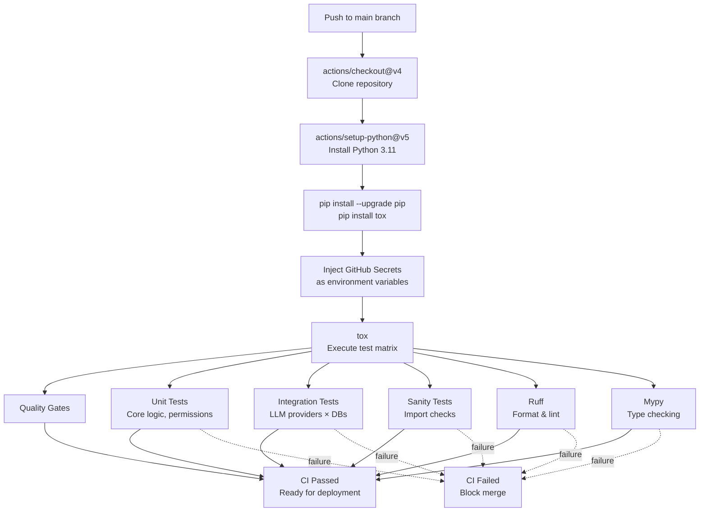
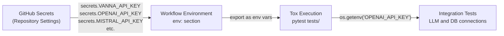
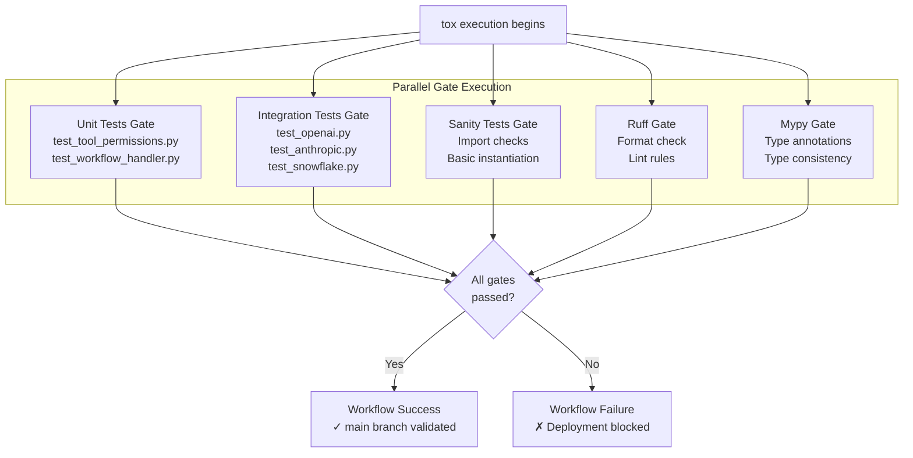
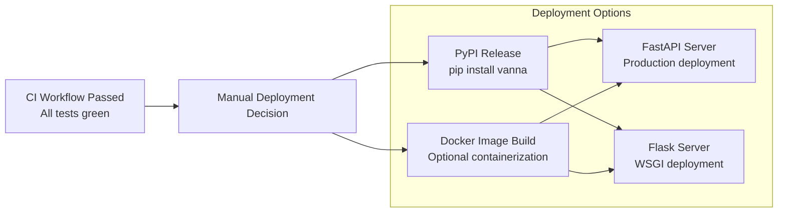

<!-- source: DeepWiki mcp.deepwiki.com · repo vanna-ai/vanna · page 10.4 CI/CD Pipeline · fetched 2026-10-29 -->

# CI/CD Pipeline

<details>
<summary>Relevant source files</summary>

The following files were used as context for generating this wiki page:

- [.github/workflows/tests.yml](.github/workflows/tests.yml)
- [.gitignore](.gitignore)

</details>


## Purpose and Scope

This document describes the Continuous Integration and Continuous Deployment (CI/CD) pipeline implemented via GitHub Actions for the Vanna repository. It covers workflow configuration, trigger conditions, environment setup, secrets management, test execution, and quality gates.

For information about the testing infrastructure that the CI/CD pipeline executes, see [Testing Infrastructure](#10.2) and [Integration Testing Matrix](#10.3). For deployment options after CI passes, see [Server and Deployment](#8).

---

## GitHub Actions Workflow Overview

The CI/CD pipeline is defined in [.github/workflows/tests.yml:1-36]() and runs automatically on every push to the `main` branch. The workflow orchestrates the complete test suite including unit tests, integration tests, quality checks, and ensures the codebase maintains production-ready standards.

### Workflow Architecture



**Sources**: [.github/workflows/tests.yml:1-36]()

---

## Workflow Configuration

### Trigger Conditions

The workflow is configured with the following trigger:

```yaml
on:
  push:
    branches:
      - main
```

This means the CI pipeline executes:
- **Every push to `main`**: Ensures the primary branch always maintains quality standards
- **Not on pull requests**: This workflow focuses on post-merge validation
- **Not on other branches**: Development branches are tested locally before merge

**Sources**: [.github/workflows/tests.yml:3-6]()

### Job Configuration

| Configuration | Value | Purpose |
|---------------|-------|---------|
| **Runner OS** | `ubuntu-latest` | Linux environment for consistent test execution |
| **Python Version** | `3.11` | Target Python version for production deployments |
| **Permissions** | `contents: read` | Minimal permissions following security best practices |

The workflow defines a single job named `build` that executes all test and quality steps sequentially.

**Sources**: [.github/workflows/tests.yml:8-19]()

---

## Environment Setup and Dependencies

### Python Environment Initialization

The workflow performs a three-step setup:

1. **Repository Checkout**: Uses `actions/checkout@v4` to clone the repository with full git history
2. **Python Installation**: Uses `actions/setup-python@v5` to install Python 3.11
3. **Dependency Installation**: Upgrades `pip` and installs `tox` for test orchestration

```yaml
- name: Install pip
  run: |
    python -m pip install --upgrade pip
    pip install tox
```

The use of `tox` as the sole direct dependency is intentional—it manages all test environments, dependencies, and execution through its configuration in `tox.ini`.

**Sources**: [.github/workflows/tests.yml:20-23]()

---

## Secrets Management

### GitHub Secrets Configuration

The workflow injects sensitive credentials as environment variables from GitHub Secrets. This approach:
- **Secures API keys**: Never stored in code or logs
- **Enables integration tests**: LLM providers and databases require authentication
- **Follows least-privilege**: Only the workflow runner has access during execution

### Secrets Injection Flow



**Sources**: [.github/workflows/tests.yml:25-35]()

### Complete Secrets Inventory

| Secret Name | Purpose | Usage |
|-------------|---------|-------|
| `VANNA_API_KEY` | Cloud Vanna service authentication | Memory operations with premium service |
| `OPENAI_API_KEY` | OpenAI API access | GPT-4 and GPT-3.5 integration tests |
| `MISTRAL_API_KEY` | Mistral AI API access | Mistral model integration tests |
| `ANTHROPIC_API_KEY` | Anthropic API access | Claude integration tests |
| `GEMINI_API_KEY` | Google Gemini API access | Gemini integration tests |
| `SNOWFLAKE_ACCOUNT` | Snowflake connection | Cloud warehouse integration tests |
| `SNOWFLAKE_USERNAME` | Snowflake authentication | Database connection |
| `SNOWFLAKE_PASSWORD` | Snowflake authentication | Secure credential storage |

**Environment Variable Implementation**:

[.github/workflows/tests.yml:25-35]() shows the `env:` section where secrets are mapped to environment variables:

```yaml
env:
  PROTOCOL_BUFFERS_PYTHON_IMPLEMENTATION: python
  VANNA_API_KEY: ${{ secrets.VANNA_API_KEY }}
  OPENAI_API_KEY: ${{ secrets.OPENAI_API_KEY }}
  MISTRAL_API_KEY: ${{ secrets.MISTRAL_API_KEY }}
  ANTHROPIC_API_KEY: ${{ secrets.ANTHROPIC_API_KEY }}
  GEMINI_API_KEY: ${{ secrets.GEMINI_API_KEY }}
  SNOWFLAKE_ACCOUNT: ${{ secrets.SNOWFLAKE_ACCOUNT }}
  SNOWFLAKE_USERNAME: ${{ secrets.SNOWFLAKE_USERNAME }}
  SNOWFLAKE_PASSWORD: ${{ secrets.SNOWFLAKE_PASSWORD }}
```

**Special Configuration**: `PROTOCOL_BUFFERS_PYTHON_IMPLEMENTATION: python` is set to ensure compatibility with certain dependencies that use protocol buffers.

**Sources**: [.github/workflows/tests.yml:25-35]()

---

## Test Execution via Tox

### Single Command Orchestration

The entire test suite is executed with a single command:

```yaml
- name: Run tests
  run: tox
```

This invokes the `tox` configuration (documented in [Testing Infrastructure](#10.2)), which:
- Creates isolated virtual environments
- Installs dependencies with optional extras
- Runs multiple test suites in parallel
- Enforces quality gates

### Test Matrix Execution

When `tox` runs without arguments (as in the CI workflow), it executes the default test environments defined in `tox.ini`. The complete test matrix includes:

| Test Environment | Purpose | Dependencies Required |
|------------------|---------|----------------------|
| **Unit Tests** | Core framework logic, tool permissions, workflow handlers | None (mocked integrations) |
| **Integration Tests** | LLM provider × database combinations | All API keys and credentials |
| **Sanity Tests** | Import verification, basic instantiation | Minimal |
| **Ruff** | Code formatting and linting | None |
| **Mypy** | Static type checking | None |

### CI vs Local Execution

| Aspect | CI Pipeline | Local Development |
|--------|-------------|-------------------|
| Environment | Fresh Ubuntu container | Developer machine |
| Secrets | GitHub Secrets injected | `.env` file or shell exports |
| Test scope | All tests, all integrations | Selective (e.g., `tox -e unit`) |
| Failure impact | Blocks deployment | Informational |

**Sources**: [.github/workflows/tests.yml:24-35]()

---

## Quality Gates and Success Criteria

### Pass/Fail Criteria

The workflow succeeds if and only if:
- All unit tests pass
- All integration tests pass (requiring valid API keys)
- All sanity tests pass
- Code passes `ruff` formatting and linting checks
- Code passes `mypy` type checking with no errors
- No unhandled exceptions during test execution

Any failure in these gates causes the workflow to fail, preventing deployment of broken code.

### Quality Gates Diagram



**Sources**: [.github/workflows/tests.yml:1-36]()

---

## Build Artifacts and Cleanup

### Excluded from Version Control

The [.gitignore:1-29]() file specifies build artifacts and test outputs that are excluded from version control but generated during CI execution:

| Pattern | Description | Generated By |
|---------|-------------|--------------|
| `.tox/` | Tox virtual environments | CI test execution |
| `.coverage*` | Coverage reports | pytest-cov plugin |
| `htmlcov/` | HTML coverage reports | coverage html command |
| `*.egg-info` | Package metadata | pip install -e . |
| `build/`, `dist/` | Distribution packages | python -m build |
| `__pycache__/` | Python bytecode cache | Python interpreter |
| `*.sqlite`, `*.sqlite3` | Test databases | Integration tests |
| `.milvus.db.lock` | Milvus vector DB lock | Memory integration tests |

### CI Cleanup Behavior

GitHub Actions automatically:
- **Discards all artifacts** after job completion (no persistence configured)
- **Removes the runner container** including all generated files
- **Frees resources** for subsequent workflow runs

This ensures each CI run starts from a clean state, preventing cross-contamination between runs.

**Sources**: [.gitignore:1-29]()

---

## Workflow Permissions and Security

### Minimal Permissions Model

The workflow declares `permissions: contents: read` ([.github/workflows/tests.yml:8-9]()), which:
- **Allows**: Reading repository contents for checkout and test execution
- **Denies**: Writing to repository, modifying issues, creating releases
- **Prevents**: Unauthorized modifications from compromised workflow

### Security Best Practices

| Practice | Implementation | Rationale |
|----------|---------------|-----------|
| **Pinned Actions** | `actions/checkout@v4`, `actions/setup-python@v5` | Version pinning prevents supply chain attacks |
| **Secrets Management** | `${{ secrets.KEY }}` syntax | Secrets never appear in logs or code |
| **Minimal Scope** | `contents: read` only | Least-privilege access control |
| **No Caching** | No explicit cache steps | Prevents cache poisoning attacks |

**Sources**: [.github/workflows/tests.yml:8-9]()

---

## Integration with Deployment Pipeline

### Post-CI Workflow

After successful CI execution on `main`:



The CI pipeline validates code quality but does **not** automatically deploy. Deployment strategies are documented in:
- [FastAPI Server](#8.2) for async production deployments
- [Flask Server](#8.3) for WSGI deployments
- [CLI and Example Agents](#8.5) for local/development deployments

**Sources**: [.github/workflows/tests.yml:1-36]()

---

## Monitoring and Failure Response

### Workflow Status Visibility

GitHub Actions provides:
- **Commit status checks**: Green checkmark or red X on commits
- **Workflow run logs**: Detailed output for each step
- **Email notifications**: On workflow failure (configurable per user)
- **GitHub UI**: https://github.com/vanna-ai/vanna/actions shows all runs

### Common Failure Scenarios

| Failure Type | Cause | Resolution |
|--------------|-------|------------|
| **Integration test timeout** | LLM API slow/unavailable | Retry workflow or skip integration tests locally |
| **Type checking errors** | Missing type annotations | Add annotations or `# type: ignore` comments |
| **Import errors** | Missing dependency in `pyproject.toml` | Add to dependencies or optional-dependencies |
| **Authentication failures** | Invalid/expired API keys | Update GitHub Secrets with fresh credentials |
| **Database connection errors** | Snowflake credentials rotated | Update `SNOWFLAKE_*` secrets |

### Debugging Failed Runs

To investigate failures:
1. Navigate to failed workflow run in GitHub Actions UI
2. Expand failed step (e.g., "Run tests")
3. Review tox output for specific test failures
4. Reproduce locally: `tox -e unit` or `tox -e integration`
5. Use environment variables from `.env` file matching CI secrets

**Sources**: [.github/workflows/tests.yml:1-36]()

---

## Summary

The Vanna CI/CD pipeline provides:
- **Automated validation**: Every push to `main` is tested comprehensively
- **Integration coverage**: Real LLM and database providers are tested
- **Quality enforcement**: Ruff, Mypy, and test coverage gates
- **Security**: Secrets management and minimal permissions
- **Fast feedback**: Single workflow execution in ~5-10 minutes

This pipeline ensures the `main` branch always represents production-ready code, enabling confident deployments to PyPI and production environments.

**Sources**: [.github/workflows/tests.yml:1-36](), [.gitignore:1-29]()

---

