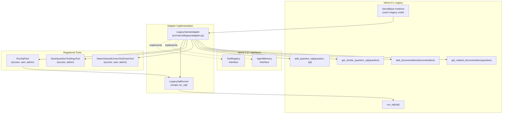
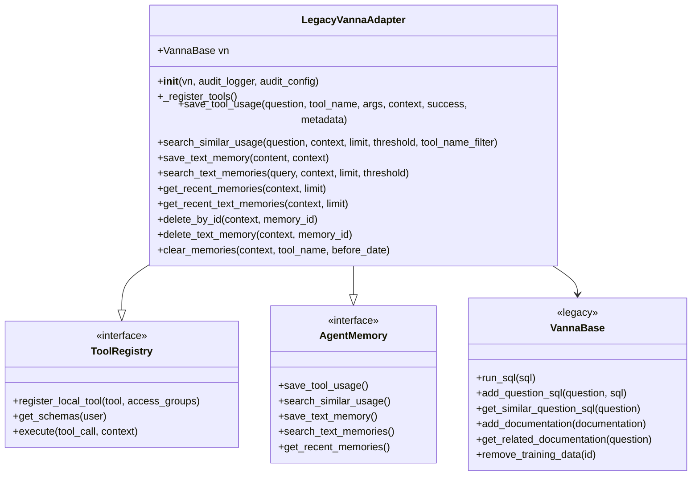
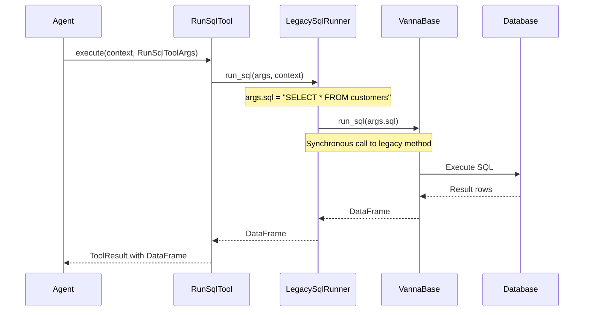
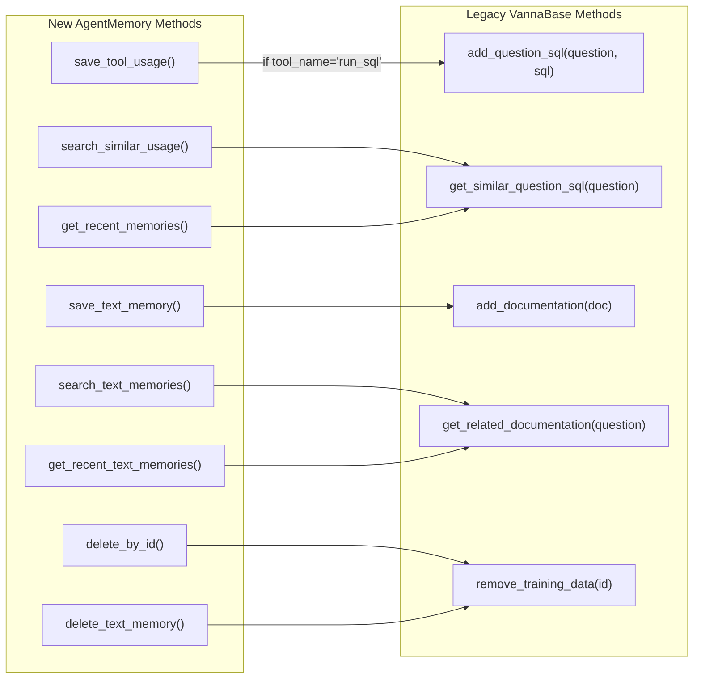
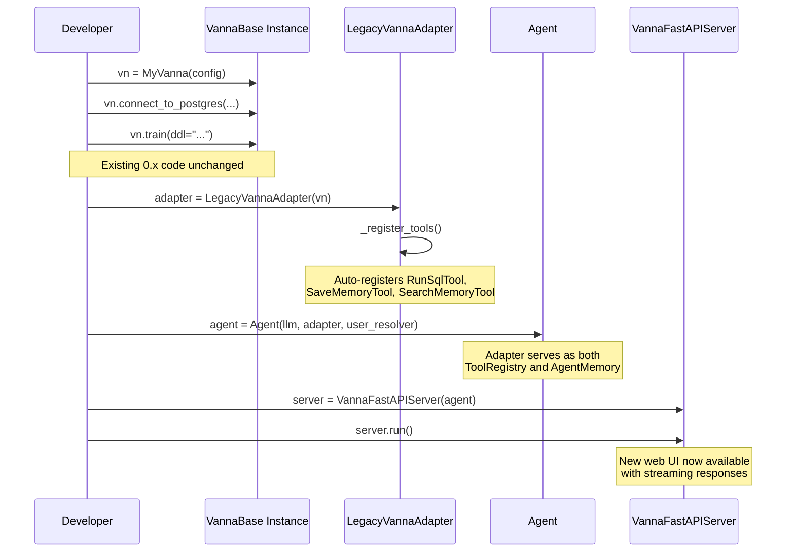
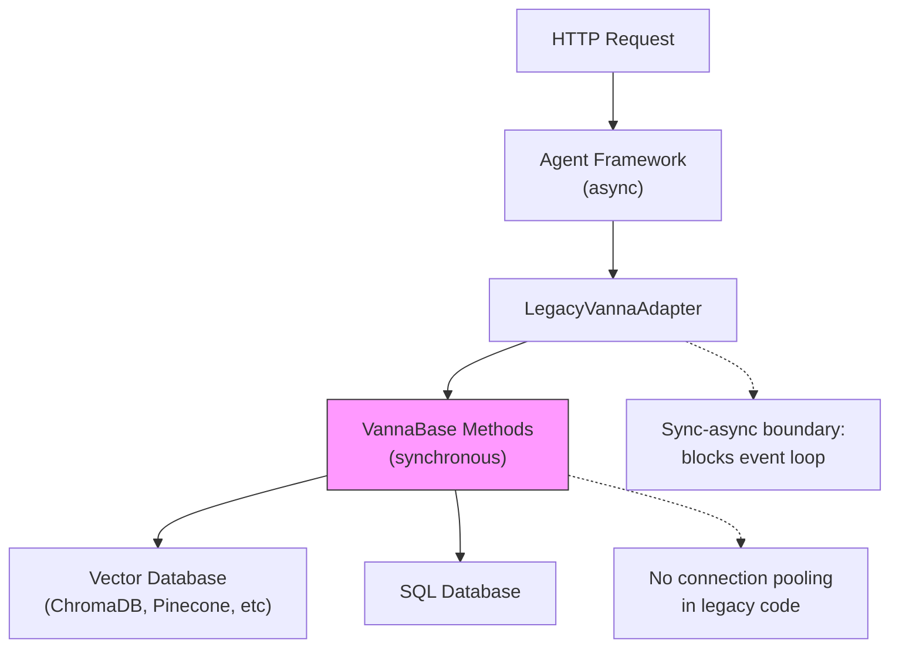
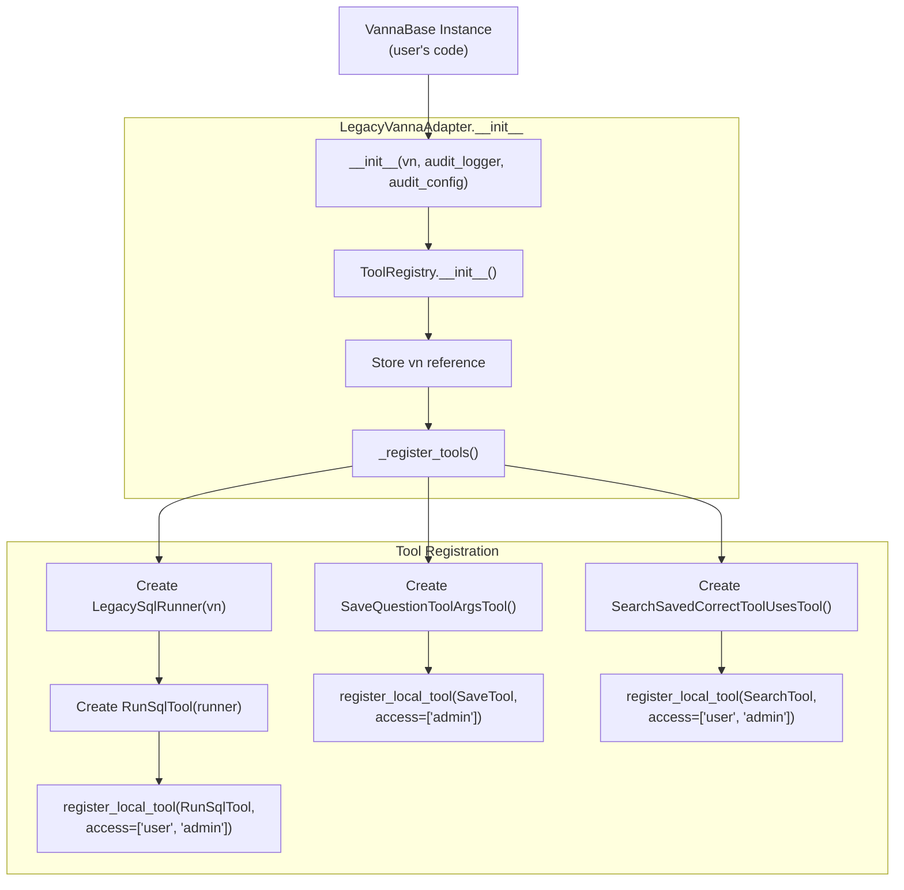

<!-- source: DeepWiki mcp.deepwiki.com · repo vanna-ai/vanna · page 11 Migration and Legacy Support · fetched 2026-10-29 -->

# Migration and Legacy Support

<details>
<summary>Relevant source files</summary>

The following files were used as context for generating this wiki page:

- [MIGRATION_GUIDE.md](MIGRATION_GUIDE.md)
- [README.md](README.md)
- [img/architecture.png](img/architecture.png)
- [img/vanna2.svg](img/vanna2.svg)
- [notebooks/quickstart.ipynb](notebooks/quickstart.ipynb)
- [src/vanna/integrations/anthropic/llm.py](src/vanna/integrations/anthropic/llm.py)
- [src/vanna/integrations/azuresearch/agent_memory.py](src/vanna/integrations/azuresearch/agent_memory.py)
- [src/vanna/integrations/chromadb/agent_memory.py](src/vanna/integrations/chromadb/agent_memory.py)
- [src/vanna/integrations/faiss/agent_memory.py](src/vanna/integrations/faiss/agent_memory.py)
- [src/vanna/integrations/marqo/agent_memory.py](src/vanna/integrations/marqo/agent_memory.py)
- [src/vanna/integrations/milvus/agent_memory.py](src/vanna/integrations/milvus/agent_memory.py)
- [src/vanna/integrations/openai/llm.py](src/vanna/integrations/openai/llm.py)
- [src/vanna/integrations/opensearch/agent_memory.py](src/vanna/integrations/opensearch/agent_memory.py)
- [src/vanna/integrations/pinecone/agent_memory.py](src/vanna/integrations/pinecone/agent_memory.py)
- [src/vanna/integrations/qdrant/agent_memory.py](src/vanna/integrations/qdrant/agent_memory.py)
- [src/vanna/integrations/weaviate/agent_memory.py](src/vanna/integrations/weaviate/agent_memory.py)
- [src/vanna/legacy/adapter.py](src/vanna/legacy/adapter.py)
- [src/vanna/servers/fastapi/app.py](src/vanna/servers/fastapi/app.py)
- [src/vanna/servers/flask/app.py](src/vanna/servers/flask/app.py)
- [tests/test_chromadb_persistence_fix.py](tests/test_chromadb_persistence_fix.py)

</details>


## Purpose and Scope

This page documents the technical architecture and implementation of Vanna's legacy support system, which enables backward compatibility with Vanna 0.x (`VannaBase`) implementations in the new Vanna 2.0+ agent framework. The primary mechanism is the `LegacyVannaAdapter`, which wraps legacy instances and maps their methods to the new `ToolRegistry` and `AgentMemory` interfaces.

For step-by-step migration instructions and user-facing guidance, see the [MIGRATION_GUIDE.md](). For creating new tools from scratch in the 2.0+ framework, see [Tool System](#7). For agent memory implementations, see [Agent Memory System](#4).

---

## Legacy Adapter Architecture

The `LegacyVannaAdapter` implements a dual-interface adapter pattern, simultaneously implementing both `ToolRegistry` and `AgentMemory` to bridge the gap between Vanna 0.x and 2.0+ architectures. This allows existing `VannaBase` instances to function as both tool providers and memory stores in the new system.

### Adapter Pattern Overview



**Sources:** [src/vanna/legacy/adapter.py:1-464]()

---

## LegacyVannaAdapter Implementation

The `LegacyVannaAdapter` class wraps a `VannaBase` instance and exposes its functionality through the new framework's interfaces.

### Class Definition and Initialization



The adapter initializes by calling `_register_tools()` which automatically registers three tools with appropriate access controls:

| Tool | Legacy Method | Access Groups | Purpose |
|------|--------------|---------------|---------|
| `RunSqlTool` | `vn.run_sql()` | `['user', 'admin']` | Execute SQL queries |
| `SaveQuestionToolArgsTool` | `vn.add_question_sql()` | `['admin']` | Save question-SQL training pairs |
| `SearchSavedCorrectToolUsesTool` | `vn.get_similar_question_sql()` | `['user', 'admin']` | Search similar question patterns |

**Sources:** [src/vanna/legacy/adapter.py:66-138]()

---

## LegacySqlRunner

The `LegacySqlRunner` class implements the `SqlRunner` interface by wrapping the legacy `VannaBase.run_sql()` method. This enables the legacy database connection to work with the new `RunSqlTool`.



### Implementation Details

The `LegacySqlRunner` is minimal, delegating all work to the legacy instance:

- **Constructor**: Stores reference to `VannaBase` instance at [src/vanna/legacy/adapter.py:40-46]()
- **run_sql method**: Directly invokes `self.vn.run_sql(args.sql)` at [src/vanna/legacy/adapter.py:48-63]()
- **Synchronous execution**: Legacy methods are synchronous; called directly within async context

**Sources:** [src/vanna/legacy/adapter.py:32-63]()

---

## AgentMemory Interface Implementation

The `LegacyVannaAdapter` maps legacy training data methods to the new `AgentMemory` interface, enabling legacy vector stores to function as agent memory.

### Memory Method Mapping



### save_tool_usage Implementation

The adapter filters tool usage saves to only persist SQL-related executions:

```python
# From src/vanna/legacy/adapter.py:142-167
async def save_tool_usage(
    self,
    question: str,
    tool_name: str,
    args: Dict[str, Any],
    context: ToolContext,
    success: bool = True,
    metadata: Optional[Dict[str, Any]] = None,
) -> None:
    # Only save if this was a run_sql tool with SQL in args
    if tool_name == "run_sql" and "sql" in args:
        sql = args["sql"]
        # Synchronous call to legacy method
        self.vn.add_question_sql(question=question, sql=sql)
```

**Key characteristics:**
- Only persists `run_sql` tool executions
- Ignores `success` and `metadata` parameters (not supported by legacy API)
- Synchronous execution within async method

**Sources:** [src/vanna/legacy/adapter.py:142-167]()

### search_similar_usage Implementation

Converts legacy question-SQL results to the new `ToolMemorySearchResult` format:

```python
# From src/vanna/legacy/adapter.py:169-219
async def search_similar_usage(
    self,
    question: str,
    context: ToolContext,
    *,
    limit: int = 10,
    similarity_threshold: float = 0.7,
    tool_name_filter: Optional[str] = None,
) -> List[ToolMemorySearchResult]:
    # Call legacy method
    similar_results = self.vn.get_similar_question_sql(question=question)
    
    # Convert to new format
    memory_results = []
    for idx, result in enumerate(similar_results):
        if isinstance(result, dict) and "question" in result and "sql" in result:
            tool_memory = ToolMemory(
                memory_id=None,  # Legacy doesn't provide IDs
                question=result["question"],
                tool_name="run_sql",
                args={"sql": result["sql"]},
                success=True,
            )
            
            # Rank-based similarity (legacy doesn't provide scores)
            similarity_score = 1.0 - (idx * 0.1)
            similarity_score = max(similarity_score, 0.0)
            
            memory_results.append(
                ToolMemorySearchResult(
                    memory=tool_memory,
                    similarity_score=similarity_score,
                    rank=idx + 1,
                )
            )
    
    return memory_results[:limit]
```

**Limitations:**
- No actual `memory_id` (set to `None`)
- Similarity scores are synthetic (rank-based: 1.0, 0.9, 0.8, ...)
- `limit` and `similarity_threshold` partially supported
- `tool_name_filter` ignored (legacy API doesn't support filtering)

**Sources:** [src/vanna/legacy/adapter.py:169-219]()

### Text Memory Methods

Text memories map to legacy documentation methods:

| New Method | Legacy Method | Notes |
|------------|---------------|-------|
| `save_text_memory(content)` | `add_documentation(content)` | Returns `doc_id` from legacy method |
| `search_text_memories(query)` | `get_related_documentation(query)` | Converts strings/dicts to `TextMemory` objects |
| `get_recent_text_memories()` | `get_related_documentation("")` | Uses empty string to retrieve recent |

**Sources:** [src/vanna/legacy/adapter.py:221-376]()

---

## Migration Workflow Patterns

### Quick Wrap Pattern (Strategy 1)

This pattern wraps an existing `VannaBase` instance with minimal code changes:



**Usage example from quickstart:**

```python
# Existing code
vn = MyVanna(config={'model': 'gpt-4'})
vn.connect_to_postgres(...)

# New wrapper code
from vanna.legacy.adapter import LegacyVannaAdapter
tools = LegacyVannaAdapter(vn)
agent = Agent(llm_service=llm, tool_registry=tools, user_resolver=resolver)
```

**Sources:** [MIGRATION_GUIDE.md:82-164](), [notebooks/quickstart.ipynb:1-169]()

### Full Migration Pattern (Strategy 2)

For full migration, legacy components are replaced with native 2.0+ implementations:

| Legacy Component | 2.0+ Replacement |
|------------------|------------------|
| `vn.connect_to_postgres()` | `PostgresRunner(host, dbname, ...)` |
| `vn.train(ddl="...")` | System prompt configuration |
| `vn.train(question="...", sql="...")` | `ChromaAgentMemory` or other vector store |
| `vn.generate_sql()` | Agent with `RunSqlTool` |
| Direct method calls | Agent streaming responses |

**Sources:** [MIGRATION_GUIDE.md:167-262]()

---

## Limitations and Considerations

### Functional Limitations

The `LegacyVannaAdapter` has several constraints due to legacy API limitations:

| Limitation | Impact | Workaround |
|------------|--------|------------|
| No memory IDs | Cannot reliably delete specific memories | Use `clear_memories()` with filters |
| No actual similarity scores | Search results use synthetic rank-based scores | Migrate to native `AgentMemory` for real scores |
| No timestamps | Cannot sort by recency accurately | Legacy stores may provide timestamps |
| No metadata support | Cannot attach custom metadata to memories | Migrate to native implementation |
| Single-user context | All requests use same `VannaBase` instance | No row-level security possible |

**Sources:** [src/vanna/legacy/adapter.py:142-426]()

### Performance Considerations



**Performance impacts:**
- Synchronous legacy methods called within async context (no true parallelism)
- Legacy code may not use connection pooling
- Vector searches block the event loop
- No batching or caching optimizations

**Sources:** [src/vanna/legacy/adapter.py:48-63](), [src/vanna/legacy/adapter.py:142-426]()

### Security Limitations

The adapter cannot implement user-aware security features:

| Security Feature | Legacy Support | Reason |
|------------------|----------------|--------|
| User-specific queries | ❌ No | Single `VannaBase` instance for all users |
| Row-level security | ❌ No | Cannot inject user context into SQL |
| Per-user rate limiting | ❌ No | No user identity in legacy methods |
| User-scoped memories | ❌ No | Shared vector store |
| Audit trails | ⚠️ Partial | Can log in adapter, but not in legacy code |

**Recommendation:** For production deployments requiring security, migrate to native 2.0+ implementations with proper `SqlRunner.transform_args()` support for row-level security.

**Sources:** [README.md:82-87](), [MIGRATION_GUIDE.md:160-164]()

---

## Legacy Method Compatibility Matrix

### Supported Legacy Methods

| VannaBase Method | Adapter Mapping | Status | Notes |
|------------------|-----------------|--------|-------|
| `run_sql(sql)` | `LegacySqlRunner.run_sql()` | ✅ Full | Wrapped as `RunSqlTool` |
| `add_question_sql(q, sql)` | `save_tool_usage()` | ✅ Full | Accessible via `SaveQuestionToolArgsTool` |
| `get_similar_question_sql(q)` | `search_similar_usage()` | ⚠️ Partial | No similarity scores, limited filtering |
| `add_documentation(doc)` | `save_text_memory()` | ✅ Full | Returns memory ID if provided |
| `get_related_documentation(q)` | `search_text_memories()` | ⚠️ Partial | No similarity scores |
| `remove_training_data(id)` | `delete_by_id()` | ✅ Full | Works for both tool and text memories |
| `get_training_data()` | — | ❌ None | Not exposed; use search methods |
| `generate_sql(question)` | — | ❌ None | Replaced by Agent workflow |

### Unsupported Legacy Methods

Legacy methods related to SQL generation, plotting, and direct question answering are not supported by the adapter. These are replaced by the Agent's orchestration:

- `generate_sql()` → Agent generates SQL via LLM + tools
- `generate_plotly_code()` → `VisualizeDataTool` handles visualization
- `ask()` → `Agent.send_message()` handles full workflow
- `train()` → Use memory tools or `save_text_memory()`

**Sources:** [src/vanna/legacy/adapter.py:66-426]()

---

## Code Integration Points

### Adapter Registration Flow



The registration flow happens in `_register_tools()` at [src/vanna/legacy/adapter.py:116-138]():

1. Creates `LegacySqlRunner` wrapping `self.vn.run_sql`
2. Instantiates `RunSqlTool` with the runner
3. Registers tool with `['user', 'admin']` access
4. Creates and registers memory tools (`SaveQuestionToolArgsTool`, `SearchSavedCorrectToolUsesTool`)

**Sources:** [src/vanna/legacy/adapter.py:96-138]()

---

## Testing and Validation

### Validating Legacy Adapter Functionality

To verify the adapter works with your legacy instance:

```python
from vanna.legacy.adapter import LegacyVannaAdapter
from vanna.core.user import User
from vanna.core.tool import ToolContext

# Wrap your legacy instance
adapter = LegacyVannaAdapter(vn)

# Test tool registration
user = User(id="test", email="test@example.com", group_memberships=['user'])
schemas = await adapter.get_schemas(user)
print(f"Registered tools: {[s.name for s in schemas]}")
# Expected: ['run_sql', 'search_saved_correct_tool_uses']

# Test memory operations
context = ToolContext(
    user=user,
    conversation_id="test",
    request_id="test",
    agent_memory=adapter,
)

# Save a pattern
await adapter.save_tool_usage(
    question="Show top customers",
    tool_name="run_sql",
    args={"sql": "SELECT * FROM customers LIMIT 10"},
    context=context,
)

# Search for similar
results = await adapter.search_similar_usage(
    question="Top customers",
    context=context,
    limit=5,
)
print(f"Found {len(results)} similar patterns")
```

**Sources:** [src/vanna/legacy/adapter.py:1-464]()

---

## Advanced: Extending the Adapter

For advanced use cases, you can subclass `LegacyVannaAdapter` to add custom tool registrations or override behavior:

```python
from vanna.legacy.adapter import LegacyVannaAdapter
from vanna.core.tool import Tool, ToolContext, ToolResult
from pydantic import BaseModel

class CustomLegacyAdapter(LegacyVannaAdapter):
    def _register_tools(self):
        # Call parent to register standard tools
        super()._register_tools()
        
        # Register additional custom tools
        self.register_local_tool(
            CustomTool(self.vn),
            access_groups=['admin']
        )
```

This pattern allows gradual migration by adding new tools while maintaining legacy integration.

**Sources:** [src/vanna/legacy/adapter.py:66-138]()

---

