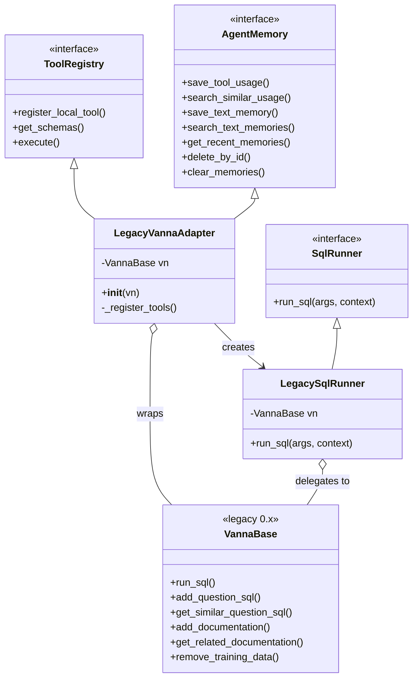
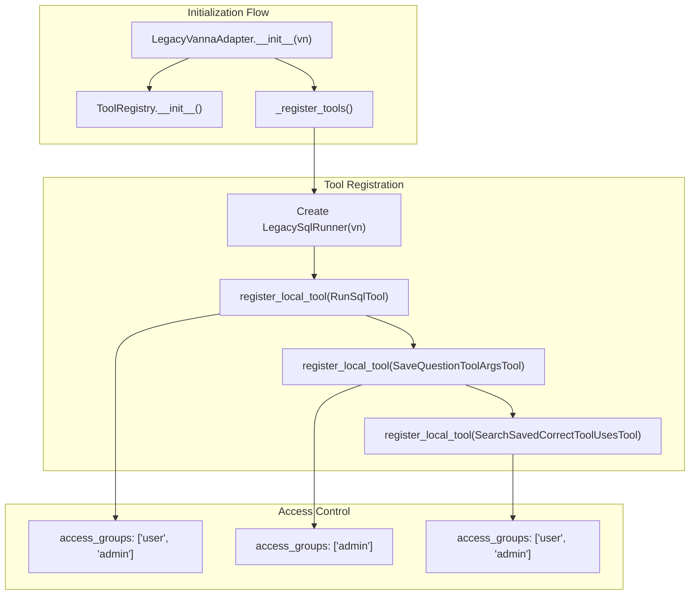
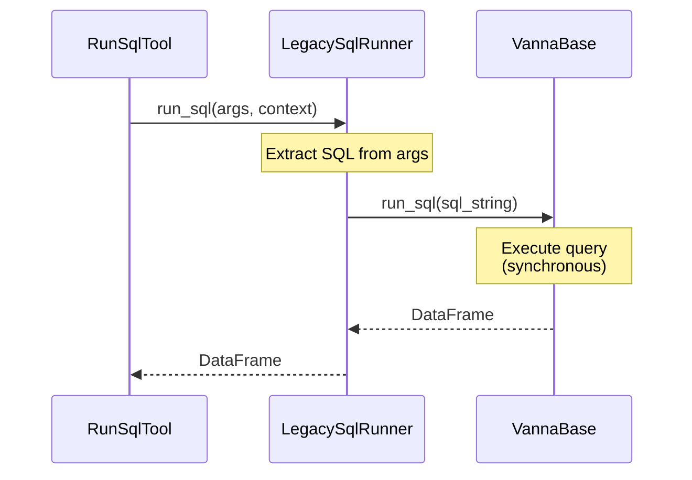
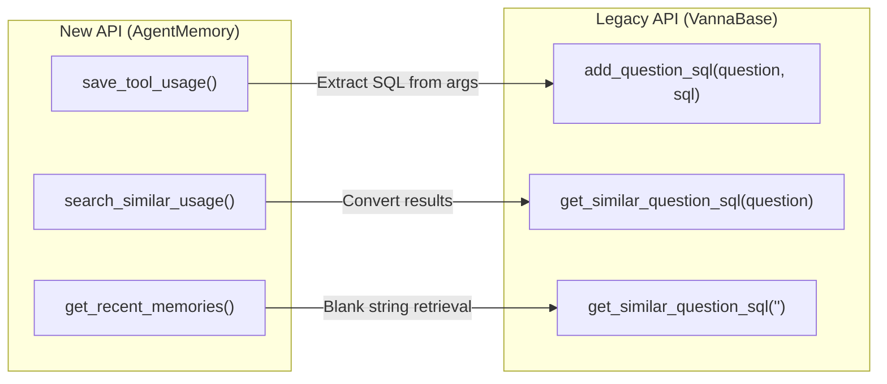
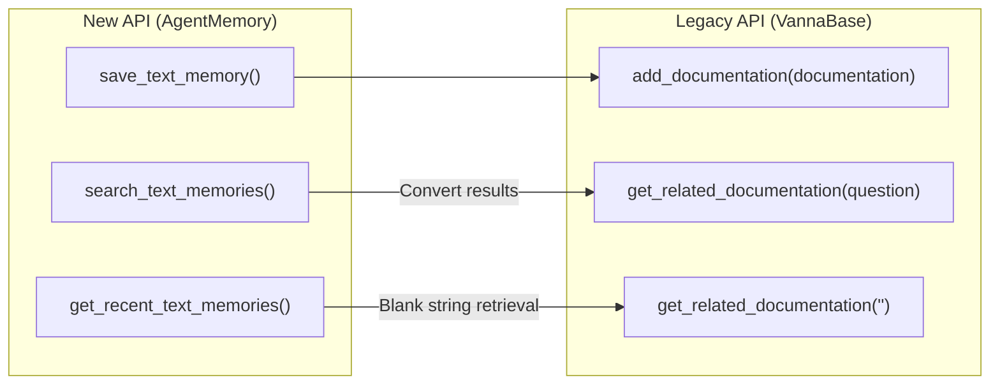
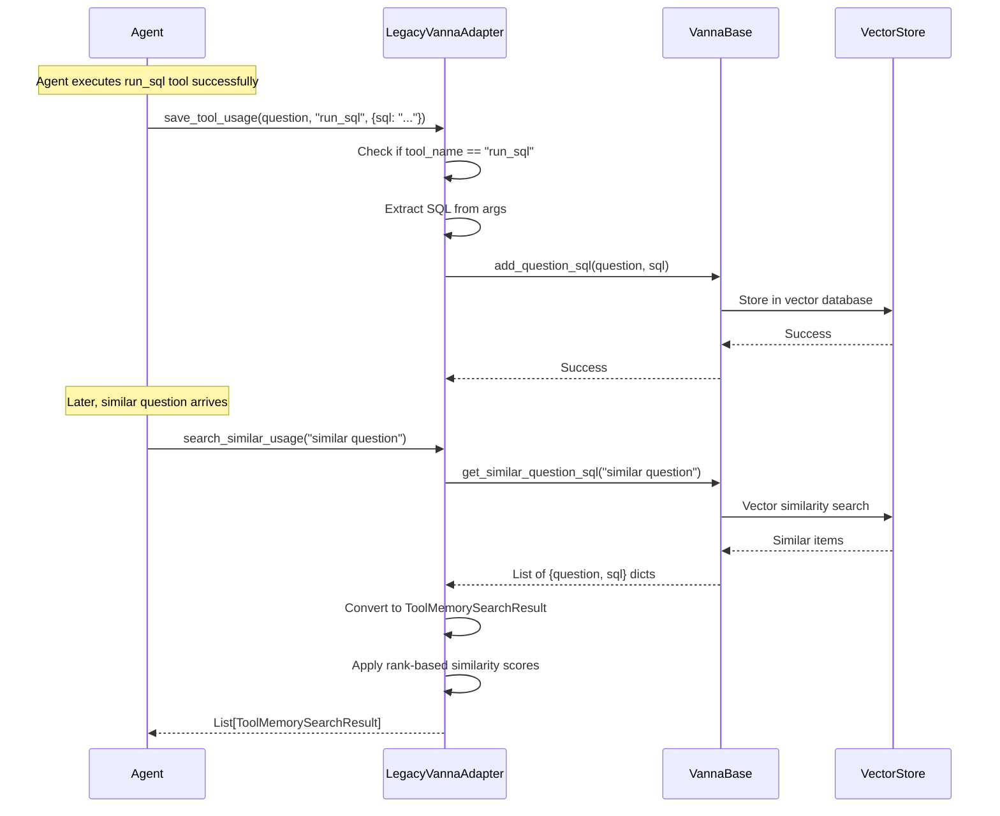
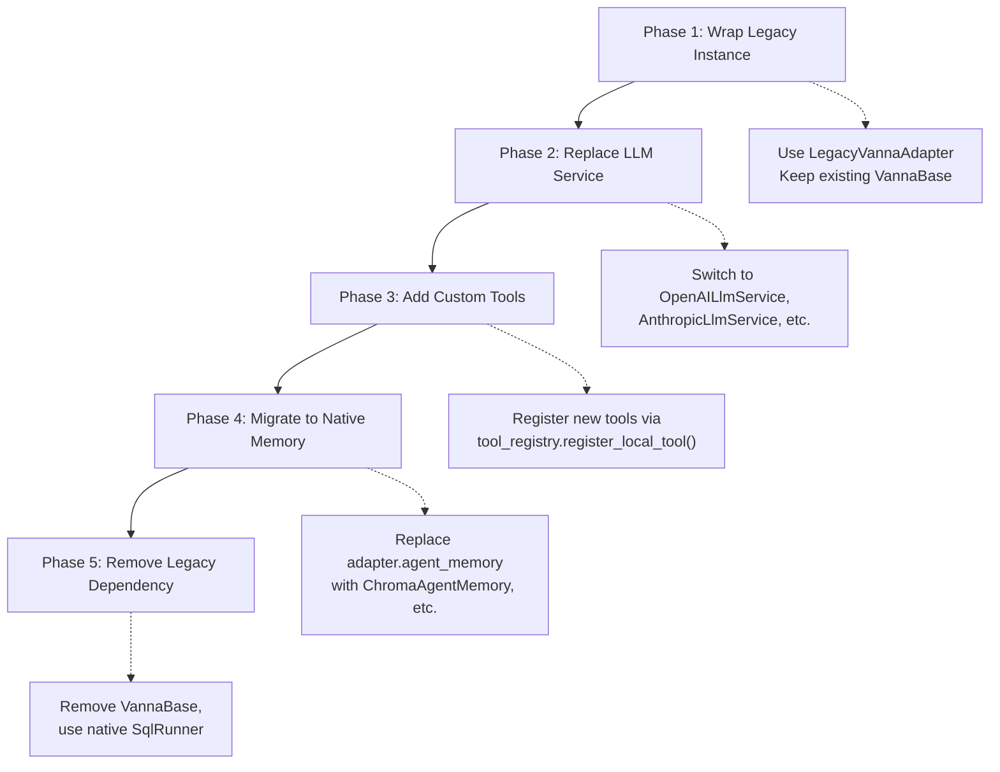

<!-- source: DeepWiki mcp.deepwiki.com · repo vanna-ai/vanna · page 11.1 LegacyVannaAdapter · fetched 2026-10-29 -->

# LegacyVannaAdapter

<details>
<summary>Relevant source files</summary>

The following files were used as context for generating this wiki page:

- [src/vanna/integrations/azureopenai/__init__.py](src/vanna/integrations/azureopenai/__init__.py)
- [src/vanna/integrations/azureopenai/llm.py](src/vanna/integrations/azureopenai/llm.py)
- [src/vanna/integrations/azuresearch/agent_memory.py](src/vanna/integrations/azuresearch/agent_memory.py)
- [src/vanna/integrations/chromadb/agent_memory.py](src/vanna/integrations/chromadb/agent_memory.py)
- [src/vanna/integrations/faiss/agent_memory.py](src/vanna/integrations/faiss/agent_memory.py)
- [src/vanna/integrations/marqo/agent_memory.py](src/vanna/integrations/marqo/agent_memory.py)
- [src/vanna/integrations/milvus/agent_memory.py](src/vanna/integrations/milvus/agent_memory.py)
- [src/vanna/integrations/opensearch/agent_memory.py](src/vanna/integrations/opensearch/agent_memory.py)
- [src/vanna/integrations/pinecone/agent_memory.py](src/vanna/integrations/pinecone/agent_memory.py)
- [src/vanna/integrations/qdrant/agent_memory.py](src/vanna/integrations/qdrant/agent_memory.py)
- [src/vanna/integrations/weaviate/agent_memory.py](src/vanna/integrations/weaviate/agent_memory.py)
- [src/vanna/legacy/adapter.py](src/vanna/legacy/adapter.py)
- [tests/conftest.py](tests/conftest.py)
- [tests/test_agent_memory_sanity.py](tests/test_agent_memory_sanity.py)
- [tests/test_agents.py](tests/test_agents.py)
- [tests/test_azureopenai_llm.py](tests/test_azureopenai_llm.py)
- [tests/test_chromadb_persistence_fix.py](tests/test_chromadb_persistence_fix.py)
- [tests/test_legacy_adapter.py](tests/test_legacy_adapter.py)
- [tox.ini](tox.ini)

</details>


The `LegacyVannaAdapter` provides backward compatibility between Vanna 0.x (`VannaBase`) and the Vanna 2.0 Agents framework. It wraps legacy `VannaBase` instances, automatically exposing their methods as tools and memory operations in the new architecture, enabling gradual migration without rewriting existing code.

For information about the new Agent framework architecture, see [Agent System](#2.1). For details on creating native 2.0 agents from scratch, see [Migration Guide from Vanna 0.x](#11.2).

## Architecture Overview

The `LegacyVannaAdapter` implements a dual-interface bridge pattern, simultaneously inheriting from both `ToolRegistry` and `AgentMemory`. This allows a single adapter instance to provide both tool execution capabilities and memory storage for the Agent framework.



**Sources:** [src/vanna/legacy/adapter.py:1-464]()

The adapter wraps a `VannaBase` instance and exposes it through two interfaces:
- **ToolRegistry Interface**: Automatically registers `RunSqlTool`, `SaveQuestionToolArgsTool`, and `SearchSavedCorrectToolUsesTool`
- **AgentMemory Interface**: Maps legacy training data methods to the new memory API

## Core Components

### LegacyVannaAdapter Class

The main adapter class that bridges legacy and new architectures.



**Sources:** [src/vanna/legacy/adapter.py:66-139]()

**Key Properties:**
- **Dual Inheritance**: Implements both `ToolRegistry` and `AgentMemory` [src/vanna/legacy/adapter.py:66]()
- **Automatic Tool Registration**: Three tools registered in `_register_tools()` [src/vanna/legacy/adapter.py:116-139]()
- **Group-Based Access Control**: Different permissions for SQL execution (user+admin) vs. memory saving (admin only) [src/vanna/legacy/adapter.py:129-138]()

### LegacySqlRunner

A `SqlRunner` implementation that wraps `VannaBase.run_sql()` to work with the new tool execution pipeline.



**Sources:** [src/vanna/legacy/adapter.py:32-63]()

**Implementation Details:**
- **Synchronous Bridge**: Legacy `run_sql()` is synchronous; called directly within async method [src/vanna/legacy/adapter.py:63]()
- **Argument Extraction**: Extracts SQL string from `RunSqlToolArgs` [src/vanna/legacy/adapter.py:63]()
- **No Context Usage**: Legacy implementation doesn't use `ToolContext` for user information or metadata [src/vanna/legacy/adapter.py:48-63]()

### Tool Registration

The adapter automatically registers three tools during initialization:

| Tool | Access Groups | Purpose | Legacy Method |
|------|--------------|---------|---------------|
| `RunSqlTool` | `user`, `admin` | Execute SQL queries | `VannaBase.run_sql()` |
| `SaveQuestionToolArgsTool` | `admin` | Save question-tool-args patterns | `VannaBase.add_question_sql()` |
| `SearchSavedCorrectToolUsesTool` | `user`, `admin` | Search similar patterns | `VannaBase.get_similar_question_sql()` |

**Sources:** [src/vanna/legacy/adapter.py:116-139]()

## Method Mapping

The adapter maps legacy `VannaBase` methods to the `AgentMemory` interface:

### Tool Memory Methods



**Sources:** [src/vanna/legacy/adapter.py:142-333]()

**save_tool_usage() Implementation:**
```python
# Only saves if tool_name == "run_sql" and args contains "sql"
if tool_name == "run_sql" and "sql" in args:
    sql = args["sql"]
    self.vn.add_question_sql(question=question, sql=sql)
```
[src/vanna/legacy/adapter.py:142-167]()

**search_similar_usage() Implementation:**
- Calls `vn.get_similar_question_sql(question)` [src/vanna/legacy/adapter.py:191]()
- Converts results to `ToolMemorySearchResult` format [src/vanna/legacy/adapter.py:194-218]()
- Uses rank-based similarity scores (1.0, 0.9, 0.8...) since legacy doesn't provide actual scores [src/vanna/legacy/adapter.py:207-209]()
- Limits results to requested `limit` [src/vanna/legacy/adapter.py:219]()

### Text Memory Methods



**Sources:** [src/vanna/legacy/adapter.py:221-376]()

**save_text_memory() Implementation:**
```python
# Calls legacy method and wraps result
doc_id = self.vn.add_documentation(documentation=content)
return TextMemory(memory_id=doc_id, content=content, timestamp=None)
```
[src/vanna/legacy/adapter.py:221-239]()

**search_text_memories() Implementation:**
- Calls `vn.get_related_documentation(question)` [src/vanna/legacy/adapter.py:261]()
- Handles both string and dict results [src/vanna/legacy/adapter.py:267-275]()
- Applies rank-based similarity scores and threshold filtering [src/vanna/legacy/adapter.py:285-289]()

### Deletion Methods

| New Method | Legacy Method | Implementation |
|------------|---------------|----------------|
| `delete_by_id()` | `remove_training_data(id)` | Direct passthrough [src/vanna/legacy/adapter.py:378-390]() |
| `delete_text_memory()` | `remove_training_data(id)` | Same method, different interface [src/vanna/legacy/adapter.py:392-404]() |
| `clear_memories()` | N/A | Returns 0 (not supported) [src/vanna/legacy/adapter.py:406-425]() |

**Sources:** [src/vanna/legacy/adapter.py:378-425]()

## Usage Example

### Basic Adapter Setup

```python
from vanna.legacy.adapter import LegacyVannaAdapter
from vanna.legacy.chromadb import ChromaDB_VectorStore
from vanna.legacy.mock import MockLLM

# Create legacy VannaBase instance (0.x style with multiple inheritance)
class MyVanna(ChromaDB_VectorStore, MockLLM):
    def __init__(self, config=None):
        ChromaDB_VectorStore.__init__(self, config=config)
        MockLLM.__init__(self, config=config)

vn = MyVanna()
vn.connect_to_sqlite("https://vanna.ai/Chinook.sqlite")

# Add legacy training data
vn.add_question_sql(
    question="Who is the top artist?",
    sql="SELECT Name FROM Artist LIMIT 1"
)

# Wrap with adapter
adapter = LegacyVannaAdapter(vn)
```

**Sources:** [tests/test_legacy_adapter.py:29-55]()

### Integration with Agent

```python
from vanna import Agent, AgentConfig
from vanna.integrations.anthropic import AnthropicLlmService
from vanna.core.user.resolver import UserResolver

# Create new 2.0 LLM service
llm = AnthropicLlmService(api_key="...", model="claude-haiku-4-5")

# Create agent using adapter for both tools and memory
agent = Agent(
    llm_service=llm,
    tool_registry=adapter,    # LegacyVannaAdapter is a ToolRegistry
    agent_memory=adapter,     # LegacyVannaAdapter implements AgentMemory
    user_resolver=SimpleUserResolver(),
    config=AgentConfig(),
)

# Use agent with new API
async for component in agent.send_message(request_context, "Who is the top artist?"):
    # Components returned in new format
    process(component)
```

**Sources:** [tests/test_legacy_adapter.py:56-67](), [tests/test_legacy_adapter.py:70-76]()

### Memory Operations Flow



**Sources:** [src/vanna/legacy/adapter.py:142-219]()

## Limitations and Differences

### Missing Features

| Feature | New API Support | Legacy Support | Workaround |
|---------|----------------|----------------|------------|
| Memory IDs | Required | Optional/None | IDs may be None in results [src/vanna/legacy/adapter.py:199]() |
| Timestamps | ISO format strings | May be None | Legacy doesn't always provide timestamps [src/vanna/legacy/adapter.py:238]() |
| Similarity Scores | 0.0-1.0 float | N/A | Adapter uses rank-based scores [src/vanna/legacy/adapter.py:207-209]() |
| Limit Parameter | Enforced | Not directly supported | Adapter applies limit after retrieval [src/vanna/legacy/adapter.py:219]() |
| clear_memories() | Full support | Not supported | Always returns 0 [src/vanna/legacy/adapter.py:424]() |

**Sources:** [src/vanna/legacy/adapter.py:142-425]()

### Behavioral Differences

**get_recent_memories():**
- New API: Returns memories sorted by timestamp (most recent first)
- Legacy: Uses blank string retrieval (`get_similar_question_sql("")`), which may return most relevant rather than most recent [src/vanna/legacy/adapter.py:300-333]()

**save_tool_usage():**
- New API: Saves any tool usage with full metadata
- Legacy: Only saves if `tool_name == "run_sql"` and args contain SQL [src/vanna/legacy/adapter.py:162-167]()

**search_similar_usage():**
- New API: Uses semantic embeddings with actual similarity scores
- Legacy: Returns vector similarity results but adapter assigns decreasing scores (1.0, 0.9, 0.8...) based on rank [src/vanna/legacy/adapter.py:207-209]()

### Tool Name Restrictions

The adapter only saves tool usage for the `run_sql` tool:

```python
# From save_tool_usage implementation
if tool_name == "run_sql" and "sql" in args:
    sql = args["sql"]
    self.vn.add_question_sql(question=question, sql=sql)
# Other tools are silently ignored
```

**Sources:** [src/vanna/legacy/adapter.py:162-167]()

This means memory tools (`save_question_tool_args`, `search_saved_correct_tool_uses`) won't accumulate memories for non-SQL tool executions.

## Testing Configuration

The legacy adapter has dedicated test environment configuration:

```ini
[testenv:py311-legacy]
description = Test LegacyVannaAdapter with Anthropic
extras = anthropic, chromadb
passenv = ANTHROPIC_API_KEY
commands =
    python -c "from vanna.legacy.adapter import LegacyVannaAdapter; ..."
    pytest tests/test_legacy_adapter.py -v -m legacy
```

**Sources:** [tox.ini:80-88]()

The test suite validates:
- Wrapping legacy VannaBase instances [tests/test_legacy_adapter.py:29-55]()
- Integration with new LLM services (Anthropic) [tests/test_legacy_adapter.py:56-67]()
- AgentMemory interface implementation [tests/test_legacy_adapter.py:98-163]()
- Memory operations (save, search, delete) [tests/test_legacy_adapter.py:126-163]()

## Migration Strategies

### Quick Migration (Minimal Code Changes)

```python
# Before: Vanna 0.x
vn = MyVanna()
vn.connect_to_sqlite("db.sqlite")
vn.add_question_sql(q, sql)
sql = vn.generate_sql(question)
df = vn.run_sql(sql)

# After: Vanna 2.0 with adapter
vn = MyVanna()
vn.connect_to_sqlite("db.sqlite")
vn.add_question_sql(q, sql)  # Still works

adapter = LegacyVannaAdapter(vn)
agent = Agent(llm_service=new_llm, tool_registry=adapter, agent_memory=adapter)
# Use agent.send_message() for new capabilities
```

### Gradual Migration Path



**Sources:** Based on architecture analysis from [src/vanna/legacy/adapter.py:1-464]() and migration patterns

For detailed migration instructions, see [Migration Guide from Vanna 0.x](#11.2).

---

