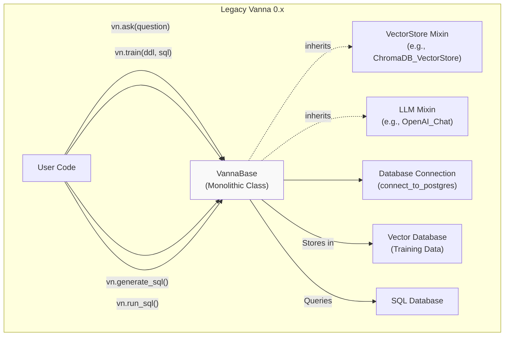
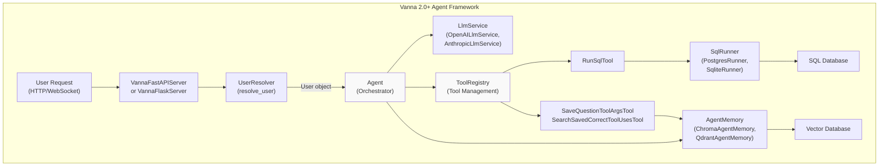
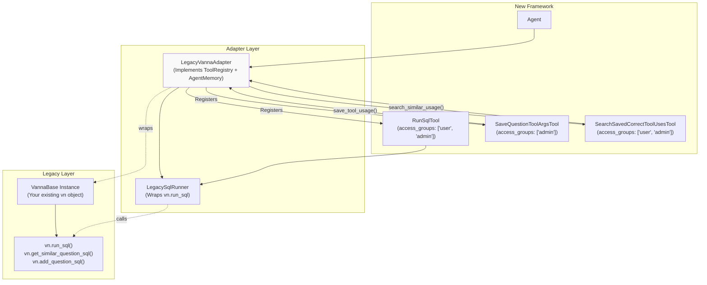
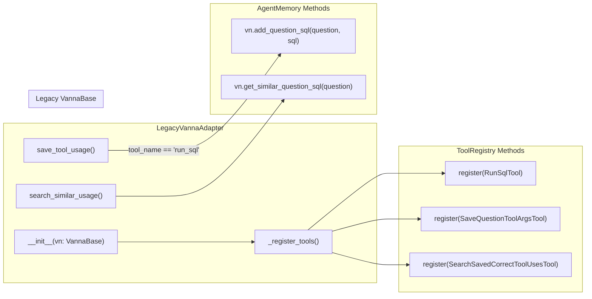
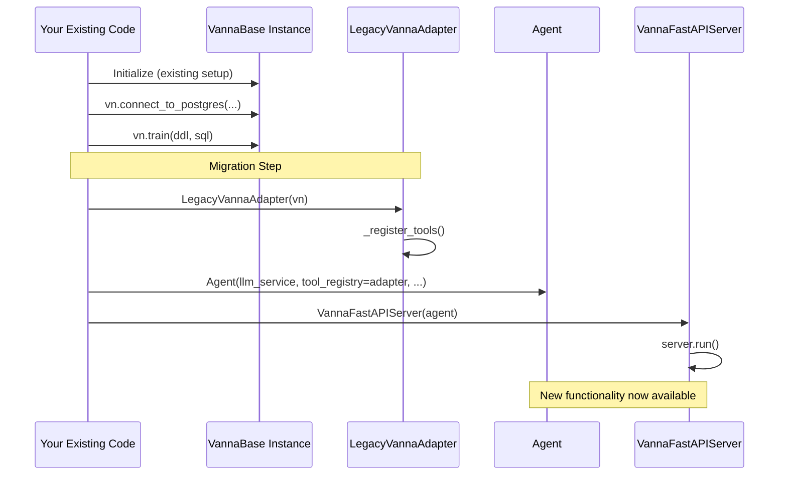
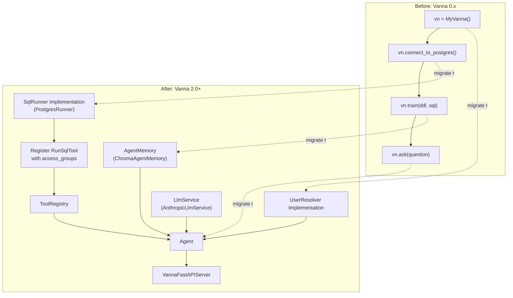
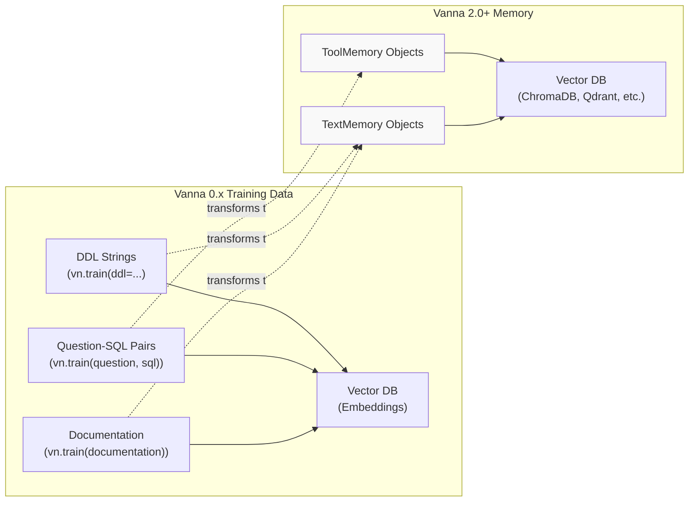
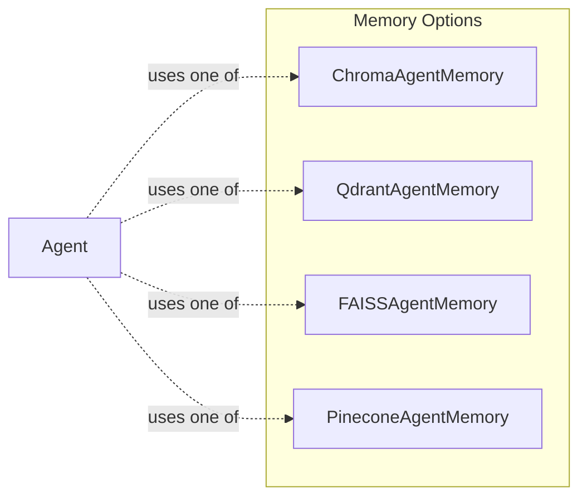

<!-- source: DeepWiki mcp.deepwiki.com · repo vanna-ai/vanna · page 11.2 Migration Guide from Vanna 0.x · fetched 2026-10-29 -->

# Migration Guide from Vanna 0.x

<details>
<summary>Relevant source files</summary>

The following files were used as context for generating this wiki page:

- [MIGRATION_GUIDE.md](MIGRATION_GUIDE.md)
- [README.md](README.md)
- [img/architecture.png](img/architecture.png)
- [img/vanna2.svg](img/vanna2.svg)
- [notebooks/quickstart.ipynb](notebooks/quickstart.ipynb)
- [src/vanna/integrations/anthropic/llm.py](src/vanna/integrations/anthropic/llm.py)
- [src/vanna/integrations/azuresearch/agent_memory.py](src/vanna/integrations/azuresearch/agent_memory.py)
- [src/vanna/integrations/chromadb/agent_memory.py](src/vanna/integrations/chromadb/agent_memory.py)
- [src/vanna/integrations/faiss/agent_memory.py](src/vanna/integrations/faiss/agent_memory.py)
- [src/vanna/integrations/marqo/agent_memory.py](src/vanna/integrations/marqo/agent_memory.py)
- [src/vanna/integrations/milvus/agent_memory.py](src/vanna/integrations/milvus/agent_memory.py)
- [src/vanna/integrations/openai/llm.py](src/vanna/integrations/openai/llm.py)
- [src/vanna/integrations/opensearch/agent_memory.py](src/vanna/integrations/opensearch/agent_memory.py)
- [src/vanna/integrations/pinecone/agent_memory.py](src/vanna/integrations/pinecone/agent_memory.py)
- [src/vanna/integrations/qdrant/agent_memory.py](src/vanna/integrations/qdrant/agent_memory.py)
- [src/vanna/integrations/weaviate/agent_memory.py](src/vanna/integrations/weaviate/agent_memory.py)
- [src/vanna/legacy/adapter.py](src/vanna/legacy/adapter.py)
- [src/vanna/servers/fastapi/app.py](src/vanna/servers/fastapi/app.py)
- [src/vanna/servers/flask/app.py](src/vanna/servers/flask/app.py)
- [tests/test_chromadb_persistence_fix.py](tests/test_chromadb_persistence_fix.py)

</details>


## Purpose and Scope

This document provides technical guidance for migrating from Vanna 0.x (legacy VannaBase architecture) to Vanna 2.0+ (agent-based architecture). It covers architectural differences, component mappings, and migration strategies with specific code entity references.

For general overview of Vanna 2.0 capabilities, see [Overview](#1). For details on the legacy adapter implementation, see [LegacyVannaAdapter](#11.1). For setting up new agents from scratch, see [Getting Started](#1.1).

---

## Architectural Changes Overview

Vanna 2.0+ represents a fundamental shift from a monolithic class-based approach to a modular, user-aware agent framework.

### Vanna 0.x Architecture (Legacy)



**Sources:** [src/vanna/legacy/base/base.py](), [MIGRATION_GUIDE.md:1-296]()

### Vanna 2.0+ Architecture (Current)



**Sources:** [src/vanna/core/agent/agent.py](), [src/vanna/core/registry.py](), [src/vanna/servers/fastapi/app.py](), [src/vanna/servers/flask/app.py]()

---

## Core Component Mapping

The following table maps Vanna 0.x concepts to their Vanna 2.0+ equivalents:

| Vanna 0.x Concept | Code Entity | Vanna 2.0+ Concept | Code Entity |
|-------------------|-------------|---------------------|-------------|
| `VannaBase` class | `vanna.legacy.base.base.VannaBase` | `Agent` class | `vanna.core.agent.agent.Agent` |
| Mixin inheritance pattern | `ChromaDB_VectorStore`, `OpenAI_Chat` | Interface implementations | `ChromaAgentMemory`, `OpenAILlmService` |
| `vn.ask(question)` | Method call | `agent.send_message()` | `Agent.send_message()` |
| `vn.generate_sql()` | Method | Tool-based workflow | `RunSqlTool.execute()` |
| `vn.run_sql(sql)` | Method | `SqlRunner` interface | `PostgresRunner.run_sql()` |
| `vn.train()` | Method | Memory operations | `AgentMemory.save_tool_usage()` |
| `vn.get_similar_question_sql()` | Method | Memory search | `AgentMemory.search_similar_usage()` |
| No user context | N/A | `User` object | `vanna.core.user.User` |
| Direct method access | Public methods | Permission-based tools | `Tool.access_groups` |
| Plain text/DataFrame returns | Return values | `UiComponent` stream | `DataFrameComponent`, `ChartComponent` |

**Sources:** [src/vanna/legacy/base/base.py](), [src/vanna/core/agent/agent.py](), [src/vanna/core/tool.py](), [src/vanna/core/user.py]()

---

## LegacyVannaAdapter Bridge

The `LegacyVannaAdapter` provides a compatibility layer that wraps a Vanna 0.x `VannaBase` instance into the new agent framework interfaces.

### Adapter Architecture



**Sources:** [src/vanna/legacy/adapter.py:1-464]()

### Adapter Implementation Details

The `LegacyVannaAdapter` implements two key interfaces:

1. **ToolRegistry Interface** - Auto-registers legacy methods as tools
2. **AgentMemory Interface** - Bridges training data to memory operations



**Key Code Paths:**

- Tool registration: [src/vanna/legacy/adapter.py:116-138]()
- SQL runner wrapping: [src/vanna/legacy/adapter.py:32-63]()
- Memory save operation: [src/vanna/legacy/adapter.py:142-167]()
- Memory search operation: [src/vanna/legacy/adapter.py:169-219]()

**Sources:** [src/vanna/legacy/adapter.py:66-426]()

---

## Migration Strategies

### Strategy 1: Quick Adapter-Based Migration

This approach wraps your existing `VannaBase` instance with minimal code changes.



**Implementation Steps:**

1. **Install Vanna 2.0+**
   ```bash
   pip install 'vanna[flask,anthropic]'
   ```

2. **Keep existing setup** - Your `VannaBase` initialization remains unchanged

3. **Add user resolver** - Required for 2.0+ framework:
   ```python
   # Reference: notebooks/quickstart.ipynb:81-93
   class SimpleUserResolver(UserResolver):
       async def resolve_user(self, request_context: RequestContext) -> User:
           user_email = request_context.get_cookie('vanna_email')
           if user_email == "admin@example.com":
               return User(id="admin1", email=user_email, group_memberships=['admin'])
           return User(id="user1", email=user_email, group_memberships=['user'])
   ```

4. **Wrap with adapter**:
   ```python
   # Reference: src/vanna/legacy/adapter.py:97-114
   tools = LegacyVannaAdapter(vn)  # vn is your existing VannaBase instance
   ```

5. **Create agent with new LLM service**:
   ```python
   # Reference: notebooks/quickstart.ipynb:123-133
   llm = AnthropicLlmService(model="claude-sonnet-4-5", api_key="sk-ant-...")
   agent = Agent(
       llm_service=llm,
       tool_registry=tools,  # LegacyVannaAdapter is a ToolRegistry
       user_resolver=SimpleUserResolver(),
       config=AgentConfig(),
       agent_memory=tools  # LegacyVannaAdapter is also an AgentMemory
   )
   ```

6. **Launch server**:
   ```python
   # Reference: notebooks/quickstart.ipynb:136-137
   server = VannaFastAPIServer(agent)
   server.run()
   ```

**Registered Tools:** The adapter automatically registers:
- `run_sql` tool (access_groups: `['user', 'admin']`) - [src/vanna/legacy/adapter.py:127-129]()
- `save_question_tool_args` tool (access_groups: `['admin']`) - [src/vanna/legacy/adapter.py:132-134]()
- `search_saved_correct_tool_uses` tool (access_groups: `['user', 'admin']`) - [src/vanna/legacy/adapter.py:136-138]()

**Sources:** [src/vanna/legacy/adapter.py:97-138](), [notebooks/quickstart.ipynb:54-137](), [MIGRATION_GUIDE.md:82-164]()

### Strategy 2: Full Native Migration

This approach rebuilds using native 2.0+ components for maximum feature access.



**Component Replacements:**

1. **Database Connection**
   - **Before:** `vn.connect_to_postgres(host, dbname, user, password, port)` (legacy method)
   - **After:** `PostgresRunner(host, dbname, user, password, port)` - [src/vanna/integrations/postgres/postgres.py]()
   
2. **Training Data Storage**
   - **Before:** `vn.train(ddl="...", sql="...", question="...")` (method calls)
   - **After:** `ChromaAgentMemory(persist_directory="./chroma_memory")` - [src/vanna/integrations/chromadb/agent_memory.py:42-100]()
   - Memory operations via: `save_tool_usage()`, `search_similar_usage()` - [src/vanna/integrations/chromadb/agent_memory.py:166-265]()

3. **LLM Integration**
   - **Before:** Mixin inheritance from `OpenAI_Chat`
   - **After:** `AnthropicLlmService` or `OpenAILlmService` - [src/vanna/integrations/anthropic/llm.py:27-271](), [src/vanna/integrations/openai/llm.py:27-240]()

4. **Tool Registration**
   - **Before:** Direct method access on `VannaBase`
   - **After:**
     ```python
     # Reference: notebooks/quickstart.ipynb:109-114
     tools = ToolRegistry()
     tools.register_local_tool(
         RunSqlTool(sql_runner=postgres_runner),
         access_groups=['admin', 'user']
     )
     tools.register_local_tool(SaveQuestionToolArgsTool(), access_groups=['admin'])
     tools.register_local_tool(SearchSavedCorrectToolUsesTool(), access_groups=['admin', 'user'])
     ```

**Sources:** [MIGRATION_GUIDE.md:167-262](), [notebooks/quickstart.ipynb:109-137]()

---

## Data Migration: Training Data to Memory

### Training Data Structure Transformation



**Adapter Transformation Logic:**

When using `LegacyVannaAdapter`, the transformation happens automatically:

1. **Question-SQL pairs → ToolMemory**
   - `vn.add_question_sql(question, sql)` becomes `save_tool_usage(question, "run_sql", {"sql": sql}, ...)`
   - Storage: [src/vanna/legacy/adapter.py:142-167]()
   - Retrieval: [src/vanna/legacy/adapter.py:169-219]()

2. **Documentation → TextMemory**
   - `vn.add_documentation(doc)` becomes `save_text_memory(doc, ...)`
   - Storage: [src/vanna/legacy/adapter.py:221-239]()
   - Retrieval: [src/vanna/legacy/adapter.py:241-298]()

3. **Memory Structure**
   ```python
   # ToolMemory structure (for SQL queries)
   ToolMemory(
       memory_id="uuid",
       question="Show top customers",
       tool_name="run_sql",
       args={"sql": "SELECT ..."},
       success=True,
       timestamp="2024-01-01T00:00:00"
   )
   
   # TextMemory structure (for documentation)
   TextMemory(
       memory_id="uuid", 
       content="Documentation string",
       timestamp="2024-01-01T00:00:00"
   )
   ```

**Native 2.0+ Memory Operations:**

For full native migration, use `AgentMemory` implementations directly:

- **ChromaDB:** [src/vanna/integrations/chromadb/agent_memory.py:42-489]()
- **Qdrant:** [src/vanna/integrations/qdrant/agent_memory.py:39-467]()
- **FAISS:** [src/vanna/integrations/faiss/agent_memory.py:34-436]()
- **Pinecone:** [src/vanna/integrations/pinecone/agent_memory.py:31-330]()

**Sources:** [src/vanna/legacy/adapter.py:142-298](), [src/vanna/integrations/chromadb/agent_memory.py:166-313]()

---

## API Surface Changes

### Method Call Mappings

| Operation | Vanna 0.x API | Vanna 2.0+ API |
|-----------|---------------|----------------|
| **Initialize** | `vn = MyVanna(config={...})` | `agent = Agent(llm_service=..., tool_registry=..., user_resolver=...)` |
| **Connect DB** | `vn.connect_to_postgres(...)` | `PostgresRunner(host, dbname, ...)` → `RunSqlTool(sql_runner)` |
| **Train DDL** | `vn.train(ddl="CREATE TABLE...")` | `agent_memory.save_text_memory("CREATE TABLE...", context)` |
| **Train Q-SQL** | `vn.train(question="...", sql="...")` | `agent_memory.save_tool_usage("...", "run_sql", {"sql": "..."}, context)` |
| **Generate SQL** | `sql = vn.generate_sql(question)` | Automatic via `Agent.send_message()` → `RunSqlTool` |
| **Run SQL** | `df = vn.run_sql(sql)` | `sql_runner.run_sql(RunSqlToolArgs(sql=sql), context)` |
| **Ask Question** | `response = vn.ask(question)` | `async for chunk in agent.send_message(request_context, message): ...` |
| **Get Similar** | `similar = vn.get_similar_question_sql(q)` | `results = await agent_memory.search_similar_usage(q, context)` |

### Request/Response Transformation

**Vanna 0.x:** Synchronous method calls returning plain objects
```python
# Direct method call
sql = vn.generate_sql("Show top customers")
df = vn.run_sql(sql)
# Returns: DataFrame
```

**Vanna 2.0+:** Async streaming with structured UI components
```python
# Streaming via agent
async for chunk in agent.send_message(request_context, "Show top customers"):
    if isinstance(chunk, UiComponent):
        # Yields: DataFrameComponent, ChartComponent, CodeBlockComponent, etc.
        pass
```

**Sources:** [src/vanna/core/agent/agent.py:97-384](), [src/vanna/legacy/base/base.py]()

---

## Common Migration Patterns

### Pattern 1: Single Database Connection

**Before (0.x):**
```python
from vanna import VannaBase
from vanna.chromadb import ChromaDB_VectorStore
from vanna.openai_chat import OpenAI_Chat

class MyVanna(ChromaDB_VectorStore, OpenAI_Chat):
    def __init__(self, config=None):
        ChromaDB_VectorStore.__init__(self, config=config)
        OpenAI_Chat.__init__(self, config=config)

vn = MyVanna(config={'model': 'gpt-4'})
vn.connect_to_postgres(host='localhost', dbname='mydb', user='user', password='pass')
```

**After (2.0+ with Adapter):**
```python
# Reference: MIGRATION_GUIDE.md:94-146
from vanna import Agent, AgentConfig
from vanna.servers.fastapi import VannaFastAPIServer
from vanna.legacy.adapter import LegacyVannaAdapter
from vanna.integrations.anthropic import AnthropicLlmService
from vanna.core.user import UserResolver, User, RequestContext

# Keep existing vn initialization
# vn = MyVanna(...)
# vn.connect_to_postgres(...)

class SimpleUserResolver(UserResolver):
    async def resolve_user(self, request_context: RequestContext) -> User:
        user_email = request_context.get_cookie('vanna_email')
        groups = ['admin'] if user_email == "admin@example.com" else ['user']
        return User(id=user_email, email=user_email, group_memberships=groups)

tools = LegacyVannaAdapter(vn)
llm = AnthropicLlmService(model="claude-sonnet-4-5")
agent = Agent(llm_service=llm, tool_registry=tools, user_resolver=SimpleUserResolver())
server = VannaFastAPIServer(agent)
```

**After (2.0+ Native):**
```python
# Reference: notebooks/quickstart.ipynb:54-137
from vanna import Agent, AgentConfig
from vanna.core.registry import ToolRegistry
from vanna.integrations.anthropic import AnthropicLlmService
from vanna.tools import RunSqlTool
from vanna.integrations.postgres import PostgresRunner
from vanna.integrations.chromadb import ChromaAgentMemory

tools = ToolRegistry()
postgres_runner = PostgresRunner(host='localhost', dbname='mydb', user='user', password='pass')
tools.register_local_tool(RunSqlTool(sql_runner=postgres_runner), access_groups=['user', 'admin'])

agent_memory = ChromaAgentMemory(persist_directory="./chroma_memory")
llm = AnthropicLlmService(model="claude-sonnet-4-5")
agent = Agent(llm_service=llm, tool_registry=tools, user_resolver=SimpleUserResolver(), agent_memory=agent_memory)
```

**Sources:** [MIGRATION_GUIDE.md:82-164](), [notebooks/quickstart.ipynb:54-137]()

### Pattern 2: Multiple Vector Store Backends

**Before (0.x):** Mixin-based with single vector store
```python
class MyVanna(ChromaDB_VectorStore, OpenAI_Chat):
    pass

vn = MyVanna(config={'chroma_path': './chroma_data'})
```

**After (2.0+):** Pluggable memory implementations



**Implementation:**
```python
# ChromaDB (local)
from vanna.integrations.chromadb import ChromaAgentMemory
agent_memory = ChromaAgentMemory(persist_directory="./chroma_memory")

# Qdrant (cloud/local)
from vanna.integrations.qdrant import QdrantAgentMemory
agent_memory = QdrantAgentMemory(url="http://localhost:6333")

# FAISS (local, high-performance)
from vanna.integrations.faiss import FAISSAgentMemory
agent_memory = FAISSAgentMemory(persist_path="./faiss_index")

# Pinecone (cloud)
from vanna.integrations.pinecone import PineconeAgentMemory
agent_memory = PineconeAgentMemory(api_key="...", index_name="tool-memories")

# Pass to agent
agent = Agent(..., agent_memory=agent_memory)
```

**Sources:** [src/vanna/integrations/chromadb/agent_memory.py:42-100](), [src/vanna/integrations/qdrant/agent_memory.py:39-61](), [src/vanna/integrations/faiss/agent_memory.py:34-56](), [src/vanna/integrations/pinecone/agent_memory.py:31-54]()

### Pattern 3: Custom SQL Transformation

**Before (0.x):** Override methods in `VannaBase`
```python
class MyVanna(ChromaDB_VectorStore, OpenAI_Chat):
    def run_sql(self, sql: str) -> pd.DataFrame:
        # Custom transformation
        modified_sql = sql + " LIMIT 100"
        return super().run_sql(modified_sql)
```

**After (2.0+):** Use `transform_args` on `SqlRunner` or custom `Tool`

```python
# Option 1: Custom SqlRunner with transform_args
from vanna.integrations.postgres import PostgresRunner
from vanna.capabilities.sql_runner import RunSqlToolArgs

class CustomPostgresRunner(PostgresRunner):
    def transform_args(self, args: RunSqlToolArgs, context: ToolContext) -> RunSqlToolArgs:
        # Add LIMIT clause
        modified_sql = args.sql + " LIMIT 100"
        return RunSqlToolArgs(sql=modified_sql)

runner = CustomPostgresRunner(host='localhost', dbname='mydb', user='user', password='pass')
tools.register_local_tool(RunSqlTool(sql_runner=runner), access_groups=['user'])
```

**Sources:** [src/vanna/capabilities/sql_runner.py](), [examples/transform_args_example.py]()

### Pattern 4: Custom Training Data Handling

**Before (0.x):** Directly manipulate vector store
```python
vn.train(ddl="CREATE TABLE customers ...")
vn.train(question="Top customers?", sql="SELECT ...")
vn.train(documentation="The customers table contains...")
```

**After (2.0+ with Adapter):** Automatic via `LegacyVannaAdapter`
```python
# Existing vn.train() calls continue to work through legacy instance
# vn.train(...) stores in original vector store

# LegacyVannaAdapter provides read access via memory interface
tools = LegacyVannaAdapter(vn)
# Agent can now search this data via search_saved_correct_tool_uses tool
```

**After (2.0+ Native):** Direct memory operations
```python
from vanna.integrations.chromadb import ChromaAgentMemory

agent_memory = ChromaAgentMemory(persist_directory="./chroma_memory")

# Save DDL as text memory
await agent_memory.save_text_memory("CREATE TABLE customers ...", context)

# Save question-SQL as tool memory
await agent_memory.save_tool_usage(
    question="Top customers?",
    tool_name="run_sql",
    args={"sql": "SELECT * FROM customers ORDER BY total DESC LIMIT 10"},
    context=context,
    success=True
)

# Search similar patterns
results = await agent_memory.search_similar_usage("Show best customers", context, limit=5)
```

**Sources:** [src/vanna/integrations/chromadb/agent_memory.py:166-265](), [src/vanna/legacy/adapter.py:142-298]()

---

## Breaking Changes Checklist

The following are **not compatible** between 0.x and 2.0+ and require code changes:

### 1. Direct Method Calls
- ❌ **Removed:** `vn.ask(question)`, `vn.generate_sql(question)`, `vn.generate_plotly_code()`
- ✅ **Replacement:** `agent.send_message(request_context, message)` with streaming response

### 2. Synchronous Execution
- ❌ **Removed:** All synchronous blocking calls
- ✅ **Replacement:** `async`/`await` patterns with `asyncio`

### 3. Direct DataFrame Returns
- ❌ **Removed:** Methods returning raw `pd.DataFrame` objects
- ✅ **Replacement:** Streaming `UiComponent` objects (`DataFrameComponent`, `ChartComponent`)

### 4. No User Context
- ❌ **Removed:** Global/single-user execution model
- ✅ **Replacement:** `User` object with `group_memberships` for every request via `UserResolver`

### 5. Mixin Inheritance Pattern
- ❌ **Removed:** Multiple inheritance from `VectorStore` and `LLM` mixins
- ✅ **Replacement:** Composition with `LlmService` and `AgentMemory` interface implementations

### 6. Configuration via `config` Dict
- ❌ **Removed:** `VannaBase(config={'model': 'gpt-4', 'api_key': '...'})`
- ✅ **Replacement:** Explicit component initialization:
  ```python
  llm = AnthropicLlmService(model="claude-sonnet-4-5", api_key="...")
  agent = Agent(llm_service=llm, ...)
  ```

### 7. Embedded Flask Server
- ❌ **Removed:** `vn.run_server()` method
- ✅ **Replacement:** Explicit server creation:
  ```python
  server = VannaFastAPIServer(agent)
  server.run()
  ```

**Sources:** [MIGRATION_GUIDE.md:267-279](), [README.md:285-301]()

---

## Testing Your Migration

### Verification Checklist

1. **Adapter Wrapper Works**
   ```python
   # Verify LegacyVannaAdapter initializes
   tools = LegacyVannaAdapter(vn)
   assert isinstance(tools, ToolRegistry)
   assert isinstance(tools, AgentMemory)
   ```

2. **Tools Are Registered**
   ```python
   # Check registered tools
   from vanna.core.user import User
   user = User(id="test", email="test@example.com", group_memberships=['user'])
   schemas = await tools.get_schemas(user)
   tool_names = [s.name for s in schemas]
   assert "run_sql" in tool_names
   assert "search_saved_correct_tool_uses" in tool_names
   ```

3. **Memory Access Works**
   ```python
   # Verify memory search
   from vanna.core.tool import ToolContext
   context = ToolContext(user=user, conversation_id="test", request_id="test", agent_memory=tools, metadata={})
   results = await tools.search_similar_usage("test question", context, limit=5)
   assert isinstance(results, list)
   ```

4. **Server Responds**
   ```bash
   # Start server and test endpoint
   curl http://localhost:8000/health
   # Expected: {"status": "healthy", "service": "vanna"}
   ```

**Test Files for Reference:**
- Unit tests: [tests/test_vanna.py]()
- ChromaDB persistence: [tests/test_chromadb_persistence_fix.py:40-133]()

**Sources:** [tests/test_chromadb_persistence_fix.py:40-181](), [src/vanna/legacy/adapter.py:97-138]()

---

## Summary

Migration from Vanna 0.x to 2.0+ follows one of two paths:

| Approach | Best For | Key Component | Time Investment |
|----------|----------|---------------|-----------------|
| **Adapter-Based** | Quick migration, existing codebases | `LegacyVannaAdapter` | Minimal (hours) |
| **Native Migration** | New projects, full feature access | `Agent` + `ToolRegistry` + `AgentMemory` | Moderate (days) |

**Recommended Strategy:**
1. Start with `LegacyVannaAdapter` for immediate 2.0+ compatibility
2. Gradually migrate critical paths to native components
3. Eventually remove adapter once fully migrated

**Key Files for Reference:**
- Adapter implementation: [src/vanna/legacy/adapter.py:1-464]()
- Migration guide: [MIGRATION_GUIDE.md:1-296]()
- Quickstart example: [notebooks/quickstart.ipynb:54-137]()
- Server setup: [src/vanna/servers/fastapi/app.py:16-163](), [src/vanna/servers/flask/app.py:16-132]()

**Sources:** [MIGRATION_GUIDE.md:282-296](), [README.md:285-301]()