<!-- source: DeepWiki mcp.deepwiki.com · repo vanna-ai/vanna · page 2 Core Architecture · fetched 2026-10-29 -->

# Core Architecture

<details>
<summary>Relevant source files</summary>

The following files were used as context for generating this wiki page:

- [pyproject.toml](pyproject.toml)
- [src/vanna/__init__.py](src/vanna/__init__.py)
- [src/vanna/core/__init__.py](src/vanna/core/__init__.py)
- [src/vanna/core/agent/agent.py](src/vanna/core/agent/agent.py)
- [src/vanna/core/workflow/__init__.py](src/vanna/core/workflow/__init__.py)
- [src/vanna/examples/default_workflow_handler_example.py](src/vanna/examples/default_workflow_handler_example.py)
- [src/vanna/integrations/local/__init__.py](src/vanna/integrations/local/__init__.py)
- [src/vanna/integrations/local/file_system_conversation_store.py](src/vanna/integrations/local/file_system_conversation_store.py)
- [src/vanna/tools/agent_memory.py](src/vanna/tools/agent_memory.py)

</details>


This document provides a detailed overview of Vanna's core architectural components and their interactions. It covers the primary classes, interfaces, and data flows that form the foundation of the agent framework. For information about specific integrations (LLM providers, vector databases, SQL databases), see sections [5](#5), [4](#4), and [6](#6) respectively. For information about the security model, see [Security and Access Control](#3).

The Vanna architecture follows a layered design where the `Agent` class serves as the central orchestrator, coordinating between the LLM service, tool execution, conversation management, and extensibility points. All major components are interface-driven, allowing for flexible implementations and easy testing.

## Core Component Overview

The following diagram shows the main architectural components and their relationships:

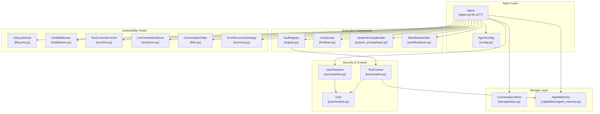

**Diagram: Core Component Dependencies**

The `Agent` class integrates all components through constructor dependency injection, making the architecture testable and modular.

**Sources:** [src/vanna/core/agent/agent.py:82-140](), [src/vanna/__init__.py:12-83](), [src/vanna/core/__init__.py:9-32]()

---

## Agent Initialization and Dependencies

The `Agent` constructor defines the complete dependency graph:

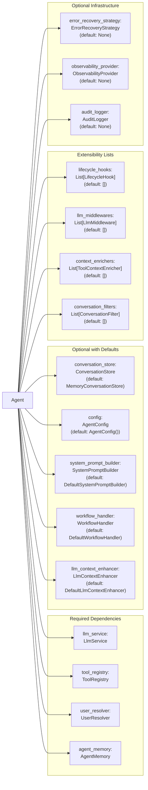

**Diagram: Agent Constructor Dependencies**

The agent provides sensible defaults for most components, requiring only the four core dependencies: `llm_service`, `tool_registry`, `user_resolver`, and `agent_memory`.

**Sources:** [src/vanna/core/agent/agent.py:82-140]()

---

## Message Processing Pipeline

The `Agent.send_message()` method orchestrates the complete message processing pipeline:

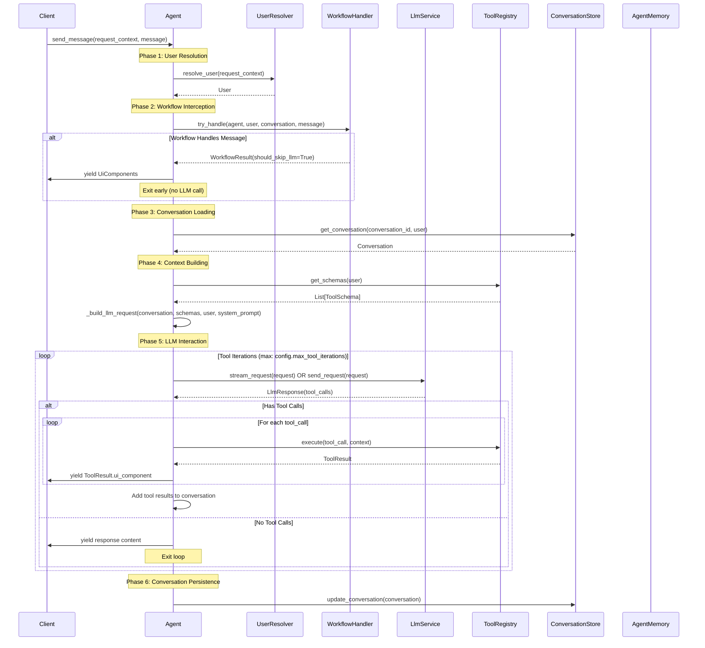

**Diagram: Message Processing Flow**

The pipeline consists of six phases, with the workflow handler providing an early exit path for deterministic command handling. The tool execution loop allows the LLM to make multiple tool calls before providing a final response.

**Sources:** [src/vanna/core/agent/agent.py:142-230](), [src/vanna/core/agent/agent.py:231-1177]()

---

## Component Initialization Flow

The following diagram maps initialization to specific code locations:

```mermaid
graph TB
    subgraph "1. Agent Instantiation"
        constructor["Agent.__init__()<br/>[agent.py:82-140]"]
    end
    
    subgraph "2. Store Dependencies"
        store_llm["self.llm_service = llm_service<br/>[agent.py:101]"]
        store_registry["self.tool_registry = tool_registry<br/>[agent.py:102]"]
        store_resolver["self.user_resolver = user_resolver<br/>[agent.py:103]"]
        store_memory["self.agent_memory = agent_memory<br/>[agent.py:104]"]
    end
    
    subgraph "3. Apply Defaults"
        default_store["if conversation_store is None:<br/>  conversation_store = MemoryConversationStore()<br/>[agent.py:107-110]"]
        default_workflow["if workflow_handler is None:<br/>  workflow_handler = DefaultWorkflowHandler()<br/>[agent.py:119-121]"]
        default_enhancer["if llm_context_enhancer is None:<br/>  llm_context_enhancer = DefaultLlmContextEnhancer(agent_memory)<br/>[agent.py:127-129]"]
    end
    
    subgraph "4. Wire Audit Logger"
        audit_wire["if audit_logger and config.audit_config.enabled:<br/>  tool_registry.audit_logger = audit_logger<br/>  tool_registry.audit_config = config.audit_config<br/>[agent.py:136-138]"]
    end
    
    constructor --> store_llm
    constructor --> store_registry
    constructor --> store_resolver
    constructor --> store_memory
    store_llm --> default_store
    store_memory --> default_workflow
    default_workflow --> default_enhancer
    default_enhancer --> audit_wire
```

**Diagram: Initialization Code Flow**

The agent applies sensible defaults for optional components and automatically wires the audit logger into the tool registry if auditing is enabled.

**Sources:** [src/vanna/core/agent/agent.py:82-140]()

---

## Data Flow: Request to Response

The following shows how data flows through core models:

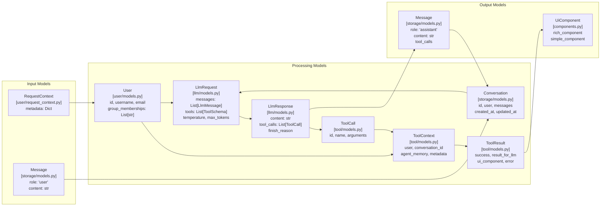

**Diagram: Data Model Flow**

Data flows through a series of strongly-typed Pydantic models, ensuring type safety and validation at each stage.

**Sources:** [src/vanna/core/tool/models.py](), [src/vanna/core/llm/models.py](), [src/vanna/core/storage/models.py](), [src/vanna/core/user/models.py]()

---

## Component Interfaces

Each core component defines an abstract interface implemented by multiple backends:

| Component | Interface Location | Key Methods | Default Implementation |
|-----------|-------------------|-------------|------------------------|
| **LlmService** | [llm/base.py]() | `send_request()`, `stream_request()`, `validate_tools()` | N/A (must provide) |
| **ConversationStore** | [storage/base.py]() | `get_conversation()`, `update_conversation()`, `list_conversations()` | `MemoryConversationStore` |
| **SystemPromptBuilder** | [system_prompt/base.py]() | `build_system_prompt()` | `DefaultSystemPromptBuilder` |
| **WorkflowHandler** | [workflow/base.py]() | `try_handle()`, `get_starter_ui()` | `DefaultWorkflowHandler` |
| **UserResolver** | [user/resolver.py]() | `resolve_user()` | N/A (must provide) |
| **AgentMemory** | [capabilities/agent_memory.py]() | `save_tool_usage()`, `search_similar_usage()` | N/A (must provide) |

**Table: Core Component Interfaces**

For detailed information about each interface, see the corresponding subsection ([2.1](#2.1) through [2.7](#2.7)).

**Sources:** [src/vanna/core/__init__.py:9-32]()

---

## Extensibility Hooks

The agent provides seven extensibility points for customizing behavior without modifying core code:

```mermaid
graph TB
    subgraph "Lifecycle Hooks"
        before_msg["before_message(user, message)<br/>[lifecycle.py]"]
        before_tool["before_tool(tool, context)<br/>[lifecycle.py]"]
        after_tool["after_tool(tool, context, result)<br/>[lifecycle.py]"]
        after_msg["after_message(user, message, conversation)<br/>[lifecycle.py]"]
    end
    
    subgraph "LLM Middleware"
        before_req["before_request(request)<br/>[middleware.py]"]
        after_resp["after_response(response)<br/>[middleware.py]"]
        after_stream["after_stream_chunk(chunk)<br/>[middleware.py]"]
    end
    
    subgraph "Context Enrichment"
        enrich["enrich_context(context)<br/>[enricher.py]"]
        enhance_sys["enhance_system_prompt(prompt, message, user)<br/>[enhancer.py]"]
        enhance_msgs["enhance_messages(messages, user)<br/>[enhancer.py]"]
    end
    
    subgraph "Filtering & Recovery"
        filter["filter_messages(messages, user)<br/>[filter.py]"]
        recover["handle_error(error, context)<br/>[recovery.py]"]
    end
    
    Agent --> before_msg
    Agent --> before_tool
    Agent --> after_tool
    Agent --> after_msg
    Agent --> before_req
    Agent --> after_resp
    Agent --> after_stream
    Agent --> enrich
    Agent --> enhance_sys
    Agent --> enhance_msgs
    Agent --> filter
    Agent --> recover
```

**Diagram: Extensibility Hook Call Sites**

Each hook is invoked at a specific point in the pipeline, allowing fine-grained control over agent behavior. For complete documentation, see [Extensibility Points](#2.8).

**Sources:** [src/vanna/core/agent/agent.py:363-389](), [src/vanna/core/agent/agent.py:784-814](), [src/vanna/core/agent/agent.py:870-902]()

---

## AgentConfig Structure

The `AgentConfig` class consolidates all configuration options:

```mermaid
graph TB
    subgraph "AgentConfig [config.py]"
        direction TB
        
        subgraph "Execution Control"
            max_iter["max_tool_iterations: int = 5"]
            stream["stream_responses: bool = True"]
            thinking["include_thinking_indicators: bool = False"]
            auto_save["auto_save_conversations: bool = True"]
        end
        
        subgraph "LLM Parameters"
            temp["temperature: float = 0.0"]
            max_tok["max_tokens: Optional[int] = None"]
            model["model: Optional[str] = None"]
        end
        
        subgraph "UI Features"
            ui_feat["ui_features: UiFeatures"]
            feat_map["feature_group_access: Dict[str, List[str]]"]
            can_access["can_user_access_feature(feature_name, user)"]
        end
        
        subgraph "Audit Configuration"
            audit["audit_config: AuditConfig"]
            enabled["enabled: bool = True"]
            log_checks["log_tool_access_checks: bool = True"]
            log_invoke["log_tool_invocations: bool = True"]
            log_ui["log_ui_feature_checks: bool = False"]
        end
    end
    
    max_iter --> Agent
    stream --> Agent
    temp --> Agent
    ui_feat --> Agent
    audit --> Agent
```

**Diagram: AgentConfig Parameters**

Configuration covers execution control, LLM parameters, UI feature gating, and audit logging. For details, see [AgentConfig and Configuration](#2.2).

**Sources:** [src/vanna/core/agent/config.py]()

---

## ToolRegistry and Permission Model

The `ToolRegistry` enforces access control at multiple levels:

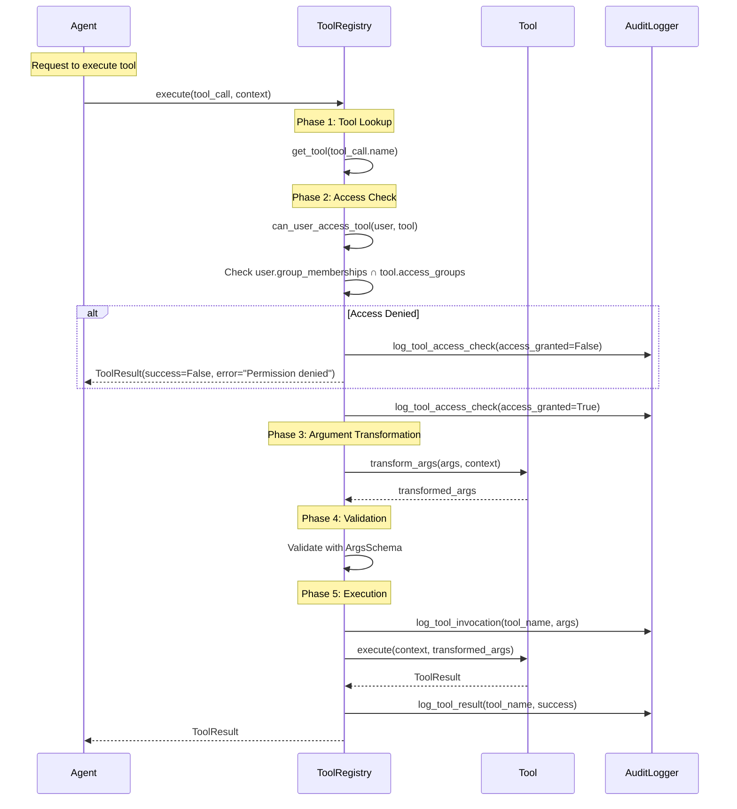

**Diagram: ToolRegistry Execution Pipeline**

The registry performs access checks, argument transformation (for row-level security), validation, and execution with comprehensive audit logging. For details, see [ToolRegistry and Execution Pipeline](#2.4).

**Sources:** [src/vanna/core/registry.py]()

---

## WorkflowHandler and Command Routing

The `WorkflowHandler` provides deterministic workflow handling before LLM invocation:

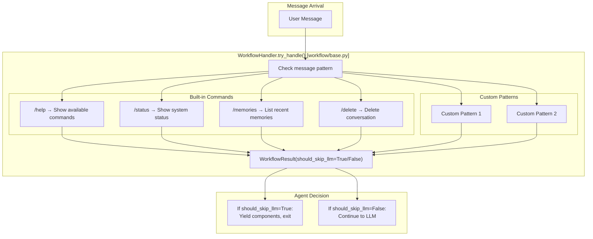

**Diagram: WorkflowHandler Command Routing**

The workflow handler enables fast, deterministic responses for commands and patterns without LLM overhead. For details, see [WorkflowHandler System](#2.5).

**Sources:** [src/vanna/core/workflow/base.py](), [src/vanna/core/workflow/default.py](), [src/vanna/core/agent/agent.py:440-509]()

---

## ConversationStore Implementations

Two conversation store implementations are provided:

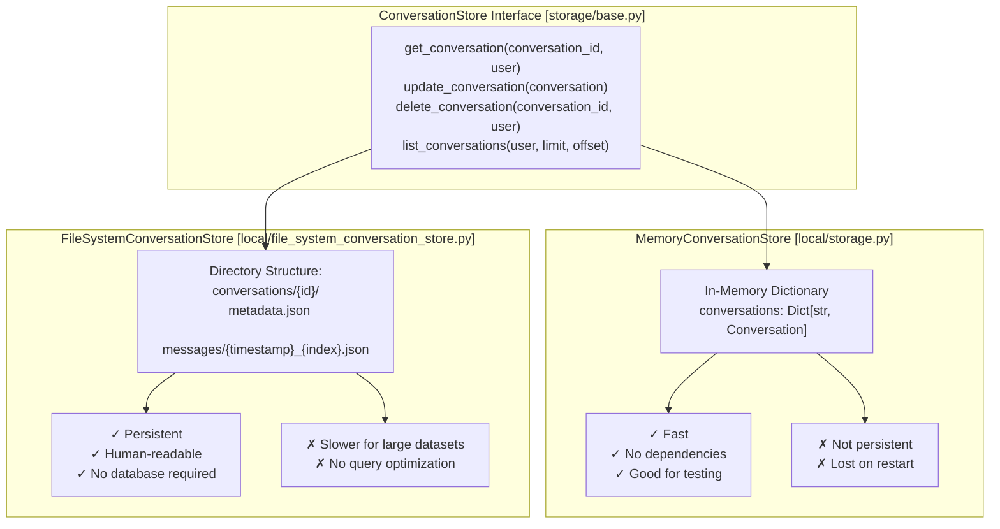

**Diagram: ConversationStore Implementations**

Choose `MemoryConversationStore` for development/testing and `FileSystemConversationStore` for simple persistent storage. For production, implement a custom store backed by your database. For details, see [ConversationStore and History Management](#2.6).

**Sources:** [src/vanna/integrations/local/storage.py](), [src/vanna/integrations/local/file_system_conversation_store.py:19-256]()

---

## SystemPromptBuilder and Context Enhancement

The system prompt is built and enhanced in multiple stages:

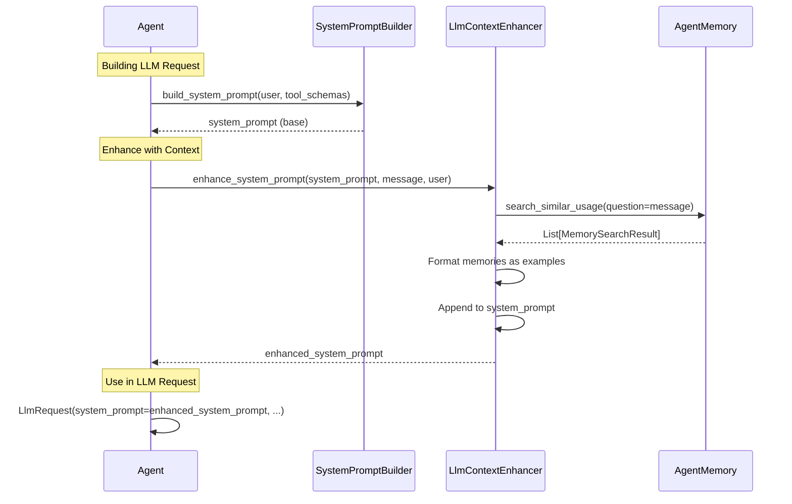

**Diagram: System Prompt Building and Enhancement**

The base system prompt includes tool schemas and instructions. The `LlmContextEnhancer` adds relevant memories from past successful interactions, creating a learning feedback loop. For details, see [SystemPromptBuilder](#2.7).

**Sources:** [src/vanna/core/agent/agent.py:592-637](), [src/vanna/core/system_prompt/base.py](), [src/vanna/core/enhancer.py]()

---

## Error Handling and Recovery

The agent provides comprehensive error handling at multiple levels:

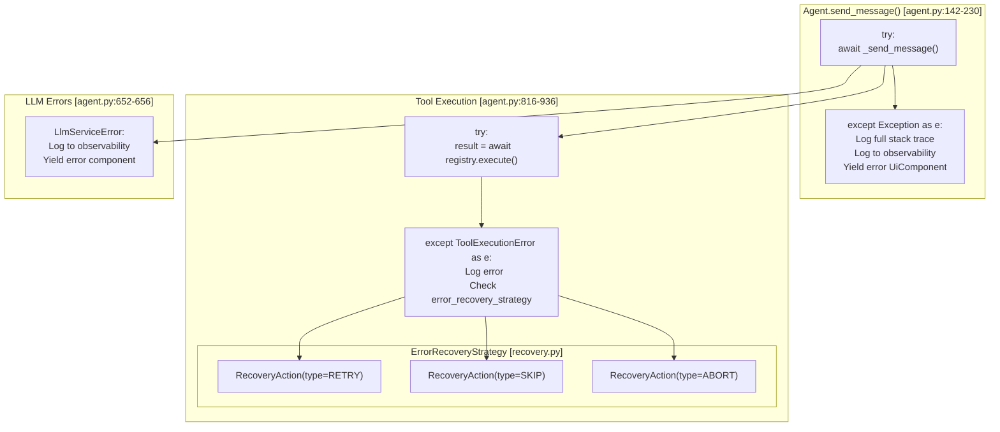

**Diagram: Error Handling Layers**

Errors are caught at the agent level, tool level, and LLM level. The `ErrorRecoveryStrategy` hook allows custom retry logic. All errors are logged to observability providers and surfaced to users via UI components.

**Sources:** [src/vanna/core/agent/agent.py:142-230](), [src/vanna/core/agent/agent.py:816-936](), [src/vanna/core/recovery.py]()

---

## Observability Integration

The agent integrates observability throughout the pipeline:

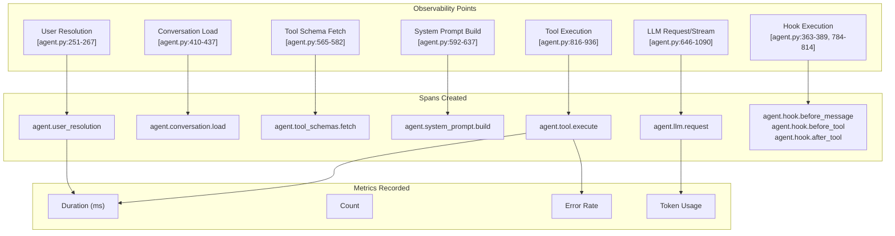

**Diagram: Observability Integration Points**

The agent creates spans and records metrics for all major operations, enabling performance monitoring and debugging in production. Observability is optional and controlled by the `observability_provider` parameter.

**Sources:** [src/vanna/core/agent/agent.py:251-267](), [src/vanna/core/agent/agent.py:565-582](), [src/vanna/core/agent/agent.py:816-866]()

---

## Summary

The Vanna core architecture provides:

1. **Central Orchestration**: `Agent` class coordinates all components
2. **Interface-Driven Design**: Swap implementations without changing core code
3. **Comprehensive Security**: Multi-layer access control via `UserResolver`, `ToolRegistry`, and `ToolContext`
4. **Extensibility**: Seven hook points for customization
5. **Observability**: Built-in tracing and metrics
6. **Error Resilience**: Multi-level error handling with recovery strategies
7. **Streaming Support**: Real-time UI updates via `UiComponent` stream
8. **Configuration**: Centralized via `AgentConfig`

For detailed documentation of each component, see the subsections [2.1](#2.1) through [2.8](#2.8).

**Sources:** [src/vanna/core/agent/agent.py](), [src/vanna/core/__init__.py](), [src/vanna/__init__.py]()

---

