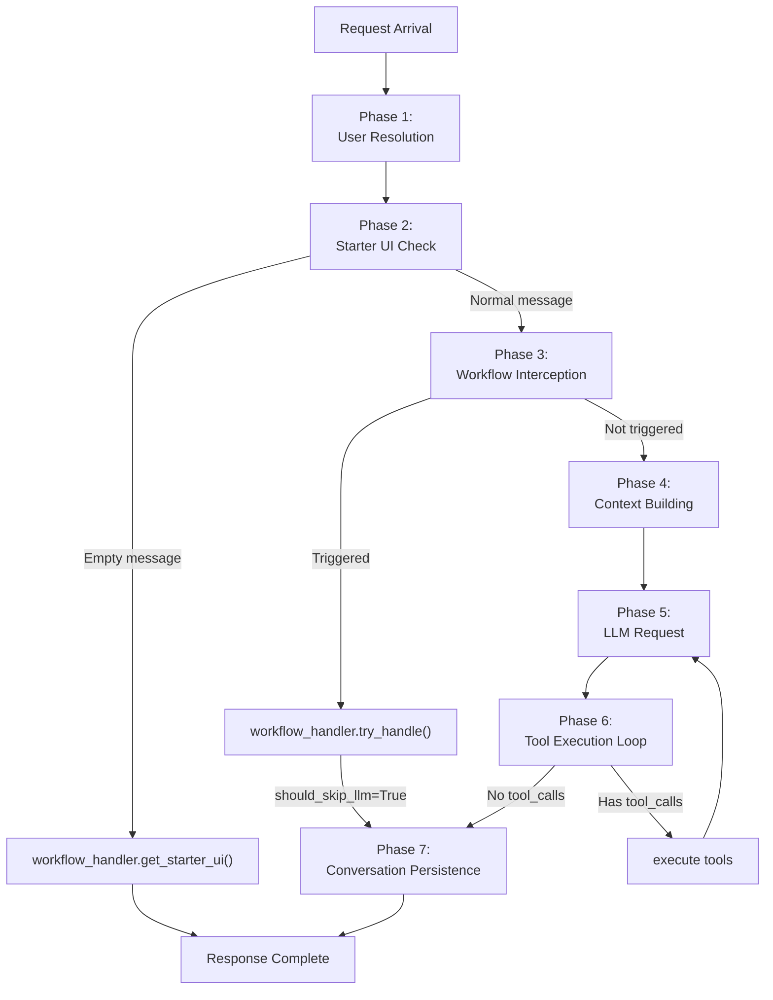
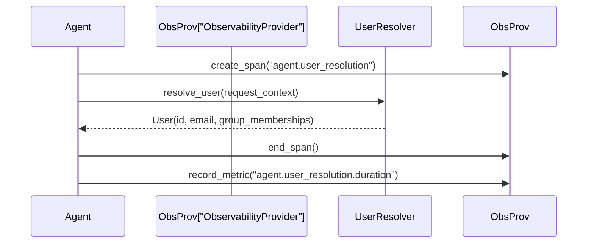
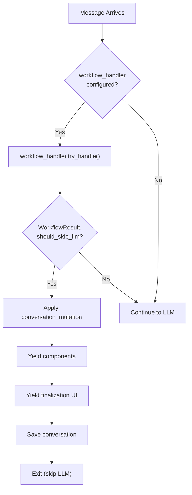
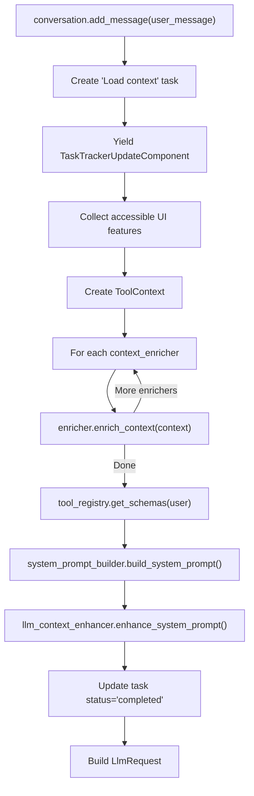
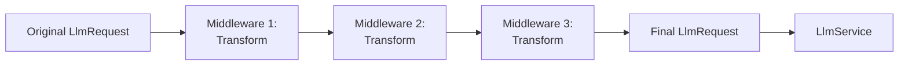
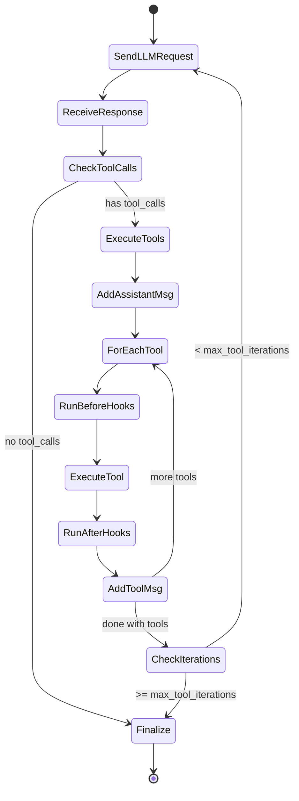
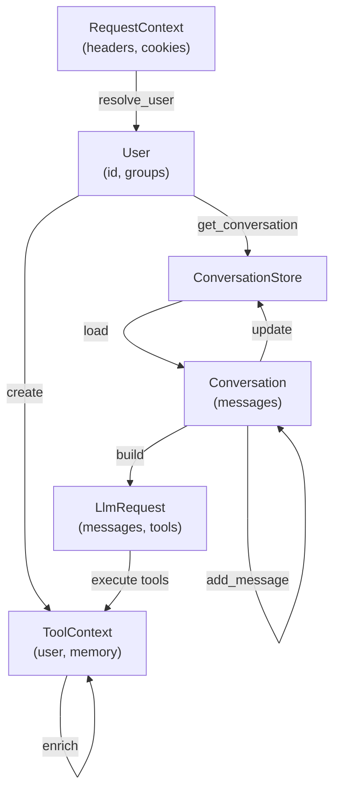
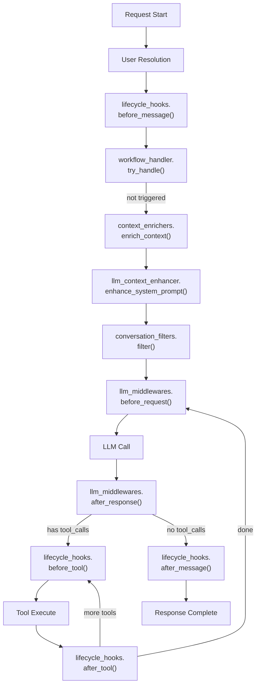

<!-- source: DeepWiki mcp.deepwiki.com · repo vanna-ai/vanna · page 2.1 Agent System · fetched 2026-10-29 -->

# Agent System

<details>
<summary>Relevant source files</summary>

The following files were used as context for generating this wiki page:

- [MIGRATION_GUIDE.md](MIGRATION_GUIDE.md)
- [README.md](README.md)
- [img/architecture.png](img/architecture.png)
- [img/vanna2.svg](img/vanna2.svg)
- [notebooks/quickstart.ipynb](notebooks/quickstart.ipynb)
- [src/vanna/core/__init__.py](src/vanna/core/__init__.py)
- [src/vanna/core/agent/agent.py](src/vanna/core/agent/agent.py)
- [src/vanna/core/workflow/__init__.py](src/vanna/core/workflow/__init__.py)
- [src/vanna/examples/default_workflow_handler_example.py](src/vanna/examples/default_workflow_handler_example.py)
- [src/vanna/integrations/anthropic/llm.py](src/vanna/integrations/anthropic/llm.py)
- [src/vanna/integrations/local/__init__.py](src/vanna/integrations/local/__init__.py)
- [src/vanna/integrations/local/file_system_conversation_store.py](src/vanna/integrations/local/file_system_conversation_store.py)
- [src/vanna/integrations/openai/llm.py](src/vanna/integrations/openai/llm.py)
- [src/vanna/servers/fastapi/app.py](src/vanna/servers/fastapi/app.py)
- [src/vanna/servers/flask/app.py](src/vanna/servers/flask/app.py)
- [src/vanna/tools/agent_memory.py](src/vanna/tools/agent_memory.py)

</details>


## Purpose and Scope

This document provides a detailed examination of the `Agent` class, the central orchestrator in the Vanna framework. The Agent manages the complete lifecycle of user interactions, coordinating between LLM services, tool execution, conversation storage, and UI component generation.

This page focuses on the Agent's initialization, state management, and the `send_message()` processing pipeline. For configuration options, see [AgentConfig and Configuration](#2.2). For tool execution mechanics, see [ToolRegistry and Execution Pipeline](#2.4). For pre-LLM interception, see [WorkflowHandler System](#2.5).

---

## Agent Class Overview

The `Agent` class ([src/vanna/core/agent/agent.py:56-140]()) is the primary interface for processing user messages. It orchestrates:

- **User authentication** via `UserResolver`
- **Pre-LLM workflow interception** via `WorkflowHandler`
- **LLM communication** via `LlmService`
- **Tool execution** via `ToolRegistry`
- **Conversation persistence** via `ConversationStore`
- **Learning and context** via `AgentMemory`

### Core Dependencies

```mermaid
graph TB
    Agent["Agent<br/>(Orchestrator)"]
    LlmService["LlmService<br/>(LLM Provider)"]
    ToolRegistry["ToolRegistry<br/>(Tool Management)"]
    UserResolver["UserResolver<br/>(Authentication)"]
    ConversationStore["ConversationStore<br/>(History)"]
    AgentMemory["AgentMemory<br/>(Learning)"]
    SystemPromptBuilder["SystemPromptBuilder<br/>(Prompt Generation)"]
    WorkflowHandler["WorkflowHandler<br/>(Pre-LLM Logic)"]
    
    Agent --> LlmService
    Agent --> ToolRegistry
    Agent --> UserResolver
    Agent --> ConversationStore
    Agent --> AgentMemory
    Agent --> SystemPromptBuilder
    Agent --> WorkflowHandler
    
    Agent -.optional.-> LifecycleHook["LifecycleHook[]<br/>(Hooks)"]
    Agent -.optional.-> LlmMiddleware["LlmMiddleware[]<br/>(Middleware)"]
    Agent -.optional.-> ErrorRecoveryStrategy["ErrorRecoveryStrategy<br/>(Recovery)"]
    Agent -.optional.-> ToolContextEnricher["ToolContextEnricher[]<br/>(Enrichers)"]
    Agent -.optional.-> LlmContextEnhancer["LlmContextEnhancer<br/>(Context)"]
    Agent -.optional.-> ConversationFilter["ConversationFilter[]<br/>(Filters)"]
    Agent -.optional.-> ObservabilityProvider["ObservabilityProvider<br/>(Telemetry)"]
    Agent -.optional.-> AuditLogger["AuditLogger<br/>(Auditing)"]
```



**Sources:** [src/vanna/core/agent/agent.py:82-140]()

---

## Agent Initialization

The Agent constructor accepts required and optional dependencies:

### Required Parameters

| Parameter | Type | Purpose |
|-----------|------|---------|
| `llm_service` | `LlmService` | LLM provider (OpenAI, Anthropic, etc.) |
| `tool_registry` | `ToolRegistry` | Manages available tools |
| `user_resolver` | `UserResolver` | Extracts user identity from requests |
| `agent_memory` | `AgentMemory` | Learning and context storage |

### Optional Parameters

| Parameter | Type | Default | Purpose |
|-----------|------|---------|---------|
| `conversation_store` | `ConversationStore` | `MemoryConversationStore()` | Persists conversation history |
| `config` | `AgentConfig` | `AgentConfig()` | Agent behavior settings |
| `system_prompt_builder` | `SystemPromptBuilder` | `DefaultSystemPromptBuilder()` | Generates system prompts |
| `lifecycle_hooks` | `List[LifecycleHook]` | `[]` | Before/after message/tool hooks |
| `llm_middlewares` | `List[LlmMiddleware]` | `[]` | Intercept LLM requests/responses |
| `workflow_handler` | `WorkflowHandler` | `DefaultWorkflowHandler()` | Pre-LLM workflow logic |
| `error_recovery_strategy` | `ErrorRecoveryStrategy` | `None` | Error handling strategy |
| `context_enrichers` | `List[ToolContextEnricher]` | `[]` | Add data to tool context |
| `llm_context_enhancer` | `LlmContextEnhancer` | `DefaultLlmContextEnhancer(agent_memory)` | Enhance LLM prompts |
| `conversation_filters` | `List[ConversationFilter]` | `[]` | Filter conversation history |
| `observability_provider` | `ObservabilityProvider` | `None` | Telemetry and metrics |
| `audit_logger` | `AuditLogger` | `None` | Security event logging |

### Initialization Wiring

The constructor performs several wiring operations:

1. **Default Instantiation**: Creates `MemoryConversationStore` if none provided ([src/vanna/core/agent/agent.py:107-111]())
2. **Workflow Handler**: Creates `DefaultWorkflowHandler` if none provided ([src/vanna/core/agent/agent.py:118-121]())
3. **LLM Context Enhancer**: Creates `DefaultLlmContextEnhancer` if none provided ([src/vanna/core/agent/agent.py:126-129]())
4. **Audit Wiring**: Connects `audit_logger` to `tool_registry` if enabled ([src/vanna/core/agent/agent.py:136-138]())

**Example initialization:**

```python
from vanna import Agent, AgentConfig
from vanna.integrations.anthropic import AnthropicLlmService
from vanna.integrations.chromadb import ChromaAgentMemory
from vanna.core.registry import ToolRegistry

agent = Agent(
    llm_service=AnthropicLlmService(model="claude-sonnet-4-5"),
    tool_registry=ToolRegistry(),
    user_resolver=MyUserResolver(),
    agent_memory=ChromaAgentMemory(),
    config=AgentConfig(max_tool_iterations=5)
)
```

**Sources:** [src/vanna/core/agent/agent.py:82-140](), [notebooks/quickstart.ipynb:122-133]()

---

## The send_message Lifecycle

The `send_message()` method is the primary public interface for message processing. It returns an async generator yielding `UiComponent` instances.

### Method Signature

```python
async def send_message(
    self,
    request_context: RequestContext,
    message: str,
    *,
    conversation_id: Optional[str] = None,
) -> AsyncGenerator[UiComponent, None]
```

**Parameters:**
- `request_context`: Contains HTTP headers, cookies, query params for user resolution
- `message`: User's message content
- `conversation_id`: Optional ID; generates new UUID if `None`

### Dual-Layer Architecture

The Agent uses a two-layer processing structure:

1. **`send_message()`** ([src/vanna/core/agent/agent.py:142-230]()): Public method with error handling and user-friendly error UI
2. **`_send_message()`** ([src/vanna/core/agent/agent.py:231-1201]()): Internal implementation with core logic

This separation ensures exceptions are caught and converted to appropriate UI components rather than crashing.

### send_message Flow Diagram

```mermaid
sequenceDiagram
    participant Client
    participant send_message["send_message()<br/>(Public)"]
    participant _send_message["_send_message()<br/>(Internal)"]
    participant ErrorHandler["Error Handler"]
    
    Client->>send_message: message, request_context
    send_message->>_send_message: delegate
    
    alt Success Path
        _send_message-->>send_message: yield UiComponents
        send_message-->>Client: stream components
    else Exception Path
        _send_message-xErrorHandler: Exception
        ErrorHandler->>ErrorHandler: Log stack trace
        ErrorHandler->>ErrorHandler: Log to observability
        ErrorHandler->>send_message: StatusCardComponent(error)
        ErrorHandler->>send_message: StatusBarUpdateComponent(error)
        ErrorHandler->>send_message: ChatInputUpdateComponent(enabled)
        send_message-->>Client: error UI components
    end
```

**Sources:** [src/vanna/core/agent/agent.py:142-230]()

---

## Core Processing Pipeline

The `_send_message()` method implements a seven-phase processing pipeline:

### Pipeline Phases Diagram



**Sources:** [src/vanna/core/agent/agent.py:231-1201]()

---

## Phase 1: User Resolution

### Purpose
Extract user identity and group memberships from the incoming request context.

### Implementation



**Code location:** [src/vanna/core/agent/agent.py:249-268]()

**Key operations:**
1. Creates observability span if provider configured
2. Calls `user_resolver.resolve_user(request_context)`
3. Receives `User` object with `id`, `email`, `group_memberships`
4. Records metrics for monitoring

**Example `User` object:**
```python
User(
    id="alice123",
    email="alice@example.com",
    group_memberships=["user", "analytics"]
)
```

The `group_memberships` list is critical for tool access control (see [Tool Access Control](#3.2)).

**Sources:** [src/vanna/core/agent/agent.py:249-268](), [README.md:162-172]()

---

## Phase 2: Starter UI Check

### Purpose
Detect if this is a request for initial UI (empty message or explicit flag) and generate appropriate starter components.

### Detection Logic

The Agent considers a request a "starter UI request" if:

```python
is_starter_request = (not message.strip()) or request_context.metadata.get("starter_ui_request", False)
```

**Source:** [src/vanna/core/agent/agent.py:270-272]()

### Starter UI Generation

When detected, the Agent:

1. Loads or creates empty conversation ([src/vanna/core/agent/agent.py:284-294]())
2. Calls `workflow_handler.get_starter_ui(self, user, conversation)` ([src/vanna/core/agent/agent.py:297-299]())
3. Yields returned components
4. Yields finalization components (StatusBar, ChatInput)
5. Exits without calling LLM

The `DefaultWorkflowHandler` provides intelligent starter UI based on setup health (see [WorkflowHandler System](#2.5)).

**Sources:** [src/vanna/core/agent/agent.py:270-346](), [src/vanna/examples/default_workflow_handler_example.py:26-200]()

---

## Phase 3: Workflow Interception

### Purpose
Allow deterministic handling of specific messages (commands, patterns) before LLM invocation.

### Workflow Handler Check



### try_handle Return Structure

The `WorkflowHandler.try_handle()` method returns a `WorkflowResult`:

```python
class WorkflowResult:
    should_skip_llm: bool  # If True, LLM call is bypassed
    components: Optional[Union[List[UiComponent], AsyncGenerator]]  # UI to yield
    conversation_mutation: Optional[Callable]  # Modify conversation before save
```

**Example workflow triggers:**
- `/help` - Display help information
- `/status` - Show agent status
- `/memories` - Display recent memories (admin only)

**Sources:** [src/vanna/core/agent/agent.py:440-508](), [src/vanna/core/workflow/__init__.py:1-13]()

---

## Phase 4: Context Building

### Purpose
Prepare all context needed for LLM invocation: user, tools, system prompt, and enrichments.

### Context Building Steps



### ToolContext Structure

The `ToolContext` object ([src/vanna/core/tool/models.py:72-115]()) provides tools with:

| Field | Type | Purpose |
|-------|------|---------|
| `user` | `User` | Current user (for permissions) |
| `conversation_id` | `str` | Current conversation ID |
| `request_id` | `str` | Unique request identifier |
| `agent_memory` | `AgentMemory` | Access to learning system |
| `observability_provider` | `Optional[ObservabilityProvider]` | Telemetry integration |
| `metadata` | `Dict[str, Any]` | Additional context data |

The `metadata` dict includes `ui_features_available` - a list of feature names the current user can access.

### System Prompt Enhancement

1. **Base Prompt**: Generated by `system_prompt_builder` with tool schemas
2. **Enhancement**: `llm_context_enhancer.enhance_system_prompt()` adds:
   - Similar tool usage patterns from `AgentMemory`
   - Workflow instructions
   - Additional context

**Sources:** [src/vanna/core/agent/agent.py:515-641](), [src/vanna/core/tool/models.py:72-115]()

---

## Phase 5: LLM Request Construction

### Purpose
Convert conversation history and tools into an `LlmRequest` suitable for the LLM provider.

### Request Building

The `_build_llm_request()` method ([src/vanna/core/agent/agent.py:1203-1259]()) constructs:

```python
LlmRequest(
    messages=[...],  # Converted from conversation.messages
    tools=[...],     # Tool schemas for function calling
    system_prompt=system_prompt,
    max_tokens=config.max_tokens,
    temperature=config.temperature
)
```

### Message Conversion

Conversation messages are converted to `LlmMessage` format:

| Conversation Role | LlmMessage Role | Notes |
|-------------------|-----------------|-------|
| `"user"` | `"user"` | User messages |
| `"assistant"` | `"assistant"` | LLM responses (may include `tool_calls`) |
| `"tool"` | `"tool"` | Tool execution results (includes `tool_call_id`) |

**Filtering:**
- `conversation_filters` can remove/modify messages
- System applies `DefaultConversationFilter` to truncate excessive history

### Middleware Chain

Before sending to LLM, request passes through `llm_middlewares`:



**Middleware use cases:**
- Request caching
- Prompt template injection
- Cost tracking
- Request logging

**Sources:** [src/vanna/core/agent/agent.py:1203-1259]()

---

## Phase 6: Tool Execution Loop

### Purpose
Handle iterative tool calling: LLM requests tools, Agent executes them, results feed back to LLM.

### Loop Structure



### Iteration Control

The loop continues while:
1. LLM response contains `tool_calls`
2. `tool_iterations < config.max_tool_iterations` (default: 10)

**Source:** [src/vanna/core/agent/agent.py:644-1103]()

### Tool Execution Sequence

For each tool call:

1. **Create Task UI**: If user has `UI_FEATURE_SHOW_TOOL_NAMES` access ([src/vanna/core/agent/agent.py:706-740]())
2. **Show Execution UI**: If user has `UI_FEATURE_SHOW_TOOL_ARGUMENTS` access ([src/vanna/core/agent/agent.py:744-782]())
3. **Run Before Hooks**: All `lifecycle_hooks.before_tool()` ([src/vanna/core/agent/agent.py:784-815]())
4. **Execute Tool**: `tool_registry.execute(tool_call, context)` ([src/vanna/core/agent/agent.py:816-827]())
5. **Run After Hooks**: All `lifecycle_hooks.after_tool()` ([src/vanna/core/agent/agent.py:846-921]())
6. **Add Tool Message**: `conversation.add_message(Message(role="tool", ...))` ([src/vanna/core/agent/agent.py:923-929]())
7. **Update Task UI**: Mark task completed ([src/vanna/core/agent/agent.py:931-936]())
8. **Yield Tool Result UI**: Display result to user ([src/vanna/core/agent/agent.py:938-1103]())

### Assistant Message with Tool Calls

Critical: Before executing tools, an assistant message with `tool_calls` is added to conversation:

```python
assistant_message = Message(
    role="assistant",
    content=response.content or "",
    tool_calls=response.tool_calls,
)
conversation.add_message(assistant_message)
```

**Why?** OpenAI API requires tool response messages to follow assistant messages with `tool_calls`. This maintains proper conversation structure.

**Source:** [src/vanna/core/agent/agent.py:661-668]()

### Streaming vs Non-Streaming

The Agent handles both modes:

| Mode | Method | Behavior |
|------|--------|----------|
| Streaming | `_handle_streaming_response()` | Yields text chunks as they arrive, accumulates tool calls at end |
| Non-streaming | `_send_llm_request()` | Waits for complete response |

**Source:** [src/vanna/core/agent/agent.py:650-655]()

---

## Phase 7: Conversation Persistence

### Purpose
Save conversation state for future context and history.

### Persistence Logic

```python
if self.config.auto_save_conversations:
    await self.conversation_store.update_conversation(conversation)
```

**Triggers:**
- After workflow handling (if triggered)
- After LLM processing completes
- After tool execution loop finishes

**Source:** [src/vanna/core/agent/agent.py:490-491](), [src/vanna/core/agent/agent.py:1188-1189]()

### Conversation Structure

A `Conversation` object contains:

| Field | Type | Purpose |
|-------|------|---------|
| `id` | `str` | Unique identifier |
| `user` | `User` | Owner |
| `messages` | `List[Message]` | Complete history |
| `created_at` | `datetime` | Creation timestamp |
| `updated_at` | `datetime` | Last modification |

**Message types:**
- `role="user"`: User messages
- `role="assistant"`: LLM responses (may include `tool_calls`)
- `role="tool"`: Tool execution results (includes `tool_call_id`)

**Sources:** [src/vanna/core/storage/models.py:1-100](), [src/vanna/integrations/local/file_system_conversation_store.py:19-192]()

---

## UI Component Generation

Throughout processing, the Agent yields `UiComponent` instances for real-time display.

### Component Types by Phase

| Phase | Component Types | Purpose |
|-------|----------------|---------|
| Starter UI | `StatusCardComponent`, `CardComponent`, `ButtonGroupComponent` | Initial welcome screen |
| Context Building | `TaskTrackerUpdateComponent` | Show "Loading context" task |
| Workflow | `CardComponent`, `RichTextComponent` | Display command results |
| Tool Execution | `StatusCardComponent`, `TaskTrackerUpdateComponent` | Show tool progress |
| Tool Results | `DataFrameComponent`, `ChartComponent`, `CodeBlockComponent` | Display tool outputs |
| Finalization | `StatusBarUpdateComponent`, `ChatInputUpdateComponent` | Update status bar, enable input |
| Errors | `StatusCardComponent` | Show error messages |

### Dual-Format Strategy

Each `UiComponent` can contain:

```python
UiComponent(
    rich_component=StatusCardComponent(...),  # For rich web UI
    simple_component=SimpleTextComponent(...) # Fallback for basic clients
)
```

**Sources:** [src/vanna/components/__init__.py:1-100](), [README.md:59-71]()

---

## State Management

The Agent maintains several state objects throughout processing:

### State Objects Table

| Object | Type | Lifecycle | Purpose |
|--------|------|-----------|---------|
| `user` | `User` | Request-scoped | Current user identity |
| `conversation` | `Conversation` | Persistent | Message history |
| `request_id` | `str` | Request-scoped | Unique request identifier |
| `conversation_id` | `str` | Persistent | Conversation identifier |
| `context` | `ToolContext` | Request-scoped | Tool execution context |
| `tool_iterations` | `int` | Request-scoped | Current iteration count |
| `request` | `LlmRequest` | Request-scoped | Current LLM request |

### State Flow Diagram



**Sources:** [src/vanna/core/agent/agent.py:231-1201]()

---

## Extensibility Points

The Agent provides seven extensibility mechanisms without requiring subclassing:

### Extensibility Points Table

| Extension Point | Interface | Invocation Timing | Use Cases |
|----------------|-----------|-------------------|-----------|
| `lifecycle_hooks` | `LifecycleHook` | Before/after message, before/after tool | Quota checking, logging, validation |
| `llm_middlewares` | `LlmMiddleware` | Before/after LLM request | Caching, prompt engineering, cost tracking |
| `workflow_handler` | `WorkflowHandler` | Before LLM (if message matches pattern) | Command handling, routing |
| `error_recovery_strategy` | `ErrorRecoveryStrategy` | After tool/LLM errors | Retry logic, fallback strategies |
| `context_enrichers` | `ToolContextEnricher` | Before tool execution | Add RAG data, inject metadata |
| `llm_context_enhancer` | `LlmContextEnhancer` | Before LLM request | Add memories, enhance prompts |
| `conversation_filters` | `ConversationFilter` | Before LLM request | Truncate history, remove sensitive data |
| `observability_provider` | `ObservabilityProvider` | Throughout processing | Telemetry, metrics, tracing |
| `audit_logger` | `AuditLogger` | On security events | Security logging, compliance |

### Extension Point Hook Locations



**Sources:** [src/vanna/core/agent/agent.py:56-79](), [src/vanna/core/agent/agent.py:364-509]()

---

## Observability Integration

When an `ObservabilityProvider` is configured, the Agent automatically creates spans and records metrics:

### Observability Spans

| Span Name | Measures | Attributes |
|-----------|----------|------------|
| `agent.user_resolution` | User resolution time | `user_id`, `has_context` |
| `agent.send_message` | Complete message processing | `user_id`, `conversation_id` |
| `agent.workflow_handler.try_handle` | Workflow handling | `user_id`, `should_skip_llm` |
| `agent.conversation.load` | Conversation loading | `conversation_id`, `is_new`, `message_count` |
| `agent.hook.before_message` | Hook execution | `hook` class name |
| `agent.context.enrichment` | Context enrichment | `enricher` class name |
| `agent.tool_schemas.fetch` | Tool schema retrieval | `schema_count` |
| `agent.system_prompt.build` | System prompt building | `tool_count`, `prompt_length` |
| `agent.tool.execute` | Tool execution | `tool`, `arg_count` |
| `agent.llm.request` | LLM request/response | `model`, `token_usage` |

### Metrics

| Metric Name | Type | Purpose |
|-------------|------|---------|
| `agent.user_resolution.duration` | `ms` | Track user resolution performance |
| `agent.conversation.load.duration` | `ms` | Track conversation load time |
| `agent.hook.duration` | `ms` | Track hook execution time |
| `agent.enrichment.duration` | `ms` | Track context enrichment time |
| `agent.tool_schemas.duration` | `ms` | Track schema fetch time |
| `agent.system_prompt.duration` | `ms` | Track prompt building time |
| `agent.tool.duration` | `ms` | Track tool execution time |
| `agent.error.count` | `count` | Track error occurrences |

**Sources:** [src/vanna/core/agent/agent.py:250-261](), [src/vanna/core/agent/agent.py:352-390]()

---

## Audit Logging

When an `AuditLogger` is configured with enabled `AuditConfig`, the Agent logs security-relevant events:

### Audit Events

| Event Type | Trigger | Logged Data |
|------------|---------|-------------|
| `ToolAccessCheckEvent` | Tool access verification | User, tool, access granted/denied |
| `ToolInvocationEvent` | Tool execution start | User, tool name, arguments |
| `ToolResultEvent` | Tool execution complete | User, tool name, success/failure |
| `UiFeatureAccessCheckEvent` | UI feature check | User, feature name, access granted/denied |

### Audit Integration Points

The Agent integrates audit logging at:

1. **Tool Registry Wiring**: Passes `audit_logger` to `tool_registry` during initialization ([src/vanna/core/agent/agent.py:136-138]())
2. **UI Feature Checks**: Logs feature access checks during tool execution ([src/vanna/core/agent/agent.py:719-733](), [src/vanna/core/agent/agent.py:760-774]())

The `ToolRegistry` handles tool-level audit logging (see [ToolRegistry and Execution Pipeline](#2.4)).

**Sources:** [src/vanna/core/agent/agent.py:136-138](), [src/vanna/core/agent/agent.py:719-774]()

---

## Error Handling Strategy

The Agent implements a multi-layer error handling approach:

### Layer 1: Public Method Protection

`send_message()` wraps `_send_message()` in try-except:

```python
try:
    async for component in self._send_message(...):
        yield component
except Exception as e:
    # Log full stack trace
    logger.error(f"Error: {e}\n{stack_trace}")
    
    # Yield error UI components
    yield StatusCardComponent(status="error", ...)
    yield StatusBarUpdateComponent(status="error", ...)
    yield ChatInputUpdateComponent(disabled=False)
```

**Source:** [src/vanna/core/agent/agent.py:160-229]()

### Layer 2: Tool Execution Protection

Tool execution errors are caught and logged:

```python
try:
    result = await self.tool_registry.execute(tool_call, context)
except Exception as e:
    # Log error
    # Yield error UI
    # Add error message to conversation
```

### Layer 3: LLM Request Protection

LLM errors propagate to Layer 1 but are observable via spans.

### Layer 4: Recovery Strategy

If `error_recovery_strategy` is configured, it can suggest recovery actions:

```python
class RecoveryAction:
    type: RecoveryActionType  # RETRY, SKIP_TOOL, SKIP_MESSAGE, CUSTOM
    max_retries: Optional[int]
    modified_args: Optional[Dict]
    custom_handler: Optional[Callable]
```

**Sources:** [src/vanna/core/agent/agent.py:160-229](), [src/vanna/core/recovery/base.py:1-50]()

---

## Usage Examples

### Basic Agent Setup

```python
from vanna import Agent, AgentConfig
from vanna.integrations.anthropic import AnthropicLlmService
from vanna.integrations.chromadb import ChromaAgentMemory
from vanna.core.registry import ToolRegistry
from vanna.core.user import SimpleUserResolver

# Create agent
agent = Agent(
    llm_service=AnthropicLlmService(model="claude-sonnet-4-5"),
    tool_registry=ToolRegistry(),
    user_resolver=SimpleUserResolver(),
    agent_memory=ChromaAgentMemory(),
    config=AgentConfig(max_tool_iterations=5)
)

# Process message
async for component in agent.send_message(
    request_context=user_resolver.create_request_context(),
    message="Show top 10 customers by revenue",
    conversation_id="conv-123"
):
    # Handle UI component
    display(component)
```

**Sources:** [notebooks/quickstart.ipynb:122-133](), [README.md:147-192]()

### With Lifecycle Hooks

```python
from vanna.core.lifecycle import LifecycleHook

class QuotaCheckHook(LifecycleHook):
    async def before_message(self, user: User, message: str) -> Optional[str]:
        if user.requests_today >= 100:
            raise Exception("Quota exceeded")
        return None

agent = Agent(
    llm_service=llm,
    tool_registry=tools,
    user_resolver=resolver,
    agent_memory=memory,
    lifecycle_hooks=[QuotaCheckHook()]
)
```

### With LLM Middleware

```python
from vanna.core.middleware import LlmMiddleware

class CachingMiddleware(LlmMiddleware):
    async def before_request(self, request: LlmRequest) -> LlmRequest:
        # Check cache
        if cached := self.cache.get(request):
            raise CacheHit(cached)
        return request
    
    async def after_response(self, request: LlmRequest, response: LlmResponse) -> LlmResponse:
        # Store in cache
        self.cache.set(request, response)
        return response

agent = Agent(
    llm_service=llm,
    tool_registry=tools,
    user_resolver=resolver,
    agent_memory=memory,
    llm_middlewares=[CachingMiddleware()]
)
```

---

## Related Documentation

- **[AgentConfig and Configuration](#2.2)**: Detailed configuration options
- **[LlmService Interface](#2.3)**: LLM provider abstraction
- **[ToolRegistry and Execution Pipeline](#2.4)**: Tool management and execution
- **[WorkflowHandler System](#2.5)**: Pre-LLM workflow interception
- **[ConversationStore and History Management](#2.6)**: Conversation persistence
- **[SystemPromptBuilder](#2.7)**: System prompt generation
- **[Extensibility Points](#2.8)**: All extensibility mechanisms

**Sources:** All sections of this document draw from [src/vanna/core/agent/agent.py:1-1259](), [README.md:1-312](), [notebooks/quickstart.ipynb:1-170](), [src/vanna/examples/default_workflow_handler_example.py:1-209]()

---

