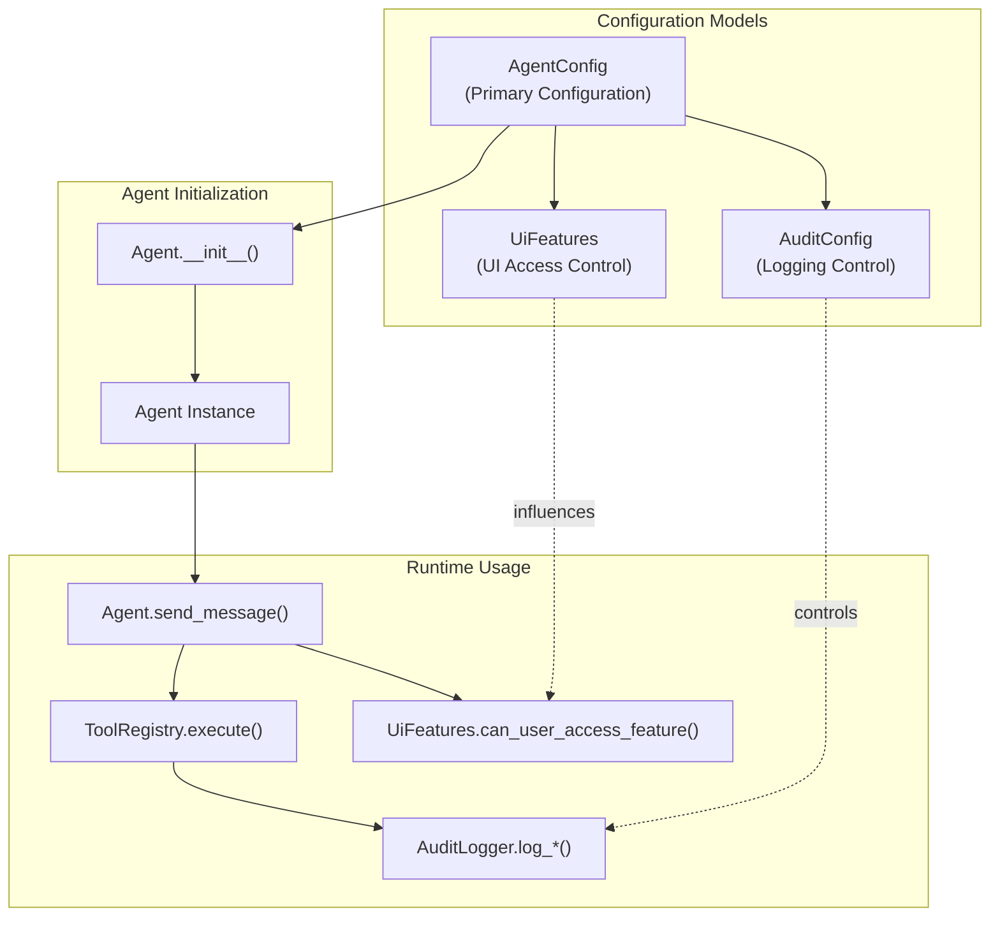
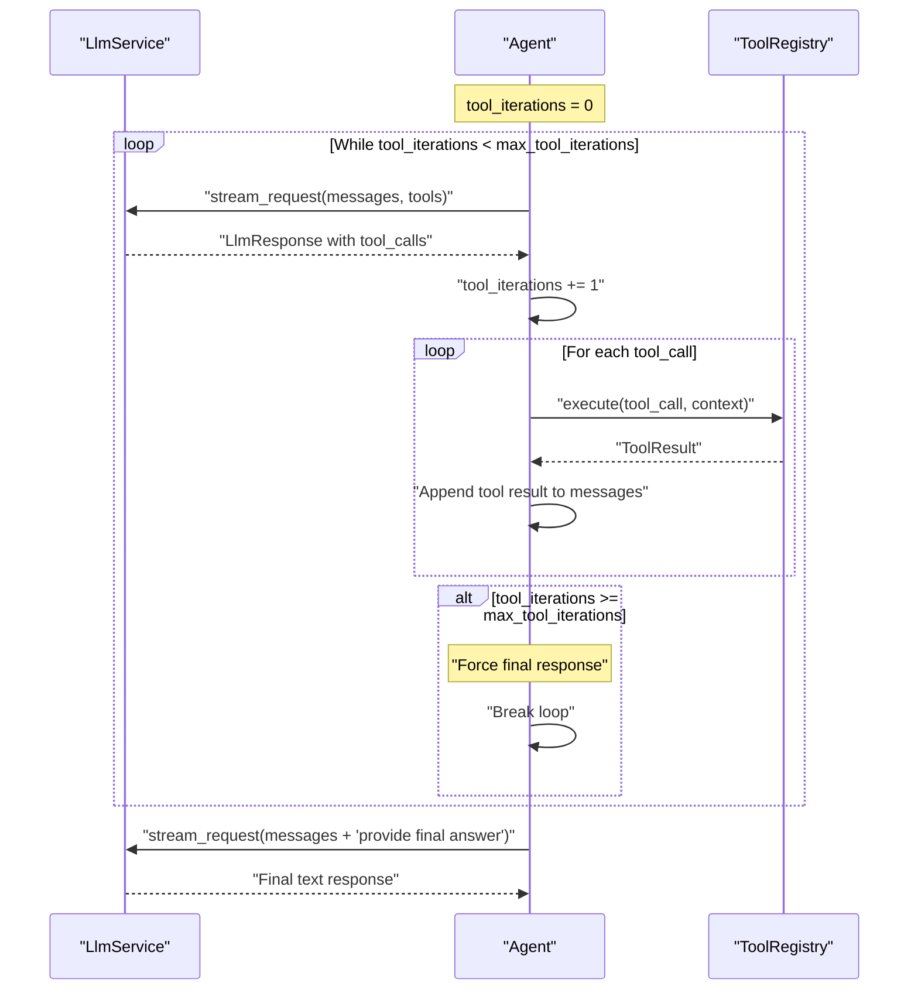
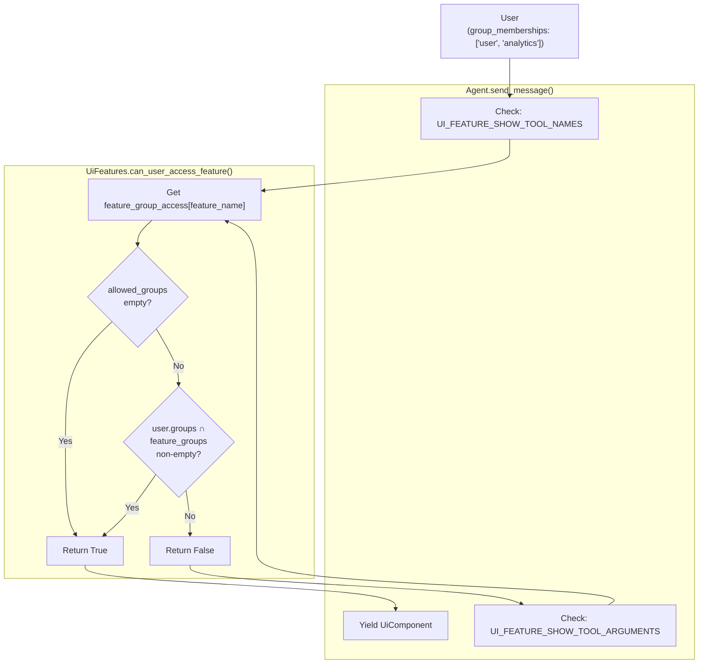
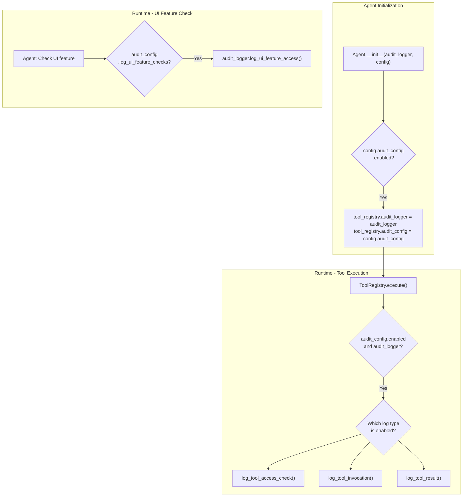
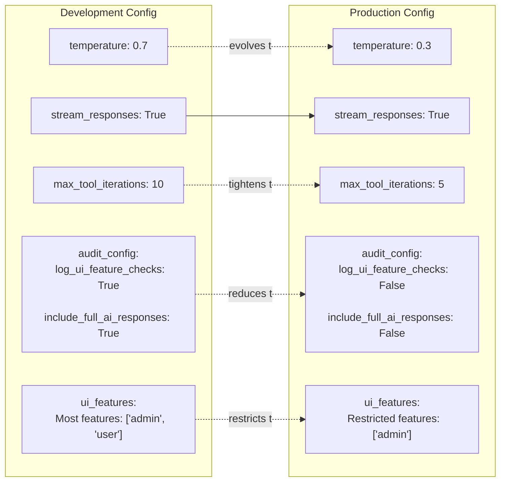

<!-- source: DeepWiki mcp.deepwiki.com · repo vanna-ai/vanna · page 2.2 AgentConfig and Configuration · fetched 2026-10-29 -->

# AgentConfig and Configuration

<details>
<summary>Relevant source files</summary>

The following files were used as context for generating this wiki page:

- [src/vanna/core/__init__.py](src/vanna/core/__init__.py)
- [src/vanna/core/agent/agent.py](src/vanna/core/agent/agent.py)
- [src/vanna/core/agent/config.py](src/vanna/core/agent/config.py)
- [src/vanna/core/workflow/__init__.py](src/vanna/core/workflow/__init__.py)
- [src/vanna/examples/default_workflow_handler_example.py](src/vanna/examples/default_workflow_handler_example.py)
- [src/vanna/integrations/__init__.py](src/vanna/integrations/__init__.py)
- [src/vanna/integrations/local/__init__.py](src/vanna/integrations/local/__init__.py)
- [src/vanna/integrations/local/file_system_conversation_store.py](src/vanna/integrations/local/file_system_conversation_store.py)
- [src/vanna/tools/agent_memory.py](src/vanna/tools/agent_memory.py)
- [src/vanna/tools/run_sql.py](src/vanna/tools/run_sql.py)

</details>


## Purpose and Scope

This document explains the `AgentConfig` class and related configuration models that control agent behavior in the Vanna Agents framework. Configuration parameters govern LLM interaction settings, UI feature access control, audit logging, and conversation management. For authentication and user identity resolution, see [UserResolver and Authentication](#3.1). For tool-level permissions, see [Tool Access Control](#3.2). For comprehensive system architecture context, see [Architecture Overview](#1.3).

**Sources:** [src/vanna/core/agent/config.py:1-124]()

---

## Configuration Architecture

The configuration system consists of three primary classes that work together to control agent behavior:



**Diagram: Configuration Flow from Initialization to Runtime**

The `AgentConfig` is passed during `Agent` initialization and is referenced throughout the agent's lifecycle to control behavior at various decision points. The `UiFeatures` and `AuditConfig` are nested within `AgentConfig` but are used independently by different subsystems.

**Sources:** [src/vanna/core/agent/agent.py:82-139](), [src/vanna/core/agent/config.py:113-124]()

---

## AgentConfig: Core Parameters

The `AgentConfig` class is defined at [src/vanna/core/agent/config.py:113-124]() and contains the following fields:

### Configuration Fields

| Field | Type | Default | Validation | Description |
|-------|------|---------|------------|-------------|
| `max_tool_iterations` | `int` | `10` | `> 0` | Maximum number of tool execution loops before forcing LLM to respond |
| `stream_responses` | `bool` | `True` | N/A | Enable streaming LLM responses via `LlmService.stream_request()` |
| `auto_save_conversations` | `bool` | `True` | N/A | Automatically persist conversations to `ConversationStore` |
| `include_thinking_indicators` | `bool` | `True` | N/A | Show visual indicators when LLM is processing (future feature) |
| `temperature` | `float` | `0.7` | `0.0 <= x <= 2.0` | LLM sampling temperature for response randomness |
| `max_tokens` | `Optional[int]` | `None` | `> 0` if set | Maximum tokens in LLM response (provider-dependent) |
| `ui_features` | `UiFeatures` | `UiFeatures()` | N/A | UI feature access control configuration |
| `audit_config` | `AuditConfig` | `AuditConfig()` | N/A | Audit logging configuration |

**Sources:** [src/vanna/core/agent/config.py:113-124]()

### Tool Iteration Control

The `max_tool_iterations` parameter controls the agent's tool execution loop. This prevents infinite loops when the LLM continuously calls tools without producing a final response.



**Diagram: Tool Iteration Loop with max_tool_iterations Enforcement**

**Sources:** [src/vanna/core/agent/agent.py:644-660]()

### Streaming Configuration

The `stream_responses` parameter controls whether the agent uses `LlmService.stream_request()` or `LlmService.send_request()`. Streaming enables progressive UI updates as tokens arrive from the LLM provider.

```python
# In Agent._send_message()
if self.config.stream_responses:
    response = await self._handle_streaming_response(request)
else:
    response = await self._send_llm_request(request)
```

**Code Reference:** [src/vanna/core/agent/agent.py:651-655]()

When streaming is enabled, the agent yields `UiComponent` objects incrementally as content arrives. When disabled, the full response is collected before yielding any UI components.

**Sources:** [src/vanna/core/agent/agent.py:651-655](), [src/vanna/core/agent/agent.py:1002-1105]()

### Conversation Persistence

The `auto_save_conversations` parameter determines whether the agent automatically calls `ConversationStore.update_conversation()` after processing messages. When disabled, the application must manually persist conversations.

**Usage Locations:**
- [src/vanna/core/agent/agent.py:336-337]() - After starter UI generation
- [src/vanna/core/agent/agent.py:490-491]() - After workflow handler execution
- [src/vanna/core/agent/agent.py:1205-1206]() - After LLM response completion

**Sources:** [src/vanna/core/agent/agent.py:336-337](), [src/vanna/core/agent/agent.py:490-491](), [src/vanna/core/agent/agent.py:1205-1206]()

### LLM Parameters

The `temperature` and `max_tokens` parameters are passed to the LLM service during request construction:

```python
# In Agent._build_llm_request()
request = LlmRequest(
    messages=llm_messages,
    tools=tool_schemas,
    temperature=self.config.temperature,
    max_tokens=self.config.max_tokens,
)
```

**Code Reference:** [src/vanna/core/agent/agent.py:1231-1236]()

These parameters are provider-agnostic and are interpreted by the specific `LlmService` implementation (OpenAI, Anthropic, etc.).

**Sources:** [src/vanna/core/agent/agent.py:1231-1236]()

---

## UiFeatures: Access Control for UI Elements

The `UiFeatures` class (defined at [src/vanna/core/agent/config.py:35-83]()) implements group-based access control for UI features using the same permission model as tool access control.

### UiFeature Enumeration

Built-in UI features are defined in the `UiFeature` enum:

```python
class UiFeature(StrEnum):
    UI_FEATURE_SHOW_TOOL_NAMES = "tool_names"
    UI_FEATURE_SHOW_TOOL_ARGUMENTS = "tool_arguments"
    UI_FEATURE_SHOW_TOOL_ERROR = "tool_error"
    UI_FEATURE_SHOW_TOOL_INVOCATION_MESSAGE_IN_CHAT = "tool_invocation_message_in_chat"
    UI_FEATURE_SHOW_MEMORY_DETAILED_RESULTS = "memory_detailed_results"
```

**Code Reference:** [src/vanna/core/agent/config.py:17-23]()

**Sources:** [src/vanna/core/agent/config.py:17-23]()

### Default Access Groups

Default group assignments are defined in `DEFAULT_UI_FEATURES`:

| Feature | Default Access Groups | Purpose |
|---------|----------------------|---------|
| `tool_names` | `["admin", "user"]` | Show which tools are being executed |
| `tool_arguments` | `["admin"]` | Show arguments passed to tools (may contain sensitive data) |
| `tool_error` | `["admin"]` | Show detailed error messages from tool failures |
| `tool_invocation_message_in_chat` | `["admin"]` | Display LLM's tool invocation reasoning in chat |
| `memory_detailed_results` | `["admin"]` | Show detailed memory search results with similarity scores |

**Code Reference:** [src/vanna/core/agent/config.py:26-32]()

**Sources:** [src/vanna/core/agent/config.py:26-32]()

### Permission Check Flow



**Diagram: UI Feature Access Check Algorithm**

The `can_user_access_feature()` method at [src/vanna/core/agent/config.py:49-73]() implements the same set-intersection logic as tool access control:

1. If `allowed_groups` is empty, all users have access
2. Otherwise, check if `user.group_memberships` intersects with `allowed_groups`
3. Return `True` if intersection is non-empty, `False` otherwise

**Sources:** [src/vanna/core/agent/config.py:49-73]()

### Usage in Agent Code

UI feature checks are performed throughout the agent's message processing:

```python
# Check if user can see tool names
has_tool_names_access = self.config.ui_features.can_user_access_feature(
    UiFeature.UI_FEATURE_SHOW_TOOL_NAMES, user
)

if has_tool_names_access:
    yield UiComponent(
        rich_component=TaskTrackerUpdateComponent.add_task(tool_task)
    )
```

**Code Reference:** [src/vanna/core/agent/agent.py:712-740]()

**Key Usage Locations:**
- [src/vanna/core/agent/agent.py:712-740]() - Tool name display in task tracker
- [src/vanna/core/agent/agent.py:753-782]() - Tool argument display in status cards
- [src/vanna/core/agent/agent.py:673-700]() - Tool invocation message in chat
- [src/vanna/tools/agent_memory.py:203-246]() - Memory search detailed results

**Sources:** [src/vanna/core/agent/agent.py:673-740](), [src/vanna/core/agent/agent.py:753-782](), [src/vanna/tools/agent_memory.py:203-246]()

### Custom Feature Registration

Applications can register custom UI features:

```python
config = AgentConfig()

# Register custom feature accessible to "premium" group
config.ui_features.register_feature(
    name="advanced_analytics_panel",
    access_groups=["premium", "admin"]
)

# Check access in custom code
if config.ui_features.can_user_access_feature("advanced_analytics_panel", user):
    # Show advanced analytics UI
    pass
```

**Method Reference:** [src/vanna/core/agent/config.py:75-82]()

**Sources:** [src/vanna/core/agent/config.py:75-82]()

---

## AuditConfig: Logging Control

The `AuditConfig` class (defined at [src/vanna/core/agent/config.py:85-111]()) controls which events are logged by the `AuditLogger` system. This enables fine-grained control over audit verbosity and privacy.

### Audit Configuration Fields

| Field | Type | Default | Description |
|-------|------|---------|-------------|
| `enabled` | `bool` | `True` | Master switch for all audit logging |
| `log_tool_access_checks` | `bool` | `True` | Log permission checks before tool execution |
| `log_tool_invocations` | `bool` | `True` | Log tool calls with parameters |
| `log_tool_results` | `bool` | `True` | Log tool execution results |
| `log_ui_feature_checks` | `bool` | `False` | Log UI feature access checks (can be noisy) |
| `log_ai_responses` | `bool` | `True` | Log AI-generated text responses |
| `include_full_ai_responses` | `bool` | `False` | Include complete AI response text (privacy concern) |
| `sanitize_tool_parameters` | `bool` | `True` | Remove sensitive parameters like passwords from logs |

**Sources:** [src/vanna/core/agent/config.py:85-111]()

### Audit Integration with Agent and ToolRegistry



**Diagram: Audit Configuration Wiring and Runtime Usage**

During agent initialization, the `audit_logger` and `audit_config` are passed to the `ToolRegistry`:

```python
# In Agent.__init__()
if self.audit_logger and self.config.audit_config.enabled:
    self.tool_registry.audit_logger = self.audit_logger
    self.tool_registry.audit_config = self.config.audit_config
```

**Code Reference:** [src/vanna/core/agent/agent.py:136-138]()

**Sources:** [src/vanna/core/agent/agent.py:136-138]()

### Conditional Logging Examples

#### Tool Invocation Logging

```python
# In ToolRegistry.execute()
if (
    self.audit_logger
    and self.audit_config
    and self.audit_config.enabled
    and self.audit_config.log_tool_invocations
):
    await self.audit_logger.log_tool_invocation(
        user=context.user,
        tool_name=tool_call.name,
        arguments=sanitized_args,
        conversation_id=context.conversation_id,
        request_id=context.request_id,
    )
```

**Pattern:** Check `enabled` and specific log type before calling audit logger methods.

**Sources:** Referenced pattern from [src/vanna/core/agent/agent.py:719-733]()

#### UI Feature Check Logging

```python
# In Agent._send_message()
if (
    self.audit_logger
    and self.config.audit_config.enabled
    and self.config.audit_config.log_ui_feature_checks
):
    await self.audit_logger.log_ui_feature_access(
        user=user,
        feature_name=UiFeature.UI_FEATURE_SHOW_TOOL_NAMES,
        access_granted=has_tool_names_access,
        required_groups=self.config.ui_features.feature_group_access.get(
            UiFeature.UI_FEATURE_SHOW_TOOL_NAMES, []
        ),
        conversation_id=conversation.id,
        request_id=request_id,
    )
```

**Code Reference:** [src/vanna/core/agent/agent.py:719-733]()

**Sources:** [src/vanna/core/agent/agent.py:719-733](), [src/vanna/core/agent/agent.py:759-774]()

### Privacy Considerations

The `include_full_ai_responses` flag controls whether complete AI-generated text is logged. This is disabled by default because AI responses may contain:
- User-specific data from database query results
- Personally identifiable information (PII)
- Sensitive business logic or patterns

When `False`, only metadata about the response (timestamp, token count, model) is logged.

**Sources:** [src/vanna/core/agent/config.py:104-107]()

---

## Configuration in Practice

### Basic Configuration Example

```python
from vanna import Agent, AgentConfig, UiFeatures, AuditConfig

# Create configuration with custom settings
config = AgentConfig(
    max_tool_iterations=5,              # Limit tool loops
    stream_responses=True,              # Enable streaming
    temperature=0.3,                    # Lower temperature for consistency
    auto_save_conversations=True,       # Persist conversations
)

# Create agent with configuration
agent = Agent(
    llm_service=llm_service,
    tool_registry=registry,
    user_resolver=user_resolver,
    agent_memory=agent_memory,
    config=config,
)
```

**Sources:** [src/vanna/core/agent/agent.py:82-100]()

### Custom UI Features Configuration

```python
from vanna import AgentConfig, UiFeatures, DEFAULT_UI_FEATURES

# Start with defaults
custom_ui_features = UiFeatures(
    feature_group_access=DEFAULT_UI_FEATURES.copy()
)

# Customize specific features
custom_ui_features.feature_group_access[UiFeature.UI_FEATURE_SHOW_TOOL_ARGUMENTS] = [
    "admin",
    "power_user"  # Add power_user group
]

# Register custom feature
custom_ui_features.register_feature(
    name="export_data_button",
    access_groups=["premium", "admin"]
)

config = AgentConfig(ui_features=custom_ui_features)
```

**Sources:** [src/vanna/core/agent/config.py:35-83]()

### Audit Configuration for Production

```python
from vanna import AgentConfig, AuditConfig
from vanna.integrations.local import LoggingAuditLogger

# Create production-safe audit config
audit_config = AuditConfig(
    enabled=True,
    log_tool_access_checks=True,
    log_tool_invocations=True,
    log_tool_results=True,
    log_ui_feature_checks=False,        # Disable noisy UI logs
    log_ai_responses=True,
    include_full_ai_responses=False,    # Privacy: don't log full responses
    sanitize_tool_parameters=True,      # Remove passwords/tokens
)

audit_logger = LoggingAuditLogger()

agent = Agent(
    llm_service=llm_service,
    tool_registry=registry,
    user_resolver=user_resolver,
    agent_memory=agent_memory,
    config=AgentConfig(audit_config=audit_config),
    audit_logger=audit_logger,
)
```

**Sources:** [src/vanna/core/agent/config.py:85-111](), [src/vanna/core/agent/agent.py:99]()

### Development vs Production Configurations



**Diagram: Configuration Evolution from Development to Production**

**Typical Adjustments:**
- **Temperature:** Lower in production for consistent, predictable responses
- **Max Iterations:** Reduce to prevent resource exhaustion
- **UI Features:** Restrict sensitive features to admin-only
- **Audit Logging:** Disable verbose logs, enable privacy protections

**Sources:** [src/vanna/core/agent/config.py:113-124]()

---

## Configuration Validation

The `AgentConfig` class uses Pydantic's field validation to ensure configuration values are valid:

```python
class AgentConfig(BaseModel):
    max_tool_iterations: int = Field(default=10, gt=0)  # Must be > 0
    temperature: float = Field(default=0.7, ge=0.0, le=2.0)  # 0.0 <= x <= 2.0
    max_tokens: Optional[int] = Field(default=None, gt=0)  # Must be > 0 if set
```

Attempting to create an `AgentConfig` with invalid values raises a `ValidationError`:

```python
# Raises ValidationError: max_tool_iterations must be > 0
config = AgentConfig(max_tool_iterations=0)

# Raises ValidationError: temperature must be >= 0.0 and <= 2.0
config = AgentConfig(temperature=3.0)
```

**Sources:** [src/vanna/core/agent/config.py:116-121]()

---

## Summary

The `AgentConfig` system provides centralized control over agent behavior through three primary components:

1. **Core Parameters** (`max_tool_iterations`, `stream_responses`, `temperature`, etc.) - Control LLM interaction and execution flow
2. **UiFeatures** - Group-based access control for UI elements using set intersection logic
3. **AuditConfig** - Fine-grained control over audit logging with privacy protections

Configuration is immutable after agent initialization and flows through the agent's execution pipeline to influence decisions at runtime. The system balances flexibility (extensive customization options) with safety (validation, defaults, privacy controls).

**Sources:** [src/vanna/core/agent/config.py:1-124](), [src/vanna/core/agent/agent.py:82-139]()

---

