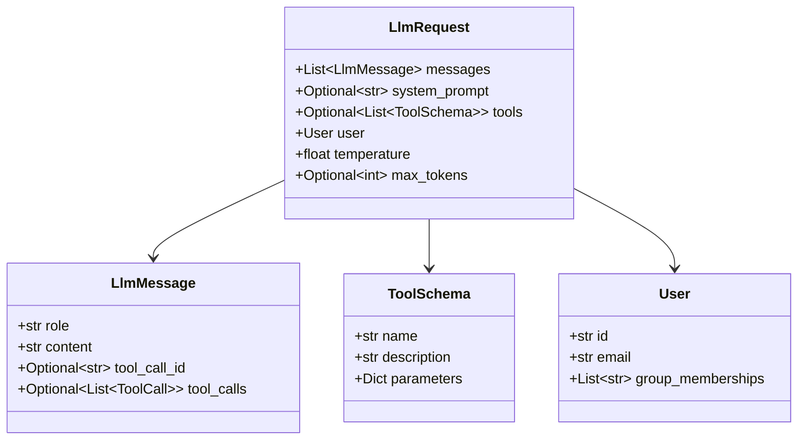
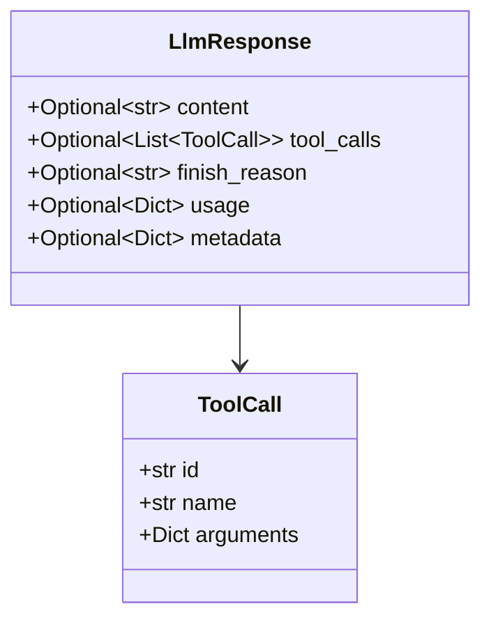
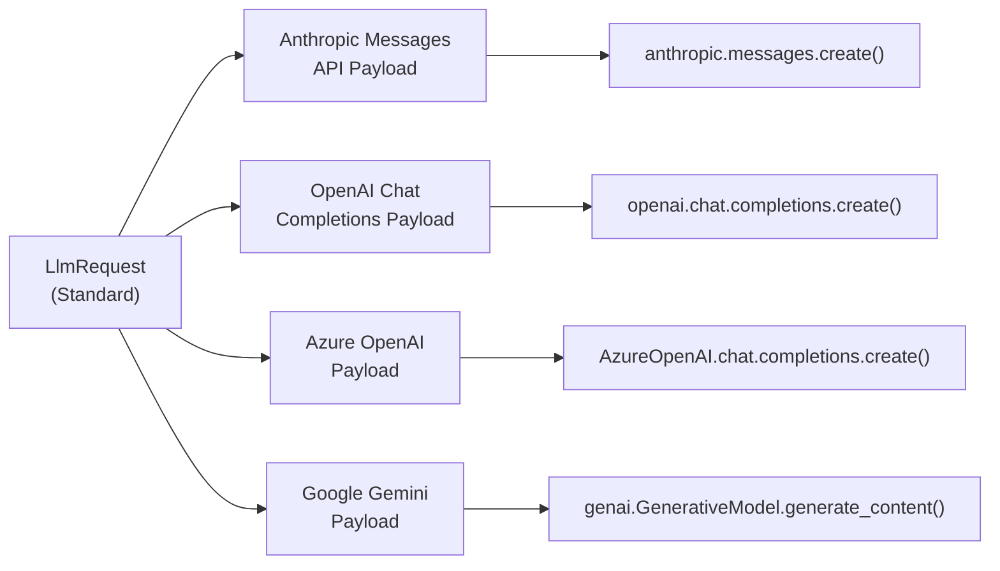
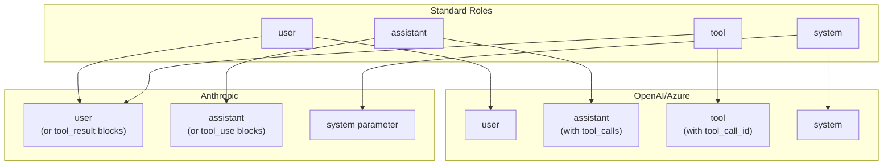
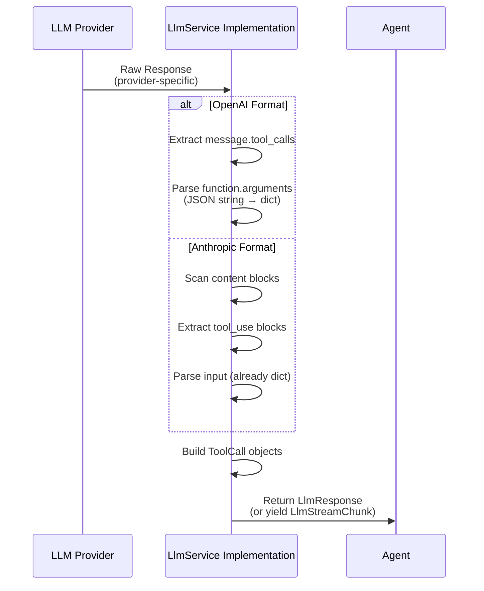
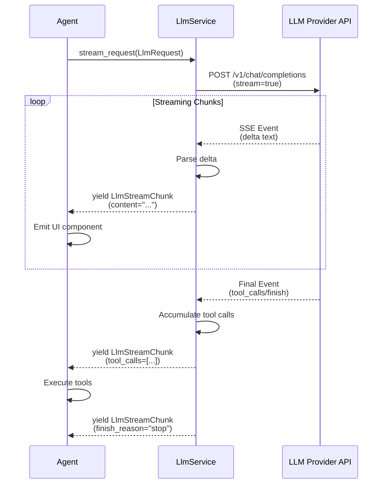
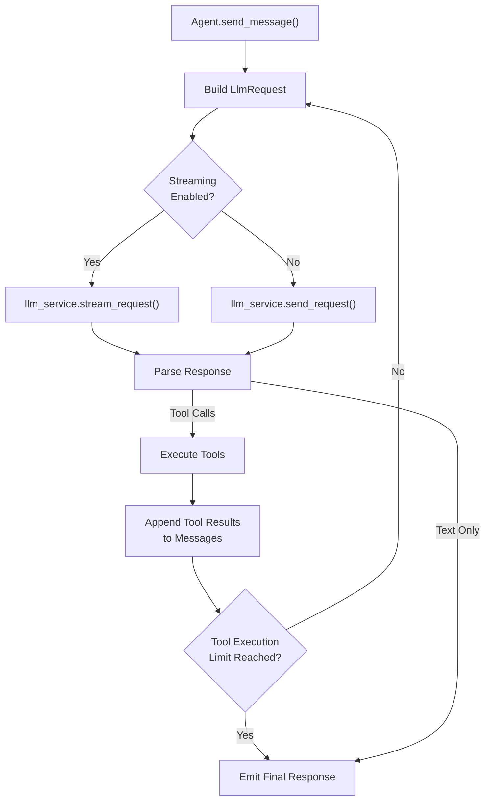

<!-- source: DeepWiki mcp.deepwiki.com · repo vanna-ai/vanna · page 2.3 LlmService Interface · fetched 2026-10-29 -->

# LlmService Interface

<details>
<summary>Relevant source files</summary>

The following files were used as context for generating this wiki page:

- [MIGRATION_GUIDE.md](MIGRATION_GUIDE.md)
- [README.md](README.md)
- [img/architecture.png](img/architecture.png)
- [img/vanna2.svg](img/vanna2.svg)
- [notebooks/quickstart.ipynb](notebooks/quickstart.ipynb)
- [src/vanna/integrations/anthropic/llm.py](src/vanna/integrations/anthropic/llm.py)
- [src/vanna/integrations/azureopenai/__init__.py](src/vanna/integrations/azureopenai/__init__.py)
- [src/vanna/integrations/azureopenai/llm.py](src/vanna/integrations/azureopenai/llm.py)
- [src/vanna/integrations/openai/llm.py](src/vanna/integrations/openai/llm.py)
- [src/vanna/integrations/openai/responses.py](src/vanna/integrations/openai/responses.py)
- [src/vanna/integrations/postgres/sql_runner.py](src/vanna/integrations/postgres/sql_runner.py)
- [src/vanna/servers/fastapi/app.py](src/vanna/servers/fastapi/app.py)
- [src/vanna/servers/flask/app.py](src/vanna/servers/flask/app.py)
- [tests/conftest.py](tests/conftest.py)
- [tests/test_agent_memory_sanity.py](tests/test_agent_memory_sanity.py)
- [tests/test_agents.py](tests/test_agents.py)
- [tests/test_azureopenai_llm.py](tests/test_azureopenai_llm.py)
- [tests/test_legacy_adapter.py](tests/test_legacy_adapter.py)
- [tox.ini](tox.ini)

</details>


## Purpose and Scope

The `LlmService` interface is the core abstraction layer that enables Vanna agents to communicate with any Large Language Model provider through a unified API. This interface decouples the agent orchestration logic from provider-specific implementation details, allowing seamless switching between OpenAI, Anthropic, Azure OpenAI, Google Gemini, Ollama, and other LLM providers without modifying agent code.

This page covers the `LlmService` abstract interface, its core methods (`send_request`, `stream_request`, `validate_tools`), request/response data models, and the provider-agnostic design principles. For details on specific LLM provider implementations, see [LLM Integrations](#5). For information on how the Agent uses `LlmService`, see [Agent System](#2.1).

**Sources:** [README.md:1-312](), [src/vanna/integrations/anthropic/llm.py:1-271](), [src/vanna/integrations/openai/llm.py:1-268]()

---

## Core Interface Definition

The `LlmService` abstract base class defines three essential methods that all provider implementations must support:

| Method | Return Type | Purpose |
|--------|-------------|---------|
| `send_request` | `LlmResponse` | Synchronous (blocking) request for complete response |
| `stream_request` | `AsyncGenerator[LlmStreamChunk, None]` | Streaming request yielding incremental chunks |
| `validate_tools` | `List[str]` | Pre-flight validation of tool schemas |

All methods are async to support efficient I/O operations and integrate seamlessly with the async agent execution pipeline.

### Method Signatures

```
async def send_request(request: LlmRequest) -> LlmResponse
async def stream_request(request: LlmRequest) -> AsyncGenerator[LlmStreamChunk, None]
async def validate_tools(tools: List[ToolSchema]) -> List[str]
```

**Sources:** [src/vanna/integrations/anthropic/llm.py:65-130](), [src/vanna/integrations/openai/llm.py:68-188]()

---

## Request and Response Data Models

### LlmRequest Structure

The `LlmRequest` encapsulates all information needed for an LLM API call:



**Key Fields:**
- **messages**: Conversation history with roles (`user`, `assistant`, `tool`, `system`)
- **system_prompt**: Top-level system instructions (distinct from system-role messages)
- **tools**: Available tool schemas for function calling
- **user**: User context for multi-tenant scenarios
- **temperature**: Sampling temperature (0.0-1.0, typically 0.0 for reasoning models)
- **max_tokens**: Maximum response length

**Sources:** [src/vanna/integrations/anthropic/llm.py:65-68](), [src/vanna/integrations/openai/llm.py:190-242]()

### LlmResponse Structure

The `LlmResponse` contains the complete LLM output:



**Key Fields:**
- **content**: Text response from the LLM (may be `None` if only tool calls returned)
- **tool_calls**: List of function calls requested by the LLM
- **finish_reason**: Completion status (`stop`, `tool_calls`, `length`, `content_filter`)
- **usage**: Token usage statistics (`input_tokens`, `output_tokens`, `total_tokens`)
- **metadata**: Provider-specific metadata (request IDs, model version, etc.)

**Sources:** [src/vanna/integrations/anthropic/llm.py:85-90](), [src/vanna/integrations/azureopenai/llm.py:145-150]()

### LlmStreamChunk Structure

For streaming requests, `LlmStreamChunk` represents incremental updates:

| Field | Type | Description |
|-------|------|-------------|
| `content` | `Optional[str]` | Incremental text delta |
| `tool_calls` | `Optional[List[ToolCall]]` | Complete tool calls (emitted at end) |
| `finish_reason` | `Optional[str]` | Completion status (emitted at end) |

Streaming typically emits:
1. Multiple chunks with `content` deltas as text is generated
2. A final chunk with `tool_calls` (if the LLM invoked functions)
3. A terminal chunk with `finish_reason` to signal completion

**Sources:** [src/vanna/integrations/anthropic/llm.py:92-122](), [src/vanna/integrations/openai/llm.py:100-178]()

---

## Provider-Agnostic Design Principles

### Payload Transformation

Each provider implementation translates the standard `LlmRequest` into provider-specific API formats:



**Transformation handled in `_build_payload()` method:**
- Message role mapping (e.g., `tool` role → `user` role with `tool_result` content blocks for Anthropic)
- Tool schema serialization (JSON Schema → provider-specific function format)
- System prompt placement (separate parameter vs. system-role message)
- Parameter constraints (e.g., temperature excluded for reasoning models like GPT-5/o1)

**Sources:** [src/vanna/integrations/anthropic/llm.py:132-224](), [src/vanna/integrations/openai/llm.py:190-242](), [src/vanna/integrations/azureopenai/llm.py:243-303]()

### Tool Schema Serialization

The `ToolSchema` abstraction is serialized differently per provider:

**OpenAI/Azure OpenAI Format:**
```json
{
  "type": "function",
  "function": {
    "name": "run_sql",
    "description": "Execute SQL query",
    "parameters": {
      "type": "object",
      "properties": {
        "sql": {"type": "string", "description": "SQL query"}
      },
      "required": ["sql"]
    }
  }
}
```

**Anthropic Format:**
```json
{
  "name": "run_sql",
  "description": "Execute SQL query",
  "input_schema": {
    "type": "object",
    "properties": {
      "sql": {"type": "string", "description": "SQL query"}
    },
    "required": ["sql"]
  }
}
```

The serialization logic resides in `_build_payload()` for each provider.

**Sources:** [src/vanna/integrations/anthropic/llm.py:198-207](), [src/vanna/integrations/openai/llm.py:219-230](), [src/vanna/integrations/azureopenai/llm.py:272-284]()

---

## Message Flow and Conversation Handling

### Message Role Mapping

Different providers support different message role conventions:



**Key Differences:**
- **System prompt**: OpenAI uses system-role message; Anthropic uses separate `system` parameter
- **Tool results**: OpenAI uses dedicated `tool` role; Anthropic uses `tool_result` content blocks within `user` messages
- **Tool calls**: OpenAI uses `tool_calls` array; Anthropic uses `tool_use` content blocks

**Anthropic Tool Result Grouping:**
Consecutive `tool` role messages are grouped into a single `user` message with multiple `tool_result` content blocks to comply with Anthropic's API requirements of alternating user/assistant turns.

**Sources:** [src/vanna/integrations/anthropic/llm.py:136-196](), [src/vanna/integrations/openai/llm.py:192-216]()

### Tool Call Extraction

After receiving an LLM response, tool calls must be extracted from provider-specific formats:



**Parsing Logic:**
- OpenAI: `message.tool_calls[i].function.arguments` is a JSON string requiring `json.loads()`
- Anthropic: Content blocks with `type: "tool_use"` contain `input` as a dict already

**Error Handling:**
If argument parsing fails, the arguments are wrapped in `{"_raw": <original_value>}` to preserve data.

**Sources:** [src/vanna/integrations/anthropic/llm.py:226-270](), [src/vanna/integrations/openai/llm.py:244-267](), [src/vanna/integrations/azureopenai/llm.py:305-329]()

---

## Streaming Architecture

### Streaming Request Flow



**Sources:** [src/vanna/integrations/anthropic/llm.py:92-122](), [src/vanna/integrations/openai/llm.py:100-178]()

### Tool Call Accumulation During Streaming

Tool calls are streamed incrementally and must be accumulated:

**OpenAI/Azure Streaming Format:**
```python
# Chunk 1
delta.tool_calls[0].index = 0
delta.tool_calls[0].function.name = "run_sql"

# Chunk 2
delta.tool_calls[0].index = 0
delta.tool_calls[0].function.arguments = '{"sql":'

# Chunk 3
delta.tool_calls[0].index = 0
delta.tool_calls[0].function.arguments = ' "SELECT'
```

The implementation maintains a `tc_builders` dict indexed by tool call index, concatenating argument strings until the stream ends, then parsing the complete JSON.

**Anthropic Streaming Format:**
Anthropic's SDK provides `stream.text_stream` for text deltas and `stream.get_final_message()` for complete tool calls at the end, simplifying accumulation.

**Sources:** [src/vanna/integrations/openai/llm.py:110-178](), [src/vanna/integrations/azureopenai/llm.py:152-232](), [src/vanna/integrations/anthropic/llm.py:100-122]()

---

## Provider Implementations Overview

### OpenAI (`OpenAILlmService`)

- **API**: OpenAI Chat Completions (`openai>=1.0.0`)
- **Endpoint**: Configurable via `base_url` (defaults to OpenAI's official API)
- **Authentication**: API key via `OPENAI_API_KEY` environment variable or constructor
- **Model Selection**: Defaults to `gpt-5`, configurable via `OPENAI_MODEL` env var
- **Tool Format**: Function calling with JSON Schema parameters
- **Streaming**: Native SSE streaming support

**Sources:** [src/vanna/integrations/openai/llm.py:1-268]()

### Azure OpenAI (`AzureOpenAILlmService`)

- **API**: Azure OpenAI Chat Completions (deployment-scoped)
- **Endpoint**: Requires `azure_endpoint` and `api_version` (defaults to `2024-10-21`)
- **Authentication**: API key or Azure AD token provider via `azure_ad_token_provider`
- **Model Selection**: Deployment name (required), not global model name
- **Reasoning Model Detection**: Automatically excludes `temperature` for GPT-5/o1/o3-mini models
- **Tool Format**: Identical to OpenAI (function calling)

**Reasoning Models:**
```python
REASONING_MODELS = {
    "o1", "o1-mini", "o1-preview", 
    "o3-mini", 
    "gpt-5", "gpt-5-mini", "gpt-5-nano", "gpt-5-pro", "gpt-5-codex"
}
```
These models reject the `temperature` parameter, which is automatically omitted.

**Sources:** [src/vanna/integrations/azureopenai/llm.py:1-330](), [tests/test_azureopenai_llm.py:1-298]()

### Anthropic (`AnthropicLlmService`)

- **API**: Anthropic Messages API (`anthropic>=0.8.0`)
- **Endpoint**: Configurable via `base_url` (defaults to Anthropic's official API)
- **Authentication**: API key via `ANTHROPIC_API_KEY` environment variable
- **Model Selection**: Defaults to `claude-sonnet-4-5`, configurable via `ANTHROPIC_MODEL` env var
- **Tool Format**: `tool_use` content blocks with `input_schema`
- **Streaming**: Native streaming with `messages.stream()` context manager
- **Max Tokens**: Required parameter (defaults to 512 if not specified)

**Message Constraints:**
- Requires alternating user/assistant turns
- System prompt passed as separate `system` parameter
- Tool results must be grouped in `user` messages as `tool_result` content blocks

**Sources:** [src/vanna/integrations/anthropic/llm.py:1-271]()

### OpenAI Responses API (`OpenAIResponsesService`)

- **API**: OpenAI Responses API (structured output with tools)
- **Model**: Defaults to `gpt-5`
- **Payload Structure**: Uses `input` instead of `messages`, `instructions` instead of `system_prompt`
- **Streaming**: Event-driven streaming with `response.output_text.delta` events
- **Tool Extraction**: Parses `output[].content[].tool_call` structures

**Sources:** [src/vanna/integrations/openai/responses.py:1-164]()

### Other Providers

The following providers are supported with similar patterns (see [Other LLM Providers](#5.7)):
- **Google Gemini** (`GeminiLlmService`)
- **Ollama** (`OllamaLlmService`) - local model hosting
- **Mistral AI** (`MistralLlmService`)
- **AWS Bedrock** (`BedrockLlmService`)
- **ZhipuAI**, **Qianfan**, **vLLM**, **Xinference**

**Sources:** [README.md:95-96](), [tox.ini:1-243]()

---

## Tool Validation

The `validate_tools` method performs pre-flight validation of tool schemas before sending requests:

```python
async def validate_tools(self, tools: List[ToolSchema]) -> List[str]:
    """
    Validate tool schemas for provider-specific constraints.
    
    Returns:
        List of error messages (empty list if valid)
    """
```

**Common Validation Rules:**
- Tool name must be non-empty and typically ≤64 characters
- Tool name must match `[a-zA-Z0-9_-]+` pattern (provider-dependent)
- Parameters must be valid JSON Schema
- Description should be clear and concise

**Implementation Patterns:**
- **Basic validation**: Name length and presence checks [src/vanna/integrations/openai/llm.py:180-188]()
- **Minimal validation**: OpenAI Responses API accepts schemas liberally [src/vanna/integrations/openai/responses.py:60-61]()
- **Server-side validation**: Most providers enforce additional constraints server-side

**Sources:** [src/vanna/integrations/anthropic/llm.py:123-130](), [src/vanna/integrations/azureopenai/llm.py:233-241]()

---

## Integration with Agent System

### Agent → LlmService Communication

The `Agent` class uses `LlmService` to orchestrate LLM interactions:



**Key Steps:**
1. **Build LlmRequest**: Aggregate conversation history, system prompt, accessible tools, and similar tool usage memories
2. **Stream or Send**: Use `stream_request()` for real-time UI updates or `send_request()` for batch processing
3. **Parse Response**: Extract text content and tool calls
4. **Execute Tools**: If tool calls present, execute via `ToolRegistry` with user context
5. **Append Tool Results**: Add tool execution results as `tool` role messages
6. **Loop Control**: Repeat until no tool calls or `max_tool_iterations` reached (default 10)

**Sources:** [tests/test_agents.py:55-106](), [notebooks/quickstart.ipynb:118-138]()

### Configuration via AgentConfig

The `AgentConfig` controls LLM interaction parameters:

| Parameter | Default | Description |
|-----------|---------|-------------|
| `stream_responses` | `True` | Enable streaming for real-time UI updates |
| `temperature` | `0.0` | LLM sampling temperature (0.0 = deterministic) |
| `max_tokens` | `None` | Maximum response length (provider default if `None`) |
| `max_tool_iterations` | `10` | Maximum tool execution loops to prevent infinite cycles |

**Sources:** [README.md:127-133](), [notebooks/quickstart.ipynb:131]()

---

## Provider Selection and Configuration

### Environment-Based Configuration

Providers use environment variables for default configuration:

| Provider | Environment Variables |
|----------|----------------------|
| **OpenAI** | `OPENAI_API_KEY`, `OPENAI_MODEL`, `OPENAI_ORG`, `OPENAI_BASE_URL` |
| **Azure OpenAI** | `AZURE_OPENAI_API_KEY`, `AZURE_OPENAI_MODEL`, `AZURE_OPENAI_ENDPOINT`, `AZURE_OPENAI_API_VERSION` |
| **Anthropic** | `ANTHROPIC_API_KEY`, `ANTHROPIC_MODEL`, `ANTHROPIC_BASE_URL` |
| **Gemini** | `GOOGLE_API_KEY` or `GEMINI_API_KEY` |

**Example:**
```python
# Configuration via environment variables
import os
os.environ["ANTHROPIC_API_KEY"] = "sk-ant-..."
os.environ["ANTHROPIC_MODEL"] = "claude-opus-4"

llm = AnthropicLlmService()  # Uses env vars

# Or explicit configuration
llm = AnthropicLlmService(
    api_key="sk-ant-...",
    model="claude-opus-4",
    base_url="https://api.anthropic.com"
)
```

**Sources:** [src/vanna/integrations/anthropic/llm.py:38-63](), [src/vanna/integrations/openai/llm.py:37-66](), [src/vanna/integrations/azureopenai/llm.py:62-117]()

### Runtime Provider Switching

Since `LlmService` is a constructor parameter to `Agent`, switching providers requires instantiating a new agent:

```python
# Agent with Anthropic
anthropic_agent = Agent(
    llm_service=AnthropicLlmService(model="claude-sonnet-4-5"),
    tool_registry=tools,
    user_resolver=resolver
)

# Agent with OpenAI (same tools, different LLM)
openai_agent = Agent(
    llm_service=OpenAILlmService(model="gpt-5"),
    tool_registry=tools,  # Same tools
    user_resolver=resolver  # Same auth
)
```

This design allows A/B testing, cost optimization, and fallback strategies.

**Sources:** [tests/test_agents.py:110-131](), [notebooks/quickstart.ipynb:123-125]()

---

## Testing and Development

### Testing Strategy

The codebase uses a multi-tier testing approach for LLM integrations:

**Tier 1: Unit Tests**
- Mock LLM responses to test payload building and response parsing
- Example: `test_build_payload_excludes_temperature_for_reasoning_model` [tests/test_azureopenai_llm.py:191-214]()

**Tier 2: Integration Tests**
- Require live API keys (environment variables)
- Execute real queries against LLM providers
- Example: `test_anthropic_top_artist` [tests/test_agents.py:108-118]()

**Tier 3: Sanity Tests**
- Validate import paths and basic instantiation without API calls
- Example: `test_chromadb_import` [tests/test_agent_memory_sanity.py:216-223]()

**Test Markers:**
```python
@pytest.mark.anthropic   # Requires ANTHROPIC_API_KEY
@pytest.mark.openai      # Requires OPENAI_API_KEY
@pytest.mark.azureopenai # Requires AZURE_OPENAI_API_KEY
```

**Sources:** [tox.ini:46-78](), [tests/conftest.py:14-67](), [tests/test_agents.py:1-196]()

### Implementing a Custom LlmService

To add a new provider, implement the three core methods:

1. **Constructor**: Accept API credentials and configuration
2. **`send_request`**: Transform `LlmRequest` → provider payload → call API → transform response to `LlmResponse`
3. **`stream_request`**: Same as above but yield `LlmStreamChunk` incrementally
4. **`validate_tools`**: Return list of validation errors

**Example Structure:**
```python
class MyCustomLlmService(LlmService):
    def __init__(self, api_key: str, model: str):
        self._client = MyCustomClient(api_key=api_key)
        self.model = model
    
    async def send_request(self, request: LlmRequest) -> LlmResponse:
        payload = self._build_payload(request)
        response = self._client.complete(payload)
        return self._parse_response(response)
    
    async def stream_request(self, request: LlmRequest) -> AsyncGenerator[LlmStreamChunk, None]:
        payload = self._build_payload(request)
        for chunk in self._client.stream(payload):
            yield self._parse_chunk(chunk)
    
    async def validate_tools(self, tools: List[ToolSchema]) -> List[str]:
        return []  # Or implement validation
    
    def _build_payload(self, request: LlmRequest) -> dict:
        # Transform LlmRequest to provider-specific format
        pass
    
    def _parse_response(self, response) -> LlmResponse:
        # Extract content, tool_calls, usage from response
        pass
```

**Sources:** [src/vanna/integrations/anthropic/llm.py:27-271](), [src/vanna/integrations/openai/llm.py:27-268]()

---

## Summary

The `LlmService` interface provides a clean abstraction over diverse LLM providers, enabling:

✅ **Provider Independence**: Switch between OpenAI, Anthropic, Azure, Gemini, etc. with a single line change  
✅ **Unified Tool Calling**: Standard `ToolSchema` → provider-specific serialization  
✅ **Streaming Support**: Real-time response streaming for all providers  
✅ **Message Format Normalization**: Consistent conversation history handling  
✅ **User Context Flow**: Multi-tenant support with `User` object throughout  

The provider-agnostic design isolates complexity in individual implementations while exposing a simple, consistent API to the agent orchestration layer.

**Sources:** [README.md:1-312](), [src/vanna/integrations/anthropic/llm.py:1-271](), [src/vanna/integrations/openai/llm.py:1-268](), [src/vanna/integrations/azureopenai/llm.py:1-330]()

---

