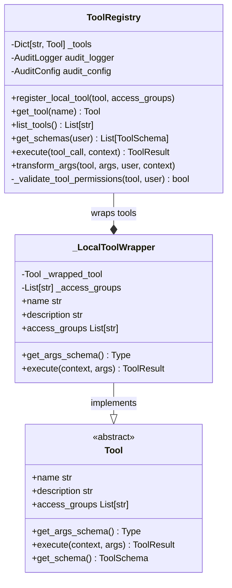
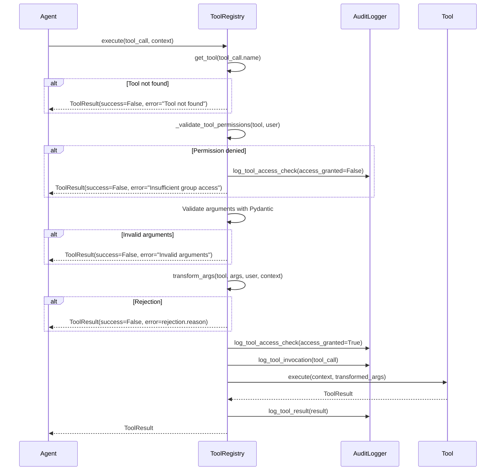
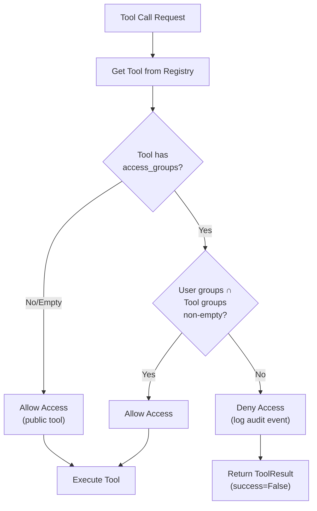
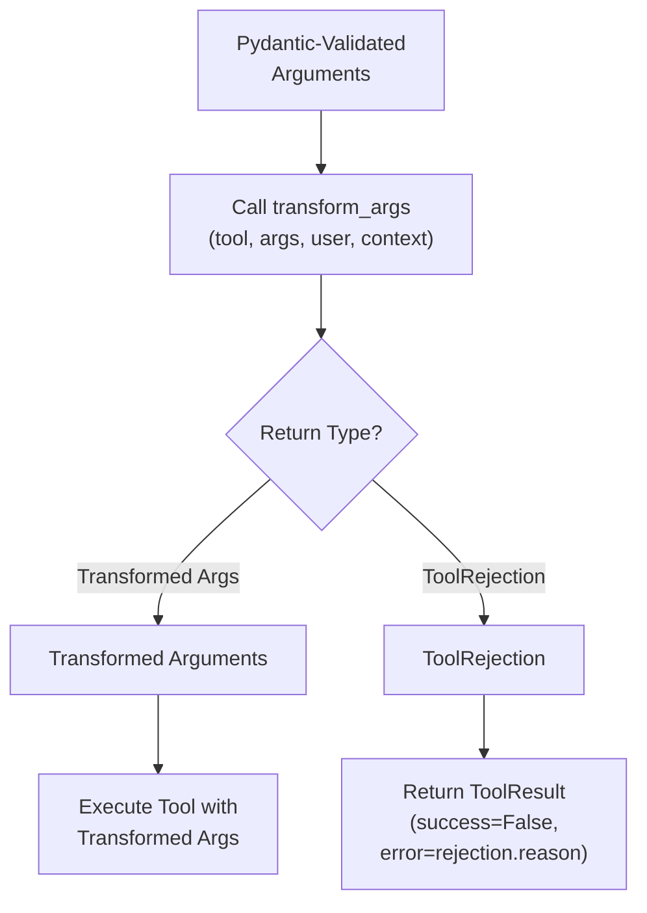

<!-- source: DeepWiki mcp.deepwiki.com · repo vanna-ai/vanna · page 2.4 ToolRegistry and Execution Pipeline · fetched 2026-10-29 -->

# ToolRegistry and Execution Pipeline

<details>
<summary>Relevant source files</summary>

The following files were used as context for generating this wiki page:

- [MIGRATION_GUIDE.md](MIGRATION_GUIDE.md)
- [README.md](README.md)
- [examples/transform_args_example.py](examples/transform_args_example.py)
- [img/architecture.png](img/architecture.png)
- [img/vanna2.svg](img/vanna2.svg)
- [notebooks/quickstart.ipynb](notebooks/quickstart.ipynb)
- [src/vanna/core/registry.py](src/vanna/core/registry.py)
- [src/vanna/core/tool/__init__.py](src/vanna/core/tool/__init__.py)
- [src/vanna/core/tool/base.py](src/vanna/core/tool/base.py)
- [src/vanna/core/tool/models.py](src/vanna/core/tool/models.py)
- [src/vanna/core/user/models.py](src/vanna/core/user/models.py)
- [src/vanna/integrations/anthropic/llm.py](src/vanna/integrations/anthropic/llm.py)
- [src/vanna/integrations/openai/llm.py](src/vanna/integrations/openai/llm.py)
- [src/vanna/servers/fastapi/app.py](src/vanna/servers/fastapi/app.py)
- [src/vanna/servers/flask/app.py](src/vanna/servers/flask/app.py)
- [tests/test_agent_memory.py](tests/test_agent_memory.py)
- [tests/test_tool_permissions.py](tests/test_tool_permissions.py)

</details>


## Purpose and Scope

This document describes the `ToolRegistry` class and the tool execution pipeline in the Vanna Agents framework. The `ToolRegistry` manages tool registration, validates permissions, transforms arguments, and orchestrates tool execution. For information about creating custom tools, see [Tool System](#7). For details on the Agent's message processing flow that invokes tools, see [Agent System](#2.1).

**Sources:** [src/vanna/core/registry.py:1-279]()

---

## ToolRegistry Class

The `ToolRegistry` class is the central component responsible for managing and executing tools. It maintains a registry of available tools, enforces access control based on user group memberships, and provides hooks for argument transformation.

### Class Structure



**Sources:** [src/vanna/core/registry.py:46-62](), [src/vanna/core/registry.py:20-44](), [src/vanna/core/tool/base.py:16-71]()

---

## Tool Registration

### register_local_tool Method

Tools are registered using the `register_local_tool` method, which accepts a `Tool` instance and a list of access groups. If access groups are provided, the tool is wrapped in a `_LocalToolWrapper` that enforces group-based access control.

```python
def register_local_tool(self, tool: Tool[Any], access_groups: List[str]) -> None:
    """Register a local tool with optional access group restrictions.
    
    Args:
        tool: The tool to register
        access_groups: List of groups that can access this tool.
                      If None or empty, tool is accessible to all users.
    """
    if tool.name in self._tools:
        raise ValueError(f"Tool '{tool.name}' already registered")
    
    if access_groups:
        # Wrap the tool with access groups
        wrapped_tool = _LocalToolWrapper(tool, access_groups)
        self._tools[tool.name] = wrapped_tool
    else:
        # No access restrictions, register as-is
        self._tools[tool.name] = tool
```

**Sources:** [src/vanna/core/registry.py:63-81]()

### _LocalToolWrapper

The `_LocalToolWrapper` class wraps tools to override their `access_groups` property with the groups specified during registration. This allows the same tool implementation to be registered with different access restrictions.

| Property | Description |
|----------|-------------|
| `name` | Delegates to wrapped tool's name |
| `description` | Delegates to wrapped tool's description |
| `access_groups` | Returns the access groups provided during registration |
| `get_args_schema()` | Delegates to wrapped tool |
| `execute()` | Delegates to wrapped tool |

**Sources:** [src/vanna/core/registry.py:20-44]()

---

## Tool Execution Pipeline

The `execute` method orchestrates the complete tool execution pipeline, including validation, permission checks, argument transformation, and execution. This method is called by the Agent when the LLM requests tool invocation.

### Execution Flow Diagram



**Sources:** [src/vanna/core/registry.py:144-279]()

### Pipeline Steps

#### 1. Tool Lookup

The registry retrieves the tool by name from its internal dictionary. If the tool is not found, execution fails immediately.

```python
tool = await self.get_tool(tool_call.name)
if not tool:
    msg = f"Tool '{tool_call.name}' not found"
    return ToolResult(success=False, result_for_llm=msg, ui_component=None, error=msg)
```

**Sources:** [src/vanna/core/registry.py:150-158]()

#### 2. Permission Validation

The registry validates that the user has permission to execute the tool by checking if any of the user's group memberships intersect with the tool's access groups. If the tool has no access groups specified, it is accessible to all users.

```python
async def _validate_tool_permissions(self, tool: Tool[Any], user: User) -> bool:
    """Validate if user has access to tool based on group membership.
    
    Checks for intersection between user's group memberships and tool's access groups.
    If tool has no access groups specified, it's accessible to all users.
    """
    tool_access_groups = tool.access_groups
    if not tool_access_groups:
        return True
    
    user_groups = set(user.group_memberships)
    tool_groups = set(tool_access_groups)
    # Grant access if any group in user.group_memberships exists in tool.access_groups
    return bool(user_groups & tool_groups)
```

**Access Logic:**
- Empty `access_groups`: Tool is accessible to all users
- Non-empty `access_groups`: User must have at least one matching group

**Sources:** [src/vanna/core/registry.py:98-112](), [src/vanna/core/registry.py:161-184]()

#### 3. Argument Validation

Tool arguments are validated using the Pydantic model returned by the tool's `get_args_schema()` method. This ensures type safety and validates required fields.

```python
try:
    args_model = tool.get_args_schema()
    validated_args = args_model.model_validate(tool_call.arguments)
except Exception as e:
    msg = f"Invalid arguments: {str(e)}"
    return ToolResult(success=False, result_for_llm=msg, ui_component=None, error=msg)
```

**Sources:** [src/vanna/core/registry.py:186-197]()

#### 4. Argument Transformation

The `transform_args` method is called to allow user-specific transformations of validated arguments. This is the primary hook for implementing Row-Level Security (RLS) and other per-user customizations.

**Default Behavior:** The base `ToolRegistry` implementation returns arguments unchanged (NoOp).

```python
async def transform_args(
    self,
    tool: Tool[T],
    args: T,
    user: User,
    context: ToolContext,
) -> Union[T, ToolRejection]:
    """Transform and validate tool arguments based on user context.
    
    This method allows per-user transformation of tool arguments, such as:
    - Applying row-level security (RLS) to SQL queries
    - Filtering available options based on user permissions
    - Validating required arguments are present
    - Redacting sensitive fields
    
    The default implementation performs no transformation (NoOp).
    Subclasses can override this method to implement custom transformation logic.
    
    Args:
        tool: The tool being executed
        args: Already Pydantic-validated arguments
        user: The user executing the tool
        context: Full execution context
    
    Returns:
        Either:
        - Transformed arguments (may be unchanged if no transformation needed)
        - ToolRejection with explanation of why args were rejected
    """
    return args  # Default: no transformation (NoOp)
```

**Sources:** [src/vanna/core/registry.py:113-142](), [src/vanna/core/registry.py:199-213]()

#### 5. Tool Execution

The tool's `execute` method is invoked with the transformed arguments and the execution context. Execution time is measured and added to the result metadata.

```python
start_time = time.perf_counter()
result = await tool.execute(context, final_args)
execution_time_ms = (time.perf_counter() - start_time) * 1000

# Add execution time to metadata
result.metadata["execution_time_ms"] = execution_time_ms
```

**Sources:** [src/vanna/core/registry.py:249-255]()

#### 6. Auditing

Throughout the pipeline, audit events are logged if an `AuditLogger` is configured:
- Tool access checks (granted/denied)
- Tool invocations
- Tool results

**Sources:** [src/vanna/core/registry.py:165-177](), [src/vanna/core/registry.py:233-246](), [src/vanna/core/registry.py:258-268]()

---

## Core Models

### ToolCall

Represents a tool invocation request from the LLM.

| Field | Type | Description |
|-------|------|-------------|
| `id` | `str` | Unique identifier for this tool call |
| `name` | `str` | Name of the tool to execute |
| `arguments` | `Dict[str, Any]` | Raw arguments from LLM |

**Sources:** [src/vanna/core/tool/models.py:20-26]()

### ToolContext

Context passed to all tool executions, providing access to user information, conversation state, and agent memory.

| Field | Type | Description |
|-------|------|-------------|
| `user` | `User` | The user executing the tool |
| `conversation_id` | `str` | Unique conversation identifier |
| `request_id` | `str` | Unique request identifier for tracing |
| `agent_memory` | `AgentMemory` | Agent memory for tool usage learning |
| `metadata` | `Dict[str, Any]` | Additional metadata (e.g., UI features available) |
| `observability_provider` | `Optional[ObservabilityProvider]` | Optional observability provider for metrics |

**Sources:** [src/vanna/core/tool/models.py:28-45]()

### ToolResult

Result returned from tool execution.

| Field | Type | Description |
|-------|------|-------------|
| `success` | `bool` | Whether execution succeeded |
| `result_for_llm` | `str` | String content to send back to the LLM |
| `ui_component` | `Optional[UiComponent]` | Optional UI component for rendering |
| `error` | `Optional[str]` | Error message if failed |
| `metadata` | `Dict[str, Any]` | Additional metadata (e.g., execution time) |

**Sources:** [src/vanna/core/tool/models.py:47-62]()

### ToolSchema

Schema describing a tool for LLM consumption.

| Field | Type | Description |
|-------|------|-------------|
| `name` | `str` | Tool name |
| `description` | `str` | What this tool does |
| `parameters` | `Dict[str, Any]` | JSON Schema of parameters |
| `access_groups` | `List[str]` | Groups permitted to access this tool |

**Sources:** [src/vanna/core/tool/models.py:64-73]()

### ToolRejection

Indicates that tool execution should be rejected with a message. Returned by `transform_args` when arguments cannot be appropriately transformed for the user's context.

| Field | Type | Description |
|-------|------|-------------|
| `reason` | `str` | Explanation of why the tool execution was rejected |

**Sources:** [src/vanna/core/tool/models.py:75-85]()

---

## Access Control Patterns

### Group-Based Access Control

Access control is based on set intersection between user group memberships and tool access groups.



**Sources:** [src/vanna/core/registry.py:98-112](), [src/vanna/core/registry.py:161-184]()

### Example Access Control Scenarios

| User Groups | Tool Access Groups | Result |
|-------------|-------------------|--------|
| `["user"]` | `[]` | ✅ Allowed (public tool) |
| `["admin", "user"]` | `["admin"]` | ✅ Allowed (intersection: admin) |
| `["user"]` | `["admin"]` | ❌ Denied (no intersection) |
| `["analyst", "user"]` | `["admin", "analyst"]` | ✅ Allowed (intersection: analyst) |
| `[]` | `["user"]` | ❌ Denied (guest user, no groups) |

**Sources:** [tests/test_tool_permissions.py:101-132](), [tests/test_tool_permissions.py:134-164](), [tests/test_tool_permissions.py:166-198](), [tests/test_tool_permissions.py:201-253](), [tests/test_tool_permissions.py:255-283]()

---

## Argument Transformation

The `transform_args` method provides a powerful extension point for implementing custom argument transformations based on user context. The most common use case is implementing Row-Level Security (RLS) for SQL queries.

### Transform Args Flow



**Sources:** [src/vanna/core/registry.py:199-213]()

### Row-Level Security Example

A common pattern is to override `transform_args` in a custom `ToolRegistry` subclass to apply RLS filters to SQL queries.

**Implementation Pattern:**

```python
class RLSToolRegistry(ToolRegistry):
    async def transform_args(
        self,
        tool: Tool[T],
        args: T,
        user: User,
        context: ToolContext,
    ) -> Union[T, ToolRejection]:
        # Example 1: Reject access to restricted tables
        if "restricted_table" in args.query.lower():
            return ToolRejection(
                reason="Access to 'restricted_table' is not permitted"
            )
        
        # Example 2: Inject WHERE clause for organization filtering
        if "users" in args.query.lower():
            user_org_id = user.metadata.get("organization_id")
            if user_org_id:
                # Modify query to include organization filter
                transformed_query = inject_where_clause(
                    args.query,
                    f"organization_id = {user_org_id}"
                )
                return args.model_copy(update={"query": transformed_query})
        
        return args
```

**Use Cases for transform_args:**

| Use Case | Description | Return Type |
|----------|-------------|-------------|
| Row-Level Security | Inject WHERE clauses to filter data by user/org | Transformed Args |
| Field Redaction | Remove sensitive fields from queries | Transformed Args |
| Parameter Validation | Enforce business rules beyond Pydantic validation | ToolRejection |
| Access Restriction | Block access to specific resources | ToolRejection |
| Query Rewriting | Optimize or normalize queries | Transformed Args |

**Sources:** [examples/transform_args_example.py:45-97](), [src/vanna/core/registry.py:113-142]()

### RLS Query Transformation Examples

**Before Transformation:**
```sql
SELECT * FROM users
```

**After Transformation (organization_id = 42):**
```sql
SELECT * FROM users WHERE organization_id = 42
```

**Before Transformation:**
```sql
SELECT * FROM users WHERE status = 'active'
```

**After Transformation (organization_id = 42):**
```sql
SELECT * FROM users WHERE organization_id = 42 AND status = 'active'
```

**Sources:** [examples/transform_args_example.py:69-87](), [tests/test_tool_permissions.py:597-683]()

---

## Schema Generation

The `get_schemas` method returns tool schemas for all tools accessible to a given user. These schemas are used by the LLM to understand which tools are available and how to invoke them.

```python
async def get_schemas(self, user: Optional[User] = None) -> List[ToolSchema]:
    """Get schemas for all tools accessible to user."""
    schemas = []
    for tool in self._tools.values():
        if user is None or await self._validate_tool_permissions(tool, user):
            schemas.append(tool.get_schema())
    return schemas
```

**Filtering Logic:**
- If `user` is `None`: All tool schemas are returned
- If `user` is provided: Only schemas for tools the user has permission to access are returned

This ensures the LLM only sees tools the user can actually execute, preventing the LLM from attempting to call tools that would be rejected by permission validation.

**Sources:** [src/vanna/core/registry.py:90-96](), [tests/test_tool_permissions.py:285-316]()

---

## Integration with Agent

The `ToolRegistry` is used by the `Agent` class during message processing. When the LLM requests tool invocation:

1. **Agent receives LLM response** containing tool calls
2. **Agent calls ToolRegistry.execute()** for each tool call, passing the `ToolContext`
3. **ToolRegistry executes the pipeline** (validation, permissions, transformation, execution)
4. **Agent receives ToolResult** and sends it back to the LLM or yields UI components

For the complete agent message processing flow, see [Agent System](#2.1).

**Sources:** [src/vanna/core/registry.py:144-279]()

---

## Summary

The `ToolRegistry` and execution pipeline provide:

1. **Centralized Tool Management:** Single registry for all available tools
2. **Multi-Layer Security:** Permission validation and argument transformation
3. **Type Safety:** Pydantic validation of tool arguments
4. **Extensibility:** `transform_args` hook for custom logic
5. **Auditability:** Comprehensive logging of access checks, invocations, and results
6. **User Context Propagation:** `ToolContext` carries user information through the entire pipeline

**Key Extension Points:**
- Override `transform_args` for custom argument transformations (RLS, validation)
- Implement custom `Tool` classes for new capabilities
- Use `AuditLogger` for compliance and monitoring
- Leverage `ToolContext.metadata` for passing custom data to tools

**Sources:** [src/vanna/core/registry.py:1-279](), [src/vanna/core/tool/models.py:1-85](), [src/vanna/core/tool/base.py:1-71]()

---

