<!-- source: DeepWiki mcp.deepwiki.com · repo vanna-ai/vanna · page 2.5 WorkflowHandler System · fetched 2026-10-29 -->

# WorkflowHandler System

<details>
<summary>Relevant source files</summary>

The following files were used as context for generating this wiki page:

- [src/vanna/components/rich/containers/card.py](src/vanna/components/rich/containers/card.py)
- [src/vanna/core/__init__.py](src/vanna/core/__init__.py)
- [src/vanna/core/agent/agent.py](src/vanna/core/agent/agent.py)
- [src/vanna/core/workflow/__init__.py](src/vanna/core/workflow/__init__.py)
- [src/vanna/core/workflow/base.py](src/vanna/core/workflow/base.py)
- [src/vanna/core/workflow/default.py](src/vanna/core/workflow/default.py)
- [src/vanna/examples/default_workflow_handler_example.py](src/vanna/examples/default_workflow_handler_example.py)
- [src/vanna/integrations/local/__init__.py](src/vanna/integrations/local/__init__.py)
- [src/vanna/integrations/local/file_system_conversation_store.py](src/vanna/integrations/local/file_system_conversation_store.py)
- [src/vanna/tools/agent_memory.py](src/vanna/tools/agent_memory.py)
- [tests/test_memory_tools.py](tests/test_memory_tools.py)
- [tests/test_workflow.py](tests/test_workflow.py)

</details>


The `WorkflowHandler` system provides pre-LLM workflow interception, enabling deterministic command handling, starter UI generation, and pattern-based routing before user messages reach the LLM. This system serves as the first extensibility point in the agent's message processing pipeline.

**Scope:** This document covers the `WorkflowHandler` interface ([src/vanna/core/workflow/base.py:74-255]()), the `WorkflowResult` dataclass ([src/vanna/core/workflow/base.py:31-72]()), the `DefaultWorkflowHandler` implementation ([src/vanna/core/workflow/default.py:32-790]()), and integration with the `Agent` class. For LLM interaction mechanics, see [2.3](#2.3). For tool execution, see [2.4](#2.4). For user authentication, see [3.1](#3.1).

---

## Architecture Overview

The `WorkflowHandler` intercepts messages after user resolution but before the message is added to conversation history or sent to the LLM. This early interception enables deterministic workflows without LLM overhead.

### Workflow Handler Position in Agent Pipeline

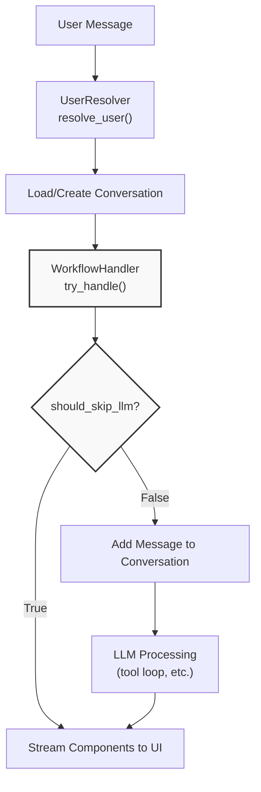

**Sources:** [src/vanna/core/agent/agent.py:440-509](), [src/vanna/core/workflow/base.py:74-131]()

**Key Characteristics:**

| Aspect | Description |
|--------|-------------|
| **Execution Point** | After user resolution, before message added to conversation |
| **Decision Output** | `should_skip_llm: bool` determines whether to skip LLM processing |
| **Message State** | If workflow handles message, it's NOT added to conversation automatically |
| **Use Cases** | Slash commands, pattern-based routing, starter UI, quota enforcement |

---

## WorkflowHandler Interface

The `WorkflowHandler` abstract base class defines two methods: `try_handle()` for message interception and `get_starter_ui()` for initial UI generation.

### Class Definition

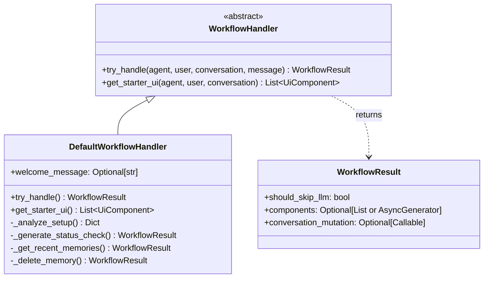

**Sources:** [src/vanna/core/workflow/base.py:74-255](), [src/vanna/core/workflow/default.py:32-43]()

### try_handle Method Signature

```python
async def try_handle(
    self, 
    agent: Agent, 
    user: User, 
    conversation: Conversation, 
    message: str
) -> WorkflowResult
```

**Parameters:**

| Parameter | Type | Description |
|-----------|------|-------------|
| `agent` | `Agent` | Agent instance providing access to `tool_registry`, `config`, `observability_provider` |
| `user` | `User` | User who sent message, including `id`, `group_memberships`, `metadata` |
| `conversation` | `Conversation` | Current conversation with message history |
| `message` | `str` | Raw user message content |

**Sources:** [src/vanna/core/workflow/base.py:134-195]()

### get_starter_ui Method Signature

```python
async def get_starter_ui(
    self, 
    agent: Agent, 
    user: User, 
    conversation: Conversation
) -> Optional[List[UiComponent]]
```

Called when a conversation starts (typically on first load with empty message). Returns UI components like welcome messages, quick action buttons, or onboarding flows.

**Sources:** [src/vanna/core/workflow/base.py:197-254]()

---

## WorkflowResult Dataclass

The `WorkflowResult` dataclass encapsulates the workflow handler's decision and optional UI output.

### Structure

| Field | Type | Description |
|-------|------|-------------|
| `should_skip_llm` | `bool` | If `True`, skip LLM processing; if `False`, continue to agent |
| `components` | `Optional[List[UiComponent] \| AsyncGenerator]` | UI components to stream to user |
| `conversation_mutation` | `Optional[Callable[[Conversation], Awaitable[None]]]` | Async callback to mutate conversation state |

**Sources:** [src/vanna/core/workflow/base.py:31-72]()

### Workflow Result Decision Flow

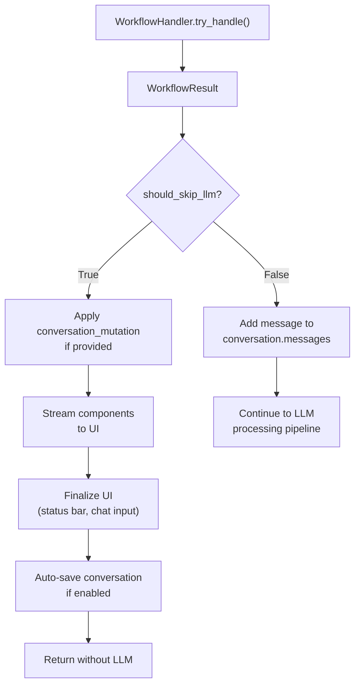

**Sources:** [src/vanna/core/agent/agent.py:449-509]()

**Example Return Values:**

```python
# Command handled, skip LLM
WorkflowResult(
    should_skip_llm=True,
    components=[
        UiComponent(
            rich_component=RichTextComponent(content="Help text", markdown=True),
            simple_component=None
        )
    ]
)

# With conversation mutation
async def clear_history(conv: Conversation) -> None:
    conv.messages.clear()

WorkflowResult(
    should_skip_llm=True,
    components=[StatusCardComponent(...)],
    conversation_mutation=clear_history
)

# Not handled, pass to LLM
WorkflowResult(should_skip_llm=False)
```

**Sources:** [src/vanna/core/workflow/base.py:46-65]()

---

## DefaultWorkflowHandler Implementation

The `DefaultWorkflowHandler` provides built-in command handling, setup health checking, and memory management UI.

### Supported Commands

| Command | Permission | Description |
|---------|-----------|-------------|
| `/help` | All users | Display help message with available commands |
| `/status` | Admin only | Show setup status report with tool analysis |
| `/memories` | Admin only | Display recent tool and text memories |
| `/delete [id]` | Admin only | Delete a memory by ID |

**Sources:** [src/vanna/core/workflow/default.py:51-162]()

### Command Processing Flow

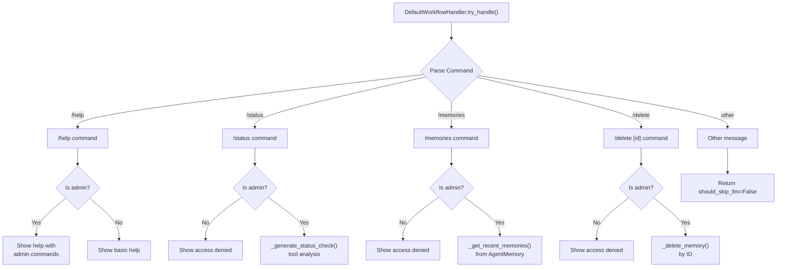

**Sources:** [src/vanna/core/workflow/default.py:51-162]()

### Permission Check Implementation

Admin commands check for `"admin"` in `user.group_memberships`:

```python
# From /status command handler
if "admin" not in user.group_memberships:
    return WorkflowResult(
        should_skip_llm=True,
        components=[
            UiComponent(
                rich_component=RichTextComponent(
                    content="# 🔒 Access Denied\n\n"
                    "The `/status` command is only available to administrators.",
                    markdown=True
                )
            )
        ]
    )
```

**Sources:** [src/vanna/core/workflow/default.py:96-112]()

---

## Setup Health Checking

The `DefaultWorkflowHandler` analyzes available tools and provides setup guidance through the `_analyze_setup()` method.

### Tool Analysis Categories

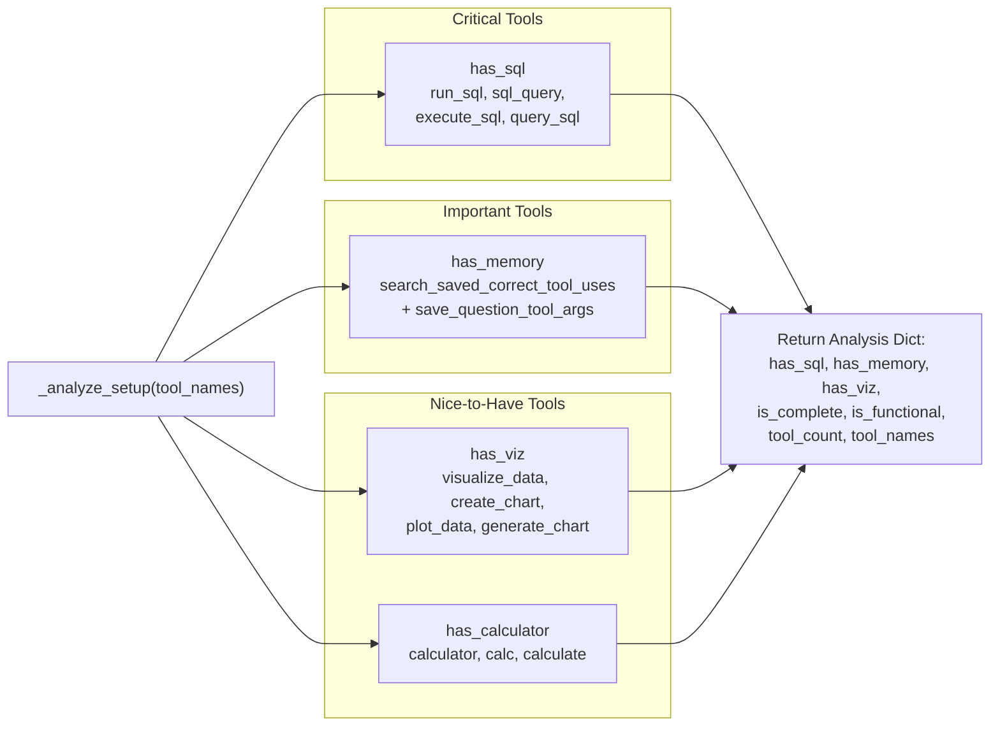

**Sources:** [src/vanna/core/workflow/default.py:285-330]()

### Setup Analysis Return Values

```python
{
    "has_sql": bool,           # At least one SQL tool detected
    "has_memory": bool,        # Both search and save memory tools
    "has_search": bool,        # search_saved_correct_tool_uses present
    "has_save": bool,          # save_question_tool_args present
    "has_viz": bool,           # Visualization tool present
    "has_calculator": bool,    # Calculator tool present
    "is_complete": bool,       # has_sql AND has_memory AND has_viz
    "is_functional": bool,     # has_sql (minimum requirement)
    "tool_count": int,         # Total number of tools
    "tool_names": List[str]    # List of all tool names
}
```

**Sources:** [src/vanna/core/workflow/default.py:319-330]()

### Status Command Components

The `/status` command generates a detailed report with:

1. **Summary Header** - Overall status (Complete/Functional/Action Required)
2. **Tool Status Cards** - Individual `StatusCardComponent` for each category
3. **Setup Guidance** - Code examples for missing tools (if needed)

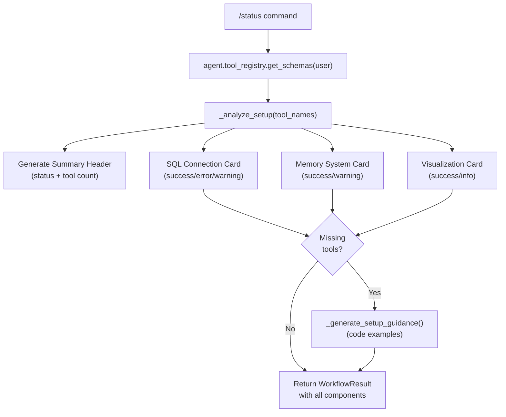

**Sources:** [src/vanna/core/workflow/default.py:455-510](), [src/vanna/core/workflow/default.py:332-398](), [src/vanna/core/workflow/default.py:399-453]()

---

## Starter UI Generation

The `get_starter_ui()` method generates role-specific welcome UI when conversations begin.

### Starter UI Call Flow

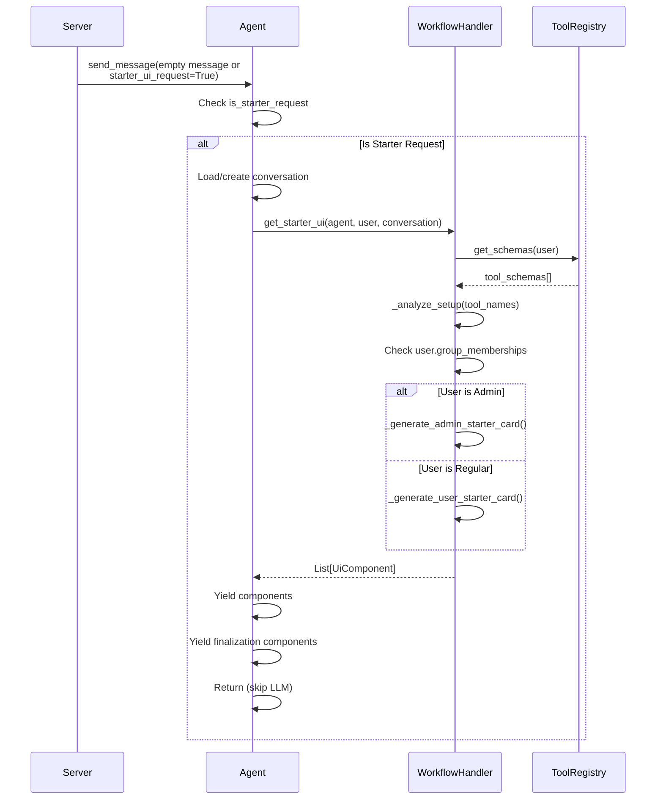

**Sources:** [src/vanna/core/agent/agent.py:269-346](), [src/vanna/core/workflow/default.py:164-192]()

### Role-Based Starter Cards

**Admin View** (`_generate_admin_starter_card`):
- Shows setup status (SQL ✓ | Memory ✓ | Visualization ✓)
- Includes memory management information
- Provides action buttons: "💡 Help", "🧠 View Memories"
- Uses `CardComponent` with status indicators

**User View** (`_generate_user_starter_card`):
- Simple welcome message via `RichTextComponent`
- No setup details or admin commands mentioned
- Minimal, clean interface

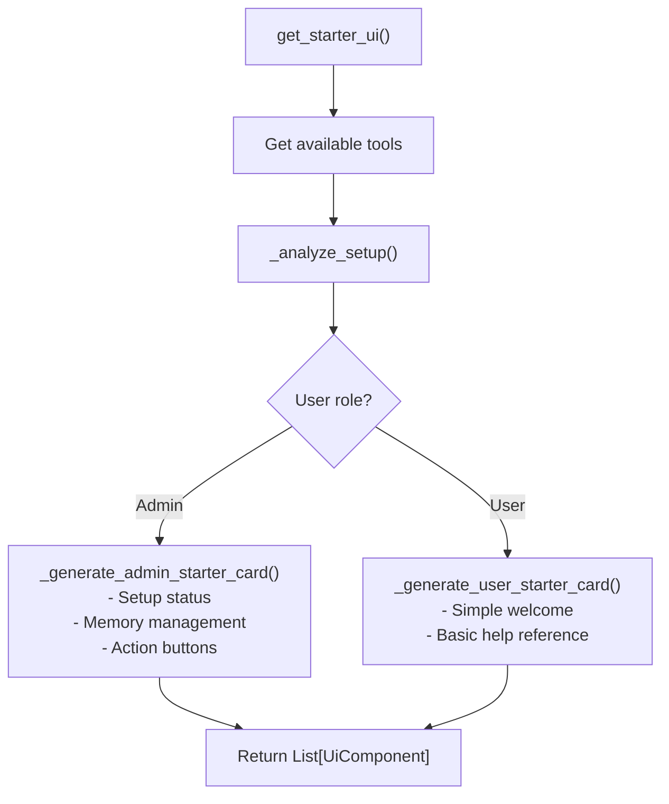

**Sources:** [src/vanna/core/workflow/default.py:194-283]()

---

## Memory Management Commands

The `DefaultWorkflowHandler` provides admin commands for viewing and managing agent memory.

### /memories Command Flow

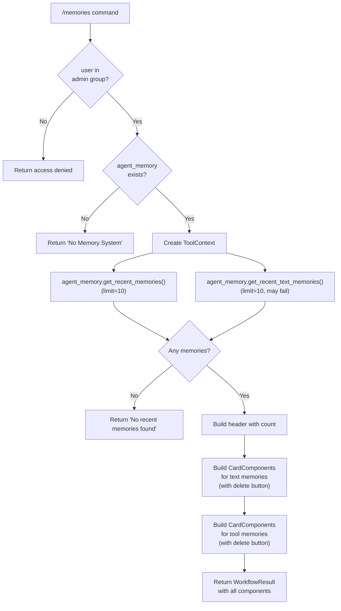

**Sources:** [src/vanna/core/workflow/default.py:512-664]()

### Memory Card Structure

Each memory is displayed as a `CardComponent` with:

**Tool Memory Card:**
```
Title: "Tool: {tool_name}"
Content:
  - Question: {question}
  - Tool: {tool_name}
  - Arguments: {args}
  - Success: ✅/❌
  - Timestamp: {timestamp}
  - ID: {memory_id}
Actions:
  - Delete button: "/delete {memory_id}"
```

**Text Memory Card:**
```
Title: "Text Memory"
Content:
  - Content: {content}
  - Timestamp: {timestamp}
  - ID: {memory_id}
Actions:
  - Delete button: "/delete {memory_id}"
```

**Sources:** [src/vanna/core/workflow/default.py:600-662]()

### /delete Command Implementation

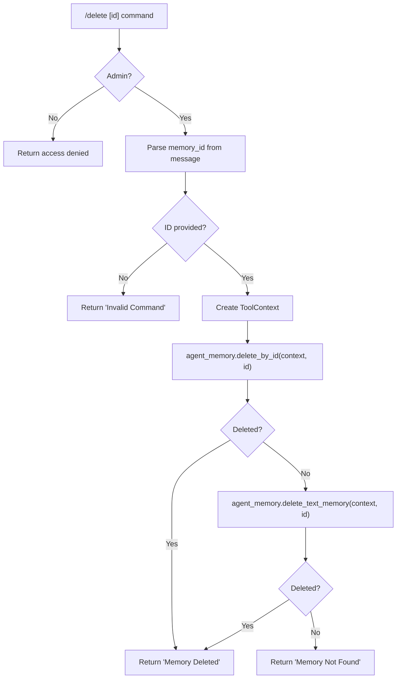

**Sources:** [src/vanna/core/workflow/default.py:683-789]()

---

## Integration with Agent Class

The `Agent` class integrates the `WorkflowHandler` at two points: starter UI generation and message interception.

### Agent Constructor Integration

```python
# From Agent.__init__
def __init__(
    self,
    llm_service: LlmService,
    tool_registry: ToolRegistry,
    user_resolver: UserResolver,
    agent_memory: AgentMemory,
    conversation_store: Optional[ConversationStore] = None,
    workflow_handler: Optional[WorkflowHandler] = None,  # <-- Optional
    ...
):
    # Use DefaultWorkflowHandler if none provided
    if workflow_handler is None:
        workflow_handler = DefaultWorkflowHandler()
    self.workflow_handler = workflow_handler
```

**Sources:** [src/vanna/core/agent/agent.py:82-121]()

### Workflow Handler Invocation Points

| Invocation | Trigger | Purpose |
|------------|---------|---------|
| **Starter UI** | Empty message OR `starter_ui_request=True` in metadata | Generate initial UI before any user interaction |
| **Message Interception** | Every non-empty user message | Check for commands/patterns before LLM |

**Sources:** [src/vanna/core/agent/agent.py:269-346](), [src/vanna/core/agent/agent.py:440-509]()

### Observability Integration

The agent creates observability spans for workflow handler operations:

```python
# Starter UI span
starter_span = await self.observability_provider.create_span(
    "agent.workflow_handler.starter_ui", 
    attributes={"user_id": user.id}
)

# try_handle span
trigger_span = await self.observability_provider.create_span(
    "agent.workflow_handler.try_handle",
    attributes={"user_id": user.id, "conversation_id": conversation_id}
)
```

**Sources:** [src/vanna/core/agent/agent.py:276-333](), [src/vanna/core/agent/agent.py:441-508]()

---

## Custom WorkflowHandler Example

Implementing a custom `WorkflowHandler` enables application-specific workflows.

### Pattern-Based Routing Example

```python
class ReportWorkflowHandler(WorkflowHandler):
    """Custom handler for report generation workflows."""
    
    async def try_handle(
        self, 
        agent: Agent, 
        user: User, 
        conversation: Conversation, 
        message: str
    ) -> WorkflowResult:
        # Regex-based report routing
        if message.startswith("/report"):
            parts = message.split()
            report_type = parts[1] if len(parts) > 1 else "summary"
            
            # Execute report tool directly
            tool = await agent.tool_registry.get_tool("generate_report")
            context = ToolContext(
                user=user, 
                conversation_id=conversation.id,
                request_id=str(uuid.uuid4()),
                agent_memory=agent.agent_memory
            )
            result = await tool.execute(context, {"report_type": report_type})
            
            return WorkflowResult(
                should_skip_llm=True,
                components=[result.ui_component]
            )
        
        # State-based onboarding
        if user.metadata.get("needs_onboarding"):
            return await self._onboarding_flow(agent, user, message)
        
        # Pass to LLM
        return WorkflowResult(should_skip_llm=False)
    
    async def get_starter_ui(
        self, 
        agent: Agent, 
        user: User, 
        conversation: Conversation
    ) -> Optional[List[UiComponent]]:
        # Generate dynamic buttons based on user's permissions
        buttons = []
        
        if "analyst" in user.group_memberships:
            buttons.append(
                ButtonComponent(label="📊 Sales Report", value="/report sales")
            )
            buttons.append(
                ButtonComponent(label="📈 Growth Report", value="/report growth")
            )
        
        return [
            RichTextComponent(content=f"Welcome, {user.username}!"),
            *buttons
        ]
```

**Sources:** [src/vanna/core/workflow/base.py:92-125]()

### Registration with Agent

```python
agent = Agent(
    llm_service=llm_service,
    tool_registry=tool_registry,
    user_resolver=user_resolver,
    agent_memory=agent_memory,
    workflow_handler=ReportWorkflowHandler()  # Custom implementation
)
```

**Sources:** [src/vanna/examples/default_workflow_handler_example.py:50-57]()

---

## Error Handling and Edge Cases

### WorkflowHandler Exception Handling

The agent wraps workflow handler calls in try-except blocks:

```python
# From agent._send_message
try:
    workflow_result = await self.workflow_handler.try_handle(
        self, user, conversation, message
    )
    
    if workflow_result.should_skip_llm:
        # Handle workflow result...
        pass
        
except Exception as e:
    logger.error(f"Error in workflow handler: {e}", exc_info=True)
    if self.observability_provider and trigger_span:
        trigger_span.set_attribute("error", str(e))
        await self.observability_provider.end_span(trigger_span)
    # Fall through to normal LLM processing on error
```

**Sources:** [src/vanna/core/agent/agent.py:499-508]()

### Memory Command Error Cases

| Error Case | Handler Behavior |
|------------|------------------|
| No `agent_memory` | Return "No Memory System" message |
| Empty memory ID | Return "Invalid Command" with usage instructions |
| Memory ID not found | Return "Memory Not Found" message |
| `get_recent_text_memories()` not implemented | Catch `AttributeError`/`NotImplementedError`, skip text memories |
| General exception | Return error component with stack trace logged |

**Sources:** [src/vanna/core/workflow/default.py:516-532](), [src/vanna/core/workflow/default.py:704-718](), [src/vanna/core/workflow/default.py:666-681]()

---

## Testing WorkflowHandler

Test files demonstrate workflow handler behavior with various scenarios.

### Test Structure

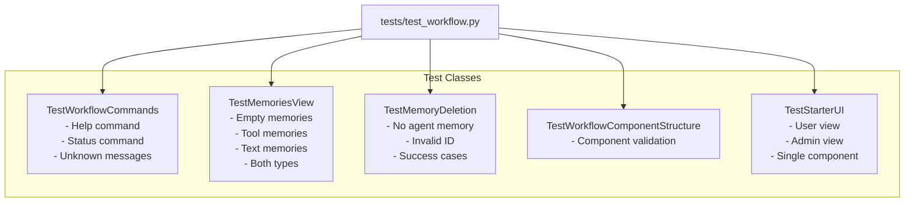

**Sources:** [tests/test_workflow.py:1-699]()

### Key Test Fixtures

```python
@pytest.fixture
def workflow_handler():
    return DefaultWorkflowHandler()

@pytest.fixture
def agent_with_memory():
    memory = DemoAgentMemory(max_items=100)
    return MockAgent(agent_memory=memory)

@pytest.fixture
def admin_test_user():
    return User(
        id="admin_user", 
        email="admin@example.com", 
        group_memberships=["admin"]
    )
```

**Sources:** [tests/test_workflow.py:70-86]()

### Example Test Case

```python
async def test_help_command(
    workflow_handler, agent_with_memory, test_user, test_conversation
):
    """Test that /help command returns help message (non-admin view)."""
    result = await workflow_handler.try_handle(
        agent_with_memory, test_user, test_conversation, "/help"
    )

    assert result.should_skip_llm is True
    assert len(result.components) > 0

    # Check that help content includes basic commands
    help_component = result.components[0]
    content = help_component.rich_component.content
    assert "/help" in content
    # Admin commands should NOT be visible to non-admin users
    assert "Admin Commands" not in content
```

**Sources:** [tests/test_workflow.py:92-112]()

---

## Summary

The `WorkflowHandler` system provides deterministic pre-LLM workflow execution through:

| Component | Responsibility | Key Classes |
|-----------|----------------|-------------|
| **Base Interface** | Define contract for workflow handlers | `WorkflowHandler`, `WorkflowResult` |
| **Default Implementation** | Built-in command handling and setup checking | `DefaultWorkflowHandler` |
| **Agent Integration** | Invoke workflows at starter UI and message interception points | `Agent._send_message()` |
| **Memory Commands** | Admin tools for viewing and managing agent memory | `/memories`, `/delete` commands |
| **Starter UI** | Role-based welcome screens and quick actions | `get_starter_ui()` |

**Key Files:**
- [src/vanna/core/workflow/base.py:1-255]() - Interface definitions
- [src/vanna/core/workflow/default.py:1-790]() - Default implementation
- [src/vanna/core/agent/agent.py:269-346]() - Starter UI integration
- [src/vanna/core/agent/agent.py:440-509]() - Message interception

---

