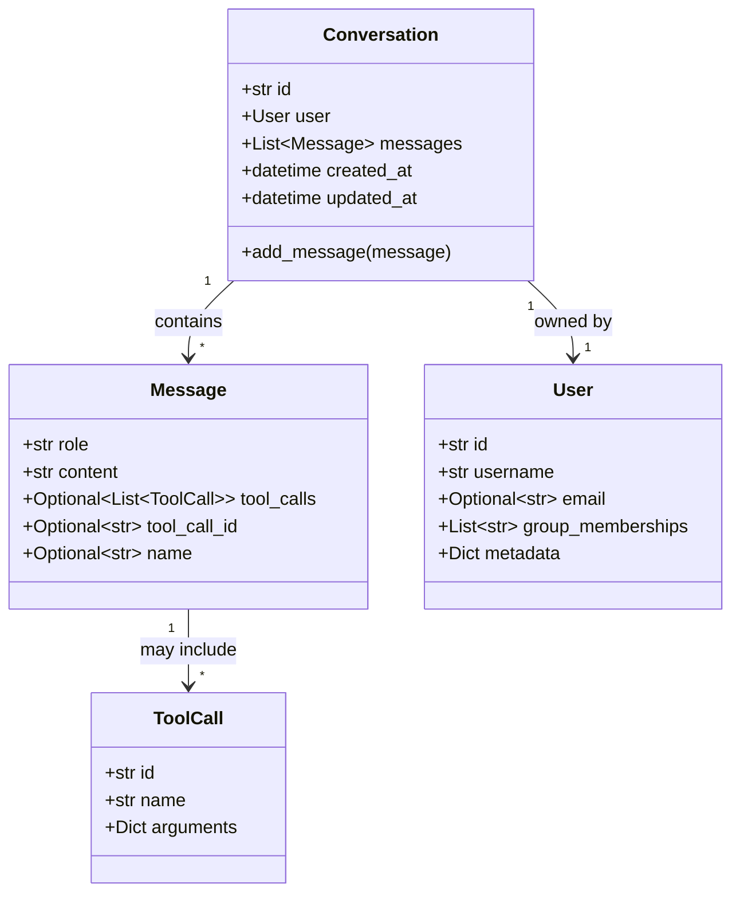
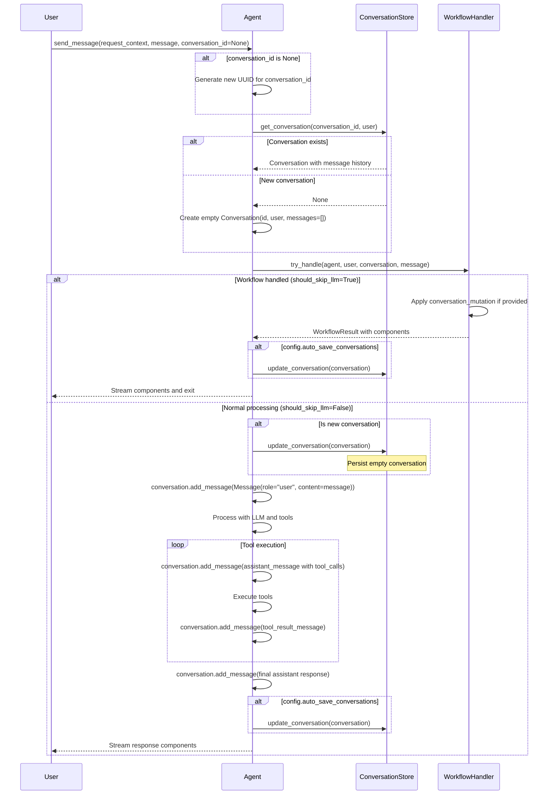
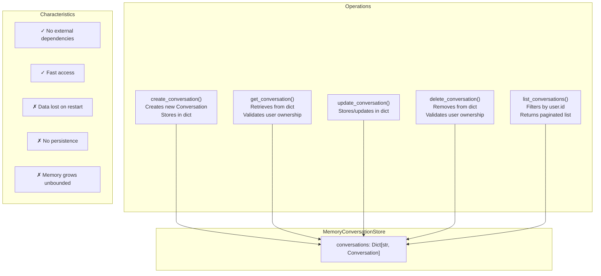
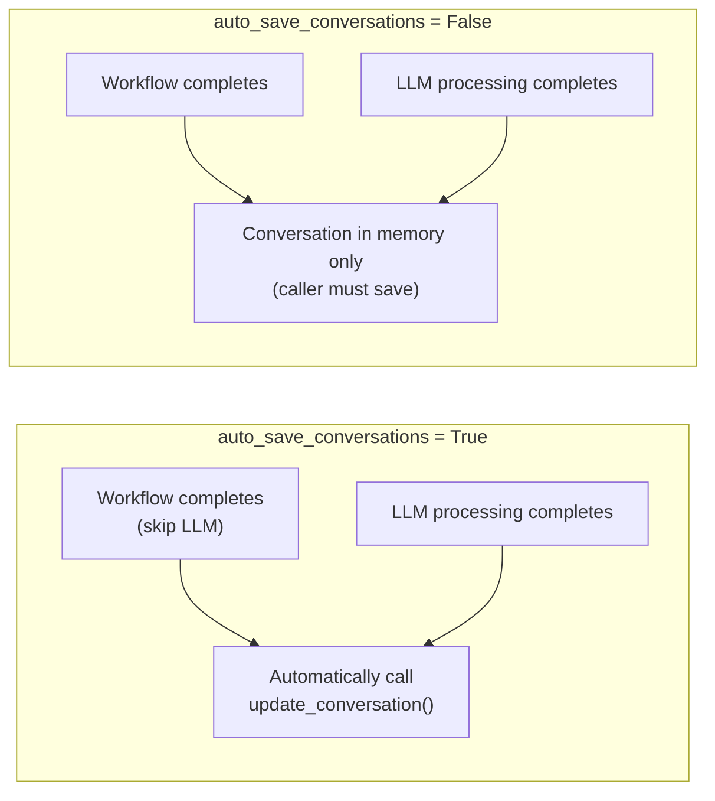
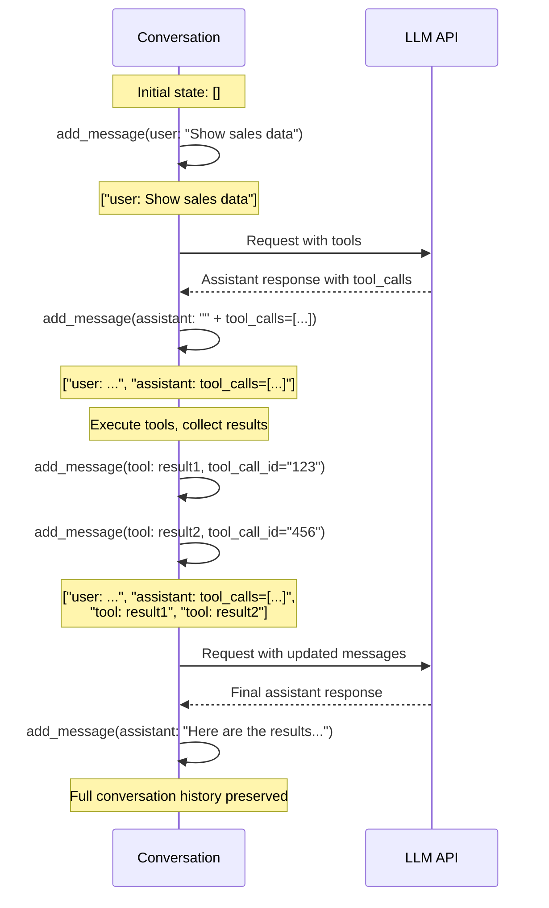

<!-- source: DeepWiki mcp.deepwiki.com · repo vanna-ai/vanna · page 2.6 ConversationStore and History Management · fetched 2026-10-29 -->

# ConversationStore and History Management

<details>
<summary>Relevant source files</summary>

The following files were used as context for generating this wiki page:

- [src/vanna/core/__init__.py](src/vanna/core/__init__.py)
- [src/vanna/core/agent/agent.py](src/vanna/core/agent/agent.py)
- [src/vanna/core/workflow/__init__.py](src/vanna/core/workflow/__init__.py)
- [src/vanna/examples/default_workflow_handler_example.py](src/vanna/examples/default_workflow_handler_example.py)
- [src/vanna/integrations/local/__init__.py](src/vanna/integrations/local/__init__.py)
- [src/vanna/integrations/local/file_system_conversation_store.py](src/vanna/integrations/local/file_system_conversation_store.py)
- [src/vanna/tools/agent_memory.py](src/vanna/tools/agent_memory.py)

</details>


## Purpose and Scope

This document describes the conversation persistence system in Vanna, which manages the storage and retrieval of conversation history between users and agents. The `ConversationStore` interface defines the contract for storing conversations, while implementations like `MemoryConversationStore` and `FileSystemConversationStore` provide different persistence strategies. This page covers conversation lifecycle, data models, and storage implementations.

For information about how conversations are used during agent message processing, see [Agent System](#2.1). For user-scoped data access, see [UserResolver and Authentication](#3.1).

## ConversationStore Interface

The `ConversationStore` interface defines five core operations for conversation management, all scoped to user identity for security:

| Method | Purpose | Returns |
|--------|---------|---------|
| `create_conversation(conversation_id, user, initial_message)` | Create new conversation with specified ID | `Conversation` |
| `get_conversation(conversation_id, user)` | Retrieve conversation by ID, scoped to user | `Optional[Conversation]` |
| `update_conversation(conversation)` | Persist conversation changes (new messages) | `None` |
| `delete_conversation(conversation_id, user)` | Remove conversation | `bool` |
| `list_conversations(user, limit, offset)` | List user's conversations with pagination | `List[Conversation]` |

All operations that retrieve or modify conversations require a `User` parameter to enforce data isolation between users. Implementations must verify that the user owns the conversation before allowing access.

**Sources:** [src/vanna/core/storage/__init__.py](), [src/vanna/core/agent/agent.py:87-112]()

## Conversation Data Models



The `Conversation` model maintains the ordered message history and metadata:
- **id**: Unique conversation identifier (typically UUID)
- **user**: Owner of the conversation (enforced in all store operations)
- **messages**: Ordered list of messages (user, assistant, tool)
- **created_at/updated_at**: Timestamps for tracking conversation lifecycle
- **add_message()**: Helper method to append messages and update timestamp

The `Message` model supports three message types:
- **User messages**: `role="user"`, `content` contains user input
- **Assistant messages**: `role="assistant"`, `content` contains LLM response, optional `tool_calls` list
- **Tool result messages**: `role="tool"`, `content` contains tool output, `tool_call_id` links to tool invocation, `name` specifies tool name

**Sources:** [src/vanna/core/storage/models.py]()

## Conversation Lifecycle in Agent



The conversation lifecycle follows this pattern:

1. **Conversation Loading** [src/vanna/core/agent/agent.py:410-426](): Agent loads existing conversation or creates new empty one
2. **Workflow Handler Check** [src/vanna/core/agent/agent.py:440-509](): WorkflowHandler can optionally mutate conversation before LLM processing
3. **Persistence of New Conversations** [src/vanna/core/agent/agent.py:511-512](): New conversations are persisted before adding messages to ensure conversation_id exists
4. **Message Addition** [src/vanna/core/agent/agent.py:515](): User message added via `conversation.add_message()`
5. **Tool Execution Loop** [src/vanna/core/agent/agent.py:658-874](): Assistant messages with `tool_calls` and tool result messages are added
6. **Auto-Save** [src/vanna/core/agent/agent.py:490-491, 336-337](): If `config.auto_save_conversations=True`, conversation is persisted after processing

The Agent never calls `create_conversation()` directly. Instead, it creates `Conversation` objects in memory and persists them via `update_conversation()`, which handles both creation and updates.

**Sources:** [src/vanna/core/agent/agent.py:231-515](), [src/vanna/core/agent/agent.py:658-874]()

## MemoryConversationStore Implementation

The `MemoryConversationStore` provides an in-memory conversation storage implementation suitable for testing, development, and ephemeral deployments:



**Key Characteristics:**
- **No persistence**: All conversations lost when process terminates
- **User isolation**: `get_conversation()` and `delete_conversation()` verify `conversation.user.id == user.id` before returning
- **Dictionary storage**: Simple `Dict[str, Conversation]` keyed by conversation_id
- **Default implementation**: Used by Agent when no `conversation_store` parameter provided [src/vanna/core/agent/agent.py:107-110]()

**Use Cases:**
- Local development and testing
- Jupyter notebooks and interactive sessions
- Demo agents where persistence is not required
- Unit tests that need isolated conversation storage

**Sources:** [src/vanna/integrations/local/storage.py](), [src/vanna/core/agent/agent.py:107-110]()

## FileSystemConversationStore Implementation

The `FileSystemConversationStore` provides file-based persistence with a directory structure optimized for append-only message storage:

### Directory Structure

```
conversations/
├── {conversation_id_1}/
│   ├── metadata.json          # Conversation metadata
│   └── messages/              # Message files directory
│       ├── 1234567890000000_000000.json  # timestamp_index.json
│       ├── 1234567890100000_000001.json
│       └── 1234567890200000_000002.json
├── {conversation_id_2}/
│   ├── metadata.json
│   └── messages/
│       └── ...
└── ...
```

### Metadata Schema

The `metadata.json` file contains conversation-level information:

```json
{
  "id": "conversation-uuid",
  "user": {
    "id": "user123",
    "username": "alice",
    "email": "alice@example.com",
    "group_memberships": ["user", "analyst"]
  },
  "created_at": "2024-01-15T10:30:00.123456",
  "updated_at": "2024-01-15T10:35:00.789012"
}
```

### Message File Schema

Each message is stored as an individual JSON file with timestamp-based naming for guaranteed ordering:

```json
{
  "role": "user",
  "content": "Show me sales data for Q4",
  "tool_calls": null,
  "tool_call_id": null,
  "name": null
}
```

**Sources:** [src/vanna/integrations/local/file_system_conversation_store.py:19-65]()

### FileSystemConversationStore Operations

```mermaid
flowchart TB
    subgraph "create_conversation"
        CC1["Create Conversation object<br/>with initial_message"]
        CC2["_save_metadata()<br/>Write metadata.json"]
        CC3["_append_message()<br/>Write first message file"]
        CC1 --> CC2 --> CC3
    end
    
    subgraph "get_conversation"
        GC1["Check metadata.json exists"]
        GC2["Load metadata, verify user.id"]
        GC3["_load_messages()<br/>Read all message files<br/>Sort by filename"]
        GC4["Reconstruct Conversation object"]
        GC1 --> GC2 --> GC3 --> GC4
    end
    
    subgraph "update_conversation"
        UC1["Update conversation.updated_at"]
        UC2["_save_metadata()<br/>Write updated timestamps"]
        UC3["_load_messages()<br/>Count existing messages"]
        UC4["_append_message()<br/>Only write new messages<br/>with incremented indices"]
        UC1 --> UC2 --> UC3 --> UC4
    end
    
    subgraph "delete_conversation"
        DC1["Verify user ownership"]
        DC2["Delete all message files"]
        DC3["Delete metadata.json"]
        DC4["Remove conversation directory"]
        DC1 --> DC2 --> DC3 --> DC4
    end
```



**Append-Only Design:**
- Messages use `{timestamp_microseconds}_{index:06d}.json` naming scheme [src/vanna/integrations/local/file_system_conversation_store.py:96-99]()
- Timestamp ensures uniqueness and prevents overwrites
- Index provides deterministic ordering
- `update_conversation()` only writes messages not already persisted [src/vanna/integrations/local/file_system_conversation_store.py:169-173]()

**User Isolation:**
- All read operations verify `metadata["user"]["id"] == user.id` [src/vanna/integrations/local/file_system_conversation_store.py:137-138]()
- `list_conversations()` filters to only user-owned conversations [src/vanna/integrations/local/file_system_conversation_store.py:231-233]()

**Sources:** [src/vanna/integrations/local/file_system_conversation_store.py:104-206]()

### FileSystemConversationStore Usage

```python
from vanna.integrations.local import FileSystemConversationStore
from vanna import Agent, User

# Create store with custom directory
store = FileSystemConversationStore(base_dir="./my_conversations")

# Use with Agent
agent = Agent(
    llm_service=llm,
    tool_registry=registry,
    user_resolver=resolver,
    agent_memory=memory,
    conversation_store=store,  # Conversations persist to disk
    config=AgentConfig(auto_save_conversations=True)
)
```

**Key Features:**
- **Persistence**: Conversations survive process restarts
- **File-per-message**: Individual message files enable efficient appends
- **Human-readable**: JSON files can be inspected with text editors
- **Ordered loading**: Filename sorting ensures correct message order
- **Incremental updates**: Only new messages written on `update_conversation()`

**Limitations:**
- No indexing for fast queries across conversations
- Linear scan required for `list_conversations()`
- Not suitable for high-concurrency scenarios without locking
- No built-in cleanup of old conversations

**Sources:** [src/vanna/integrations/local/file_system_conversation_store.py:19-256]()

## Auto-Save Configuration

The Agent's `config.auto_save_conversations` flag controls when conversations are persisted:



**When auto-save is enabled** (default):
- Conversations automatically persisted after workflow handling [src/vanna/core/agent/agent.py:490-491]()
- Conversations automatically persisted after starter UI generation [src/vanna/core/agent/agent.py:336-337]()
- No manual save required by caller

**When auto-save is disabled:**
- Caller must manually retrieve conversation and call `conversation_store.update_conversation()`
- Useful for batch processing or custom save logic
- Agent still creates and loads conversations, just doesn't persist changes

**Configuration:**

```python
config = AgentConfig(
    auto_save_conversations=True,  # Default: True
    max_tool_iterations=5,
    stream_responses=True
)

agent = Agent(
    llm_service=llm,
    tool_registry=registry,
    user_resolver=resolver,
    agent_memory=memory,
    conversation_store=store,
    config=config
)
```

**Sources:** [src/vanna/core/agent/agent.py:336-337, 490-491](), [src/vanna/core/agent/config.py]()

## Message Ordering and Conversation Flow

Messages in a conversation follow strict ordering rules required by LLM APIs:



**Critical Ordering Rules:**
1. **Tool result messages must follow assistant message with tool_calls**: OpenAI API requires this structure [src/vanna/core/agent/agent.py:662-668]()
2. **Assistant message added before tool execution**: Ensures API compatibility even if tool execution fails
3. **Multiple tool results added separately**: Each tool result is a distinct message with unique `tool_call_id`
4. **All messages preserved**: Full conversation history available for context in subsequent LLM calls

**Message Role Transitions:**

| Current Message | Valid Next Roles |
|----------------|------------------|
| `user` | `assistant` |
| `assistant` (no tool_calls) | `user` |
| `assistant` (with tool_calls) | `tool` (one per tool_call) |
| `tool` | `tool` (more results) or `assistant` (LLM response) |

**Sources:** [src/vanna/core/agent/agent.py:658-874]()

## Implementation Comparison

| Feature | MemoryConversationStore | FileSystemConversationStore |
|---------|------------------------|----------------------------|
| **Persistence** | None (in-memory only) | Disk-based, survives restarts |
| **Performance** | Fast (dict lookup) | Slower (file I/O) |
| **Scalability** | Memory-limited | Disk-limited |
| **Concurrency** | Single-process only | File locking needed for multi-process |
| **Inspectability** | Requires debugging tools | Human-readable JSON files |
| **Setup complexity** | Zero configuration | Requires writable directory |
| **Best for** | Dev, testing, demos | Production, persistence required |
| **Dependencies** | None | File system access |

**Choosing an Implementation:**

```python
# Development/testing: Use default in-memory store
agent = Agent(
    llm_service=llm,
    tool_registry=registry,
    user_resolver=resolver,
    agent_memory=memory
    # conversation_store defaults to MemoryConversationStore
)

# Production: Use file system store for persistence
from vanna.integrations.local import FileSystemConversationStore

agent = Agent(
    llm_service=llm,
    tool_registry=registry,
    user_resolver=resolver,
    agent_memory=memory,
    conversation_store=FileSystemConversationStore(base_dir="/data/conversations")
)

# Custom: Implement ConversationStore for database backend
class PostgresConversationStore(ConversationStore):
    async def create_conversation(self, conversation_id, user, initial_message):
        # Insert into postgres with JSON columns
        ...
```

**Sources:** [src/vanna/integrations/local/storage.py](), [src/vanna/integrations/local/file_system_conversation_store.py]()

## Common Usage Patterns

### Pattern 1: Retrieving Conversation History for Context

```python
# In a custom tool or workflow handler
conversation = await agent.conversation_store.get_conversation(
    conversation_id=context.conversation_id,
    user=context.user
)

if conversation:
    # Analyze message history
    user_messages = [m for m in conversation.messages if m.role == "user"]
    recent_questions = [m.content for m in user_messages[-5:]]
```

### Pattern 2: Listing User's Conversations (Chat History UI)

```python
# For building a sidebar with conversation list
conversations = await store.list_conversations(
    user=current_user,
    limit=20,
    offset=0
)

for conv in conversations:
    # Display conversation preview
    first_message = next((m for m in conv.messages if m.role == "user"), None)
    preview = first_message.content[:50] if first_message else "Empty"
    print(f"{conv.id}: {preview}... (updated {conv.updated_at})")
```

### Pattern 3: Manual Conversation Save (auto_save=False)

```python
# When auto_save_conversations=False
async for component in agent.send_message(
    request_context=ctx,
    message="Hello",
    conversation_id="123"
):
    # Stream components to UI
    await ui.send(component)

# Manually retrieve and save conversation
conversation = await agent.conversation_store.get_conversation("123", user)
if conversation:
    # Apply custom logic before saving
    if should_archive(conversation):
        conversation.metadata["archived"] = True
    
    await agent.conversation_store.update_conversation(conversation)
```

### Pattern 4: Conversation Mutation in Workflow

```python
class ClearHistoryWorkflow(WorkflowHandler):
    async def try_handle(self, agent, user, conversation, message):
        if message == "/clear":
            async def clear_messages(conv):
                conv.messages.clear()
                await agent.conversation_store.update_conversation(conv)
            
            return WorkflowResult(
                should_skip_llm=True,
                components=[StatusCardComponent(
                    title="History Cleared",
                    status="success",
                    description="Conversation history has been cleared"
                )],
                conversation_mutation=clear_messages
            )
        
        return WorkflowResult(should_skip_llm=False)
```

**Sources:** [src/vanna/core/agent/agent.py:461-463](), [src/vanna/core/workflow/base.py:44]()

---

