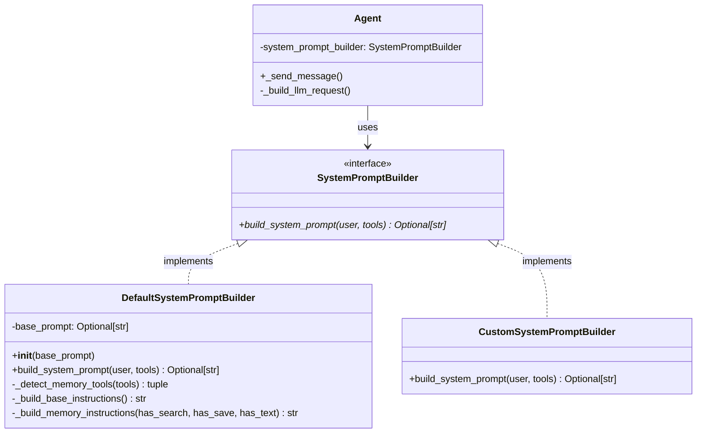
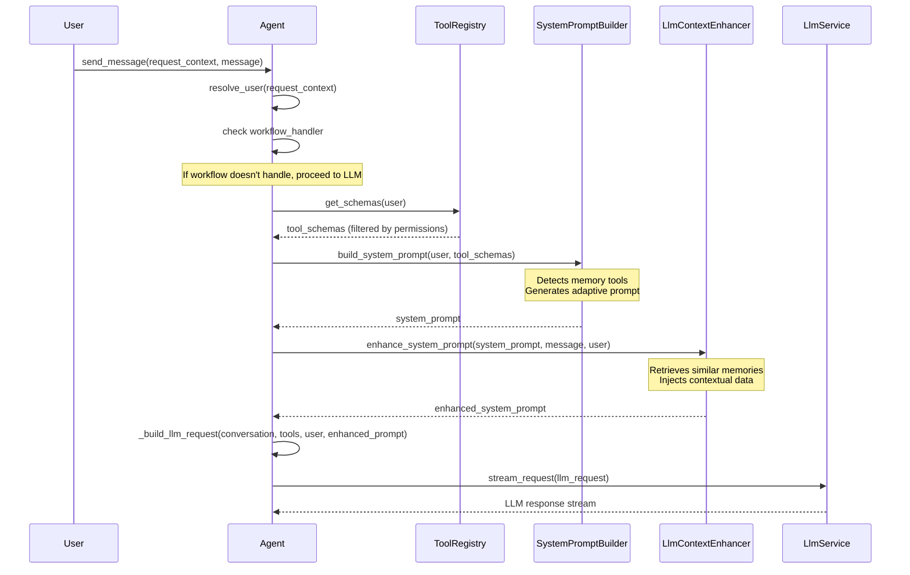
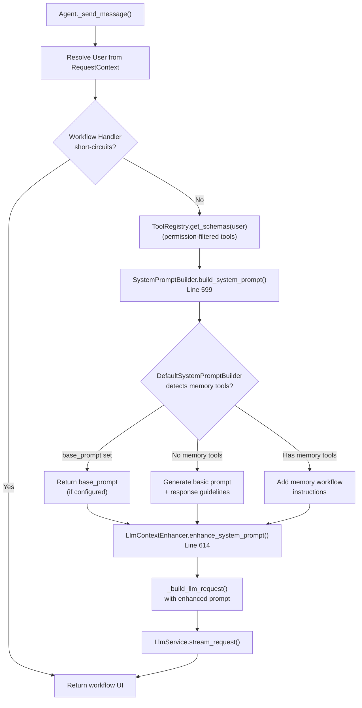
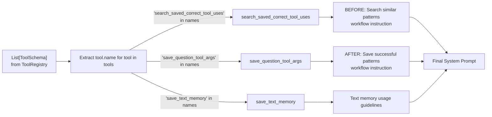
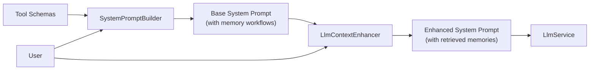

<!-- source: DeepWiki mcp.deepwiki.com · repo vanna-ai/vanna · page 2.7 SystemPromptBuilder · fetched 2026-10-29 -->

# SystemPromptBuilder

<details>
<summary>Relevant source files</summary>

The following files were used as context for generating this wiki page:

- [src/vanna/components/rich/interactive/task_list.py](src/vanna/components/rich/interactive/task_list.py)
- [src/vanna/core/__init__.py](src/vanna/core/__init__.py)
- [src/vanna/core/agent/agent.py](src/vanna/core/agent/agent.py)
- [src/vanna/core/system_prompt/base.py](src/vanna/core/system_prompt/base.py)
- [src/vanna/core/system_prompt/default.py](src/vanna/core/system_prompt/default.py)
- [src/vanna/core/workflow/__init__.py](src/vanna/core/workflow/__init__.py)
- [src/vanna/examples/default_workflow_handler_example.py](src/vanna/examples/default_workflow_handler_example.py)
- [src/vanna/integrations/local/__init__.py](src/vanna/integrations/local/__init__.py)
- [src/vanna/integrations/local/file_system_conversation_store.py](src/vanna/integrations/local/file_system_conversation_store.py)
- [src/vanna/tools/agent_memory.py](src/vanna/tools/agent_memory.py)

</details>


## Purpose and Scope

The `SystemPromptBuilder` interface defines how system prompts are generated for the LLM before processing user requests. System prompts establish the LLM's role, capabilities, and operational guidelines. The default implementation (`DefaultSystemPromptBuilder`) dynamically adapts system prompts based on available tools, with special emphasis on memory workflow instructions when memory tools are present.

For information about how system prompts are enhanced with contextual data after generation, see [LlmContextEnhancer](#2.8). For the overall Agent message processing pipeline, see [Agent System](#2.1).

**Sources:** [src/vanna/core/system_prompt/base.py:1-37](), [src/vanna/core/system_prompt/default.py:1-158]()

---

## Interface Definition

The `SystemPromptBuilder` abstract base class defines a single method for system prompt generation.

### Abstract Base Class

```python
class SystemPromptBuilder(ABC):
    @abstractmethod
    async def build_system_prompt(
        self, user: "User", tools: List["ToolSchema"]
    ) -> Optional[str]:
        """Build a system prompt based on user context and available tools."""
        pass
```

**Method Parameters:**

| Parameter | Type | Description |
|-----------|------|-------------|
| `user` | `User` | The user making the request (provides context like group memberships) |
| `tools` | `List[ToolSchema]` | List of tools accessible to the user (after permission filtering) |

**Returns:** `Optional[str]` - The system prompt string, or `None` if no system prompt should be used.

The interface is intentionally minimal to allow maximum flexibility in implementation. Builders can incorporate user-specific context, tool availability, time-based information, or any other relevant data.

**Sources:** [src/vanna/core/system_prompt/base.py:15-37]()

---

## System Prompt Builder Hierarchy



**Sources:** [src/vanna/core/system_prompt/base.py:15-37](), [src/vanna/core/system_prompt/default.py:18-158](), [src/vanna/core/agent/agent.py:82-140]()

---

## DefaultSystemPromptBuilder Implementation

The `DefaultSystemPromptBuilder` provides an intelligent default implementation that adapts system prompts based on tool availability.

### Initialization

```python
DefaultSystemPromptBuilder(base_prompt: Optional[str] = None)
```

- **`base_prompt=None`**: If provided, the builder returns this static prompt without dynamic generation
- **`base_prompt=None` (default)**: The builder dynamically generates prompts based on available tools

**Sources:** [src/vanna/core/system_prompt/default.py:26-32]()

### Dynamic Prompt Generation

When `base_prompt` is not set, the builder generates a structured prompt with the following sections:

1. **Identity and Date**: Establishes the LLM as "Vanna, an AI data analyst assistant" with the current date
2. **Response Guidelines**: Instructions on tool usage and result handling
3. **Tool Listing**: Enumerates available tools by name
4. **Memory System Instructions**: Conditional section that appears when memory tools are present

**Sources:** [src/vanna/core/system_prompt/default.py:47-157]()

### Memory Tool Detection

The builder checks for three specific memory-related tools:

| Tool Name | Purpose | Prompt Section |
|-----------|---------|----------------|
| `search_saved_correct_tool_uses` | Search for similar past tool usages | "BEFORE executing" workflow instruction |
| `save_question_tool_args` | Save successful tool usage patterns | "AFTER successfully executing" workflow instruction |
| `save_text_memory` | Save domain knowledge and context | Text memory usage guidelines |

**Detection Logic:**

```python
tool_names = [tool.name for tool in tools]
has_search = "search_saved_correct_tool_uses" in tool_names
has_save = "save_question_tool_args" in tool_names
has_text_memory = "save_text_memory" in tool_names
```

**Sources:** [src/vanna/core/system_prompt/default.py:50-54]()

---

## Memory Workflow Instructions

When memory tools are detected, the system prompt includes structured workflow instructions that guide the LLM through proper memory usage patterns.

### Tool Usage Memory Workflow

When `search_saved_correct_tool_uses` and/or `save_question_tool_args` are available, the prompt includes:

```
MEMORY SYSTEM:
==============================================================
1. TOOL USAGE MEMORY (Structured Workflow):
--------------------------------------------------

• BEFORE executing any tool (run_sql, visualize_data, or calculator), 
  you MUST first call search_saved_correct_tool_uses with the user's 
  question to check if there are existing successful patterns for 
  similar questions.

• Review the search results (if any) to inform your approach before 
  proceeding with other tool calls.

• AFTER successfully executing a tool that produces correct and useful 
  results, you MUST call save_question_tool_args to save the successful 
  pattern for future use.

Example workflow:
  • User asks a question
  • First: Call search_saved_correct_tool_uses(question="user's question")
  • Then: Execute the appropriate tool(s) based on search results
  • Finally: Call save_question_tool_args(question="...", tool_name="...", args={...})
```

**Exceptions to Search-First Rule:**
- User is asking about the tools themselves (meta-queries)
- User is testing or demonstrating the save/search functionality

**Sources:** [src/vanna/core/system_prompt/default.py:80-124]()

### Text Memory Guidelines

When `save_text_memory` is available, the prompt includes:

```
2. TEXT MEMORY (Domain Knowledge & Context):
--------------------------------------------------

• save_text_memory: Save important context about the database, 
  schema, or domain

Use text memory to save:
  • Database schema details (column meanings, data types, relationships)
  • Company-specific terminology and definitions
  • Query patterns or best practices for this database
  • Domain knowledge about the business or data
  • User preferences for queries or visualizations

DO NOT save:
  • Information already captured in tool usage memory
  • One-time query results or temporary observations
```

**Sources:** [src/vanna/core/system_prompt/default.py:126-151]()

---

## Integration with Agent Pipeline

The `SystemPromptBuilder` is invoked during the Agent's message processing pipeline, specifically before making LLM requests.

### System Prompt Generation Flow



**Sources:** [src/vanna/core/agent/agent.py:564-641]()

### Agent Integration Points

The Agent invokes the system prompt builder at a specific point in its pipeline:

**Step 1: Tool Schema Retrieval** [src/vanna/core/agent/agent.py:564-583]()
```python
# Get available tools for user (permission-filtered)
tool_schemas = await self.tool_registry.get_schemas(user)
```

**Step 2: System Prompt Building** [src/vanna/core/agent/agent.py:591-602]()
```python
system_prompt = await self.system_prompt_builder.build_system_prompt(
    user, tool_schemas
)
```

**Step 3: Context Enhancement** [src/vanna/core/agent/agent.py:604-627]()
```python
# Enhance system prompt with LLM context enhancer
if self.llm_context_enhancer and system_prompt is not None:
    system_prompt = await self.llm_context_enhancer.enhance_system_prompt(
        system_prompt, message, user
    )
```

**Step 4: LLM Request Construction** [src/vanna/core/agent/agent.py:638-641]()
```python
request = await self._build_llm_request(
    conversation, tool_schemas, user, system_prompt
)
```

**Sources:** [src/vanna/core/agent/agent.py:564-641]()

---

## System Prompt Builder Lifecycle



**Sources:** [src/vanna/core/agent/agent.py:231-656](), [src/vanna/core/system_prompt/default.py:34-157]()

---

## Tool Detection and Prompt Adaptation

The `DefaultSystemPromptBuilder` uses tool name detection to adapt the system prompt.

### Tool Name Mapping



**Sources:** [src/vanna/core/system_prompt/default.py:50-157]()

### Example Prompt Variations

**Scenario 1: No Memory Tools Available**
```
You are Vanna, an AI data analyst assistant. Today's date is 2024-01-15.

Response Guidelines:
- Use the available tools to help the user accomplish their goals.
- When you execute a query, that raw result is shown to the user...

You have access to the following tools: run_sql, visualize_data
```

**Scenario 2: All Memory Tools Available**
```
You are Vanna, an AI data analyst assistant. Today's date is 2024-01-15.

Response Guidelines:
- Use the available tools to help the user accomplish their goals.
- When you execute a query, that raw result is shown to the user...

You have access to the following tools: run_sql, search_saved_correct_tool_uses, 
save_question_tool_args, save_text_memory

============================================================
MEMORY SYSTEM:
============================================================

1. TOOL USAGE MEMORY (Structured Workflow):
--------------------------------------------------
[Detailed workflow instructions...]

2. TEXT MEMORY (Domain Knowledge & Context):
--------------------------------------------------
[Text memory guidelines...]
```

**Sources:** [src/vanna/core/system_prompt/default.py:59-157]()

---

## Customization and Extension

Implement a custom `SystemPromptBuilder` for specialized prompting strategies.

### Custom Implementation Pattern

```python
from vanna.core.system_prompt import SystemPromptBuilder
from vanna.core.user import User
from vanna.core.tool import ToolSchema
from typing import List, Optional

class CustomSystemPromptBuilder(SystemPromptBuilder):
    """Custom system prompt builder with domain-specific instructions."""
    
    def __init__(self, organization: str, domain_context: str):
        self.organization = organization
        self.domain_context = domain_context
    
    async def build_system_prompt(
        self, user: User, tools: List[ToolSchema]
    ) -> Optional[str]:
        """Build organization-specific system prompt."""
        
        # Include user group information
        groups = ", ".join(user.group_memberships)
        
        # Build prompt with organization context
        prompt = f"""You are {self.organization}'s AI data analyst.
        
Domain Context: {self.domain_context}

User: {user.username} (Groups: {groups})

Available Tools: {", ".join(tool.name for tool in tools)}

Guidelines:
- Follow {self.organization} data policies
- Respect user's group permissions
- ...
"""
        return prompt
```

### Custom Builder Registration

```python
from vanna.core import Agent, AgentConfig

# Create custom builder
custom_builder = CustomSystemPromptBuilder(
    organization="Acme Corp",
    domain_context="Financial services data warehouse"
)

# Register with agent
agent = Agent(
    llm_service=llm_service,
    tool_registry=registry,
    user_resolver=user_resolver,
    agent_memory=memory,
    system_prompt_builder=custom_builder,  # Use custom builder
    config=AgentConfig()
)
```

**Sources:** [src/vanna/core/agent/agent.py:82-114]()

---

## Use Cases and Best Practices

### Use Case 1: Role-Specific Prompts

Adapt system prompts based on user roles:

```python
class RoleBasedPromptBuilder(SystemPromptBuilder):
    async def build_system_prompt(self, user: User, tools: List[ToolSchema]) -> Optional[str]:
        if "admin" in user.group_memberships:
            return "You are an administrative AI with full system access..."
        elif "analyst" in user.group_memberships:
            return "You are a data analysis AI focused on reporting..."
        else:
            return "You are a read-only AI assistant..."
```

### Use Case 2: Time-Aware Prompts

Include temporal context:

```python
class TimeAwarePromptBuilder(SystemPromptBuilder):
    async def build_system_prompt(self, user: User, tools: List[ToolSchema]) -> Optional[str]:
        now = datetime.now()
        business_hours = 9 <= now.hour < 17
        
        prompt = f"Current time: {now.strftime('%Y-%m-%d %H:%M')}\n"
        
        if not business_hours:
            prompt += "Note: Outside business hours. Use cached data when possible.\n"
        
        return prompt
```

### Use Case 3: Combining Default with Custom

Extend the default builder:

```python
class ExtendedDefaultPromptBuilder(DefaultSystemPromptBuilder):
    def __init__(self, base_prompt: Optional[str] = None, extra_guidelines: str = ""):
        super().__init__(base_prompt)
        self.extra_guidelines = extra_guidelines
    
    async def build_system_prompt(self, user: User, tools: List[ToolSchema]) -> Optional[str]:
        # Get default prompt
        base = await super().build_system_prompt(user, tools)
        
        # Add extra guidelines
        if base and self.extra_guidelines:
            return f"{base}\n\n{self.extra_guidelines}"
        
        return base
```

**Sources:** [src/vanna/core/system_prompt/default.py:18-157](), [src/vanna/core/system_prompt/base.py:15-37]()

---

## Observability Integration

The Agent tracks system prompt building with observability metrics when an `ObservabilityProvider` is configured.

### Metrics Collected

| Metric | Type | Description |
|--------|------|-------------|
| `agent.system_prompt.build` | span | Duration of prompt building |
| `agent.system_prompt.duration` | metric (ms) | Time to build system prompt |
| `agent.llm_context.enhance_system_prompt` | span | Duration of enhancement |
| `agent.llm_context.enhance_system_prompt.duration` | metric (ms) | Time to enhance prompt |

**Span Attributes:**
- `tool_count`: Number of tools available to user
- `prompt_length`: Length of generated system prompt
- `enhancer`: Name of LlmContextEnhancer class

**Sources:** [src/vanna/core/agent/agent.py:591-637]()

---

## Relationship to LlmContextEnhancer

The `SystemPromptBuilder` and `LlmContextEnhancer` work sequentially in the Agent pipeline:

1. **SystemPromptBuilder** generates the base system prompt with role, guidelines, and memory workflows
2. **LlmContextEnhancer** enhances the prompt by injecting similar memories and contextual data



The separation allows:
- **SystemPromptBuilder**: Define static role, guidelines, and workflows
- **LlmContextEnhancer**: Add dynamic, query-specific context from memory

**Sources:** [src/vanna/core/agent/agent.py:599-627]()

---

## Summary

The `SystemPromptBuilder` system provides:

| Feature | Description |
|---------|-------------|
| **Interface** | Abstract base class with single `build_system_prompt()` method |
| **Default Implementation** | `DefaultSystemPromptBuilder` with memory-aware prompt generation |
| **Memory Integration** | Automatic workflow instructions when memory tools detected |
| **Customization** | Easy subclassing for domain-specific prompting |
| **Agent Integration** | Invoked before LLM calls, enhanced by `LlmContextEnhancer` |
| **Observability** | Tracked via spans and metrics when provider configured |

The builder is responsible for establishing the LLM's identity, capabilities, and operational guidelines, with special emphasis on guiding the LLM through proper memory usage patterns when memory tools are available.

**Sources:** [src/vanna/core/system_prompt/base.py:1-37](), [src/vanna/core/system_prompt/default.py:1-158](), [src/vanna/core/agent/agent.py:82-641]()

---

