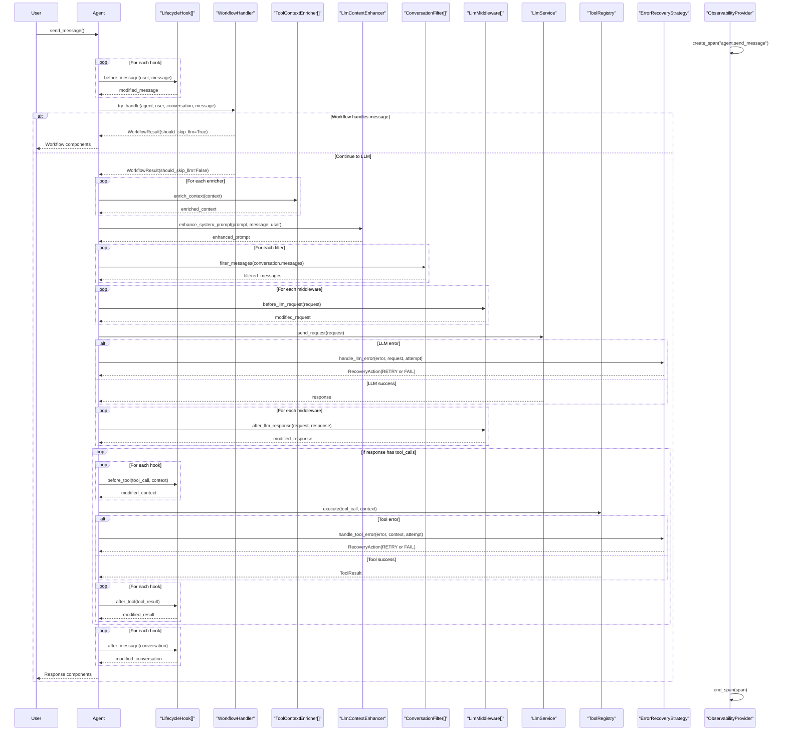
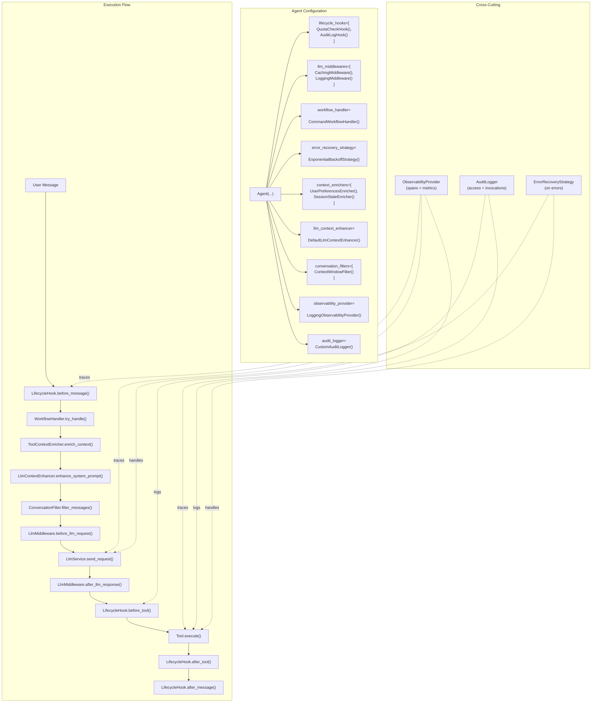

<!-- source: DeepWiki mcp.deepwiki.com · repo vanna-ai/vanna · page 2.8 Extensibility Points · fetched 2026-10-29 -->

# Extensibility Points

<details>
<summary>Relevant source files</summary>

The following files were used as context for generating this wiki page:

- [pyproject.toml](pyproject.toml)
- [src/vanna/__init__.py](src/vanna/__init__.py)
- [src/vanna/core/__init__.py](src/vanna/core/__init__.py)
- [src/vanna/core/agent/agent.py](src/vanna/core/agent/agent.py)
- [src/vanna/core/workflow/__init__.py](src/vanna/core/workflow/__init__.py)
- [src/vanna/examples/default_workflow_handler_example.py](src/vanna/examples/default_workflow_handler_example.py)
- [src/vanna/integrations/local/__init__.py](src/vanna/integrations/local/__init__.py)
- [src/vanna/integrations/local/file_system_conversation_store.py](src/vanna/integrations/local/file_system_conversation_store.py)
- [src/vanna/tools/agent_memory.py](src/vanna/tools/agent_memory.py)

</details>


## Purpose and Scope

This page documents the seven extensibility mechanisms in the Vanna Agent framework that allow customization without modifying core agent logic. These interfaces provide hook points for implementing cross-cutting concerns such as caching, rate limiting, observability, error recovery, and context enhancement.

For information about creating custom tools, see [Tool System](#6). For information about the core Agent orchestration logic, see [Agent Core](#2.1).

---

## Overview of Extensibility Interfaces

The Agent class accepts seven types of extensibility components that are invoked at specific points in the request processing pipeline:

| Interface | Purpose | Typical Use Cases | Invocation Phase |
|-----------|---------|-------------------|------------------|
| `LifecycleHook` | Hook into message and tool execution lifecycle | Rate limiting, quota checks, audit logging | Before/after message and tool execution |
| `LlmMiddleware` | Intercept LLM requests and responses | Caching, logging, request transformation | Before/after LLM calls |
| `WorkflowHandler` | Deterministic pre-LLM message handling | Command processing, starter UI generation | Before LLM (optional short-circuit) |
| `ErrorRecoveryStrategy` | Handle errors with custom retry logic | Exponential backoff, fallback strategies | On tool or LLM error |
| `ToolContextEnricher` | Add data to tool execution context | User preferences, session state, environment config | Before tool execution |
| `LlmContextEnhancer` | Enhance LLM prompts with additional context | RAG, memory retrieval, documentation injection | Before building LLM request |
| `ConversationFilter` | Filter conversation history | Context window management, token limits | Before LLM calls |
| `ObservabilityProvider` | Collect telemetry and metrics | Tracing, logging, monitoring, debugging | Throughout execution |

**Sources:** [src/vanna/core/agent/agent.py:33-40](), [src/vanna/core/agent/agent.py:57-81]()

---

## Extensibility Architecture Diagram

```mermaid
graph TB
    subgraph "Agent Initialization"
        Agent["Agent"]
        Config["AgentConfig"]
    end
    
    subgraph "Lifecycle Extensibility Points"
        LH["LifecycleHook[]"]
        LH_Before["before_message()"]
        LH_BeforeTool["before_tool()"]
        LH_AfterTool["after_tool()"]
        LH_After["after_message()"]
        
        LH --> LH_Before
        LH --> LH_BeforeTool
        LH --> LH_AfterTool
        LH --> LH_After
    end
    
    subgraph "LLM Pipeline Extensibility"
        MW["LlmMiddleware[]"]
        MW_Before["before_llm_request()"]
        MW_After["after_llm_response()"]
        
        CE["LlmContextEnhancer"]
        CE_Prompt["enhance_system_prompt()"]
        CE_Messages["enhance_user_messages()"]
        
        CF["ConversationFilter[]"]
        CF_Filter["filter_messages()"]
        
        MW --> MW_Before
        MW --> MW_After
        CE --> CE_Prompt
        CE --> CE_Messages
        CF --> CF_Filter
    end
    
    subgraph "Tool Execution Extensibility"
        TE["ToolContextEnricher[]"]
        TE_Enrich["enrich_context()"]
        
        ER["ErrorRecoveryStrategy"]
        ER_Tool["handle_tool_error()"]
        ER_LLM["handle_llm_error()"]
        
        TE --> TE_Enrich
        ER --> ER_Tool
        ER --> ER_LLM
    end
    
    subgraph "Workflow Extensibility"
        WF["WorkflowHandler"]
        WF_Try["try_handle()"]
        WF_Starter["get_starter_ui()"]
        
        WF --> WF_Try
        WF --> WF_Starter
    end
    
    subgraph "Observability"
        Obs["ObservabilityProvider"]
        Obs_Span["create_span() / end_span()"]
        Obs_Metric["record_metric()"]
        
        Obs --> Obs_Span
        Obs --> Obs_Metric
    end
    
    Agent --> LH
    Agent --> MW
    Agent --> CE
    Agent --> CF
    Agent --> TE
    Agent --> ER
    Agent --> WF
    Agent --> Obs
```



**Sources:** [src/vanna/core/agent/agent.py:83-135]()

---

## Request Processing Timeline with Extensibility Points



**Sources:** [src/vanna/core/agent/agent.py:232-960]()

---

## LifecycleHook

### Purpose

`LifecycleHook` provides four hook points for intercepting the agent's message and tool execution lifecycle. Hooks can be used for implementing rate limiting, quota management, audit logging, and validation.

### Interface Definition

The base interface is defined in [src/vanna/core/lifecycle/base.py]():

```python
class LifecycleHook(ABC):
    async def before_message(self, user: User, message: str) -> Optional[str]:
        """Called before processing a user message. Can modify or validate the message."""
        return None  # Returning None keeps original message
    
    async def after_message(self, conversation: Conversation) -> Optional[Conversation]:
        """Called after processing completes. Can modify conversation."""
        return None  # Returning None keeps original conversation
    
    async def before_tool(
        self, tool_call: ToolCall, context: ToolContext
    ) -> Optional[ToolContext]:
        """Called before tool execution. Can modify context or validate permissions."""
        return None  # Returning None keeps original context
    
    async def after_tool(self, tool_result: ToolResult) -> Optional[ToolResult]:
        """Called after tool execution. Can modify result or log outcomes."""
        return None  # Returning None keeps original result
```

### Invocation Points

Hooks are called in sequence:

1. **before_message**: Lines [366-391]() in `agent.py` - Called immediately after user resolution, before any processing
2. **before_tool**: Lines [786-837]() in `agent.py` - Called before each tool execution
3. **after_tool**: Lines [931-989]() in `agent.py` - Called after each tool execution
4. **after_message**: Lines [1036-1066]() in `agent.py` - Called at the end of message processing

### Registration

Hooks are registered via the Agent constructor:

```python
agent = Agent(
    llm_service=llm,
    tool_registry=tools,
    user_resolver=user_resolver,
    lifecycle_hooks=[QuotaCheckHook(), AuditLogHook()],  # Multiple hooks
)
```

**Sources:** [src/vanna/core/agent/agent.py:92](), [src/vanna/core/agent/agent.py:116](), [README.md:524-547]()

---

## LlmMiddleware

### Purpose

`LlmMiddleware` intercepts LLM requests and responses for implementing caching, logging, request transformation, response validation, and cost tracking.

### Interface Definition

The base interface is defined in [src/vanna/core/middleware/base.py]():

```python
class LlmMiddleware(ABC):
    async def before_llm_request(self, request: LlmRequest) -> LlmRequest:
        """Intercept and optionally modify the LLM request before sending."""
        return request
    
    async def after_llm_response(
        self, request: LlmRequest, response: LlmResponse
    ) -> LlmResponse:
        """Intercept and optionally modify the LLM response after receiving."""
        return response
```

### Implementation Example

The caching middleware example from [src/vanna/examples/extensibility_example.py:36-68]():

```python
class CachingMiddleware(LlmMiddleware):
    def __init__(self):
        self.cache: Dict[str, LlmResponse] = {}
    
    def _compute_cache_key(self, request: LlmRequest) -> str:
        messages_str = str([(m.role, m.content) for m in request.messages])
        return f"{messages_str}:{request.temperature}"
    
    async def before_llm_request(self, request: LlmRequest) -> LlmRequest:
        cache_key = self._compute_cache_key(request)
        if cache_key in self.cache:
            # Return cached response (implementation specific)
            pass
        return request
    
    async def after_llm_response(
        self, request: LlmRequest, response: LlmResponse
    ) -> LlmResponse:
        cache_key = self._compute_cache_key(request)
        self.cache[cache_key] = response
        return response
```

### Invocation Points

Middlewares are called in sequence around each LLM request:

- **before_llm_request**: Called at [src/vanna/core/agent/agent.py:1113-1133]() before sending request to LLM
- **after_llm_response**: Called at [src/vanna/core/agent/agent.py:1147-1163]() after receiving LLM response

### Registration

```python
agent = Agent(
    llm_service=llm,
    tool_registry=tools,
    user_resolver=user_resolver,
    llm_middlewares=[CachingMiddleware(), LoggingMiddleware()],
)
```

**Sources:** [src/vanna/core/agent/agent.py:93](), [src/vanna/core/agent/agent.py:117](), [README.md:549-578]()

---

## WorkflowHandler

### Purpose

`WorkflowHandler` enables deterministic pre-LLM message handling for implementing command systems, shortcuts, and starter UI generation. Workflows can short-circuit the LLM entirely for specific message patterns.

### Interface Definition

The base interface is defined in [src/vanna/core/workflow/base.py]():

```python
class WorkflowHandler(ABC):
    async def try_handle(
        self,
        agent: "Agent",
        user: User,
        conversation: Conversation,
        message: str,
    ) -> WorkflowResult:
        """Attempt to handle a message with a workflow.
        
        Returns:
            WorkflowResult with should_skip_llm=True to bypass LLM
        """
        pass
    
    async def get_starter_ui(
        self,
        agent: "Agent",
        user: User,
        conversation: Conversation,
    ) -> Optional[List[UiComponent]]:
        """Generate starter UI components when conversation begins."""
        pass
```

The `WorkflowResult` model:

```python
class WorkflowResult(BaseModel):
    should_skip_llm: bool = False  # True to bypass LLM
    components: Optional[Union[List[UiComponent], AsyncGenerator[UiComponent, None]]] = None
    conversation_mutation: Optional[Callable[[Conversation], Awaitable[None]]] = None
```

### Invocation Points

- **try_handle**: Called at [src/vanna/core/agent/agent.py:441-510]() after user resolution but before LLM processing
- **get_starter_ui**: Called at [src/vanna/core/agent/agent.py:275-347]() for empty/starter messages

### Registration

```python
agent = Agent(
    llm_service=llm,
    tool_registry=tools,
    user_resolver=user_resolver,
    workflow_handler=CustomWorkflowHandler(),  # Single handler
)
```

**Default Implementation:** If no handler is provided, the Agent uses `DefaultWorkflowHandler` ([src/vanna/core/agent/agent.py:119-122]()), which provides memory management commands like `/memories`, `/delete`, `/search`.

**Sources:** [src/vanna/core/agent/agent.py:94](), [src/vanna/core/agent/agent.py:119-122](), [src/vanna/core/workflow/base.py](), [README.md:526-547]()

---

## ErrorRecoveryStrategy

### Purpose

`ErrorRecoveryStrategy` handles errors during tool execution and LLM calls with custom retry logic, fallback strategies, or graceful degradation.

### Interface Definition

The base interface is defined in [src/vanna/core/recovery/base.py]():

```python
class ErrorRecoveryStrategy(ABC):
    async def handle_tool_error(
        self, error: Exception, context: ToolContext, attempt: int = 1
    ) -> RecoveryAction:
        """Handle tool execution errors."""
        pass
    
    async def handle_llm_error(
        self, error: Exception, request: LlmRequest, attempt: int = 1
    ) -> RecoveryAction:
        """Handle LLM request errors."""
        pass
```

The `RecoveryAction` model:

```python
class RecoveryAction(BaseModel):
    action: RecoveryActionType  # RETRY, SKIP, FAIL, or USE_FALLBACK
    retry_delay_ms: Optional[int] = None
    fallback_response: Optional[LlmResponse] = None
    message: Optional[str] = None
```

Where `RecoveryActionType` is an enum:

```python
class RecoveryActionType(Enum):
    RETRY = "retry"              # Retry the operation
    SKIP = "skip"                # Skip this operation, continue
    FAIL = "fail"                # Fail the entire request
    USE_FALLBACK = "use_fallback"  # Use fallback response
```

### Implementation Example

The exponential backoff strategy from [src/vanna/examples/extensibility_example.py:70-118]():

```python
class ExponentialBackoffStrategy(ErrorRecoveryStrategy):
    def __init__(self, max_retries: int = 3):
        self.max_retries = max_retries
    
    async def handle_tool_error(
        self, error: Exception, context: ToolContext, attempt: int = 1
    ) -> RecoveryAction:
        if attempt < self.max_retries:
            delay_ms = (2 ** (attempt - 1)) * 1000
            return RecoveryAction(
                action=RecoveryActionType.RETRY,
                retry_delay_ms=delay_ms,
                message=f"Retrying after {delay_ms}ms"
            )
        return RecoveryAction(
            action=RecoveryActionType.FAIL,
            message=f"Tool error after {self.max_retries} attempts: {str(error)}"
        )
```

### Invocation Points

- **handle_tool_error**: Called at [src/vanna/core/agent/agent.py:899-930]() when tool execution raises an exception
- **handle_llm_error**: Called at [src/vanna/core/agent/agent.py:1179-1208]() when LLM request raises an exception

### Registration

```python
agent = Agent(
    llm_service=llm,
    tool_registry=tools,
    user_resolver=user_resolver,
    error_recovery_strategy=ExponentialBackoffStrategy(max_retries=3),
)
```

**Sources:** [src/vanna/core/agent/agent.py:95](), [src/vanna/core/agent/agent.py:124](), [src/vanna/core/recovery/base.py]()

---

## ToolContextEnricher

### Purpose

`ToolContextEnricher` adds data to the `ToolContext` before tool execution. This is used for injecting user preferences, session state, environment configuration, or any data that tools need beyond the standard context.

### Interface Definition

The base interface is defined in [src/vanna/core/enricher/base.py:15-60]():

```python
class ToolContextEnricher(ABC):
    async def enrich_context(self, context: ToolContext) -> ToolContext:
        """Enrich the tool execution context with additional data.
        
        Typically modifies context.metadata dict to add data.
        """
        return context
```

### Implementation Example

The user preferences enricher from [src/vanna/examples/extensibility_example.py:120-141]():

```python
class UserPreferencesEnricher(ToolContextEnricher):
    def __init__(self):
        self.preferences: Dict[str, Dict[str, Any]] = {
            "user123": {
                "timezone": "America/New_York",
                "language": "en",
                "theme": "dark",
            }
        }
    
    async def enrich_context(self, context: ToolContext) -> ToolContext:
        prefs = self.preferences.get(context.user.id, {})
        context.metadata["user_preferences"] = prefs
        context.metadata["timezone"] = prefs.get("timezone", "UTC")
        return context
```

### Invocation Point

Enrichers are called in sequence at [src/vanna/core/agent/agent.py:545-564]() after creating the base `ToolContext` but before tool execution.

### Registration

```python
agent = Agent(
    llm_service=llm,
    tool_registry=tools,
    user_resolver=user_resolver,
    context_enrichers=[
        UserPreferencesEnricher(),
        SessionStateEnricher(),
        EnvironmentEnricher()
    ],
)
```

**Key Distinction:** `ToolContextEnricher` enriches tool execution context, while `LlmContextEnhancer` (next section) enriches LLM prompts. These serve different purposes in the pipeline.

**Sources:** [src/vanna/core/agent/agent.py:96](), [src/vanna/core/agent/agent.py:125](), [src/vanna/core/enricher/base.py:15-60](), [README.md:601-620]()

---

## LlmContextEnhancer

### Purpose

`LlmContextEnhancer` enhances LLM system prompts and messages with additional context before LLM calls. This is typically used for Retrieval-Augmented Generation (RAG), memory retrieval, documentation injection, or adding relevant examples.

### Interface Definition

The base interface is defined in [src/vanna/core/enhancer/base.py:16-95]():

```python
class LlmContextEnhancer(ABC):
    async def enhance_system_prompt(
        self, system_prompt: str, user_message: str, user: User
    ) -> str:
        """Enhance system prompt with additional context based on user message.
        
        Called once per conversation turn before first LLM request.
        """
        return system_prompt
    
    async def enhance_user_messages(
        self, messages: list[LlmMessage], user: User
    ) -> list[LlmMessage]:
        """Enhance user messages with additional context.
        
        Called before each LLM request including after tool calls.
        Be careful not to add context repeatedly.
        """
        return messages
```

### Default Implementation

The framework provides `DefaultLlmContextEnhancer` ([src/vanna/core/enhancer/default.py]()) which uses `AgentMemory` for RAG:

```python
class DefaultLlmContextEnhancer(LlmContextEnhancer):
    def __init__(self, agent_memory: AgentMemory, max_examples: int = 5):
        self.agent_memory = agent_memory
        self.max_examples = max_examples
    
    async def enhance_system_prompt(
        self, system_prompt: str, user_message: str, user: User
    ) -> str:
        # Search for similar successful tool usages
        similar_usages = await self.agent_memory.search_similar_usage(
            question=user_message,
            limit=self.max_examples,
        )
        
        if similar_usages:
            examples = "\n\n".join([
                f"Q: {usage.question}\nTool: {usage.tool_name}\nArgs: {usage.args}"
                for usage in similar_usages
            ])
            system_prompt += f"\n\nRelevant examples from past interactions:\n{examples}"
        
        return system_prompt
```

### Invocation Point

The enhancer is called at [src/vanna/core/agent/agent.py:605-628]() after building the system prompt but before creating the LLM request.

### Registration

```python
# Use default implementation (recommended)
agent = Agent(
    llm_service=llm,
    tool_registry=tools,
    user_resolver=user_resolver,
    agent_memory=agent_memory,
    llm_context_enhancer=DefaultLlmContextEnhancer(agent_memory),
)

# Or use custom implementation
agent = Agent(
    llm_service=llm,
    tool_registry=tools,
    user_resolver=user_resolver,
    llm_context_enhancer=CustomRAGEnhancer(),
)
```

**Default Behavior:** If no enhancer is provided, the Agent automatically uses `DefaultLlmContextEnhancer` ([src/vanna/core/agent/agent.py:127-130]()).

**Key Distinction:** 
- **ToolContextEnricher**: Enriches tool execution context (runs before tool execution)
- **LlmContextEnhancer**: Enhances LLM prompts and messages (runs before LLM calls)

**Sources:** [src/vanna/core/agent/agent.py:97](), [src/vanna/core/agent/agent.py:127-130](), [src/vanna/core/enhancer/base.py:16-95](), [src/vanna/core/enhancer/default.py](), [README.md:621-671]()

---

## ConversationFilter

### Purpose

`ConversationFilter` filters conversation history before sending to the LLM. This is used for managing context windows, enforcing token limits, removing sensitive information, or implementing sliding window strategies.

### Interface Definition

The base interface is defined in [src/vanna/core/filter/base.py]():

```python
class ConversationFilter(ABC):
    async def filter_messages(self, messages: List[Message]) -> List[Message]:
        """Filter conversation messages to fit within constraints.
        
        Returns:
            Filtered list of messages
        """
        return messages
```

### Implementation Example

The context window filter from [src/vanna/examples/extensibility_example.py:143-165]():

```python
class ContextWindowFilter(ConversationFilter):
    def __init__(self, max_messages: int = 20):
        self.max_messages = max_messages
    
    async def filter_messages(self, messages: List[Message]) -> List[Message]:
        if len(messages) <= self.max_messages:
            return messages
        
        # Keep system messages and recent messages
        system_messages = [m for m in messages if m.role == "system"]
        other_messages = [m for m in messages if m.role != "system"]
        
        # Take most recent messages
        recent_messages = other_messages[-self.max_messages:]
        filtered = system_messages + recent_messages
        
        return filtered
```

### Invocation Point

Filters are applied in sequence at [src/vanna/core/agent/agent.py:1095-1110]() when building the LLM request from conversation history.

### Registration

```python
agent = Agent(
    llm_service=llm,
    tool_registry=tools,
    user_resolver=user_resolver,
    conversation_filters=[
        ContextWindowFilter(max_messages=20),
        SensitiveDataFilter(),
    ],
)
```

**Sources:** [src/vanna/core/agent/agent.py:98](), [src/vanna/core/agent/agent.py:132](), [src/vanna/core/filter/base.py]()

---

## ObservabilityProvider

### Purpose

`ObservabilityProvider` collects telemetry data throughout agent execution for tracing, logging, monitoring, and debugging. It provides span-based tracing and metric recording.

### Interface Definition

The base interface is defined in [src/vanna/core/observability/base.py]():

```python
class ObservabilityProvider(ABC):
    async def create_span(
        self, name: str, attributes: Optional[Dict[str, Any]] = None
    ) -> Span:
        """Create a new span for tracing an operation."""
        pass
    
    async def end_span(self, span: Span) -> None:
        """End and record a span."""
        pass
    
    async def record_metric(
        self,
        name: str,
        value: float,
        unit: str = "",
        tags: Optional[Dict[str, str]] = None,
    ) -> None:
        """Record a metric value."""
        pass
```

The `Span` model:

```python
class Span(BaseModel):
    name: str
    attributes: Dict[str, Any]
    start_time: float  # Unix timestamp
    end_time: Optional[float] = None
    
    def duration_ms(self) -> Optional[float]:
        """Calculate span duration in milliseconds."""
        if self.end_time:
            return (self.end_time - self.start_time) * 1000
        return None
```

### Implementation Example

The logging provider from [src/vanna/examples/extensibility_example.py:167-202]():

```python
class LoggingObservabilityProvider(ObservabilityProvider):
    def __init__(self):
        self.metrics: List[Metric] = []
        self.spans: List[Span] = []
    
    async def record_metric(
        self,
        name: str,
        value: float,
        unit: str = "",
        tags: Optional[Dict[str, str]] = None,
    ) -> None:
        metric = Metric(name=name, value=value, unit=unit, tags=tags or {})
        self.metrics.append(metric)
        print(f"[METRIC] {name}: {value}{unit}")
    
    async def create_span(
        self, name: str, attributes: Optional[Dict[str, Any]] = None
    ) -> Span:
        span = Span(name=name, attributes=attributes or {})
        print(f"[SPAN START] {name}")
        return span
    
    async def end_span(self, span: Span) -> None:
        span.end()
        self.spans.append(span)
        duration = span.duration_ms() or 0
        print(f"[SPAN END] {span.name}: {duration:.2f}ms")
```

### Invocation Throughout Pipeline

The observability provider is called throughout the agent execution:

- User resolution: [src/vanna/core/agent/agent.py:252-268]()
- Message processing: [src/vanna/core/agent/agent.py:354-362]()
- Workflow handler: [src/vanna/core/agent/agent.py:277-334]()
- Hook execution: [src/vanna/core/agent/agent.py:368-390]()
- Context enrichment: [src/vanna/core/agent/agent.py:546-563]()
- Tool schema fetch: [src/vanna/core/agent/agent.py:566-583]()
- System prompt build: [src/vanna/core/agent/agent.py:593-637]()
- LLM requests: [src/vanna/core/agent/agent.py:1113-1163]()
- Tool execution: [src/vanna/core/agent/agent.py:838-898]()

### Registration

```python
agent = Agent(
    llm_service=llm,
    tool_registry=tools,
    user_resolver=user_resolver,
    observability_provider=LoggingObservabilityProvider(),
)
```

**Key Feature:** The observability provider is also passed to tools via `ToolContext` ([src/vanna/core/agent/agent.py:535-542]()), allowing tools to create their own spans and metrics.

**Sources:** [src/vanna/core/agent/agent.py:99](), [src/vanna/core/agent/agent.py:133](), [src/vanna/core/observability/base.py](), [README.md:580-599]()

---

## AuditLogger (Bonus)

### Purpose

`AuditLogger` provides specialized logging for security auditing, compliance, and access tracking. Unlike `ObservabilityProvider` (which focuses on performance and debugging), `AuditLogger` focuses on "who did what" tracking.

### Interface Definition

The base interface is defined in [src/vanna/core/audit/base.py]():

```python
class AuditLogger(ABC):
    async def log_tool_access_check(
        self,
        user: User,
        tool_name: str,
        access_granted: bool,
        required_groups: List[str],
        conversation_id: str,
        request_id: str,
    ) -> None:
        """Log tool access permission checks."""
        pass
    
    async def log_tool_invocation(
        self,
        user: User,
        tool_name: str,
        args: Dict[str, Any],
        conversation_id: str,
        request_id: str,
    ) -> None:
        """Log tool invocations with parameters."""
        pass
    
    async def log_tool_result(
        self,
        user: User,
        tool_name: str,
        result: ToolResult,
        conversation_id: str,
        request_id: str,
    ) -> None:
        """Log tool execution results."""
        pass
    
    async def log_ui_feature_access(
        self,
        user: User,
        feature_name: str,
        access_granted: bool,
        required_groups: List[str],
        conversation_id: str,
        request_id: str,
    ) -> None:
        """Log UI feature access checks."""
        pass
```

### Configuration

Audit logging is configured via `AuditConfig` in [src/vanna/core/agent/config.py:83-109]():

```python
class AuditConfig(BaseModel):
    enabled: bool = True
    log_tool_access_checks: bool = True
    log_tool_invocations: bool = True
    log_tool_results: bool = True
    log_ui_feature_checks: bool = False  # Can be noisy
    log_ai_responses: bool = True
    include_full_ai_responses: bool = False  # Privacy concern
    sanitize_tool_parameters: bool = True  # Remove passwords, tokens
```

### Integration Points

The audit logger is integrated into:

1. **ToolRegistry**: Tool access checks ([src/vanna/core/registry/tool_registry.py]())
2. **Agent**: UI feature access checks ([src/vanna/core/agent/agent.py:719-775]())

When enabled, the agent automatically wires the audit logger into the tool registry ([src/vanna/core/agent/agent.py:136-140]()):

```python
if self.audit_logger and self.config.audit_config.enabled:
    self.tool_registry.audit_logger = self.audit_logger
    self.tool_registry.audit_config = self.config.audit_config
```

### Registration

```python
agent = Agent(
    llm_service=llm,
    tool_registry=tools,
    user_resolver=user_resolver,
    audit_logger=CustomAuditLogger(),
    config=AgentConfig(
        audit_config=AuditConfig(
            enabled=True,
            log_tool_access_checks=True,
            log_ui_feature_checks=False,
        )
    ),
)
```

**Sources:** [src/vanna/core/agent/agent.py:100](), [src/vanna/core/agent/agent.py:134](), [src/vanna/core/agent/agent.py:136-140](), [src/vanna/core/agent/config.py:83-109](), [src/vanna/core/audit/base.py]()

---

## Extensibility Composition Example

### Complete Integration

The following diagram shows how all extensibility components work together in a single agent:



**Sources:** [src/vanna/examples/extensibility_example.py:204-262]()

### Example Code

Complete example from [src/vanna/examples/extensibility_example.py:204-262]():

```python
from vanna import Agent, AgentConfig
from vanna.core.registry import ToolRegistry
from vanna.integrations.anthropic import AnthropicLlmService

# Create all extensibility components
agent = Agent(
    llm_service=AnthropicLlmService(model="claude-sonnet-4-5"),
    tool_registry=ToolRegistry(),
    user_resolver=MyUserResolver(),
    agent_memory=agent_memory,
    
    # Extensibility components
    lifecycle_hooks=[
        QuotaCheckHook(),
        AuditLogHook(),
    ],
    llm_middlewares=[
        CachingMiddleware(),
        LoggingMiddleware(),
    ],
    workflow_handler=CommandWorkflowHandler(),
    error_recovery_strategy=ExponentialBackoffStrategy(max_retries=3),
    context_enrichers=[
        UserPreferencesEnricher(),
        SessionStateEnricher(),
    ],
    llm_context_enhancer=DefaultLlmContextEnhancer(agent_memory),
    conversation_filters=[
        ContextWindowFilter(max_messages=20),
    ],
    observability_provider=LoggingObservabilityProvider(),
    audit_logger=CustomAuditLogger(),
    
    # Configuration
    config=AgentConfig(
        max_tool_iterations=10,
        stream_responses=True,
        audit_config=AuditConfig(
            enabled=True,
            log_tool_access_checks=True,
            log_ui_feature_checks=False,
        )
    ),
)
```

---

## Summary Table: When to Use Each Interface

| Use Case | Interface | Example |
|----------|-----------|---------|
| Rate limiting / quota checks | `LifecycleHook.before_message()` | Check user quota before processing |
| Audit logging for compliance | `LifecycleHook.after_tool()` or `AuditLogger` | Log all tool invocations |
| LLM response caching | `LlmMiddleware` | Cache responses by request hash |
| Request transformation | `LlmMiddleware.before_llm_request()` | Add headers, modify temperature |
| Retry logic for transient errors | `ErrorRecoveryStrategy` | Exponential backoff on rate limits |
| Command system (e.g., `/help`) | `WorkflowHandler.try_handle()` | Handle commands without LLM |
| Starter UI for conversations | `WorkflowHandler.get_starter_ui()` | Show quick action buttons |
| User preference injection | `ToolContextEnricher` | Add timezone, language to context |
| RAG / memory retrieval | `LlmContextEnhancer` | Add relevant examples to prompt |
| Context window management | `ConversationFilter` | Keep only recent N messages |
| Performance monitoring | `ObservabilityProvider` | Track latency, error rates |
| Security access logs | `AuditLogger` | Log who accessed what tools |

**Sources:** [README.md:495-672](), [src/vanna/examples/extensibility_example.py]()

---

