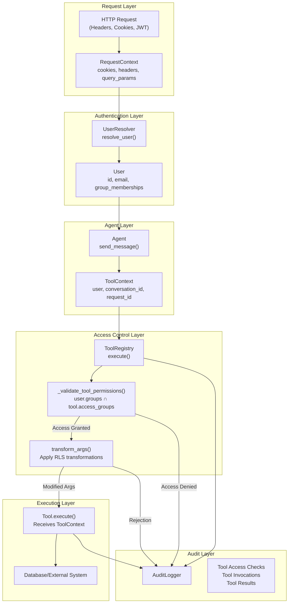
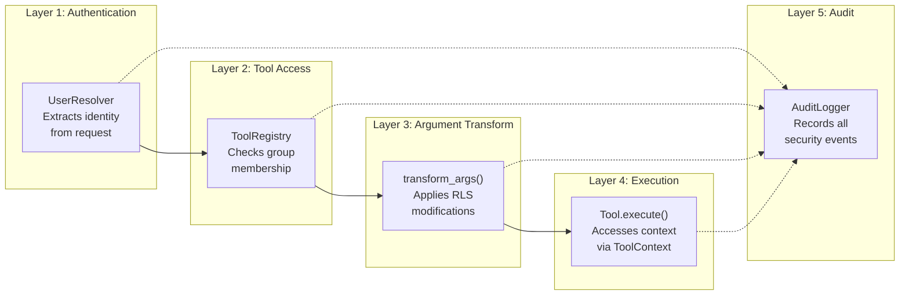
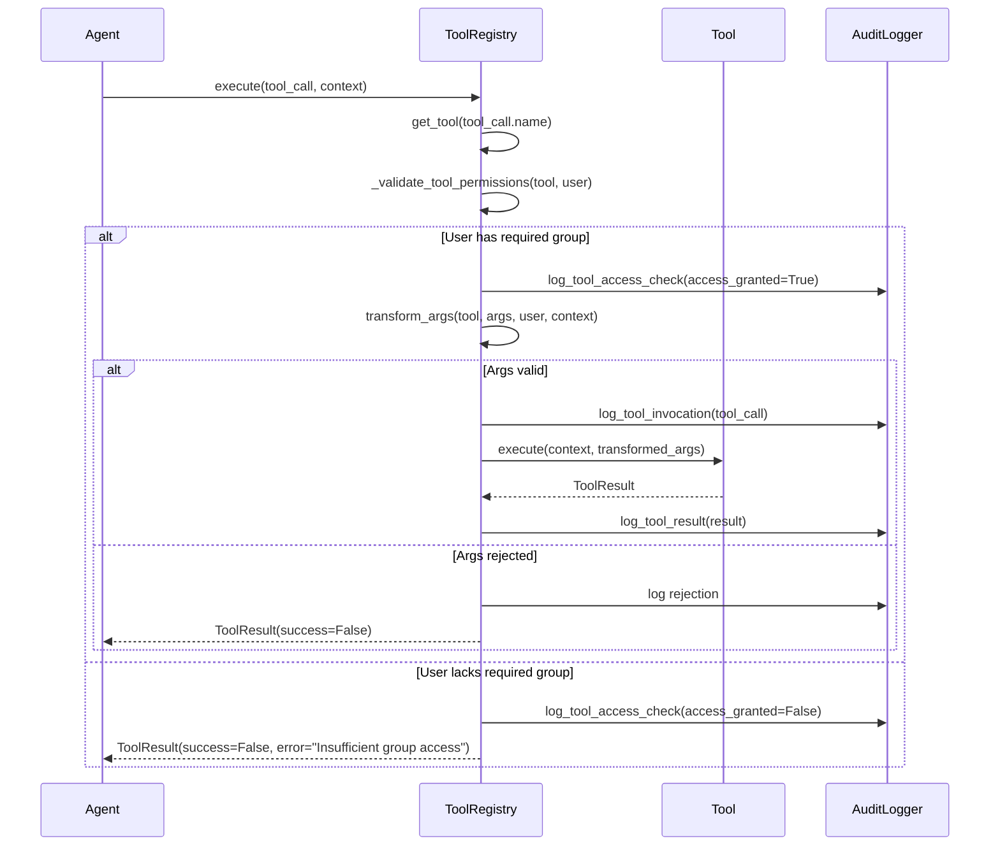
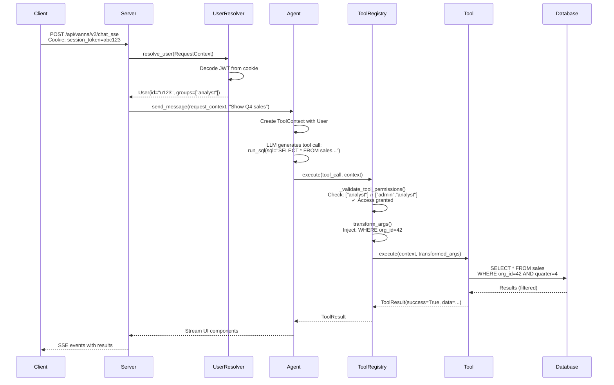

<!-- source: DeepWiki mcp.deepwiki.com · repo vanna-ai/vanna · page 3 Security and Access Control · fetched 2026-10-29 -->

# Security and Access Control

<details>
<summary>Relevant source files</summary>

The following files were used as context for generating this wiki page:

- [MIGRATION_GUIDE.md](MIGRATION_GUIDE.md)
- [README.md](README.md)
- [examples/transform_args_example.py](examples/transform_args_example.py)
- [img/architecture.png](img/architecture.png)
- [img/vanna2.svg](img/vanna2.svg)
- [notebooks/quickstart.ipynb](notebooks/quickstart.ipynb)
- [src/vanna/core/registry.py](src/vanna/core/registry.py)
- [src/vanna/core/tool/__init__.py](src/vanna/core/tool/__init__.py)
- [src/vanna/core/tool/base.py](src/vanna/core/tool/base.py)
- [src/vanna/core/tool/models.py](src/vanna/core/tool/models.py)
- [src/vanna/core/user/models.py](src/vanna/core/user/models.py)
- [src/vanna/integrations/anthropic/llm.py](src/vanna/integrations/anthropic/llm.py)
- [src/vanna/integrations/openai/llm.py](src/vanna/integrations/openai/llm.py)
- [src/vanna/servers/fastapi/app.py](src/vanna/servers/fastapi/app.py)
- [src/vanna/servers/flask/app.py](src/vanna/servers/flask/app.py)
- [tests/test_agent_memory.py](tests/test_agent_memory.py)
- [tests/test_tool_permissions.py](tests/test_tool_permissions.py)

</details>


## Purpose and Scope

This document provides a comprehensive overview of Vanna's multi-layer security model. Vanna implements user-aware security throughout the system, from request authentication to tool execution and data access. The framework ensures that user identity and permissions flow through every layer of the application.

This page covers the overall security architecture and how the components work together. For detailed information on specific aspects:
- User authentication and resolution: see [UserResolver and Authentication](#3.1)
- Tool-level permission checks: see [Tool Access Control](#3.2)  
- UI feature gating: see [UI Feature Access Control](#3.3)
- Row-level security implementation: see [Argument Transformation and Row-Level Security](#3.4)

---

## Security Architecture Overview

Vanna's security model is built on four key principles:

1. **User-Aware by Design**: Every request carries user context through the entire execution pipeline
2. **Group-Based Permissions**: Tools specify required group memberships; access granted via intersection
3. **Transformation-Based RLS**: SQL queries can be automatically modified based on user context
4. **Comprehensive Auditing**: All security-relevant events are logged for compliance

### High-Level Security Architecture



**Sources:** [README.md:1-312](), [src/vanna/core/registry.py:1-279](), [src/vanna/core/tool/models.py:1-85]()

---

## Core Security Components

### User Model

The `User` class represents an authenticated user with their identity and permissions:

| Field | Type | Description |
|-------|------|-------------|
| `id` | `str` | Unique user identifier |
| `username` | `Optional[str]` | Display name |
| `email` | `Optional[str]` | Email address |
| `group_memberships` | `List[str]` | Groups the user belongs to (e.g., `["admin", "analyst"]`) |
| `metadata` | `Dict[str, Any]` | Additional context (e.g., `organization_id`) |

The `group_memberships` field is critical for security - it determines which tools the user can access and can be used for row-level security filtering.

**Sources:** [src/vanna/core/user/models.py:1-26]()

### RequestContext

The `RequestContext` captures the raw HTTP request information before authentication:

```python
class RequestContext:
    cookies: Dict[str, str]
    headers: Dict[str, str]
    query_params: Dict[str, str]
```

Custom `UserResolver` implementations extract user identity from these fields (JWT tokens, session cookies, API keys, etc.).

**Sources:** [notebooks/quickstart.ipynb:71-94]()

### ToolContext

Once authenticated, the `User` object flows through the system wrapped in a `ToolContext`:

| Field | Type | Description |
|-------|------|-------------|
| `user` | `User` | Authenticated user |
| `conversation_id` | `str` | Current conversation identifier |
| `request_id` | `str` | Unique request identifier for tracing |
| `agent_memory` | `AgentMemory` | Agent memory for tool learning |
| `metadata` | `Dict[str, Any]` | Additional execution context |
| `observability_provider` | `Optional[ObservabilityProvider]` | Metrics/tracing provider |

The `ToolContext` is passed to every tool execution, providing full user context and execution metadata.

**Sources:** [src/vanna/core/tool/models.py:28-45]()

---

## Security Layers

Vanna implements security at multiple layers, each with specific responsibilities:



### Layer 1: Authentication via UserResolver

**Responsibility:** Convert `RequestContext` into authenticated `User` object

**Implementation:** Custom subclass of `UserResolver` with `resolve_user()` method

**Example:** [notebooks/quickstart.ipynb:76-93]()

```python
class SimpleUserResolver(UserResolver):
    async def resolve_user(self, request_context: RequestContext) -> User:
        user_email = request_context.get_cookie('vanna_email')
        if user_email == "admin@example.com":
            return User(id="admin1", email=user_email, 
                       group_memberships=['admin'])
        return User(id="user1", email=user_email, 
                   group_memberships=['user'])
```

### Layer 2: Tool Access Control

**Responsibility:** Validate user has required group membership to access tool

**Implementation:** `ToolRegistry._validate_tool_permissions()` [src/vanna/core/registry.py:98-111]()

**Logic:** 
```
Access Granted = (user.group_memberships ∩ tool.access_groups) ≠ ∅
```

If `tool.access_groups` is empty, the tool is accessible to all users.

### Layer 3: Argument Transformation

**Responsibility:** Modify tool arguments based on user context (e.g., inject WHERE clauses)

**Implementation:** Override `ToolRegistry.transform_args()` [src/vanna/core/registry.py:113-142]()

**Returns:** Either transformed arguments or `ToolRejection` if validation fails

### Layer 4: Tool Execution

**Responsibility:** Execute business logic with full user context

**Implementation:** `Tool.execute(context: ToolContext, args: T)` [src/vanna/core/tool/base.py:42-52]()

Tools access user information via `context.user` throughout execution.

### Layer 5: Audit Logging

**Responsibility:** Record all security-relevant events

**Events Logged:**
- Tool access checks (granted/denied)
- Tool invocations with arguments
- Tool results
- UI feature access checks

**Sources:** [src/vanna/core/registry.py:160-278](), [README.md:82-86]()

---

## Permission Model

### Tool Registration with Access Groups

Tools are registered with optional access group restrictions:

```python
tools = ToolRegistry()
tools.register_local_tool(
    RunSqlTool(sql_runner=SqliteRunner("./db.sqlite")),
    access_groups=['admin', 'user']  # Both groups can access
)
tools.register_local_tool(
    SaveQuestionToolArgsTool(),
    access_groups=['admin']  # Admin-only
)
```

**Sources:** [notebooks/quickstart.ipynb:109-114]()

### Permission Check Flow



**Sources:** [src/vanna/core/registry.py:144-278](), [tests/test_tool_permissions.py:1-916]()

---

## Row-Level Security Example

The `transform_args()` mechanism enables sophisticated row-level security:

```python
class RLSToolRegistry(ToolRegistry):
    async def transform_args(self, tool, args, user, context):
        if tool.name == "run_sql" and isinstance(args, RunSqlToolArgs):
            original_sql = args.sql
            user_org_id = user.metadata.get("organization_id")
            
            # Inject WHERE clause
            if "WHERE" in original_sql.upper():
                modified_sql = original_sql.replace(
                    "WHERE", 
                    f"WHERE organization_id = {user_org_id} AND",
                    1
                )
            else:
                modified_sql = f"{original_sql} WHERE organization_id = {user_org_id}"
            
            return args.model_copy(update={"sql": modified_sql})
        
        return args  # No transformation
```

This ensures users only see data belonging to their organization without modifying tool code.

**Sources:** [examples/transform_args_example.py:1-157](), [tests/test_tool_permissions.py:597-683]()

---

## Complete Request Flow

### End-to-End Security Flow



**Sources:** [README.md:116-132](), [src/vanna/core/registry.py:144-278]()

---

## Security Features Summary

| Feature | Implementation | Purpose |
|---------|---------------|---------|
| **User Authentication** | Custom `UserResolver` subclass | Extract identity from requests (JWT, cookies, etc.) |
| **Group-Based Access** | `Tool.access_groups` + intersection check | Control which users can invoke which tools |
| **Row-Level Security** | `ToolRegistry.transform_args()` override | Automatically filter data based on user context |
| **Audit Logging** | `AuditLogger` with `AuditConfig` | Record all security events for compliance |
| **UI Feature Gating** | `UiFeatures.can_user_access_feature()` | Hide admin features from regular users |
| **Request Scoping** | `ToolContext` flows through execution | Ensure user context available everywhere |
| **Permission Rejection** | `ToolRejection` return type | Gracefully deny access with explanations |

**Sources:** [README.md:82-106](), [src/vanna/core/registry.py:1-279](), [src/vanna/core/tool/models.py:75-85]()

---

## Configuration

### AuditConfig Options

Audit logging can be configured via `AuditConfig`:

```python
from vanna.core.agent.config import AuditConfig

audit_config = AuditConfig(
    log_tool_access_checks=True,      # Log permission checks
    log_tool_invocations=True,        # Log tool calls with args
    log_tool_results=True,            # Log tool execution results
    sanitize_tool_parameters=True     # Redact sensitive arguments
)

registry = ToolRegistry(
    audit_logger=my_audit_logger,
    audit_config=audit_config
)
```

**Sources:** [src/vanna/core/registry.py:49-62]()

---

## Best Practices

1. **Always Use UserResolver**: Never bypass authentication - implement a `UserResolver` that validates tokens/sessions
2. **Principle of Least Privilege**: Only grant necessary group memberships
3. **Enable Audit Logging**: Keep audit logs for security incidents and compliance
4. **Test Permission Boundaries**: Verify denied access cases work correctly
5. **Use transform_args for RLS**: Don't rely on tools to filter data - enforce at registry level
6. **Validate User Metadata**: Check `user.metadata` exists before using for RLS
7. **Return Clear Error Messages**: Use `ToolRejection.reason` to explain why access was denied

**Sources:** [tests/test_tool_permissions.py:1-916](), [examples/transform_args_example.py:45-97]()

---

This security model ensures that Vanna applications can safely support multi-tenant deployments with fine-grained access control, automatic data filtering, and comprehensive audit trails. For implementation details on specific security components, see the sub-pages linked at the top of this document.

---

