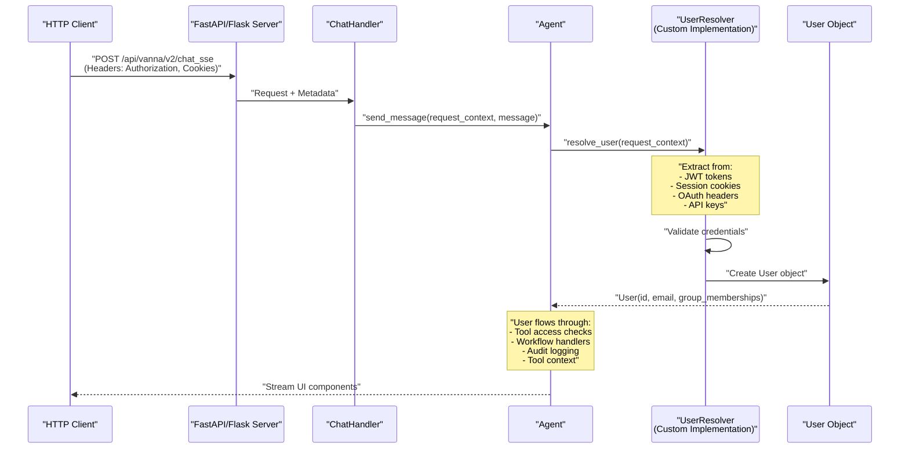
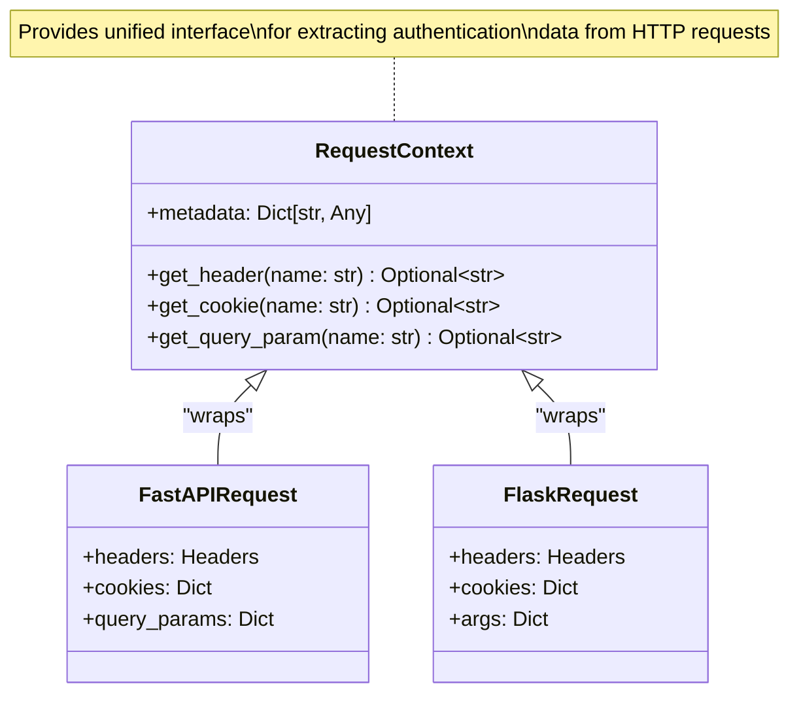
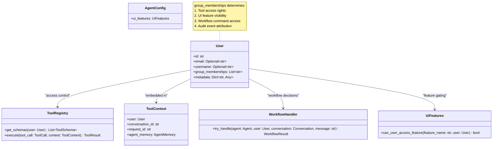
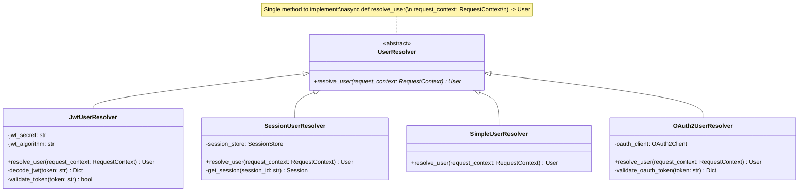
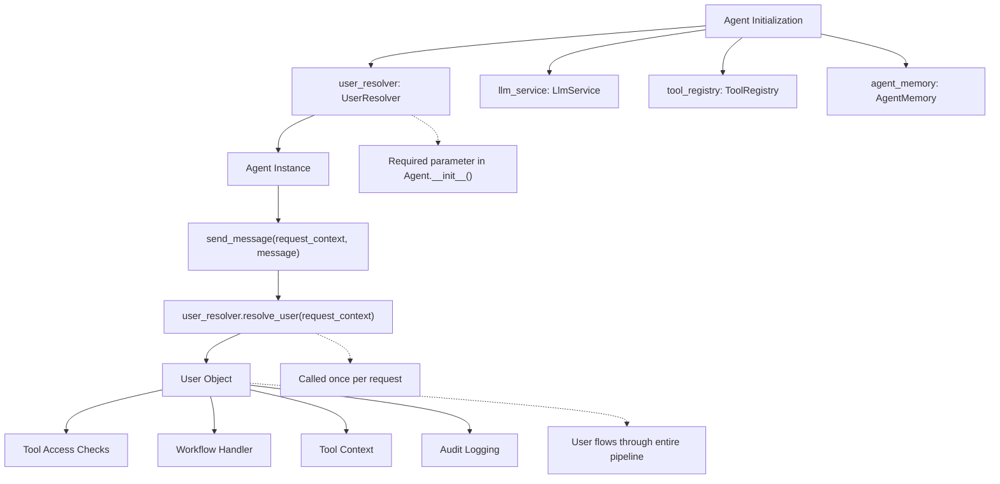
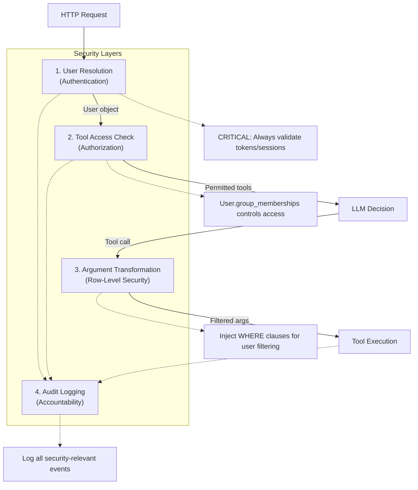
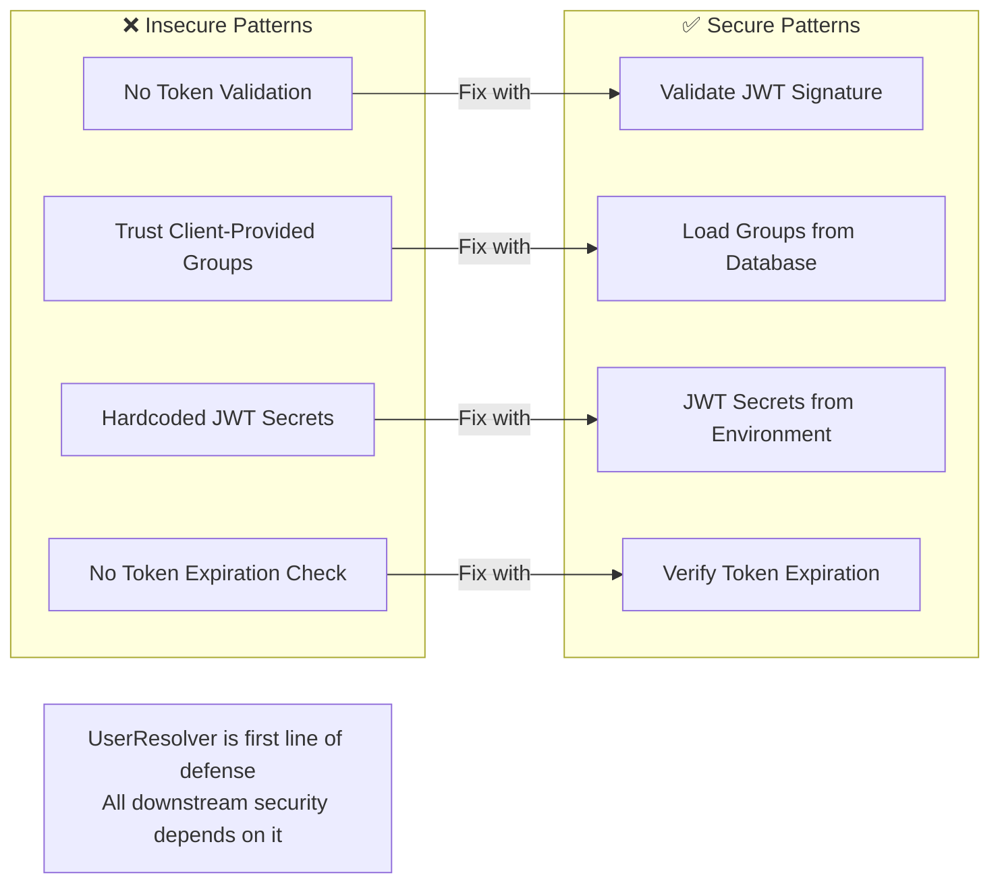
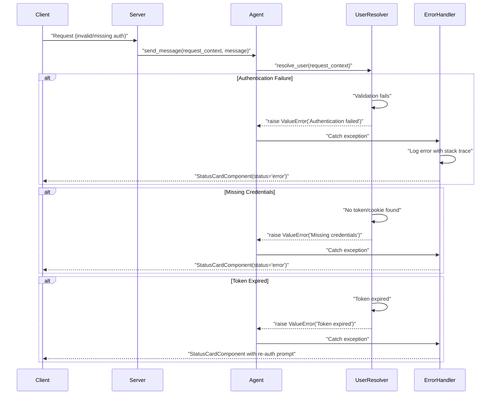

<!-- source: DeepWiki mcp.deepwiki.com · repo vanna-ai/vanna · page 3.1 UserResolver and Authentication · fetched 2026-10-29 -->

# UserResolver and Authentication

<details>
<summary>Relevant source files</summary>

The following files were used as context for generating this wiki page:

- [MIGRATION_GUIDE.md](MIGRATION_GUIDE.md)
- [README.md](README.md)
- [img/architecture.png](img/architecture.png)
- [img/vanna2.svg](img/vanna2.svg)
- [notebooks/quickstart.ipynb](notebooks/quickstart.ipynb)
- [src/vanna/core/__init__.py](src/vanna/core/__init__.py)
- [src/vanna/core/agent/agent.py](src/vanna/core/agent/agent.py)
- [src/vanna/core/workflow/__init__.py](src/vanna/core/workflow/__init__.py)
- [src/vanna/examples/default_workflow_handler_example.py](src/vanna/examples/default_workflow_handler_example.py)
- [src/vanna/integrations/anthropic/llm.py](src/vanna/integrations/anthropic/llm.py)
- [src/vanna/integrations/local/__init__.py](src/vanna/integrations/local/__init__.py)
- [src/vanna/integrations/local/file_system_conversation_store.py](src/vanna/integrations/local/file_system_conversation_store.py)
- [src/vanna/integrations/openai/llm.py](src/vanna/integrations/openai/llm.py)
- [src/vanna/servers/fastapi/app.py](src/vanna/servers/fastapi/app.py)
- [src/vanna/servers/flask/app.py](src/vanna/servers/flask/app.py)
- [src/vanna/tools/agent_memory.py](src/vanna/tools/agent_memory.py)

</details>


## Purpose and Scope

This document explains the `UserResolver` system, which is responsible for extracting user identity from HTTP requests and converting it into a `User` object that flows through the entire Vanna agent pipeline. The `UserResolver` is the entry point for all authentication and serves as the bridge between your existing authentication system (JWT, OAuth, cookies, etc.) and Vanna's security model.

For information about how the resolved `User` object is used for tool-level permissions, see [Tool Access Control](#3.2). For UI feature gating, see [UI Feature Access Control](#3.3). For row-level security, see [Argument Transformation and Row-Level Security](#3.4).

**Sources:** README.md:1-312, Architecture diagrams

---

## System Overview

The `UserResolver` is an abstract interface that you implement to connect Vanna to your authentication system. It is invoked at the start of every agent request to resolve the `RequestContext` (HTTP metadata) into a `User` object containing identity and group memberships.

### Authentication Flow



**Sources:** src/vanna/core/agent/agent.py:249-267, README.md:143-192

---

## RequestContext

The `RequestContext` is an abstraction over HTTP request metadata that is passed to `UserResolver.resolve_user()`. It provides methods to extract authentication data from various sources.

### RequestContext API



### Common Extraction Patterns

| Method | Purpose | Example |
|--------|---------|---------|
| `get_header('Authorization')` | Extract bearer tokens | `"Bearer eyJ0eXAiOiJKV1QiLCJh..."` |
| `get_header('X-API-Key')` | Extract API keys | `"sk-proj-abc123..."` |
| `get_cookie('session_id')` | Extract session cookies | `"f5a3b2c1..."` |
| `get_cookie('vanna_email')` | Extract user identifier | `"alice@example.com"` |
| `metadata.get('custom_field')` | Access custom metadata | Any custom data |

**Sources:** README.md:161-172, notebooks/quickstart.ipynb:84-86

---

## User Model

The `User` object returned by `UserResolver` contains identity information and group memberships that determine access throughout the system.

### User Structure



### User Fields

| Field | Type | Purpose | Example |
|-------|------|---------|---------|
| `id` | `str` | Unique user identifier (required) | `"user_12345"`, `"alice@example.com"` |
| `email` | `Optional[str]` | User email for display | `"alice@example.com"` |
| `username` | `Optional[str]` | Display name | `"Alice Johnson"` |
| `group_memberships` | `List[str]` | Group names for access control | `["admin", "analytics"]` |
| `metadata` | `Dict[str, Any]` | Custom fields | `{"organization_id": "org_123"}` |

**Sources:** README.md:168-172, src/vanna/core/agent/agent.py:527-541, notebooks/quickstart.ipynb:91-93

---

## Creating Custom UserResolvers

### UserResolver Interface

You implement the `UserResolver` abstract class by providing an async `resolve_user()` method:



### Example: JWT-Based Authentication

```python
# Example implementation (not actual code from repo)
class JwtUserResolver(UserResolver):
    async def resolve_user(self, request_context: RequestContext) -> User:
        # Extract JWT from Authorization header
        auth_header = request_context.get_header('Authorization')
        if not auth_header or not auth_header.startswith('Bearer '):
            raise ValueError("Missing or invalid Authorization header")
        
        token = auth_header[7:]  # Remove "Bearer " prefix
        
        # Decode and validate JWT (use your existing logic)
        try:
            payload = self.decode_jwt(token)
        except Exception as e:
            raise ValueError(f"Invalid JWT: {e}")
        
        # Map JWT claims to User object
        return User(
            id=payload['sub'],
            email=payload.get('email'),
            username=payload.get('name'),
            group_memberships=payload.get('groups', ['user']),
            metadata={'organization_id': payload.get('org_id')}
        )
```

**Pattern demonstrated in:** README.md:161-172

### Example: Cookie-Based Authentication

The quickstart notebook demonstrates a simple cookie-based resolver:

```python
# From notebooks/quickstart.ipynb:81-93
class SimpleUserResolver(UserResolver):
    async def resolve_user(self, request_context: RequestContext) -> User:
        # In production, validate cookies/JWTs here
        user_email = request_context.get_cookie('vanna_email')
        if not user_email:
            raise ValueError("Missing 'vanna_email' cookie for user identification")
        
        if user_email == "admin@example.com":
            return User(id="admin1", email=user_email, group_memberships=['admin'])
        
        return User(id="user1", email=user_email, group_memberships=['user'])
```

**Sources:** notebooks/quickstart.ipynb:81-93, README.md:161-172

---

## Integration with Agent

The `Agent` class receives a `UserResolver` instance during initialization and invokes it at the start of every `send_message()` call.

### Agent Initialization



### Agent Code Flow

The agent resolves the user immediately after receiving a request:

[src/vanna/core/agent/agent.py:249-267]()

```python
# Resolve user from request context with observability
user_resolution_span = None
if self.observability_provider:
    user_resolution_span = await self.observability_provider.create_span(
        "agent.user_resolution",
        attributes={"has_context": request_context is not None},
    )

user = await self.user_resolver.resolve_user(request_context)

if self.observability_provider and user_resolution_span:
    user_resolution_span.set_attribute("user_id", user.id)
    await self.observability_provider.end_span(user_resolution_span)
    # ... metric recording
```

### Complete Setup Example

From the README, here's a complete production setup:

[README.md:143-192]()

```python
from fastapi import FastAPI
from vanna import Agent
from vanna.servers.fastapi.routes import register_chat_routes
from vanna.servers.base import ChatHandler
from vanna.core.user import UserResolver, User, RequestContext
from vanna.integrations.anthropic import AnthropicLlmService
from vanna.tools import RunSqlTool
from vanna.integrations.sqlite import SqliteRunner
from vanna.core.registry import ToolRegistry

app = FastAPI()

# 1. Define your user resolver
class MyUserResolver(UserResolver):
    async def resolve_user(self, request_context: RequestContext) -> User:
        token = request_context.get_header('Authorization')
        user_data = self.decode_jwt(token)
        
        return User(
            id=user_data['id'],
            email=user_data['email'],
            group_memberships=user_data['groups']
        )

# 2. Set up agent with tools
llm = AnthropicLlmService(model="claude-sonnet-4-5")
tools = ToolRegistry()
tools.register(RunSqlTool(sql_runner=SqliteRunner("./data.db")))

agent = Agent(
    llm_service=llm,
    tool_registry=tools,
    user_resolver=MyUserResolver()  # Your custom resolver
)

# 3. Register routes
chat_handler = ChatHandler(agent)
register_chat_routes(app, chat_handler)
```

**Sources:** README.md:143-192, src/vanna/core/agent/agent.py:82-140

---

## Common Authentication Patterns

### Pattern Comparison

```mermaid
graph TB
    subgraph "JWT Token (Stateless)"
        JWTClient["Client<br/>Authorization: Bearer token"]
        JWTResolver["UserResolver"]
        JWTDecode["Decode & Validate JWT"]
        JWTUser["User(id, email, groups)"]
        
        JWTClient -->|"get_header('Authorization')"| JWTResolver
        JWTResolver --> JWTDecode
        JWTDecode --> JWTUser
    end
    
    subgraph "Session Cookie (Stateful)"
        CookieClient["Client<br/>Cookie: session_id=xyz"]
        CookieResolver["UserResolver"]
        CookieLookup["Session Store Lookup"]
        CookieUser["User(id, email, groups)"]
        
        CookieClient -->|"get_cookie('session_id')"| CookieResolver
        CookieResolver --> CookieLookup
        CookieLookup --> CookieUser
    end
    
    subgraph "API Key (Service Accounts)"
        APIClient["Client<br/>X-API-Key: sk-..."]
        APIResolver["UserResolver"]
        APILookup["API Key Database Lookup"]
        APIUser["User(id='service', groups=['api'])"]
        
        APIClient -->|"get_header('X-API-Key')"| APIResolver
        APIResolver --> APILookup
        APILookup --> APIUser
    end
    
    subgraph "Development (Simplified)"
        DevClient["Client<br/>Cookie: vanna_email=user@example.com"]
        DevResolver["SimpleUserResolver"]
        DevCheck["Map email to groups"]
        DevUser["User(id, email, groups)"]
        
        DevClient -->|"get_cookie('vanna_email')"| DevResolver
        DevResolver --> DevCheck
        DevCheck --> DevUser
    end
```



### Implementation Examples

| Pattern | RequestContext Method | Validation Strategy | Use Case |
|---------|----------------------|---------------------|----------|
| JWT Bearer Token | `get_header('Authorization')` | Verify signature, check expiration | Production APIs, microservices |
| Session Cookie | `get_cookie('session_id')` | Lookup in session store (Redis, DB) | Traditional web apps |
| API Key | `get_header('X-API-Key')` | Database lookup, rate limiting | Service-to-service, API clients |
| OAuth Token | `get_header('Authorization')` | Validate with OAuth provider | Third-party integrations |
| Simple Cookie | `get_cookie('vanna_email')` | Minimal/no validation | Development, demos |

**Sources:** README.md:161-172, notebooks/quickstart.ipynb:81-93

---

## SimpleUserResolver for Testing

For development and testing, Vanna provides a `SimpleUserResolver` that extracts user identity from cookies without validation. This is demonstrated in the quickstart notebook.

### SimpleUserResolver Example

[notebooks/quickstart.ipynb:81-93]()

```python
class SimpleUserResolver(UserResolver):
    async def resolve_user(self, request_context: RequestContext) -> User:
        # In production, validate cookies/JWTs here
        user_email = request_context.get_cookie('vanna_email')
        if not user_email:
            raise ValueError("Missing 'vanna_email' cookie for user identification")
        
        print(f"Resolving user for email: {user_email}")

        if user_email == "admin@example.com":
            return User(id="admin1", email=user_email, group_memberships=['admin'])
        
        return User(id="user1", email=user_email, group_memberships=['user'])
```

### When to Use SimpleUserResolver

| Scenario | Should Use? | Reason |
|----------|-------------|--------|
| Local development | ✅ Yes | Fast iteration, no auth setup needed |
| Automated tests | ✅ Yes | Predictable user resolution |
| Demos/prototypes | ✅ Yes | Focus on functionality, not auth |
| Production | ❌ No | No security validation |
| Multi-user production | ❌ No | No proper user isolation |

**Sources:** notebooks/quickstart.ipynb:81-93, src/vanna/examples/default_workflow_handler_example.py:22-33

---

## Security Considerations

### Critical Security Patterns



### Security Checklist

**UserResolver Implementation:**

| Requirement | Description | Risk if Missing |
|-------------|-------------|-----------------|
| ✅ Token validation | Verify JWT signature, check expiration | Token forgery, replay attacks |
| ✅ Session verification | Validate session exists and not expired | Session hijacking |
| ✅ Error handling | Catch and handle validation failures | Information leakage in errors |
| ✅ Rate limiting | Limit failed auth attempts | Brute force attacks |
| ✅ HTTPS enforcement | Require encrypted connections | Credential interception |
| ✅ Group membership validation | Verify groups against authoritative source | Privilege escalation |

**Common Vulnerabilities:**



### Production Best Practices

1. **Always validate credentials**: Never trust client-provided data without verification
   - For JWTs: Verify signature, issuer, audience, expiration
   - For sessions: Lookup in secure session store (Redis, database)
   - For API keys: Hash and compare against stored values

2. **Load group memberships server-side**: The `group_memberships` field determines all access rights
   - Query user's groups from your database/directory service
   - Never accept groups from the client
   - Cache group lookups with appropriate TTL

3. **Handle errors securely**: 
   - Log detailed errors server-side
   - Return generic error messages to clients
   - Avoid leaking user existence information

4. **Use observability**: The agent logs user resolution timing and success/failure
   - Monitor for authentication failures
   - Alert on suspicious patterns
   - Track user resolution duration

Example of secure implementation:

```python
class SecureJwtUserResolver(UserResolver):
    async def resolve_user(self, request_context: RequestContext) -> User:
        try:
            # Extract and validate token
            auth_header = request_context.get_header('Authorization')
            if not auth_header or not auth_header.startswith('Bearer '):
                raise ValueError("Invalid Authorization header")
            
            token = auth_header[7:]
            
            # Verify JWT signature and claims
            payload = jwt.decode(
                token,
                self.jwt_secret,
                algorithms=['RS256'],
                audience='vanna-api',
                issuer='auth.example.com'
            )
            
            # Load groups from authoritative source (database)
            user_groups = await self.db.get_user_groups(payload['sub'])
            
            return User(
                id=payload['sub'],
                email=payload['email'],
                group_memberships=user_groups,  # Server-side loaded
                metadata={'organization_id': payload['org_id']}
            )
        except jwt.InvalidTokenError as e:
            # Log detailed error server-side
            logger.warning(f"Invalid JWT token: {e}")
            # Return generic error to client
            raise ValueError("Authentication failed")
```

**Sources:** README.md:18-26, Architecture diagram (Diagram 4)

---

## Error Handling

### UserResolver Error Flow



The Agent catches exceptions from `UserResolver` and yields error UI components:

[src/vanna/core/agent/agent.py:166-229]()

The error handling includes:
- Full stack trace logging server-side
- User-friendly error messages to client
- Status bar updates showing error state
- Re-enabling of chat input for retry

**Sources:** src/vanna/core/agent/agent.py:166-229

---

## Summary

The `UserResolver` system provides:

1. **Pluggable authentication**: Implement one async method to connect any auth system
2. **RequestContext abstraction**: Unified interface for extracting headers, cookies, query params
3. **User identity propagation**: Resolved `User` flows through entire agent pipeline
4. **Group-based access control**: `group_memberships` field drives all authorization decisions
5. **Observability integration**: User resolution timing and errors are tracked
6. **Security foundation**: First line of defense for the entire system

Key integration points:
- Agent calls `user_resolver.resolve_user()` at start of every request
- User object embedded in `ToolContext` for tool execution
- User passed to `WorkflowHandler` for command authorization
- User used by `UiFeatures` for feature gating
- User recorded in audit logs for accountability

For next steps:
- [Tool Access Control](#3.2): How `group_memberships` controls tool access
- [UI Feature Access Control](#3.3): Gating admin interfaces by user group
- [Argument Transformation and Row-Level Security](#3.4): Injecting user-specific filters

**Sources:** README.md:1-312, src/vanna/core/agent/agent.py:82-267, notebooks/quickstart.ipynb:71-94, MIGRATION_GUIDE.md:1-297

---

