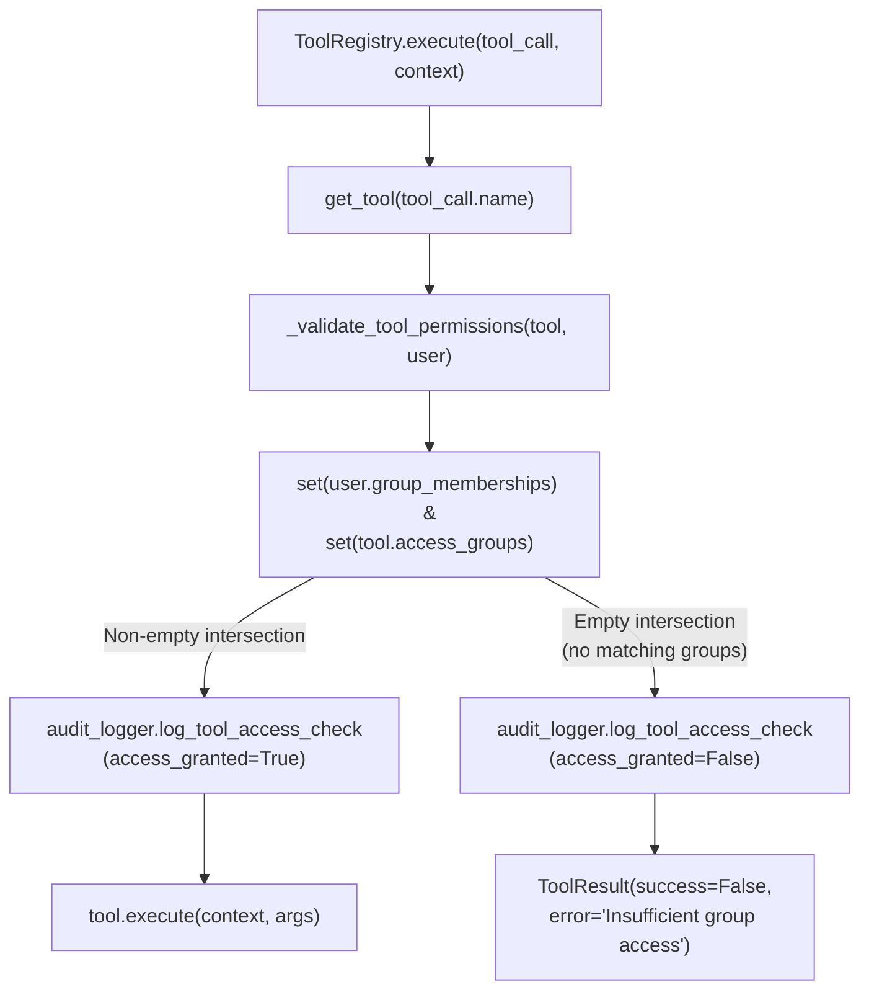
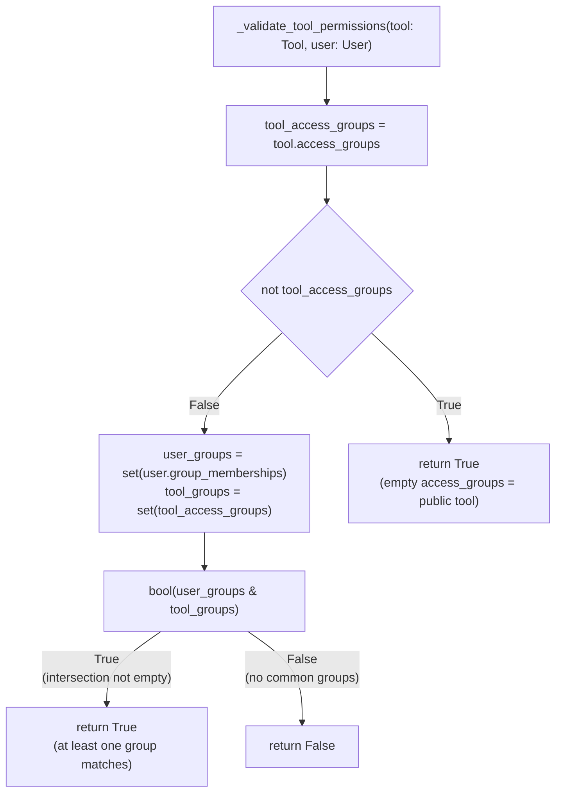
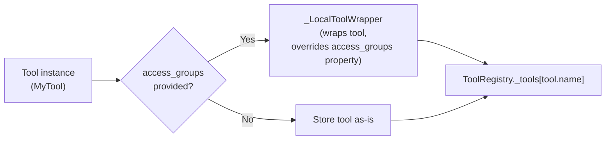
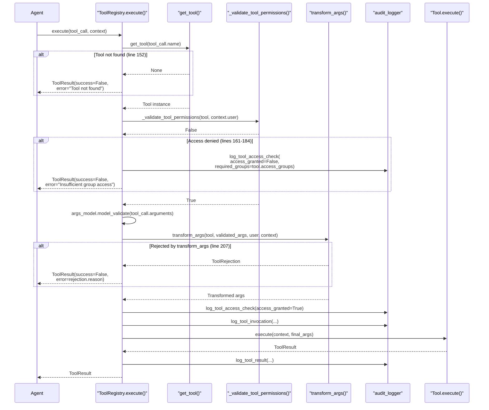
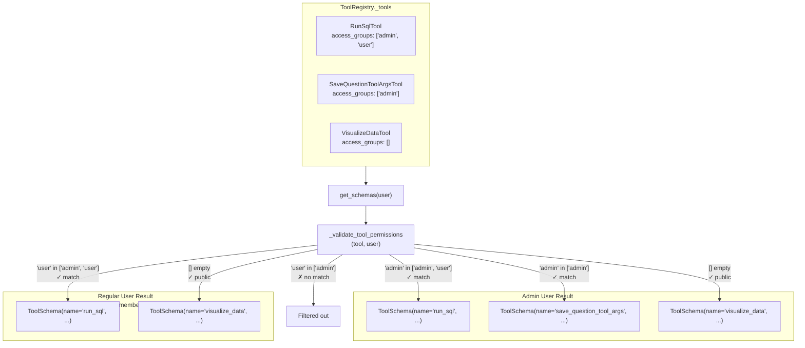

<!-- source: DeepWiki mcp.deepwiki.com · repo vanna-ai/vanna · page 3.2 Tool Access Control · fetched 2026-10-29 -->

# Tool Access Control

<details>
<summary>Relevant source files</summary>

The following files were used as context for generating this wiki page:

- [MIGRATION_GUIDE.md](MIGRATION_GUIDE.md)
- [README.md](README.md)
- [examples/transform_args_example.py](examples/transform_args_example.py)
- [img/architecture.png](img/architecture.png)
- [img/vanna2.svg](img/vanna2.svg)
- [notebooks/quickstart.ipynb](notebooks/quickstart.ipynb)
- [src/vanna/core/registry.py](src/vanna/core/registry.py)
- [src/vanna/core/tool/__init__.py](src/vanna/core/tool/__init__.py)
- [src/vanna/core/tool/base.py](src/vanna/core/tool/base.py)
- [src/vanna/core/tool/models.py](src/vanna/core/tool/models.py)
- [src/vanna/core/user/models.py](src/vanna/core/user/models.py)
- [src/vanna/integrations/anthropic/llm.py](src/vanna/integrations/anthropic/llm.py)
- [src/vanna/integrations/openai/llm.py](src/vanna/integrations/openai/llm.py)
- [src/vanna/servers/fastapi/app.py](src/vanna/servers/fastapi/app.py)
- [src/vanna/servers/flask/app.py](src/vanna/servers/flask/app.py)
- [tests/test_agent_memory.py](tests/test_agent_memory.py)
- [tests/test_tool_permissions.py](tests/test_tool_permissions.py)

</details>


## Purpose and Scope

This document describes the group-based access control system for tools in the Vanna Agents framework. Tool access control determines which users can execute which tools based on group membership, providing enterprise-grade authorization for agent capabilities.

For information about user authentication and identity resolution, see [UserResolver and Authentication](#3.1). For controlling visibility of tool execution details in the UI, see [UI Feature Access Control](#3.3). For argument-level security transformations like row-level security, see [Argument Transformation and Row-Level Security](#3.4).

**Sources:** [README.md:1-312](), [src/vanna/core/registry.py:1-279]()

---

## Overview

Tool access control in Vanna operates on a **group-based permission model** implemented by the `ToolRegistry` class. Each tool declares its `access_groups` via the `Tool.access_groups` property, and each `User` has a `group_memberships` list. During tool execution, `ToolRegistry.execute()` calls `_validate_tool_permissions()` to validate that the user belongs to at least one of the tool's allowed groups before permitting execution.

**Access Control Flow in ToolRegistry.execute()**



**Sources:** [src/vanna/core/registry.py:98-111](), [src/vanna/core/registry.py:144-184](), [tests/test_tool_permissions.py:1-916]()

---

## Group-Based Access Model

### User Group Memberships

Users have a `group_memberships` field that contains a list of group identifiers:

```python
User(
    id="user123",
    email="analyst@example.com",
    group_memberships=["user", "analyst"]  # User belongs to 2 groups
)
```

**Sources:** [src/vanna/core/user/models.py:12-25]()

### Tool Access Groups

Tools declare which groups can access them via the `access_groups` property:

```python
class MyTool(Tool):
    @property
    def access_groups(self) -> List[str]:
        return ["admin", "analyst"]  # Only these groups can execute
```

If `access_groups` returns an empty list, the tool is **accessible to all users** regardless of group membership.

**Sources:** [src/vanna/core/tool/base.py:32-34]()

### Permission Validation Logic

The `ToolRegistry._validate_tool_permissions()` method (lines 98-111) implements the validation logic:

**_validate_tool_permissions() Decision Tree**



The actual implementation from [src/vanna/core/registry.py:98-111]():

```python
async def _validate_tool_permissions(self, tool: Tool[Any], user: User) -> bool:
    """Validate if user has access to tool based on group membership.
    
    Checks for intersection between user's group memberships and tool's access groups.
    If tool has no access groups specified, it's accessible to all users.
    """
    tool_access_groups = tool.access_groups
    if not tool_access_groups:
        return True
    
    user_groups = set(user.group_memberships)
    tool_groups = set(tool_access_groups)
    # Grant access if any group in user.group_memberships exists in tool.access_groups
    return bool(user_groups & tool_groups)
```

**Sources:** [src/vanna/core/registry.py:98-111]()

---

## Tool Registration with Access Groups

### register_local_tool Method

Tools are registered with the `ToolRegistry` using `register_local_tool()`, which accepts an `access_groups` parameter:

```python
registry = ToolRegistry()

# Admin-only tool
registry.register_local_tool(
    SaveQuestionToolArgsTool(),
    access_groups=["admin"]
)

# Tool accessible by multiple groups
registry.register_local_tool(
    RunSqlTool(sql_runner=...),
    access_groups=["admin", "user", "analyst"]
)

# Public tool (empty list)
registry.register_local_tool(
    VisualizeDataTool(),
    access_groups=[]
)
```

**Sources:** [src/vanna/core/registry.py:63-80](), [notebooks/quickstart.ipynb:109-114]()

### Internal Wrapper Mechanism

The `register_local_tool()` method wraps tools with custom access groups using the internal `_LocalToolWrapper` class (lines 20-44):

**Tool Registration with _LocalToolWrapper**



The `_LocalToolWrapper` class delegates all methods to the wrapped tool except `access_groups`:

- `_LocalToolWrapper.name` → `_wrapped_tool.name`
- `_LocalToolWrapper.description` → `_wrapped_tool.description`
- `_LocalToolWrapper.access_groups` → returns `_access_groups` (from registration)
- `_LocalToolWrapper.get_args_schema()` → `_wrapped_tool.get_args_schema()`
- `_LocalToolWrapper.execute()` → `_wrapped_tool.execute()`

This pattern allows the same tool class to be registered multiple times with different access groups.

**Sources:** [src/vanna/core/registry.py:20-44](), [src/vanna/core/registry.py:63-80]()

---

## Permission Validation Pipeline

### Execution Flow with Permission Checks

The `ToolRegistry.execute()` method (lines 144-278) implements a multi-stage pipeline with permission checks:

**ToolRegistry.execute() Pipeline**



**Sources:** [src/vanna/core/registry.py:144-278]()

### Error Response for Access Denial

When `_validate_tool_permissions()` returns `False`, the registry constructs and returns a `ToolResult` with failure status (lines 161-184):

```python
# Validate group access
if not await self._validate_tool_permissions(tool, context.user):
    msg = f"Insufficient group access for tool '{tool_call.name}'"

    # Audit access denial
    if (
        self.audit_logger
        and self.audit_config
        and self.audit_config.log_tool_access_checks
    ):
        await self.audit_logger.log_tool_access_check(
            user=context.user,
            tool_name=tool_call.name,
            access_granted=False,
            required_groups=tool.access_groups,
            context=context,
            reason=msg,
        )

    return ToolResult(
        success=False,
        result_for_llm=msg,
        ui_component=None,
        error=msg,
    )
```

This `ToolResult` is returned to the agent, which sends the `result_for_llm` back to the LLM. The LLM can then inform the user that the operation is not permitted or attempt a different approach.

**Sources:** [src/vanna/core/registry.py:161-184]()

---

## Schema Filtering for Users

### get_schemas Method

The `ToolRegistry.get_schemas()` method (lines 90-96) filters tool schemas based on user permissions. The `Agent` calls this method when constructing the LLM request to ensure the LLM only sees tools the user has permission to execute:

```python
async def get_schemas(self, user: Optional[User] = None) -> List[ToolSchema]:
    """Get schemas for all tools accessible to user."""
    schemas = []
    for tool in self._tools.values():
        if user is None or await self._validate_tool_permissions(tool, user):
            schemas.append(tool.get_schema())
    return schemas
```

The filtering logic:
- If `user` is `None`, all tool schemas are returned (no filtering)
- If `user` is provided, only tools where `_validate_tool_permissions(tool, user)` returns `True` are included

This prevents the LLM from attempting to call tools the user cannot access, improving the user experience and reducing unnecessary permission denial errors.

**Sources:** [src/vanna/core/registry.py:90-96]()

### Schema Filtering Example

**Schema Filtering by User Groups**



In the test case from [tests/test_tool_permissions.py:286-316]():
- Admin user (groups: `["admin", "user"]`) receives 3 schemas
- Regular user (groups: `["user"]`) receives 2 schemas (save_memory filtered out)

**Sources:** [tests/test_tool_permissions.py:286-316](), [src/vanna/core/registry.py:90-96]()

---

## Audit Logging

### Access Check Logging

Every permission validation (both successful and failed) is logged via `audit_logger.log_tool_access_check()` if the `AuditLogger` is configured and `audit_config.log_tool_access_checks` is enabled:

**Access Denial Logging** (lines 165-177):
```python
if (
    self.audit_logger
    and self.audit_config
    and self.audit_config.log_tool_access_checks
):
    await self.audit_logger.log_tool_access_check(
        user=context.user,
        tool_name=tool_call.name,
        access_granted=False,
        required_groups=tool.access_groups,
        context=context,
        reason=msg,
    )
```

**Access Grant Logging** (lines 219-230):
```python
if (
    self.audit_logger
    and self.audit_config
    and self.audit_config.log_tool_access_checks
):
    await self.audit_logger.log_tool_access_check(
        user=context.user,
        tool_name=tool_call.name,
        access_granted=True,
        required_groups=tool.access_groups,
        context=context,
    )
```

The audit log records:
- `user`: Full `User` object with id, email, and group_memberships
- `tool_name`: Name of the tool being accessed
- `access_granted`: Boolean indicating whether access was granted
- `required_groups`: The tool's `access_groups` list
- `context`: Full `ToolContext` with conversation_id and request_id
- `reason`: Optional explanation (only for denials)

**Sources:** [src/vanna/core/registry.py:165-177](), [src/vanna/core/registry.py:219-230]()

### Audit Configuration

The `AuditConfig` dataclass (referenced in `ToolRegistry.__init__` lines 49-61) controls audit logging behavior:

| AuditConfig Setting | Description | Used In |
|---------------------|-------------|---------|
| `log_tool_access_checks` | Log all `_validate_tool_permissions()` results | Lines 168, 222 |
| `log_tool_invocations` | Log successful tool calls before execution | Lines 235 |
| `log_tool_results` | Log tool execution results | Lines 260 |
| `sanitize_tool_parameters` | Redact sensitive parameters in invocation logs | Line 245 |

The `ToolRegistry` checks these flags before calling the corresponding `AuditLogger` methods. If `audit_logger` is `None` or the specific flag is disabled, logging is skipped.

**Sources:** [src/vanna/core/registry.py:49-61](), [src/vanna/core/registry.py:165-269]()

---

## Examples and Best Practices

### Example 1: Multi-Group Tool

Register a tool accessible by multiple roles:

```python
tools = ToolRegistry()

tools.register_local_tool(
    RunSqlTool(sql_runner=PostgresRunner(...)),
    access_groups=["admin", "analyst", "user"]
)
```

Any user with `admin`, `analyst`, OR `user` in their `group_memberships` can execute this tool.

**Sources:** [notebooks/quickstart.ipynb:109-114]()

### Example 2: Admin-Only Tool

Restrict sensitive operations to administrators:

```python
tools.register_local_tool(
    SaveQuestionToolArgsTool(),  # Saves to memory - sensitive
    access_groups=["admin"]
)
```

**Sources:** [notebooks/quickstart.ipynb:113]()

### Example 3: Public Tool

Make a tool available to all users:

```python
tools.register_local_tool(
    VisualizeDataTool(),
    access_groups=[]  # Empty list = public
)
```

**Sources:** [tests/test_tool_permissions.py:102-131]()

### Example 4: Testing Access Control

```python
# Admin user with multiple group memberships
admin_user = User(
    id="admin_1",
    email="admin@example.com",
    group_memberships=["admin", "user"]
)

# Regular user with limited groups
regular_user = User(
    id="user_1",
    email="user@example.com",
    group_memberships=["user"]
)

# Register admin-only tool
registry.register_local_tool(
    AdminTool(),
    access_groups=["admin"]
)

# Admin can execute
context = ToolContext(user=admin_user, ...)
result = await registry.execute(tool_call, context)
assert result.success is True

# Regular user cannot execute
context = ToolContext(user=regular_user, ...)
result = await registry.execute(tool_call, context)
assert result.success is False
assert "Insufficient group access" in result.error
```

**Sources:** [tests/test_tool_permissions.py:135-164](), [tests/test_tool_permissions.py:166-198]()

### Best Practice: Principle of Least Privilege

1. **Default to restrictive**: Only specify `access_groups=[]` for truly public tools
2. **Use specific groups**: Create fine-grained groups like `sales_analyst`, `finance_admin` rather than broad `user` groups
3. **Document group semantics**: Maintain documentation of what each group represents
4. **Audit regularly**: Enable `log_tool_access_checks` to monitor access patterns
5. **Combine with argument transformation**: Use access groups for coarse-grained control and `transform_args` for fine-grained row-level security (see [Argument Transformation and Row-Level Security](#3.4))

**Sources:** [README.md:18-24](), [README.md:82-86]()

---

## Summary Table

| Component | Location | Purpose |
|-----------|----------|---------|
| `Tool.access_groups` | [src/vanna/core/tool/base.py:32-34]() | Property declaring which groups can access the tool |
| `User.group_memberships` | [src/vanna/core/user/models.py:21-23]() | List of groups the user belongs to |
| `ToolRegistry.register_local_tool()` | [src/vanna/core/registry.py:63-80]() | Register a tool with specific access groups |
| `ToolRegistry._validate_tool_permissions()` | [src/vanna/core/registry.py:98-111]() | Validate user has required group membership |
| `ToolRegistry.get_schemas()` | [src/vanna/core/registry.py:90-96]() | Filter tool schemas based on user permissions |
| `ToolRegistry.execute()` | [src/vanna/core/registry.py:144-278]() | Execute tool with permission validation |
| `AuditLogger.log_tool_access_check()` | [src/vanna/core/registry.py:165-177]() | Log permission validation attempts |

---

