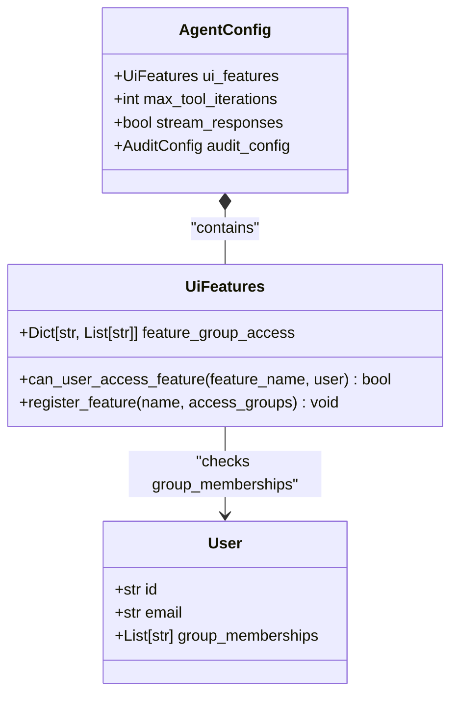
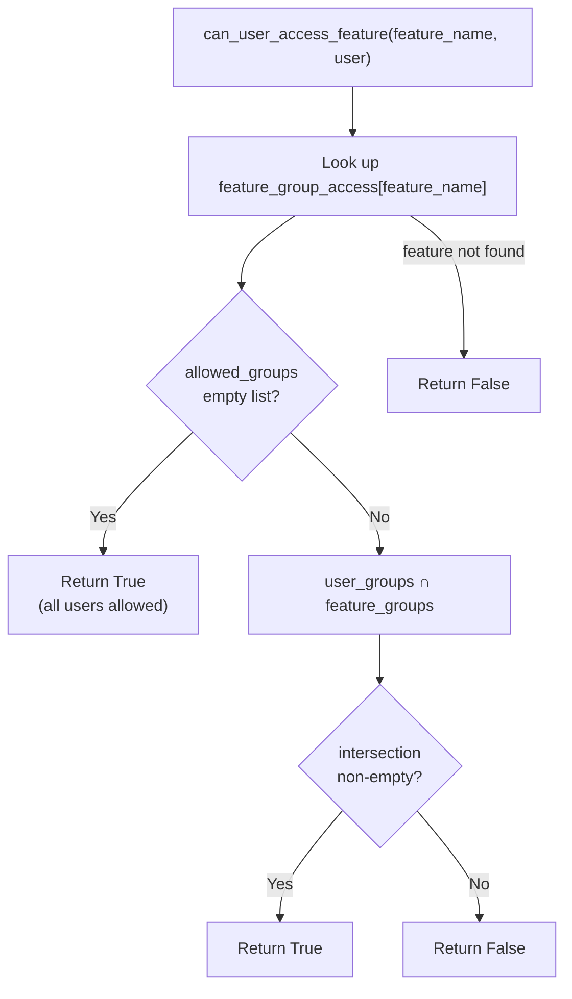
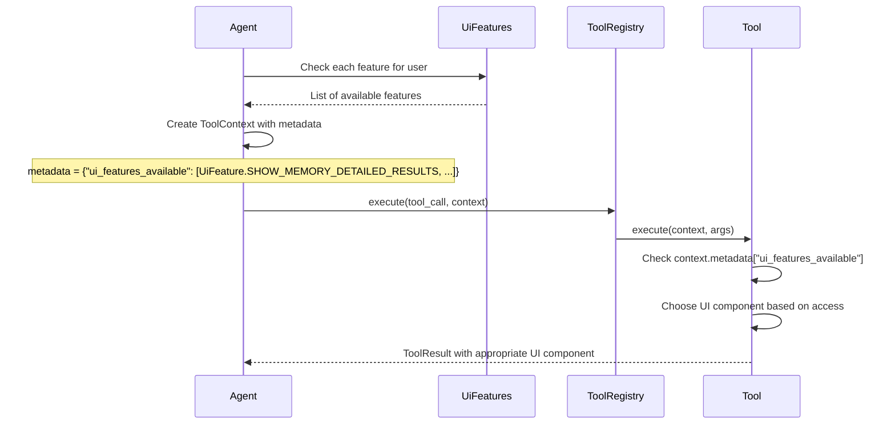
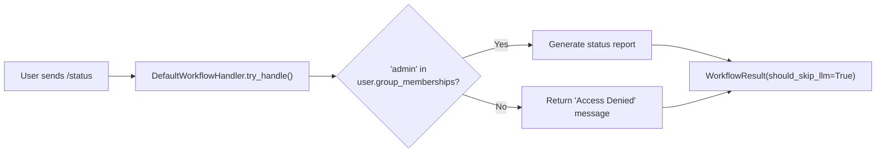
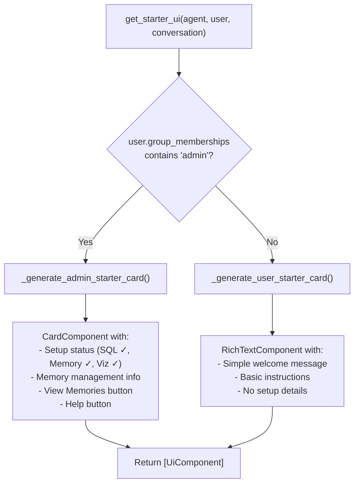
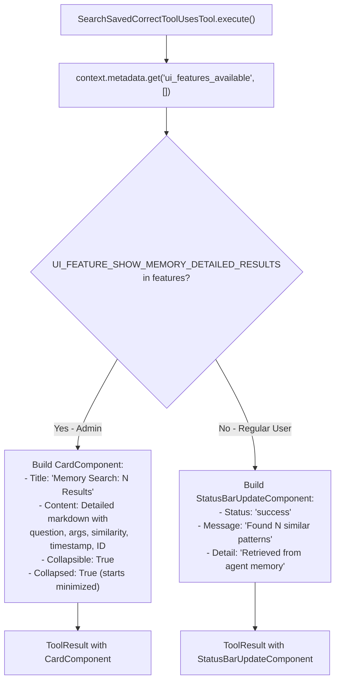
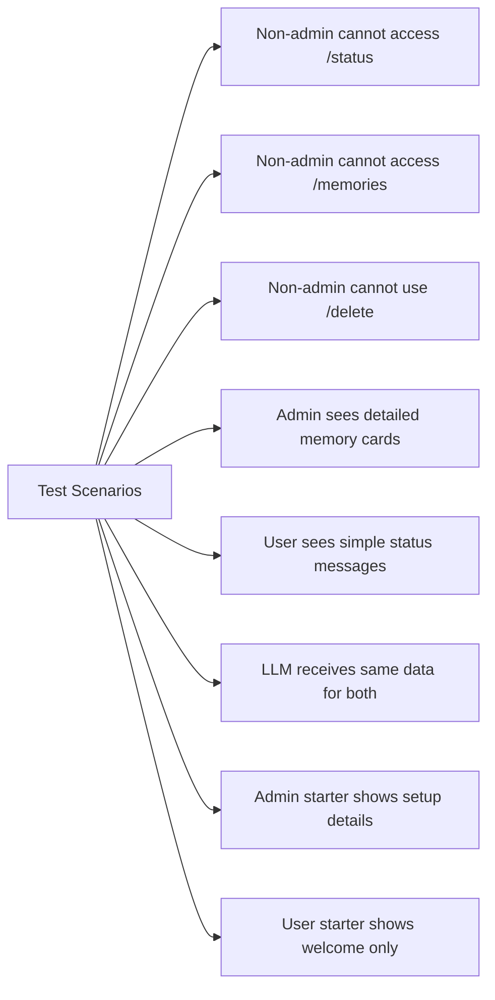

<!-- source: DeepWiki mcp.deepwiki.com · repo vanna-ai/vanna · page 3.3 UI Feature Access Control · fetched 2026-10-29 -->

# UI Feature Access Control

<details>
<summary>Relevant source files</summary>

The following files were used as context for generating this wiki page:

- [src/vanna/components/rich/containers/card.py](src/vanna/components/rich/containers/card.py)
- [src/vanna/core/agent/config.py](src/vanna/core/agent/config.py)
- [src/vanna/core/workflow/base.py](src/vanna/core/workflow/base.py)
- [src/vanna/core/workflow/default.py](src/vanna/core/workflow/default.py)
- [src/vanna/integrations/__init__.py](src/vanna/integrations/__init__.py)
- [src/vanna/tools/run_sql.py](src/vanna/tools/run_sql.py)
- [tests/test_memory_tools.py](tests/test_memory_tools.py)
- [tests/test_workflow.py](tests/test_workflow.py)

</details>


## Purpose and Scope

This document describes the UI feature access control system that governs what information users see in the UI based on their group memberships. This complements tool access control (see [Tool Access Control](#3.2)) by controlling the *visibility* and *detail level* of UI components, rather than the *execution* of tools. For user authentication concepts, see [UserResolver and Authentication](#3.1).

UI feature access control enables role-based user experiences where administrators see detailed diagnostic information (tool arguments, error traces, memory details) while regular users see simplified, cleaner interfaces. This system uses the same group intersection logic as tool access control.

---

## The UiFeature System

### UiFeature Enum

The `UiFeature` enum defines all available UI features that can be controlled:

| Feature | Description |
|---------|-------------|
| `UI_FEATURE_SHOW_TOOL_NAMES` | Display which tools are being invoked |
| `UI_FEATURE_SHOW_TOOL_ARGUMENTS` | Show the arguments passed to tools |
| `UI_FEATURE_SHOW_TOOL_ERROR` | Display detailed error messages and stack traces |
| `UI_FEATURE_SHOW_TOOL_INVOCATION_MESSAGE_IN_CHAT` | Show tool invocation status in chat history |
| `UI_FEATURE_SHOW_MEMORY_DETAILED_RESULTS` | Display detailed memory search results in collapsible cards |

Each feature controls a specific aspect of the UI's information density and diagnostic detail.

**Sources:** [src/vanna/core/agent/config.py:17-23]()

### UiFeatures Configuration Class

The `UiFeatures` class manages feature access mappings and provides the access control logic:



**Sources:** [src/vanna/core/agent/config.py:35-83]()

### Default Feature Access Configuration

The framework provides sensible defaults via `DEFAULT_UI_FEATURES`:

```python
DEFAULT_UI_FEATURES = {
    "tool_names": ["admin", "user"],           # Both admins and users
    "tool_arguments": ["admin"],               # Admins only
    "tool_error": ["admin"],                   # Admins only
    "tool_invocation_message_in_chat": ["admin"],  # Admins only
    "memory_detailed_results": ["admin"]       # Admins only
}
```

This configuration ensures regular users see a clean interface while administrators get full diagnostic visibility.

**Sources:** [src/vanna/core/agent/config.py:26-32]()

---

## Access Control Mechanism

### Group-Based Access Pattern

UI feature access uses the same intersection logic as tool access control:



**Key Principle:** An empty list for `allowed_groups` means the feature is accessible to **all users**. A non-empty list requires at least one group membership intersection.

**Sources:** [src/vanna/core/agent/config.py:49-73]()

### Implementation Details

The `can_user_access_feature` method implements this logic:

```python
def can_user_access_feature(self, feature_name: str, user: "User") -> bool:
    if feature_name in self.feature_group_access:
        allowed_groups = self.feature_group_access[feature_name]
    else:
        return False  # Feature doesn't exist, deny access
    
    if not allowed_groups:
        return True  # Empty list means all users
    
    user_groups = set(user.group_memberships)
    feature_groups = set(allowed_groups)
    return bool(user_groups & feature_groups)
```

**Sources:** [src/vanna/core/agent/config.py:49-73]()

---

## Passing UI Features to Tools

### Via ToolContext Metadata

When the `Agent` creates a `ToolContext` for tool execution, it computes which UI features the current user can access and stores them in `context.metadata["ui_features_available"]`:



This pattern allows tools to make UI decisions without directly accessing the user resolution or configuration systems.

**Sources:** [src/vanna/tools/agent_memory.py:153-159](), [src/vanna/tools/agent_memory.py:203-209]()

### Checking Features in Tools

Tools extract the available features from metadata and conditionally render UI components:

```python
# From SearchSavedCorrectToolUsesTool
ui_features_available = context.metadata.get("ui_features_available", [])
show_detailed_results = (
    UiFeature.UI_FEATURE_SHOW_MEMORY_DETAILED_RESULTS 
    in ui_features_available
)

if show_detailed_results:
    # Admin view: Show detailed CardComponent
    ui_component = CardComponent(title="Memory Search: 5 Results", ...)
else:
    # User view: Show simple StatusBarUpdateComponent
    ui_component = StatusBarUpdateComponent(status="success", ...)
```

**Sources:** [src/vanna/tools/agent_memory.py:203-246]()

---

## Built-in UI Features

### Tool Names (UI_FEATURE_SHOW_TOOL_NAMES)

**Default Access:** `["admin", "user"]` (both groups)

Controls whether the name of the tool being invoked is displayed in the UI. Typically enabled for all users as it provides basic transparency.

### Tool Arguments (UI_FEATURE_SHOW_TOOL_ARGUMENTS)

**Default Access:** `["admin"]` (admins only)

Controls whether the arguments passed to tools are shown. Arguments may contain sensitive data (SQL queries, database table names, filter conditions), so this is restricted to administrators.

### Tool Error Details (UI_FEATURE_SHOW_TOOL_ERROR)

**Default Access:** `["admin"]` (admins only)

Controls whether detailed error messages and stack traces are displayed when tool execution fails. Errors may expose internal implementation details or system configuration, so regular users see simplified error messages.

### Tool Invocation Messages (UI_FEATURE_SHOW_TOOL_INVOCATION_MESSAGE_IN_CHAT)

**Default Access:** `["admin"]` (admins only)

Controls whether tool invocation status updates appear in the chat history. This creates a detailed execution log for administrators while keeping the regular user experience focused on results.

### Memory Detailed Results (UI_FEATURE_SHOW_MEMORY_DETAILED_RESULTS)

**Default Access:** `["admin"]` (admins only)

Controls whether memory search results are displayed in detailed, collapsible cards or as simple status messages. This is the most visible example of UI feature access control in action.

**Sources:** [src/vanna/core/agent/config.py:17-32]()

---

## Admin-Only Workflow Commands

### Direct Group Membership Checks

The `DefaultWorkflowHandler` implements admin-only commands using direct group membership checks rather than the `UiFeatures` system. This is because these commands should be completely invisible to non-admins, not just restricted:



**Sources:** [src/vanna/core/workflow/default.py:96-113]()

### The Admin Commands

| Command | Purpose | Admin-Only Check Line |
|---------|---------|----------------------|
| `/status` | Display system setup status and tool availability | [src/vanna/core/workflow/default.py:96-113]() |
| `/memories` | View recent tool and text memories | [src/vanna/core/workflow/default.py:116-138]() |
| `/delete [id]` | Delete a memory by ID | [src/vanna/core/workflow/default.py:141-159]() |

Each command performs the same check:

```python
if "admin" not in user.group_memberships:
    return WorkflowResult(
        should_skip_llm=True,
        components=[
            UiComponent(
                rich_component=RichTextComponent(
                    content="# 🔒 Access Denied\n\n"
                    "The `/status` command is only available to administrators.",
                    markdown=True,
                ),
                simple_component=None,
            )
        ],
    )
```

**Sources:** [src/vanna/core/workflow/default.py:96-159]()

### Help Command Conditional Display

The `/help` command adapts its output based on user role:

```python
is_admin = "admin" in user.group_memberships
help_content = "## 🤖 Vanna AI Assistant\n..."

if is_admin:
    help_content += (
        "\n**🔒 Admin Commands**\n"
        "- `/status` - Check setup status\n"
        "- `/memories` - View and manage recent memories\n"
        "- `/delete [id]` - Delete a memory by ID\n"
    )
```

Non-admin users never see the admin command section, maintaining a clean interface.

**Sources:** [src/vanna/core/workflow/default.py:56-81]()

---

## Role-Based Starter UI

### Different Starter UIs for Different Roles

The `get_starter_ui` method generates different welcome screens based on user role:



**Sources:** [src/vanna/core/workflow/default.py:164-283]()

### Admin Starter Card Structure

Administrators see a `CardComponent` with detailed setup status:

```python
def _generate_admin_starter_card(self, analysis: Dict[str, Any]) -> UiComponent:
    if analysis["is_complete"]:
        title = "Admin: System Ready"
        content = "**🔒 Admin View** - You have admin privileges...\n\n"
        content += "**Setup:** SQL ✓ | Memory ✓ | Visualization ✓"
        status = "success"
    
    actions = [
        {"label": "💡 Help", "action": "/help", "variant": "secondary"},
        {"label": "🧠 View Memories", "action": "/memories", "variant": "secondary"}
    ]
    
    return UiComponent(
        rich_component=CardComponent(
            title=title, content=content, icon=icon, status=status, actions=actions
        )
    )
```

**Sources:** [src/vanna/core/workflow/default.py:206-263]()

### Regular User Starter Card Structure

Regular users see a simple `RichTextComponent`:

```python
def _generate_user_starter_card(self, analysis: Dict[str, Any]) -> UiComponent:
    if not analysis["has_sql"]:
        content = "# ⚠️ Setup Required\n\n..."
    else:
        content = (
            "# 👋 Welcome to Vanna AI\n\n"
            "I'm your AI data analyst assistant. Ask me anything about your data in plain English!\n\n"
            "Type `/help` to see what I can do."
        )
    
    return UiComponent(
        rich_component=RichTextComponent(content=content, markdown=True)
    )
```

No setup status, no memory management, no action buttons—just a friendly welcome.

**Sources:** [src/vanna/core/workflow/default.py:265-283]()

---

## Practical Example: Memory Tool UI Adaptation

### Admin View with Detailed Results

When an admin user searches for memory patterns, they receive a detailed `CardComponent`:



**Example Output for Admin:**

```
🧠 Memory Search: 3 Results [collapsible card, collapsed]
└─ Retrieved memories passed to LLM:

   1. run_sql (similarity: 0.87)
      - Question: What is the total sales?
      - Arguments: `{"query": "SELECT SUM(total) FROM invoices"}`
      - Timestamp: 2024-01-15 14:23:11
      - ID: `mem_abc123`
```

**Example Output for Regular User:**

```
Status: ✓ Found 3 similar pattern(s)
        Retrieved from agent memory
```

Both users' LLMs receive **identical** `result_for_llm` text—only the UI rendering differs.

**Sources:** [src/vanna/tools/agent_memory.py:203-252](), [tests/test_memory_tools.py:45-145]()

### No Results Handling

When no memories match the search, the UI adapts similarly:

| User Type | Component Type | Display |
|-----------|----------------|---------|
| Admin | `CardComponent` | "🧠 Memory Search: 0 Results" (collapsible, showing "No matches found") |
| Regular User | `StatusBarUpdateComponent` | "No similar patterns found" (simple status) |

**Sources:** [src/vanna/tools/agent_memory.py:147-191](), [tests/test_memory_tools.py:193-243]()

---

## Configuration Example

### Setting Up Custom UI Features

```python
from vanna import Agent, AgentConfig, UiFeatures

# Create custom UI features configuration
ui_features = UiFeatures()

# Override defaults
ui_features.feature_group_access = {
    "tool_names": [],  # Empty = all users
    "tool_arguments": ["admin", "developer"],  # Admins and developers
    "tool_error": ["admin"],
    "memory_detailed_results": ["admin", "data_analyst"]
}

# Register custom feature
ui_features.register_feature("show_sql_explain_plans", ["admin", "dba"])

# Use in agent config
config = AgentConfig(ui_features=ui_features)
agent = Agent(config=config, ...)
```

**Sources:** [src/vanna/core/agent/config.py:75-83]()

---

## Testing UI Feature Access

### Test Structure

The test suite verifies UI feature access control through two main test files:

1. **Workflow Command Tests** ([tests/test_workflow.py]()): Verify admin-only commands and role-based starter UIs
2. **Memory Tool Tests** ([tests/test_memory_tools.py]()): Verify conditional UI component rendering

**Key Test Scenarios:**



**Example Test:**

```python
async def test_admin_sees_detailed_results():
    context = ToolContext(
        user=admin_user,
        metadata={
            "ui_features_available": [
                UiFeature.UI_FEATURE_SHOW_MEMORY_DETAILED_RESULTS
            ]
        }
    )
    result = await search_tool.execute(context, search_params)
    
    assert result.ui_component.rich_component.type == ComponentType.CARD
    assert result.ui_component.rich_component.collapsible is True
```

**Sources:** [tests/test_workflow.py:755-871](), [tests/test_memory_tools.py:45-292]()

---

## Design Rationale

### Why Not Use UiFeatures for Workflow Commands?

The `DefaultWorkflowHandler` checks `user.group_memberships` directly for admin commands rather than using the `UiFeatures` system. This design choice exists because:

1. **Complete Invisibility:** Admin commands should be completely hidden from non-admins, not just restricted. The `/help` command doesn't even mention them for regular users.

2. **Workflow-Level Concern:** Command routing happens before tool execution, so the `UiFeatures` system (which operates at the tool level) isn't the appropriate layer.

3. **Simplicity:** A single `"admin" in user.group_memberships` check is clearer than configuring a UI feature for each command.

The `UiFeatures` system is designed for **graduated information disclosure** (admins see more details), while workflow commands require **binary access control** (admins can access, others cannot).

**Sources:** [src/vanna/core/workflow/default.py:96-159]()

### LLM-Facing vs. User-Facing Data

A critical principle: **UI feature access never affects what the LLM sees**. The `result_for_llm` field in `ToolResult` is identical regardless of UI feature access. Only the `ui_component` field varies:

```python
return ToolResult(
    success=True,
    result_for_llm=results_text,  # Same for all users
    ui_component=admin_card if show_detailed else simple_status  # Varies by role
)
```

This ensures the LLM's decision-making isn't compromised by UI restrictions while still protecting sensitive information from being displayed to end users.

**Sources:** [src/vanna/tools/agent_memory.py:193-252](), [tests/test_memory_tools.py:244-292]()

---

## Summary

UI feature access control in Vanna provides:

1. **Group-Based Access:** Uses the same intersection logic as tool access control
2. **Default Configuration:** Sensible defaults (admins see details, users see clean UI)
3. **Metadata Propagation:** Features passed to tools via `ToolContext.metadata`
4. **Conditional Rendering:** Tools choose UI components based on user access
5. **Admin-Only Commands:** Workflow-level restrictions for sensitive operations
6. **Role-Based Experiences:** Different starter UIs for different user roles
7. **LLM-User Separation:** LLMs always receive full information; UI restrictions only affect human users

This system enables production deployments where administrators have full diagnostic visibility while regular users enjoy a simplified, non-technical interface—all while maintaining consistent LLM behavior across user roles.

---

