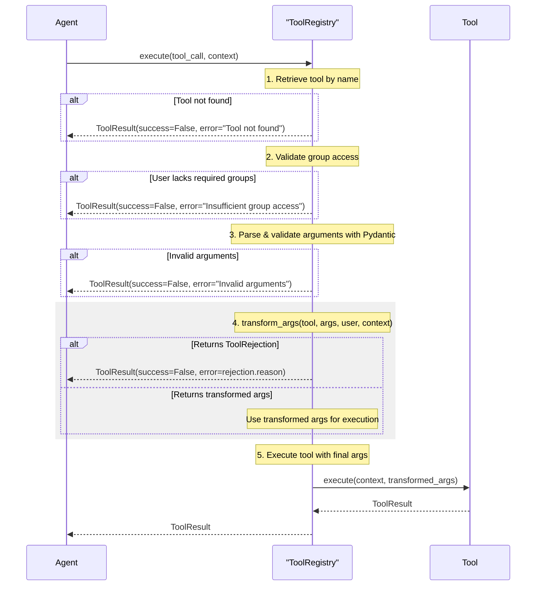
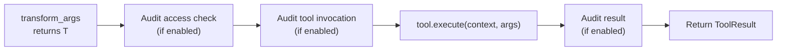
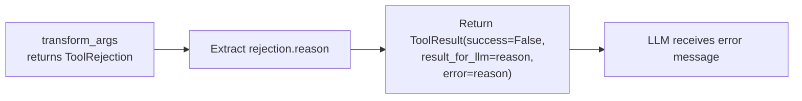
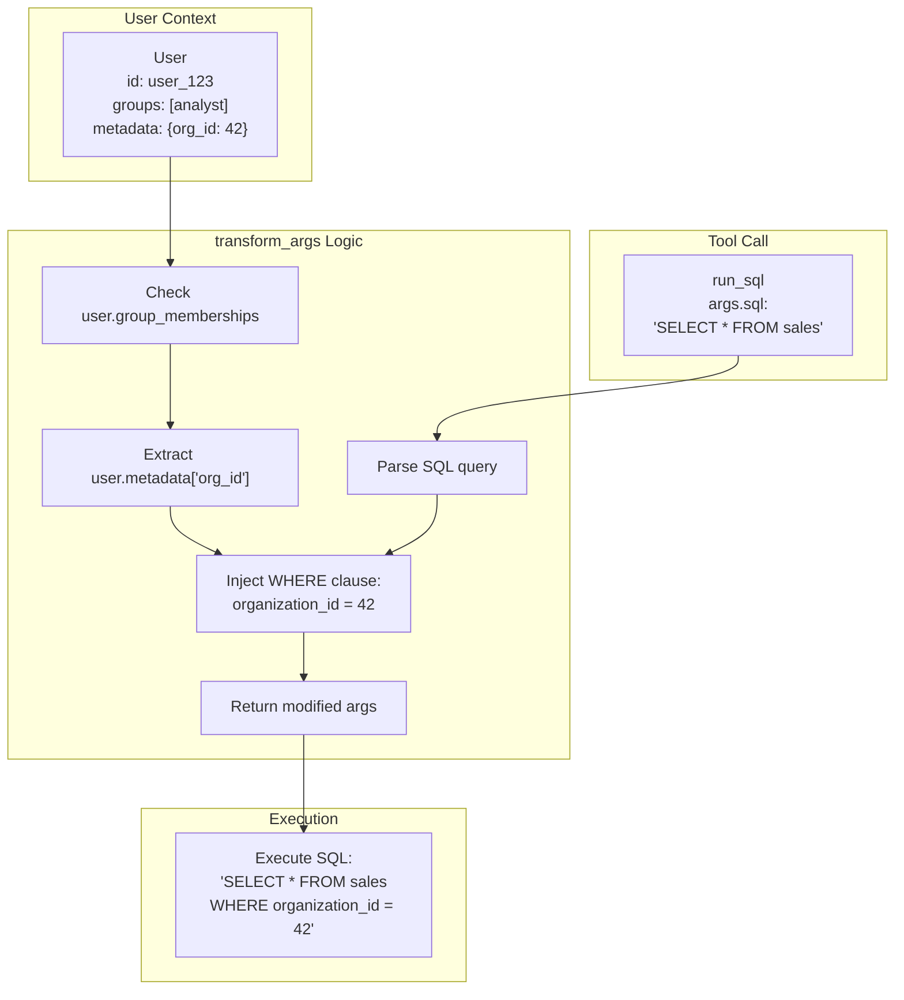
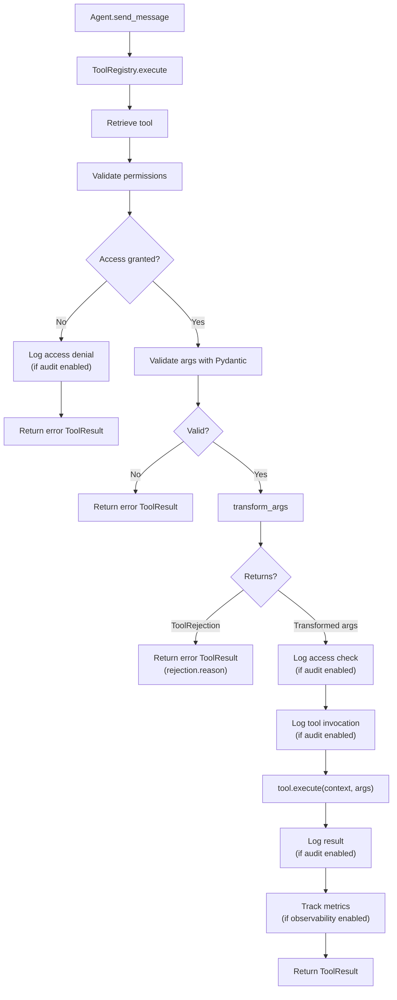
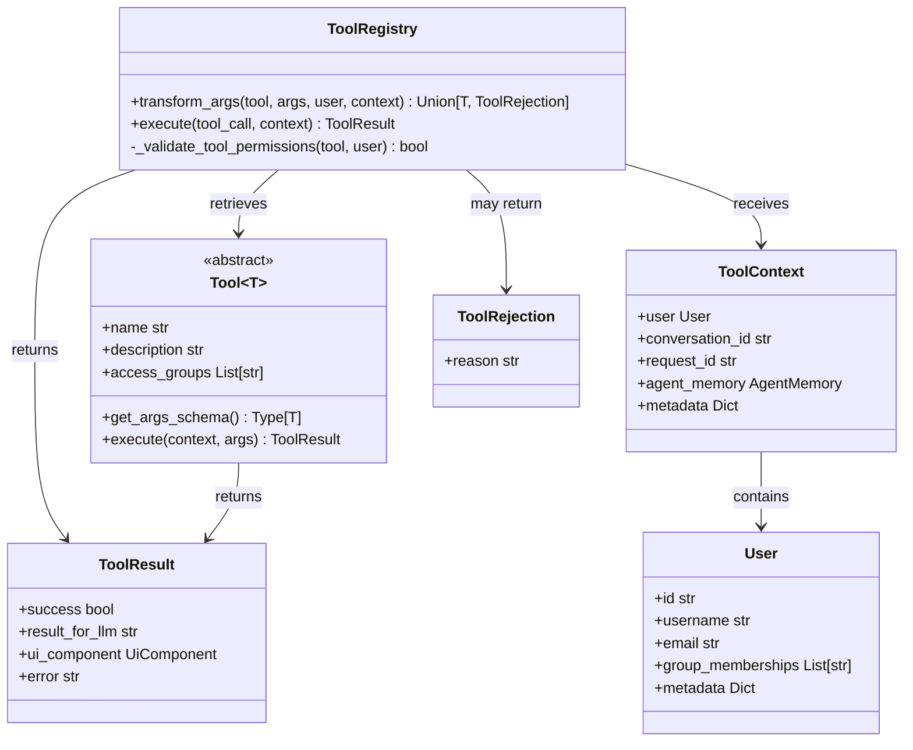

<!-- source: DeepWiki mcp.deepwiki.com · repo vanna-ai/vanna · page 3.4 Argument Transformation and Row-Level Security · fetched 2026-10-29 -->

# Argument Transformation and Row-Level Security

<details>
<summary>Relevant source files</summary>

The following files were used as context for generating this wiki page:

- [examples/transform_args_example.py](examples/transform_args_example.py)
- [src/vanna/core/registry.py](src/vanna/core/registry.py)
- [src/vanna/core/tool/__init__.py](src/vanna/core/tool/__init__.py)
- [src/vanna/core/tool/base.py](src/vanna/core/tool/base.py)
- [src/vanna/core/tool/models.py](src/vanna/core/tool/models.py)
- [src/vanna/core/user/models.py](src/vanna/core/user/models.py)
- [tests/test_agent_memory.py](tests/test_agent_memory.py)
- [tests/test_tool_permissions.py](tests/test_tool_permissions.py)

</details>


## Purpose and Scope

This document describes the `transform_args` method in `ToolRegistry`, which enables per-user transformation and validation of tool arguments before execution. This mechanism is primarily used to implement **row-level security (RLS)** by rewriting SQL queries based on user context, but also supports argument validation, field redaction, and dynamic parameter injection. 

For information about tool access control based on group membership, see [Tool Access Control](#3.2). For UI-level access control, see [UI Feature Access Control](#3.3). For general authentication and user resolution, see [UserResolver and Authentication](#3.1).

## Overview

The `transform_args` method acts as a transformation and validation gate in the tool execution pipeline. After arguments are parsed and validated by Pydantic schemas, but before tool execution, `transform_args` receives the validated arguments and can:

- **Transform** them (e.g., inject WHERE clauses into SQL queries for row-level security)
- **Reject** execution by returning a `ToolRejection` with an explanation
- **Pass through** unchanged (the default behavior)

This approach provides a centralized, extensible mechanism for applying business logic and security constraints to tool arguments based on user identity and context.

**Sources:** [src/vanna/core/registry.py:113-142]()

## Execution Pipeline Position

The following diagram shows where `transform_args` fits in the complete tool execution pipeline:



**Sources:** [src/vanna/core/registry.py:144-278](), [tests/test_tool_permissions.py:686-727]()

## The transform_args Method

### Method Signature

```python
async def transform_args(
    self,
    tool: Tool[T],
    args: T,
    user: User,
    context: ToolContext,
) -> Union[T, ToolRejection]:
```

**Parameters:**
- `tool`: The `Tool` instance being executed
- `args`: Already Pydantic-validated arguments (typed as `T`, the tool's argument schema)
- `user`: The `User` executing the tool (contains `id`, `group_memberships`, `metadata`)
- `context`: Full `ToolContext` including `conversation_id`, `request_id`, `agent_memory`

**Return Value:**
- **Transformed arguments** (type `T`): Modified or unmodified arguments to use for execution
- **ToolRejection**: Object with a `reason` string explaining why execution should be denied

**Sources:** [src/vanna/core/registry.py:113-142](), [src/vanna/core/tool/models.py:75-85]()

### Default Behavior

The base `ToolRegistry` implementation is a **no-op** that returns arguments unchanged:

```python
async def transform_args(self, tool, args, user, context) -> Union[T, ToolRejection]:
    return args  # Default: no transformation
```

To enable transformation, create a custom `ToolRegistry` subclass and override this method.

**Sources:** [src/vanna/core/registry.py:142](), [tests/test_tool_permissions.py:425-455]()

## Return Types and Behavior

### Returning Transformed Arguments

When `transform_args` returns an object of type `T` (the tool's argument schema), execution proceeds with those arguments:



The transformed arguments can be:
- **Identical to input** (validation passed, no changes needed)
- **Modified** (e.g., SQL query with injected WHERE clause)
- **Reconstructed** (using Pydantic's `model_copy(update={...})` method)

**Sources:** [src/vanna/core/registry.py:199-216](), [tests/test_tool_permissions.py:479-508]()

### Returning ToolRejection

When `transform_args` returns a `ToolRejection`, execution is halted and an error `ToolResult` is returned:



The `reason` string should explain why the arguments were rejected in terms the LLM can understand and potentially correct.

**Sources:** [src/vanna/core/registry.py:207-213](), [tests/test_tool_permissions.py:531-561]()

## Use Case: Row-Level Security

The primary use case for `transform_args` is implementing **row-level security (RLS)** by modifying SQL queries to restrict data access based on user identity:

### RLS Transformation Flow



**Sources:** [tests/test_tool_permissions.py:597-683](), [examples/transform_args_example.py:45-96]()

### RLS Implementation Example

The test suite demonstrates a complete RLS implementation:

| User Group | SQL Transformation | Result |
|------------|-------------------|--------|
| `admin` | No modification | Full data access |
| `analyst` | Append `WHERE department='analytics'` | Department-filtered data |
| `user` | Append `WHERE user_id='{user.id}'` | User-specific data only |

This table is implemented in code at [tests/test_tool_permissions.py:597-624]().

**Example Implementation:**

```python
class RowLevelSecurityRegistry(ToolRegistry):
    async def transform_args(self, tool, args, user, context):
        if isinstance(args, SQLExecutionArgs):
            if "SELECT" in args.query.upper():
                # Admin: no restriction
                if "admin" in user.group_memberships:
                    return args
                
                # Analyst: department filter
                elif "analyst" in user.group_memberships:
                    modified = args.query + " WHERE department='analytics'"
                    return args.model_copy(update={"query": modified})
                
                # Regular user: user_id filter
                else:
                    modified = args.query + f" WHERE user_id='{user.id}'"
                    return args.model_copy(update={"query": modified})
        
        return args
```

**Sources:** [tests/test_tool_permissions.py:597-683](), [examples/transform_args_example.py:45-96]()

## Additional Use Cases

### Argument Validation

Beyond Pydantic schema validation, `transform_args` can enforce business rules:

```python
class ValidationRegistry(ToolRegistry):
    async def transform_args(self, tool, args, user, context):
        if tool.name == "execute_sql":
            # Reject queries to restricted tables
            if "restricted_table" in args.query.lower():
                return ToolRejection(
                    reason="Access to 'restricted_table' is not permitted"
                )
            
            # Validate required parameters
            if not args.database:
                return ToolRejection(
                    reason="Database parameter is required"
                )
        
        return args
```

**Sources:** [examples/transform_args_example.py:61-93](), [tests/test_tool_permissions.py:511-561]()

### Field Redaction

Sensitive fields can be removed or masked based on user permissions:

```python
class RedactionRegistry(ToolRegistry):
    async def transform_args(self, tool, args, user, context):
        # Remove sensitive fields for non-admin users
        if "admin" not in user.group_memberships:
            if hasattr(args, "include_pii"):
                return args.model_copy(update={"include_pii": False})
        return args
```

### Dynamic Parameter Injection

User context can be injected as implicit parameters:

```python
class InjectionRegistry(ToolRegistry):
    async def transform_args(self, tool, args, user, context):
        # Append user context to messages
        if isinstance(args, MessageArgs):
            enhanced = f"{args.message} [user: {user.username}]"
            return args.model_copy(update={"message": enhanced})
        return args
```

**Sources:** [tests/test_tool_permissions.py:458-476]()

## Implementation Guide

### Step 1: Create Custom ToolRegistry

Define a subclass of `ToolRegistry`:

```python
from vanna.core import ToolRegistry
from vanna.core.tool import Tool, ToolContext, ToolRejection
from vanna.core.user import User
from typing import Union, TypeVar

T = TypeVar("T")

class CustomToolRegistry(ToolRegistry):
    async def transform_args(
        self,
        tool: Tool[T],
        args: T,
        user: User,
        context: ToolContext,
    ) -> Union[T, ToolRejection]:
        # Your transformation logic here
        return args
```

**Sources:** [tests/test_tool_permissions.py:458-476](), [examples/transform_args_example.py:45-96]()

### Step 2: Implement Transformation Logic

Use conditional logic to determine which transformations apply:

```python
async def transform_args(self, tool, args, user, context):
    # Tool-specific transformations
    if tool.name == "run_sql":
        return await self._transform_sql_args(args, user)
    elif tool.name == "read_file":
        return await self._transform_file_args(args, user)
    
    # Default: no transformation
    return args
```

### Step 3: Work with Pydantic Models

Arguments are Pydantic models. Use `model_copy(update={...})` to create modified versions:

```python
# Read original value
original_query = args.query

# Create modified copy
modified_args = args.model_copy(update={
    "query": original_query + " LIMIT 100",
    "timeout": 30
})

return modified_args
```

**Sources:** [tests/test_tool_permissions.py:470-475]()

### Step 4: Use in Agent

Pass your custom registry to the `Agent`:

```python
from vanna import Agent

registry = CustomToolRegistry()
# Register tools...

agent = Agent(
    llm_service=llm,
    tool_registry=registry,  # Use custom registry
    user_resolver=user_resolver,
    agent_memory=memory,
)
```

## Execution Flow Integration

The complete execution flow showing audit and observability integration:



**Sources:** [src/vanna/core/registry.py:144-278]()

## Error Handling

### Transformation Errors

If `transform_args` raises an exception, the tool execution framework catches it and returns an error `ToolResult`:

```python
try:
    transform_result = await self.transform_args(tool, validated_args, user, context)
except Exception as e:
    return ToolResult(
        success=False,
        result_for_llm=f"Argument transformation failed: {str(e)}",
        error=str(e),
    )
```

This is handled by the general exception handler at [src/vanna/core/registry.py:271-278]().

### Rejection Messages

When returning a `ToolRejection`, craft the `reason` string to:
- Explain what was rejected (e.g., "Access to 'restricted_table' is not permitted")
- Indicate why (e.g., "for your user group")
- Be LLM-readable so the agent can potentially adjust and retry

**Example:**
```python
return ToolRejection(
    reason=f"User '{user.username}' cannot access {table_name}. "
           f"Users in group '{user.group_memberships[0]}' are restricted to "
           f"tables: {allowed_tables}"
)
```

**Sources:** [tests/test_tool_permissions.py:524-526](), [examples/transform_args_example.py:63-65]()

## Code Entity Map

The following diagram maps key code entities involved in argument transformation:



**File Locations:**
- `ToolRegistry`: [src/vanna/core/registry.py:46-279]()
- `Tool`: [src/vanna/core/tool/base.py:16-71]()
- `ToolContext`: [src/vanna/core/tool/models.py:28-45]()
- `User`: [src/vanna/core/user/models.py:12-26]()
- `ToolRejection`: [src/vanna/core/tool/models.py:75-85]()
- `ToolResult`: [src/vanna/core/tool/models.py:47-62]()

## Testing and Validation

### Unit Testing transform_args

Test your custom `transform_args` implementation by calling it directly:

```python
@pytest.mark.asyncio
async def test_my_transform_logic():
    registry = MyCustomRegistry()
    tool = MySQLTool()
    
    original_args = SQLArgs(query="SELECT * FROM users")
    user = User(id="user123", group_memberships=["analyst"])
    context = ToolContext(...)
    
    result = await registry.transform_args(tool, original_args, user, context)
    
    # Assert transformation occurred
    assert "WHERE" in result.query
    assert user.id in result.query
```

**Sources:** [tests/test_tool_permissions.py:730-783]()

### Integration Testing

Test the full pipeline by executing tool calls through the registry:

```python
@pytest.mark.asyncio
async def test_transform_in_execution_flow():
    registry = MyCustomRegistry()
    tool = MySQLTool()
    registry.register_local_tool(tool, access_groups=[])
    
    tool_call = ToolCall(
        id="call1",
        name="run_sql",
        arguments={"query": "SELECT * FROM sales"}
    )
    
    context = ToolContext(user=user, ...)
    result = await registry.execute(tool_call, context)
    
    # Verify transformed query was used
    assert result.success
    assert "organization_id" in result.result_for_llm
```

**Sources:** [tests/test_tool_permissions.py:786-915]()

## Best Practices

### 1. Fail Closed

Default to restrictive behavior. If user context is missing or ambiguous, reject execution:

```python
user_org_id = user.metadata.get("organization_id")
if not user_org_id:
    return ToolRejection(
        reason="Organization context is required for this query"
    )
```

### 2. Use Type Checking

Check argument types before transformation to avoid runtime errors:

```python
if isinstance(args, SQLExecutionArgs):
    # Safe to access args.query
    return self._transform_sql(args, user)
return args
```

### 3. Log Transformations

For debugging and audit purposes, log what transformations were applied:

```python
if original_query != transformed_query:
    logger.info(
        f"Transformed SQL for user {user.id}: "
        f"added WHERE clause for org {org_id}"
    )
```

### 4. Document Rejection Reasons

Rejection messages should be clear enough for:
- LLM to understand and potentially retry with corrections
- Users to understand if shown in UI
- Administrators to debug access issues

### 5. Consider SQL Parsing

For complex SQL transformations, use a SQL parser (e.g., `sqlparse`, `sqlglot`) rather than string manipulation:

```python
import sqlparse

parsed = sqlparse.parse(args.query)[0]
# Safely modify WHERE clause...
transformed_query = str(parsed)
```

**Sources:** [examples/transform_args_example.py:1-157](), [tests/test_tool_permissions.py:597-683]()

## Relationship to Other Security Layers

`transform_args` is one layer in Vanna's defense-in-depth security model:

| Security Layer | Purpose | Enforced By | Document |
|---------------|---------|-------------|----------|
| Authentication | Verify user identity | `UserResolver` | [3.1](#3.1) |
| Tool Access Control | Grant/deny tool execution | `ToolRegistry._validate_tool_permissions` | [3.2](#3.2) |
| **Argument Transformation** | **Modify/validate args per user** | **`ToolRegistry.transform_args`** | **This page** |
| UI Feature Control | Control UI element visibility | `UiFeatures` system | [3.3](#3.3) |
| Audit Logging | Record security events | `AuditLogger` | [2.7](#2.7) |

These layers work together: a user must pass authentication, have group access to the tool, pass argument transformation, and then execute. Each layer can reject the request independently.

**Sources:** [src/vanna/core/registry.py:98-112](), [src/vanna/core/registry.py:113-142](), [src/vanna/core/registry.py:160-184]()

---

