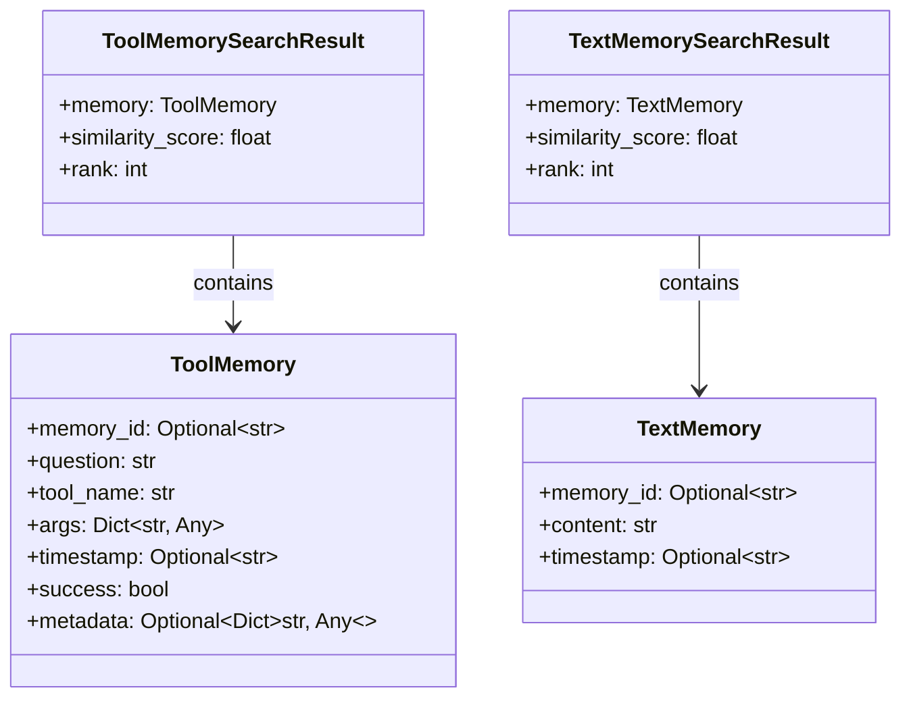
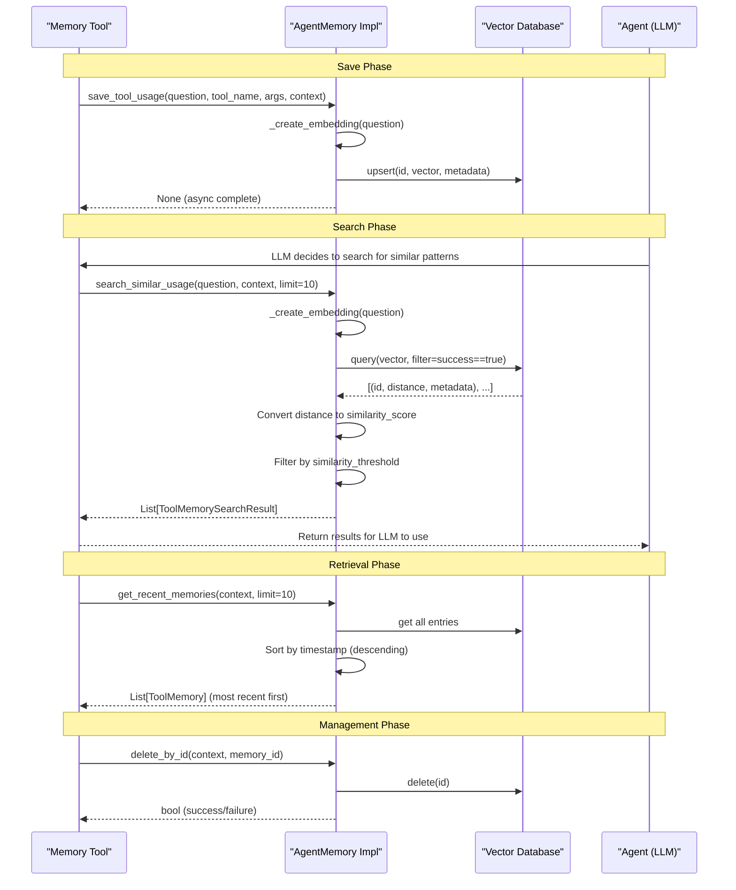
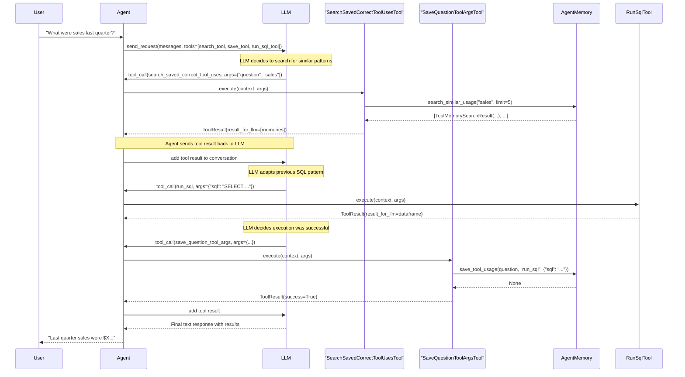
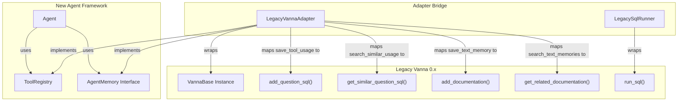

<!-- source: DeepWiki mcp.deepwiki.com · repo vanna-ai/vanna · page 4 Agent Memory System · fetched 2026-10-29 -->

# Agent Memory System

<details>
<summary>Relevant source files</summary>

The following files were used as context for generating this wiki page:

- [src/vanna/capabilities/agent_memory/base.py](src/vanna/capabilities/agent_memory/base.py)
- [src/vanna/capabilities/agent_memory/models.py](src/vanna/capabilities/agent_memory/models.py)
- [src/vanna/integrations/azuresearch/agent_memory.py](src/vanna/integrations/azuresearch/agent_memory.py)
- [src/vanna/integrations/chromadb/agent_memory.py](src/vanna/integrations/chromadb/agent_memory.py)
- [src/vanna/integrations/faiss/agent_memory.py](src/vanna/integrations/faiss/agent_memory.py)
- [src/vanna/integrations/local/agent_memory/in_memory.py](src/vanna/integrations/local/agent_memory/in_memory.py)
- [src/vanna/integrations/marqo/agent_memory.py](src/vanna/integrations/marqo/agent_memory.py)
- [src/vanna/integrations/milvus/agent_memory.py](src/vanna/integrations/milvus/agent_memory.py)
- [src/vanna/integrations/opensearch/agent_memory.py](src/vanna/integrations/opensearch/agent_memory.py)
- [src/vanna/integrations/pinecone/agent_memory.py](src/vanna/integrations/pinecone/agent_memory.py)
- [src/vanna/integrations/premium/agent_memory/premium.py](src/vanna/integrations/premium/agent_memory/premium.py)
- [src/vanna/integrations/qdrant/agent_memory.py](src/vanna/integrations/qdrant/agent_memory.py)
- [src/vanna/integrations/weaviate/agent_memory.py](src/vanna/integrations/weaviate/agent_memory.py)
- [src/vanna/legacy/adapter.py](src/vanna/legacy/adapter.py)
- [tests/test_chromadb_persistence_fix.py](tests/test_chromadb_persistence_fix.py)

</details>


## Purpose and Scope

The Agent Memory System enables agents to learn from past interactions by storing and retrieving tool usage patterns and domain knowledge. This system provides vector-based similarity search across multiple storage backends, allowing agents to find relevant past solutions when processing new questions. The memory system is exposed to the LLM through specialized tools that enable autonomous learning and recall.

For information about the memory-enabled tools that agents use to interact with this system, see [4.3](#4.3). For details on how memory integrates with the overall agent workflow, see [2.1](#2.1).

## Core Interface and Data Models

The memory system is built around the `AgentMemory` abstract base class and two primary data models representing different memory types.

### AgentMemory Interface

The `AgentMemory` interface defines the contract that all memory implementations must fulfill:

```mermaid
classDiagram
    class AgentMemory {
        <<abstract>>
        +save_tool_usage(question, tool_name, args, context, success, metadata) None
        +save_text_memory(content, context) TextMemory
        +search_similar_usage(question, context, limit, threshold, filter) List~ToolMemorySearchResult~
        +search_text_memories(query, context, limit, threshold) List~TextMemorySearchResult~
        +get_recent_memories(context, limit) List~ToolMemory~
        +get_recent_text_memories(context, limit) List~TextMemory~
        +delete_by_id(context, memory_id) bool
        +delete_text_memory(context, memory_id) bool
        +clear_memories(context, tool_name, before_date) int
    }
    
    class DemoAgentMemory {
        -_memories: List~ToolMemory~
        -_text_memories: List~TextMemory~
        -_lock: asyncio.Lock
        -_max_items: int
        +_similarity(a, b) float
    }
    
    class ChromaAgentMemory {
        -persist_directory: str
        -_client: chromadb.Client
        -_collection: chromadb.Collection
        -_executor: ThreadPoolExecutor
    }
    
    class QdrantAgentMemory {
        -url: str
        -path: str
        -_client: QdrantClient
        -dimension: int
    }
    
    class FAISSAgentMemory {
        -index_path: str
        -_index: faiss.Index
        -_metadata: dict
        -dimension: int
    }
    
    class PineconeAgentMemory {
        -api_key: str
        -index_name: str
        -_client: Pinecone
        -_index: pinecone.Index
    }
    
    class CloudAgentMemory {
        -api_base_url: str
        -api_key: str
        -_client: httpx.AsyncClient
    }
    
    class OpenSearchAgentMemory {
        -index_name: str
        -hosts: List
        -_client: OpenSearch
    }
    
    class MilvusAgentMemory {
        -collection_name: str
        -host: str
        -_collection: Collection
    }
    
    class WeaviateAgentMemory {
        -collection_name: str
        -url: str
        -_client: weaviate.Client
    }
    
    class MarqoAgentMemory {
        -url: str
        -index_name: str
        -_client: marqo.Client
    }
    
    class AzureAISearchAgentMemory {
        -endpoint: str
        -index_name: str
        -_search_client: SearchClient
    }
    
    class LegacyVannaAdapter {
        -vn: VannaBase
    }
    
    AgentMemory <|.. DemoAgentMemory
    AgentMemory <|.. ChromaAgentMemory
    AgentMemory <|.. QdrantAgentMemory
    AgentMemory <|.. FAISSAgentMemory
    AgentMemory <|.. PineconeAgentMemory
    AgentMemory <|.. CloudAgentMemory
    AgentMemory <|.. OpenSearchAgentMemory
    AgentMemory <|.. MilvusAgentMemory
    AgentMemory <|.. WeaviateAgentMemory
    AgentMemory <|.. MarqoAgentMemory
    AgentMemory <|.. AzureAISearchAgentMemory
    AgentMemory <|.. LegacyVannaAdapter
```



**Core AgentMemory Interface Hierarchy**

The interface declares nine abstract methods organized into three categories: save operations (`save_tool_usage`, `save_text_memory`), search operations (`search_similar_usage`, `search_text_memories`, `get_recent_memories`, `get_recent_text_memories`), and management operations (`delete_by_id`, `delete_text_memory`, `clear_memories`). All methods are async and accept a `ToolContext` parameter for user scoping and access control.

**Sources:** [src/vanna/capabilities/agent_memory/base.py:1-104]()

### Memory Data Models

The memory system uses Pydantic models to represent stored memories and search results:



**Memory Data Models and Search Results**

`ToolMemory` captures structured records of tool executions: the user's `question`, the `tool_name` invoked, the `args` passed, execution `success` status, and optional `metadata`. This structured format enables pattern-based learning where the agent can find how similar questions were previously answered.

`TextMemory` stores free-form `content` for domain knowledge, schemas, business rules, or documentation. Unlike tool memories, text memories are unstructured and searched based purely on semantic content similarity.

Search result wrappers (`ToolMemorySearchResult`, `TextMemorySearchResult`) add `similarity_score` (0.0-1.0) and `rank` (1-based position) to enable LLMs to understand relevance when multiple memories are returned.

**Sources:** [src/vanna/capabilities/agent_memory/models.py:1-54]()

## Memory Types: Tool Memory vs Text Memory

The memory system distinguishes between two fundamentally different memory types, each serving distinct purposes in agent learning.

### Tool Memory: Structured Workflow Patterns

Tool memories capture question-tool-args triplets representing successful workflows:

| Field | Type | Purpose |
|-------|------|---------|
| `question` | `str` | User's natural language question |
| `tool_name` | `str` | Name of tool that was invoked |
| `args` | `Dict[str, Any]` | Arguments passed to the tool |
| `success` | `bool` | Whether execution succeeded |
| `timestamp` | `str` | ISO format timestamp |
| `metadata` | `Dict[str, Any]` | Additional context (user, org, etc) |

**Usage Pattern:**
When an agent successfully executes a tool, it can save the pattern via `save_tool_usage()`. Later, when processing a similar question, `search_similar_usage()` retrieves past patterns ranked by semantic similarity. The LLM can then reuse or adapt the previous tool invocation.

**Example Workflow:**
```
Question: "What were total sales last month?"
Tool: run_sql
Args: {"sql": "SELECT SUM(amount) FROM sales WHERE date >= '2024-01-01' AND date < '2024-02-01'"}
Success: true
```

When a user later asks "What were total sales in February?", the agent searches for similar patterns, finds this memory, and adapts the SQL query by modifying the date range.

**Sources:** [src/vanna/capabilities/agent_memory/models.py:10-20]()

### Text Memory: Unstructured Domain Knowledge

Text memories store free-form content without structured fields:

| Field | Type | Purpose |
|-------|------|---------|
| `content` | `str` | Free-form text content |
| `timestamp` | `str` | ISO format timestamp |

**Usage Pattern:**
Text memories store documentation, schemas, business glossaries, or any domain knowledge that helps the agent understand context. They are searched via `search_text_memories()` using semantic similarity against the query string.

**Example Content:**
- Database schema documentation: "The customers table has columns: id, name, email, created_at"
- Business rules: "Q4 is defined as October through December"
- Glossary terms: "GMV means Gross Merchandise Value, the total sales dollar value"

**Sources:** [src/vanna/capabilities/agent_memory/models.py:22-28]()

## Memory Operations and Lifecycle

Memory operations follow a consistent async pattern across all implementations. The lifecycle diagram shows how memories flow through the system:



**Memory Operation Lifecycle**

**Sources:** [src/vanna/capabilities/agent_memory/base.py:26-103](), [src/vanna/integrations/chromadb/agent_memory.py:98-197]()

### Save Operations

**save_tool_usage()**
Stores a tool execution pattern. Implementations create a unique `memory_id` (typically UUID v4), generate an embedding from the question text, and store both the embedding vector and metadata (question, tool_name, args, timestamp, success) in the vector database.

```python
# Typical implementation pattern
async def save_tool_usage(
    self,
    question: str,
    tool_name: str,
    args: Dict[str, Any],
    context: ToolContext,
    success: bool = True,
    metadata: Optional[Dict[str, Any]] = None,
) -> None:
    memory_id = str(uuid.uuid4())
    timestamp = datetime.now().isoformat()
    embedding = self._create_embedding(question)
    
    # Store in vector DB
    await self._store(memory_id, embedding, {
        "question": question,
        "tool_name": tool_name,
        "args": args,
        "timestamp": timestamp,
        "success": success,
        "metadata": metadata or {}
    })
```

**save_text_memory()**
Stores free-form content. Similar to tool memories but with simpler metadata structure. Returns the created `TextMemory` object with assigned `memory_id`.

**Sources:** [src/vanna/integrations/chromadb/agent_memory.py:98-131](), [src/vanna/integrations/qdrant/agent_memory.py:89-120]()

### Search Operations

**search_similar_usage()**
Performs vector similarity search against the question field of tool memories. Key parameters:
- `limit`: Maximum results to return (default 10)
- `similarity_threshold`: Minimum score to include (default 0.7)
- `tool_name_filter`: Optional filter to search only specific tool memories

The implementation creates an embedding from the search question, queries the vector database, converts distances to similarity scores (vector DB specific: ChromaDB uses L2 distance `1 - distance`, Qdrant/Pinecone return cosine similarity directly), filters by threshold and success status, then ranks results.

**search_text_memories()**
Similar to `search_similar_usage()` but searches text memory content instead of tool questions. Uses the same similarity threshold and limit parameters.

**get_recent_memories() / get_recent_text_memories()**
Retrieve recently added memories sorted by timestamp (descending). Useful for displaying memory history or debugging. Some implementations (like Pinecone) may not support efficient timestamp-based retrieval and return empty lists.

**Sources:** [src/vanna/integrations/chromadb/agent_memory.py:133-197](), [src/vanna/integrations/pinecone/agent_memory.py:174-190]()

### Management Operations

**delete_by_id() / delete_text_memory()**
Remove a specific memory by its `memory_id`. Returns `True` if found and deleted, `False` if not found. Used for cleaning up outdated or incorrect memories.

**clear_memories()**
Bulk deletion with optional filters:
- `tool_name`: Delete only memories for a specific tool
- `before_date`: Delete only memories older than a date (ISO format string)
- No filters: Delete all memories

Returns the count of deleted memories (some implementations like Qdrant may return 0 as they don't track deletion counts).

**Sources:** [src/vanna/integrations/chromadb/agent_memory.py:247-263](), [src/vanna/integrations/chromadb/agent_memory.py:384-421]()

## Similarity Search Mechanics

Vector similarity search is the core mechanism enabling pattern retrieval. Each implementation follows a similar pattern but with database-specific details.

### Embedding Generation

All implementations include a `_create_embedding()` method to convert text into fixed-dimension vectors. The provided implementations use placeholder hash-based embeddings for simplicity:

```python
def _create_embedding(self, text: str) -> List[float]:
    """Create a simple embedding from text (placeholder)."""
    import hashlib
    hash_val = int(hashlib.md5(text.encode()).hexdigest(), 16)
    return [(hash_val >> i) % 100 / 100.0 for i in range(self.dimension)]
```

**Production Usage Note:** These placeholder embeddings should be replaced with actual embedding models (e.g., `sentence-transformers`, OpenAI embeddings, or other semantic models) for production deployments. The hash-based approach provides deterministic but semantically meaningless vectors useful only for testing.

**Sources:** [src/vanna/integrations/chromadb/agent_memory.py:63-73](), [src/vanna/integrations/qdrant/agent_memory.py:82-87]()

### Distance Metrics and Similarity Conversion

Different vector databases use different distance metrics and return formats:

| Database | Native Metric | Return Format | Conversion to Similarity |
|----------|---------------|---------------|-------------------------|
| ChromaDB | L2 Distance | `distances[0]` | `max(0, 1 - distance)` |
| Qdrant | Cosine | `hit.score` | Direct (already 0-1) |
| FAISS | Cosine or L2 | `distances[0]` | Cosine: direct, L2: `1.0 / (1.0 + dist)` |
| Pinecone | Cosine | `match.score` | Direct (already 0-1) |
| OpenSearch | Cosine | `hit["_score"]` | `min(score / 10.0, 1.0)` (normalized) |
| Milvus | Inner Product | `hit.distance` | Direct (already 0-1) |
| Weaviate | Cosine | `obj.metadata.distance` | `1 - distance` |

**Sources:** [src/vanna/integrations/chromadb/agent_memory.py:168-170](), [src/vanna/integrations/qdrant/agent_memory.py:186-188](), [src/vanna/integrations/faiss/agent_memory.py:177-180]()

### Filtering and Ranking

Search operations apply multiple filters in sequence:

1. **Success Filter**: Only retrieve memories where `success == True` (hardcoded in most implementations)
2. **Tool Name Filter**: If `tool_name_filter` provided, only match that specific tool
3. **Similarity Threshold**: Only include results where `similarity_score >= threshold`
4. **Limit**: Return top N results by score

Results are ranked by `similarity_score` (descending) and assigned sequential `rank` values starting at 1.

**Sources:** [src/vanna/integrations/chromadb/agent_memory.py:145-194](), [src/vanna/integrations/qdrant/agent_memory.py:139-190]()

## Implementation Patterns

All memory implementations follow consistent patterns for initialization, client management, and async execution.

### Common Initialization Pattern

Implementations accept configuration parameters in `__init__` and defer client/connection creation to lazy initialization methods:

```python
class ExampleAgentMemory(AgentMemory):
    def __init__(self, connection_params, dimension=384):
        self._client = None  # Lazy initialization
        self._executor = ThreadPoolExecutor(max_workers=2)  # For sync APIs
        # Store config parameters
        
    def _get_client(self):
        """Get or create client connection."""
        if self._client is None:
            self._client = create_client(self.connection_params)
            self._ensure_index_exists()
        return self._client
```

This pattern avoids connection overhead during agent initialization and ensures connections are only created when actually needed.

**Sources:** [src/vanna/integrations/chromadb/agent_memory.py:36-61](), [src/vanna/integrations/qdrant/agent_memory.py:42-80]()

### ThreadPoolExecutor for Sync APIs

Many vector databases provide only synchronous Python APIs. Implementations use `ThreadPoolExecutor` to avoid blocking the async event loop:

```python
from concurrent.futures import ThreadPoolExecutor

self._executor = ThreadPoolExecutor(max_workers=2)

async def save_tool_usage(self, ...):
    def _save():
        # Synchronous vector DB operations
        client = self._get_client()
        client.upsert(...)
    
    await asyncio.get_event_loop().run_in_executor(self._executor, _save)
```

This pattern allows the memory system to integrate seamlessly with the async agent framework while using sync database clients.

**Sources:** [src/vanna/integrations/chromadb/agent_memory.py:51](), [src/vanna/integrations/chromadb/agent_memory.py:131]()

### Metadata Serialization

Vector databases have varying support for complex metadata types. Implementations serialize complex objects to JSON strings:

```python
# ChromaDB example - only accepts primitive types
memory_data = {
    "question": question,
    "tool_name": tool_name,
    "args_json": json.dumps(args),  # Serialize dict to string
    "timestamp": timestamp,
    "success": success,
    "metadata_json": json.dumps(metadata or {}),
}
```

During retrieval, implementations deserialize JSON strings back to Python objects:

```python
args = json.loads(metadata.get("args_json", "{}"))
metadata_dict = json.loads(metadata.get("metadata_json", "{}"))
```

**Sources:** [src/vanna/integrations/chromadb/agent_memory.py:117-124](), [src/vanna/integrations/chromadb/agent_memory.py:173-174]()

## Vector Store Integrations

The memory system supports 11 vector database backends, each with specific configuration requirements and characteristics.

### DemoAgentMemory: In-Memory Storage

**Implementation:** [src/vanna/integrations/local/agent_memory/in_memory.py:28-286]()

The simplest implementation stores memories in Python lists with no external dependencies. Uses Jaccard similarity and `difflib.SequenceMatcher` instead of vector embeddings:

```python
@classmethod
def _similarity(cls, a: str, b: str) -> float:
    """Calculate similarity using Jaccard and difflib."""
    ta, tb = cls._tokenize(a), cls._tokenize(b)
    jaccard = len(ta & tb) / max(1, len(ta | tb))
    ratio = difflib.SequenceMatcher(None, a, b).ratio()
    return max(jaccard, ratio)
```

**Configuration:**
```python
memory = DemoAgentMemory(max_items=10_000)  # FIFO eviction when full
```

**Characteristics:**
- Zero dependencies (pure Python)
- O(n) search performance
- Thread-safe via `asyncio.Lock`
- Ephemeral (data lost on restart)
- Best for testing, demos, or small datasets

**Sources:** [src/vanna/integrations/local/agent_memory/in_memory.py:28-286]()

### ChromaAgentMemory: Local Persistent Storage

**Implementation:** [src/vanna/integrations/chromadb/agent_memory.py:33-421]()

ChromaDB provides local persistent vector storage with automatic embedding generation:

**Configuration:**
```python
memory = ChromaAgentMemory(
    persist_directory="./chroma_memory",
    collection_name="tool_memories",
    embedding_function=None  # Uses ChromaDB's default
)
```

**Key Features:**
- Persistent storage on local filesystem
- Automatic embedding via `DefaultEmbeddingFunction()` (sentence-transformers)
- L2 distance metric for vector similarity
- Metadata filtering via `where` clauses
- Collection-based organization

**Implementation Details:**
- Client initialization: [src/vanna/integrations/chromadb/agent_memory.py:54-61]()
- Embedding function setup: [src/vanna/integrations/chromadb/agent_memory.py:63-73]()
- Collection management: [src/vanna/integrations/chromadb/agent_memory.py:75-90]()
- Query with metadata filters: [src/vanna/integrations/chromadb/agent_memory.py:145-157]()

**Sources:** [src/vanna/integrations/chromadb/agent_memory.py:33-421]()

### QdrantAgentMemory: High-Performance Vector Search

**Implementation:** [src/vanna/integrations/qdrant/agent_memory.py:39-467]()

Qdrant supports both local and cloud deployments with high-performance vector search:

**Configuration:**
```python
# Local deployment
memory = QdrantAgentMemory(
    collection_name="tool_memories",
    path="./qdrant_data",  # Local storage
    dimension=384
)

# Cloud deployment
memory = QdrantAgentMemory(
    collection_name="tool_memories",
    url="https://xyz.qdrant.tech",
    api_key="your-api-key",
    dimension=384
)
```

**Key Features:**
- Rust-based high performance
- Cosine distance metric (inner product)
- Support for both local and cloud modes
- Filter expressions for complex queries
- Backward compatibility with old and new API versions

**API Version Compatibility:**
The implementation supports both old (`search`) and new (`query_points`) API methods:

```python
if hasattr(client, "query_points"):
    results = client.query_points(...)  # Newer qdrant-client (1.8.0+)
else:
    results = client.search(...)  # Older versions
```

**Sources:** [src/vanna/integrations/qdrant/agent_memory.py:39-467](), [src/vanna/integrations/qdrant/agent_memory.py:152-168]()

### FAISSAgentMemory: Facebook AI Similarity Search

**Implementation:** [src/vanna/integrations/faiss/agent_memory.py:34-436]()

FAISS provides efficient similarity search with various index types:

**Configuration:**
```python
memory = FAISSAgentMemory(
    index_path="./faiss_index",  # Also accepts persist_path
    dimension=384,
    metric="cosine"  # or "l2"
)
```

**Key Features:**
- High-performance C++ implementation
- Index persistence to disk (`.faiss` file + `.pkl` metadata)
- Support for cosine (IndexFlatIP) or L2 (IndexFlatL2) metrics
- In-memory metadata storage (pickled separately)
- Efficient for large-scale vector search

**Index Persistence:**
```python
def _save_index(self):
    index_file = os.path.join(self.index_path, "index.faiss")
    metadata_file = os.path.join(self.index_path, "metadata.pkl")
    faiss.write_index(self._index, index_file)
    with open(metadata_file, "wb") as f:
        pickle.dump(self._metadata, f)
```

**Limitations:**
- Metadata stored separately from vectors (requires synchronization)
- Delete operations don't actually remove from index (only from metadata)
- No native filtering support (filtering done post-search in Python)

**Sources:** [src/vanna/integrations/faiss/agent_memory.py:34-436](), [src/vanna/integrations/faiss/agent_memory.py:77-84]()

### PineconeAgentMemory: Managed Cloud Vector Database

**Implementation:** [src/vanna/integrations/pinecone/agent_memory.py:31-330]()

Pinecone offers fully managed cloud vector search:

**Configuration:**
```python
memory = PineconeAgentMemory(
    api_key="your-api-key",
    index_name="tool-memories",
    environment="us-east-1",
    dimension=384,
    metric="cosine"
)
```

**Key Features:**
- Fully managed cloud service
- Serverless architecture
- Automatic scaling
- Built-in metadata filtering
- Namespace support for multi-tenancy

**Index Creation:**
```python
if self.index_name not in client.list_indexes().names():
    client.create_index(
        name=self.index_name,
        dimension=self.dimension,
        metric=self.metric,
        spec=ServerlessSpec(cloud="aws", region=self.environment),
    )
```

**Limitations:**
- `get_recent_memories()` returns empty list (Pinecone doesn't support efficient timestamp-based retrieval without dummy vector queries)
- Requires active Pinecone account and API key
- Cloud-only (no local deployment)

**Sources:** [src/vanna/integrations/pinecone/agent_memory.py:31-330](), [src/vanna/integrations/pinecone/agent_memory.py:62-77](), [src/vanna/integrations/pinecone/agent_memory.py:174-190]()

### OpenSearchAgentMemory: Distributed Search Engine

**Implementation:** [src/vanna/integrations/opensearch/agent_memory.py:31-412]()

OpenSearch provides distributed vector search with k-NN capabilities:

**Configuration:**
```python
memory = OpenSearchAgentMemory(
    index_name="tool_memories",
    hosts=["localhost:9200"],
    http_auth=("username", "password"),
    use_ssl=True,
    verify_certs=True,
    dimension=384
)
```

**Key Features:**
- Distributed architecture for scalability
- k-NN vector search via HNSW algorithm
- Full-text search capabilities alongside vector search
- Index mapping with field types
- Sort by timestamp for recent queries

**Index Configuration:**
```python
index_body = {
    "settings": {
        "index": {"knn": True, "knn.algo_param.ef_search": 100}
    },
    "mappings": {
        "properties": {
            "embedding": {
                "type": "knn_vector",
                "dimension": self.dimension,
                "method": {
                    "name": "hnsw",
                    "space_type": "cosinesimil",
                    "engine": "nmslib",
                }
            },
            # ... other fields
        }
    }
}
```

**Sources:** [src/vanna/integrations/opensearch/agent_memory.py:31-412](), [src/vanna/integrations/opensearch/agent_memory.py:68-95]()

### MilvusAgentMemory: Distributed Vector Database

**Implementation:** [src/vanna/integrations/milvus/agent_memory.py:38-459]()

Milvus provides distributed vector database capabilities:

**Configuration:**
```python
memory = MilvusAgentMemory(
    collection_name="tool_memories",
    host="localhost",
    port=19530,
    alias="default",
    dimension=384
)
```

**Key Features:**
- Distributed architecture for large-scale deployments
- Multiple index types (IVF_FLAT, HNSW, etc.)
- Inner product metric for similarity
- Expression-based filtering
- Schema definition for fields

**Schema Definition:**
```python
fields = [
    FieldSchema(name="id", dtype=DataType.VARCHAR, is_primary=True, max_length=100),
    FieldSchema(name="embedding", dtype=DataType.FLOAT_VECTOR, dim=self.dimension),
    FieldSchema(name="question", dtype=DataType.VARCHAR, max_length=2000),
    FieldSchema(name="tool_name", dtype=DataType.VARCHAR, max_length=200),
    # ... other fields
]
```

**Filtering Pattern:**
Milvus uses expression strings for filtering:
```python
expr = "success == true"
if tool_name_filter:
    expr += f' && tool_name == "{tool_name_filter}"'
```

**Sources:** [src/vanna/integrations/milvus/agent_memory.py:38-459](), [src/vanna/integrations/milvus/agent_memory.py:68-116]()

### WeaviateAgentMemory: GraphQL-Based Vector Database

**Implementation:** [src/vanna/integrations/weaviate/agent_memory.py:36-429]()

Weaviate provides vector search with GraphQL query interface:

**Configuration:**
```python
# Local deployment
memory = WeaviateAgentMemory(
    collection_name="ToolMemory",
    url="http://localhost:8080",
    dimension=384
)

# Cloud deployment
memory = WeaviateAgentMemory(
    collection_name="ToolMemory",
    url="https://xyz.weaviate.network",
    api_key="your-api-key",
    dimension=384
)
```

**Key Features:**
- GraphQL-based query interface
- Schema-based data model
- Built-in vectorization or custom vectors
- RESTful and GraphQL APIs
- Support for complex filtering

**Collection Creation:**
```python
if not self._client.collections.exists(self.collection_name):
    self._client.collections.create(
        name=self.collection_name,
        vectorizer_config=Configure.Vectorizer.none(),  # Custom vectors
        properties=[
            Property(name="question", data_type=WeaviateDataType.TEXT),
            Property(name="tool_name", data_type=WeaviateDataType.TEXT),
            # ... other properties
        ],
    )
```

**Filtering Pattern:**
Weaviate uses filter builder pattern:
```python
filters = weaviate.classes.query.Filter.by_property("success").equal(True)
if tool_name_filter:
    filters = filters & weaviate.classes.query.Filter.by_property("tool_name").equal(tool_name_filter)
```

**Sources:** [src/vanna/integrations/weaviate/agent_memory.py:36-429](), [src/vanna/integrations/weaviate/agent_memory.py:72-84]()

### MarqoAgentMemory: Multimodal Vector Search

**Implementation:** [src/vanna/integrations/marqo/agent_memory.py:31-355]()

Marqo provides multimodal vector search capabilities:

**Configuration:**
```python
memory = MarqoAgentMemory(
    url="http://localhost:8882",
    index_name="tool-memories",
    api_key=None  # Optional for cloud
)
```

**Key Features:**
- Multimodal support (text, images)
- Built-in tensor generation
- Filter string syntax
- Sort by timestamp support
- Simple REST API

**Tensor Field Specification:**
Documents specify which fields to tensorize:
```python
client.index(self.index_name).add_documents(
    [document],
    tensor_fields=["question"]  # Generate vectors for question field
)
```

**Filter Syntax:**
Marqo uses Lucene-style filter strings:
```python
filter_string = "success:true"
if tool_name_filter:
    filter_string += f" AND tool_name:{tool_name_filter}"
```

**Sources:** [src/vanna/integrations/marqo/agent_memory.py:31-355](), [src/vanna/integrations/marqo/agent_memory.py:91-93]()

### AzureAISearchAgentMemory: Azure Cognitive Search

**Implementation:** [src/vanna/integrations/azuresearch/agent_memory.py:40-414]()

Azure AI Search (formerly Cognitive Search) provides enterprise vector search:

**Configuration:**
```python
memory = AzureAISearchAgentMemory(
    endpoint="https://your-service.search.windows.net",
    api_key="your-admin-key",
    index_name="tool-memories",
    dimension=384
)
```

**Key Features:**
- Enterprise-grade Azure service
- Vector search with HNSW algorithm
- Integration with Azure ecosystem
- Field-level security
- OData filter syntax

**Index Schema:**
```python
fields = [
    SearchField(name="memory_id", type=SearchFieldDataType.String, key=True),
    SearchField(name="question", type=SearchFieldDataType.String, searchable=True),
    SearchField(name="tool_name", type=SearchFieldDataType.String, filterable=True),
    SearchField(name="timestamp", type=SearchFieldDataType.String, sortable=True, filterable=True),
    SearchField(
        name="embedding",
        type=SearchFieldDataType.Collection(SearchFieldDataType.Single),
        searchable=True,
        vector_search_dimensions=self.dimension,
        vector_search_configuration="vector-config",
    ),
]
```

**Filter Syntax:**
Azure Search uses OData expressions:
```python
filter_expr = "success eq true"
if tool_name_filter:
    filter_expr += f" and tool_name eq '{tool_name_filter}'"
```

**Sources:** [src/vanna/integrations/azuresearch/agent_memory.py:40-414](), [src/vanna/integrations/azuresearch/agent_memory.py:85-131]()

### CloudAgentMemory: Premium Vanna Service

**Implementation:** [src/vanna/integrations/premium/agent_memory/premium.py:23-187]()

Cloud-based implementation using Vanna's premium API service:

**Configuration:**
```python
memory = CloudAgentMemory(
    api_base_url="https://api.vanna.ai",
    api_key="your-api-key",
    organization_id="your-org-id"
)
```

**Key Features:**
- Fully managed service
- No infrastructure management
- Advanced analytics and monitoring
- Multi-organization support
- RESTful API interface

**API Communication:**
Uses `httpx.AsyncClient` for async HTTP requests:
```python
async def save_tool_usage(self, ...):
    payload = {
        "id": str(uuid.uuid4()),
        "question": question,
        "tool_name": tool_name,
        # ...
    }
    response = await self._client.post(
        "/memory/tool-usage",
        json=payload,
        headers=self._get_headers()
    )
```

**Limitations:**
- Text memory operations not yet implemented (raise `NotImplementedError`)
- Requires active Vanna API subscription
- Network dependency for all operations

**Sources:** [src/vanna/integrations/premium/agent_memory/premium.py:23-187](), [src/vanna/integrations/premium/agent_memory/premium.py:46-71]()

## Integration with Agent and Tools

The memory system integrates with the agent framework through dedicated tools that the LLM can invoke autonomously.



**Agent-Memory-Tool Integration Flow**

The agent provides an `AgentMemory` instance to tools via the `ToolContext` object. Memory-enabled tools (defined in [src/vanna/tools/agent_memory.py]()) access the memory system through `context.agent_memory`.

**Tools Using AgentMemory:**

1. **SearchSavedCorrectToolUsesTool** - Searches for similar past tool executions
2. **SaveQuestionToolArgsTool** - Saves successful tool executions for future reference
3. **SaveTextMemoryTool** - Stores free-form domain knowledge

These tools are automatically included in the tool registry when an agent is configured with an `AgentMemory` instance. The `DefaultSystemPromptBuilder` injects instructions for using these tools into the system prompt, enabling the LLM to autonomously decide when to search or save memories.

**Sources:** [src/vanna/core/tool/models.py:1-50]() (ToolContext structure), [src/vanna/tools/agent_memory.py]() (memory tools)

## Legacy Compatibility

The `LegacyVannaAdapter` bridges the old VannaBase 0.x API with the new AgentMemory interface:



**Legacy VannaBase Integration via Adapter**

### Method Mapping

The adapter translates between old and new APIs:

| New AgentMemory Method | Legacy VannaBase Method | Notes |
|------------------------|-------------------------|-------|
| `save_tool_usage()` | `add_question_sql()` | Only saves if tool is `run_sql` |
| `search_similar_usage()` | `get_similar_question_sql()` | Returns only SQL-related memories |
| `save_text_memory()` | `add_documentation()` | Direct mapping |
| `search_text_memories()` | `get_related_documentation()` | Direct mapping |
| `get_recent_memories()` | `get_similar_question_sql("")` | Uses empty string query |
| `delete_by_id()` | `remove_training_data()` | Direct mapping |
| `clear_memories()` | N/A | Returns 0 (not supported) |

**Usage Example:**
```python
from vanna.legacy.base import VannaBase
from vanna.legacy.adapter import LegacyVannaAdapter

# Initialize legacy Vanna instance
vn = VannaBase(config={"model": "gpt-4"})
vn.connect_to_postgres(...)

# Wrap with adapter
adapter = LegacyVannaAdapter(vn)

# Use with new agent framework
agent = Agent(
    llm_service=OpenAILlmService(),
    tool_registry=adapter,  # Acts as ToolRegistry
    agent_memory=adapter,   # Acts as AgentMemory
)
```

**Limitations:**
- Tool memories only saved/retrieved for `run_sql` tool
- No actual similarity scores (uses rank-based approximation: `1.0 - (rank * 0.1)`)
- No memory IDs from legacy system (set to `None`)
- No timestamp information from legacy system
- `clear_memories()` not supported

**Sources:** [src/vanna/legacy/adapter.py:66-426](), [src/vanna/legacy/adapter.py:142-220]()

---

