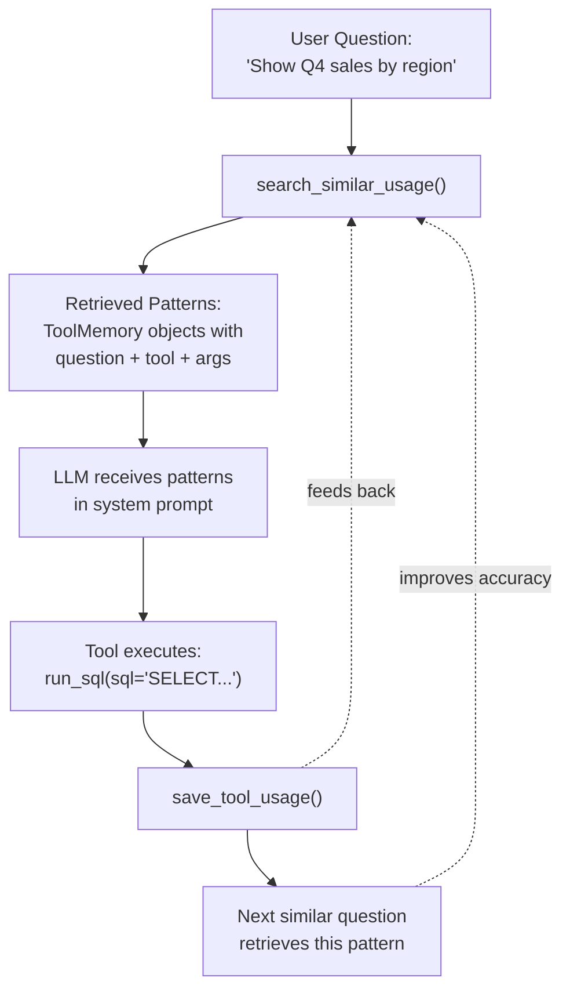
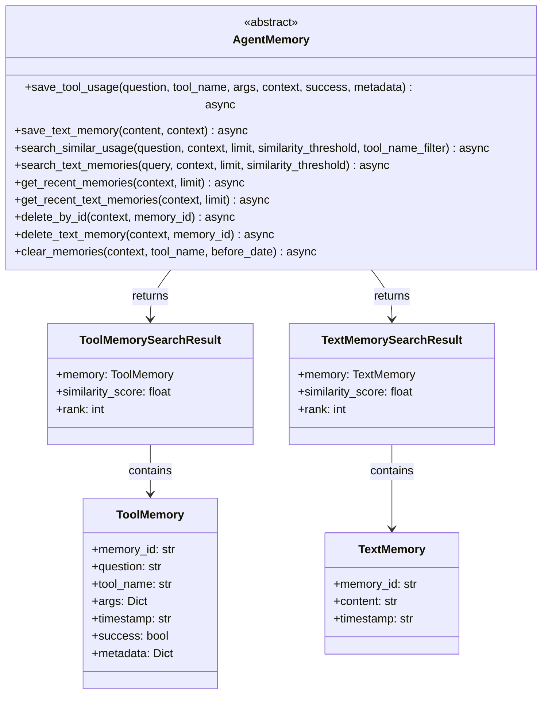
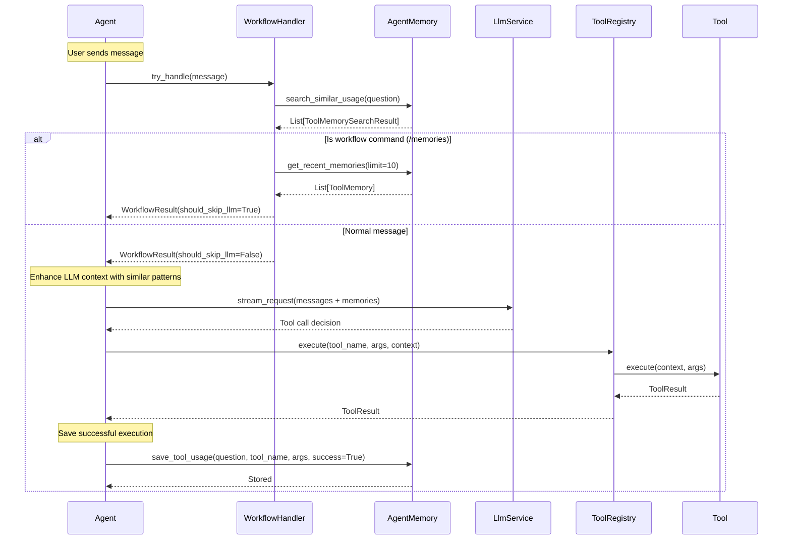
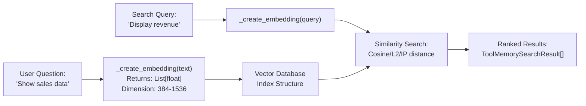
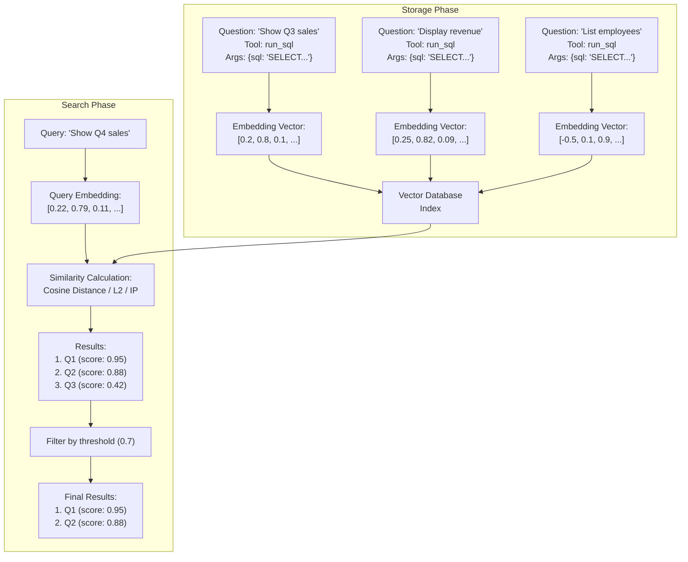
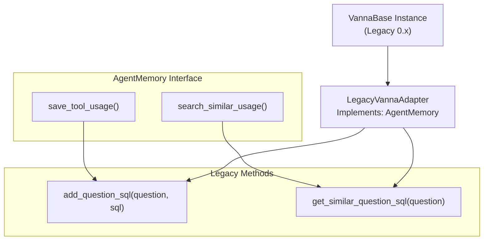

<!-- source: DeepWiki mcp.deepwiki.com · repo vanna-ai/vanna · page 4.1 AgentMemory Interface and Concepts · fetched 2026-10-29 -->

# AgentMemory Interface and Concepts

<details>
<summary>Relevant source files</summary>

The following files were used as context for generating this wiki page:

- [src/vanna/capabilities/agent_memory/base.py](src/vanna/capabilities/agent_memory/base.py)
- [src/vanna/capabilities/agent_memory/models.py](src/vanna/capabilities/agent_memory/models.py)
- [src/vanna/integrations/azuresearch/agent_memory.py](src/vanna/integrations/azuresearch/agent_memory.py)
- [src/vanna/integrations/chromadb/agent_memory.py](src/vanna/integrations/chromadb/agent_memory.py)
- [src/vanna/integrations/faiss/agent_memory.py](src/vanna/integrations/faiss/agent_memory.py)
- [src/vanna/integrations/local/agent_memory/in_memory.py](src/vanna/integrations/local/agent_memory/in_memory.py)
- [src/vanna/integrations/marqo/agent_memory.py](src/vanna/integrations/marqo/agent_memory.py)
- [src/vanna/integrations/milvus/agent_memory.py](src/vanna/integrations/milvus/agent_memory.py)
- [src/vanna/integrations/opensearch/agent_memory.py](src/vanna/integrations/opensearch/agent_memory.py)
- [src/vanna/integrations/pinecone/agent_memory.py](src/vanna/integrations/pinecone/agent_memory.py)
- [src/vanna/integrations/premium/agent_memory/premium.py](src/vanna/integrations/premium/agent_memory/premium.py)
- [src/vanna/integrations/qdrant/agent_memory.py](src/vanna/integrations/qdrant/agent_memory.py)
- [src/vanna/integrations/weaviate/agent_memory.py](src/vanna/integrations/weaviate/agent_memory.py)
- [src/vanna/legacy/adapter.py](src/vanna/legacy/adapter.py)
- [tests/test_chromadb_persistence_fix.py](tests/test_chromadb_persistence_fix.py)

</details>


This document explains the `AgentMemory` interface, which enables agents to learn from past successful interactions and retrieve similar patterns to improve future responses. `AgentMemory` is a capability interface that abstracts vector database operations for storing and searching tool usage patterns and free-form text.

For information about specific tools that interact with memory (e.g., `SaveQuestionToolArgsTool`, `SearchSavedCorrectToolUsesTool`), see [Memory-Enabled Tools](#4.3). For implementation details of specific vector databases, see [ChromaDB Integration](#4.5), [Qdrant Integration](#4.6), and other implementation pages.

---

## Core Concepts

### The Learning Feedback Loop

`AgentMemory` enables a self-improving system where successful tool executions are stored and retrieved to inform future LLM decisions. This creates a positive feedback loop:



**Sources:** [src/vanna/capabilities/agent_memory/base.py:1-104](), high-level architecture diagram 5

### Memory Types

`AgentMemory` stores two distinct types of memories:

| Memory Type | Model | Purpose | Search Method | Typical Use Case |
|-------------|-------|---------|---------------|------------------|
| **Tool Memory** | `ToolMemory` | Stores structured tool usage patterns: question → tool → args | `search_similar_usage()` | Learning SQL patterns, API call patterns, successful tool invocations |
| **Text Memory** | `TextMemory` | Stores free-form documentation or notes | `search_text_memories()` | Schema documentation, business rules, guidelines |

**Tool Memory Structure:**
```python
class ToolMemory(BaseModel):
    memory_id: Optional[str]
    question: str           # User's original question
    tool_name: str         # Tool that was invoked
    args: Dict[str, Any]   # Arguments passed to the tool
    timestamp: Optional[str]
    success: bool          # Whether execution succeeded
    metadata: Optional[Dict[str, Any]]
```

**Text Memory Structure:**
```python
class TextMemory(BaseModel):
    memory_id: Optional[str]
    content: str           # Free-form text content
    timestamp: Optional[str]
```

**Sources:** [src/vanna/capabilities/agent_memory/models.py:10-28]()

---

## AgentMemory Interface

The `AgentMemory` abstract base class defines the contract that all implementations must satisfy:



**Sources:** [src/vanna/capabilities/agent_memory/base.py:23-104](), [src/vanna/capabilities/agent_memory/models.py:10-44]()

### Core Methods

#### Storage Operations

**`save_tool_usage()`** - Stores a tool execution pattern:
- Parameters: `question` (user's query), `tool_name`, `args` (tool arguments), `context` (ToolContext), `success` (execution status), `metadata` (optional additional data)
- Creates a vector embedding from the question text
- Stores the pattern for future semantic search
- Used automatically by the agent after successful tool executions

**`save_text_memory()`** - Stores free-form documentation:
- Parameters: `content` (text to store), `context` (ToolContext)
- Returns a `TextMemory` object with assigned `memory_id`
- Typically invoked via `SaveTextMemoryTool` for user-provided documentation

**Sources:** [src/vanna/capabilities/agent_memory/base.py:27-44]()

#### Retrieval Operations

**`search_similar_usage()`** - Finds similar tool usage patterns:
- Parameters: `question` (query text), `context`, `limit` (max results, default 10), `similarity_threshold` (minimum score, default 0.7), `tool_name_filter` (optional filter)
- Returns `List[ToolMemorySearchResult]` ordered by similarity score
- Performs semantic similarity search using vector embeddings
- Used by `WorkflowHandler` to enhance LLM context before tool execution

**`search_text_memories()`** - Finds similar documentation:
- Parameters: `query` (search text), `context`, `limit`, `similarity_threshold`
- Returns `List[TextMemorySearchResult]` ordered by similarity
- Used via `SearchTextMemoriesTool` for user-initiated searches

**`get_recent_memories()`** - Retrieves recent tool memories:
- Parameters: `context`, `limit` (default 10)
- Returns most recent tool usage patterns, sorted by timestamp descending
- Used by the `/memories` workflow command to show recent learnings

**`get_recent_text_memories()`** - Retrieves recent text memories:
- Parameters: `context`, `limit`
- Returns most recent text memories, sorted by timestamp descending

**Sources:** [src/vanna/capabilities/agent_memory/base.py:47-83]()

#### Maintenance Operations

**`delete_by_id()`** - Deletes a specific tool memory:
- Returns `bool` indicating success
- Used for manual memory cleanup

**`delete_text_memory()`** - Deletes a specific text memory:
- Returns `bool` indicating success

**`clear_memories()`** - Bulk deletion with optional filters:
- Parameters: `context`, `tool_name` (optional filter), `before_date` (optional cutoff)
- Returns count of deleted memories
- If both filters are `None`, deletes all memories

**Sources:** [src/vanna/capabilities/agent_memory/base.py:86-103]()

### ToolContext Integration

All `AgentMemory` methods accept a `ToolContext` parameter, which provides:

```python
class ToolContext:
    user: User                      # User identity and group memberships
    conversation_id: str            # Current conversation
    request_id: str                 # Current request
    agent_memory: AgentMemory       # Reference to memory instance
    metadata: Dict[str, Any]        # Additional context data
```

This enables:
- **User-scoped operations**: Implementations can filter memories by user or organization
- **Audit logging**: Track who saved/retrieved memories
- **Multi-tenancy**: Different users see different memory subsets
- **Self-reference**: Tools can access the memory instance they're operating on

**Sources:** [src/vanna/core/tool.py]() (referenced in memory operations), [src/vanna/capabilities/agent_memory/base.py:14-104]()

---

## Memory Flow Through the Agent System

The following diagram shows how memories flow through the agent's message processing pipeline:



**Key Observations:**

1. **Pre-LLM Retrieval**: `search_similar_usage()` is called by `WorkflowHandler` before the LLM sees the request, allowing similar patterns to enhance the system prompt.

2. **Automatic Learning**: After successful tool execution, the agent automatically calls `save_tool_usage()` without explicit instruction.

3. **Command Handling**: The `/memories` workflow command uses `get_recent_memories()` to show users what the agent has learned.

4. **Context Preservation**: The `ToolContext` flows through all operations, maintaining user identity and request correlation.

**Sources:** [src/vanna/core/agent/agent.py]() (agent flow), [src/vanna/core/workflow/default.py]() (workflow handler), high-level architecture diagram 2

---

## Common Implementation Patterns

While `AgentMemory` has 11+ implementations (see [Other Vector Store Integrations](#4.9)), they share common patterns:

### Vector Embeddings

All implementations must convert text to vector embeddings for similarity search:



**Implementation Notes:**

- **Placeholder Embeddings**: Many implementations use `hashlib.md5()` for demo purposes (e.g., [src/vanna/integrations/qdrant/agent_memory.py:82-87](), [src/vanna/integrations/faiss/agent_memory.py:86-102]())
- **Production Embeddings**: Users should provide real embedding functions (e.g., SentenceTransformers, OpenAI embeddings)
- **ChromaDB Exception**: Uses `DefaultEmbeddingFunction` which downloads an ONNX model (~80MB) automatically
- **Dimension Requirements**: Must match vector database index configuration (commonly 384 for sentence-transformers, 1536 for OpenAI)

**Sources:** [src/vanna/integrations/chromadb/agent_memory.py:129-139](), [src/vanna/integrations/qdrant/agent_memory.py:82-87]()

### Asynchronous Operations with ThreadPoolExecutor

All implementations use `asyncio` with `ThreadPoolExecutor` to avoid blocking the event loop during I/O operations:

```python
# Common pattern across implementations
def __init__(self, ...):
    self._executor = ThreadPoolExecutor(max_workers=2)

async def save_tool_usage(self, ...):
    def _save():
        # Synchronous database operation
        client = self._get_client()
        client.insert(...)
    
    # Execute in thread pool, return awaitable
    await asyncio.get_event_loop().run_in_executor(self._executor, _save)
```

**Why This Pattern:**
- Vector databases typically provide synchronous clients
- Running sync I/O on the main event loop would block other requests
- ThreadPoolExecutor with 2 workers handles concurrent memory operations
- Inner `_save()` function captures closure over parameters

**Sources:** [src/vanna/integrations/chromadb/agent_memory.py:117-199](), [src/vanna/integrations/qdrant/agent_memory.py:61-120](), [src/vanna/integrations/faiss/agent_memory.py:55-137]()

### Metadata Serialization

Vector databases often have restrictions on metadata field types (only primitives, no nested objects). Implementations serialize complex types:

```python
# ChromaDB example: serialize complex objects to JSON strings
memory_data = {
    "question": question,
    "tool_name": tool_name,
    "args_json": json.dumps(args),      # Serialize dict to JSON
    "timestamp": timestamp,
    "success": success,
    "metadata_json": json.dumps(metadata or {}),  # Serialize metadata
}

# On retrieval: deserialize back to Python objects
args = json.loads(metadata.get("args_json", "{}"))
metadata_dict = json.loads(metadata.get("metadata_json", "{}"))
```

**Affected Implementations:**
- ChromaDB: Serializes to JSON strings in metadata ([src/vanna/integrations/chromadb/agent_memory.py:185-192]())
- Pinecone: Serializes complex fields ([src/vanna/integrations/pinecone/agent_memory.py:106-113]())
- Azure AI Search: Serializes to JSON strings ([src/vanna/integrations/azuresearch/agent_memory.py:159-167]())

**Not Required:**
- Qdrant: Supports nested payloads natively ([src/vanna/integrations/qdrant/agent_memory.py:105-114]())
- FAISS: Stores metadata separately in pickle file ([src/vanna/integrations/faiss/agent_memory.py:124-133]())

**Sources:** [src/vanna/integrations/chromadb/agent_memory.py:185-197](), [src/vanna/integrations/pinecone/agent_memory.py:106-116]()

### Persistence Strategies

Implementations handle persistence differently based on the underlying database:

| Implementation | Persistence Strategy | Configuration |
|----------------|---------------------|---------------|
| **ChromaDB** | `PersistentClient` with local directory | `persist_directory` (default: `"./chroma_memory"`) |
| **FAISS** | Manual save of index + pickle metadata | `index_path` for `index.faiss` and `metadata.pkl` |
| **Qdrant** | Server-managed persistence (local or cloud) | `url` or `path` (`:memory:` for in-memory) |
| **Pinecone** | Fully managed cloud service | `api_key` and `environment` (e.g., `"us-east-1"`) |
| **DemoAgentMemory** | In-memory only, no persistence | FIFO eviction with `max_items` |

**ChromaDB Persistence Optimization:**

ChromaDB's implementation includes an important optimization for avoiding unnecessary model downloads:

```python
def _get_collection(self):
    if self._collection is None:
        client = self._get_client()
        try:
            # Try to retrieve existing collection WITHOUT embedding function
            # This avoids re-downloading the embedding model
            self._collection = client.get_collection(name=self.collection_name)
        except NotFoundError:
            # Collection doesn't exist - create with embedding function
            embedding_func = self._get_embedding_function()
            self._collection = client.create_collection(...)
    return self._collection
```

This pattern ensures that on application restart, existing collections are loaded without triggering a model download.

**Sources:** [src/vanna/integrations/chromadb/agent_memory.py:141-158](), [src/vanna/integrations/faiss/agent_memory.py:58-85](), [src/vanna/integrations/qdrant/agent_memory.py:63-80](), [src/vanna/integrations/local/agent_memory/in_memory.py:36-48]()

---

## Available Implementations

The following table summarizes all `AgentMemory` implementations:

| Implementation | Module Path | Backend | Persistence | Embedding | Typical Use Case |
|----------------|-------------|---------|-------------|-----------|------------------|
| **DemoAgentMemory** | `vanna.integrations.local.agent_memory` | In-memory list | None (FIFO eviction) | Jaccard + difflib | Testing, demos, prototypes |
| **ChromaAgentMemory** | `vanna.integrations.chromadb` | ChromaDB | Local SQLite + files | DefaultEmbeddingFunction | Local development, single-machine deployments |
| **QdrantAgentMemory** | `vanna.integrations.qdrant` | Qdrant | Server-managed (local/cloud) | Custom required | Production, cloud-native |
| **FAISSAgentMemory** | `vanna.integrations.faiss` | FAISS | Local index + pickle | Custom required | High-performance local search |
| **PineconeAgentMemory** | `vanna.integrations.pinecone` | Pinecone | Managed cloud | Custom required | Fully managed, serverless |
| **MilvusAgentMemory** | `vanna.integrations.milvus` | Milvus | Server-managed | Custom required | Large-scale distributed systems |
| **WeaviateAgentMemory** | `vanna.integrations.weaviate` | Weaviate | Server-managed | Custom required | GraphQL integration, hybrid search |
| **OpenSearchAgentMemory** | `vanna.integrations.opensearch` | OpenSearch | Server-managed | Custom required | Elasticsearch alternative, AWS integration |
| **AzureAISearchAgentMemory** | `vanna.integrations.azuresearch` | Azure Cognitive Search | Managed cloud | Custom required | Azure-native deployments |
| **MarqoAgentMemory** | `vanna.integrations.marqo` | Marqo | Server-managed | Built-in models | Easy setup, multi-modal support |
| **CloudAgentMemory** | `vanna.integrations.premium.agent_memory` | Vanna Cloud API | Managed cloud | Managed by service | Premium SaaS offering |

**Selection Criteria:**

- **Development/Testing**: `DemoAgentMemory` or `ChromaAgentMemory` (no external dependencies or minimal setup)
- **Local Production**: `ChromaAgentMemory` or `FAISSAgentMemory` (persistent, self-contained)
- **Cloud Production**: `PineconeAgentMemory`, `QdrantAgentMemory` (cloud), or `CloudAgentMemory` (Vanna-managed)
- **Enterprise Scale**: `MilvusAgentMemory`, `OpenSearchAgentMemory` (distributed systems)
- **Existing Infrastructure**: Match your organization's vector database (e.g., `WeaviateAgentMemory` if already using Weaviate)

**Sources:** All integration files under `src/vanna/integrations/*/agent_memory.py`

---

## Similarity Search Mechanics

The core value of `AgentMemory` is semantic similarity search. Here's how it works conceptually:



**Key Parameters:**

- **`similarity_threshold`** (default: 0.7): Minimum similarity score (0.0-1.0) to include a result
  - Higher threshold = fewer, more precise results
  - Lower threshold = more results, potentially less relevant
  
- **`limit`** (default: 10): Maximum number of results to return
  - Results are ranked by similarity score
  
- **`tool_name_filter`** (optional): Restrict results to a specific tool
  - Example: Only retrieve `run_sql` patterns when generating SQL

**Distance Metrics:**

Different implementations use different similarity metrics:

| Metric | Implementations | Calculation | Range |
|--------|----------------|-------------|-------|
| **Cosine Similarity** | ChromaDB (L2→similarity), FAISS, Pinecone | `1 - distance` | 0.0 (orthogonal) to 1.0 (identical) |
| **Inner Product (IP)** | Milvus, Qdrant | Dot product of normalized vectors | -1.0 to 1.0 |
| **L2 Distance** | FAISS (option), OpenSearch | Euclidean distance | 0.0 (identical) to ∞ |
| **Jaccard + difflib** | DemoAgentMemory | Token overlap + sequence matching | 0.0 to 1.0 |

**Sources:** [src/vanna/integrations/chromadb/agent_memory.py:223-240](), [src/vanna/integrations/local/agent_memory/in_memory.py:66-87](), [src/vanna/integrations/milvus/agent_memory.py:182-199]()

---

## Legacy Integration

For compatibility with Vanna 0.x codebases, `LegacyVannaAdapter` bridges `VannaBase` instances to the `AgentMemory` interface:



**Key Mappings:**

- `save_tool_usage()` → `vn.add_question_sql()` (for `run_sql` tool only)
- `search_similar_usage()` → `vn.get_similar_question_sql()`
- `save_text_memory()` → `vn.add_documentation()`
- `search_text_memories()` → `vn.get_related_documentation()`

**Limitations:**
- Only tracks SQL queries (ignores non-SQL tools)
- No true memory IDs (uses `None`)
- No actual similarity scores (uses rank-based approximation)
- `get_recent_memories()` uses blank string query as workaround

**Sources:** [src/vanna/legacy/adapter.py:66-426]()

---

## Best Practices

### Choosing an Implementation

1. **Start with DemoAgentMemory** for prototyping - zero dependencies, instant setup
2. **Use ChromaAgentMemory** for local development - automatic embedding, persistent
3. **Deploy with cloud backends** (Qdrant, Pinecone) for production - managed, scalable
4. **Match existing infrastructure** if you already have a vector database

### Embedding Functions

The placeholder embeddings (`hashlib.md5`) in many implementations are **for demonstration only**. Production deployments should use real embedding models:

```python
# Example: ChromaDB with SentenceTransformers
from chromadb.utils import embedding_functions

ef = embedding_functions.SentenceTransformerEmbeddingFunction(
    model_name="all-MiniLM-L6-v2"
)

memory = ChromaAgentMemory(
    persist_directory="/app/data/chroma",
    embedding_function=ef
)
```

### Multi-Tenancy

Implement user/organization scoping in `ToolContext` to isolate memories:

```python
class UserScopedMemory(AgentMemory):
    async def search_similar_usage(self, question, context, ...):
        # Filter by user's organization
        org_id = context.user.metadata.get("organization_id")
        # Add org_id to vector database filter
        ...
```

### Performance Tuning

- **Limit results**: Use reasonable `limit` values (5-10) to avoid overwhelming the LLM context
- **Threshold tuning**: Adjust `similarity_threshold` based on your use case (0.6-0.8 typical range)
- **Index configuration**: Configure vector database indexes appropriately (e.g., HNSW parameters for Qdrant)
- **Batch operations**: If saving many memories, use batch insert APIs where available

**Sources:** [src/vanna/integrations/chromadb/agent_memory.py:42-100](), implementation examples throughout integration files

---

