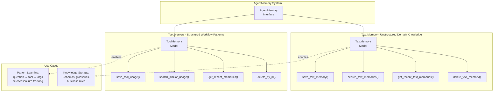
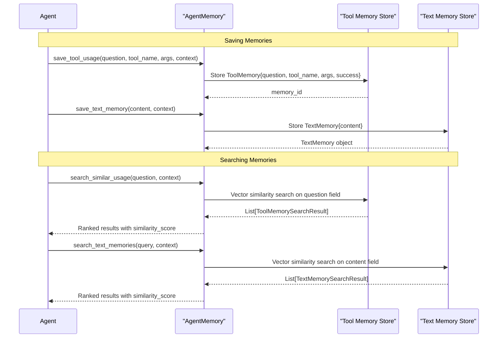
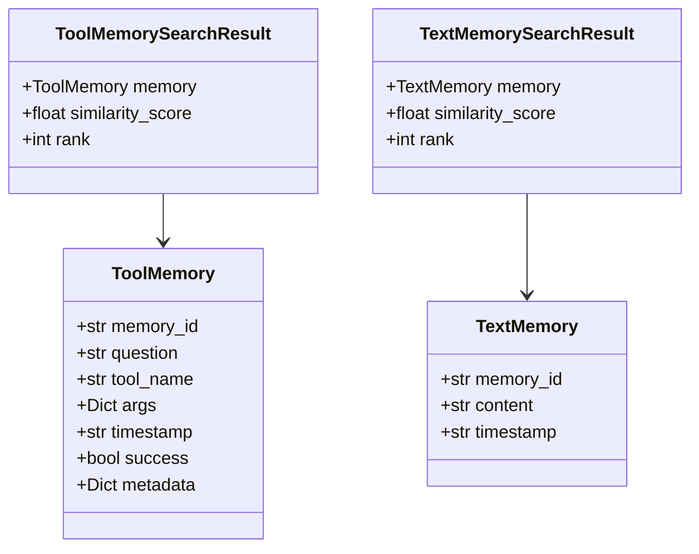
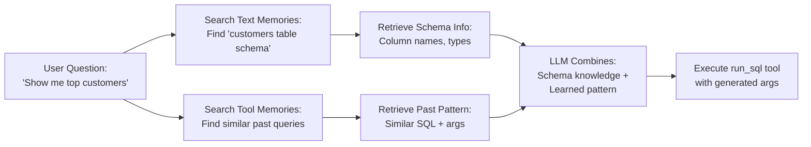

<!-- source: DeepWiki mcp.deepwiki.com · repo vanna-ai/vanna · page 4.2 Tool Memory vs Text Memory · fetched 2026-10-29 -->

# Tool Memory vs Text Memory

<details>
<summary>Relevant source files</summary>

The following files were used as context for generating this wiki page:

- [src/vanna/capabilities/agent_memory/base.py](src/vanna/capabilities/agent_memory/base.py)
- [src/vanna/capabilities/agent_memory/models.py](src/vanna/capabilities/agent_memory/models.py)
- [src/vanna/integrations/azuresearch/agent_memory.py](src/vanna/integrations/azuresearch/agent_memory.py)
- [src/vanna/integrations/chromadb/agent_memory.py](src/vanna/integrations/chromadb/agent_memory.py)
- [src/vanna/integrations/faiss/agent_memory.py](src/vanna/integrations/faiss/agent_memory.py)
- [src/vanna/integrations/local/agent_memory/in_memory.py](src/vanna/integrations/local/agent_memory/in_memory.py)
- [src/vanna/integrations/marqo/agent_memory.py](src/vanna/integrations/marqo/agent_memory.py)
- [src/vanna/integrations/milvus/agent_memory.py](src/vanna/integrations/milvus/agent_memory.py)
- [src/vanna/integrations/opensearch/agent_memory.py](src/vanna/integrations/opensearch/agent_memory.py)
- [src/vanna/integrations/pinecone/agent_memory.py](src/vanna/integrations/pinecone/agent_memory.py)
- [src/vanna/integrations/premium/agent_memory/premium.py](src/vanna/integrations/premium/agent_memory/premium.py)
- [src/vanna/integrations/qdrant/agent_memory.py](src/vanna/integrations/qdrant/agent_memory.py)
- [src/vanna/integrations/weaviate/agent_memory.py](src/vanna/integrations/weaviate/agent_memory.py)
- [src/vanna/legacy/adapter.py](src/vanna/legacy/adapter.py)
- [tests/test_chromadb_persistence_fix.py](tests/test_chromadb_persistence_fix.py)

</details>


## Purpose and Scope

This document explains the two distinct memory types supported by Vanna's AgentMemory system: **Tool Memory** for structured workflow patterns and **Text Memory** for unstructured domain knowledge. Understanding these memory types is essential for configuring agents that learn from past interactions and leverage domain expertise.

For the AgentMemory interface and general memory concepts, see [AgentMemory Interface and Concepts](#4.1). For specific memory-enabled tools that agents use to interact with memory, see [Memory-Enabled Tools](#4.3). For implementation details of specific vector store backends, see sections [4.4](#4.4) through [4.9](#4.9).

---

## Memory Type Overview

The AgentMemory system maintains two parallel memory stores with fundamentally different purposes and structures:



**Sources**: [src/vanna/capabilities/agent_memory/models.py:10-28](), [src/vanna/capabilities/agent_memory/base.py:23-103]()

---

## Data Models

### ToolMemory Structure

The `ToolMemory` model captures structured records of tool execution patterns:

| Field | Type | Purpose |
|-------|------|---------|
| `memory_id` | `Optional[str]` | Unique identifier for retrieval and deletion |
| `question` | `str` | The user's original natural language question |
| `tool_name` | `str` | Name of the tool that was executed |
| `args` | `Dict[str, Any]` | Tool arguments that produced successful results |
| `timestamp` | `Optional[str]` | ISO format timestamp for temporal ordering |
| `success` | `bool` | Whether the tool execution succeeded (default: True) |
| `metadata` | `Optional[Dict[str, Any]]` | Additional context (user_id, org_id, etc.) |

**Sources**: [src/vanna/capabilities/agent_memory/models.py:10-19]()

### TextMemory Structure

The `TextMemory` model stores unstructured content:

| Field | Type | Purpose |
|-------|------|---------|
| `memory_id` | `Optional[str]` | Unique identifier for retrieval and deletion |
| `content` | `str` | Free-form text content (schemas, glossaries, notes) |
| `timestamp` | `Optional[str]` | ISO format timestamp for temporal ordering |

**Key Difference**: TextMemory has no tool-specific fields. It stores pure content without execution context.

**Sources**: [src/vanna/capabilities/agent_memory/models.py:22-27]()

---

## Storage Operations



**Sources**: [src/vanna/capabilities/agent_memory/base.py:26-69]()

### save_tool_usage

```python
async def save_tool_usage(
    self,
    question: str,
    tool_name: str,
    args: Dict[str, Any],
    context: ToolContext,
    success: bool = True,
    metadata: Optional[Dict[str, Any]] = None,
) -> None
```

Stores a structured record of tool execution. The `question` field is embedded for similarity search, enabling pattern-based retrieval.

**Sources**: [src/vanna/capabilities/agent_memory/base.py:26-37]()

### save_text_memory

```python
async def save_text_memory(
    self, content: str, context: ToolContext
) -> TextMemory
```

Stores unstructured text content. Returns the created `TextMemory` object with assigned `memory_id`.

**Sources**: [src/vanna/capabilities/agent_memory/base.py:39-44]()

### search_similar_usage

```python
async def search_similar_usage(
    self,
    question: str,
    context: ToolContext,
    *,
    limit: int = 10,
    similarity_threshold: float = 0.7,
    tool_name_filter: Optional[str] = None,
) -> List[ToolMemorySearchResult]
```

Searches tool memories by question similarity. The `tool_name_filter` parameter allows filtering to specific tools (e.g., only search for `run_sql` patterns). Only successful executions (`success=True`) are typically returned.

**Sources**: [src/vanna/capabilities/agent_memory/base.py:46-57]()

### search_text_memories

```python
async def search_text_memories(
    self,
    query: str,
    context: ToolContext,
    *,
    limit: int = 10,
    similarity_threshold: float = 0.7,
) -> List[TextMemorySearchResult]
```

Searches text memories by content similarity. No tool filtering is available since text memories are not tool-specific.

**Sources**: [src/vanna/capabilities/agent_memory/base.py:59-69]()

---

## Search Result Models

Both memory types return structured search results with similarity scoring:



The `rank` field provides ordinal position (1 for best match), while `similarity_score` provides the numerical similarity value (typically 0.0 to 1.0).

**Sources**: [src/vanna/capabilities/agent_memory/models.py:30-43]()

---

## Similarity Algorithms

### DemoAgentMemory Implementation

The in-memory implementation uses a hybrid similarity approach for both memory types:

```python
@classmethod
def _similarity(cls, a: str, b: str) -> float:
    """
    Calculate similarity between two strings using multiple methods.
    
    Returns the maximum of Jaccard similarity and difflib ratio.
    """
    a_norm, b_norm = cls._normalize(a), cls._normalize(b)
    
    # Jaccard over whitespace tokens
    ta, tb = cls._tokenize(a_norm), cls._tokenize(b_norm)
    if not ta and not tb:
        jaccard = 1.0
    elif not ta or not tb:
        jaccard = 0.0
    else:
        jaccard = len(ta & tb) / max(1, len(ta | tb))
    
    # difflib ratio
    ratio = difflib.SequenceMatcher(None, a_norm, b_norm).ratio()
    
    # Take the better of the two cheap measures
    return max(jaccard, ratio)
```

**Tool Memory Search**: Compares the input `question` against stored `ToolMemory.question` fields:

**Text Memory Search**: Compares the input `query` against stored `TextMemory.content` fields:

**Sources**: [src/vanna/integrations/local/agent_memory/in_memory.py:66-87](), [src/vanna/integrations/local/agent_memory/in_memory.py:127-164](), [src/vanna/integrations/local/agent_memory/in_memory.py:166-197]()

### Vector Store Implementations

Vector store backends (ChromaDB, Qdrant, FAISS, Pinecone) use embedding-based similarity:
- **Tool Memory**: Embeds the `question` field for vector search
- **Text Memory**: Embeds the `content` field for vector search

The similarity metric (cosine, euclidean, dot product) depends on the vector store configuration.

**Sources**: See sections [4.5](#4.5) through [4.8](#4.8) for implementation-specific details.

---

## Use Cases and Examples

### Tool Memory Use Case: SQL Pattern Learning

**Scenario**: An agent learns that "show me Q4 sales" maps to `run_sql` with specific SQL:

```
ToolMemory:
  question: "Show me Q4 sales for 2023"
  tool_name: "run_sql"
  args: {
    "sql": "SELECT SUM(amount) FROM sales WHERE quarter = 'Q4' AND year = 2023"
  }
  success: true
```

When a user later asks "What were our sales in the fourth quarter?", the agent:
1. Searches tool memories using the question
2. Finds the similar past pattern with high similarity score
3. Adapts the stored SQL args to the new question
4. Executes the tool with learned parameters

**Sources**: [src/vanna/capabilities/agent_memory/models.py:10-19]()

### Text Memory Use Case: Schema Documentation

**Scenario**: Store database schema information for the LLM to reference:

```
TextMemory:
  content: "The sales table has columns: id (PK), customer_id (FK), amount (DECIMAL), 
            transaction_date (DATE), quarter (VARCHAR), year (INT). The quarter column 
            uses format 'Q1', 'Q2', 'Q3', 'Q4'."
```

When constructing SQL queries, the agent can search text memories for "sales table schema" to understand column names and data types.

**Sources**: [src/vanna/capabilities/agent_memory/models.py:22-27]()

### Text Memory Use Case: Business Glossary

**Scenario**: Store domain-specific terminology:

```
TextMemory:
  content: "ARR (Annual Recurring Revenue) is the total subscription revenue normalized 
            to a one-year period. Stored in the metrics table as metric_name='ARR'. 
            Calculate by multiplying MRR by 12."
```

When a user asks "What's our ARR?", the agent searches text memories to understand that ARR maps to specific database fields and calculations.

**Sources**: [src/vanna/capabilities/agent_memory/models.py:22-27]()

---

## Clear and Delete Operations

Both memory types support individual and bulk deletion:

| Operation | Tool Memory | Text Memory |
|-----------|-------------|-------------|
| Delete by ID | `delete_by_id(context, memory_id)` | `delete_text_memory(context, memory_id)` |
| Clear all | `clear_memories(context)` | `clear_memories(context)` |
| Clear by tool | `clear_memories(context, tool_name="run_sql")` | N/A (ignored) |
| Clear by date | `clear_memories(context, before_date="2024-01-01")` | `clear_memories(context, before_date="2024-01-01")` |

The `clear_memories` method handles both memory types:
- When `tool_name` is specified: Only deletes tool memories for that tool
- When `tool_name` is `None`: Deletes both tool and text memories
- The `before_date` filter applies to both memory types

**Sources**: [src/vanna/capabilities/agent_memory/base.py:85-103](), [src/vanna/integrations/local/agent_memory/in_memory.py:232-285]()

---

## Implementation Comparison

### DemoAgentMemory (In-Memory)

Supports both memory types with separate in-memory lists:

```python
def __init__(self, *, max_items: int = 10_000):
    self._memories: List[ToolMemory] = []          # Tool memories
    self._text_memories: List[TextMemory] = []     # Text memories
    self._lock = asyncio.Lock()
    self._max_items = max_items
```

Both lists share the same FIFO eviction policy when `max_items` is exceeded.

**Sources**: [src/vanna/integrations/local/agent_memory/in_memory.py:37-48]()

### CloudAgentMemory (Premium Service)

**Current Limitation**: CloudAgentMemory only implements tool memory operations. Text memory methods raise `NotImplementedError`:

```python
async def save_text_memory(self, content: str, context: ToolContext) -> TextMemory:
    """Cloud implementation does not yet support text memories."""
    raise NotImplementedError("CloudAgentMemory does not support text memories.")
```

All text memory search and retrieval methods return empty results or `False`.

**Sources**: [src/vanna/integrations/premium/agent_memory/premium.py:142-165]()

### Vector Store Implementations

Vector store backends (ChromaDB, Qdrant, FAISS, Pinecone) typically support both memory types using separate collections or namespaces:
- ChromaDB: Uses separate collections (`tool_memories` and `text_memories`)
- Qdrant: Uses separate collections with distinct payloads
- FAISS: Maintains separate indices and metadata stores
- Pinecone: Uses separate namespaces

**Sources**: See implementation-specific pages [4.5](#4.5) through [4.8](#4.8)

---

## Memory Type Selection Guide

| When to Use Tool Memory | When to Use Text Memory |
|-------------------------|-------------------------|
| Learning from successful tool executions | Storing static reference information |
| Pattern-based workflow optimization | Database schema documentation |
| User-specific query preferences | Business glossary and definitions |
| Tool argument templates | Company-specific data conventions |
| Historical success/failure tracking | Multi-step procedure documentation |

### Combined Usage Pattern

Agents typically use both memory types in tandem:



**Sources**: [src/vanna/capabilities/agent_memory/base.py:23-103]()

---

## Summary Table

| Aspect | Tool Memory | Text Memory |
|--------|-------------|-------------|
| **Data Model** | `ToolMemory` with 7 fields | `TextMemory` with 3 fields |
| **Primary Purpose** | Workflow pattern learning | Domain knowledge storage |
| **Search Field** | `question` field | `content` field |
| **Structured Data** | Tool name and args included | Pure text, no structure |
| **Success Tracking** | `success` boolean | Not applicable |
| **Filtering** | By tool_name, success status | No additional filters |
| **LLM Usage** | Adapts past args to new questions | Provides context for reasoning |
| **CloudAgentMemory** | Fully supported | Not yet supported |
| **Typical Size** | Many small records per tool | Fewer, larger documents |
| **Update Frequency** | After each tool execution | Infrequent, manual saves |

**Sources**: [src/vanna/capabilities/agent_memory/models.py:10-28](), [src/vanna/capabilities/agent_memory/base.py:23-103]()

---

