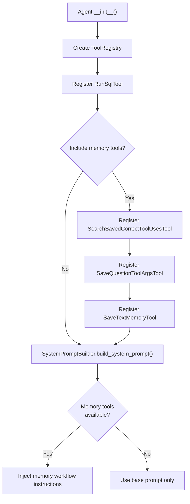
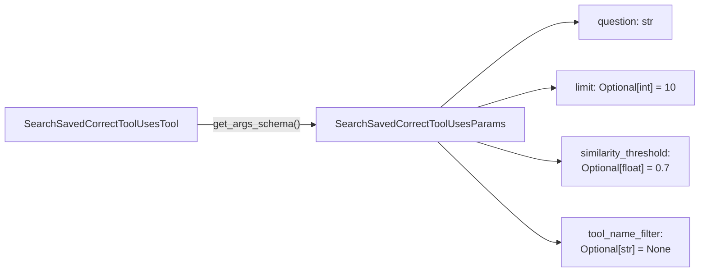
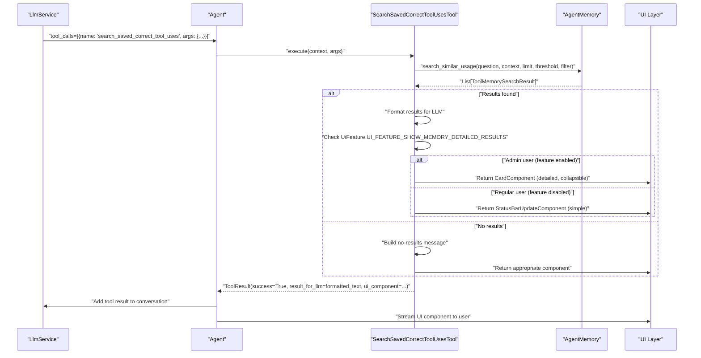
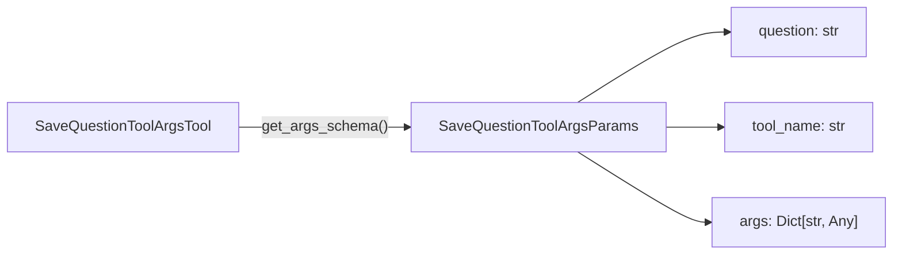
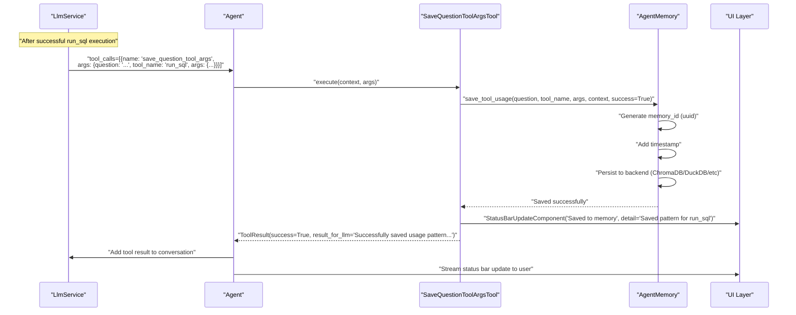
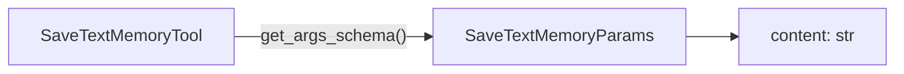
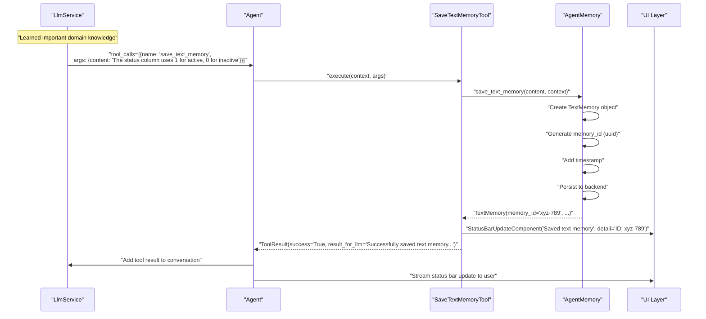
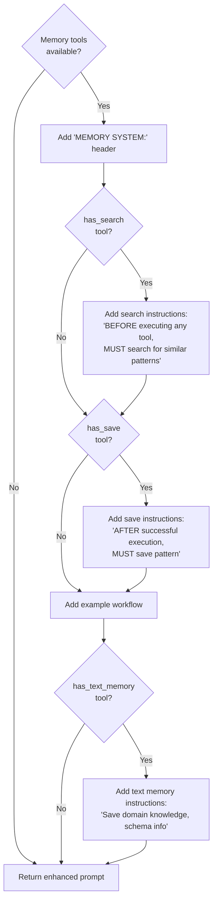
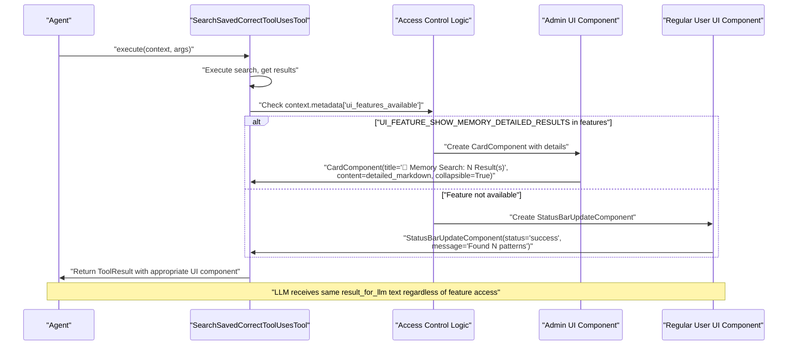
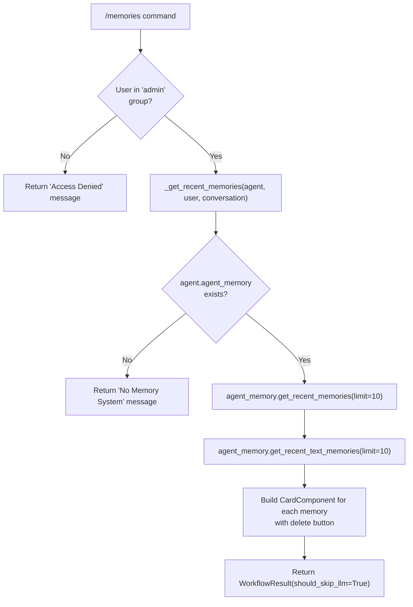

<!-- source: DeepWiki mcp.deepwiki.com · repo vanna-ai/vanna · page 4.3 Memory-Enabled Tools · fetched 2026-10-29 -->

# Memory-Enabled Tools

<details>
<summary>Relevant source files</summary>

The following files were used as context for generating this wiki page:

- [src/vanna/components/rich/containers/card.py](src/vanna/components/rich/containers/card.py)
- [src/vanna/core/workflow/base.py](src/vanna/core/workflow/base.py)
- [src/vanna/core/workflow/default.py](src/vanna/core/workflow/default.py)
- [src/vanna/integrations/azuresearch/agent_memory.py](src/vanna/integrations/azuresearch/agent_memory.py)
- [src/vanna/integrations/chromadb/agent_memory.py](src/vanna/integrations/chromadb/agent_memory.py)
- [src/vanna/integrations/faiss/agent_memory.py](src/vanna/integrations/faiss/agent_memory.py)
- [src/vanna/integrations/marqo/agent_memory.py](src/vanna/integrations/marqo/agent_memory.py)
- [src/vanna/integrations/milvus/agent_memory.py](src/vanna/integrations/milvus/agent_memory.py)
- [src/vanna/integrations/opensearch/agent_memory.py](src/vanna/integrations/opensearch/agent_memory.py)
- [src/vanna/integrations/pinecone/agent_memory.py](src/vanna/integrations/pinecone/agent_memory.py)
- [src/vanna/integrations/qdrant/agent_memory.py](src/vanna/integrations/qdrant/agent_memory.py)
- [src/vanna/integrations/weaviate/agent_memory.py](src/vanna/integrations/weaviate/agent_memory.py)
- [src/vanna/legacy/adapter.py](src/vanna/legacy/adapter.py)
- [tests/test_chromadb_persistence_fix.py](tests/test_chromadb_persistence_fix.py)
- [tests/test_memory_tools.py](tests/test_memory_tools.py)
- [tests/test_workflow.py](tests/test_workflow.py)

</details>


## Overview

Memory-enabled tools provide the LLM with explicit capabilities to search and save knowledge through the `AgentMemory` system. Unlike automatic memory operations that occur in the background, these tools are **exposed to the LLM** in its tool list, allowing it to autonomously decide when to search for past patterns or save new learnings.

The three memory-enabled tools are:

| Tool Name | Purpose | Tool Class |
|-----------|---------|------------|
| `search_saved_correct_tool_uses` | Search for similar past tool usage patterns | `SearchSavedCorrectToolUsesTool` |
| `save_question_tool_args` | Save a successful question-tool-args combination | `SaveQuestionToolArgsTool` |
| `save_text_memory` | Save free-form domain knowledge or context | `SaveTextMemoryTool` |

These tools access `AgentMemory` via the `ToolContext.agent_memory` property, which is populated by the Agent during tool execution. The LLM learns to use these tools through instructions injected by the `DefaultSystemPromptBuilder` when memory tools are available.

**Sources:** [src/vanna/tools/agent_memory.py:1-323](), [src/vanna/core/system_prompt/default.py:1-158]()

---

## How Memory Tools Are Registered

Memory tools are registered in the `ToolRegistry` just like any other tool. When the Agent initializes, it can optionally include these tools:



**Example registration code:**

```python
from vanna.core.tool import ToolRegistry
from vanna.tools.agent_memory import (
    SearchSavedCorrectToolUsesTool,
    SaveQuestionToolArgsTool,
    SaveTextMemoryTool
)

tool_registry = ToolRegistry()

# Register memory tools (typically with open access)
tool_registry.register(SearchSavedCorrectToolUsesTool())
tool_registry.register(SaveQuestionToolArgsTool())
tool_registry.register(SaveTextMemoryTool())
```

The `DefaultSystemPromptBuilder` detects these tools at [src/vanna/core/system_prompt/default.py:50-54]() and automatically adds usage instructions to the system prompt.

**Sources:** [src/vanna/core/system_prompt/default.py:34-158](), [src/vanna/tools/agent_memory.py:1-323]()

---

## SearchSavedCorrectToolUsesTool

The `SearchSavedCorrectToolUsesTool` allows the LLM to explicitly search for similar past tool usage patterns before executing tools.

### Tool Definition



**Tool properties** (defined at [src/vanna/tools/agent_memory.py:120-132]()):
- **name**: `"search_saved_correct_tool_uses"`
- **description**: `"Search for similar tool usage patterns based on a question"`
- **access_groups**: Inherits from base Tool (typically open access)

### Argument Schema

The Pydantic model `SearchSavedCorrectToolUsesParams` at [src/vanna/tools/agent_memory.py:37-52]():

```python
class SearchSavedCorrectToolUsesParams(BaseModel):
    question: str = Field(
        description="The question to find similar tool usage patterns for"
    )
    limit: Optional[int] = Field(
        default=10, description="Maximum number of results to return"
    )
    similarity_threshold: Optional[float] = Field(
        default=0.7, description="Minimum similarity score for results (0.0-1.0)"
    )
    tool_name_filter: Optional[str] = Field(
        default=None, description="Filter results to specific tool name"
    )
```

### Execution Flow

When the LLM calls this tool, the execution flow is:



**Sources:** [src/vanna/tools/agent_memory.py:134-266](), [tests/test_memory_tools.py:42-292]()

### Result Formatting for LLM

The tool formats search results as structured text at [src/vanna/tools/agent_memory.py:193-200]():

```
Found 2 similar tool usage pattern(s):

1. run_sql (similarity: 0.87)
   Question: What were our total sales in January 2024?
   Args: {'sql': "SELECT SUM(amount) FROM sales WHERE date >= '2024-01-01' AND date < '2024-02-01'"}

2. run_sql (similarity: 0.75)
   Question: Show me Q1 2024 revenue
   Args: {'sql': "SELECT SUM(revenue) FROM transactions WHERE quarter = 'Q1' AND year = 2024"}
```

This text is placed in `ToolResult.result_for_llm`, which the Agent adds to the conversation history. The LLM then uses this information to inform its next tool call.

### UI Components Based on User Access

The tool checks `UiFeature.UI_FEATURE_SHOW_MEMORY_DETAILED_RESULTS` at [src/vanna/tools/agent_memory.py:203-208]() to determine UI output:

| User Type | UiFeature Enabled? | Component Type | Contents |
|-----------|-------------------|----------------|----------|
| Admin | Yes | `CardComponent` | Detailed results with similarity scores, collapsible |
| Regular User | No | `StatusBarUpdateComponent` | Simple count (e.g., "Found 2 similar patterns") |

**Admin view** (at [src/vanna/tools/agent_memory.py:211-236]()):
```python
CardComponent(
    title=f"🧠 Memory Search: {len(results)} Result(s)",
    content="**Retrieved memories passed to LLM:**\n\n"
            "**1. run_sql** (similarity: 0.87)\n"
            "- **Question:** What were our total sales in January 2024?\n"
            "- **Arguments:** `{'sql': '...'}`\n"
            "- **Timestamp:** 2024-01-15T10:30:00Z\n"
            "- **ID:** `abc-123`\n",
    icon="🔍",
    status="info",
    collapsible=True,
    collapsed=True,  # Start collapsed to avoid clutter
    markdown=True
)
```

**Regular user view** (at [src/vanna/tools/agent_memory.py:237-246]()):
```python
StatusBarUpdateComponent(
    status="success",
    message=f"Found {len(results)} similar pattern(s)",
    detail="Retrieved from agent memory"
)
```

**Critical note:** The **LLM receives the same `result_for_llm` text** regardless of user access level. Only the UI component differs. This ensures consistent AI behavior while controlling what human users see.

**Sources:** [src/vanna/tools/agent_memory.py:134-266](), [src/vanna/core/agent/config.py:17-32](), [tests/test_memory_tools.py:42-292]()

---

## SaveQuestionToolArgsTool

The `SaveQuestionToolArgsTool` allows the LLM to explicitly save successful tool usage patterns to memory.

### Tool Definition



**Tool properties** (defined at [src/vanna/tools/agent_memory.py:60-74]()):
- **name**: `"save_question_tool_args"`
- **description**: `"Save a successful question-tool-argument combination for future reference"`
- **access_groups**: Inherits from base Tool (typically open access)

### Argument Schema

The Pydantic model `SaveQuestionToolArgsParams` at [src/vanna/tools/agent_memory.py:25-35]():

```python
class SaveQuestionToolArgsParams(BaseModel):
    question: str = Field(description="The original question that was asked")
    tool_name: str = Field(
        description="The name of the tool that was used successfully"
    )
    args: Dict[str, Any] = Field(
        description="The arguments that were passed to the tool"
    )
```

### Execution Flow



**Sources:** [src/vanna/tools/agent_memory.py:76-118]()

### Implementation Details

The execute method at [src/vanna/tools/agent_memory.py:76-118]():

```python
async def execute(
    self, context: ToolContext, args: SaveQuestionToolArgsParams
) -> ToolResult:
    """Save the tool usage pattern to agent memory."""
    try:
        await context.agent_memory.save_tool_usage(
            question=args.question,
            tool_name=args.tool_name,
            args=args.args,
            context=context,
            success=True,
        )

        success_msg = (
            f"Successfully saved usage pattern for '{args.tool_name}' tool"
        )
        return ToolResult(
            success=True,
            result_for_llm=success_msg,
            ui_component=UiComponent(
                rich_component=StatusBarUpdateComponent(
                    status="success",
                    message="Saved to memory",
                    detail=f"Saved pattern for '{args.tool_name}'",
                ),
                simple_component=None,
            ),
        )
    except Exception as e:
        # Error handling omitted for brevity
```

**Key points:**
1. Delegates actual persistence to `context.agent_memory.save_tool_usage()`
2. Always passes `success=True` (only successful patterns should be saved)
3. Returns a simple `StatusBarUpdateComponent` for UI feedback
4. Provides structured text for LLM in `result_for_llm`

### Typical Usage by LLM

Based on system prompt instructions, the LLM typically saves patterns after successful executions:

```
User: "What were our Q1 2024 sales?"

LLM: [Executes run_sql successfully]
LLM: [Decides to save the pattern]
LLM calls: save_question_tool_args(
    question="What were our Q1 2024 sales?",
    tool_name="run_sql",
    args={"sql": "SELECT SUM(amount) FROM sales WHERE quarter = 'Q1' AND year = 2024"}
)

Agent: [Executes save tool]
Agent: [Streams status update to UI: "✓ Saved to memory"]
Agent: [Returns to LLM: "Successfully saved usage pattern for 'run_sql' tool"]
```

**Sources:** [src/vanna/tools/agent_memory.py:60-118](), [src/vanna/core/system_prompt/default.py:94-100]()

---

## SaveTextMemoryTool

The `SaveTextMemoryTool` allows the LLM to save free-form text memories for domain knowledge, schema information, and business context.

### Tool Definition



**Tool properties** (defined at [src/vanna/tools/agent_memory.py:269-281]()):
- **name**: `"save_text_memory"`
- **description**: `"Save free-form text memory for important insights, observations, or context"`
- **access_groups**: Inherits from base Tool (typically open access)

### Argument Schema

The Pydantic model `SaveTextMemoryParams` at [src/vanna/tools/agent_memory.py:54-58]():

```python
class SaveTextMemoryParams(BaseModel):
    content: str = Field(description="The text content to save as a memory")
```

### Execution Flow



**Sources:** [src/vanna/tools/agent_memory.py:283-323]()

### Implementation Details

The execute method at [src/vanna/tools/agent_memory.py:283-323]():

```python
async def execute(
    self, context: ToolContext, args: SaveTextMemoryParams
) -> ToolResult:
    """Save a text memory to agent memory."""
    try:
        text_memory = await context.agent_memory.save_text_memory(
            content=args.content, context=context
        )

        success_msg = (
            f"Successfully saved text memory with ID: {text_memory.memory_id}"
        )
        return ToolResult(
            success=True,
            result_for_llm=success_msg,
            ui_component=UiComponent(
                rich_component=StatusBarUpdateComponent(
                    status="success",
                    message="Saved text memory",
                    detail=f"ID: {text_memory.memory_id}",
                ),
                simple_component=None,
            ),
        )
    except Exception as e:
        # Error handling omitted for brevity
```

### Use Cases for Text Memory

According to the system prompt instructions at [src/vanna/core/system_prompt/default.py:135-150](), the LLM should use text memory to save:

| Use Case | Example Content |
|----------|-----------------|
| Schema details | `"The status column uses 1 for active, 0 for inactive"` |
| Business terminology | `"MRR means Monthly Recurring Revenue in our schema"` |
| Query patterns | `"Always exclude test accounts where email contains 'test'"` |
| Domain knowledge | `"Fiscal year starts in April for this company"` |
| User preferences | `"This user prefers bar charts over line charts"` |

**What NOT to save:**
- Information already captured in tool usage memory (redundant)
- One-time query results (temporary)
- Transient observations (not persistent knowledge)

### Text Memory vs Tool Memory

The key distinction:

| Memory Type | Structure | Purpose | Example |
|-------------|-----------|---------|---------|
| **Tool Memory** | Question + tool_name + args | Capture successful workflows | `"Show Q1 sales" → run_sql(sql="SELECT...")` |
| **Text Memory** | Free-form text content | Store domain knowledge | `"The fiscal_year column starts from April"` |

Text memories are typically retrieved via `search_text_memories()` or `get_recent_text_memories()`, which some `AgentMemory` implementations support. However, unlike tool memories, text memories are **not automatically injected** into the system prompt by `DefaultSystemPromptBuilder` - they're primarily for explicit retrieval when needed.

**Sources:** [src/vanna/tools/agent_memory.py:269-323](), [src/vanna/core/system_prompt/default.py:126-152]()

---

## System Prompt Integration: Teaching the LLM

The `DefaultSystemPromptBuilder` automatically detects memory tools and injects usage instructions into the system prompt. This teaches the LLM **when and how** to use memory tools autonomously.

### Workflow Instruction Detection

At [src/vanna/core/system_prompt/default.py:50-54](), the prompt builder checks which memory tools are available:

```python
# Check which memory tools are available
tool_names = [tool.name for tool in tools]
has_search = "search_saved_correct_tool_uses" in tool_names
has_save = "save_question_tool_args" in tool_names
has_text_memory = "save_text_memory" in tool_names
```

### Memory Workflow Instructions

When memory tools are detected, the prompt builder injects structured instructions at [src/vanna/core/system_prompt/default.py:75-124]():



**Sources:** [src/vanna/core/system_prompt/default.py:34-158]()

### Tool Usage Memory Instructions

When `search_saved_correct_tool_uses` and `save_question_tool_args` are available, the prompt includes at [src/vanna/core/system_prompt/default.py:80-124]():

```
1. TOOL USAGE MEMORY (Structured Workflow):
--------------------------------------------------

• BEFORE executing any tool (run_sql, visualize_data, or calculator), you MUST first 
  call search_saved_correct_tool_uses with the user's question to check if there are 
  existing successful patterns for similar questions.

• Review the search results (if any) to inform your approach before proceeding with 
  other tool calls.

• AFTER successfully executing a tool that produces correct and useful results, you 
  MUST call save_question_tool_args to save the successful pattern for future use.

Example workflow:
  • User asks a question
  • First: Call search_saved_correct_tool_uses(question="user's question")
  • Then: Execute the appropriate tool(s) based on search results and the question
  • Finally: If successful, call save_question_tool_args(question="user's question", 
    tool_name="tool_used", args={the args you used})

Do NOT skip the search step, even if you think you know how to answer. Do NOT forget 
to save successful executions.

The only exceptions to searching first are:
  • When the user is explicitly asking about the tools themselves (like "list the tools")
  • When the user is testing or asking you to demonstrate the save/search functionality itself
```

**Key enforcement points:**
1. **MUST search first** - Make it a hard requirement before other tool calls
2. **MUST save after success** - Capture successful patterns for learning
3. **Review results** - Use retrieved patterns to inform tool arguments
4. **Exceptions listed** - Avoid infinite loops when user asks about memory itself

### Text Memory Instructions

When `save_text_memory` is available, the prompt includes at [src/vanna/core/system_prompt/default.py:126-152]():

```
2. TEXT MEMORY (Domain Knowledge & Context):
--------------------------------------------------

• save_text_memory: Save important context about the database, schema, or domain

Use text memory to save:
  • Database schema details (column meanings, data types, relationships)
  • Company-specific terminology and definitions
  • Query patterns or best practices for this database
  • Domain knowledge about the business or data
  • User preferences for queries or visualizations

DO NOT save:
  • Information already captured in tool usage memory
  • One-time query results or temporary observations

Examples:
  • save_text_memory(content="The status column uses 1 for active, 0 for inactive")
  • save_text_memory(content="MRR means Monthly Recurring Revenue in our schema")
  • save_text_memory(content="Always exclude test accounts where email contains 'test'")
```

**Sources:** [src/vanna/core/system_prompt/default.py:126-152]()

### LLM Decision-Making Example

Based on these instructions, here's how the LLM autonomously uses memory tools:

```
User: "Show me Q2 2024 sales"

LLM (internal reasoning based on system prompt):
  1. System prompt says "MUST first call search_saved_correct_tool_uses"
  2. Let me search for similar past patterns

LLM calls: search_saved_correct_tool_uses(question="Show me Q2 2024 sales")

Agent executes search → Returns:
  "Found 1 similar tool usage pattern:
   1. run_sql (similarity: 0.87)
      Question: What were our total sales in January 2024?
      Args: {'sql': 'SELECT SUM(amount) FROM sales WHERE date >= 2024-01-01 AND date < 2024-02-01'}"

LLM (internal reasoning):
  1. Found a similar pattern using date range filtering
  2. I should adapt that SQL pattern for Q2 (April-June)
  3. Execute the SQL tool

LLM calls: run_sql(sql="SELECT SUM(amount) FROM sales WHERE date >= '2024-04-01' AND date < '2024-07-01'")

Agent executes → Returns: Success with result

LLM (internal reasoning):
  1. SQL executed successfully
  2. System prompt says "MUST call save_question_tool_args after successful execution"
  3. Let me save this pattern

LLM calls: save_question_tool_args(
    question="Show me Q2 2024 sales",
    tool_name="run_sql",
    args={"sql": "SELECT SUM(amount) FROM sales WHERE date >= '2024-04-01' AND date < '2024-07-01'"}
)

Agent executes → Saves to memory

LLM responds to user: "Here are your Q2 2024 sales: [results]. I've saved this query pattern for future reference."
```

**Sources:** [src/vanna/core/system_prompt/default.py:34-158]()

---

## UI Access Control and User Experience

Memory tools provide different levels of detail to different user types through the `UiFeature` system.

### UiFeature for Memory Details

The `UiFeature.UI_FEATURE_SHOW_MEMORY_DETAILED_RESULTS` feature controls whether users see detailed memory information. Defined at [src/vanna/core/agent/config.py:17-32]():

```python
class UiFeature(StrEnum):
    UI_FEATURE_SHOW_TOOL_NAMES = "tool_names"
    UI_FEATURE_SHOW_TOOL_ARGUMENTS = "tool_arguments"
    UI_FEATURE_SHOW_TOOL_ERROR = "tool_error"
    UI_FEATURE_SHOW_TOOL_INVOCATION_MESSAGE_IN_CHAT = "tool_invocation_message_in_chat"
    UI_FEATURE_SHOW_MEMORY_DETAILED_RESULTS = "memory_detailed_results"  # ← Memory feature

DEFAULT_UI_FEATURES: Dict[str, List[str]] = {
    UiFeature.UI_FEATURE_SHOW_MEMORY_DETAILED_RESULTS: ["admin"],  # Admin-only by default
    # ... other features
}
```

### Access Control Flow



**Sources:** [src/vanna/tools/agent_memory.py:203-246](), [tests/test_memory_tools.py:42-243]()

### Admin User Experience

When `UI_FEATURE_SHOW_MEMORY_DETAILED_RESULTS` is enabled (typically for admin users):

**Search results** display in a collapsible `CardComponent` at [src/vanna/tools/agent_memory.py:211-236]():

```
🧠 Memory Search: 2 Result(s)
━━━━━━━━━━━━━━━━━━━━━━━━━━━━━━━━━━
Retrieved memories passed to LLM:

1. run_sql (similarity: 0.87)
- Question: What were our total sales in January 2024?
- Arguments: `{'sql': "SELECT SUM(amount) FROM sales WHERE date >= '2024-01-01' AND date < '2024-02-01'"}`
- Timestamp: 2024-01-15T10:30:00Z
- ID: `abc-123-def-456`

2. run_sql (similarity: 0.75)
- Question: Show Q1 2024 revenue
- Arguments: `{'sql': "SELECT SUM(revenue) FROM transactions WHERE quarter = 'Q1' AND year = 2024"}`
- Timestamp: 2024-02-01T14:20:00Z
- ID: `xyz-789-ghi-012`

[Card is collapsible, starts collapsed to reduce clutter]
```

**Save operations** display status at [src/vanna/tools/agent_memory.py:96-103]():

```
✓ Saved to memory
Saved pattern for 'run_sql'
```

### Regular User Experience

When `UI_FEATURE_SHOW_MEMORY_DETAILED_RESULTS` is **not** enabled (regular users):

**Search results** display simple status at [src/vanna/tools/agent_memory.py:237-246]():

```
✓ Found 2 similar pattern(s)
Retrieved from agent memory
```

**Save operations** display the same status as admin users (no privilege difference for saves).

### Critical Consistency Guarantee

**The LLM receives identical information regardless of UI feature access.** At [src/vanna/tools/agent_memory.py:249-252]():

```python
return ToolResult(
    success=True,
    result_for_llm=results_text.strip(),  # ← Same text for all users
    ui_component=ui_component  # ← Different component based on access
)
```

This ensures:
1. **AI behavior is consistent** - All users get the same quality responses
2. **Privacy is controlled** - Only UI visibility differs, not AI capabilities
3. **Testing is simplified** - LLM behavior doesn't vary by user role

**Test verification** at [tests/test_memory_tools.py:244-292]():

```python
async def test_llm_result_same_for_admin_and_user(...):
    # ... save memory ...
    
    admin_result = await search_tool.execute(admin_context, search_params)
    user_result = await search_tool.execute(user_context, search_params)
    
    # Both should have the same result_for_llm
    assert admin_result.result_for_llm == user_result.result_for_llm
    assert "Found" in admin_result.result_for_llm
    assert "similar tool usage pattern" in admin_result.result_for_llm
```

**Sources:** [src/vanna/tools/agent_memory.py:134-266](), [tests/test_memory_tools.py:244-292](), [src/vanna/core/agent/config.py:17-83]()

---

## Complete Learning Flow Example

Here's how memory tools work together in practice, showing LLM-driven autonomous learning:

### Initial Interaction (Learning Phase)

```
User: "What were our total sales in January 2024?"

Agent receives message → Builds system prompt with memory instructions

LLM (internal reasoning):
  - System prompt says "MUST first call search_saved_correct_tool_uses"
  
LLM Tool Call 1: search_saved_correct_tool_uses(question="What were our total sales in January 2024?")

Agent executes → SearchSavedCorrectToolUsesTool.execute()
Tool searches AgentMemory → No results found (first time)

Agent returns to LLM: "No similar tool usage patterns found for this question."

LLM (internal reasoning):
  - No past patterns available
  - User wants sales data for January 2024
  - Need to construct SQL query
  
LLM Tool Call 2: run_sql(sql="SELECT SUM(amount) FROM sales WHERE date >= '2024-01-01' AND date < '2024-02-01'")

Agent executes → RunSqlTool.execute()
Tool executes SQL successfully → Returns $125,000

Agent returns to LLM: "Query executed successfully. Result: $125,000"

LLM (internal reasoning):
  - Query succeeded
  - System prompt says "MUST call save_question_tool_args after successful execution"
  
LLM Tool Call 3: save_question_tool_args(
    question="What were our total sales in January 2024?",
    tool_name="run_sql",
    args={"sql": "SELECT SUM(amount) FROM sales WHERE date >= '2024-01-01' AND date < '2024-02-01'"}
)

Agent executes → SaveQuestionToolArgsTool.execute()
Tool saves to AgentMemory with success=True

Agent returns to LLM: "Successfully saved usage pattern for 'run_sql' tool"
Agent streams to user: [Status: ✓ Saved to memory]

LLM Final Response to User: "Your total sales for January 2024 were $125,000. I've saved this query pattern for future reference."
```

### Second Interaction (Retrieval Phase)

```
User: "Show me sales for February 2024"

Agent receives message → Builds system prompt with memory instructions

LLM (internal reasoning):
  - System prompt says "MUST first call search_saved_correct_tool_uses"
  
LLM Tool Call 1: search_saved_correct_tool_uses(question="Show me sales for February 2024")

Agent executes → SearchSavedCorrectToolUsesTool.execute()
Tool searches AgentMemory → Finds 1 similar pattern

Agent returns to LLM:
"Found 1 similar tool usage pattern(s):

1. run_sql (similarity: 0.87)
   Question: What were our total sales in January 2024?
   Args: {'sql': 'SELECT SUM(amount) FROM sales WHERE date >= 2024-01-01 AND date < 2024-02-01'}"

Agent streams to user: [Admin: Card showing detailed results | User: ✓ Found 1 similar pattern]

LLM (internal reasoning):
  - Found similar pattern using date range filter
  - January used date >= '2024-01-01' AND date < '2024-02-01'
  - For February, adapt to date >= '2024-02-01' AND date < '2024-03-01'
  
LLM Tool Call 2: run_sql(sql="SELECT SUM(amount) FROM sales WHERE date >= '2024-02-01' AND date < '2024-03-01'")

Agent executes → RunSqlTool.execute()
Tool executes SQL successfully → Returns $132,000

Agent returns to LLM: "Query executed successfully. Result: $132,000"

LLM (internal reasoning):
  - Query succeeded
  - System prompt says "MUST call save_question_tool_args after successful execution"
  
LLM Tool Call 3: save_question_tool_args(
    question="Show me sales for February 2024",
    tool_name="run_sql",
    args={"sql": "SELECT SUM(amount) FROM sales WHERE date >= '2024-02-01' AND date < '2024-03-01'"}
)

Agent executes → SaveQuestionToolArgsTool.execute()
Tool saves to AgentMemory

Agent returns to LLM: "Successfully saved usage pattern for 'run_sql' tool"
Agent streams to user: [Status: ✓ Saved to memory]

LLM Final Response to User: "Your sales for February 2024 were $132,000. The query followed the same pattern as the January query I had saved."
```

**Key observations:**
1. LLM **autonomously decides** when to search/save based on system prompt
2. Search happens **before** other tool execution (enforced by instructions)
3. Save happens **after** successful execution (reinforcing learning loop)
4. Pattern reuse improves accuracy on second query (learned date range logic)
5. User experience differs (admin sees details, regular user sees status) but **LLM behavior is identical**

**Sources:** [src/vanna/core/system_prompt/default.py:80-124](), [src/vanna/tools/agent_memory.py:1-323](), [src/vanna/core/agent/agent.py:232-516]()

---

## Memory Management Commands

The `DefaultWorkflowHandler` provides admin-only commands for managing memories interactively.

### /memories Command

Displays recent tool and text memories. Defined at [src/vanna/core/workflow/default.py:116-138]():



**Example output for admin:**

```
🧠 Recent Memories
Found 3 recent memories

📝 Text Memories (1)
┌─────────────────────────────────────────┐
│ Text Memory                             │
├─────────────────────────────────────────┤
│ Content: The status column uses 1 for  │
│ active, 0 for inactive                  │
│                                         │
│ Timestamp: 2024-01-15T10:30:00Z         │
│ ID: text-abc-123                        │
│                                         │
│ [🗑️ Delete]                            │
└─────────────────────────────────────────┘

🔧 Tool Memories (2)
┌─────────────────────────────────────────┐
│ Tool: run_sql                           │
├─────────────────────────────────────────┤
│ Question: What were our total sales in  │
│ January 2024?                           │
│                                         │
│ Arguments: {'sql': 'SELECT SUM...'}     │
│ Success: ✅ Yes                         │
│ Timestamp: 2024-01-15T11:00:00Z         │
│ ID: tool-def-456                        │
│                                         │
│ [🗑️ Delete]                            │
└─────────────────────────────────────────┘
```

**Sources:** [src/vanna/core/workflow/default.py:512-665](), [tests/test_workflow.py:157-334]()

### /delete Command

Deletes a specific memory by ID. Defined at [src/vanna/core/workflow/default.py:140-159]():

```
User: /delete tool-def-456

Agent: [Checks admin access]
Agent: [Tries to delete as tool memory first]
Agent: [If not found, tries as text memory]

Response:
✅ Memory Deleted

Successfully deleted memory with ID: `tool-def-456`

You can view remaining memories using `/memories`.
```

**Delete flow at [src/vanna/core/workflow/default.py:683-789]():**

```python
# Try to delete as a tool memory first
deleted = await agent.agent_memory.delete_by_id(context, memory_id)

# If not found as tool memory, try as text memory
if not deleted:
    try:
        deleted = await agent.agent_memory.delete_text_memory(
            context, memory_id
        )
    except (AttributeError, NotImplementedError):
        pass  # Text memory deletion not supported by this implementation
```

**Sources:** [src/vanna/core/workflow/default.py:683-789](), [tests/test_workflow.py:376-541]()

### Access Control

All memory management commands are **admin-only** by default. Non-admin users receive:

```
🔒 Access Denied

The `/memories` command is only available to administrators.

If you need access to memory management features, please contact your system administrator.
```

Checked at [src/vanna/core/workflow/default.py:123-137]():

```python
if "admin" not in user.group_memberships:
    return WorkflowResult(
        should_skip_llm=True,
        components=[
            UiComponent(
                rich_component=RichTextComponent(
                    content="# 🔒 Access Denied\n\n"
                    "The `/memories` command is only available to administrators..."
                )
            )
        ]
    )
```

**Sources:** [src/vanna/core/workflow/default.py:115-160](), [tests/test_workflow.py:755-829]()

---

## Summary

Tool usage learning enables Vanna agents to improve over time by:

1. **Saving** successful tool invocations with `save_tool_usage()`
2. **Searching** for similar past patterns with `search_similar_usage()`
3. **Injecting** relevant examples into LLM prompts via `DefaultLlmContextEnhancer`

This creates a feedback loop where the agent learns from its own successful executions, improving accuracy and reducing trial-and-error on similar future queries.

**Key Files:**
- [src/vanna/capabilities/agent_memory/base.py]() - AgentMemory interface
- [src/vanna/capabilities/agent_memory/models.py]() - ToolMemory, ToolMemorySearchResult
- [src/vanna/core/enhancer.py]() - DefaultLlmContextEnhancer
- [src/vanna/core/agent/agent.py:605-627]() - Integration with Agent
- [src/vanna/tools/agent_memory.py]() - Tool implementations for saving/searching
- [src/vanna/integrations/local/agent_memory/in_memory.py]() - DemoAgentMemory
- [src/vanna/integrations/chromadb/agent_memory.py]() - ChromaAgentMemory (vector-based)

---

