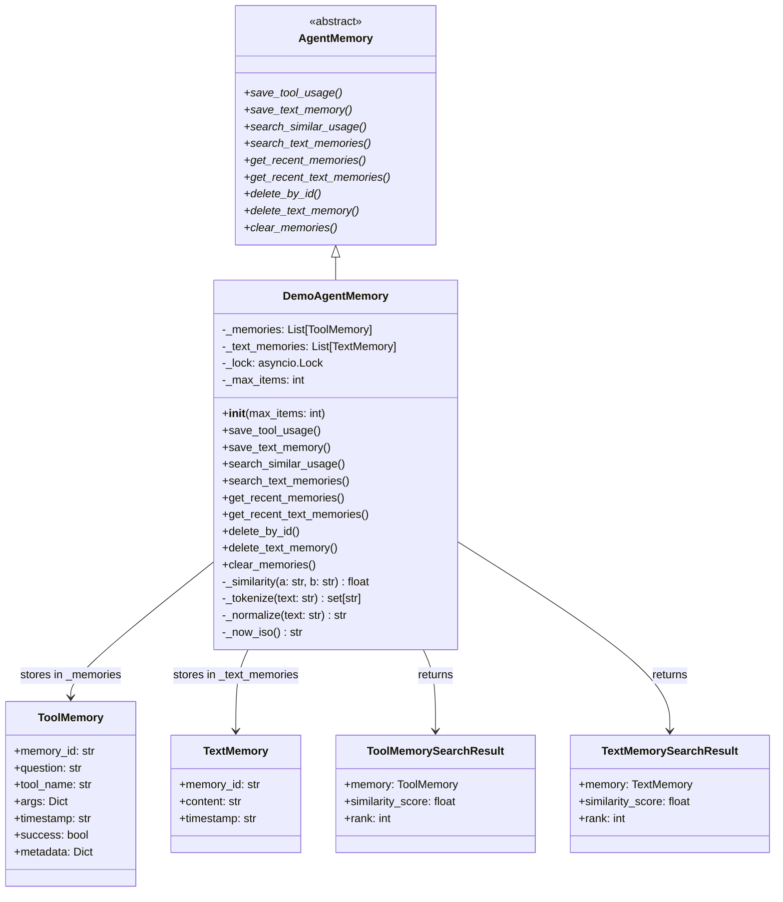
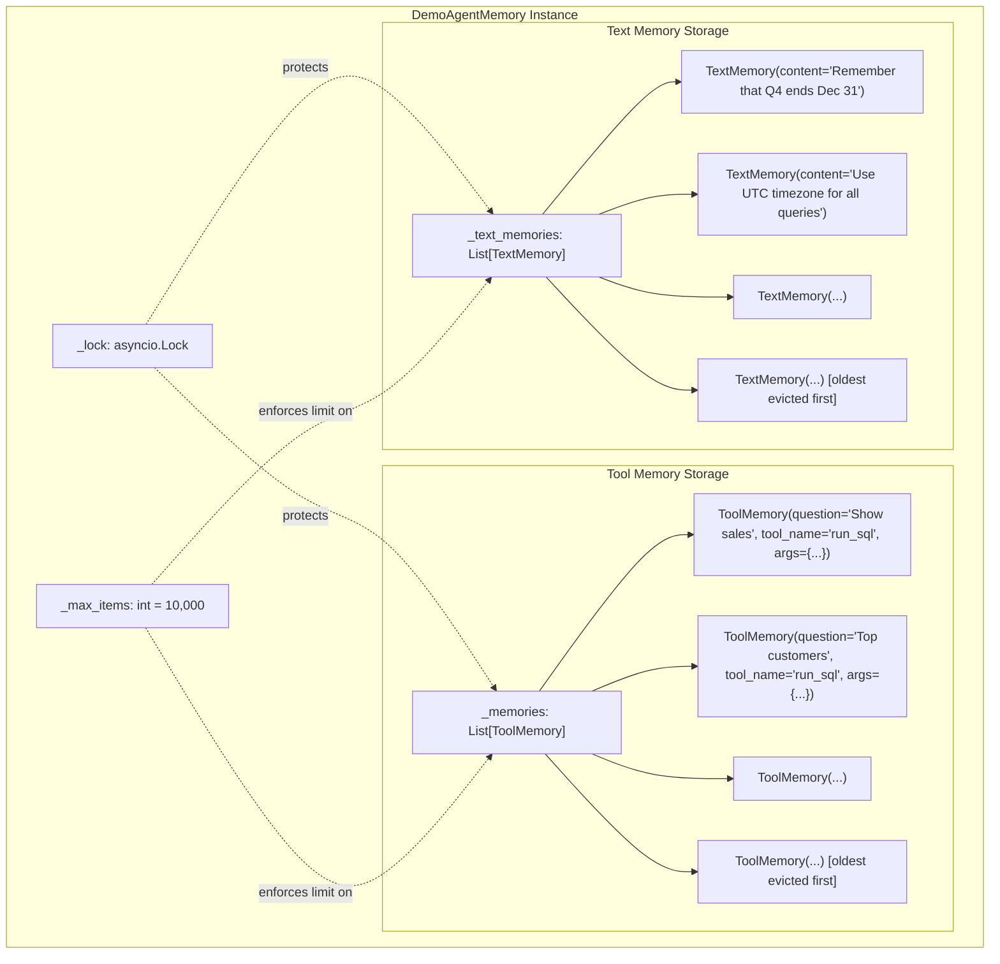
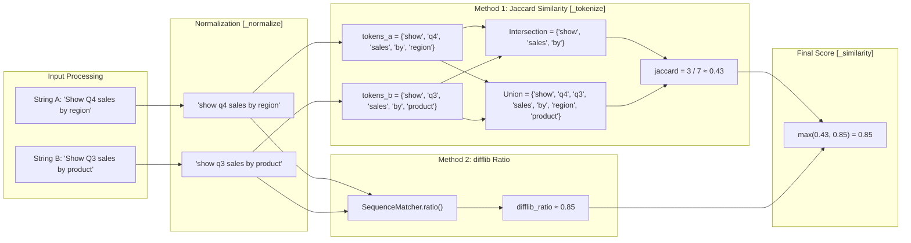
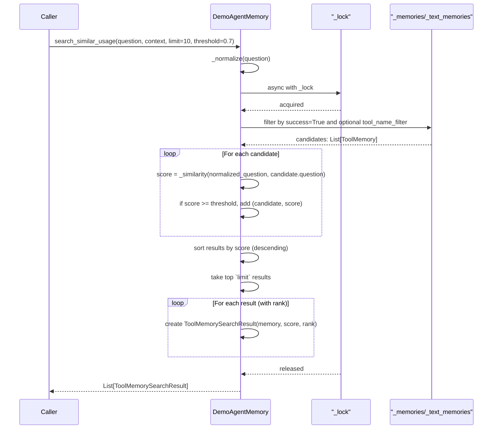
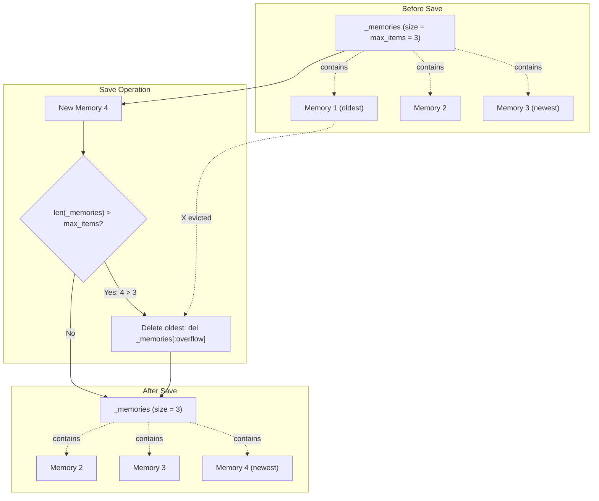
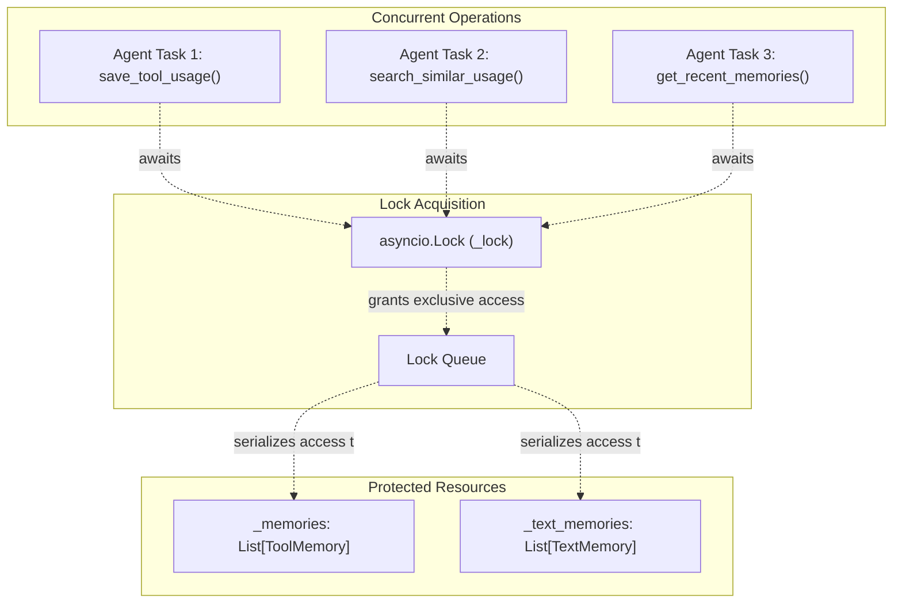
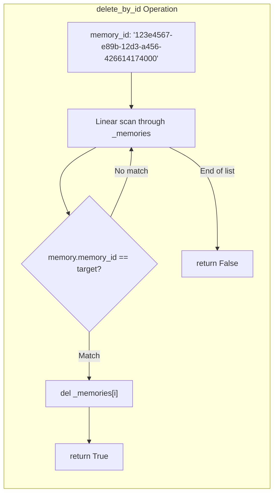
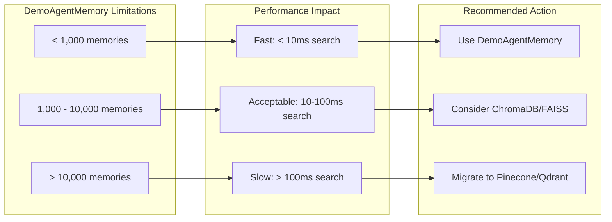

<!-- source: DeepWiki mcp.deepwiki.com · repo vanna-ai/vanna · page 4.4 DemoAgentMemory (In-Memory) · fetched 2026-10-29 -->

# DemoAgentMemory (In-Memory)

<details>
<summary>Relevant source files</summary>

The following files were used as context for generating this wiki page:

- [src/vanna/capabilities/agent_memory/base.py](src/vanna/capabilities/agent_memory/base.py)
- [src/vanna/capabilities/agent_memory/models.py](src/vanna/capabilities/agent_memory/models.py)
- [src/vanna/integrations/local/agent_memory/in_memory.py](src/vanna/integrations/local/agent_memory/in_memory.py)
- [src/vanna/integrations/premium/agent_memory/premium.py](src/vanna/integrations/premium/agent_memory/premium.py)

</details>


## Purpose and Scope

`DemoAgentMemory` is a zero-dependency, in-memory implementation of the [`AgentMemory`](#4.1) interface designed for demos, testing, and development environments. Unlike production implementations that use vector databases like [ChromaDB](#4.5) or [Pinecone](#4.8), `DemoAgentMemory` stores all memories in RAM and uses simple similarity algorithms (Jaccard similarity and difflib sequence matching) instead of neural embeddings.

This implementation is ideal for:
- **Quick prototyping** without configuring external dependencies
- **Unit and integration testing** with predictable, repeatable behavior
- **Demos and tutorials** where setup complexity should be minimized
- **Local development** without requiring vector database credentials

For production deployments with large-scale similarity search, see vector database integrations starting at [ChromaDB Integration](#4.5). For understanding the memory interface itself, see [AgentMemory Interface and Concepts](#4.1).

**Sources**: [src/vanna/integrations/local/agent_memory/in_memory.py:1-7]()

---

## Implementation Architecture

`DemoAgentMemory` implements the complete `AgentMemory` interface using in-memory Python lists. The architecture is intentionally simple to avoid external dependencies while maintaining compatibility with the agent framework.



**Sources**: [src/vanna/integrations/local/agent_memory/in_memory.py:28-48](), [src/vanna/capabilities/agent_memory/base.py:23-103](), [src/vanna/capabilities/agent_memory/models.py:1-54]()

---

## Storage Model and Data Structures

The implementation maintains two separate in-memory lists with identical eviction and locking semantics.

| Storage Component | Type | Purpose | Eviction Strategy |
|------------------|------|---------|-------------------|
| `_memories` | `List[ToolMemory]` | Stores structured tool usage patterns (question + tool_name + args) | FIFO when exceeding `max_items` |
| `_text_memories` | `List[TextMemory]` | Stores free-form text memories for context | FIFO when exceeding `max_items` |
| `_lock` | `asyncio.Lock` | Thread-safety for concurrent access | N/A |
| `_max_items` | `int` | Maximum memories per list (default: 10,000) | Configurable at initialization |



**Sources**: [src/vanna/integrations/local/agent_memory/in_memory.py:37-48](), [src/vanna/integrations/local/agent_memory/in_memory.py:108-125]()

---

## Similarity Algorithm

Unlike vector database implementations that use neural embeddings and cosine similarity, `DemoAgentMemory` uses a hybrid similarity metric combining two classical string comparison methods.

### Algorithm Details

The `_similarity()` method computes:

```
similarity(a, b) = max(jaccard_similarity(a, b), difflib_ratio(a, b))
```

Where:
- **Jaccard Similarity**: Token-based overlap using `|tokens_a ∩ tokens_b| / |tokens_a ∪ tokens_b|`
- **difflib Ratio**: Character-level sequence matching using Python's `difflib.SequenceMatcher`



### Implementation Details

| Function | Purpose | Algorithm | Time Complexity |
|----------|---------|-----------|-----------------|
| `_normalize(text)` | Lowercase and collapse whitespace | `" ".join(text.lower().split())` | O(n) |
| `_tokenize(text)` | Split into word set | `set(text.lower().split())` | O(n) |
| `_similarity(a, b)` | Compute hybrid similarity | `max(jaccard, difflib_ratio)` | O(n × m) |

**Sources**: [src/vanna/integrations/local/agent_memory/in_memory.py:50-87]()

---

## Search Implementation

The search methods perform linear scans with filtering, scoring, and ranking. This O(n) approach is acceptable for demo/test scenarios with limited memory sizes.



### Search Method Comparison

| Method | Input | Filter Criteria | Similarity Metric | Returns |
|--------|-------|----------------|-------------------|---------|
| `search_similar_usage()` | `question: str` | `success=True`, optional `tool_name_filter` | Question text similarity | `List[ToolMemorySearchResult]` |
| `search_text_memories()` | `query: str` | None | Content text similarity | `List[TextMemorySearchResult]` |
| `get_recent_memories()` | None | None | Timestamp-based (newest first) | `List[ToolMemory]` |
| `get_recent_text_memories()` | None | None | Timestamp-based (newest first) | `List[TextMemory]` |

**Sources**: [src/vanna/integrations/local/agent_memory/in_memory.py:127-213]()

---

## FIFO Eviction Strategy

When either `_memories` or `_text_memories` exceeds `max_items`, the oldest entries are deleted to maintain the limit.



Implementation in `save_tool_usage()` and `save_text_memory()`:

```python
# After appending new memory
if len(self._memories) > self._max_items:
    overflow = len(self._memories) - self._max_items
    del self._memories[:overflow]  # Remove oldest entries
```

**Sources**: [src/vanna/integrations/local/agent_memory/in_memory.py:108-125]()

---

## Thread Safety and Concurrency

All public methods use `async with self._lock` to ensure thread-safe access to the in-memory lists. This prevents race conditions when multiple agent operations access memory concurrently.



**Key Implementation Details**:

| Aspect | Implementation | Line Reference |
|--------|---------------|----------------|
| Lock Type | `asyncio.Lock` (async-compatible) | [in_memory.py:47]() |
| Acquisition Pattern | `async with self._lock:` (context manager) | [in_memory.py:108, 120, 139, etc.]() |
| Protected Operations | All list reads and writes | Throughout all methods |
| Lock Scope | Per-method (released after operation completes) | N/A |

**Sources**: [src/vanna/integrations/local/agent_memory/in_memory.py:47](), [src/vanna/integrations/local/agent_memory/in_memory.py:108-113]()

---

## Memory Deletion and Clearing

`DemoAgentMemory` supports selective and bulk deletion operations.

### Delete by ID



### Clear Memories with Filters

The `clear_memories()` method supports optional filtering:

| Parameter | Effect | Example |
|-----------|--------|---------|
| `tool_name=None, before_date=None` | Clear all memories | `clear_memories(context)` → deletes everything |
| `tool_name="run_sql"` | Clear only `run_sql` tool memories | `clear_memories(context, tool_name="run_sql")` |
| `before_date="2024-01-01T00:00:00"` | Clear memories before date | `clear_memories(context, before_date="2024-01-01T00:00:00")` |
| Both filters | Clear matching both criteria | `clear_memories(context, tool_name="run_sql", before_date="2024-01-01T00:00:00")` |

**Implementation Logic** ([in_memory.py:232-285]()):

1. For **tool memories**: Apply both `tool_name` and `before_date` filters
2. For **text memories**: Only apply `before_date` filter (tool name is irrelevant)
3. Return total count of deleted memories (tool + text)

**Sources**: [src/vanna/integrations/local/agent_memory/in_memory.py:214-285]()

---

## Performance Characteristics

| Operation | Time Complexity | Space Complexity | Notes |
|-----------|----------------|------------------|-------|
| `save_tool_usage()` | O(1) amortized | O(1) | Append to list; occasional O(k) for eviction |
| `save_text_memory()` | O(1) amortized | O(1) | Same as above |
| `search_similar_usage()` | O(n × m) | O(n) | n = memory count, m = avg question length |
| `search_text_memories()` | O(n × m) | O(n) | n = memory count, m = avg content length |
| `get_recent_memories()` | O(k) | O(k) | k = limit; slice and reverse |
| `delete_by_id()` | O(n) | O(1) | Linear scan to find ID |
| `clear_memories()` | O(n) | O(n) | Build new filtered list |

### Scalability Considerations



**Migration Path**: For production deployments with >10k memories, migrate to:
- **Local/embedded**: [ChromaDB](#4.5) or [FAISS](#4.7) for persistence and faster vector search
- **Cloud-managed**: [Pinecone](#4.8), [Qdrant](#4.6), or [Azure AI Search](#4.9) for scalability

**Sources**: [src/vanna/integrations/local/agent_memory/in_memory.py:1-7](), [src/vanna/integrations/local/agent_memory/in_memory.py:127-164]()

---

## Usage Example

### Initialization

```python
from vanna.integrations.local.agent_memory import DemoAgentMemory

# Create in-memory storage with 5,000 item limit
memory = DemoAgentMemory(max_items=5_000)
```

### Saving Tool Usage

```python
from vanna.core.tool import ToolContext

context = ToolContext(user=user, agent_memory=memory, ...)

# Save a successful SQL query pattern
await memory.save_tool_usage(
    question="Show total sales by region",
    tool_name="run_sql",
    args={"sql": "SELECT region, SUM(amount) FROM sales GROUP BY region"},
    context=context,
    success=True,
    metadata={"execution_time_ms": 45}
)
```

### Searching Similar Patterns

```python
# Find similar past queries
results = await memory.search_similar_usage(
    question="Display revenue by territory",
    context=context,
    limit=5,
    similarity_threshold=0.7,
    tool_name_filter="run_sql"  # Optional: filter by tool
)

for result in results:
    print(f"Rank {result.rank}: {result.memory.question}")
    print(f"  Similarity: {result.similarity_score:.2f}")
    print(f"  SQL: {result.memory.args['sql']}")
```

### Saving and Searching Text Memories

```python
# Save free-form context
text_mem = await memory.save_text_memory(
    content="Always use UTC timezone for timestamp comparisons",
    context=context
)

# Search for relevant context
text_results = await memory.search_text_memories(
    query="timezone handling",
    context=context,
    limit=3
)
```

**Sources**: [src/vanna/integrations/local/agent_memory/in_memory.py:89-125](), [src/vanna/integrations/local/agent_memory/in_memory.py:127-197]()

---

## Comparison with Production Implementations

| Feature | DemoAgentMemory | ChromaDB | Pinecone | CloudAgentMemory |
|---------|----------------|----------|----------|------------------|
| **Dependencies** | None (stdlib only) | `chromadb` | `pinecone-client` | `httpx` |
| **Storage** | RAM only | Disk-persisted SQLite | Cloud-managed | Vanna Cloud API |
| **Similarity** | Jaccard + difflib | Vector embeddings (cosine) | Vector embeddings (cosine) | Server-side embeddings |
| **Scalability** | < 10k memories | Millions of vectors | Billions of vectors | Cloud-scale |
| **Latency** | O(n) linear scan | ~ms with HNSW index | ~ms with optimized index | Network RTT + compute |
| **Setup Complexity** | Instant | Local installation | API key + index creation | API key only |
| **Use Case** | Demos, testing | Local production | Cloud production | Managed service |

**When to Use DemoAgentMemory**:
- ✅ Unit tests with predictable similarity scores
- ✅ Quick demos without external setup
- ✅ Development environments
- ✅ Documentation examples

**When to Migrate**:
- ❌ Production deployments
- ❌ > 10,000 memories
- ❌ Sub-second search requirements at scale
- ❌ Multi-user concurrent access with high throughput

**Sources**: [src/vanna/integrations/local/agent_memory/in_memory.py:1-7](), [src/vanna/integrations/premium/agent_memory/premium.py:23-187]()

---

## Testing and Validation

The `DemoAgentMemory` implementation is tested in the agent memory sanity test suite:

| Test Category | Coverage | Location |
|---------------|----------|----------|
| Interface compliance | All `AgentMemory` abstract methods | `tests/test_agent_memory_sanity.py` |
| Similarity algorithm | Edge cases (empty strings, identical strings, no overlap) | `tests/test_agent_memory_sanity.py` |
| FIFO eviction | Verify oldest memories are removed when exceeding `max_items` | `tests/test_agent_memory_sanity.py` |
| Thread safety | Concurrent save/search operations | `tests/test_agent_memory_sanity.py` |
| Filtering logic | `tool_name_filter`, `before_date` in `clear_memories()` | `tests/test_agent_memory_sanity.py` |

**Sources**: Inferred from test infrastructure described in [tox.ini]() and testing patterns

---

## Summary

`DemoAgentMemory` provides a **lightweight, dependency-free implementation** of the `AgentMemory` interface suitable for demos, testing, and development. Key characteristics:

- **Zero setup**: Requires no external services or configuration
- **Simple similarity**: Uses Jaccard + difflib instead of neural embeddings
- **FIFO eviction**: Automatically manages memory limits
- **Thread-safe**: Uses `asyncio.Lock` for concurrent access
- **Interface-compliant**: Fully implements all `AgentMemory` abstract methods

For production deployments requiring vector search at scale, migrate to [ChromaDB](#4.5), [Pinecone](#4.8), or other vector database backends documented in sections 4.5-4.9.

**Sources**: [src/vanna/integrations/local/agent_memory/in_memory.py:1-286]()

---

