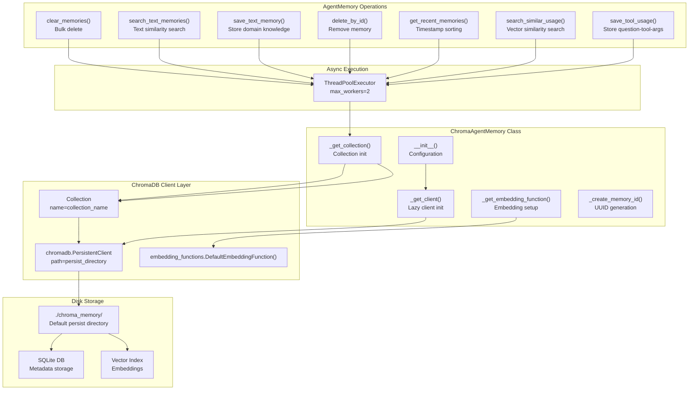
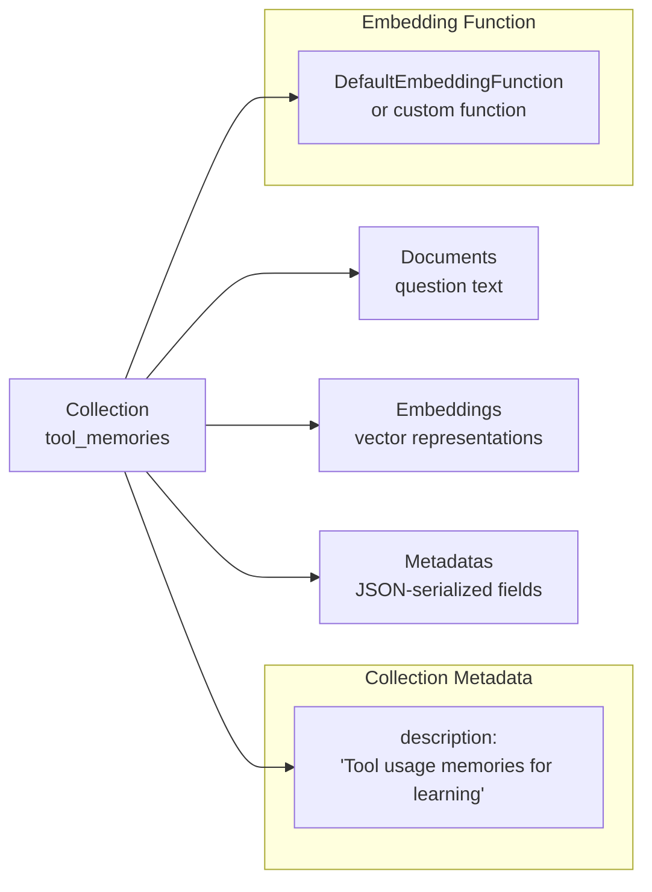
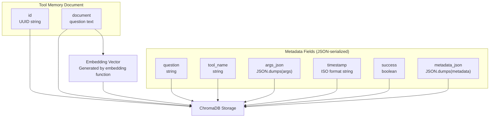
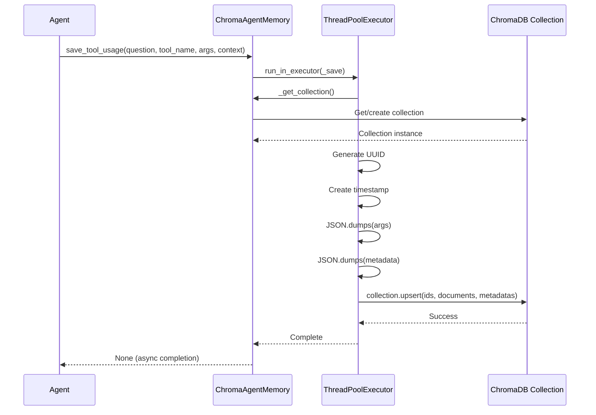
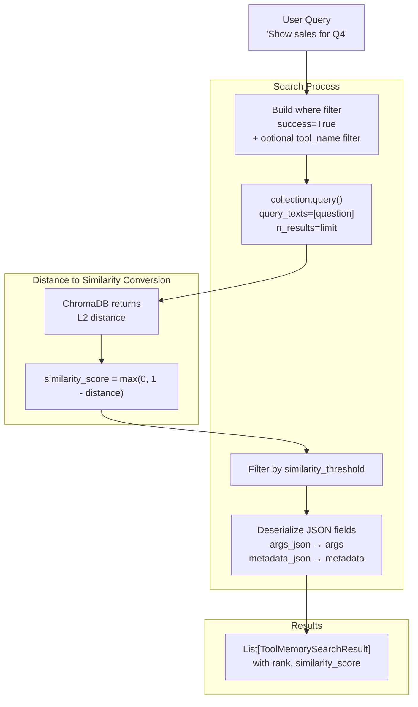
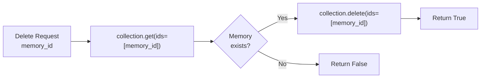
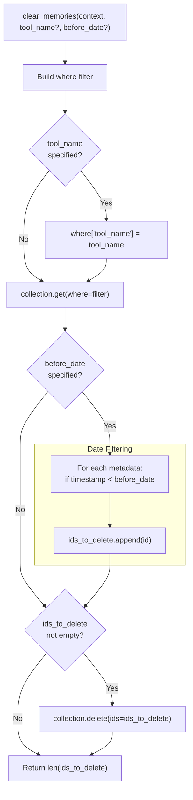

<!-- source: DeepWiki mcp.deepwiki.com · repo vanna-ai/vanna · page 4.5 ChromaDB Integration · fetched 2026-10-29 -->

# ChromaDB Integration

<details>
<summary>Relevant source files</summary>

The following files were used as context for generating this wiki page:

- [src/vanna/integrations/azuresearch/agent_memory.py](src/vanna/integrations/azuresearch/agent_memory.py)
- [src/vanna/integrations/chromadb/agent_memory.py](src/vanna/integrations/chromadb/agent_memory.py)
- [src/vanna/integrations/faiss/agent_memory.py](src/vanna/integrations/faiss/agent_memory.py)
- [src/vanna/integrations/marqo/agent_memory.py](src/vanna/integrations/marqo/agent_memory.py)
- [src/vanna/integrations/milvus/agent_memory.py](src/vanna/integrations/milvus/agent_memory.py)
- [src/vanna/integrations/opensearch/agent_memory.py](src/vanna/integrations/opensearch/agent_memory.py)
- [src/vanna/integrations/pinecone/agent_memory.py](src/vanna/integrations/pinecone/agent_memory.py)
- [src/vanna/integrations/qdrant/agent_memory.py](src/vanna/integrations/qdrant/agent_memory.py)
- [src/vanna/integrations/weaviate/agent_memory.py](src/vanna/integrations/weaviate/agent_memory.py)
- [src/vanna/legacy/adapter.py](src/vanna/legacy/adapter.py)
- [tests/test_chromadb_persistence_fix.py](tests/test_chromadb_persistence_fix.py)

</details>


This document provides detailed technical documentation for the `ChromaAgentMemory` implementation, which uses ChromaDB as the vector storage backend for Vanna's agent memory system. ChromaDB is a local, persistent vector database designed for simplicity and ease of use, making it ideal for development, testing, and self-hosted production deployments.

For general concepts about agent memory and the `AgentMemory` interface, see [AgentMemory Interface and Concepts](#4.1). For information about memory-enabled tools that interact with this storage, see [Memory-Enabled Tools](#4.3). For other vector store options, see [Qdrant Integration](#4.6), [FAISS Integration](#4.7), and [Pinecone Integration](#4.8).

**Sources**: [src/vanna/integrations/chromadb/agent_memory.py:1-421]()

---

## Overview

The `ChromaAgentMemory` class implements the `AgentMemory` interface using ChromaDB's persistent client for local vector storage. This implementation provides disk-based persistence of both tool usage patterns and text memories, with support for semantic similarity search via embeddings.

### Key Features

| Feature | Description |
|---------|-------------|
| **Persistence** | Disk-based storage using ChromaDB's `PersistentClient` |
| **Collection-based** | Separate collections for organizing memories |
| **Embedding flexibility** | Configurable embedding function or ChromaDB's default |
| **JSON serialization** | Automatic handling of complex objects in metadata |
| **Async operations** | Non-blocking operations via `ThreadPoolExecutor` |
| **Dual memory types** | Support for both tool memories and text memories |
| **L2 distance metric** | Similarity search using Euclidean distance |

**Sources**: [src/vanna/integrations/chromadb/agent_memory.py:33-52]()

---

## Installation and Dependencies

ChromaDB is an optional dependency. Install it using:

```bash
pip install chromadb
```

Or install with Vanna's ChromaDB extras:

```bash
pip install vanna[chromadb]
```

The implementation checks for ChromaDB availability at import time and raises an `ImportError` with installation instructions if the package is not found.

**Sources**: [src/vanna/integrations/chromadb/agent_memory.py:14-21](), [src/vanna/integrations/chromadb/agent_memory.py:42-45]()

---

## Architecture Overview



**Diagram: ChromaAgentMemory Architecture**

The architecture uses lazy initialization: the ChromaDB client and collection are only created when first accessed. All operations are wrapped in async executors to prevent blocking the event loop.

**Sources**: [src/vanna/integrations/chromadb/agent_memory.py:36-96]()

---

## Configuration and Initialization

### Constructor Parameters

```python
ChromaAgentMemory(
    persist_directory: str = "./chroma_memory",
    collection_name: str = "tool_memories",
    embedding_function = None
)
```

| Parameter | Type | Default | Description |
|-----------|------|---------|-------------|
| `persist_directory` | `str` | `"./chroma_memory"` | Directory path for persistent storage |
| `collection_name` | `str` | `"tool_memories"` | Name of the ChromaDB collection |
| `embedding_function` | Optional | `None` | Custom embedding function (uses ChromaDB default if `None`) |

### Client Initialization

The `_get_client()` method creates a `PersistentClient` with the following settings:

```python
chromadb.PersistentClient(
    path=self.persist_directory,
    settings=Settings(
        anonymized_telemetry=False,
        allow_reset=True
    )
)
```

- **`anonymized_telemetry=False`**: Disables telemetry for privacy
- **`allow_reset=True`**: Allows collection reset operations

**Sources**: [src/vanna/integrations/chromadb/agent_memory.py:36-61](), [src/vanna/integrations/chromadb/agent_memory.py:54-61]()

### Collection Initialization

Collections are created with the following structure:



**Diagram: ChromaDB Collection Structure**

The collection stores three components:
1. **Documents**: The question text (used for embedding)
2. **Embeddings**: Vector representations (generated by embedding function)
3. **Metadatas**: All other fields as JSON-serialized strings

**Sources**: [src/vanna/integrations/chromadb/agent_memory.py:75-90]()

---

## Embedding Function Handling

### Default Embedding Function

If no embedding function is provided during initialization, ChromaDB's `DefaultEmbeddingFunction` is used:

```python
def _get_embedding_function(self):
    if self._embedding_function is None:
        self._embedding_function = embedding_functions.DefaultEmbeddingFunction()
    return self._embedding_function
```

This avoids requiring `sentence-transformers` as a hard dependency. The default function uses a lightweight model for generating embeddings.

### Custom Embedding Functions

You can provide a custom embedding function that implements ChromaDB's embedding function interface:

```python
from chromadb.utils import embedding_functions

# Example: Using OpenAI embeddings
openai_ef = embedding_functions.OpenAIEmbeddingFunction(
    api_key="your-api-key",
    model_name="text-embedding-ada-002"
)

memory = ChromaAgentMemory(
    embedding_function=openai_ef
)
```

**Sources**: [src/vanna/integrations/chromadb/agent_memory.py:63-73]()

---

## Data Model and JSON Serialization

### Tool Memory Schema

ChromaDB requires metadata to consist of primitive types only. Complex objects are JSON-serialized:



**Diagram: Tool Memory Data Model**

**Example serialization**:

```python
memory_data = {
    "question": "What are the top 5 customers?",
    "tool_name": "run_sql",
    "args_json": json.dumps({"sql": "SELECT * FROM customers LIMIT 5"}),
    "timestamp": "2024-01-15T10:30:00",
    "success": True,
    "metadata_json": json.dumps({"execution_time_ms": 150})
}
```

**Sources**: [src/vanna/integrations/chromadb/agent_memory.py:107-130]()

### Text Memory Schema

Text memories use a simplified structure with an `is_text_memory` flag:

```python
memory_data = {
    "content": "The customer_id column is the primary key",
    "timestamp": "2024-01-15T10:30:00",
    "is_text_memory": True
}
```

This flag allows filtering tool memories from text memories during retrieval operations.

**Sources**: [src/vanna/integrations/chromadb/agent_memory.py:265-286]()

---

## Memory Operations

### Saving Tool Usage

The `save_tool_usage()` method stores a question-tool-args pattern:



**Diagram: save_tool_usage() Flow**

Key implementation details:
- Uses `upsert` instead of `insert` to allow updating existing memories
- Question text is the document (used for embedding generation)
- All complex objects are JSON-serialized before storage
- Operations are async via `ThreadPoolExecutor`

**Sources**: [src/vanna/integrations/chromadb/agent_memory.py:98-131]()

### Searching Similar Usage

The `search_similar_usage()` method performs vector similarity search:



**Diagram: search_similar_usage() Process**

**Filter syntax example**:

```python
# Single condition
where_filter = {"success": True}

# Multiple conditions (with tool_name_filter)
where_filter = {
    "$and": [
        {"success": True},
        {"tool_name": "run_sql"}
    ]
}
```

**Distance to similarity conversion**:

ChromaDB uses L2 (Euclidean) distance by default. The implementation converts this to a similarity score:

```python
similarity_score = max(0, 1 - distance)
```

This ensures:
- Distance of 0 → similarity of 1.0 (perfect match)
- Distance of 1 → similarity of 0.0 (threshold boundary)
- Distance > 1 → similarity of 0.0 (clamped to zero)

**Sources**: [src/vanna/integrations/chromadb/agent_memory.py:133-197](), [src/vanna/integrations/chromadb/agent_memory.py:168-169]()

### Getting Recent Memories

The `get_recent_memories()` method retrieves recent tool memories sorted by timestamp:

```python
# Implementation approach:
1. collection.get() - Retrieve all memories
2. Filter out text memories (is_text_memory flag)
3. Parse timestamps from metadata
4. Sort by timestamp descending
5. Return top N memories
```

**Note**: This method loads all memories and sorts in-memory. For large datasets, consider implementing pagination or using a time-based filter.

**Sources**: [src/vanna/integrations/chromadb/agent_memory.py:199-245]()

### Deleting Memories

The `delete_by_id()` method removes a specific memory:



**Diagram: delete_by_id() Logic**

The method verifies existence before deletion to return accurate success/failure status.

**Sources**: [src/vanna/integrations/chromadb/agent_memory.py:247-263]()

---

## Text Memory Operations

Text memories follow the same patterns as tool memories but with a simplified schema:

### Saving Text Memory

```python
memory_data = {
    "content": content,
    "timestamp": datetime.now().isoformat(),
    "is_text_memory": True  # Distinguishes from tool memories
}

collection.upsert(
    ids=[memory_id],
    documents=[content],  # Content is the document
    metadatas=[memory_data]
)
```

### Searching Text Memories

Search uses the same vector similarity approach:

```python
where_filter = {"is_text_memory": True}

results = collection.query(
    query_texts=[query],
    n_results=limit,
    where=where_filter
)
```

**Sources**: [src/vanna/integrations/chromadb/agent_memory.py:265-286](), [src/vanna/integrations/chromadb/agent_memory.py:288-335]()

---

## Bulk Operations

### Clear Memories

The `clear_memories()` method supports bulk deletion with optional filters:



**Diagram: clear_memories() Logic Flow**

**Example usage**:

```python
# Clear all SQL tool memories
count = await memory.clear_memories(
    context,
    tool_name="run_sql"
)

# Clear memories before a date
count = await memory.clear_memories(
    context,
    before_date="2024-01-01T00:00:00"
)

# Clear all memories
count = await memory.clear_memories(context)
```

**Sources**: [src/vanna/integrations/chromadb/agent_memory.py:384-420]()

---

## Async Execution Pattern

All operations use a consistent async execution pattern:

```python
async def operation_method(self, ...):
    """Public async method."""
    
    def _operation():
        """Synchronous implementation."""
        collection = self._get_collection()
        # Perform ChromaDB operations
        return result
    
    return await asyncio.get_event_loop().run_in_executor(
        self._executor,
        _operation
    )
```

This pattern:
1. Keeps ChromaDB's synchronous API isolated
2. Prevents blocking the async event loop
3. Uses a fixed thread pool (`max_workers=2`) for concurrency control
4. Allows the agent to perform other tasks while waiting for disk I/O

**Sources**: [src/vanna/integrations/chromadb/agent_memory.py:98-131](), [src/vanna/integrations/chromadb/agent_memory.py:11-12](), [src/vanna/integrations/chromadb/agent_memory.py:51]()

---

## Performance Characteristics

### Storage

| Aspect | Characteristic |
|--------|----------------|
| **Disk usage** | SQLite database + vector index files |
| **Write performance** | Sequential writes, no network latency |
| **Read performance** | Fast local disk access |
| **Scalability** | Suitable for 10k-100k memories |
| **Concurrency** | Limited by `ThreadPoolExecutor` (2 workers) |

### Memory Operations

| Operation | Time Complexity | Notes |
|-----------|----------------|-------|
| `save_tool_usage()` | O(1) | Upsert to collection |
| `search_similar_usage()` | O(log n) | Vector index search |
| `get_recent_memories()` | O(n log n) | Loads all, sorts in-memory |
| `delete_by_id()` | O(1) | Direct ID lookup |
| `clear_memories()` | O(n) | Scans all memories for filtering |

**Note**: `get_recent_memories()` performance degrades with large datasets. Consider implementing limit-based filtering at the ChromaDB query level for production use.

**Sources**: [src/vanna/integrations/chromadb/agent_memory.py:199-245]()

---

## Complete Usage Example

```python
from vanna.integrations.chromadb import ChromaAgentMemory
from vanna.core.tool import ToolContext
from vanna.core.user import User

# Initialize ChromaDB memory
memory = ChromaAgentMemory(
    persist_directory="./my_agent_memory",
    collection_name="production_memories"
)

# Create context
user = User(id="user_123", email="user@example.com")
context = ToolContext(
    user=user,
    conversation_id="conv_001",
    request_id="req_001",
    agent_memory=memory
)

# Save a tool usage pattern
await memory.save_tool_usage(
    question="What are the top 5 products by revenue?",
    tool_name="run_sql",
    args={"sql": "SELECT product, SUM(revenue) FROM sales GROUP BY product ORDER BY SUM(revenue) DESC LIMIT 5"},
    context=context,
    success=True,
    metadata={"execution_time_ms": 245}
)

# Search for similar patterns
results = await memory.search_similar_usage(
    question="Show me top selling products",
    context=context,
    limit=5,
    similarity_threshold=0.7,
    tool_name_filter="run_sql"
)

for result in results:
    print(f"Question: {result.memory.question}")
    print(f"SQL: {result.memory.args['sql']}")
    print(f"Similarity: {result.similarity_score:.2f}")
    print(f"Rank: {result.rank}")
    print()

# Get recent memories
recent = await memory.get_recent_memories(context, limit=10)
for mem in recent:
    print(f"{mem.timestamp}: {mem.question}")

# Save text memory (domain knowledge)
text_mem = await memory.save_text_memory(
    content="The 'products' table contains a 'category' column that uses codes: ELC=Electronics, CLO=Clothing, FRN=Furniture",
    context=context
)

# Search text memories
text_results = await memory.search_text_memories(
    query="What categories exist in products?",
    context=context,
    limit=5
)

# Clear old memories
deleted_count = await memory.clear_memories(
    context,
    before_date="2023-12-31T23:59:59"
)
print(f"Deleted {deleted_count} memories")
```

**Sources**: [src/vanna/integrations/chromadb/agent_memory.py:98-420]()

---

## Comparison with Other Backends

| Feature | ChromaDB | Qdrant | FAISS | Pinecone |
|---------|----------|--------|-------|----------|
| **Deployment** | Local | Local/Cloud | Local | Cloud |
| **Persistence** | Disk (SQLite) | Disk/Cloud | Disk + pickle | Cloud |
| **Embedding generation** | Built-in | Manual | Manual | Manual |
| **Distance metric** | L2, Cosine, IP | Cosine, Euclidean, Dot | L2, IP | Cosine, Euclidean, Dot |
| **Filtering** | Basic | Advanced | In-memory | Advanced |
| **Setup complexity** | Low | Medium | Low | Medium |
| **Best for** | Dev/small prod | Production | Local analysis | Large-scale prod |

ChromaDB is ideal for:
- Development and testing environments
- Self-hosted deployments with moderate scale
- Scenarios requiring simple setup and maintenance
- Applications needing local data control

For cloud-scale deployments, consider [Pinecone Integration](#4.8) or [Qdrant Integration](#4.6).

**Sources**: [src/vanna/integrations/chromadb/agent_memory.py:1-421](), [src/vanna/integrations/qdrant/agent_memory.py:1-467](), [src/vanna/integrations/faiss/agent_memory.py:1-436](), [src/vanna/integrations/pinecone/agent_memory.py:1-330]()

---

## Troubleshooting

### Common Issues

**Issue: `ImportError: ChromaDB is required`**

Solution: Install ChromaDB dependency:
```bash
pip install chromadb
```

**Issue: Permission denied on persist_directory**

Solution: Ensure the directory is writable:
```python
memory = ChromaAgentMemory(
    persist_directory="/path/to/writable/directory"
)
```

**Issue: Collection not found errors**

The implementation automatically creates collections if they don't exist. If you encounter this error, check:
1. Disk space availability
2. Write permissions on `persist_directory`
3. ChromaDB version compatibility

**Issue: Slow `get_recent_memories()` with large datasets**

The current implementation loads all memories to sort them. For large datasets, consider:
1. Implementing pagination at the application level
2. Using time-range filters in `search_similar_usage()` instead
3. Periodically archiving old memories with `clear_memories()`

**Sources**: [src/vanna/integrations/chromadb/agent_memory.py:42-45](), [src/vanna/integrations/chromadb/agent_memory.py:75-90](), [src/vanna/integrations/chromadb/agent_memory.py:199-245]()

---

## Implementation Reference

### Key Classes and Methods

| Class/Method | Location | Purpose |
|--------------|----------|---------|
| `ChromaAgentMemory` | [src/vanna/integrations/chromadb/agent_memory.py:33]() | Main implementation class |
| `_get_client()` | [src/vanna/integrations/chromadb/agent_memory.py:54-61]() | Lazy ChromaDB client initialization |
| `_get_embedding_function()` | [src/vanna/integrations/chromadb/agent_memory.py:63-73]() | Embedding function setup |
| `_get_collection()` | [src/vanna/integrations/chromadb/agent_memory.py:75-90]() | Collection retrieval/creation |
| `_create_memory_id()` | [src/vanna/integrations/chromadb/agent_memory.py:92-96]() | UUID generation |
| `save_tool_usage()` | [src/vanna/integrations/chromadb/agent_memory.py:98-131]() | Store tool usage pattern |
| `search_similar_usage()` | [src/vanna/integrations/chromadb/agent_memory.py:133-197]() | Vector similarity search |
| `get_recent_memories()` | [src/vanna/integrations/chromadb/agent_memory.py:199-245]() | Recent tool memories |
| `delete_by_id()` | [src/vanna/integrations/chromadb/agent_memory.py:247-263]() | Delete specific memory |
| `save_text_memory()` | [src/vanna/integrations/chromadb/agent_memory.py:265-286]() | Store domain knowledge |
| `search_text_memories()` | [src/vanna/integrations/chromadb/agent_memory.py:288-335]() | Search text memories |
| `get_recent_text_memories()` | [src/vanna/integrations/chromadb/agent_memory.py:337-365]() | Recent text memories |
| `delete_text_memory()` | [src/vanna/integrations/chromadb/agent_memory.py:367-382]() | Delete text memory |
| `clear_memories()` | [src/vanna/integrations/chromadb/agent_memory.py:384-420]() | Bulk delete with filters |

**Sources**: [src/vanna/integrations/chromadb/agent_memory.py:1-421]()

---

