<!-- source: DeepWiki mcp.deepwiki.com · repo vanna-ai/vanna · page 4.6 Qdrant Integration · fetched 2026-10-29 -->

# Qdrant

<details>
<summary>Relevant source files</summary>

The following files were used as context for generating this wiki page:

- [src/vanna/integrations/azuresearch/agent_memory.py](src/vanna/integrations/azuresearch/agent_memory.py)
- [src/vanna/integrations/chromadb/agent_memory.py](src/vanna/integrations/chromadb/agent_memory.py)
- [src/vanna/integrations/faiss/agent_memory.py](src/vanna/integrations/faiss/agent_memory.py)
- [src/vanna/integrations/marqo/agent_memory.py](src/vanna/integrations/marqo/agent_memory.py)
- [src/vanna/integrations/milvus/agent_memory.py](src/vanna/integrations/milvus/agent_memory.py)
- [src/vanna/integrations/opensearch/agent_memory.py](src/vanna/integrations/opensearch/agent_memory.py)
- [src/vanna/integrations/pinecone/agent_memory.py](src/vanna/integrations/pinecone/agent_memory.py)
- [src/vanna/integrations/qdrant/agent_memory.py](src/vanna/integrations/qdrant/agent_memory.py)
- [src/vanna/integrations/weaviate/agent_memory.py](src/vanna/integrations/weaviate/agent_memory.py)
- [src/vanna/legacy/adapter.py](src/vanna/legacy/adapter.py)
- [tests/test_chromadb_persistence_fix.py](tests/test_chromadb_persistence_fix.py)

</details>


## Purpose and Scope

This page documents the Qdrant integration for the Vanna Agent framework, specifically the `QdrantAgentMemory` implementation of the `AgentMemory` interface. This integration enables agents to store and retrieve tool usage patterns and text memories using [Qdrant](https://qdrant.tech/), a high-performance vector database.

For information about other vector database integrations, see [AgentMemory Implementations](#3). For the abstract `AgentMemory` interface specification, see [AgentMemory System](#2.4).

The `QdrantAgentMemory` class provides vector-based similarity search capabilities, allowing agents to learn from past successful tool invocations and retrieve relevant context. This implementation supports both local and remote Qdrant deployments.

**Sources:** [src/vanna/integrations/qdrant/agent_memory.py:1-440]()

---

## Architecture Overview

### Integration in the Vanna System

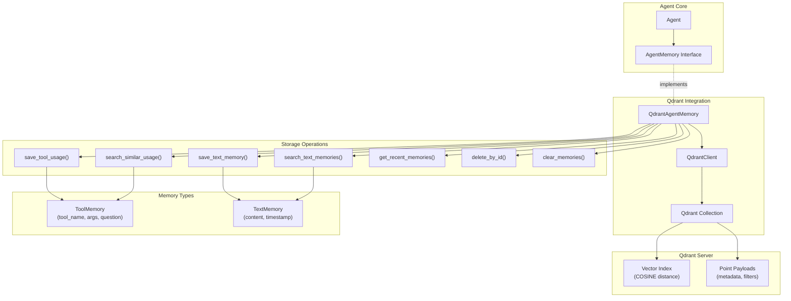

The `QdrantAgentMemory` class sits between the `Agent` and the Qdrant vector database, implementing the standard `AgentMemory` interface. It manages two types of memories: structured tool usage patterns and unstructured text memories, both stored in a single Qdrant collection with different payload schemas.

**Sources:** [src/vanna/integrations/qdrant/agent_memory.py:39-81](), [src/vanna/capabilities/agent_memory/models.py]()

---

## Class Structure

### QdrantAgentMemory Class

The `QdrantAgentMemory` class is defined at [src/vanna/integrations/qdrant/agent_memory.py:39-440]() and inherits from the `AgentMemory` abstract base class.

| Component | Type | Purpose |
|-----------|------|---------|
| `collection_name` | `str` | Name of the Qdrant collection (default: "tool_memories") |
| `url` | `Optional[str]` | URL of remote Qdrant server |
| `path` | `Optional[str]` | Path for local Qdrant instance |
| `api_key` | `Optional[str]` | API key for authentication (cloud deployments) |
| `dimension` | `int` | Vector embedding dimension (default: 384) |
| `_client` | `QdrantClient` | Lazy-initialized Qdrant client instance |
| `_executor` | `ThreadPoolExecutor` | Thread pool for async operations (max_workers=2) |

**Sources:** [src/vanna/integrations/qdrant/agent_memory.py:39-62]()

### Initialization Parameters

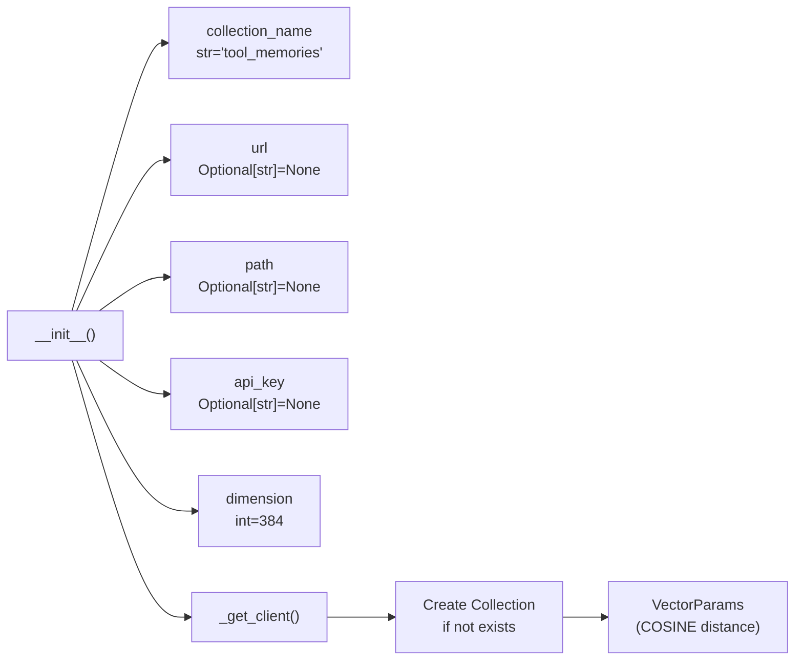

The initialization at [src/vanna/integrations/qdrant/agent_memory.py:42-61]() accepts either a `url` for remote deployments or a `path` for local instances. If neither is provided, it defaults to an in-memory instance (`:memory:`).

**Sources:** [src/vanna/integrations/qdrant/agent_memory.py:42-61]()

---

## Client and Collection Management

### Client Initialization

The `_get_client()` method at [src/vanna/integrations/qdrant/agent_memory.py:63-80]() implements lazy initialization:

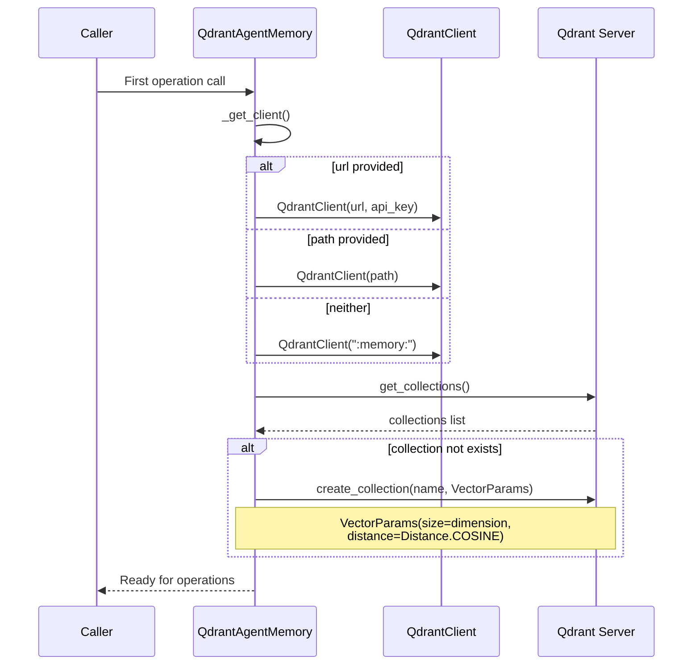

The collection is automatically created with the following configuration:
- **Vector Size:** Specified by `dimension` parameter (default: 384)
- **Distance Metric:** `COSINE` for similarity measurement
- **Schema:** Dynamic payload fields (no strict schema enforcement)

**Sources:** [src/vanna/integrations/qdrant/agent_memory.py:63-80]()

---

## Memory Operations

### Tool Usage Memory Operations

#### save_tool_usage

The `save_tool_usage()` method at [src/vanna/integrations/qdrant/agent_memory.py:89-120]() stores a tool usage pattern:

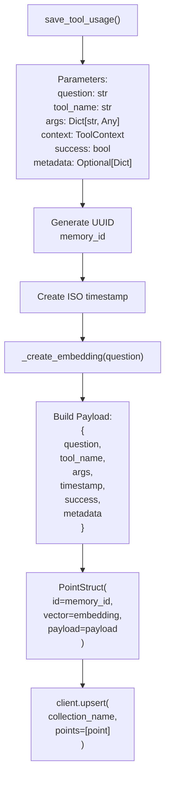

**Key Details:**
- Executes asynchronously using `ThreadPoolExecutor`
- Generates unique UUID for each memory
- Stores timestamp in ISO 8601 format
- Payload stores raw Python dictionaries (not JSON-serialized)
- Uses `upsert` operation (insert or update)

**Sources:** [src/vanna/integrations/qdrant/agent_memory.py:89-120]()

#### search_similar_usage

The `search_similar_usage()` method at [src/vanna/integrations/qdrant/agent_memory.py:122-181]() performs vector similarity search:

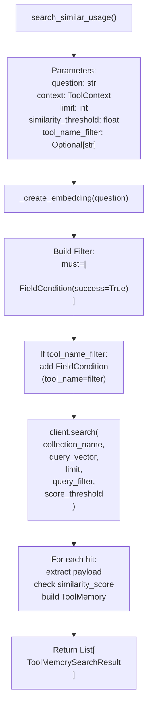

**Filter Logic:**
- Always filters `success=True` (only successful tool usages)
- Optional `tool_name` filter for specific tools
- Uses Qdrant's `Filter` with `must` conditions (AND logic)

**Scoring:**
- Qdrant returns similarity scores directly (COSINE distance)
- Results filtered by `score_threshold` parameter
- Results ranked by similarity score (highest first)

**Sources:** [src/vanna/integrations/qdrant/agent_memory.py:122-181]()

---

### Text Memory Operations

#### save_text_memory

The `save_text_memory()` method at [src/vanna/integrations/qdrant/agent_memory.py:251-273]() stores unstructured text:

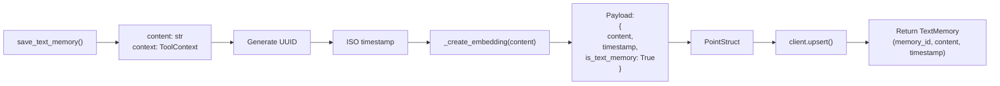

**Distinguishing Feature:** The `is_text_memory: True` flag in the payload allows differentiation between tool memories and text memories in the same collection.

**Sources:** [src/vanna/integrations/qdrant/agent_memory.py:251-273]()

#### search_text_memories

The `search_text_memories()` method at [src/vanna/integrations/qdrant/agent_memory.py:275-322]() searches text memories:

The search logic is similar to `search_similar_usage()` but filters for `is_text_memory=True` instead of checking `success` and `tool_name`.

**Sources:** [src/vanna/integrations/qdrant/agent_memory.py:275-322]()

---

### Retrieval Operations

#### get_recent_memories

The `get_recent_memories()` method at [src/vanna/integrations/qdrant/agent_memory.py:183-222]() retrieves recent tool usage memories:

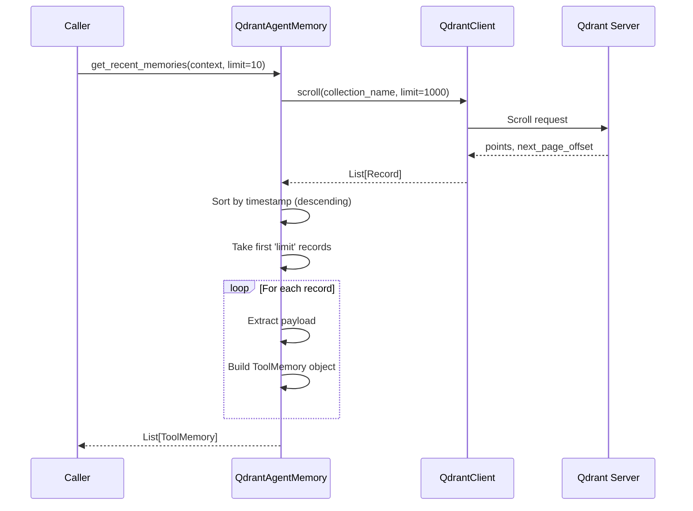

**Implementation Details:**
- Uses Qdrant's `scroll()` API to fetch up to 1000 points
- Sorts in-memory by timestamp (descending order)
- Returns most recent `limit` memories
- No vector search involved (timestamp-based only)

**Sources:** [src/vanna/integrations/qdrant/agent_memory.py:183-222]()

#### get_recent_text_memories

Similar to `get_recent_memories()` but filters for text memories using the `is_text_memory=True` condition at [src/vanna/integrations/qdrant/agent_memory.py:324-366]().

**Sources:** [src/vanna/integrations/qdrant/agent_memory.py:324-366]()

---

### Deletion Operations

#### delete_by_id

The `delete_by_id()` method at [src/vanna/integrations/qdrant/agent_memory.py:224-249]() deletes a specific memory:

| Step | Operation | Purpose |
|------|-----------|---------|
| 1 | `client.retrieve([memory_id])` | Verify point exists |
| 2 | Check if results non-empty | Confirm existence |
| 3 | `client.delete(points_selector=[memory_id])` | Delete if exists |
| 4 | Return `True` or `False` | Indicate success |

**Sources:** [src/vanna/integrations/qdrant/agent_memory.py:224-249]()

#### delete_text_memory

Identical implementation to `delete_by_id()` but semantically specific to text memories at [src/vanna/integrations/qdrant/agent_memory.py:368-393]().

**Sources:** [src/vanna/integrations/qdrant/agent_memory.py:368-393]()

#### clear_memories

The `clear_memories()` method at [src/vanna/integrations/qdrant/agent_memory.py:395-439]() performs bulk deletion:

```mermaid
graph TB
    ClearMemories["clear_memories()"]
    
    Params["Parameters:<br/>context: ToolContext<br/>tool_name: Optional[str]<br/>before_date: Optional[str]"]
    
    BuildConditions["Build conditions list:<br/>conditions = []"]
    
    CheckToolName{"tool_name<br/>provided?"}
    AddToolCondition["conditions.append(<br/>  FieldCondition(tool_name=value)<br/>)"]
    
    CheckDate{"before_date<br/>provided?"}
    AddDateCondition["conditions.append(<br/>  FieldCondition(timestamp=value)<br/>)"]
    
    CheckEmpty{"conditions<br/>empty?"}
    
    DeleteAll["Delete entire collection<br/>Recreate collection"]
    DeleteFiltered["client.delete(<br/>  points_selector=Filter(must=conditions)<br/>)"]
    
    ClearMemories --> Params
    Params --> BuildConditions
    BuildConditions --> CheckToolName
    CheckToolName -->|Yes| AddToolCondition
    CheckToolName -->|No| CheckDate
    AddToolCondition --> CheckDate
    CheckDate -->|Yes| AddDateCondition
    CheckDate -->|No| CheckEmpty
    AddDateCondition --> CheckEmpty
    
    CheckEmpty -->|Yes<br/>(no filters)| DeleteAll
    CheckEmpty -->|No<br/>(has filters)| DeleteFiltered
```

**Important Behavior:**
- If no filters provided (`tool_name=None`, `before_date=None`): Deletes entire collection and recreates it
- If filters provided: Deletes only matching points
- Returns `0` (Qdrant doesn't provide count of deleted items)

**Sources:** [src/vanna/integrations/qdrant/agent_memory.py:395-439]()

---

## Embedding Generation

### _create_embedding Method

The `_create_embedding()` method at [src/vanna/integrations/qdrant/agent_memory.py:82-87]() is a placeholder implementation:

```python
def _create_embedding(self, text: str) -> List[float]:
    """Create a simple embedding from text (placeholder)."""
    import hashlib
    hash_val = int(hashlib.md5(text.encode()).hexdigest(), 16)
    return [(hash_val >> i) % 100 / 100.0 for i in range(self.dimension)]
```

**Warning:** This is a **deterministic hash-based embedding**, not a semantic embedding. For production use, this should be replaced with:
- Sentence transformers (e.g., `sentence-transformers/all-MiniLM-L6-v2`)
- OpenAI embeddings API
- Other neural embedding models

The hash-based approach ensures consistent results for testing but provides no semantic similarity.

**Sources:** [src/vanna/integrations/qdrant/agent_memory.py:82-87]()

---

## Data Model

### Tool Memory Schema

Tool memories stored in Qdrant have the following payload structure:

| Field | Type | Description | Filterable |
|-------|------|-------------|------------|
| `question` | `str` | User's original question | No |
| `tool_name` | `str` | Name of the tool executed | Yes |
| `args` | `Dict[str, Any]` | Tool arguments (raw dict) | No |
| `timestamp` | `str` | ISO 8601 timestamp | Yes |
| `success` | `bool` | Whether execution succeeded | Yes |
| `metadata` | `Dict[str, Any]` | Additional metadata (raw dict) | No |

**Vector:** Generated from `question` text

**Sources:** [src/vanna/integrations/qdrant/agent_memory.py:107-114]()

### Text Memory Schema

Text memories have a simplified schema:

| Field | Type | Description | Filterable |
|-------|------|-------------|------------|
| `content` | `str` | The text content | No |
| `timestamp` | `str` | ISO 8601 timestamp | Yes |
| `is_text_memory` | `bool` | Always `True` | Yes |

**Vector:** Generated from `content` text

**Sources:** [src/vanna/integrations/qdrant/agent_memory.py:261-265]()

---

## Concurrency Model

### ThreadPoolExecutor Usage

All operations use `asyncio.get_event_loop().run_in_executor()` to execute synchronous Qdrant client calls asynchronously:

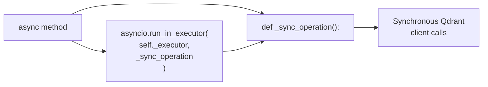

**Configuration:**
- `ThreadPoolExecutor(max_workers=2)` at [src/vanna/integrations/qdrant/agent_memory.py:61]()
- Two concurrent operations maximum
- Prevents blocking the event loop during I/O operations

**Sources:** [src/vanna/integrations/qdrant/agent_memory.py:61](), [src/vanna/integrations/qdrant/agent_memory.py:98-132]()

---

## Deployment Options

### Local Deployment

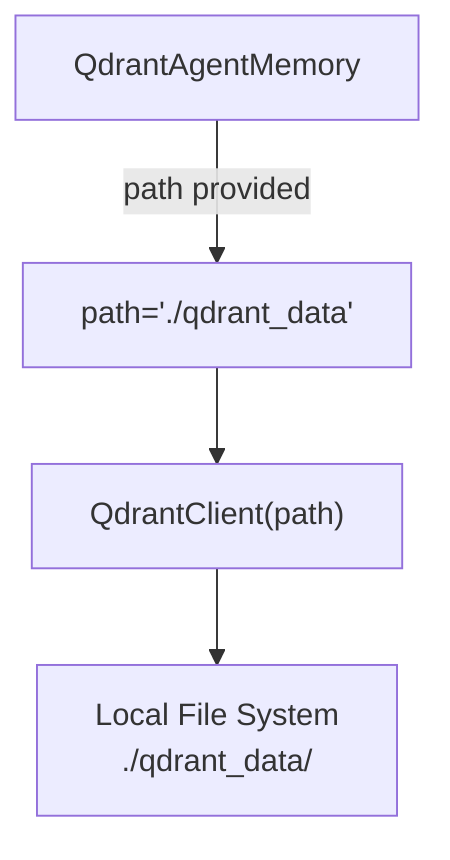

**Usage:** Suitable for development, testing, or single-node deployments. Data persisted to local filesystem.

**Sources:** [src/vanna/integrations/qdrant/agent_memory.py:66-69]()

### Remote Deployment

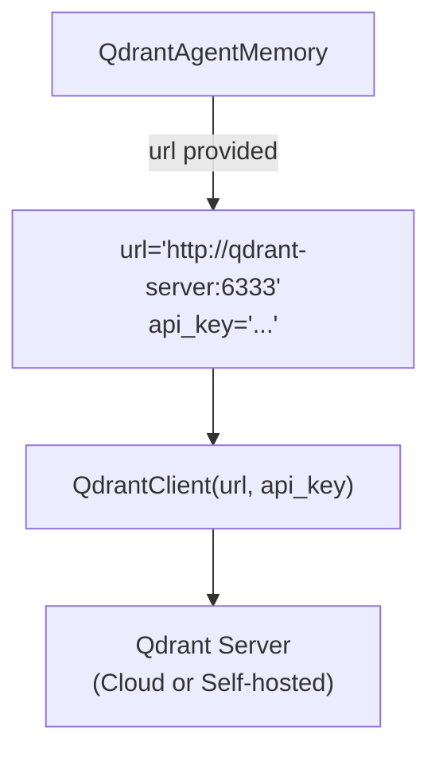

**Usage:** Production deployments with Qdrant Cloud or self-hosted Qdrant cluster. Supports authentication via API key.

**Sources:** [src/vanna/integrations/qdrant/agent_memory.py:66-67]()

### In-Memory Deployment

If neither `url` nor `path` is provided, defaults to `:memory:` mode - ephemeral storage that exists only during runtime.

**Sources:** [src/vanna/integrations/qdrant/agent_memory.py:69]()

---

## Error Handling

### Exception Handling Patterns

The implementation uses try-except blocks in deletion operations:

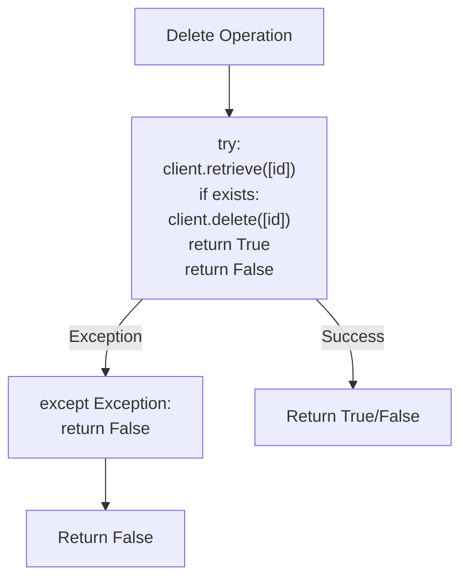

**Key Points:**
- Broad exception catching for robustness
- No exception propagation to caller
- Boolean return indicates success/failure
- Logging not implemented (caller responsibility)

**Sources:** [src/vanna/integrations/qdrant/agent_memory.py:230-247](), [src/vanna/integrations/qdrant/agent_memory.py:374-391]()

---

## Integration Example

### Using QdrantAgentMemory with Agent

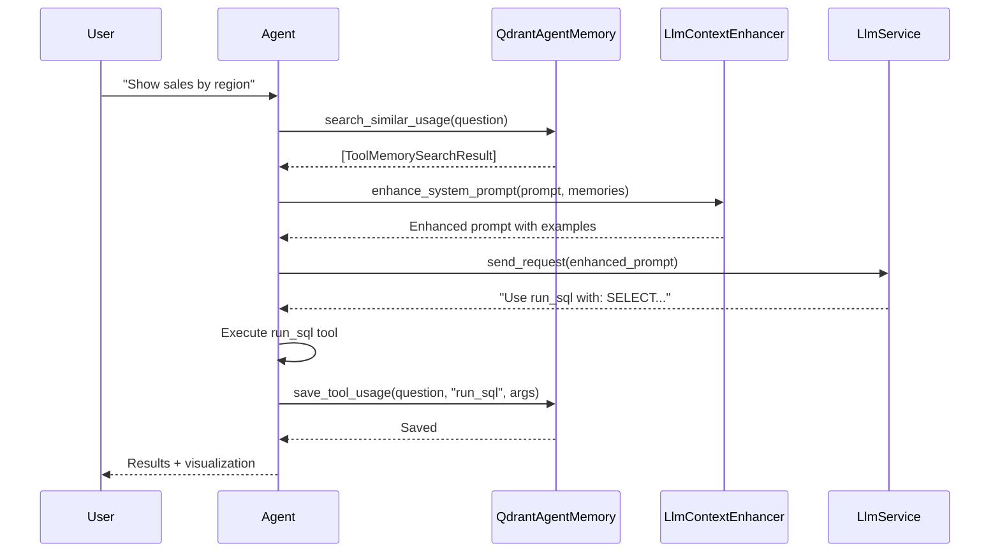

The `QdrantAgentMemory` instance is passed to the `Agent` during initialization and used throughout the agent's lifecycle to:
1. Search for similar past tool usages before LLM invocation
2. Store successful tool invocations for future learning
3. Provide context to the LLM via `LlmContextEnhancer`

**Sources:** [src/vanna/integrations/qdrant/agent_memory.py:39-440]()

---

## Performance Considerations

### Vector Search Performance

| Factor | Impact | Recommendation |
|--------|--------|----------------|
| Collection size | Linear impact on scroll operations | Use vector search instead of scroll when possible |
| Vector dimension | Memory usage and search speed | Balance between accuracy and performance (384 is reasonable) |
| `limit` parameter | Network overhead | Request only needed results |
| Filters | May slow down search | Create payload indexes for frequently filtered fields |

### Memory Usage

- Each point stores: vector (dimension × 4 bytes) + payload (variable)
- 384-dimension vector = ~1.5 KB per point
- Payloads with large args/metadata increase storage
- ThreadPoolExecutor with 2 workers = minimal thread overhead

**Sources:** [src/vanna/integrations/qdrant/agent_memory.py:42-62]()

---

## Dependencies

### Required Package

```
pip install qdrant-client
```

The integration checks for availability at import time:

```python
try:
    from qdrant_client import QdrantClient
    from qdrant_client.models import ...
    QDRANT_AVAILABLE = True
except ImportError:
    QDRANT_AVAILABLE = False
```

If `qdrant-client` is not installed, initialization raises `ImportError` with installation instructions.

**Sources:** [src/vanna/integrations/qdrant/agent_memory.py:14-27](), [src/vanna/integrations/qdrant/agent_memory.py:50-53]()

---

## Comparison with Other Implementations

### ChromaDB vs Qdrant vs FAISS

| Feature | QdrantAgentMemory | ChromaAgentMemory | FAISSAgentMemory |
|---------|-------------------|-------------------|------------------|
| **Storage** | Server-based (local/remote) | Local file-based | Local file-based |
| **Scalability** | High (distributed) | Medium (single node) | Low (in-memory) |
| **Filters** | Native filter support | Native filter support | Manual filtering |
| **Async** | ThreadPoolExecutor | ThreadPoolExecutor | ThreadPoolExecutor |
| **Payload** | Raw Python dicts | JSON serialized | Pickle serialized |
| **Production Ready** | Yes | Yes | Development only |

For other vector store integrations, see [Other Vector Stores](#3.6).

**Sources:** [src/vanna/integrations/qdrant/agent_memory.py:1-440](), [src/vanna/integrations/chromadb/agent_memory.py:1-417](), [src/vanna/integrations/faiss/agent_memory.py:1-432]()

---

