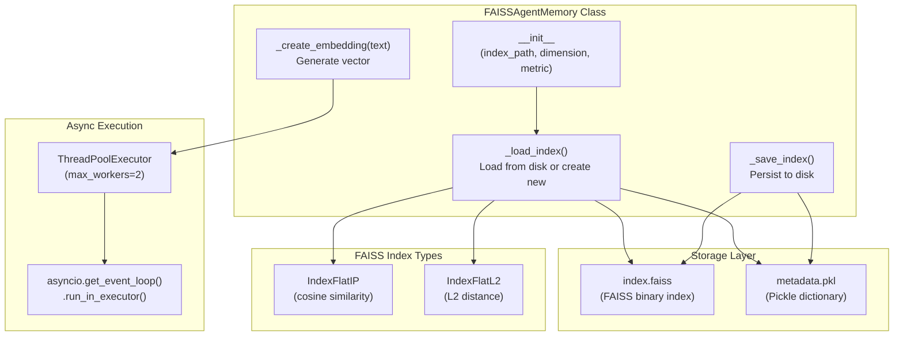
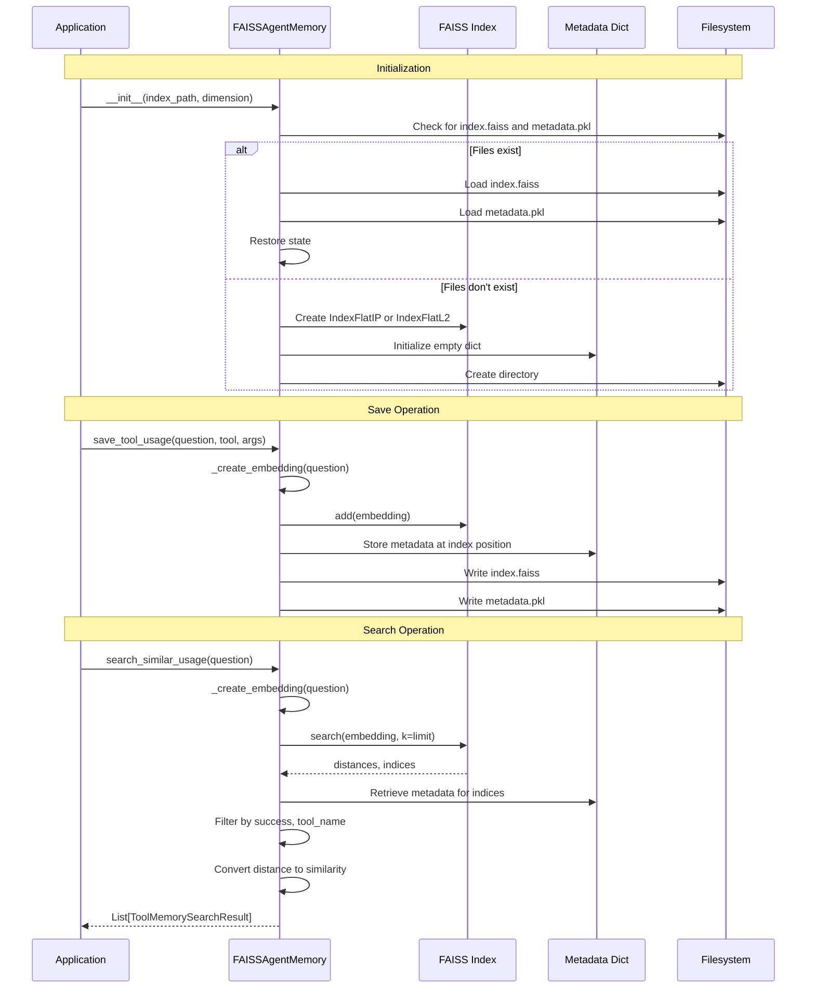
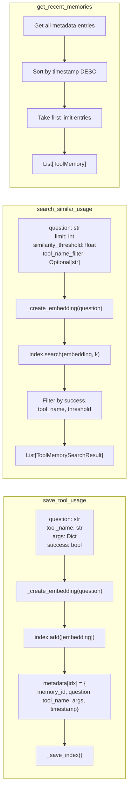
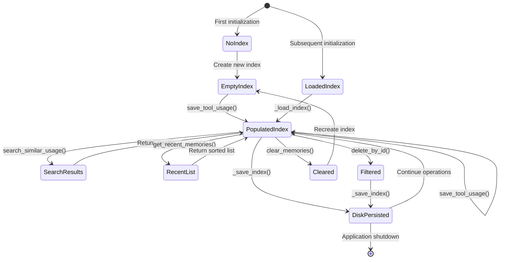

<!-- source: DeepWiki mcp.deepwiki.com · repo vanna-ai/vanna · page 4.7 FAISS Integration · fetched 2026-10-29 -->

# FAISS

<details>
<summary>Relevant source files</summary>

The following files were used as context for generating this wiki page:

- [src/vanna/integrations/azuresearch/agent_memory.py](src/vanna/integrations/azuresearch/agent_memory.py)
- [src/vanna/integrations/chromadb/agent_memory.py](src/vanna/integrations/chromadb/agent_memory.py)
- [src/vanna/integrations/faiss/agent_memory.py](src/vanna/integrations/faiss/agent_memory.py)
- [src/vanna/integrations/marqo/agent_memory.py](src/vanna/integrations/marqo/agent_memory.py)
- [src/vanna/integrations/milvus/agent_memory.py](src/vanna/integrations/milvus/agent_memory.py)
- [src/vanna/integrations/opensearch/agent_memory.py](src/vanna/integrations/opensearch/agent_memory.py)
- [src/vanna/integrations/pinecone/agent_memory.py](src/vanna/integrations/pinecone/agent_memory.py)
- [src/vanna/integrations/qdrant/agent_memory.py](src/vanna/integrations/qdrant/agent_memory.py)
- [src/vanna/integrations/weaviate/agent_memory.py](src/vanna/integrations/weaviate/agent_memory.py)
- [src/vanna/legacy/adapter.py](src/vanna/legacy/adapter.py)
- [tests/test_chromadb_persistence_fix.py](tests/test_chromadb_persistence_fix.py)

</details>


## Purpose and Scope

This page documents the FAISS (Facebook AI Similarity Search) implementation of the AgentMemory interface. FAISS provides efficient local vector storage and similarity search for agent learning patterns without requiring a separate database server. For information about other AgentMemory backends, see [AgentMemory Implementations](#3). For the core AgentMemory interface and concepts, see [AgentMemory System](#2.4).

**Sources:** [src/vanna/integrations/faiss/agent_memory.py:1-432]()

---

## Overview

`FAISSAgentMemory` is a local, file-based implementation of the AgentMemory interface that uses Facebook's FAISS library for efficient vector similarity search. Unlike server-based vector databases (ChromaDB, Qdrant, Pinecone), FAISS operates entirely on the local filesystem, making it ideal for lightweight deployments, development environments, and edge computing scenarios.

### Key Characteristics

| Feature | Description |
|---------|-------------|
| **Storage** | Local filesystem (index file + metadata pickle file) |
| **Deployment** | No server required, fully embedded |
| **Persistence** | Automatic disk persistence on every write |
| **Metrics** | Cosine similarity or L2 distance |
| **Dependencies** | `faiss-cpu` (or `faiss-gpu` for GPU acceleration) |
| **Async Support** | ThreadPoolExecutor for non-blocking operations |

**Sources:** [src/vanna/integrations/faiss/agent_memory.py:34-56](), [tox.ini:104-111]()

---

## Installation

FAISS is available as an optional dependency. Install with:

```bash
# CPU version (recommended for most users)
pip install "vanna[faiss]"

# Or manually
pip install faiss-cpu
```

For GPU-accelerated similarity search:

```bash
pip install faiss-gpu
```

The integration will raise an `ImportError` if FAISS is not installed when attempting to create a `FAISSAgentMemory` instance.

**Sources:** [src/vanna/integrations/faiss/agent_memory.py:17-22, 44-47](), [tox.ini:104-111]()

---

## Configuration and Initialization

### Basic Initialization

```python
from vanna.integrations.faiss import FAISSAgentMemory

# Initialize with default settings
agent_memory = FAISSAgentMemory()

# Or with custom configuration
agent_memory = FAISSAgentMemory(
    index_path="./my_faiss_index",  # Directory for index files
    dimension=384,                   # Vector dimension
    metric="cosine"                  # "cosine" or "l2"
)
```

### Configuration Parameters

| Parameter | Type | Default | Description |
|-----------|------|---------|-------------|
| `index_path` | `str` | `"./faiss_index"` | Directory path for storing index and metadata files |
| `persist_path` | `str` | `None` | Alternative name for `index_path` (backward compatibility) |
| `dimension` | `int` | `384` | Dimensionality of embedding vectors |
| `metric` | `str` | `"cosine"` | Distance metric: `"cosine"` (inner product) or `"l2"` (Euclidean) |

**Sources:** [src/vanna/integrations/faiss/agent_memory.py:36-56]()

---

## Architecture

### Component Structure



**Sources:** [src/vanna/integrations/faiss/agent_memory.py:34-103]()

### File Structure on Disk

The FAISS implementation stores data in two files within the configured directory:

```
<index_path>/
├── index.faiss       # FAISS binary index containing vectors
└── metadata.pkl      # Python pickle containing metadata dictionary
```

The metadata dictionary maps FAISS index positions (integers) to memory records containing question text, tool names, arguments, timestamps, and other metadata.

**Sources:** [src/vanna/integrations/faiss/agent_memory.py:58-84]()

---

## Core Operations

### Index Management



**Sources:** [src/vanna/integrations/faiss/agent_memory.py:58-103, 104-205]()

### Embedding and Distance Metrics

The implementation supports two distance metrics:

**Cosine Similarity (default):**
- Uses `faiss.IndexFlatIP` (inner product)
- Vectors are normalized before storage
- Higher scores = more similar
- Scores returned directly as similarity

**L2 Distance:**
- Uses `faiss.IndexFlatL2` (Euclidean distance)
- Lower distances = more similar
- Converted to similarity: `1.0 / (1.0 + distance)`

```python
# Cosine similarity initialization
if self.metric == "cosine":
    self._index = faiss.IndexFlatIP(self.dimension)
    # Normalize embedding before adding
    embedding = embedding / np.linalg.norm(embedding)
    
# L2 distance initialization  
else:
    self._index = faiss.IndexFlatL2(self.dimension)
```

**Sources:** [src/vanna/integrations/faiss/agent_memory.py:68-102, 177-181]()

---

## AgentMemory Interface Implementation

### Tool Memory Operations



**Sources:** [src/vanna/integrations/faiss/agent_memory.py:104-236]()

### Text Memory Operations

Text memories are stored in the same FAISS index as tool memories, differentiated by the `is_text_memory` flag in metadata. The question field is reused to store the content.

```python
# Text memory storage structure in metadata
{
    "memory_id": "uuid-string",
    "content": "actual text content",  # Stored in question field for embedding
    "timestamp": "2024-01-15T10:30:00",
    "is_text_memory": True  # Flag to distinguish from tool memories
}
```

**Sources:** [src/vanna/integrations/faiss/agent_memory.py:258-282, 284-340, 342-371]()

---

## Memory Lifecycle

### Save and Retrieve Pattern



**Sources:** [src/vanna/integrations/faiss/agent_memory.py:58-84, 77-84, 104-432]()

---

## Usage Examples

### Basic Agent Configuration

```python
from vanna import Agent, AgentConfig
from vanna.integrations.faiss import FAISSAgentMemory
from vanna.integrations.anthropic import AnthropicLlmService
from vanna.core.registry import ToolRegistry
from vanna.tools import RunSqlTool
from vanna.integrations.sqlite import SqliteRunner

# Initialize FAISS memory
agent_memory = FAISSAgentMemory(
    index_path="./agent_memory",
    dimension=384,
    metric="cosine"
)

# Configure agent with FAISS memory
agent = Agent(
    llm_service=AnthropicLlmService(api_key="...", model="claude-sonnet-4-5"),
    tool_registry=tools,
    agent_memory=agent_memory,  # FAISS backend
    user_resolver=user_resolver,
    config=AgentConfig()
)
```

### Manual Memory Management

```python
from vanna.core.tool import ToolContext
from vanna.core.user import User

# Create context
user = User(id="user123", email="user@example.com", group_memberships=["user"])
context = ToolContext(
    user=user,
    conversation_id="conv-123",
    request_id="req-456",
    agent_memory=agent_memory
)

# Save a successful query pattern
await agent_memory.save_tool_usage(
    question="What are the total sales by region?",
    tool_name="run_sql",
    args={"sql": "SELECT region, SUM(amount) FROM sales GROUP BY region"},
    context=context,
    success=True
)

# Search for similar patterns
results = await agent_memory.search_similar_usage(
    question="Show me sales per region",
    context=context,
    limit=5,
    similarity_threshold=0.7
)

for result in results:
    print(f"Similar query: {result.memory.question}")
    print(f"SQL: {result.memory.args['sql']}")
    print(f"Similarity: {result.similarity_score:.2f}")
```

**Sources:** [tests/test_agents.py:23-52]()

---

## Comparison with Other AgentMemory Backends

| Feature | FAISS | ChromaDB | Qdrant | Pinecone |
|---------|-------|----------|--------|----------|
| **Deployment** | Local files | Local server | Local or cloud | Cloud only |
| **Server Required** | No | No | Optional | Yes |
| **Persistence** | File-based | File-based | File or server | Cloud-managed |
| **Scalability** | Single machine | Single machine | Distributed | Highly distributed |
| **Setup Complexity** | Minimal | Minimal | Medium | Low (managed) |
| **GPU Acceleration** | Yes (faiss-gpu) | Yes (optional) | Yes | Built-in |
| **Metadata Filtering** | In-memory filter | Native | Native | Native |
| **Real-time Updates** | Immediate | Immediate | Immediate | Eventual |
| **Cost** | Free | Free | Free/Paid | Paid |

**Use FAISS when:**
- You need minimal dependencies
- Running in resource-constrained environments
- Prototyping or development
- Working with small to medium datasets (<1M vectors)
- Deploying edge computing applications

**Consider alternatives when:**
- Need distributed/clustered deployment (→ Qdrant, Milvus)
- Require advanced filtering capabilities (→ ChromaDB, Qdrant)
- Need managed cloud solution (→ Pinecone)
- Working with very large datasets (→ Pinecone, Milvus)

**Sources:** [src/vanna/integrations/faiss/agent_memory.py:1-432](), [src/vanna/integrations/chromadb/agent_memory.py:1-417](), [src/vanna/integrations/qdrant/agent_memory.py:1-440](), [src/vanna/integrations/pinecone/agent_memory.py:1-330]()

---

## Performance Characteristics

### Time Complexity

| Operation | Complexity | Notes |
|-----------|------------|-------|
| `save_tool_usage` | O(d) | d = dimension; includes embedding and disk write |
| `search_similar_usage` | O(n·d) | n = total vectors; brute-force search |
| `get_recent_memories` | O(n·log n) | Sorts all metadata entries |
| `delete_by_id` | O(n) | Linear scan through metadata |
| `clear_memories` | O(n) | Rebuilds index if clearing all |

### Space Complexity

- **Index file:** ~4 bytes per dimension per vector
- **Metadata file:** Variable, depends on question/args size
- **Memory overhead:** Full index loaded into RAM

For a 384-dimension index with 10,000 vectors:
- Index size: ~15 MB (10,000 × 384 × 4 bytes)
- Metadata size: ~1-10 MB (depends on content)

**Sources:** [src/vanna/integrations/faiss/agent_memory.py:86-103, 139-205]()

---

## Limitations and Considerations

### Embedding Generation

The current implementation uses a placeholder hash-based embedding function:

```python
def _create_embedding(self, text: str) -> np.ndarray:
    """Create a simple embedding from text (placeholder)."""
    import hashlib
    hash_val = int(hashlib.md5(text.encode()).hexdigest(), 16)
    embedding = np.array(
        [(hash_val >> i) % 100 / 100.0 for i in range(self.dimension)],
        dtype=np.float32
    )
    # Normalize for cosine similarity
    if self.metric == "cosine":
        norm = np.linalg.norm(embedding)
        if norm > 0:
            embedding = embedding / norm
    return embedding
```

**Production Recommendation:** Replace with a proper embedding model:
- sentence-transformers (e.g., `all-MiniLM-L6-v2`)
- OpenAI embeddings API
- Custom fine-tuned models

**Sources:** [src/vanna/integrations/faiss/agent_memory.py:86-102]()

### Metadata Filtering

Unlike native vector databases, FAISS does not support metadata filtering during search. The implementation performs post-search filtering in Python:

1. Search returns top-k results from FAISS
2. Results filtered by `success`, `tool_name_filter`, `similarity_threshold`
3. May return fewer than `limit` results after filtering

**Impact:** For datasets with sparse matching metadata, may need to search with higher `k` value internally.

**Sources:** [src/vanna/integrations/faiss/agent_memory.py:139-205]()

### Concurrency

The implementation uses a `ThreadPoolExecutor` with 2 workers for async operations. This provides:
- Non-blocking I/O for disk operations
- Thread-safe index updates (Python GIL protection)

**Limitation:** Not suitable for high-concurrency scenarios (>10 concurrent writes). For heavy concurrent loads, consider Qdrant or Milvus with proper locking.

**Sources:** [src/vanna/integrations/faiss/agent_memory.py:55, 131-137]()

### Disk Persistence

Every write operation (save, delete, clear) triggers a full index save:

```python
def _save_index(self):
    """Save FAISS index to disk."""
    index_file = os.path.join(self.index_path, "index.faiss")
    metadata_file = os.path.join(self.index_path, "metadata.pkl")
    
    faiss.write_index(self._index, index_file)
    with open(metadata_file, "wb") as f:
        pickle.dump(self._metadata, f)
```

**Impact:** High-frequency writes may cause I/O bottlenecks. Consider batching writes if saving thousands of memories per second.

**Sources:** [src/vanna/integrations/faiss/agent_memory.py:77-84]()

---

## Testing

The FAISS integration is tested using the standard AgentMemory test suite:

```bash
# Run FAISS-specific tests
pytest tests/test_agent_memory.py::TestLocalAgentMemory -k faiss -v

# Or using tox
tox -e py311-faiss
```

The test environment installs only `faiss-cpu` as a test dependency to verify the integration works with minimal setup.

**Sources:** [tox.ini:104-111](), [tests/conftest.py:57-76]()

---

## Migration from Other Backends

### From DemoAgentMemory (Local)

```python
# Before: DemoAgentMemory (in-memory only)
from vanna.integrations.local.agent_memory import DemoAgentMemory
agent_memory = DemoAgentMemory(max_items=1000)

# After: FAISSAgentMemory (persistent)
from vanna.integrations.faiss import FAISSAgentMemory
agent_memory = FAISSAgentMemory(
    index_path="./agent_memory",
    dimension=384
)
# Data is now persisted across restarts
```

### From ChromaDB

```python
# Before: ChromaDB
from vanna.integrations.chromadb import ChromaAgentMemory
agent_memory = ChromaAgentMemory(
    persist_directory="./chroma_memory",
    collection_name="tool_memories"
)

# After: FAISS (lighter weight, no server)
from vanna.integrations.faiss import FAISSAgentMemory
agent_memory = FAISSAgentMemory(
    index_path="./faiss_memory",
    dimension=384
)
# Note: Requires data migration (not automatic)
```

**Sources:** [src/vanna/integrations/faiss/agent_memory.py:34-56](), [src/vanna/integrations/chromadb/agent_memory.py:33-90]()

---

## Advanced Configuration

### GPU Acceleration

If you have `faiss-gpu` installed, FAISS will automatically use GPU acceleration:

```python
# Install GPU version
# pip install faiss-gpu

# No code changes needed - FAISS auto-detects GPU
agent_memory = FAISSAgentMemory(
    index_path="./gpu_index",
    dimension=384,
    metric="cosine"
)
# Vector operations will use CUDA if available
```

### Custom Index Types

For advanced users, the default flat index can be replaced with more sophisticated FAISS index types (IVF, HNSW, etc.) by extending the class:

```python
from vanna.integrations.faiss import FAISSAgentMemory
import faiss

class CustomFAISSMemory(FAISSAgentMemory):
    def _load_index(self):
        """Override to use IVF index for large datasets."""
        if os.path.exists(os.path.join(self.index_path, "index.faiss")):
            # Load existing index
            super()._load_index()
        else:
            # Create IVF index instead of flat
            quantizer = faiss.IndexFlatIP(self.dimension)
            self._index = faiss.IndexIVFFlat(
                quantizer, self.dimension, 100  # 100 clusters
            )
            self._metadata = {}
```

**Note:** Custom index types require training before use. Consult FAISS documentation for details.

**Sources:** [src/vanna/integrations/faiss/agent_memory.py:58-76]()

---

## Summary

`FAISSAgentMemory` provides a lightweight, file-based vector storage solution for Vanna agents. It excels in scenarios requiring minimal dependencies, local-first deployment, or edge computing. While lacking some advanced features of server-based solutions, its simplicity and zero-configuration approach make it ideal for development, prototyping, and small to medium-scale deployments.

**Key Takeaways:**
- **Zero setup** - No server or external service required
- **Persistent** - Survives application restarts via disk files
- **Efficient** - FAISS provides optimized vector operations
- **Scalable** - Works well up to ~1M vectors on a single machine
- **Production-ready** - Replace placeholder embeddings with proper models

**Sources:** [src/vanna/integrations/faiss/agent_memory.py:1-432]()

---

