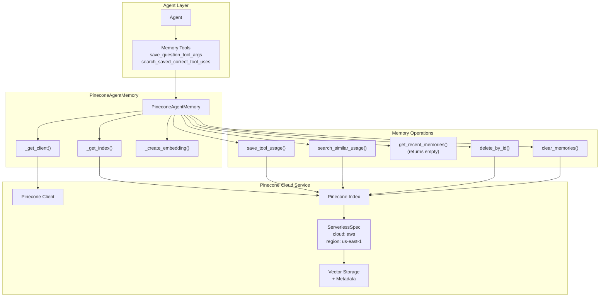
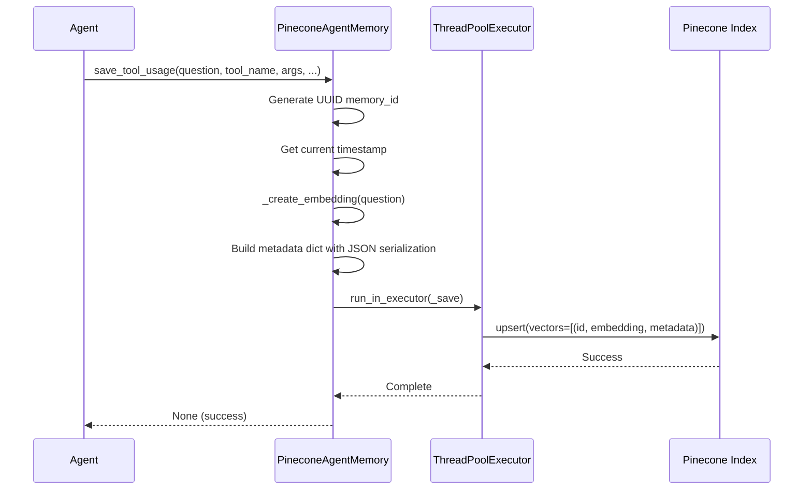

<!-- source: DeepWiki mcp.deepwiki.com · repo vanna-ai/vanna · page 4.8 Pinecone Integration · fetched 2026-10-29 -->

# Pinecone Integration

<details>
<summary>Relevant source files</summary>

The following files were used as context for generating this wiki page:

- [src/vanna/integrations/azuresearch/agent_memory.py](src/vanna/integrations/azuresearch/agent_memory.py)
- [src/vanna/integrations/chromadb/agent_memory.py](src/vanna/integrations/chromadb/agent_memory.py)
- [src/vanna/integrations/faiss/agent_memory.py](src/vanna/integrations/faiss/agent_memory.py)
- [src/vanna/integrations/marqo/agent_memory.py](src/vanna/integrations/marqo/agent_memory.py)
- [src/vanna/integrations/milvus/agent_memory.py](src/vanna/integrations/milvus/agent_memory.py)
- [src/vanna/integrations/opensearch/agent_memory.py](src/vanna/integrations/opensearch/agent_memory.py)
- [src/vanna/integrations/pinecone/agent_memory.py](src/vanna/integrations/pinecone/agent_memory.py)
- [src/vanna/integrations/qdrant/agent_memory.py](src/vanna/integrations/qdrant/agent_memory.py)
- [src/vanna/integrations/weaviate/agent_memory.py](src/vanna/integrations/weaviate/agent_memory.py)
- [src/vanna/legacy/adapter.py](src/vanna/legacy/adapter.py)
- [tests/test_chromadb_persistence_fix.py](tests/test_chromadb_persistence_fix.py)

</details>


This document describes the `PineconeAgentMemory` implementation, which provides cloud-based vector storage for the Agent Memory System using Pinecone's managed service. Pinecone is a fully-managed vector database optimized for similarity search at scale.

For information about the Agent Memory System interface and concepts, see [AgentMemory Interface and Concepts](#4.1). For local vector storage alternatives, see [ChromaDB Integration](#4.5), [FAISS Integration](#4.7), or [Qdrant Integration](#4.6).

---

## Overview

`PineconeAgentMemory` implements the `AgentMemory` interface using Pinecone's serverless cloud infrastructure. Unlike local implementations (ChromaDB, FAISS), Pinecone is a fully-managed service that handles scaling, replication, and availability automatically. This makes it suitable for production deployments requiring high availability and global distribution.

**Key Characteristics:**
- Fully-managed cloud service (no infrastructure management)
- Serverless architecture with automatic scaling
- Global availability across AWS regions
- API-based access (requires network connectivity)
- Persistent storage without local file management
- Support for filtering and metadata-based queries

**Trade-offs:**
- Requires API key and internet connectivity
- Incurs usage-based costs
- Higher latency than local solutions
- Limited `get_recent_memories` functionality (see limitations section)

**Sources:** [src/vanna/integrations/pinecone/agent_memory.py:1-30]()

---

## Initialization and Configuration

### Class Definition

```python
class PineconeAgentMemory(AgentMemory):
    def __init__(
        self,
        api_key: str,
        index_name: str = "tool-memories",
        environment: str = "us-east-1",
        dimension: int = 384,
        metric: str = "cosine",
    )
```

**Parameters:**

| Parameter | Type | Default | Description |
|-----------|------|---------|-------------|
| `api_key` | `str` | Required | Pinecone API key for authentication |
| `index_name` | `str` | `"tool-memories"` | Name of the Pinecone index to create/use |
| `environment` | `str` | `"us-east-1"` | AWS region for serverless deployment |
| `dimension` | `int` | `384` | Vector embedding dimension size |
| `metric` | `str` | `"cosine"` | Distance metric for similarity search |

### Setup Example

```python
from vanna.integrations.pinecone import PineconeAgentMemory

# Initialize with Pinecone API key
memory = PineconeAgentMemory(
    api_key="your-pinecone-api-key",
    index_name="my-agent-memories",
    environment="us-east-1",  # AWS region
    dimension=384,
    metric="cosine"
)
```

**Important Notes:**
- The `api_key` must be obtained from the Pinecone console
- The `environment` parameter specifies the AWS region for serverless deployment
- The `dimension` must match the embedding model's output size
- Supported metrics: `"cosine"`, `"euclidean"`, `"dotproduct"`

**Sources:** [src/vanna/integrations/pinecone/agent_memory.py:31-54]()

---

## Architecture Overview

The following diagram shows how `PineconeAgentMemory` integrates with the Vanna Agent Memory System:



**Key Components:**

1. **PineconeAgentMemory**: Main class implementing `AgentMemory` interface
2. **_get_client()**: Lazy initialization of Pinecone client [lines 56-60]()
3. **_get_index()**: Lazy initialization and index creation [lines 62-77]()
4. **_create_embedding()**: Placeholder embedding function (should be replaced) [lines 79-85]()
5. **ThreadPoolExecutor**: Async wrapper for synchronous Pinecone SDK [line 54]()

**Sources:** [src/vanna/integrations/pinecone/agent_memory.py:31-85]()

---

## Index Management

### Automatic Index Creation

Pinecone indexes are created automatically on first access if they don't exist. The index configuration uses Pinecone's serverless architecture:

```python
def _get_index(self):
    """Get or create Pinecone index."""
    if self._index is None:
        client = self._get_client()

        # Create index if it doesn't exist
        if self.index_name not in client.list_indexes().names():
            client.create_index(
                name=self.index_name,
                dimension=self.dimension,
                metric=self.metric,
                spec=ServerlessSpec(cloud="aws", region=self.environment),
            )

        self._index = client.Index(self.index_name)
    return self._index
```

**Index Configuration Details:**

| Property | Value | Description |
|----------|-------|-------------|
| `name` | User-specified | Unique identifier for the index |
| `dimension` | User-specified (default 384) | Vector dimension size |
| `metric` | User-specified (default "cosine") | Similarity metric |
| `spec` | `ServerlessSpec` | Serverless deployment configuration |
| `cloud` | `"aws"` | Cloud provider (AWS, GCP, Azure) |
| `region` | User-specified (default "us-east-1") | AWS region for deployment |

**Index Lifecycle:**
1. Client checks if index exists using `list_indexes().names()`
2. If not found, creates index with `ServerlessSpec` configuration
3. Returns `Index` object for subsequent operations
4. Index persists in Pinecone cloud until explicitly deleted

**Sources:** [src/vanna/integrations/pinecone/agent_memory.py:62-77]()

---

## Metadata Structure

### Tool Memory Metadata

When saving tool usage patterns, Pinecone stores metadata as a flat dictionary with JSON-serialized complex fields:

```python
memory_metadata = {
    "question": question,                    # Original user question (string)
    "tool_name": tool_name,                  # Name of the tool used (string)
    "args_json": json.dumps(args),          # Tool arguments (JSON string)
    "timestamp": timestamp,                  # ISO format timestamp (string)
    "success": success,                      # Execution success flag (boolean)
    "metadata_json": json.dumps(metadata)   # Additional metadata (JSON string)
}
```

**Metadata Field Details:**

| Field | Type | Filterable | Description |
|-------|------|------------|-------------|
| `question` | `string` | Yes | User's natural language question |
| `tool_name` | `string` | Yes | Tool identifier for filtering searches |
| `args_json` | `string` | No | JSON-serialized tool arguments |
| `timestamp` | `string` | Yes | ISO 8601 timestamp (YYYY-MM-DDTHH:MM:SS) |
| `success` | `boolean` | Yes | Whether tool execution succeeded |
| `metadata_json` | `string` | No | JSON-serialized additional metadata |

**JSON Serialization Rationale:**

Pinecone metadata only supports primitive types (string, number, boolean, list of strings). Complex objects like dictionaries are serialized to JSON strings to preserve structure. This is similar to the ChromaDB implementation pattern.

**Deserialization on Retrieval:**

```python
# During search_similar_usage
args = json.loads(metadata.get("args_json", "{}"))
metadata_dict = json.loads(metadata.get("metadata_json", "{}"))

memory = ToolMemory(
    memory_id=match.id,
    question=metadata["question"],
    tool_name=metadata["tool_name"],
    args=args,  # Deserialized dict
    timestamp=metadata.get("timestamp"),
    success=metadata.get("success", True),
    metadata=metadata_dict,  # Deserialized dict
)
```

**Sources:** [src/vanna/integrations/pinecone/agent_memory.py:96-116](), [src/vanna/integrations/pinecone/agent_memory.py:149-162]()

### Text Memory Metadata

Text memories use a simpler metadata structure:

```python
memory_metadata = {
    "content": content,           # Text content (string)
    "timestamp": timestamp,       # ISO format timestamp (string)
    "is_text_memory": True       # Flag to distinguish from tool memories (boolean)
}
```

The `is_text_memory` flag enables filtering between tool and text memories during searches.

**Sources:** [src/vanna/integrations/pinecone/agent_memory.py:206-224]()

---

## Memory Operations

### Save Tool Usage

```python
async def save_tool_usage(
    self,
    question: str,
    tool_name: str,
    args: Dict[str, Any],
    context: ToolContext,
    success: bool = True,
    metadata: Optional[Dict[str, Any]] = None,
) -> None
```

**Process Flow:**



**Implementation Details:**
- Generates unique UUID for `memory_id`
- Creates vector embedding from question text
- Serializes `args` and `metadata` to JSON strings
- Uses `upsert` operation (creates or updates if ID exists)
- Async execution via `ThreadPoolExecutor` (Pinecone SDK is synchronous)

**Sources:** [src/vanna/integrations/pinecone/agent_memory.py:87-117]()

---

### Search Similar Usage

```python
async def search_similar_usage(
    self,
    question: str,
    context: ToolContext,
    *,
    limit: int = 10,
    similarity_threshold: float = 0.7,
    tool_name_filter: Optional[str] = None,
) -> List[ToolMemorySearchResult]
```

**Search Process:**


**Filter Construction:**

```python
# Base filter: only successful executions
filter_dict = {"success": True}

# Optional tool name filter
if tool_name_filter:
    filter_dict["tool_name"] = tool_name_filter

# Pinecone query
results = index.query(
    vector=embedding,
    top_k=limit,
    filter=filter_dict,
    include_metadata=True
)
```

**Similarity Scoring:**

Pinecone returns similarity scores directly based on the configured metric (cosine, euclidean, or dotproduct). The implementation filters results to only include matches above the `similarity_threshold`.

**Sources:** [src/vanna/integrations/pinecone/agent_memory.py:119-172]()

---

### Delete Operations

#### Delete by ID

```python
async def delete_by_id(self, context: ToolContext, memory_id: str) -> bool:
    """Delete a memory by its ID."""
    def _delete():
        index = self._get_index()
        try:
            index.delete(ids=[memory_id])
            return True
        except Exception:
            return False
```

**Behavior:**
- Deletes vector and metadata by ID
- Returns `True` on success, `False` on failure
- Exceptions are caught and converted to `False` return value

**Sources:** [src/vanna/integrations/pinecone/agent_memory.py:192-204]()

#### Clear Memories

```python
async def clear_memories(
    self,
    context: ToolContext,
    tool_name: Optional[str] = None,
    before_date: Optional[str] = None,
) -> int
```

**Clear Strategies:**

| Parameters | Operation | Description |
|------------|-----------|-------------|
| None provided | `index.delete(delete_all=True)` | Deletes all vectors in the index |
| `tool_name` only | `index.delete(filter={"tool_name": value})` | Deletes all memories for specific tool |
| `before_date` only | `index.delete(filter={"timestamp": {"$lt": value}})` | Deletes memories older than date |
| Both provided | Combined filter | Deletes matching both conditions |

**Filter Syntax Example:**

```python
# Delete memories before specific date
filter_dict = {"timestamp": {"$lt": "2024-01-01T00:00:00"}}

# Delete specific tool's memories
filter_dict = {"tool_name": "run_sql"}

# Combined filter
filter_dict = {
    "tool_name": "run_sql",
    "timestamp": {"$lt": "2024-01-01T00:00:00"}
}

index.delete(filter=filter_dict)
```

**Limitation:** Returns `0` (Pinecone doesn't provide deletion count)

**Sources:** [src/vanna/integrations/pinecone/agent_memory.py:301-329]()

---

## Known Limitations

### get_recent_memories() Returns Empty List

The most significant limitation of `PineconeAgentMemory` is that `get_recent_memories()` and `get_recent_text_memories()` always return empty lists:

```python
async def get_recent_memories(
    self, context: ToolContext, limit: int = 10
) -> List[ToolMemory]:
    """Get recently added memories."""
    
    def _get_recent():
        index = self._get_index()
        
        # Pinecone doesn't have a native "get all" - we need to query with a dummy vector
        # or use the list operation with metadata filtering
        # This is a limitation - we'll return empty for now
        # In production, you'd maintain a separate timestamp index or use Pinecone's metadata filtering
        return []
    
    return await asyncio.get_event_loop().run_in_executor(
        self._executor, _get_recent
    )
```

**Root Cause:**

Pinecone is optimized for vector similarity search, not for retrieving all vectors sorted by timestamp. The API lacks:
- A "list all vectors" operation
- Efficient timestamp-based sorting
- Pagination of results without a query vector

**Comparison with Other Implementations:**

| Implementation | get_recent_memories Support | Method |
|----------------|----------------------------|---------|
| ChromaDB | ✅ Full support | `collection.get()` + sort by timestamp |
| Qdrant | ✅ Full support | `scroll()` + sort by timestamp |
| FAISS | ✅ Full support | In-memory metadata dictionary |
| OpenSearch | ✅ Full support | Query with `sort: [timestamp: desc]` |
| **Pinecone** | ❌ Returns empty | No native support |

**Workarounds:**

1. **Maintain Separate Index:** Use a traditional database (PostgreSQL, DynamoDB) to track memory IDs and timestamps, then fetch from Pinecone by ID
2. **Dummy Vector Query:** Query with a zero vector and use metadata filtering, but this is inefficient and may not return all results
3. **Use Alternative:** Switch to ChromaDB or Qdrant if `get_recent_memories()` is critical

**Sources:** [src/vanna/integrations/pinecone/agent_memory.py:174-190](), [src/vanna/integrations/pinecone/agent_memory.py:272-285]()

---

### Placeholder Embedding Function

The current implementation uses a placeholder embedding function that generates deterministic but semantically meaningless vectors:

```python
def _create_embedding(self, text: str) -> List[float]:
    """Create a simple embedding from text (placeholder - should use actual embedding model)."""
    # TODO: Replace with actual embedding model
    import hashlib
    
    hash_val = int(hashlib.md5(text.encode()).hexdigest(), 16)
    return [(hash_val >> i) % 100 / 100.0 for i in range(self.dimension)]
```

**Production Requirements:**

For production use, replace this with a proper embedding model:

```python
from sentence_transformers import SentenceTransformer

class PineconeAgentMemory(AgentMemory):
    def __init__(self, ..., embedding_model: str = "all-MiniLM-L6-v2"):
        # ...
        self._embedding_model = SentenceTransformer(embedding_model)
    
    def _create_embedding(self, text: str) -> List[float]:
        embedding = self._embedding_model.encode(text)
        return embedding.tolist()
```

**Recommended Embedding Models:**

| Model | Dimension | Use Case |
|-------|-----------|----------|
| `all-MiniLM-L6-v2` | 384 | Lightweight, fast, good general-purpose |
| `all-mpnet-base-v2` | 768 | Higher quality, slower |
| `text-embedding-ada-002` (OpenAI) | 1536 | Highest quality, requires API key |

**Sources:** [src/vanna/integrations/pinecone/agent_memory.py:79-85]()

---

## Comparison with Other Vector Stores

### Feature Matrix

| Feature | Pinecone | ChromaDB | Qdrant | FAISS |
|---------|----------|----------|--------|-------|
| **Deployment** | Managed cloud | Local/server | Local/cloud | Local only |
| **Scaling** | Automatic | Manual | Manual | Single-node |
| **Persistence** | Built-in cloud | Local files | Local/cloud | Local files |
| **get_recent_memories** | ❌ No | ✅ Yes | ✅ Yes | ✅ Yes |
| **Metadata Filtering** | ✅ Yes | ✅ Yes | ✅ Yes | ❌ Limited |
| **API Latency** | 50-200ms | <1ms (local) | <1ms (local) | <1ms |
| **Setup Complexity** | Low (API key) | Low (pip install) | Medium | Low |
| **Cost** | Usage-based | Free | Free/paid | Free |
| **High Availability** | ✅ Built-in | ❌ Self-managed | ✅ Replication | ❌ None |

### Use Case Recommendations

**Choose Pinecone when:**
- You need fully-managed infrastructure
- High availability is critical
- You want automatic scaling
- You're willing to accept the `get_recent_memories` limitation
- Budget permits usage-based pricing

**Choose ChromaDB when:**
- You need full local control
- Cost is a primary concern
- `get_recent_memories` is important
- You want simple file-based persistence

**Choose Qdrant when:**
- You need high-performance similarity search
- You want flexible deployment (local or cloud)
- Rust-based performance is valuable
- You need advanced filtering capabilities

**Choose FAISS when:**
- You need maximum search speed
- Data fits in memory
- You don't need distributed deployment
- You can manage metadata separately

**Sources:** All integration files in `src/vanna/integrations/*/agent_memory.py`

---

## Implementation Reference

### Complete Initialization Example

```python
import os
from vanna.integrations.pinecone import PineconeAgentMemory
from vanna.core.agent import Agent
from vanna.capabilities.sql_runner import SqlRunner
from vanna.tools.run_sql import RunSqlTool

# Initialize Pinecone memory
memory = PineconeAgentMemory(
    api_key=os.getenv("PINECONE_API_KEY"),
    index_name="my-agent-memories",
    environment="us-east-1",
    dimension=384,
    metric="cosine"
)

# Create agent with Pinecone memory
agent = Agent(
    llm=llm_service,
    agent_memory=memory,
    # ... other configuration
)
```

### Environment Variables

```bash
# Required
PINECONE_API_KEY=your-api-key-here

# Optional (defaults shown)
PINECONE_INDEX_NAME=tool-memories
PINECONE_ENVIRONMENT=us-east-1
PINECONE_DIMENSION=384
PINECONE_METRIC=cosine
```

**Sources:** [src/vanna/integrations/pinecone/agent_memory.py:31-54]()

---

## Related Documentation

- [AgentMemory Interface and Concepts](#4.1) - Core memory system interface
- [Tool Memory vs Text Memory](#4.2) - Understanding memory types
- [Memory-Enabled Tools](#4.3) - Tools that use agent memory
- [ChromaDB Integration](#4.5) - Local alternative with full feature support
- [Qdrant Integration](#4.6) - High-performance alternative
- [FAISS Integration](#4.7) - In-memory alternative
- [Other Vector Store Integrations](#4.9) - Milvus, Weaviate, etc.

**Sources:** All sections of this document

---

