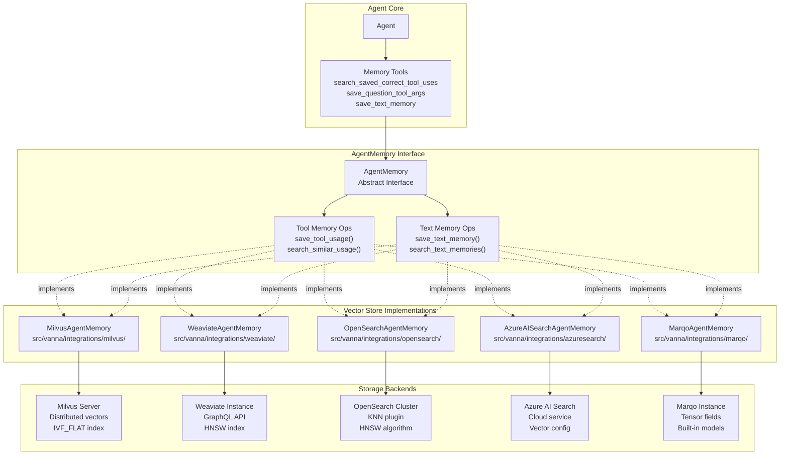
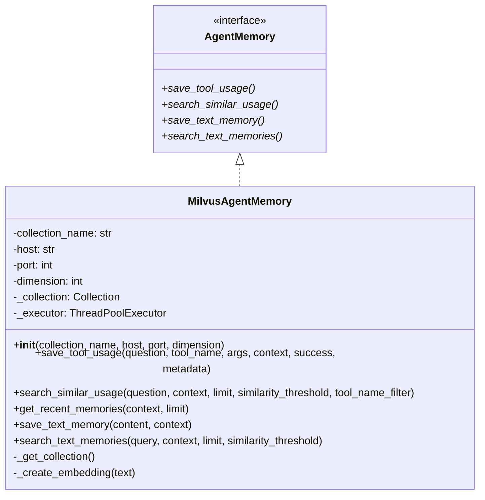
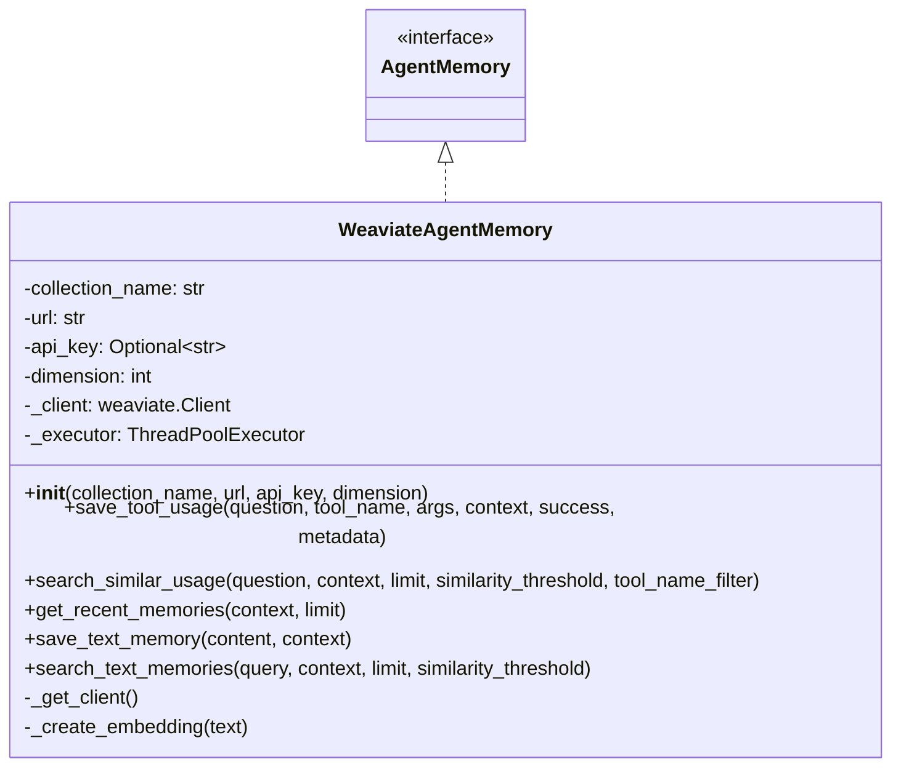
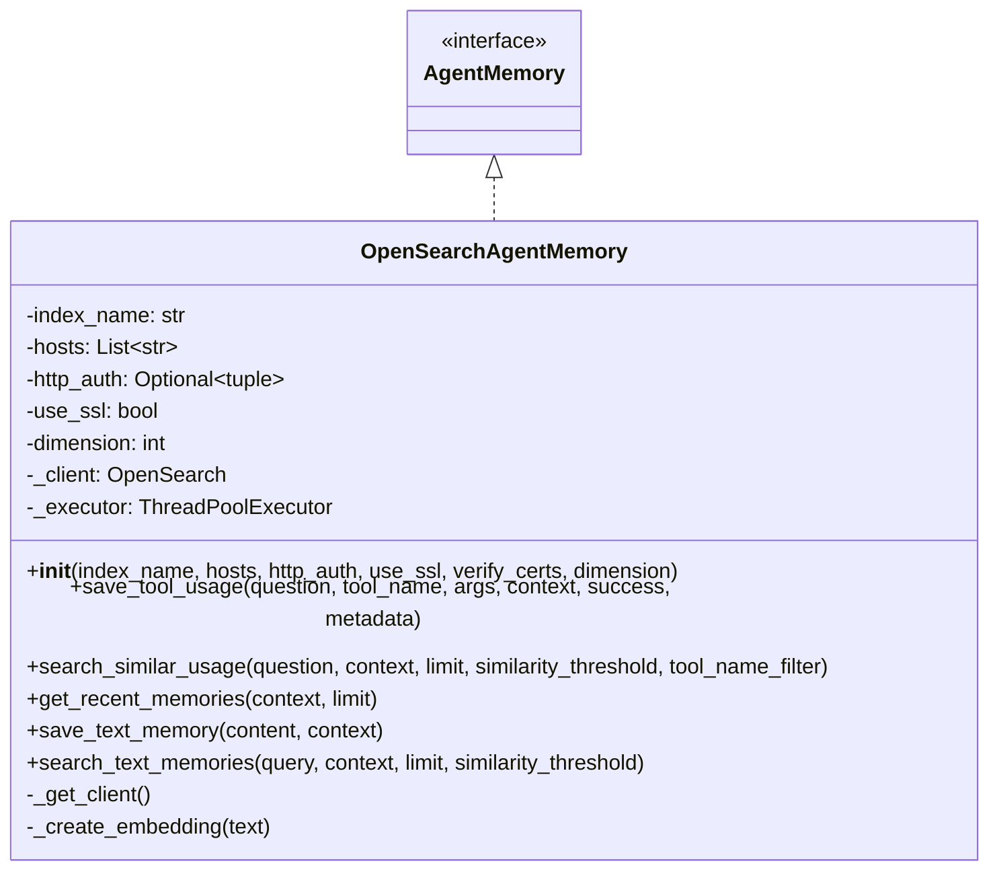
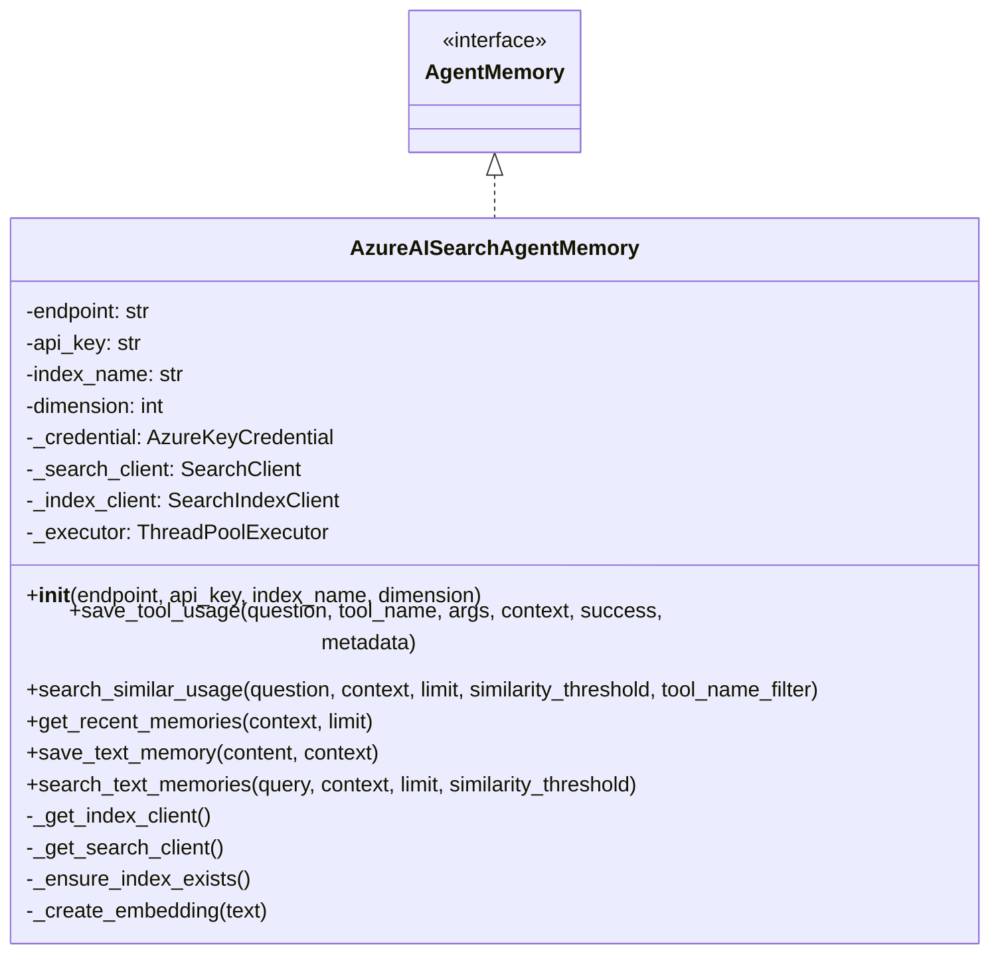
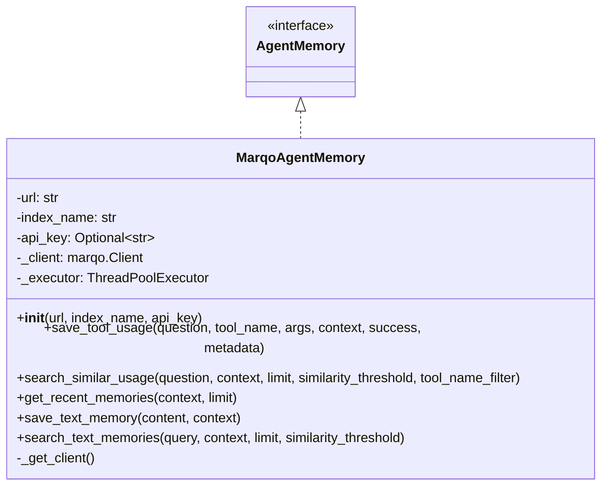

<!-- source: DeepWiki mcp.deepwiki.com · repo vanna-ai/vanna · page 4.9 Other Vector Store Integrations · fetched 2026-10-29 -->

# Other Vector Store Integrations

<details>
<summary>Relevant source files</summary>

The following files were used as context for generating this wiki page:

- [src/vanna/integrations/azuresearch/agent_memory.py](src/vanna/integrations/azuresearch/agent_memory.py)
- [src/vanna/integrations/chromadb/agent_memory.py](src/vanna/integrations/chromadb/agent_memory.py)
- [src/vanna/integrations/faiss/agent_memory.py](src/vanna/integrations/faiss/agent_memory.py)
- [src/vanna/integrations/marqo/agent_memory.py](src/vanna/integrations/marqo/agent_memory.py)
- [src/vanna/integrations/milvus/agent_memory.py](src/vanna/integrations/milvus/agent_memory.py)
- [src/vanna/integrations/opensearch/agent_memory.py](src/vanna/integrations/opensearch/agent_memory.py)
- [src/vanna/integrations/pinecone/agent_memory.py](src/vanna/integrations/pinecone/agent_memory.py)
- [src/vanna/integrations/qdrant/agent_memory.py](src/vanna/integrations/qdrant/agent_memory.py)
- [src/vanna/integrations/weaviate/agent_memory.py](src/vanna/integrations/weaviate/agent_memory.py)
- [src/vanna/legacy/adapter.py](src/vanna/legacy/adapter.py)
- [tests/test_chromadb_persistence_fix.py](tests/test_chromadb_persistence_fix.py)

</details>


This page documents additional vector store implementations of the `AgentMemory` interface beyond the core options (DemoAgentMemory, ChromaDB, Qdrant, FAISS, and Pinecone) covered in pages 4.4-4.8. These implementations enable Vanna agents to store and retrieve tool usage patterns and text memories using various vector database technologies.

For information about the core memory implementations, see:
- [DemoAgentMemory](#4.4) - In-memory implementation for testing
- [ChromaDB](#4.5) - Local persistent storage
- [Qdrant](#4.6) - High-performance Rust-based vector store
- [FAISS](#4.7) - Facebook AI Similarity Search
- [Pinecone](#4.8) - Managed cloud vector database

## Supported Vector Stores Overview

The following vector store integrations implement the `AgentMemory` interface defined in [src/vanna/capabilities/agent_memory/models.py]():

| Vector Store | Type | Deployment | Key Features | Installation |
|--------------|------|------------|--------------|--------------|
| **Milvus** | Distributed | Self-hosted or Cloud | Distributed architecture, high scalability, advanced indexing | `pip install pymilvus` |
| **Weaviate** | GraphQL-based | Self-hosted or Cloud | GraphQL API, semantic search, modular architecture | `pip install weaviate-client` |
| **OpenSearch** | Search Engine | Self-hosted or AWS | Elasticsearch fork, distributed search, KNN plugin | `pip install opensearch-py` |
| **Azure AI Search** | Managed Service | Azure Cloud | Fully managed, Azure integration, hybrid search | `pip install azure-search-documents` |
| **Marqo** | Multimodal | Self-hosted or Cloud | Tensor search, multimodal support, built-in embeddings | `pip install marqo` |

All implementations support both tool memory (structured workflow patterns) and text memory (domain knowledge) storage as defined by the `AgentMemory` interface.

Sources: [src/vanna/integrations/milvus/agent_memory.py:1-459](), [src/vanna/integrations/weaviate/agent_memory.py:1-429](), [src/vanna/integrations/opensearch/agent_memory.py:1-412](), [src/vanna/integrations/azuresearch/agent_memory.py:1-414](), [src/vanna/integrations/marqo/agent_memory.py:1-355]()
</thinking>

## AgentMemory Interface

All vector store implementations on this page implement the `AgentMemory` interface, providing these core methods:

**Tool Memory Operations:**
- `save_tool_usage()` - Store successful tool execution patterns
- `search_similar_usage()` - Find semantically similar past tool uses
- `get_recent_memories()` - Retrieve recently stored tool patterns
- `delete_by_id()` - Remove specific tool memory by ID

**Text Memory Operations:**
- `save_text_memory()` - Store domain knowledge or documentation
- `search_text_memories()` - Search for relevant text content
- `get_recent_text_memories()` - Retrieve recent text entries
- `delete_text_memory()` - Remove specific text memory

**Management:**
- `clear_memories()` - Bulk delete with optional filters

Sources: [src/vanna/integrations/milvus/agent_memory.py:38-459](), [src/vanna/integrations/weaviate/agent_memory.py:36-429]()

## Architecture Integration

The following diagram shows how these vector store implementations integrate with the Agent framework:



Sources: [src/vanna/integrations/milvus/agent_memory.py:1-50](), [src/vanna/integrations/weaviate/agent_memory.py:1-50](), [src/vanna/integrations/opensearch/agent_memory.py:1-50](), [src/vanna/integrations/azuresearch/agent_memory.py:1-50](), [src/vanna/integrations/marqo/agent_memory.py:1-50]()

## Milvus Integration

Milvus is a distributed vector database designed for scalability and performance. The `MilvusAgentMemory` implementation in [src/vanna/integrations/milvus/agent_memory.py]() provides both local and distributed deployment options.

### Key Features
- Distributed architecture for horizontal scaling
- Support for multiple index types (IVF_FLAT, HNSW, etc.)
- Collection-based organization with schema enforcement
- High-performance similarity search with configurable metrics

### Implementation Architecture



### Configuration and Setup

The `MilvusAgentMemory` class connects to a Milvus server and manages a collection with a predefined schema:

```python
from vanna.integrations.milvus import MilvusAgentMemory

# Connect to local Milvus instance
memory = MilvusAgentMemory(
    collection_name="tool_memories",
    host="localhost",
    port=19530,
    dimension=384  # Embedding dimension
)
```

**Collection Schema:** The implementation creates a collection with fields defined in [src/vanna/integrations/milvus/agent_memory.py:70-98](). Key fields include:
- `id` (VARCHAR, primary key)
- `embedding` (FLOAT_VECTOR, dim=dimension)
- `question`, `tool_name`, `args_json`, `timestamp`, `success`, `metadata_json`

**Index Configuration:** Uses IVF_FLAT index with IP (inner product) metric [src/vanna/integrations/milvus/agent_memory.py:106-113]()

### Search Operations

Tool memory search uses expression filtering and vector similarity:

```python
# Search filter combines success flag and optional tool name
expr = "success == true"
if tool_name_filter:
    expr += f' && tool_name == "{tool_name_filter}"'

# Execute vector search with metadata retrieval
search_params = {"metric_type": "IP", "params": {"nprobe": 10}}
```

Text memories are distinguished by an empty `tool_name` field [src/vanna/integrations/milvus/agent_memory.py:343]().

### Data Persistence

All operations flush data immediately to ensure persistence [src/vanna/integrations/milvus/agent_memory.py:157](). The `get_recent_memories()` method retrieves up to 1000 entries and sorts by timestamp client-side [src/vanna/integrations/milvus/agent_memory.py:243-255]().

Sources: [src/vanna/integrations/milvus/agent_memory.py:1-459]()

## Weaviate Integration

Weaviate is a cloud-native vector database with a GraphQL API. The `WeaviateAgentMemory` implementation in [src/vanna/integrations/weaviate/agent_memory.py]() provides semantic search capabilities with flexible deployment options.

### Key Features
- GraphQL-based query interface
- Support for both local and cloud deployments
- Property-based filtering with vector search
- Modular vectorizer configuration (uses custom embeddings)

### Implementation Architecture



### Configuration and Setup

Connection to Weaviate supports both local and cloud instances:

```python
from vanna.integrations.weaviate import WeaviateAgentMemory

# Local deployment
memory = WeaviateAgentMemory(
    collection_name="ToolMemory",
    url="http://localhost:8080",
    dimension=384
)

# Cloud deployment
memory = WeaviateAgentMemory(
    collection_name="ToolMemory",
    url="https://your-cluster.weaviate.network",
    api_key="your-api-key",
    dimension=384
)
```

**Collection Schema:** The implementation creates a collection with properties defined in [src/vanna/integrations/weaviate/agent_memory.py:72-84](). The collection uses `Configure.Vectorizer.none()` to allow custom embedding vectors [src/vanna/integrations/weaviate/agent_memory.py:75]().

### Memory Storage Pattern

Both tool and text memories are stored in the same collection, differentiated by the `tool_name` property:
- Tool memories have a non-empty `tool_name`
- Text memories have an empty `tool_name` with `is_text_memory` metadata flag [src/vanna/integrations/weaviate/agent_memory.py:266]()

### Search Operations

Vector search with filtering uses Weaviate's query API:

```python
# Build filter for tool memories
filters = weaviate.classes.query.Filter.by_property("success").equal(True)
if tool_name_filter:
    filters = filters & weaviate.classes.query.Filter.by_property(
        "tool_name"
    ).equal(tool_name_filter)

# Execute near_vector search
response = collection.query.near_vector(
    near_vector=embedding,
    limit=limit,
    filters=filters,
    return_metadata=weaviate.classes.query.MetadataQuery(distance=True)
)
```

Weaviate returns distances which are converted to similarity scores: `similarity_score = 1 - distance` [src/vanna/integrations/weaviate/agent_memory.py:164]().

### Recent Memories Retrieval

The `get_recent_memories()` method fetches up to 1000 objects and sorts by timestamp client-side [src/vanna/integrations/weaviate/agent_memory.py:201-209](). This is a limitation of the current implementation.

Sources: [src/vanna/integrations/weaviate/agent_memory.py:1-429]()

## OpenSearch Integration

OpenSearch is an open-source distributed search and analytics engine with KNN (k-nearest neighbor) vector search capabilities. The `OpenSearchAgentMemory` implementation in [src/vanna/integrations/opensearch/agent_memory.py]() provides scalable vector storage.

### Key Features
- Distributed search architecture
- KNN plugin with HNSW algorithm support
- Flexible authentication (username/password, SSL)
- Native timestamp sorting for recent memory retrieval

### Implementation Architecture



### Configuration and Setup

Connection configuration supports both secure and insecure deployments:

```python
from vanna.integrations.opensearch import OpenSearchAgentMemory

# Production configuration with SSL
memory = OpenSearchAgentMemory(
    index_name="tool_memories",
    hosts=["https://opensearch.example.com:9200"],
    http_auth=("username", "password"),
    use_ssl=True,
    verify_certs=True,
    dimension=384
)

# Local development
memory = OpenSearchAgentMemory(
    index_name="tool_memories",
    hosts=["localhost:9200"],
    dimension=384
)
```

**Index Configuration:** The implementation creates an index with KNN settings and mappings defined in [src/vanna/integrations/opensearch/agent_memory.py:70-95](). Key configuration:
- `index.knn` enabled
- `ef_search` parameter for HNSW algorithm
- `knn_vector` field with dimension and HNSW method using cosine similarity

### Search Operations

Vector search uses OpenSearch's KNN query with bool filters:

```python
# Build query with filters
must_conditions = [{"term": {"success": True}}]
if tool_name_filter:
    must_conditions.append({"term": {"tool_name": tool_name_filter}})

query = {
    "size": limit,
    "query": {
        "bool": {
            "must": must_conditions,
            "filter": {
                "knn": {"embedding": {"vector": embedding, "k": limit}}
            }
        }
    }
}
```

OpenSearch scores are normalized to 0-1 range: `similarity_score = min(score / 10.0, 1.0)` [src/vanna/integrations/opensearch/agent_memory.py:182]().

### Recent Memories with Native Sorting

Unlike some other implementations, OpenSearch supports native timestamp-based sorting:

```python
query = {
    "size": limit,
    "query": {"match_all": {}},
    "sort": [{"timestamp": {"order": "desc"}}]
}
```

This provides efficient retrieval of recent memories without client-side sorting [src/vanna/integrations/opensearch/agent_memory.py:213-217]().

### Bulk Delete Operations

The `clear_memories()` method uses `delete_by_query` for efficient bulk deletion:

```python
# Delete with filters or match_all
response = client.delete_by_query(
    index=self.index_name,
    body=query,
    refresh=True
)
return response.get("deleted", 0)
```

Sources: [src/vanna/integrations/opensearch/agent_memory.py:1-412]()

## Azure AI Search Integration

Azure AI Search (formerly Azure Cognitive Search) is Microsoft's fully managed cloud search service. The `AzureAISearchAgentMemory` implementation in [src/vanna/integrations/azuresearch/agent_memory.py]() provides enterprise-grade vector search with Azure integration.

### Key Features
- Fully managed cloud service (no infrastructure management)
- Integration with Azure Active Directory and RBAC
- Hybrid search capabilities (vector + keyword)
- Automatic index creation with vector configuration

### Implementation Architecture



### Configuration and Setup

Connection requires Azure Search service endpoint and API key:

```python
from vanna.integrations.azuresearch import AzureAISearchAgentMemory

memory = AzureAISearchAgentMemory(
    endpoint="https://your-service.search.windows.net",
    api_key="your-admin-api-key",
    index_name="tool-memories",
    dimension=384
)
```

**Index Schema:** The implementation automatically creates an index with fields defined in [src/vanna/integrations/azuresearch/agent_memory.py:91-119](). The schema includes:
- `memory_id` (key field)
- `question`, `tool_name`, `args_json`, `timestamp`, `success`, `metadata_json`
- `embedding` (Collection of Single with vector search config)

**Vector Configuration:** Uses `VectorSearchAlgorithmConfiguration` named "vector-config" [src/vanna/integrations/azuresearch/agent_memory.py:121-125]().

### Search Operations

Vector search uses Azure Search's native vector capabilities:

```python
# Build OData filter expression
filter_expr = "success eq true"
if tool_name_filter:
    filter_expr += f" and tool_name eq '{tool_name_filter}'"

# Execute vector search
results = client.search(
    search_text=None,
    vector=embedding,
    top_k=limit,
    filter=filter_expr
)
```

Azure returns similarity scores in the `@search.score` field [src/vanna/integrations/azuresearch/agent_memory.py:201]().

### Sorted Retrieval

Azure AI Search supports native sorting by timestamp:

```python
results = client.search(
    search_text="*",
    top=limit,
    order_by=["timestamp desc"]
)
```

This enables efficient recent memory retrieval [src/vanna/integrations/azuresearch/agent_memory.py:235-237]().

### Document Management

The implementation uses Azure's document upload and delete APIs:
- `client.upload_documents()` for indexing [src/vanna/integrations/azuresearch/agent_memory.py:169]()
- `client.delete_documents()` for removal [src/vanna/integrations/azuresearch/agent_memory.py:268]()

Text memories are stored in the same index as tool memories with distinguishing fields (no `tool_name` field present) [src/vanna/integrations/azuresearch/agent_memory.py:350-352]().

Sources: [src/vanna/integrations/azuresearch/agent_memory.py:1-414]()

## Marqo Integration

Marqo is a tensor search engine designed for multimodal AI applications. The `MarqoAgentMemory` implementation in [src/vanna/integrations/marqo/agent_memory.py]() provides built-in embedding generation and multimodal support.

### Key Features
- Built-in tensor generation (no separate embedding service needed)
- Multimodal support (text, images, etc.)
- Tensor fields for automatic vectorization
- Native filtering and sorting capabilities

### Implementation Architecture



### Configuration and Setup

Marqo can run locally or in the cloud:

```python
from vanna.integrations.marqo import MarqoAgentMemory

# Local deployment
memory = MarqoAgentMemory(
    url="http://localhost:8882",
    index_name="tool-memories"
)

# Cloud deployment
memory = MarqoAgentMemory(
    url="https://api.marqo.ai",
    index_name="tool-memories",
    api_key="your-api-key"
)
```

**Index Creation:** Marqo automatically creates indices when they don't exist [src/vanna/integrations/marqo/agent_memory.py:58-60]().

### Tensor Fields

Marqo uses tensor fields to automatically generate embeddings during document ingestion:

```python
# Tool memory with tensor field on question
document = {
    "_id": memory_id,
    "question": question,
    "tool_name": tool_name,
    "args": json.dumps(args),
    "timestamp": timestamp,
    "success": success,
    "metadata": json.dumps(metadata or {})
}

client.index(self.index_name).add_documents(
    [document],
    tensor_fields=["question"]  # Marqo generates embedding
)
```

This eliminates the need for a separate embedding generation step [src/vanna/integrations/marqo/agent_memory.py:91-93]().

### Search with Filtering

Marqo uses filter strings for combining vector search with metadata filtering:

```python
# Build filter string
filter_string = "success:true"
if tool_name_filter:
    filter_string += f" AND tool_name:{tool_name_filter}"

# Execute search
results = client.index(self.index_name).search(
    q=question,
    limit=limit,
    filter_string=filter_string
)
```

Search results include a `_score` field representing similarity [src/vanna/integrations/marqo/agent_memory.py:123]().

### Sorted Retrieval

Marqo supports sorting by any field, including timestamp:

```python
results = client.index(self.index_name).search(
    q="*",  # Wildcard query
    limit=limit,
    sort="timestamp:desc"
)
```

This enables efficient recent memory retrieval [src/vanna/integrations/marqo/agent_memory.py:158-160]().

### Text Memory Storage

Text memories use a different tensor field configuration:

```python
document = {
    "_id": memory_id,
    "content": content,
    "timestamp": timestamp,
    "is_text_memory": True
}

client.index(self.index_name).add_documents(
    [document],
    tensor_fields=["content"]  # Generate embedding from content
)
```

The `is_text_memory` flag enables filtering [src/vanna/integrations/marqo/agent_memory.py:211]().

### Bulk Operations

The `clear_memories()` method searches for matching documents and deletes them in bulk:

```python
# Search for documents matching filter
results = client.index(self.index_name).search(
    q="*",
    limit=1000,
    filter_string=filter_string
)

ids_to_delete = [hit["_id"] for hit in results.get("hits", [])]

if ids_to_delete:
    client.index(self.index_name).delete_documents(ids=ids_to_delete)
```

Sources: [src/vanna/integrations/marqo/agent_memory.py:1-355]()

## Common Patterns and Implementation Details

All vector store implementations follow common patterns for memory management and async execution.

### Async Execution Pattern

All implementations use `ThreadPoolExecutor` for async compatibility with the synchronous vector database clients:

```python
from concurrent.futures import ThreadPoolExecutor

class VectorStoreAgentMemory(AgentMemory):
    def __init__(self, ...):
        self._executor = ThreadPoolExecutor(max_workers=2)
    
    async def save_tool_usage(self, ...):
        def _save():
            # Synchronous database operations
            ...
        
        await asyncio.get_event_loop().run_in_executor(
            self._executor, _save
        )
```

This pattern is used consistently in [src/vanna/integrations/milvus/agent_memory.py:51](), [src/vanna/integrations/weaviate/agent_memory.py:56](), [src/vanna/integrations/opensearch/agent_memory.py:55](), [src/vanna/integrations/azuresearch/agent_memory.py:63](), and [src/vanna/integrations/marqo/agent_memory.py:49]().

### Placeholder Embedding Generation

Most implementations include a placeholder `_create_embedding()` method using MD5 hashing for demonstration:

```python
def _create_embedding(self, text: str) -> List[float]:
    """Create a simple embedding from text (placeholder)."""
    import hashlib
    
    hash_val = int(hashlib.md5(text.encode()).hexdigest(), 16)
    return [(hash_val >> i) % 100 / 100.0 for i in range(self.dimension)]
```

**Note:** Production deployments should replace this with actual embedding models (e.g., sentence-transformers, OpenAI embeddings, or the vector store's built-in embedding service).

Sources: [src/vanna/integrations/milvus/agent_memory.py:120-125](), [src/vanna/integrations/weaviate/agent_memory.py:88-93](), [src/vanna/integrations/opensearch/agent_memory.py:99-104]()

### Memory Type Differentiation

Implementations distinguish tool memories from text memories using one of these patterns:

**Pattern 1: Metadata flag** (ChromaDB, Qdrant, FAISS)
```python
metadata = {
    "is_text_memory": True,  # Flag for text memories
    ...
}
```

**Pattern 2: Empty tool_name** (Milvus, Weaviate, Marqo)
```python
# Tool memories have tool_name set
# Text memories have empty string or absent tool_name
if entry.get("tool_name") == "":
    # This is a text memory
```

Sources: [src/vanna/integrations/milvus/agent_memory.py:317](), [src/vanna/integrations/weaviate/agent_memory.py:262](), [src/vanna/integrations/marqo/agent_memory.py:211]()

### JSON Serialization for Complex Fields

All implementations serialize complex objects (dicts, lists) to JSON strings before storage:

```python
memory_data = {
    "question": question,
    "tool_name": tool_name,
    "args_json": json.dumps(args),  # Serialize dict to string
    "timestamp": timestamp,
    "success": success,
    "metadata_json": json.dumps(metadata or {})
}
```

This ensures compatibility with vector stores that only accept primitive types in metadata.

Sources: [src/vanna/integrations/milvus/agent_memory.py:145-154](), [src/vanna/integrations/azuresearch/agent_memory.py:158-167]()

## Choosing a Vector Store

When selecting a vector store for your Vanna.AI implementation, consider the following factors:

1. **Deployment Environment**: 
   - For local development or lightweight applications: FAISS or Qdrant (in-memory)
   - For production or cloud deployment: AzureAISearch, OpenSearch, Qdrant (remote), or Oracle

2. **Performance Requirements**:
   - FAISS offers high-performance in-memory vector search
   - Qdrant and OpenSearch provide efficient remote vector search with filtering

3. **Integration with Existing Infrastructure**:
   - Already using Oracle Database? Oracle Vector Store may be the most straightforward option
   - Already in the Azure ecosystem? Azure AI Search offers seamless integration
   - Need a fully open-source stack? OpenSearch or Qdrant are good options

4. **Scaling Needs**:
   - For scaling to large datasets: OpenSearch, Qdrant, or Azure AI Search
   - For local processing of moderate-sized datasets: FAISS

5. **Embedding Models**:
   - Need flexibility in embedding models? Oracle and OpenSearch offer configurable embedding functions
   - Want built-in embedding? FAISS, Qdrant, and Azure AI Search have integrated embedding models

## Summary

The "Other Vector Stores" in Vanna.AI provide flexibility to adapt the framework to different environments and requirements. All implementations follow a consistent interface, making it straightforward to switch between them based on your needs.

By supporting multiple vector store options, Vanna.AI allows users to leverage existing infrastructure or choose the most appropriate technology for their specific use case.

---

