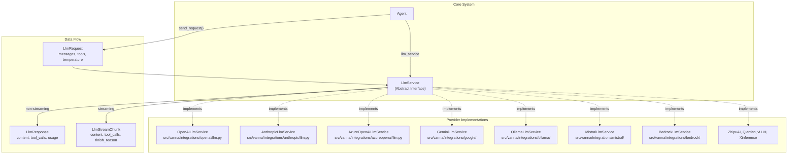
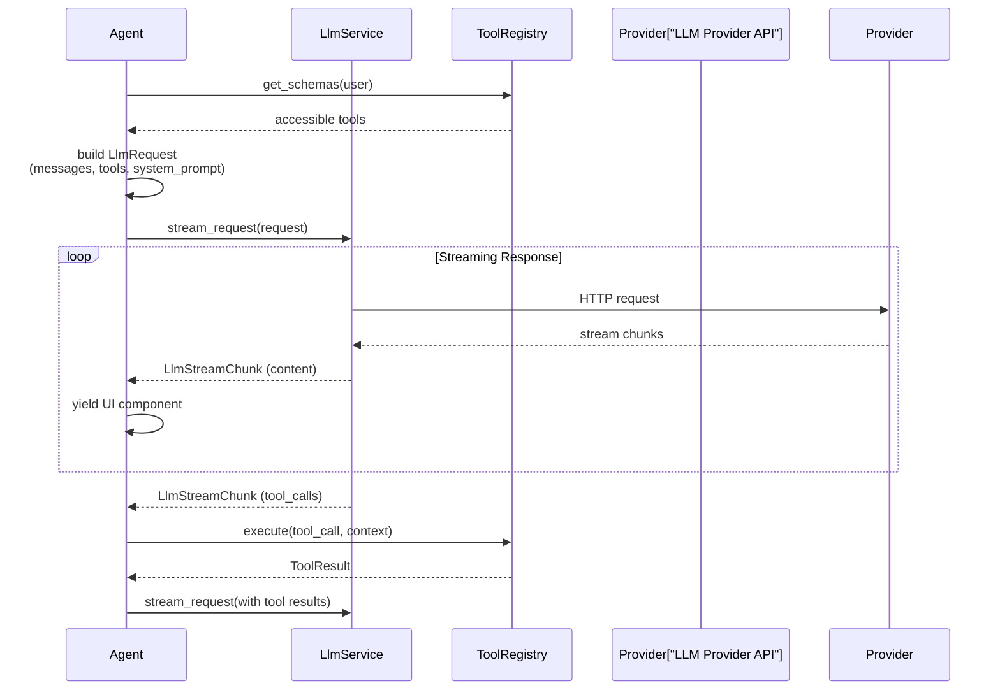
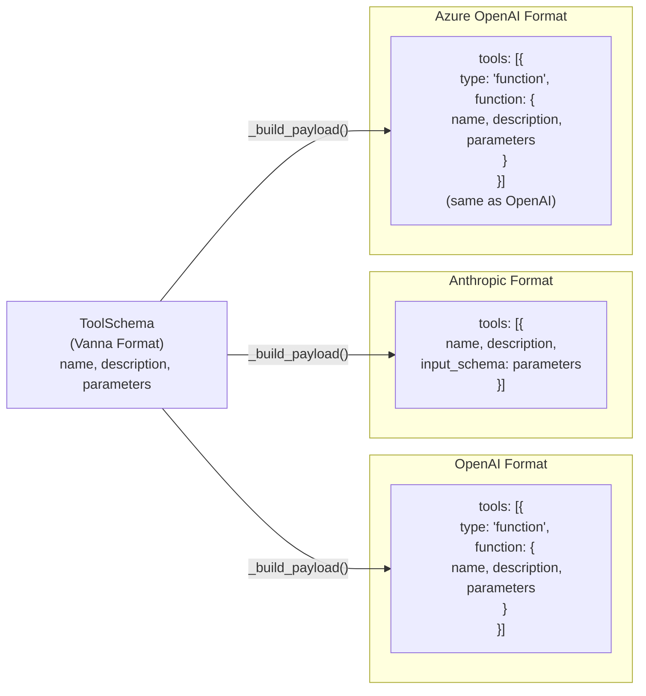
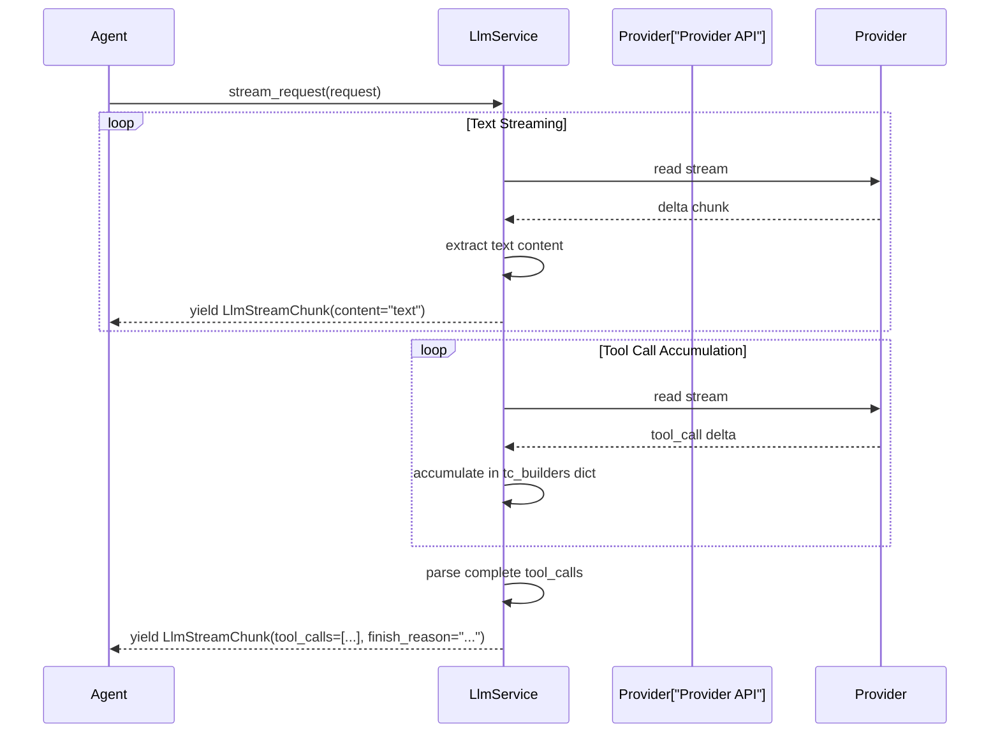

<!-- source: DeepWiki mcp.deepwiki.com · repo vanna-ai/vanna · page 5 LLM Integrations · fetched 2026-10-29 -->

# LLM Integrations

<details>
<summary>Relevant source files</summary>

The following files were used as context for generating this wiki page:

- [MIGRATION_GUIDE.md](MIGRATION_GUIDE.md)
- [README.md](README.md)
- [img/architecture.png](img/architecture.png)
- [img/vanna2.svg](img/vanna2.svg)
- [notebooks/quickstart.ipynb](notebooks/quickstart.ipynb)
- [src/vanna/integrations/anthropic/llm.py](src/vanna/integrations/anthropic/llm.py)
- [src/vanna/integrations/azureopenai/__init__.py](src/vanna/integrations/azureopenai/__init__.py)
- [src/vanna/integrations/azureopenai/llm.py](src/vanna/integrations/azureopenai/llm.py)
- [src/vanna/integrations/openai/llm.py](src/vanna/integrations/openai/llm.py)
- [src/vanna/servers/fastapi/app.py](src/vanna/servers/fastapi/app.py)
- [src/vanna/servers/flask/app.py](src/vanna/servers/flask/app.py)
- [tests/conftest.py](tests/conftest.py)
- [tests/test_agent_memory_sanity.py](tests/test_agent_memory_sanity.py)
- [tests/test_agents.py](tests/test_agents.py)
- [tests/test_azureopenai_llm.py](tests/test_azureopenai_llm.py)
- [tests/test_legacy_adapter.py](tests/test_legacy_adapter.py)
- [tox.ini](tox.ini)

</details>


## Purpose and Scope

This page documents Vanna's LLM integration system, which enables the Agent framework to communicate with various Large Language Model providers through a unified interface. The system supports OpenAI, Anthropic (Claude), Google Gemini, Azure OpenAI, Ollama, and several other providers.

For detailed information about the `LlmService` interface specification and its role in the agent architecture, see [LlmService Interface](#2.3). For information about how agents use LLM services during message processing, see [Agent System](#2.1).

## Architecture Overview

Vanna's LLM integration follows a plugin-based architecture where all providers implement a common `LlmService` interface, enabling seamless switching between providers.



**Sources:** [README.md:95-96](), [src/vanna/integrations/anthropic/llm.py:1-271](), [src/vanna/integrations/openai/llm.py:1-268](), [src/vanna/integrations/azureopenai/llm.py:1-330]()

### Integration Points

The LLM service integrates with the Agent system at the following points:



**Sources:** [tests/test_agents.py:23-52](), [src/vanna/integrations/anthropic/llm.py:92-122]()

## The LlmService Interface

All LLM providers implement the `LlmService` abstract base class, which defines three core methods:

| Method | Purpose | Return Type |
|--------|---------|-------------|
| `send_request()` | Non-streaming request/response | `LlmResponse` |
| `stream_request()` | Streaming response generation | `AsyncGenerator[LlmStreamChunk]` |
| `validate_tools()` | Validate tool schemas for provider | `List[str]` (error messages) |

### Request/Response Models

**LlmRequest** ([src/vanna/core/llm/models.py]())
- `messages: List[LlmMessage]` - Conversation history
- `tools: Optional[List[ToolSchema]]` - Available tools
- `system_prompt: Optional[str]` - System instructions
- `temperature: float` - Sampling temperature
- `max_tokens: Optional[int]` - Maximum response length
- `user: User` - Current user context

**LlmResponse** ([src/vanna/core/llm/models.py]())
- `content: Optional[str]` - Generated text
- `tool_calls: Optional[List[ToolCall]]` - Tool invocations
- `finish_reason: Optional[str]` - Completion reason
- `usage: Optional[Dict[str, int]]` - Token usage statistics

**LlmStreamChunk** ([src/vanna/core/llm/models.py]())
- `content: Optional[str]` - Text delta
- `tool_calls: Optional[List[ToolCall]]` - Tool invocations (emitted at end)
- `finish_reason: Optional[str]` - Stream completion signal

**Sources:** [src/vanna/integrations/anthropic/llm.py:18-24](), [src/vanna/integrations/openai/llm.py:18-24]()

## Supported Providers

Vanna supports the following LLM providers with varying levels of feature support:

| Provider | Implementation | Streaming | Tool Calling | Installation |
|----------|---------------|-----------|--------------|--------------|
| OpenAI | `OpenAILlmService` | ✅ | ✅ | `pip install 'vanna[openai]'` |
| Anthropic | `AnthropicLlmService` | ✅ | ✅ | `pip install 'vanna[anthropic]'` |
| Azure OpenAI | `AzureOpenAILlmService` | ✅ | ✅ | `pip install 'vanna[azureopenai]'` |
| Google Gemini | `GeminiLlmService` | ✅ | ✅ | `pip install 'vanna[gemini]'` |
| Ollama | `OllamaLlmService` | ✅ | ✅ | `pip install 'vanna[ollama]'` |
| Mistral AI | `MistralLlmService` | ✅ | ✅ | `pip install 'vanna[mistral]'` |
| AWS Bedrock | `BedrockLlmService` | ✅ | ✅ | `pip install 'vanna[bedrock]'` |
| ZhipuAI | `ZhipuAILlmService` | ✅ | ✅ | `pip install 'vanna[zhipuai]'` |
| Qianfan | `QianfanLlmService` | ✅ | ✅ | `pip install 'vanna[qianfan]'` |
| vLLM | `VLLMLlmService` | ✅ | ✅ | `pip install 'vanna[vllm]'` |
| Xinference | `XinferenceLlmService` | ✅ | ✅ | `pip install 'vanna[xinference]'` |

For detailed documentation on specific providers, see:
- [OpenAI](#5.2)
- [Anthropic (Claude)](#5.3)
- [Google Gemini](#5.4)
- [Azure OpenAI](#5.5)
- [Ollama (Local Models)](#5.6)
- [Other LLM Providers](#5.7)

**Sources:** [README.md:95-96](), [tox.ini:8-9](), [tests/conftest.py:16-27]()

## Common Integration Patterns

### Instantiation Pattern

All LLM service implementations follow a consistent instantiation pattern:

```python
from vanna.integrations.anthropic import AnthropicLlmService
from vanna.integrations.openai import OpenAILlmService
from vanna.integrations.azureopenai import AzureOpenAILlmService

# Anthropic
llm = AnthropicLlmService(
    model="claude-sonnet-4-5",
    api_key="sk-ant-...",  # or set ANTHROPIC_API_KEY env var
    base_url=None,  # optional custom endpoint
)

# OpenAI
llm = OpenAILlmService(
    model="gpt-5",
    api_key="sk-...",  # or set OPENAI_API_KEY env var
    organization=None,  # optional
    base_url=None,  # optional custom endpoint
)

# Azure OpenAI
llm = AzureOpenAILlmService(
    model="gpt-4o",  # deployment name
    api_key="...",  # or set AZURE_OPENAI_API_KEY
    azure_endpoint="https://....openai.azure.com",
    api_version="2024-10-21",
)
```

**Sources:** [src/vanna/integrations/anthropic/llm.py:28-63](), [src/vanna/integrations/openai/llm.py:27-66](), [src/vanna/integrations/azureopenai/llm.py:44-118]()

### Configuration Priority

All implementations follow this configuration priority (highest to lowest):

1. **Explicit constructor arguments** - Directly passed parameters
2. **Environment variables** - Provider-specific variables
3. **Default values** - Sensible defaults (e.g., `claude-sonnet-4-5`, `gpt-5`)

Common environment variables:

```bash
# Anthropic
export ANTHROPIC_API_KEY="sk-ant-..."
export ANTHROPIC_MODEL="claude-sonnet-4-5"
export ANTHROPIC_BASE_URL="https://..."  # optional

# OpenAI
export OPENAI_API_KEY="sk-..."
export OPENAI_MODEL="gpt-5"
export OPENAI_ORG="org-..."  # optional
export OPENAI_BASE_URL="https://..."  # optional

# Azure OpenAI
export AZURE_OPENAI_API_KEY="..."
export AZURE_OPENAI_MODEL="gpt-4o"
export AZURE_OPENAI_ENDPOINT="https://....openai.azure.com"
export AZURE_OPENAI_API_VERSION="2024-10-21"
```

**Sources:** [src/vanna/integrations/anthropic/llm.py:38-55](), [src/vanna/integrations/openai/llm.py:38-56](), [src/vanna/integrations/azureopenai/llm.py:62-96]()

### Tool Schema Serialization

Each provider implements provider-specific tool schema formats:



**OpenAI/Azure Format** ([src/vanna/integrations/openai/llm.py:218-231](), [src/vanna/integrations/azureopenai/llm.py:272-284]())
```python
{
    "type": "function",
    "function": {
        "name": "run_sql",
        "description": "Execute SQL query",
        "parameters": {
            "type": "object",
            "properties": {...}
        }
    }
}
```

**Anthropic Format** ([src/vanna/integrations/anthropic/llm.py:198-207]())
```python
{
    "name": "run_sql",
    "description": "Execute SQL query",
    "input_schema": {
        "type": "object",
        "properties": {...}
    }
}
```

**Sources:** [src/vanna/integrations/anthropic/llm.py:198-223](), [src/vanna/integrations/openai/llm.py:190-242](), [src/vanna/integrations/azureopenai/llm.py:244-303]()

### Message Format Conversion

Each provider converts Vanna's `LlmMessage` format to provider-specific formats:

**Anthropic Content Blocks** ([src/vanna/integrations/anthropic/llm.py:136-196]())
- Text messages: `{"type": "text", "text": "..."}`
- Tool results: `{"type": "tool_result", "tool_use_id": "...", "content": "..."}`
- Tool calls: `{"type": "tool_use", "id": "...", "name": "...", "input": {...}}`
- Consecutive tool messages grouped into single user message

**OpenAI/Azure Messages** ([src/vanna/integrations/openai/llm.py:190-216](), [src/vanna/integrations/azureopenai/llm.py:244-270]())
- Text messages: `{"role": "...", "content": "..."}`
- Tool results: `{"role": "tool", "tool_call_id": "...", "content": "..."}`
- Tool calls: `{"role": "assistant", "tool_calls": [{...}]}`
- System prompt as first message with `role: "system"`

**Sources:** [src/vanna/integrations/anthropic/llm.py:132-197](), [src/vanna/integrations/openai/llm.py:190-242](), [src/vanna/integrations/azureopenai/llm.py:244-303]()

### Streaming Patterns

All implementations emit text incrementally and accumulate tool calls:



**OpenAI Streaming** ([src/vanna/integrations/openai/llm.py:100-178]())
```python
stream = self._client.chat.completions.create(**payload, stream=True)
tc_builders: Dict[int, Dict[str, Optional[str]]] = {}

for event in stream:
    delta = event.choices[0].delta
    
    # Yield text immediately
    if delta.content:
        yield LlmStreamChunk(content=delta.content)
    
    # Accumulate tool calls by index
    if delta.tool_calls:
        for tc in delta.tool_calls:
            idx = tc.index
            tc_builders[idx]["arguments"] += tc.function.arguments

# Emit final tool calls chunk
if tc_builders:
    yield LlmStreamChunk(tool_calls=final_tool_calls, finish_reason=last_finish)
```

**Anthropic Streaming** ([src/vanna/integrations/anthropic/llm.py:92-122]())
```python
with self._client.messages.stream(**payload) as stream:
    # Stream text as it arrives
    for text in stream.text_stream:
        if text:
            yield LlmStreamChunk(content=text)
    
    # Get final message with tool calls
    final = stream.get_final_message()
    _, tool_calls = self._parse_message_content(final)
    if tool_calls:
        yield LlmStreamChunk(tool_calls=tool_calls, finish_reason=...)
```

**Sources:** [src/vanna/integrations/openai/llm.py:100-178](), [src/vanna/integrations/anthropic/llm.py:92-122](), [src/vanna/integrations/azureopenai/llm.py:152-232]()

### Tool Call Parsing

Providers return tool calls in different formats that must be normalized:

**OpenAI/Azure Format** ([src/vanna/integrations/openai/llm.py:244-267](), [src/vanna/integrations/azureopenai/llm.py:305-329]())
```python
def _extract_tool_calls_from_message(self, message):
    tool_calls = []
    for tc in message.tool_calls:
        args_raw = tc.function.arguments  # JSON string
        args_dict = json.loads(args_raw)
        tool_calls.append(ToolCall(
            id=tc.id,
            name=tc.function.name,
            arguments=args_dict
        ))
    return tool_calls
```

**Anthropic Format** ([src/vanna/integrations/anthropic/llm.py:226-270]())
```python
def _parse_message_content(self, msg):
    tool_calls = []
    for block in msg.content:
        if block.type == "tool_use":
            tool_calls.append(ToolCall(
                id=block.id,
                name=block.name,
                arguments=block.input  # Already a dict
            ))
    return text_parts, tool_calls
```

**Sources:** [src/vanna/integrations/anthropic/llm.py:226-270](), [src/vanna/integrations/openai/llm.py:244-267](), [src/vanna/integrations/azureopenai/llm.py:305-329]()

## Using LLM Services with Agent

Integrating an LLM service with the Agent requires passing it to the `Agent` constructor:

```python
from vanna import Agent, AgentConfig
from vanna.integrations.anthropic import AnthropicLlmService
from vanna.core.registry import ToolRegistry
from vanna.core.user import UserResolver, User, RequestContext

# 1. Create LLM service
llm = AnthropicLlmService(model="claude-sonnet-4-5")

# 2. Set up tools
tools = ToolRegistry()
# ... register tools ...

# 3. Define user resolver
class MyUserResolver(UserResolver):
    async def resolve_user(self, request_context: RequestContext) -> User:
        return User(id="user1", email="user@example.com", group_memberships=["user"])

# 4. Create agent
agent = Agent(
    llm_service=llm,  # LLM service instance
    tool_registry=tools,
    user_resolver=MyUserResolver(),
    config=AgentConfig(temperature=0.7)  # Optional config
)

# 5. Use agent
async for component in agent.send_message(request_context, "Show me sales data"):
    # Process streaming UI components
    pass
```

The Agent automatically:
- Constructs `LlmRequest` objects with conversation history and tool schemas
- Calls `llm_service.stream_request()` for streaming responses
- Parses tool calls and executes them via `ToolRegistry`
- Handles multi-turn tool execution loops

**Sources:** [tests/test_agents.py:23-52](), [notebooks/quickstart.ipynb:123-137]()

## Provider-Specific Features

### Reasoning Model Detection (Azure OpenAI)

Azure OpenAI automatically detects reasoning models (GPT-5, o1, o3-mini) and excludes unsupported parameters:

```python
# Reasoning models: o1, o1-mini, o1-preview, o3-mini, gpt-5, gpt-5-mini, etc.
REASONING_MODELS = {"o1", "o1-mini", "o1-preview", "o3-mini", "gpt-5", ...}

def _is_reasoning_model(model: str) -> bool:
    model_lower = model.lower()
    return any(reasoning_model in model_lower for reasoning_model in REASONING_MODELS)

# In payload building:
if not self._is_reasoning_model:
    payload["temperature"] = request.temperature  # Skip for reasoning models
```

**Sources:** [src/vanna/integrations/azureopenai/llm.py:24-42](), [src/vanna/integrations/azureopenai/llm.py:286-295](), [tests/test_azureopenai_llm.py:13-46]()

### Azure AD Token Provider (Azure OpenAI)

Azure OpenAI supports Microsoft Entra ID authentication alongside API keys:

```python
from azure.identity import DefaultAzureCredential, get_bearer_token_provider

token_provider = get_bearer_token_provider(
    DefaultAzureCredential(),
    "https://cognitiveservices.azure.com/.default"
)

llm = AzureOpenAILlmService(
    model="gpt-4o",
    azure_endpoint="https://....openai.azure.com",
    azure_ad_token_provider=token_provider,  # No api_key needed
)
```

**Sources:** [src/vanna/integrations/azureopenai/llm.py:44-60](), [src/vanna/integrations/azureopenai/llm.py:106-115](), [tests/test_azureopenai_llm.py:133-145]()

### System Prompt Handling

Different providers handle system prompts differently:

**Anthropic** - Dedicated `system` parameter ([src/vanna/integrations/anthropic/llm.py:220-222]())
```python
payload = {
    "model": self.model,
    "messages": messages,  # No system message in messages list
    "system": request.system_prompt  # Separate parameter
}
```

**OpenAI/Azure** - First message with `role: "system"` ([src/vanna/integrations/openai/llm.py:193-195](), [src/vanna/integrations/azureopenai/llm.py:247-249]())
```python
messages = []
if request.system_prompt:
    messages.append({"role": "system", "content": request.system_prompt})
# Then add conversation messages
```

**Sources:** [src/vanna/integrations/anthropic/llm.py:220-222](), [src/vanna/integrations/openai/llm.py:190-195](), [src/vanna/integrations/azureopenai/llm.py:244-249]()

## Testing LLM Integrations

### Test Markers

Vanna uses pytest markers to organize LLM integration tests by provider:

```python
# In tests/conftest.py
@pytest.mark.anthropic  # Requires ANTHROPIC_API_KEY
@pytest.mark.openai     # Requires OPENAI_API_KEY
@pytest.mark.azureopenai # Requires AZURE_OPENAI_API_KEY
@pytest.mark.gemini     # Requires GOOGLE_API_KEY or GEMINI_API_KEY
@pytest.mark.ollama     # Requires OLLAMA_HOST (optional)
```

Tests automatically skip if required API keys are not set ([tests/conftest.py:29-67]()).

**Sources:** [tests/conftest.py:14-27](), [tests/conftest.py:29-67]()

### Tox Environments

The project defines dedicated tox environments for each provider:

```ini
[tox]
envlist =
    py311-anthropic
    py311-openai
    py311-azureopenai
    py311-gemini
    py311-ollama

[testenv:py311-anthropic]
extras = anthropic
passenv = ANTHROPIC_API_KEY
commands =
    pytest tests/ -v -m anthropic

[testenv:py311-openai]
extras = openai
passenv = OPENAI_API_KEY
commands =
    pytest tests/ -v -m openai
```

Run specific provider tests:
```bash
tox -e py311-anthropic
tox -e py311-openai
tox -e py311-azureopenai
```

**Sources:** [tox.ini:1-61]()

### Integration Test Structure

All provider integration tests follow a common pattern:

```python
@pytest.mark.anthropic
@pytest.mark.asyncio
async def test_anthropic_top_artist(chinook_db):
    """Test Anthropic agent finding the top artist by sales."""
    from vanna.integrations.anthropic import AnthropicLlmService
    
    api_key = os.getenv("ANTHROPIC_API_KEY")
    llm = AnthropicLlmService(api_key=api_key, model="claude-sonnet-4-5")
    
    agent = create_agent(llm, chinook_db)
    await test_agent_top_artist(agent)
```

The `chinook_db` fixture provides a SQLite database for testing SQL execution ([tests/conftest.py:69-88]()).

**Sources:** [tests/test_agents.py:108-118](), [tests/test_agents.py:121-131](), [tests/test_agents.py:134-154](), [tests/conftest.py:69-88]()

## Error Handling

All LLM service implementations should handle common error scenarios:

1. **Import errors** - Graceful failure if provider SDK not installed ([src/vanna/integrations/anthropic/llm.py:45-50](), [src/vanna/integrations/openai/llm.py:46-51]())
2. **Authentication errors** - Clear messages about missing API keys
3. **API errors** - Let provider SDK exceptions propagate with context
4. **Validation errors** - Tool schema validation via `validate_tools()` method

Example import error handling:
```python
def __init__(self, ...):
    try:
        import anthropic
    except Exception as e:
        raise ImportError(
            "anthropic package is required. Install with: pip install 'vanna[anthropic]'"
        ) from e
```

**Sources:** [src/vanna/integrations/anthropic/llm.py:45-50](), [src/vanna/integrations/openai/llm.py:46-51](), [src/vanna/integrations/azureopenai/llm.py:71-77]()

## Migration from Vanna 0.x

Vanna 2.0 requires switching from the old monolithic LLM configuration to the new `LlmService` system:

**Vanna 0.x:**
```python
from vanna.openai_chat import OpenAI_Chat
from vanna.chromadb import ChromaDB_VectorStore

class MyVanna(ChromaDB_VectorStore, OpenAI_Chat):
    def __init__(self, config=None):
        ChromaDB_VectorStore.__init__(self, config=config)
        OpenAI_Chat.__init__(self, config=config)

vn = MyVanna(config={'model': 'gpt-4', 'api_key': 'your-key'})
```

**Vanna 2.0:**
```python
from vanna import Agent
from vanna.integrations.openai import OpenAILlmService
from vanna.integrations.chromadb import ChromaAgentMemory

llm = OpenAILlmService(model="gpt-5", api_key="your-key")
agent_memory = ChromaAgentMemory()

agent = Agent(llm_service=llm, agent_memory=agent_memory, ...)
```

For gradual migration using the `LegacyVannaAdapter`, see [Migration Guide](MIGRATION_GUIDE.md:80-165).

**Sources:** [MIGRATION_GUIDE.md:19-38](), [MIGRATION_GUIDE.md:167-250]()

---

