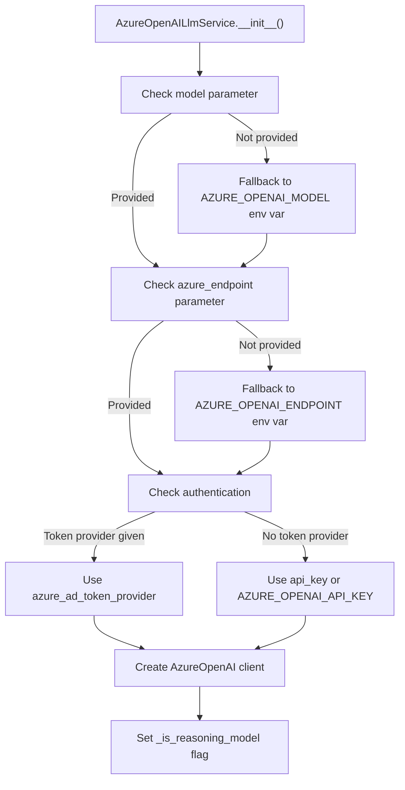
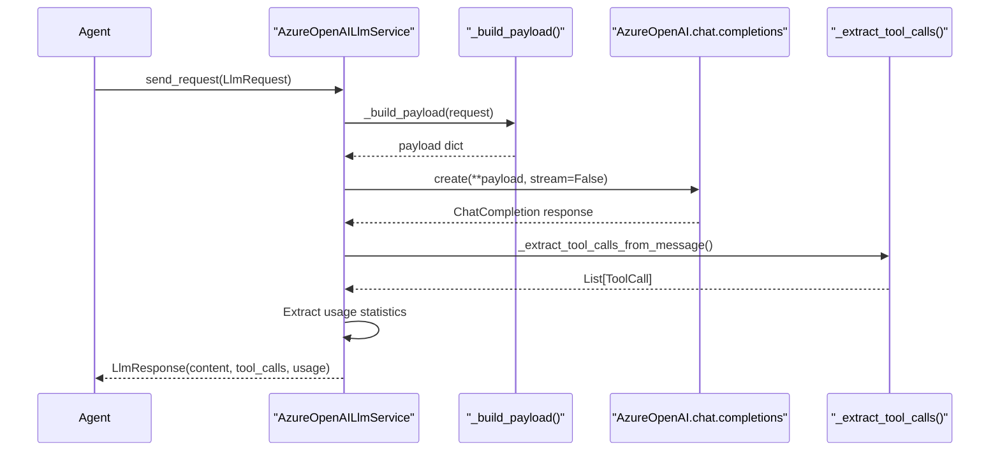
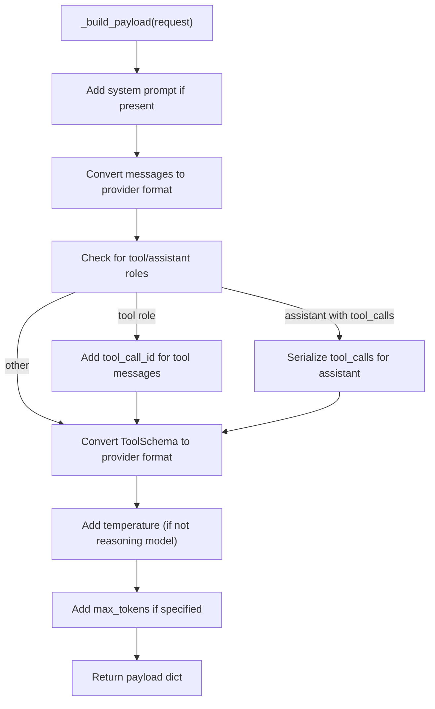
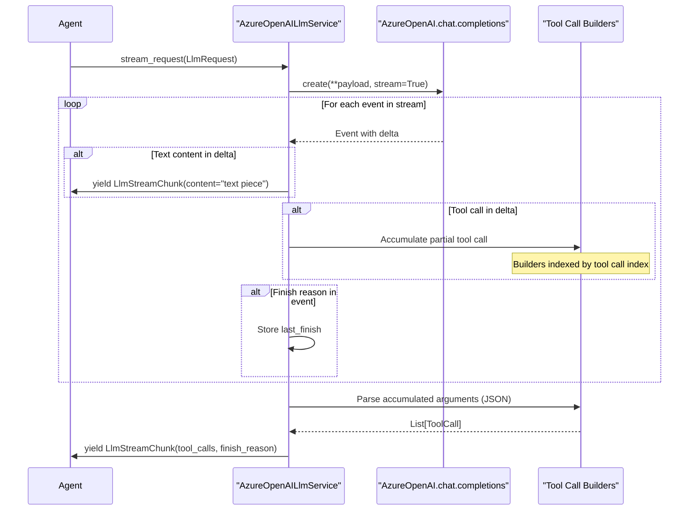
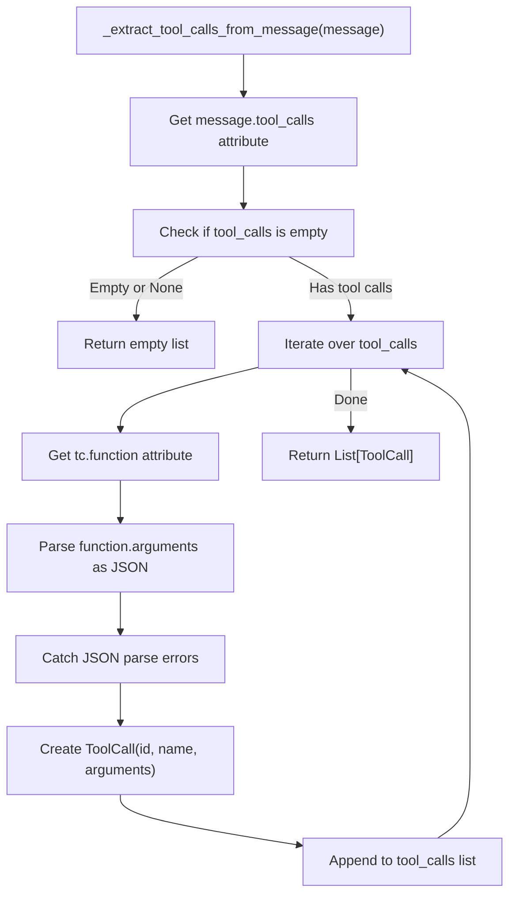
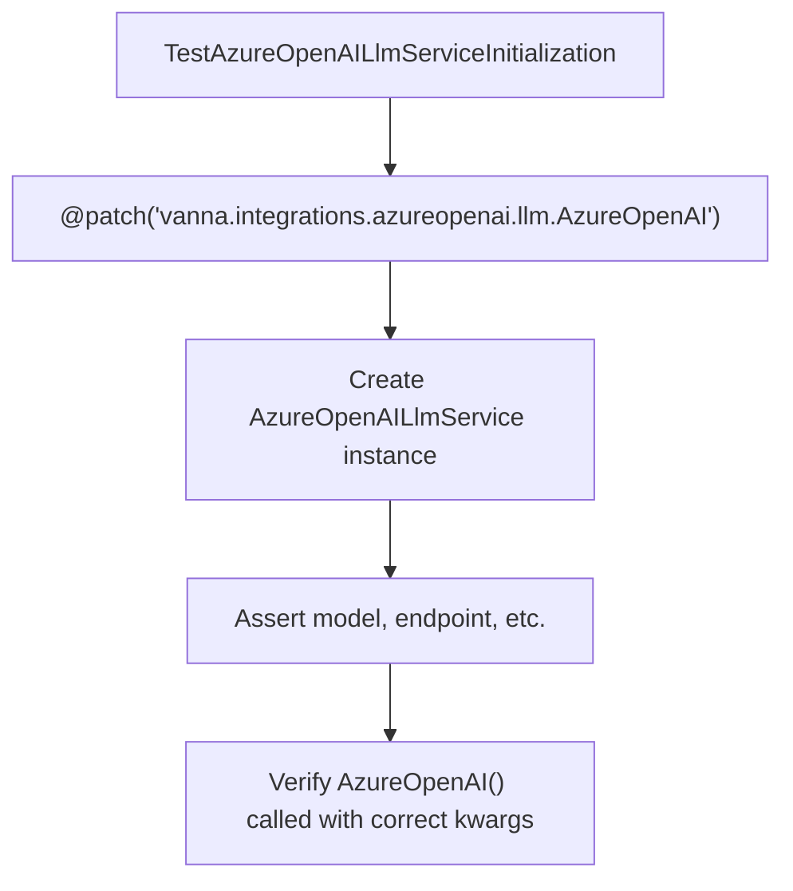

<!-- source: DeepWiki mcp.deepwiki.com · repo vanna-ai/vanna · page 5.1 LLM Integration Patterns · fetched 2026-10-29 -->

# LLM Integration Patterns

<details>
<summary>Relevant source files</summary>

The following files were used as context for generating this wiki page:

- [MIGRATION_GUIDE.md](MIGRATION_GUIDE.md)
- [README.md](README.md)
- [img/architecture.png](img/architecture.png)
- [img/vanna2.svg](img/vanna2.svg)
- [notebooks/quickstart.ipynb](notebooks/quickstart.ipynb)
- [src/vanna/integrations/anthropic/llm.py](src/vanna/integrations/anthropic/llm.py)
- [src/vanna/integrations/azureopenai/__init__.py](src/vanna/integrations/azureopenai/__init__.py)
- [src/vanna/integrations/azureopenai/llm.py](src/vanna/integrations/azureopenai/llm.py)
- [src/vanna/integrations/openai/llm.py](src/vanna/integrations/openai/llm.py)
- [src/vanna/integrations/openai/responses.py](src/vanna/integrations/openai/responses.py)
- [src/vanna/integrations/postgres/sql_runner.py](src/vanna/integrations/postgres/sql_runner.py)
- [src/vanna/servers/fastapi/app.py](src/vanna/servers/fastapi/app.py)
- [src/vanna/servers/flask/app.py](src/vanna/servers/flask/app.py)
- [tests/conftest.py](tests/conftest.py)
- [tests/test_agent_memory_sanity.py](tests/test_agent_memory_sanity.py)
- [tests/test_agents.py](tests/test_agents.py)
- [tests/test_azureopenai_llm.py](tests/test_azureopenai_llm.py)
- [tests/test_legacy_adapter.py](tests/test_legacy_adapter.py)
- [tox.ini](tox.ini)

</details>


This document describes the common architectural patterns used across all LLM provider integrations in Vanna. It covers the `LlmService` interface implementation patterns, request/response handling, streaming, tool call extraction, and usage tracking. For documentation on specific LLM providers, see [OpenAI](#5.2), [Anthropic](#5.3), [Gemini](#5.4), [Azure OpenAI](#5.5), and [Ollama](#5.6).

## Purpose and Scope

All LLM integrations in Vanna implement the `LlmService` interface from [src/vanna/core/llm/__init__.py:1-50](). This page documents the common patterns, helper methods, and design principles shared across implementations. The patterns described here apply to all 7+ LLM provider integrations listed in [pyproject.toml:40-82]().

---

## LlmService Interface Overview

Every LLM provider integration must implement three core methods defined by the `LlmService` interface:

| Method | Signature | Purpose |
|--------|-----------|---------|
| `send_request` | `async def send_request(request: LlmRequest) -> LlmResponse` | Non-streaming request/response |
| `stream_request` | `async def stream_request(request: LlmRequest) -> AsyncGenerator[LlmStreamChunk, None]` | Streaming request with incremental responses |
| `validate_tools` | `async def validate_tools(tools: List[ToolSchema]) -> List[str]` | Pre-flight validation of tool schemas |

### Core Data Models

The interface uses standardized models for requests and responses:

- **`LlmRequest`**: Contains `messages`, `tools`, `system_prompt`, `temperature`, `max_tokens`, and `user` context
- **`LlmResponse`**: Contains `content`, `tool_calls`, `finish_reason`, and `usage` statistics
- **`LlmStreamChunk`**: Contains incremental `content`, `tool_calls` (emitted at end), and `finish_reason`
- **`ToolCall`**: Contains `id`, `name`, and `arguments` (dict)
- **`ToolSchema`**: Contains `name`, `description`, and `parameters` (JSON schema)

**Sources**: [src/vanna/integrations/azureopenai/llm.py:15-21]()

---

## Common Implementation Patterns

### Initialization and Configuration

All LLM service implementations follow a standard initialization pattern with provider-specific and environment variable fallbacks:



**Key Pattern**: The initialization validates required parameters, falls back to environment variables, and raises clear `ValueError` exceptions with helpful messages if configuration is missing.

**Sources**: [src/vanna/integrations/azureopenai/llm.py:62-119](), [tests/test_azureopenai_llm.py:48-159]()

### Configuration Validation

Implementations validate configuration in `__init__` and raise descriptive errors:

```python
# Example from AzureOpenAILlmService
if not self.model:
    raise ValueError(
        "model parameter (deployment name) is required for Azure OpenAI. "
        "Provide it as argument or set AZURE_OPENAI_MODEL environment variable."
    )

if not azure_endpoint:
    raise ValueError(
        "azure_endpoint is required for Azure OpenAI. "
        "Provide it as argument or set AZURE_OPENAI_ENDPOINT environment variable."
    )

if not api_key and not azure_ad_token_provider:
    raise ValueError(
        "Authentication required: provide either api_key or azure_ad_token_provider. "
        "API key can also be set via AZURE_OPENAI_API_KEY environment variable."
    )
```

**Sources**: [src/vanna/integrations/azureopenai/llm.py:80-115]()

---

## Request Processing Flow

### Non-Streaming Requests

The `send_request` method follows a standard pattern across all implementations:



**Key Steps**:
1. Build provider-specific payload from `LlmRequest`
2. Call provider API (synchronously within async context)
3. Extract tool calls from response message
4. Extract usage statistics (prompt_tokens, completion_tokens, total_tokens)
5. Return standardized `LlmResponse`

**Sources**: [src/vanna/integrations/azureopenai/llm.py:120-150]()

### Payload Building Pattern

The `_build_payload` helper method constructs provider-specific API payloads:



**Critical Pattern - Reasoning Models**: Some models (o1, o3-mini, GPT-5 series) do not support temperature parameters. The pattern is:

```python
REASONING_MODELS = {"o1", "o1-mini", "o1-preview", "o3-mini", "gpt-5", ...}

def _is_reasoning_model(model: str) -> bool:
    model_lower = model.lower()
    return any(reasoning_model in model_lower for reasoning_model in REASONING_MODELS)

# In __init__:
self._is_reasoning_model = _is_reasoning_model(self.model)

# In _build_payload:
if not self._is_reasoning_model:
    payload["temperature"] = request.temperature
```

**Sources**: [src/vanna/integrations/azureopenai/llm.py:24-42](), [src/vanna/integrations/azureopenai/llm.py:243-303](), [tests/test_azureopenai_llm.py:13-46]()

### Tool Schema Conversion

Tools must be converted from Vanna's `ToolSchema` to provider-specific formats:

**OpenAI/Azure OpenAI Format**:
```python
tools_payload = [
    {
        "type": "function",
        "function": {
            "name": t.name,
            "description": t.description,
            "parameters": t.parameters,  # Already JSON Schema
        },
    }
    for t in request.tools
]
payload["tools"] = tools_payload
payload["tool_choice"] = "auto"
```

**Anthropic Format**: Uses `tools` array with slightly different structure (documented in [Anthropic integration](#5.3))

**Gemini Format**: Uses `function_declarations` (documented in [Gemini integration](#5.4))

**Sources**: [src/vanna/integrations/azureopenai/llm.py:273-284](), [tests/test_azureopenai_llm.py:240-273]()

---

## Streaming Request Pattern

The `stream_request` method implements incremental response delivery with tool call accumulation:



### Tool Call Accumulation Pattern

Tool calls arrive incrementally in streaming responses and must be accumulated:

```python
# Initialize builders for each tool call index
tc_builders: Dict[int, Dict[str, Optional[str]]] = {}

for event in stream:
    delta = event.choices[0].delta
    
    # Handle text content
    if delta.content:
        yield LlmStreamChunk(content=delta.content)
    
    # Accumulate tool calls
    if delta.tool_calls:
        for tc in delta.tool_calls:
            idx = tc.index or 0
            b = tc_builders.setdefault(idx, {"id": None, "name": None, "arguments": ""})
            
            if tc.id:
                b["id"] = tc.id
            if tc.function and tc.function.name:
                b["name"] = tc.function.name
            if tc.function and tc.function.arguments:
                b["arguments"] = (b["arguments"] or "") + tc.function.arguments

# After stream ends, emit final tool calls
final_tool_calls = []
for b in tc_builders.values():
    args_dict = json.loads(b["arguments"] or "{}")
    final_tool_calls.append(ToolCall(id=b["id"], name=b["name"], arguments=args_dict))

if final_tool_calls:
    yield LlmStreamChunk(tool_calls=final_tool_calls, finish_reason=last_finish)
```

**Sources**: [src/vanna/integrations/azureopenai/llm.py:152-232]()

---

## Tool Call Extraction

### Extracting from Non-Streaming Responses

The `_extract_tool_calls_from_message` helper parses tool calls from API responses:



### JSON Argument Parsing with Error Handling

Tool call arguments arrive as JSON strings and must be parsed defensively:

```python
def _extract_tool_calls_from_message(self, message: Any) -> List[ToolCall]:
    tool_calls: List[ToolCall] = []
    raw_tool_calls = getattr(message, "tool_calls", None) or []
    
    for tc in raw_tool_calls:
        fn = getattr(tc, "function", None)
        if not fn:
            continue
        
        args_raw = getattr(fn, "arguments", "{}")
        try:
            loaded = json.loads(args_raw)
            if isinstance(loaded, dict):
                args_dict = loaded
            else:
                # Handle non-dict JSON (wrap in "args" key)
                args_dict = {"args": loaded}
        except Exception:
            # Parse error - preserve raw string
            args_dict = {"_raw": args_raw}
        
        tool_calls.append(ToolCall(
            id=getattr(tc, "id", "tool_call"),
            name=getattr(fn, "name", "tool"),
            arguments=args_dict,
        ))
    
    return tool_calls
```

**Error Handling Strategy**:
- If arguments is not valid JSON, store in `{"_raw": "..."}` dict
- If arguments is valid JSON but not a dict, wrap in `{"args": ...}`
- Always provide fallback values for `id` and `name`

**Sources**: [src/vanna/integrations/azureopenai/llm.py:305-329]()

---

## Usage Tracking Pattern

Usage statistics are extracted from API responses and returned in `LlmResponse.usage`:

```python
async def send_request(self, request: LlmRequest) -> LlmResponse:
    resp = self._client.chat.completions.create(**payload, stream=False)
    
    # Extract usage if available
    usage: Dict[str, int] = {}
    if getattr(resp, "usage", None):
        usage = {
            "prompt_tokens": getattr(resp.usage, "prompt_tokens", 0),
            "completion_tokens": getattr(resp.usage, "completion_tokens", 0),
            "total_tokens": getattr(resp.usage, "total_tokens", 0),
        }
    
    return LlmResponse(
        content=content,
        tool_calls=tool_calls,
        finish_reason=finish_reason,
        usage=usage or None,  # None if no usage data
    )
```

**Note**: Streaming responses typically do not include usage statistics until the stream ends. Some providers (like OpenAI) include usage in a final event, while others do not.

**Sources**: [src/vanna/integrations/azureopenai/llm.py:134-149]()

---

## Tool Validation Pattern

The `validate_tools` method performs provider-specific validation before sending to the LLM:

```python
async def validate_tools(self, tools: List[ToolSchema]) -> List[str]:
    """Validate tool schemas. Returns a list of error messages."""
    errors: List[str] = []
    
    for t in tools:
        # Provider-specific constraints
        if not t.name or len(t.name) > 64:
            errors.append(f"Invalid tool name: {t.name!r}")
        
        # Additional checks (description length, parameter schema, etc.)
        # ...
    
    return errors
```

**Common Validations**:
- Tool name length limits (typically 64 characters)
- Tool name format (alphanumeric + underscores)
- Description length limits
- Parameter schema validity (JSON Schema compliance)

**Sources**: [src/vanna/integrations/azureopenai/llm.py:233-240]()

---

## Testing Patterns

### Unit Testing LLM Services

LLM service tests use mocking to avoid actual API calls:



**Mocking Pattern**:
```python
@patch("vanna.integrations.azureopenai.llm.AzureOpenAI")
def test_init_with_all_params(mock_azure_openai):
    service = AzureOpenAILlmService(
        model="gpt-4o",
        api_key="test-key",
        azure_endpoint="https://test.openai.azure.com",
        api_version="2024-10-21",
    )
    
    assert service.model == "gpt-4o"
    assert not service._is_reasoning_model
    
    # Verify AzureOpenAI was called with correct params
    mock_azure_openai.assert_called_once()
    call_kwargs = mock_azure_openai.call_args[1]
    assert call_kwargs["azure_endpoint"] == "https://test.openai.azure.com"
    assert call_kwargs["api_version"] == "2024-10-21"
```

**Sources**: [tests/test_azureopenai_llm.py:48-159]()

### Integration Testing with Real APIs

Integration tests use real API keys from environment variables and test against actual LLM providers:

```python
@pytest.mark.anthropic
@pytest.mark.asyncio
async def test_anthropic_top_artist(chinook_db):
    """Test Anthropic agent finding the top artist by sales."""
    from vanna.integrations.anthropic import AnthropicLlmService
    
    api_key = os.getenv("ANTHROPIC_API_KEY")
    llm = AnthropicLlmService(api_key=api_key, model="claude-sonnet-4-5")
    
    agent = create_agent(llm, chinook_db)
    await test_agent_top_artist(agent)
```

**Integration Test Matrix**: [tox.ini:1-243]() defines test environments for each provider:
- `py311-anthropic` - Anthropic Claude models
- `py311-openai` - OpenAI GPT models
- `py311-gemini` - Google Gemini models
- `py311-ollama` - Local Ollama models

Tests are skipped automatically if required environment variables are missing (via [tests/conftest.py:29-67]()).

**Sources**: [tests/test_agents.py:108-196](), [tests/conftest.py:29-67](), [tox.ini:46-78]()

---

## Error Handling Patterns

### Import Error Handling

All LLM integrations handle missing dependencies gracefully:

```python
def __init__(self, ...):
    try:
        from openai import AzureOpenAI
    except Exception as e:
        raise ImportError(
            "openai package is required. Install with: pip install 'vanna[azureopenai]' "
            "or 'pip install openai'"
        ) from e
```

This pattern:
1. Provides clear installation instructions
2. Mentions both the Vanna extra (`vanna[azureopenai]`) and direct package name
3. Preserves the original exception with `from e`

**Sources**: [src/vanna/integrations/azureopenai/llm.py:71-77]()

### API Error Handling

LLM services should catch provider-specific exceptions and re-raise as standard errors:

```python
async def send_request(self, request: LlmRequest) -> LlmResponse:
    try:
        resp = self._client.chat.completions.create(**payload)
        # ... process response
        return LlmResponse(...)
    except AuthenticationError as e:
        raise LlmServiceError(f"Authentication failed: {e}") from e
    except RateLimitError as e:
        raise LlmServiceError(f"Rate limit exceeded: {e}") from e
    except Exception as e:
        raise LlmServiceError(f"LLM request failed: {e}") from e
```

**Note**: Current implementations delegate error handling to the Agent layer, which catches all exceptions during tool execution and LLM calls.

**Sources**: [src/vanna/integrations/azureopenai/llm.py:120-150]()

---

## Provider-Specific Implementation Notes

### OpenAI and Azure OpenAI

- **Shared SDK**: Both use the `openai` Python package
- **Reasoning Models**: o1, o3-mini, GPT-5 series do not accept `temperature`, `max_tokens`, or other sampling parameters
- **Tool Format**: Uses `tools` array with `type: "function"` wrapper
- **Streaming**: Tool calls arrive incrementally and must be accumulated

### Anthropic Claude

- **Tool Format**: Uses `tools` array without wrapper, `tool_choice: {"type": "auto"}`
- **System Prompt**: Separate `system` parameter instead of system message in messages array
- **Streaming**: Emits `content_block_delta` and `content_block_stop` events

### Google Gemini

- **Tool Format**: Uses `function_declarations` array
- **Function Calling**: Tool calls returned as `function_call` objects
- **Safety Settings**: Requires configuration for content filtering

### Ollama (Local Models)

- **OpenAI Compatibility**: Supports OpenAI-compatible API
- **Local Hosting**: No API key required for localhost
- **Model Management**: Requires models to be pulled via `ollama pull` command

**Sources**: [src/vanna/integrations/azureopenai/llm.py:24-42](), [tests/test_agents.py:108-196]()

---

## Summary Checklist

When implementing a new LLM provider integration, ensure:

- [ ] Implement `send_request`, `stream_request`, and `validate_tools` methods
- [ ] Support environment variable fallbacks for configuration
- [ ] Raise descriptive `ValueError` for missing configuration
- [ ] Handle missing dependencies with helpful `ImportError`
- [ ] Build provider-specific payload in `_build_payload` helper
- [ ] Convert Vanna `ToolSchema` to provider format
- [ ] Parse tool calls from responses defensively (handle JSON errors)
- [ ] Accumulate streaming tool calls by index
- [ ] Extract usage statistics when available
- [ ] Add unit tests with mocked API client
- [ ] Add integration tests with real API (marked with `@pytest.mark.provider_name`)
- [ ] Document provider-specific quirks (reasoning models, tool formats, etc.)

**Sources**: [src/vanna/integrations/azureopenai/llm.py:1-330](), [tests/test_azureopenai_llm.py:1-298](), [tests/test_agents.py:1-196]()

---

