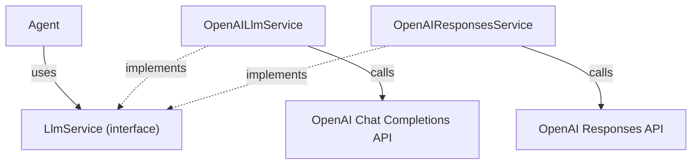
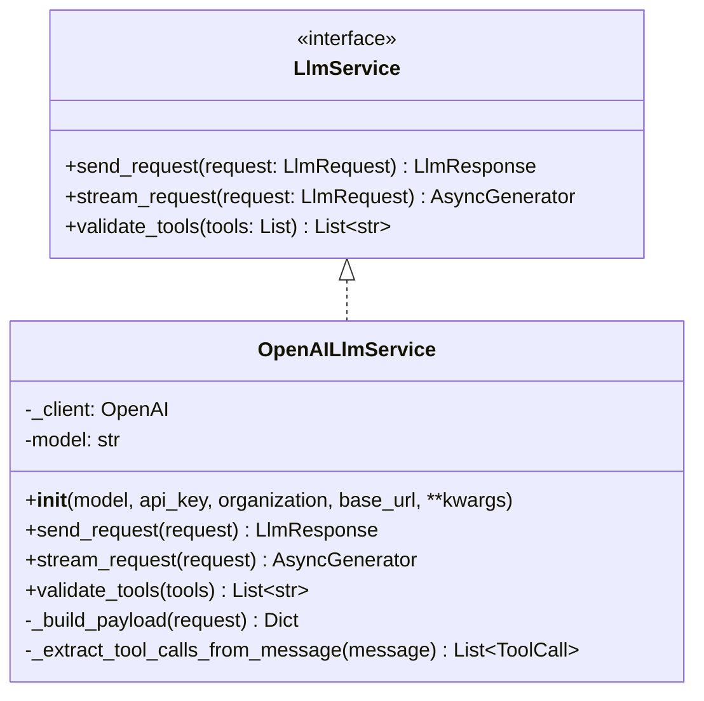
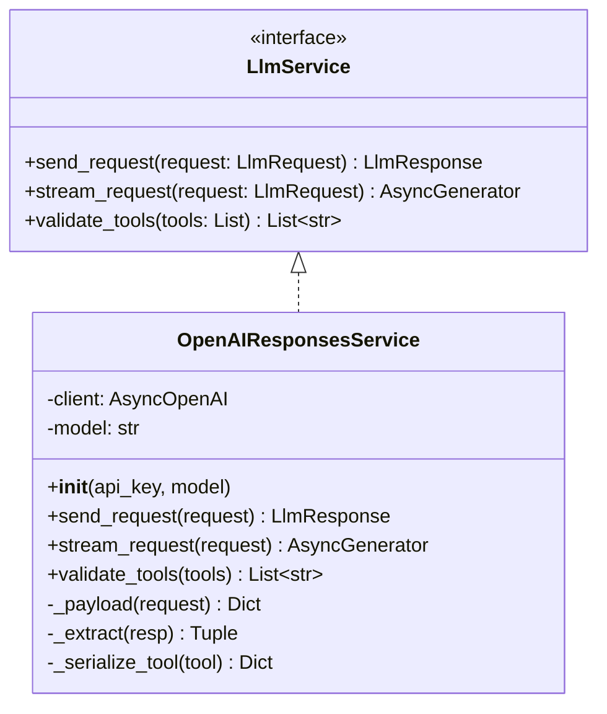
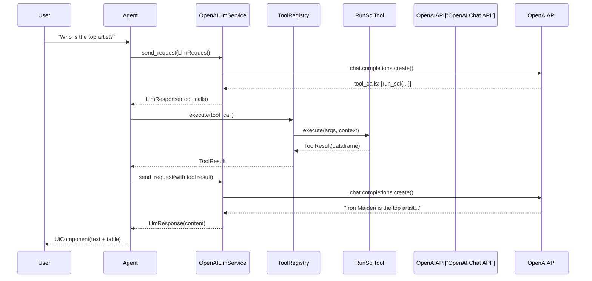
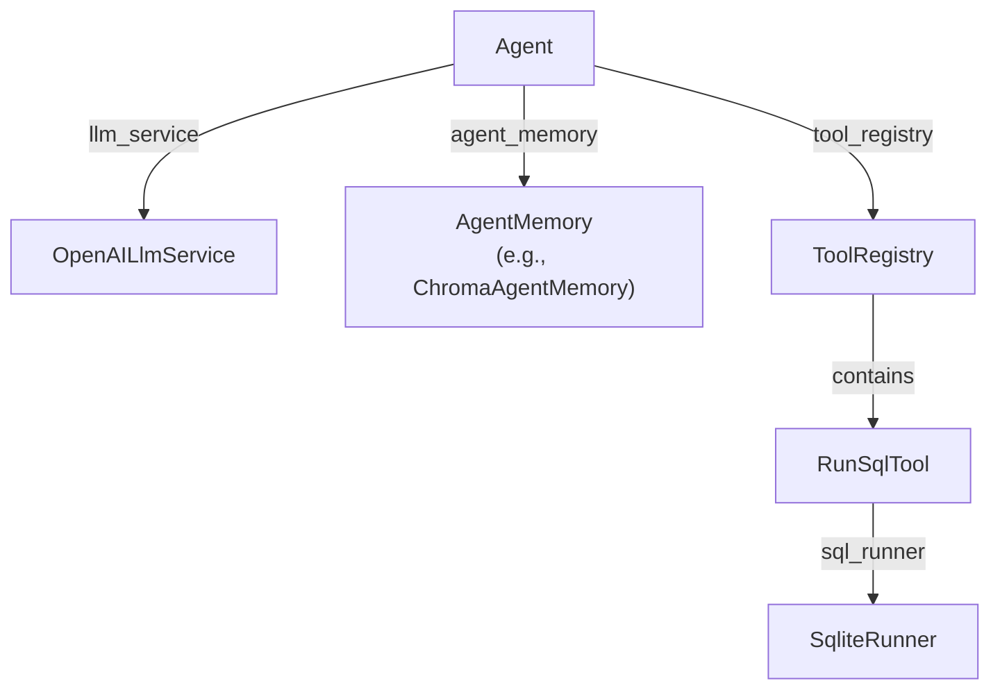

<!-- source: DeepWiki mcp.deepwiki.com · repo vanna-ai/vanna · page 5.2 OpenAI · fetched 2026-10-29 -->

# OpenAI

<details>
<summary>Relevant source files</summary>

The following files were used as context for generating this wiki page:

- [src/vanna/integrations/azureopenai/__init__.py](src/vanna/integrations/azureopenai/__init__.py)
- [src/vanna/integrations/azureopenai/llm.py](src/vanna/integrations/azureopenai/llm.py)
- [src/vanna/integrations/openai/responses.py](src/vanna/integrations/openai/responses.py)
- [src/vanna/integrations/postgres/sql_runner.py](src/vanna/integrations/postgres/sql_runner.py)
- [tests/conftest.py](tests/conftest.py)
- [tests/test_agent_memory_sanity.py](tests/test_agent_memory_sanity.py)
- [tests/test_agents.py](tests/test_agents.py)
- [tests/test_azureopenai_llm.py](tests/test_azureopenai_llm.py)
- [tests/test_legacy_adapter.py](tests/test_legacy_adapter.py)
- [tox.ini](tox.ini)

</details>


This page explains how to use OpenAI's language models with Vanna's Agent framework. The OpenAI integration provides implementations of the `LlmService` interface that connect to OpenAI's APIs. For information about other LLM providers, see pages 4.1 (Anthropic), 4.3 (Google Gemini), and 4.5 (Other LLM Providers).

## Overview

Vanna's OpenAI integration provides two `LlmService` implementations:

1. **`OpenAILlmService`** - Uses OpenAI's Chat Completions API (the standard API for GPT models)
2. **`OpenAIResponsesService`** - Uses OpenAI's newer Responses API with enhanced output formatting

Both implementations support streaming, tool calling, and are fully compatible with the Agent framework described in section 2.1 (Agent Core).

**Integration Architecture**



Sources: [src/vanna/integrations/openai/llm.py:1-26](), [src/vanna/integrations/openai/responses.py:1-27]()

## Installation

Install the OpenAI integration using pip:

```bash
pip install 'vanna[openai]'
```

This installs the `openai` package (version >=1.0.0) as a dependency.

## API Key Configuration

OpenAI services require an API key. You can provide it via:

1. **Environment variable** (recommended):
```bash
export OPENAI_API_KEY="sk-..."
```

2. **Constructor parameter**:
```python
from vanna.integrations.openai import OpenAILlmService

llm = OpenAILlmService(api_key="sk-...")
```

3. **Custom base URL** (for Azure OpenAI or custom deployments):
```python
llm = OpenAILlmService(
    api_key="...",
    base_url="https://your-deployment.openai.azure.com",
    organization="org-..."
)
```

Sources: [src/vanna/integrations/openai/llm.py:38-66](), [src/vanna/integrations/openai/responses.py:15-27]()

## OpenAILlmService (Chat Completions API)

`OpenAILlmService` implements the `LlmService` interface using OpenAI's Chat Completions API. This is the standard API used for GPT-3.5, GPT-4, and other OpenAI models.

**Class Structure**



Sources: [src/vanna/integrations/openai/llm.py:27-67]()

### Constructor Parameters

| Parameter | Type | Description | Default |
|-----------|------|-------------|---------|
| `model` | `Optional[str]` | OpenAI model name (e.g., "gpt-5") | `OPENAI_MODEL` env var or `"gpt-5"` |
| `api_key` | `Optional[str]` | OpenAI API key | `OPENAI_API_KEY` env var |
| `organization` | `Optional[str]` | OpenAI organization ID | `OPENAI_ORG` env var |
| `base_url` | `Optional[str]` | Custom API base URL (for Azure, etc.) | `OPENAI_BASE_URL` env var |
| `**extra_client_kwargs` | `Any` | Additional arguments for `openai.OpenAI()` | - |

Sources: [src/vanna/integrations/openai/llm.py:38-66]()

### Key Methods

**`send_request(request: LlmRequest) -> LlmResponse`**

Sends a non-streaming request to OpenAI and returns the complete response. Handles both text responses and tool calls.

Sources: [src/vanna/integrations/openai/llm.py:68-98]()

**`stream_request(request: LlmRequest) -> AsyncGenerator[LlmStreamChunk, None]`**

Streams the response from OpenAI. Emits `LlmStreamChunk` objects for text deltas as they arrive. Tool calls are accumulated and emitted in a final chunk when the stream completes.

Sources: [src/vanna/integrations/openai/llm.py:100-178]()

**`validate_tools(tools: List[ToolSchema]) -> List[str]`**

Validates tool schemas before sending to OpenAI. Returns a list of error messages (empty if all valid).

Sources: [src/vanna/integrations/openai/llm.py:180-187]()

### Request Payload Construction

The `_build_payload` method converts an `LlmRequest` into OpenAI's API format:

- System prompt becomes the first message with `role="system"`
- Conversation messages are mapped to `role`, `content`, and optional `tool_call_id`
- Tool calls from assistant messages are serialized as `tool_calls` array
- Tool schemas are formatted as function definitions

Sources: [src/vanna/integrations/openai/llm.py:190-242]()

### Tool Call Handling

OpenAI tool calls are extracted and converted to Vanna's `ToolCall` objects:

- Each tool call has an `id`, `name`, and `arguments` (parsed from JSON)
- Tool call arguments are validated and converted to dictionaries
- Failed JSON parsing wraps raw arguments in `{"_raw": ...}` for debugging

Sources: [src/vanna/integrations/openai/llm.py:244-267]()

## OpenAIResponsesService (Responses API)

`OpenAIResponsesService` implements the `LlmService` interface using OpenAI's newer Responses API. This API provides enhanced output formatting capabilities.

**Class Structure**



Sources: [src/vanna/integrations/openai/responses.py:14-28]()

### Constructor Parameters

| Parameter | Type | Description | Default |
|-----------|------|-------------|---------|
| `api_key` | `Optional[str]` | OpenAI API key | `OPENAI_API_KEY` env var |
| `model` | `Optional[str]` | Model name (e.g., "gpt-5") | `OPENAI_MODEL` env var or `"gpt-5"` |

Sources: [src/vanna/integrations/openai/responses.py:15-27]()

### Key Methods

**`send_request(request: LlmRequest) -> LlmResponse`**

Sends a request to the Responses API and returns the complete response.

Sources: [src/vanna/integrations/openai/responses.py:29-40]()

**`stream_request(request: LlmRequest) -> AsyncGenerator[LlmStreamChunk, None]`**

Streams the response from the Responses API. Emits text deltas via `response.output_text.delta` events and tool calls when the stream completes.

Sources: [src/vanna/integrations/openai/responses.py:42-58]()

### Responses API Differences

The Responses API differs from Chat Completions in several ways:

1. **Input format**: Uses `input` instead of `messages`, and `instructions` instead of system prompt
2. **Output format**: Returns `output_text` and structured `output` array
3. **Streaming events**: Uses `response.output_text.delta` event type
4. **Tool format**: Different serialization with `strict` parameter support

Sources: [src/vanna/integrations/openai/responses.py:65-74](), [src/vanna/integrations/openai/responses.py:125-163]()

## Usage with Agent

The following example demonstrates how to create an Agent using `OpenAILlmService`:

```python
import os
from vanna import Agent, AgentConfig
from vanna.integrations.openai import OpenAILlmService
from vanna.integrations.sqlite import SqliteRunner
from vanna.integrations.local.agent_memory import DemoAgentMemory
from vanna.integrations.local.file_system import LocalFileSystem
from vanna.core.registry import ToolRegistry
from vanna.tools import RunSqlTool
from vanna.core.user.resolver import UserResolver
from vanna.core.user import User
from vanna.core.user.request_context import RequestContext

# 1. Create LLM service
llm = OpenAILlmService(
    api_key=os.getenv("OPENAI_API_KEY"),
    model="gpt-5"
)

# 2. Create SQL runner for database connection
sql_runner = SqliteRunner(database_path="./Chinook.sqlite")

# 3. Create tool registry and register tools
tools = ToolRegistry()
tools.register_local_tool(
    RunSqlTool(sql_runner=sql_runner, file_system=LocalFileSystem()),
    access_groups=["user"]
)

# 4. Create user resolver
class SimpleUserResolver(UserResolver):
    async def resolve_user(self, request_context: RequestContext) -> User:
        return User(
            id="test_user",
            email="test@example.com",
            group_memberships=["user"]
        )

# 5. Create agent
agent = Agent(
    llm_service=llm,
    tool_registry=tools,
    user_resolver=SimpleUserResolver(),
    agent_memory=DemoAgentMemory(),
    config=AgentConfig()
)

# 6. Send a message
async def ask_question():
    request_context = RequestContext(cookies={}, headers={})
    async for component in agent.send_message(
        request_context,
        "Who is the top artist by sales?"
    ):
        print(component)
```

Sources: [tests/test_agents.py:23-53](), [tests/test_agents.py:121-131]()

### Complete Agent Example with Streaming

This example shows streaming responses from OpenAI:

```python
from vanna import Agent, AgentConfig
from vanna.integrations.openai import OpenAILlmService
# ... other imports as above ...

# Create agent with streaming enabled
llm = OpenAILlmService(
    api_key=os.getenv("OPENAI_API_KEY"),
    model="gpt-5"
)

agent = Agent(
    llm_service=llm,
    tool_registry=tools,
    user_resolver=SimpleUserResolver(),
    agent_memory=DemoAgentMemory(),
    config=AgentConfig()
)

# Stream components as they arrive
async def stream_response():
    components = []
    async for component in agent.send_message(request_context, message):
        # Each component is a UiComponent (text, table, chart, etc.)
        components.append(component)
        # Process component in real-time...
    
    return components
```

Sources: [tests/test_agents.py:55-105]()

## Agent Architecture with OpenAI

The following diagram shows how `OpenAILlmService` integrates with the Agent framework:

**Request Flow with OpenAILlmService**



Sources: [tests/test_agents.py:55-105](), [src/vanna/integrations/openai/llm.py:68-98]()

### Integration with AgentMemory

OpenAI is used by the Agent for LLM operations. For vector storage and retrieval (agent learning), the Agent uses `AgentMemory` implementations like `ChromaAgentMemory` or `DemoAgentMemory`. See section 3 (AgentMemory Implementations) for details.

**Component Dependencies**



Sources: [tests/test_agents.py:23-52]()

## Best Practices and Considerations

### Model Selection

- **GPT-3.5 Turbo**: Good balance of performance and cost, suitable for most SQL generation tasks
- **GPT-4**: Better for complex SQL queries, multiple table joins, or intricate business logic
- **Temperature Setting**: Lower values (0.1-0.3) produce more deterministic SQL queries

### Security Considerations

- API keys should be stored securely, preferably as environment variables
- Consider using API key rotation for production environments
- Use minimal necessary permissions for your OpenAI API key

### Cost Management

- GPT-3.5 Turbo is significantly less expensive than GPT-4
- Consider implementing caching for common queries to reduce API calls
- The `OpenAI_Chat` class automatically selects the appropriate model based on input length (using `gpt-3.5-turbo-16k` for longer contexts)

Sources: [src/vanna/openai/openai_chat.py:108-120]()

## Troubleshooting

### Common Issues

| Issue | Possible Solution |
|-------|-------------------|
| `"Prompt is None"` | Ensure you're passing a valid prompt to `submit_prompt()` |
| `"Prompt is empty"` | The prompt array being passed has no messages |
| API key errors | Check that your OpenAI API key is correct and has sufficient permissions |
| Token limit exceeded | For large prompts, try splitting into smaller chunks or use a model with larger context window |

Sources: [src/vanna/openai/openai_chat.py:53-58]()

---

