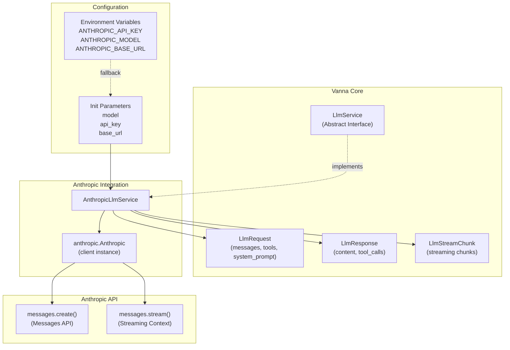
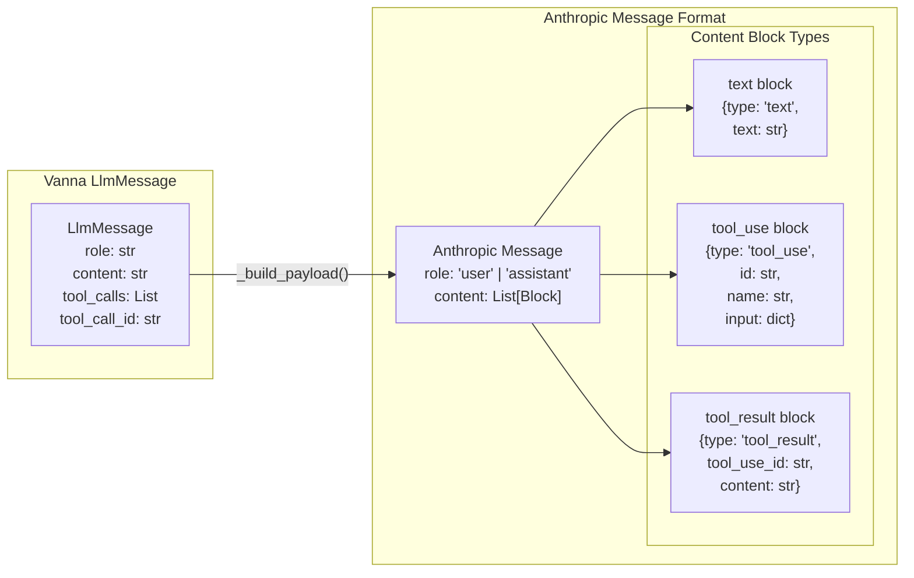
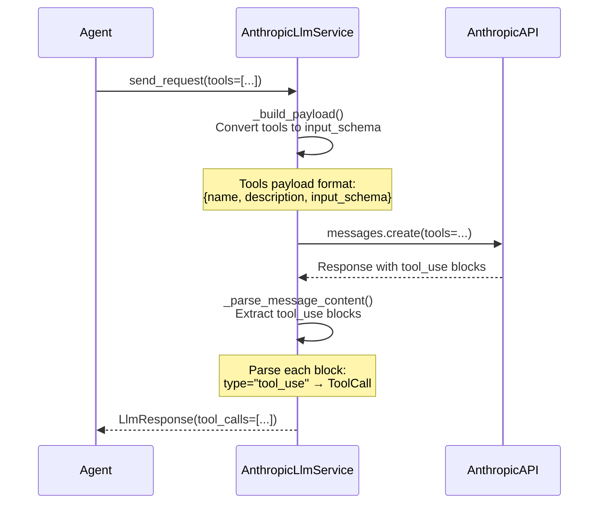
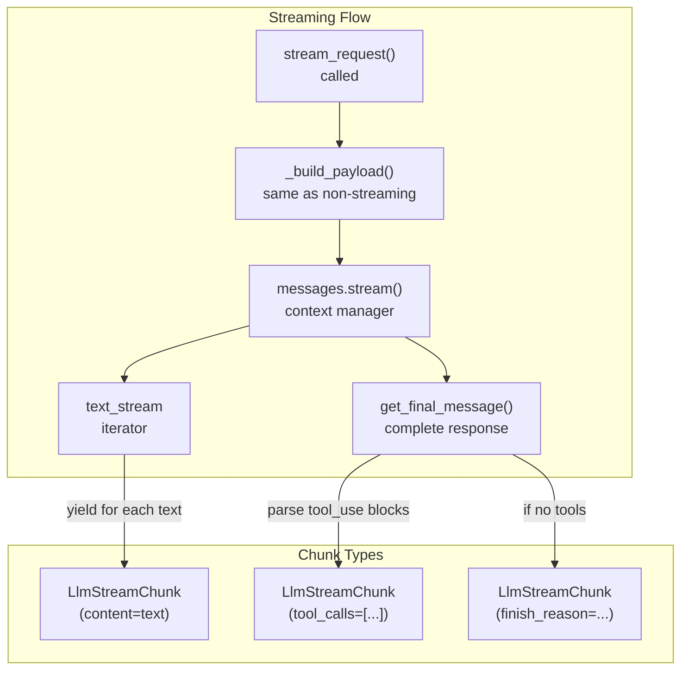
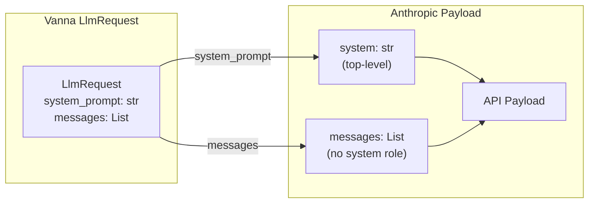

<!-- source: DeepWiki mcp.deepwiki.com · repo vanna-ai/vanna · page 5.3 Anthropic (Claude) · fetched 2026-10-29 -->

# Anthropic (Claude)

<details>
<summary>Relevant source files</summary>

The following files were used as context for generating this wiki page:

- [MIGRATION_GUIDE.md](MIGRATION_GUIDE.md)
- [README.md](README.md)
- [img/architecture.png](img/architecture.png)
- [img/vanna2.svg](img/vanna2.svg)
- [notebooks/quickstart.ipynb](notebooks/quickstart.ipynb)
- [src/vanna/integrations/anthropic/llm.py](src/vanna/integrations/anthropic/llm.py)
- [src/vanna/integrations/azureopenai/__init__.py](src/vanna/integrations/azureopenai/__init__.py)
- [src/vanna/integrations/azureopenai/llm.py](src/vanna/integrations/azureopenai/llm.py)
- [src/vanna/integrations/openai/llm.py](src/vanna/integrations/openai/llm.py)
- [src/vanna/servers/fastapi/app.py](src/vanna/servers/fastapi/app.py)
- [src/vanna/servers/flask/app.py](src/vanna/servers/flask/app.py)
- [tests/conftest.py](tests/conftest.py)
- [tests/test_agent_memory_sanity.py](tests/test_agent_memory_sanity.py)
- [tests/test_agents.py](tests/test_agents.py)
- [tests/test_azureopenai_llm.py](tests/test_azureopenai_llm.py)
- [tests/test_legacy_adapter.py](tests/test_legacy_adapter.py)
- [tox.ini](tox.ini)

</details>


## Purpose and Scope

This page documents the Anthropic Claude integration in Vanna, specifically the `AnthropicLlmService` class that implements the `LlmService` interface for Anthropic's Messages API. This page covers initialization, message formatting, tool use (function calling), streaming, and Claude-specific features.

For general LLM integration patterns, see [5.1 LLM Integration Patterns](#5.1). For other LLM providers, see [5.2 OpenAI](#5.2), [5.4 Google Gemini](#5.4), and [5.5 Azure OpenAI](#5.5).

---

## Class Overview

The `AnthropicLlmService` class is located at [src/vanna/integrations/anthropic/llm.py:27-271]() and provides the bridge between Vanna's agent framework and Anthropic's Claude models. It implements the `LlmService` interface with support for:

- Non-streaming and streaming text generation
- Tool use (function calling) via Anthropic's `tool_use` content blocks
- Claude-specific message formatting with content blocks
- Automatic API key and configuration management

**Key Characteristics:**

| Feature | Implementation |
|---------|---------------|
| **API Version** | Messages API (anthropic>=0.8.0) |
| **Default Model** | `claude-sonnet-4-5` |
| **Message Format** | Content blocks (text, tool_use, tool_result) |
| **Tool Calling** | Native `tool_use` blocks in response |
| **Streaming** | Text streamed incrementally, tools at end |
| **System Prompt** | Top-level `system` parameter in payload |

**Sources:** [src/vanna/integrations/anthropic/llm.py:1-36]()

---

## Class Structure and Initialization



### Initialization Parameters

The `AnthropicLlmService` constructor accepts the following parameters at [src/vanna/integrations/anthropic/llm.py:37-63]():

```python
AnthropicLlmService(
    model: Optional[str] = None,              # Model name (default: "claude-sonnet-4-5")
    api_key: Optional[str] = None,            # API key (fallback: ANTHROPIC_API_KEY)
    base_url: Optional[str] = None,           # Custom base URL (fallback: ANTHROPIC_BASE_URL)
    **extra_client_kwargs: Any                # Additional client kwargs
)
```

**Configuration Resolution:**

| Parameter | Priority | Environment Variable | Default |
|-----------|----------|---------------------|---------|
| `model` | Param → Env → Default | `ANTHROPIC_MODEL` | `claude-sonnet-4-5` |
| `api_key` | Param → Env | `ANTHROPIC_API_KEY` | *Required* |
| `base_url` | Param → Env | `ANTHROPIC_BASE_URL` | None |

The client is initialized at [src/vanna/integrations/anthropic/llm.py:57-63]():

```python
self._client = anthropic.Anthropic(**client_kwargs)
```

**Sources:** [src/vanna/integrations/anthropic/llm.py:37-63]()

---

## Message Format and Content Blocks

Anthropic's Messages API uses a **content blocks** structure that differs from OpenAI's simpler string-based format. Each message contains a list of content blocks with specific types.



### Message Conversion Details

The `_build_payload` method at [src/vanna/integrations/anthropic/llm.py:132-224]() converts Vanna's `LlmMessage` format to Anthropic's content block structure:

**Text Messages:**
```python
# Vanna format
LlmMessage(role="user", content="Hello")

# Anthropic format
{
    "role": "user",
    "content": [{"type": "text", "text": "Hello"}]
}
```

**Assistant with Tool Calls:**
```python
# Vanna format
LlmMessage(
    role="assistant",
    content="I'll run a query",
    tool_calls=[ToolCall(id="call_1", name="run_sql", arguments={...})]
)

# Anthropic format
{
    "role": "assistant",
    "content": [
        {"type": "text", "text": "I'll run a query"},
        {"type": "tool_use", "id": "call_1", "name": "run_sql", "input": {...}}
    ]
}
```

**Tool Results:**

Tool messages with `role="tool"` are grouped and converted to `tool_result` blocks at [src/vanna/integrations/anthropic/llm.py:141-162](). **Important:** Anthropic requires consecutive tool messages to be grouped into a single `user` message:

```python
# Multiple consecutive tool messages
[
    LlmMessage(role="tool", tool_call_id="call_1", content="result1"),
    LlmMessage(role="tool", tool_call_id="call_2", content="result2")
]

# Converted to single user message with multiple tool_result blocks
{
    "role": "user",
    "content": [
        {"type": "tool_result", "tool_use_id": "call_1", "content": "result1"},
        {"type": "tool_result", "tool_use_id": "call_2", "content": "result2"}
    ]
}
```

**Sources:** [src/vanna/integrations/anthropic/llm.py:132-224]()

---

## Tool Use (Function Calling)

Anthropic implements tool use through native `tool_use` content blocks in responses, which are then converted to Vanna's `ToolCall` format.



### Tool Schema Conversion

Tools are converted from Vanna's `ToolSchema` format to Anthropic's format at [src/vanna/integrations/anthropic/llm.py:198-207]():

```python
# Vanna ToolSchema
ToolSchema(
    name="run_sql",
    description="Execute SQL query",
    parameters={
        "type": "object",
        "properties": {"sql": {"type": "string"}},
        "required": ["sql"]
    }
)

# Anthropic tools payload
{
    "name": "run_sql",
    "description": "Execute SQL query",
    "input_schema": {  # Note: "input_schema" instead of "parameters"
        "type": "object",
        "properties": {"sql": {"type": "string"}},
        "required": ["sql"]
    }
}
```

The payload includes `tool_choice: {"type": "auto"}` to enable automatic tool selection at [src/vanna/integrations/anthropic/llm.py:218]().

### Tool Call Parsing

The `_parse_message_content` method at [src/vanna/integrations/anthropic/llm.py:226-270]() extracts tool calls from response content blocks:

```python
# Anthropic response content block
{
    "type": "tool_use",
    "id": "toolu_123",
    "name": "run_sql",
    "input": {"sql": "SELECT * FROM users"}
}

# Converted to ToolCall
ToolCall(
    id="toolu_123",
    name="run_sql",
    arguments={"sql": "SELECT * FROM users"}
)
```

The parser handles both typed SDK objects and dictionary formats at [src/vanna/integrations/anthropic/llm.py:242-267]().

**Sources:** [src/vanna/integrations/anthropic/llm.py:198-270]()

---

## Streaming Implementation

Anthropic's streaming differs from OpenAI by using a context manager with a dedicated `text_stream` iterator.



### Streaming Implementation Details

The `stream_request` method at [src/vanna/integrations/anthropic/llm.py:92-121]() implements streaming:

**Key Points:**

1. **Text Streaming:** Uses Anthropic's `text_stream` iterator to yield text chunks incrementally at [src/vanna/integrations/anthropic/llm.py:105-108]():
   ```python
   with self._client.messages.stream(**payload) as stream:
       for text in stream.text_stream:
           if text:
               yield LlmStreamChunk(content=text)
   ```

2. **Tool Calls at End:** Unlike text, tool calls are only emitted after the stream completes at [src/vanna/integrations/anthropic/llm.py:110-121]():
   ```python
   final = stream.get_final_message()
   _, tool_calls = self._parse_message_content(final)
   if tool_calls:
       yield LlmStreamChunk(tool_calls=tool_calls, finish_reason=...)
   ```

3. **Context Manager:** The streaming context ensures proper resource cleanup and provides the complete final message.

**Sources:** [src/vanna/integrations/anthropic/llm.py:92-121]()

---

## System Prompt Handling

Anthropic requires the system prompt as a **top-level parameter** separate from messages, unlike OpenAI which includes it as a `system` role message.



The system prompt is added to the payload at [src/vanna/integrations/anthropic/llm.py:220-222]():

```python
if request.system_prompt:
    payload["system"] = request.system_prompt
```

This means the `messages` array never contains a `system` role message - it only contains `user` and `assistant` roles.

**Sources:** [src/vanna/integrations/anthropic/llm.py:220-222]()

---

## Payload Structure

The complete payload structure built by `_build_payload` at [src/vanna/integrations/anthropic/llm.py:132-224]():

```python
{
    "model": "claude-sonnet-4-5",
    "messages": [
        {
            "role": "user",
            "content": [{"type": "text", "text": "..."}]
        },
        {
            "role": "assistant", 
            "content": [
                {"type": "text", "text": "..."},
                {"type": "tool_use", "id": "...", "name": "...", "input": {...}}
            ]
        },
        {
            "role": "user",
            "content": [
                {"type": "tool_result", "tool_use_id": "...", "content": "..."}
            ]
        }
    ],
    "max_tokens": 512,          # Required by Anthropic (defaults to 512)
    "temperature": 0.7,
    "tools": [                   # Only if tools provided
        {
            "name": "...",
            "description": "...",
            "input_schema": {...}
        }
    ],
    "tool_choice": {"type": "auto"},
    "system": "..."             # Top-level, not in messages
}
```

**Required Fields:**
- `model`: Model identifier
- `messages`: Content block array
- `max_tokens`: Maximum tokens to generate (Anthropic requirement at [src/vanna/integrations/anthropic/llm.py:213]())

**Sources:** [src/vanna/integrations/anthropic/llm.py:209-224]()

---

## Usage Examples

### Basic Agent Setup

From [README.md:147-192]() and [notebooks/quickstart.ipynb:54-138]():

```python
from vanna import Agent, AgentConfig
from vanna.core.registry import ToolRegistry
from vanna.integrations.anthropic import AnthropicLlmService
from vanna.tools import RunSqlTool
from vanna.integrations.sqlite import SqliteRunner

# Initialize LLM service
llm = AnthropicLlmService(
    model="claude-sonnet-4-5",
    api_key="sk-ant-..."  # Or set ANTHROPIC_API_KEY
)

# Set up tools
tools = ToolRegistry()
tools.register(RunSqlTool(sql_runner=SqliteRunner("./data.db")))

# Create agent
agent = Agent(
    llm_service=llm,
    tool_registry=tools,
    user_resolver=MyUserResolver(),
    config=AgentConfig()
)
```

### Model Selection

Available Claude models (from [src/vanna/integrations/anthropic/llm.py:31-53]()):

```python
# Fast, cost-effective
llm = AnthropicLlmService(model="claude-haiku-4-5")

# Balanced performance (default)
llm = AnthropicLlmService(model="claude-sonnet-4-5")

# Most capable
llm = AnthropicLlmService(model="claude-opus-4")

# Environment variable
# Set ANTHROPIC_MODEL=claude-haiku-4-5
llm = AnthropicLlmService()  # Uses environment variable
```

### Custom Base URL

For proxy or custom endpoints:

```python
llm = AnthropicLlmService(
    model="claude-sonnet-4-5",
    base_url="https://proxy.example.com/anthropic/v1",
    extra_client_kwargs={
        "timeout": 60.0,
        "max_retries": 3
    }
)
```

**Sources:** [README.md:147-192](), [notebooks/quickstart.ipynb:54-138](), [src/vanna/integrations/anthropic/llm.py:37-63]()

---

## Testing

The Anthropic integration is tested in multiple test environments:

### Test Configuration

From [tox.ini:46-52]():

```ini
[testenv:py311-anthropic]
description = Test with Anthropic
extras = anthropic
passenv = ANTHROPIC_API_KEY
commands =
    python -c "from vanna.integrations.anthropic import AnthropicLlmService; print('✓ Anthropic import successful')"
    pytest tests/ -v -m anthropic
```

Tests are marked with `@pytest.mark.anthropic` and automatically skipped if `ANTHROPIC_API_KEY` is not set, as configured in [tests/conftest.py:32-39]().

### Integration Test Example

From [tests/test_agents.py:108-118]():

```python
@pytest.mark.anthropic
@pytest.mark.asyncio
async def test_anthropic_top_artist(chinook_db):
    """Test Anthropic agent finding the top artist by sales."""
    from vanna.integrations.anthropic import AnthropicLlmService
    
    api_key = os.getenv("ANTHROPIC_API_KEY")
    llm = AnthropicLlmService(api_key=api_key, model="claude-sonnet-4-5")
    
    agent = create_agent(llm, chinook_db)
    await test_agent_top_artist(agent)
```

The test validates:
- API key configuration
- Tool execution with Chinook SQLite database
- Response parsing and component generation
- End-to-end agent workflow

**Sources:** [tox.ini:46-52](), [tests/conftest.py:32-39](), [tests/test_agents.py:108-118]()

---

## Error Handling

The `AnthropicLlmService` includes error handling for:

### Import Errors

At [src/vanna/integrations/anthropic/llm.py:45-50]():

```python
try:
    import anthropic
except Exception as e:
    raise ImportError(
        "anthropic package is required. Install with: pip install 'vanna[anthropic]'"
    ) from e
```

### Tool Validation

The `validate_tools` method at [src/vanna/integrations/anthropic/llm.py:123-129]() performs basic validation:

```python
async def validate_tools(self, tools: List[ToolSchema]) -> List[str]:
    """Basic validation of tool schemas for Anthropic."""
    errors: List[str] = []
    for t in tools:
        if not t.name:
            errors.append("Tool name is required")
    return errors
```

Additional validation is performed server-side by Anthropic's API.

**Sources:** [src/vanna/integrations/anthropic/llm.py:45-50](), [src/vanna/integrations/anthropic/llm.py:123-129]()

---

## Comparison with OpenAI

Key differences between `AnthropicLlmService` and `OpenAILlmService`:

| Aspect | Anthropic | OpenAI |
|--------|-----------|--------|
| **Message Format** | Content blocks (list) | Simple string content |
| **System Prompt** | Top-level `system` parameter | `system` role message |
| **Tool Results** | Grouped `tool_result` blocks in `user` message | Individual `tool` role messages |
| **Tool Format** | `input_schema` key | `parameters` key |
| **Max Tokens** | Required parameter | Optional parameter |
| **Streaming API** | Context manager with `text_stream` | Direct iterator |
| **Tool ID Prefix** | `toolu_` | `call_` |

**Sources:** [src/vanna/integrations/anthropic/llm.py:1-271](), [src/vanna/integrations/openai/llm.py:1-268]()

---

## Installation

To use the Anthropic integration, install with the `anthropic` extra:

```bash
pip install 'vanna[anthropic]'
```

This installs:
- `anthropic>=0.8.0` - Official Anthropic Python SDK
- Vanna core dependencies

**Sources:** File structure and [README.md:17]()

---

