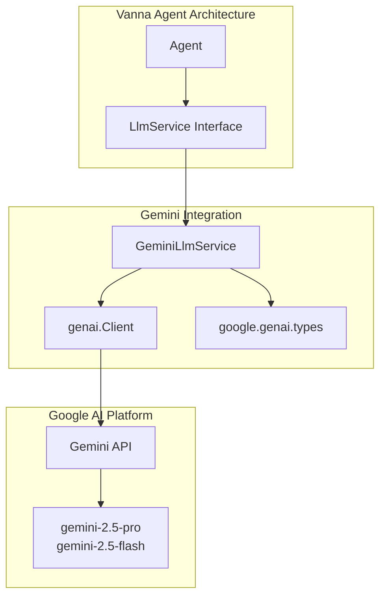
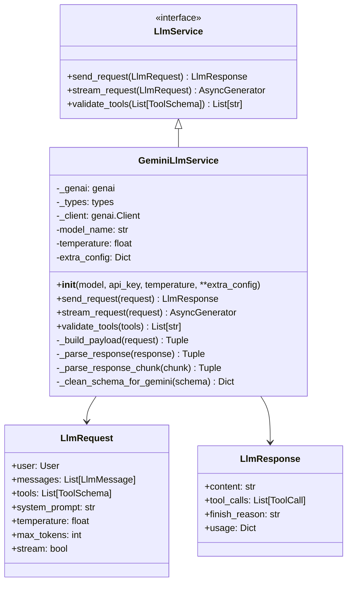
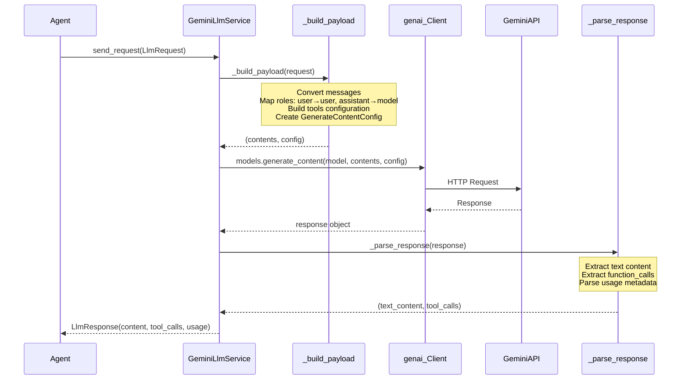
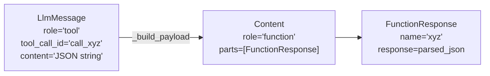
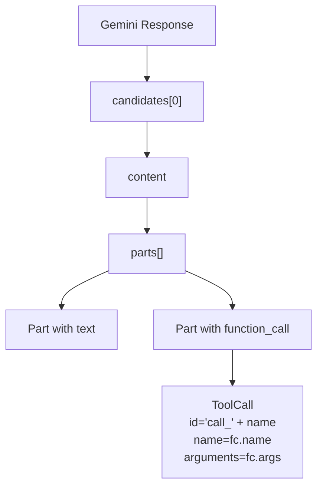

<!-- source: DeepWiki mcp.deepwiki.com · repo vanna-ai/vanna · page 5.4 Google Gemini · fetched 2026-10-29 -->

# Google Gemini

<details>
<summary>Relevant source files</summary>

The following files were used as context for generating this wiki page:

- [pyproject.toml](pyproject.toml)
- [src/vanna/__init__.py](src/vanna/__init__.py)
- [src/vanna/integrations/azureopenai/__init__.py](src/vanna/integrations/azureopenai/__init__.py)
- [src/vanna/integrations/azureopenai/llm.py](src/vanna/integrations/azureopenai/llm.py)
- [tests/conftest.py](tests/conftest.py)
- [tests/test_agent_memory_sanity.py](tests/test_agent_memory_sanity.py)
- [tests/test_agents.py](tests/test_agents.py)
- [tests/test_azureopenai_llm.py](tests/test_azureopenai_llm.py)
- [tests/test_legacy_adapter.py](tests/test_legacy_adapter.py)
- [tox.ini](tox.ini)

</details>


This page documents the Google Gemini LLM integration for the Vanna Agent framework. It covers the `GeminiLlmService` implementation, configuration options, API integration details, and tool calling capabilities. For information about other LLM providers, see [LLM Integrations](#4). For general LLM service concepts, see [LlmService Interface](#2.2).

## Overview

The `GeminiLlmService` class provides integration with Google's Gemini models (such as `gemini-2.5-pro` and `gemini-2.5-flash`) through Google's Gen AI SDK (`google-genai` package). This implementation fully supports the `LlmService` interface, including streaming responses, function calling, and token usage tracking.



**Sources:** [src/vanna/integrations/google/gemini.py:1-371](), [tests/test_agents.py:162-172]()

## Installation

The Gemini integration is available as an optional dependency in the Vanna package:

```bash
pip install "vanna[gemini]"
```

This installs the `google-genai` package required for Google Gemini integration. The integration is tested in the `py311-gemini` tox environment.

**Sources:** [tox.ini:61-69]()

## Configuration

### API Key Setup

The `GeminiLlmService` requires an API key from Google AI Platform. The key can be provided in two ways:

1. **Environment Variables** (recommended):
   - `GOOGLE_API_KEY` (takes precedence)
   - `GEMINI_API_KEY` (fallback)

2. **Constructor Parameter**:
   ```python
   llm = GeminiLlmService(api_key="your-api-key")
   ```

If no API key is found, a `ValueError` is raised with a clear error message.

**Sources:** [src/vanna/integrations/google/gemini.py:39-63](), [tests/test_gemini_integration.py:40-56]()

### Constructor Parameters

| Parameter | Type | Default | Description |
|-----------|------|---------|-------------|
| `model` | `Optional[str]` | `"gemini-2.5-pro"` | Gemini model name. Can also be set via `GEMINI_MODEL` env var |
| `api_key` | `Optional[str]` | `None` | API key for authentication |
| `temperature` | `float` | `0.7` | Temperature for generation (0.0-2.0) |
| `**extra_config` | `Any` | `{}` | Additional kwargs forwarded to `GenerateContentConfig` |

**Sources:** [src/vanna/integrations/google/gemini.py:39-74]()

## Class Structure



**Sources:** [src/vanna/integrations/google/gemini.py:27-371]()

## Request Processing Flow

The Gemini integration handles both streaming and non-streaming requests, converting Vanna's `LlmRequest` format to Gemini's API format.



**Sources:** [src/vanna/integrations/google/gemini.py:76-124](), [src/vanna/integrations/google/gemini.py:186-290]()

## Message Format Conversion

The `_build_payload` method converts Vanna's message format to Gemini's format:

### Role Mapping

| Vanna Role | Gemini Role | Notes |
|------------|-------------|-------|
| `user` | `user` | User messages with text content |
| `assistant` | `model` | Assistant responses, may include text and/or function calls |
| `tool` | `function` | Tool execution results |

### System Prompt Handling

Gemini supports system instructions as part of the configuration, not as a message:

```python
# System prompt is extracted from messages and added to config
if request.system_prompt:
    config_dict["system_instruction"] = request.system_prompt
```

**Sources:** [src/vanna/integrations/google/gemini.py:186-290]()

### Tool Result Format

Tool results are converted to Gemini's `FunctionResponse` format:



**Sources:** [src/vanna/integrations/google/gemini.py:229-252]()

## Function Calling (Tool Use)

### Schema Cleaning

Gemini only supports a subset of JSON Schema fields. The `_clean_schema_for_gemini` method filters out unsupported fields:

**Supported Fields:**
- `type`, `description`, `enum`
- `properties`, `required`, `items`
- `format`

**Removed Fields:**
- `title`, `default`, `$schema`, `additionalProperties`, etc.

```python
# Example transformation
input_schema = {
    "type": "object",
    "title": "QueryParams",  # Removed
    "properties": {
        "query": {"type": "string", "description": "SQL query"}
    },
    "required": ["query"],
    "additionalProperties": False  # Removed
}

cleaned_schema = {
    "type": "object",
    "properties": {
        "query": {"type": "string", "description": "SQL query"}
    },
    "required": ["query"]
}
```

**Sources:** [src/vanna/integrations/google/gemini.py:332-370]()

### Function Call Parsing

Gemini returns function calls in the response parts:



The parser generates tool call IDs by prefixing the function name with `call_`:

```python
tool_calls.append(
    ToolCall(
        id=f"call_{fc.name}",  # Generate ID
        name=fc.name,
        arguments=dict(fc.args) if hasattr(fc, "args") else {},
    )
)
```

**Sources:** [src/vanna/integrations/google/gemini.py:292-326]()

## Streaming Support

The `stream_request` method provides streaming text generation:

```python
async def stream_request(self, request: LlmRequest) -> AsyncGenerator[LlmStreamChunk, None]:
    contents, config = self._build_payload(request)
    
    stream = self._client.models.generate_content_stream(
        model=self.model_name,
        contents=contents,
        config=config,
    )
    
    accumulated_chunks = []
    
    for chunk in stream:
        accumulated_chunks.append(chunk)
        
        # Yield text as it arrives
        if hasattr(chunk, "text") and chunk.text:
            yield LlmStreamChunk(content=chunk.text)
    
    # After stream completes, check for tool calls
    if accumulated_chunks:
        final_chunk = accumulated_chunks[-1]
        _, tool_calls = self._parse_response_chunk(final_chunk)
        
        if tool_calls:
            yield LlmStreamChunk(tool_calls=tool_calls, finish_reason=finish_reason)
```

**Key Behavior:**
1. Text chunks are yielded immediately as they arrive
2. Tool calls are only available after the stream completes
3. The final chunk includes `finish_reason` and any tool calls

**Sources:** [src/vanna/integrations/google/gemini.py:125-173]()

## Tool Validation

The `validate_tools` method performs basic validation:

```python
async def validate_tools(self, tools: List[ToolSchema]) -> List[str]:
    errors: List[str] = []
    for t in tools:
        if not t.name:
            errors.append("Tool name is required")
        if not t.description:
            errors.append(f"Tool {t.name}: description is required")
    return errors
```

Gemini requires both `name` and `description` for each tool.

**Sources:** [src/vanna/integrations/google/gemini.py:175-183](), [tests/test_gemini_integration.py:147-188]()

## Usage Metadata

The Gemini API returns usage information in the response:

```python
usage: Dict[str, int] = {}
if hasattr(response, "usage_metadata"):
    try:
        usage = {
            "prompt_tokens": int(response.usage_metadata.prompt_token_count),
            "completion_tokens": int(response.usage_metadata.candidates_token_count),
            "total_tokens": int(response.usage_metadata.total_token_count),
        }
    except Exception:
        pass
```

**Sources:** [src/vanna/integrations/google/gemini.py:94-107]()

## Creating an Agent with Gemini

### Basic Setup

```python
from vanna import Agent, AgentConfig
from vanna.integrations.google import GeminiLlmService
from vanna.core.registry import ToolRegistry

# Create LLM service
llm = GeminiLlmService(
    model="gemini-2.5-pro",
    temperature=0.7
)

# Create agent
agent = Agent(
    llm_service=llm,
    tool_registry=tools,
    user_resolver=user_resolver,
    config=AgentConfig()
)
```

### With Custom Configuration

```python
# Using environment variable for API key
import os
os.environ["GOOGLE_API_KEY"] = "your-api-key"

llm = GeminiLlmService(
    model="gemini-2.5-flash",  # Faster, cheaper model
    temperature=0.0,           # Deterministic responses
    max_output_tokens=8192     # Extra config passed to Gemini
)
```

**Sources:** [tests/test_agents.py:162-172]()

## Testing

### Test Environment

The Gemini integration is tested using the `py311-gemini` tox environment:

```bash
tox -e py311-gemini
```

This environment:
1. Installs the `gemini` extra dependencies
2. Passes through `GOOGLE_API_KEY` and `GEMINI_API_KEY` environment variables
3. Runs tests marked with `@pytest.mark.gemini`

**Sources:** [tox.ini:61-69]()

### Pytest Markers

Tests requiring Gemini API access use the `@pytest.mark.gemini` marker. Tests are automatically skipped if neither `GOOGLE_API_KEY` nor `GEMINI_API_KEY` is set:

```python
@pytest.mark.gemini
@pytest.mark.asyncio
async def test_gemini_top_artist(chinook_db):
    """Test Gemini agent finding the top artist by sales."""
    from vanna.integrations.google import GeminiLlmService
    
    llm = GeminiLlmService(model="gemini-2.5-pro", temperature=0.0)
    
    agent = create_agent(llm, chinook_db)
    await test_agent_top_artist(agent)
```

**Sources:** [tests/conftest.py:47-54](), [tests/test_agents.py:162-172]()

### Test Coverage

The test suite includes:

1. **Import Tests**: Verify the integration can be imported
2. **Initialization Tests**: Validate API key handling and error messages
3. **Basic Request Tests**: Simple text generation without tools
4. **Streaming Tests**: Verify streaming response handling
5. **Tool Validation Tests**: Test schema validation logic
6. **End-to-End Tests**: Complete agent workflows with SQL queries

**Sources:** [tests/test_gemini_integration.py:1-189]()

## Configuration Table

| Configuration | Environment Variable | Constructor Parameter | Default | Description |
|---------------|---------------------|----------------------|---------|-------------|
| API Key | `GOOGLE_API_KEY` or `GEMINI_API_KEY` | `api_key` | None | Required for authentication |
| Model | `GEMINI_MODEL` | `model` | `"gemini-2.5-pro"` | Gemini model to use |
| Temperature | - | `temperature` | `0.7` | Generation temperature (0.0-2.0) |
| Max Tokens | - | `max_output_tokens` (via `extra_config`) | None | Maximum tokens to generate |
| Other Config | - | `**extra_config` | `{}` | Additional `GenerateContentConfig` parameters |

**Sources:** [src/vanna/integrations/google/gemini.py:39-74]()

## Error Handling

The integration includes error handling for common issues:

### Missing API Key
```python
if not api_key:
    raise ValueError(
        "Google API key is required. Set GOOGLE_API_KEY or GEMINI_API_KEY "
        "environment variable, or pass api_key parameter."
    )
```

### Missing Dependencies
```python
try:
    from google import genai
    from google.genai import types
except Exception as e:
    raise ImportError(
        "google-genai package is required. "
        "Install with: pip install 'vanna[gemini]'"
    ) from e
```

### API Errors
API errors from Google are logged and re-raised:
```python
try:
    response = self._client.models.generate_content(...)
except Exception as e:
    logger.error(f"Error calling Gemini API: {e}")
    raise
```

**Sources:** [src/vanna/integrations/google/gemini.py:46-63](), [src/vanna/integrations/google/gemini.py:121-123]()

## Module Exports

The `vanna.integrations.google` module exports:

```python
from .gemini import GeminiLlmService

__all__ = ["GeminiLlmService"]
```

**Sources:** [src/vanna/integrations/google/__init__.py:1-9]()

---

