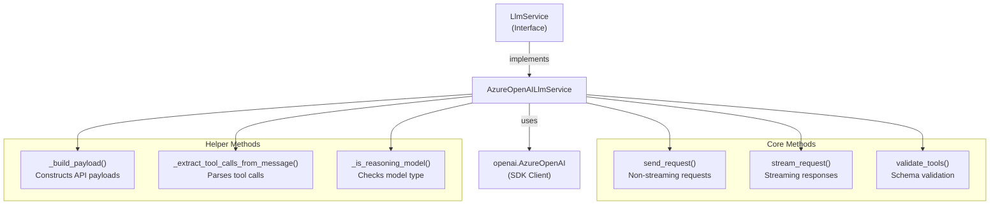
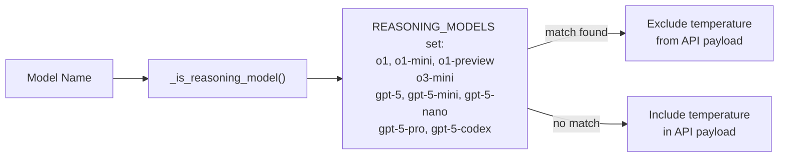
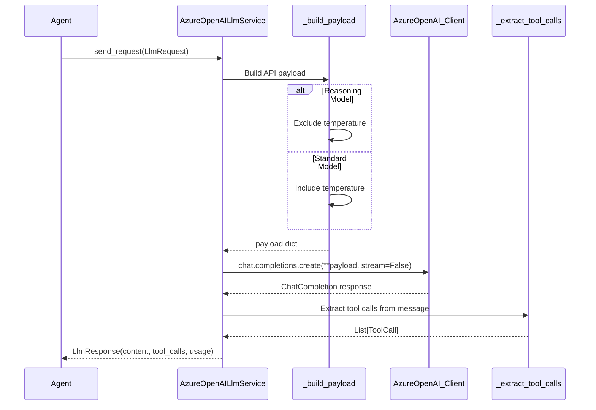
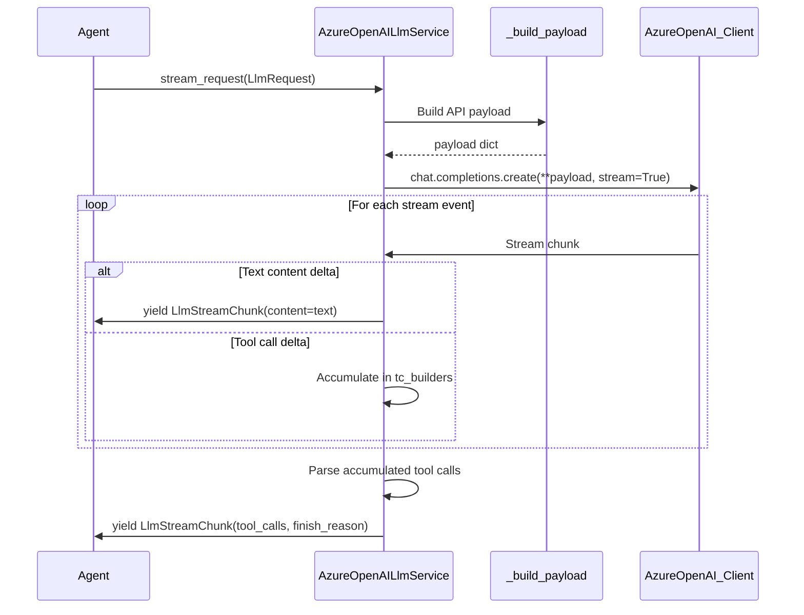
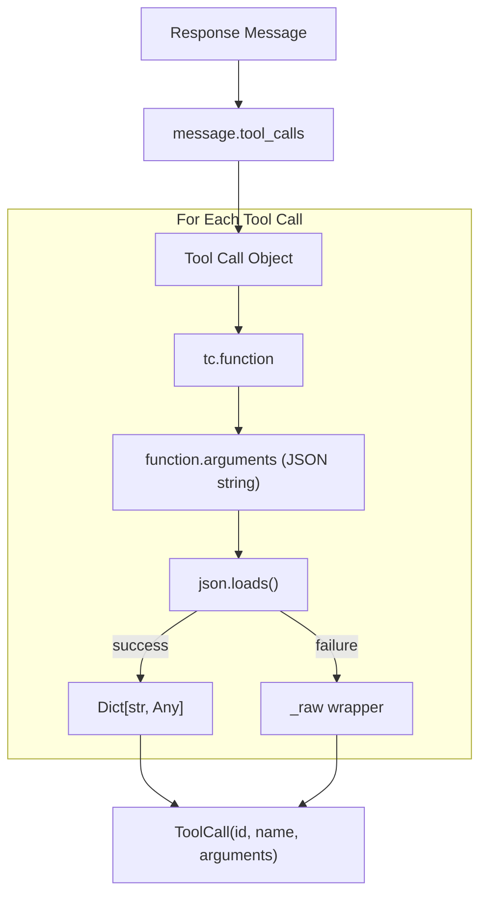

<!-- source: DeepWiki mcp.deepwiki.com · repo vanna-ai/vanna · page 5.5 Azure OpenAI · fetched 2026-10-29 -->

# Azure OpenAI

<details>
<summary>Relevant source files</summary>

The following files were used as context for generating this wiki page:

- [src/vanna/integrations/azureopenai/__init__.py](src/vanna/integrations/azureopenai/__init__.py)
- [src/vanna/integrations/azureopenai/llm.py](src/vanna/integrations/azureopenai/llm.py)
- [tests/conftest.py](tests/conftest.py)
- [tests/test_agent_memory_sanity.py](tests/test_agent_memory_sanity.py)
- [tests/test_agents.py](tests/test_agents.py)
- [tests/test_azureopenai_llm.py](tests/test_azureopenai_llm.py)
- [tests/test_legacy_adapter.py](tests/test_legacy_adapter.py)
- [tox.ini](tox.ini)

</details>


## Purpose and Scope

This page documents the Azure OpenAI integration for the Vanna Agents framework. The `AzureOpenAILlmService` class provides an `LlmService` implementation that connects to Azure OpenAI deployments, supporting deployment-scoped models, Azure-specific authentication, and reasoning models (o1, o3, gpt-5 series). 

For the standard OpenAI integration, see [OpenAI](#5.2). For general LLM integration patterns, see [LLM Integration Patterns](#5.1).

**Sources:** [src/vanna/integrations/azureopenai/llm.py:1-8](), [README.md:95]()

---

## Overview

The `AzureOpenAILlmService` wraps the `openai.AzureOpenAI` client to enable Vanna agents to communicate with Azure OpenAI deployments. Unlike the standard OpenAI integration, Azure OpenAI requires deployment-specific configuration including endpoint URLs and supports Microsoft Entra ID (Azure AD) authentication in addition to API keys.

### Key Characteristics

| Feature | Description |
|---------|-------------|
| **Class** | `AzureOpenAILlmService` |
| **Base Interface** | `LlmService` |
| **Package Requirement** | `openai>=1.0.0` |
| **Install Command** | `pip install 'vanna[azureopenai]'` |
| **Streaming Support** | Yes (text and tool calls) |
| **Tool Calling Support** | Yes (OpenAI function calling format) |
| **Reasoning Model Support** | Yes (o1, o3, gpt-5 series with temperature exclusion) |

**Sources:** [src/vanna/integrations/azureopenai/llm.py:44-60](), [src/vanna/integrations/azureopenai/__init__.py:1-10]()

---

## Architecture

### Class Hierarchy



**Sources:** [src/vanna/integrations/azureopenai/llm.py:44-119](), [src/vanna/core/llm.py]()

---

## Configuration

### Required Parameters

The `AzureOpenAILlmService` constructor requires specific Azure-related parameters:

```python
from vanna.integrations.azureopenai import AzureOpenAILlmService

# Minimum required configuration
llm = AzureOpenAILlmService(
    model="gpt-4o",                                    # Deployment name (required)
    api_key="your-api-key",                            # API key (required if no token provider)
    azure_endpoint="https://your-resource.openai.azure.com"  # Endpoint URL (required)
)
```

| Parameter | Type | Required | Default | Environment Variable |
|-----------|------|----------|---------|---------------------|
| `model` | `str` | Yes | None | `AZURE_OPENAI_MODEL` |
| `api_key` | `str` | Conditional* | None | `AZURE_OPENAI_API_KEY` |
| `azure_endpoint` | `str` | Yes | None | `AZURE_OPENAI_ENDPOINT` |
| `api_version` | `str` | No | `"2024-10-21"` | `AZURE_OPENAI_API_VERSION` |
| `azure_ad_token_provider` | `Callable` | Conditional* | None | N/A |

*Either `api_key` or `azure_ad_token_provider` must be provided for authentication.

**Sources:** [src/vanna/integrations/azureopenai/llm.py:62-116](), [tests/test_azureopenai_llm.py:52-104]()

---

### Authentication Methods

Azure OpenAI supports two authentication methods:

#### API Key Authentication

```python
llm = AzureOpenAILlmService(
    model="gpt-4o",
    api_key="your-api-key",
    azure_endpoint="https://your-resource.openai.azure.com"
)
```

#### Azure AD Token Provider Authentication

For enterprise scenarios using Microsoft Entra ID (formerly Azure AD):

```python
from azure.identity import DefaultAzureCredential
from azure.core.credentials import TokenCredential

# Create token provider
credential = DefaultAzureCredential()
token_provider = lambda: credential.get_token("https://cognitiveservices.azure.com/.default").token

llm = AzureOpenAILlmService(
    model="gpt-4o",
    azure_endpoint="https://your-resource.openai.azure.com",
    azure_ad_token_provider=token_provider
)
```

**Sources:** [src/vanna/integrations/azureopenai/llm.py:105-115](), [tests/test_azureopenai_llm.py:133-145]()

---

### Environment Variable Configuration

All configuration parameters can be set via environment variables:

```bash
export AZURE_OPENAI_MODEL="gpt-4o"
export AZURE_OPENAI_API_KEY="your-api-key"
export AZURE_OPENAI_ENDPOINT="https://your-resource.openai.azure.com"
export AZURE_OPENAI_API_VERSION="2024-10-21"
```

```python
# Automatically uses environment variables
llm = AzureOpenAILlmService()
```

**Sources:** [src/vanna/integrations/azureopenai/llm.py:80-96](), [tests/test_azureopenai_llm.py:83-103]()

---

## Reasoning Model Handling

Azure OpenAI supports "reasoning models" (o1, o3, gpt-5 series) that use extended thinking time and do not accept traditional sampling parameters like `temperature`. The integration automatically detects these models and adjusts API payloads accordingly.

### Reasoning Model Detection



### Implementation

The `_is_reasoning_model()` function performs case-insensitive substring matching:

```python
REASONING_MODELS: Set[str] = {
    "o1", "o1-mini", "o1-preview",
    "o3-mini",
    "gpt-5", "gpt-5-mini", "gpt-5-nano", "gpt-5-pro", "gpt-5-codex",
}

def _is_reasoning_model(model: str) -> bool:
    model_lower = model.lower()
    return any(reasoning_model in model_lower for reasoning_model in REASONING_MODELS)
```

During initialization, the service stores this information:

```python
self._is_reasoning_model = _is_reasoning_model(self.model)
```

When building payloads, temperature is conditionally included:

```python
# Only add temperature for non-reasoning models
if not self._is_reasoning_model:
    payload["temperature"] = request.temperature
```

**Sources:** [src/vanna/integrations/azureopenai/llm.py:25-42](), [src/vanna/integrations/azureopenai/llm.py:118](), [src/vanna/integrations/azureopenai/llm.py:291-294](), [tests/test_azureopenai_llm.py:13-46]()

---

## Request and Response Flow

### Non-Streaming Request Flow



### Streaming Request Flow



**Sources:** [src/vanna/integrations/azureopenai/llm.py:120-150](), [src/vanna/integrations/azureopenai/llm.py:152-231]()

---

## Payload Construction

The `_build_payload()` method constructs API-compatible payloads from `LlmRequest` objects:

### Payload Structure

```python
payload = {
    "model": self.model,                    # Deployment name
    "messages": [...],                       # Converted messages
    "temperature": request.temperature,      # Only for non-reasoning models
    "max_tokens": request.max_tokens,        # Optional
    "tools": [...],                          # Optional tool definitions
    "tool_choice": "auto"                    # When tools provided
}
```

### Message Conversion

The method handles three message roles:

1. **System messages**: Added from `request.system_prompt` if present
2. **User/assistant messages**: Converted with content and optional tool calls
3. **Tool messages**: Include `tool_call_id` for response correlation

Example conversion for assistant message with tool calls:

```python
{
    "role": "assistant",
    "content": "I'll query the database for you.",
    "tool_calls": [
        {
            "id": "call_abc123",
            "type": "function",
            "function": {
                "name": "run_sql",
                "arguments": '{"sql": "SELECT * FROM users"}'
            }
        }
    ]
}
```

**Sources:** [src/vanna/integrations/azureopenai/llm.py:243-303](), [tests/test_azureopenai_llm.py:216-273]()

---

## Tool Calling Support

Azure OpenAI uses the OpenAI function calling format. The integration handles tool schema conversion and tool call extraction.

### Tool Schema Format

Tools are converted from Vanna's `ToolSchema` format to Azure OpenAI's function calling format:

```python
# Vanna ToolSchema
ToolSchema(
    name="run_sql",
    description="Execute SQL queries",
    parameters={
        "type": "object",
        "properties": {
            "sql": {"type": "string"}
        }
    }
)

# Converted to Azure OpenAI format
{
    "type": "function",
    "function": {
        "name": "run_sql",
        "description": "Execute SQL queries",
        "parameters": {
            "type": "object",
            "properties": {
                "sql": {"type": "string"}
            }
        }
    }
}
```

### Tool Call Extraction

The `_extract_tool_calls_from_message()` method parses tool calls from response messages:



**Sources:** [src/vanna/integrations/azureopenai/llm.py:272-284](), [src/vanna/integrations/azureopenai/llm.py:305-329]()

---

## Usage with Vanna Agent

### Basic Setup

```python
from vanna import Agent, AgentConfig
from vanna.integrations.azureopenai import AzureOpenAILlmService
from vanna.core.registry import ToolRegistry
from vanna.tools import RunSqlTool
from vanna.integrations.sqlite import SqliteRunner
from vanna.core.user import UserResolver, User, RequestContext

# Configure Azure OpenAI LLM
llm = AzureOpenAILlmService(
    model="gpt-4o",  # Your deployment name
    api_key="your-api-key",
    azure_endpoint="https://your-resource.openai.azure.com",
    api_version="2024-10-21"
)

# Set up tools
tools = ToolRegistry()
tools.register(RunSqlTool(sql_runner=SqliteRunner("./data.db")))

# Simple user resolver
class SimpleUserResolver(UserResolver):
    async def resolve_user(self, request_context: RequestContext) -> User:
        return User(id="user1", email="user@example.com", group_memberships=["user"])

# Create agent
agent = Agent(
    llm_service=llm,
    tool_registry=tools,
    user_resolver=SimpleUserResolver(),
    config=AgentConfig()
)
```

### With FastAPI Server

```python
from vanna.servers.fastapi import VannaFastAPIServer

server = VannaFastAPIServer(agent)
server.run(host="0.0.0.0", port=8000)
```

**Sources:** [tests/test_agents.py:134-154](), [notebooks/quickstart.ipynb:123-137]()

---

## Testing

### Environment Variables for Tests

The test suite requires specific environment variables:

```bash
export AZURE_OPENAI_MODEL="your-deployment-name"
export AZURE_OPENAI_API_KEY="your-api-key"
export AZURE_OPENAI_ENDPOINT="https://your-resource.openai.azure.com"
export AZURE_OPENAI_API_VERSION="2024-10-21"  # Optional
```

### Running Tests

```bash
# Run Azure OpenAI integration tests
pytest tests/test_agents.py::test_azure_openai_top_artist -v -m azureopenai

# Run unit tests (no API calls)
pytest tests/test_azureopenai_llm.py -v
```

### Test Configuration

The `pytest` configuration automatically skips Azure OpenAI tests if credentials are missing:

```python
# conftest.py marks
config.addinivalue_line(
    "markers", "azureopenai: marks tests requiring Azure OpenAI API key"
)

# Auto-skip if AZURE_OPENAI_API_KEY not set
if "azureopenai" in item.keywords:
    if not os.getenv("AZURE_OPENAI_API_KEY"):
        item.add_marker(
            pytest.mark.skip(
                reason="AZURE_OPENAI_API_KEY environment variable not set"
            )
        )
```

**Sources:** [tests/conftest.py:21-57](), [tests/test_agents.py:134-154](), [tox.ini:1-24]()

---

## Unit Test Coverage

The test suite validates key functionality without making actual API calls:

### Test Categories

| Test Category | Purpose | File |
|--------------|---------|------|
| **Reasoning Model Detection** | Validates `_is_reasoning_model()` logic | [tests/test_azureopenai_llm.py:13-46]() |
| **Initialization** | Tests constructor parameter handling | [tests/test_azureopenai_llm.py:48-159]() |
| **Payload Building** | Validates API payload construction | [tests/test_azureopenai_llm.py:161-274]() |
| **Import Errors** | Tests helpful error messages | [tests/test_azureopenai_llm.py:276-297]() |

### Example: Reasoning Model Detection Tests

```python
def test_is_reasoning_model_o1():
    assert _is_reasoning_model("o1")
    assert _is_reasoning_model("o1-mini")
    assert _is_reasoning_model("o1-preview")

def test_is_reasoning_model_gpt5():
    assert _is_reasoning_model("gpt-5")
    assert _is_reasoning_model("gpt-5-mini")
    assert _is_reasoning_model("gpt-5-nano")

def test_is_not_reasoning_model():
    assert not _is_reasoning_model("gpt-4")
    assert not _is_reasoning_model("gpt-4o")
    assert not _is_reasoning_model("gpt-3.5-turbo")
```

**Sources:** [tests/test_azureopenai_llm.py:13-46](), [tests/test_azureopenai_llm.py:165-213]()

---

## Comparison with Standard OpenAI Integration

| Feature | Azure OpenAI | Standard OpenAI |
|---------|-------------|-----------------|
| **Class** | `AzureOpenAILlmService` | `OpenAILlmService` |
| **Endpoint** | Deployment-specific Azure URL | `api.openai.com` |
| **Model Parameter** | Deployment name (required) | Model ID (e.g., `gpt-4o`) |
| **Authentication** | API key or Azure AD token provider | API key only |
| **API Version** | Explicit version parameter | Handled by SDK |
| **Reasoning Model Handling** | Built-in detection and adjustment | Built-in detection |
| **Environment Variables** | `AZURE_OPENAI_*` prefix | `OPENAI_*` prefix |

**Key Architectural Difference**: Azure OpenAI requires the `model` parameter to specify the deployment name (e.g., `"gpt-4o-deployment"`) rather than a model ID. This deployment name maps to a specific model in your Azure OpenAI resource.

**Sources:** [src/vanna/integrations/azureopenai/llm.py:80-84](), [src/vanna/integrations/openai/llm.py:53](), [MIGRATION_GUIDE.md:1-297]()

---

## Error Handling

### Missing Package Error

If the `openai` package is not installed, a helpful error message is raised:

```python
try:
    from openai import AzureOpenAI
except Exception as e:
    raise ImportError(
        "openai package is required. Install with: pip install 'vanna[azureopenai]' "
        "or 'pip install openai'"
    ) from e
```

### Missing Required Parameters

The constructor validates required parameters and raises `ValueError` with clear messages:

```python
# Missing model
if not self.model:
    raise ValueError(
        "model parameter (deployment name) is required for Azure OpenAI. "
        "Provide it as argument or set AZURE_OPENAI_MODEL environment variable."
    )

# Missing endpoint
if not azure_endpoint:
    raise ValueError(
        "azure_endpoint is required for Azure OpenAI. "
        "Provide it as argument or set AZURE_OPENAI_ENDPOINT environment variable."
    )

# Missing authentication
if not api_key and not azure_ad_token_provider:
    raise ValueError(
        "Authentication required: provide either api_key or azure_ad_token_provider. "
        "API key can also be set via AZURE_OPENAI_API_KEY environment variable."
    )
```

**Sources:** [src/vanna/integrations/azureopenai/llm.py:71-114](), [tests/test_azureopenai_llm.py:106-130]()

---

## Advanced Configuration

### Custom Client Parameters

Additional keyword arguments are forwarded to the `AzureOpenAI` client constructor:

```python
llm = AzureOpenAILlmService(
    model="gpt-4o",
    api_key="your-api-key",
    azure_endpoint="https://your-resource.openai.azure.com",
    timeout=60.0,          # Custom timeout
    max_retries=3,         # Custom retry logic
    default_headers={      # Custom headers
        "X-Custom-Header": "value"
    }
)
```

### Multiple Deployments

Different agents can use different Azure OpenAI deployments:

```python
# Standard GPT-4o deployment
standard_llm = AzureOpenAILlmService(
    model="gpt-4o-deployment",
    api_key=api_key,
    azure_endpoint=endpoint
)

# Reasoning model deployment
reasoning_llm = AzureOpenAILlmService(
    model="gpt-5-deployment",
    api_key=api_key,
    azure_endpoint=endpoint
)

# Different agents using different deployments
standard_agent = Agent(llm_service=standard_llm, ...)
reasoning_agent = Agent(llm_service=reasoning_llm, ...)
```

**Sources:** [src/vanna/integrations/azureopenai/llm.py:62-117]()

---

## Related Pages

- [OpenAI](#5.2) - Standard OpenAI integration
- [LLM Integration Patterns](#5.1) - Common patterns across LLM providers
- [Agent System](#2.1) - How agents use LLM services
- [Tool System](#7) - Tools that LLM services invoke
- [Getting Started](#1.1) - Quick setup guide

---

