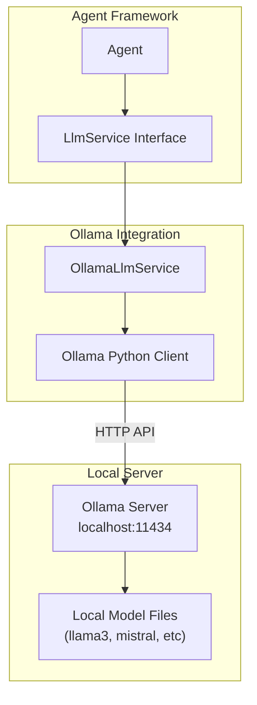

<!-- source: DeepWiki mcp.deepwiki.com · repo vanna-ai/vanna · page 5.6 Ollama (Local Models) · fetched 2026-10-29 -->

# Ollama and Local Models

<details>
<summary>Relevant source files</summary>

The following files were used as context for generating this wiki page:

- [pyproject.toml](pyproject.toml)
- [src/vanna/__init__.py](src/vanna/__init__.py)
- [src/vanna/integrations/azureopenai/__init__.py](src/vanna/integrations/azureopenai/__init__.py)
- [src/vanna/integrations/azureopenai/llm.py](src/vanna/integrations/azureopenai/llm.py)
- [tests/conftest.py](tests/conftest.py)
- [tests/test_agent_memory_sanity.py](tests/test_agent_memory_sanity.py)
- [tests/test_agents.py](tests/test_agents.py)
- [tests/test_azureopenai_llm.py](tests/test_azureopenai_llm.py)
- [tests/test_legacy_adapter.py](tests/test_legacy_adapter.py)
- [tox.ini](tox.ini)

</details>


This page documents how to use Ollama to run local Large Language Models (LLMs) with Vanna 2.0+. Ollama enables you to run open-source models locally, providing privacy, reduced latency, and the ability to operate in air-gapped environments. For cloud-based LLM providers, see [Anthropic (Claude)](#4.1), [OpenAI](#4.2), and [Google Gemini](#4.3).

## Overview

The `OllamaLlmService` class implements the `LlmService` interface to integrate with locally-running Ollama servers. This allows the Agent framework to use open-source models like Llama, Mistral, and others without sending data to external APIs.

**Architecture: Ollama Integration with Agent**



Sources: [tests/test_agents.py:147-159](), [pyproject.toml:63]()

Key benefits of using Ollama:
- **Privacy**: All data processing happens locally, nothing is sent to external APIs
- **Cost**: No API usage fees, only local compute costs
- **Availability**: Works offline and in air-gapped environments
- **Flexibility**: Run any model supported by Ollama
- **Control**: Full control over model parameters and hosting

## Installation

### Install Vanna with Ollama Support

Install Vanna with the Ollama integration:

```bash
pip install vanna[ollama]
```

This installs the required dependencies:
- `ollama` - Python client for Ollama
- `httpx` - HTTP client for communication with Ollama server

Sources: [pyproject.toml:63]()

### Install and Run Ollama Server

1. **Install Ollama** following instructions from [ollama.ai](https://ollama.ai)

2. **Pull a model** (example: Llama 3):
   ```bash
   ollama pull llama3
   ```

3. **Verify Ollama is running**:
   ```bash
   ollama list  # List installed models
   curl http://localhost:11434/api/tags  # Check API
   ```

The Ollama server runs on `http://localhost:11434` by default.

Sources: [tox.ini:71-77]()

## OllamaLlmService Configuration

The `OllamaLlmService` class implements the `LlmService` interface and accepts the following configuration parameters:

| Parameter | Type | Required | Default | Description |
|-----------|------|----------|---------|-------------|
| `model` | `str` | Yes | - | Name of the Ollama model to use (e.g., "llama3", "mistral") |
| `host` | `str` | No | `"http://localhost:11434"` | URL of the Ollama server |
| `timeout` | `float` | No | `240.0` | Request timeout in seconds |
| `options` | `dict` | No | `None` | Additional options passed to Ollama API |
| `keep_alive` | `bool` | No | `True` | Whether to keep model loaded in memory |

**Configuration Example**

```python
from vanna.integrations.ollama import OllamaLlmService

# Basic configuration with local server
llm = OllamaLlmService(
    model="llama3",
    host="http://localhost:11434"
)

# Advanced configuration with custom options
llm = OllamaLlmService(
    model="llama3",
    host="http://localhost:11434",
    timeout=300.0,
    options={
        "num_ctx": 4096,      # Context window size
        "temperature": 0.7,   # Sampling temperature
        "top_p": 0.9,        # Nucleus sampling
        "top_k": 40          # Top-k sampling
    },
    keep_alive=True
)
```

Sources: [tests/test_agents.py:147-159](), [tox.ini:74]()

## Usage with Agent Framework

The `OllamaLlmService` is used with the Agent framework like any other LLM provider. Here's a complete example:

**Complete Agent Setup with Ollama**

```python
from vanna import Agent, AgentConfig
from vanna.integrations.ollama import OllamaLlmService
from vanna.integrations.sqlite import SqliteRunner
from vanna.integrations.local.agent_memory import DemoAgentMemory
from vanna.integrations.local.file_system import LocalFileSystem
from vanna.core.registry import ToolRegistry
from vanna.core.user.resolver import UserResolver
from vanna.core.user.request_context import RequestContext
from vanna.core.user import User
from vanna.tools import RunSqlTool
import os

# 1. Configure the Ollama LLM service
llm = OllamaLlmService(
    model="llama3",
    host=os.getenv("OLLAMA_HOST", "http://localhost:11434"),
)

# 2. Set up database connection
sql_runner = SqliteRunner(database_path="chinook.db")

# 3. Configure tools
tools = ToolRegistry()
tools.register_local_tool(
    RunSqlTool(sql_runner=sql_runner, file_system=LocalFileSystem()),
    access_groups=["user"]
)

# 4. Set up agent memory
agent_memory = DemoAgentMemory(max_items=1000)

# 5. Configure user resolver
class SimpleUserResolver(UserResolver):
    async def resolve_user(self, request_context: RequestContext) -> User:
        return User(
            id="local_user",
            email="user@localhost",
            group_memberships=["user"]
        )

# 6. Create the agent
agent = Agent(
    llm_service=llm,
    tool_registry=tools,
    user_resolver=SimpleUserResolver(),
    agent_memory=agent_memory,
    config=AgentConfig()
)

# 7. Use the agent
request_context = RequestContext(cookies={}, headers={})

async for component in agent.send_message(
    request_context,
    "Who is the top artist by sales?"
):
    print(component)
```

Sources: [tests/test_agents.py:23-52](), [tests/test_agents.py:147-159]()

## Supported Models

Ollama supports a wide range of open-source models. Common models used with Vanna include:

| Model | Size | Context Window | Best For |
|-------|------|----------------|----------|
| `llama3` | 8B-70B | 8K | General-purpose SQL generation |
| `mistral` | 7B | 8K | Fast SQL generation with good accuracy |
| `mixtral` | 8x7B | 32K | Complex queries requiring large context |
| `codellama` | 7B-34B | 16K | Code-focused tasks, SQL generation |
| `qwen2` | 7B-72B | 32K | Multilingual SQL generation |
| `deepseek-coder` | 6.7B-33B | 16K | SQL and code generation |

**Listing Available Models**

```bash
# List locally installed models
ollama list

# Pull a new model
ollama pull llama3

# Pull a specific version
ollama pull llama3:70b
```

**Model Selection Guidelines**:
- **8B models** (llama3, mistral): Good balance of speed and accuracy, suitable for most use cases
- **34B+ models** (mixtral, codellama:34b): Better accuracy for complex schemas, requires more compute
- **70B models** (llama3:70b): Highest accuracy, requires significant compute resources

Sources: [tests/test_agents.py:154]()

## Agent Request Flow with Ollama

**Request Processing Pipeline**

```mermaid
sequenceDiagram
    participant User
    participant Agent
    participant OllamaLlmService
    participant OllamaServer["Ollama Server<br/>localhost:11434"]
    participant Model["Local Model<br/>(llama3)"]
    
    User->>Agent: "send_message(context, question)"
    Agent->>OllamaLlmService: "send_request(LlmRequest)"
    OllamaLlmService->>OllamaServer: "HTTP POST /api/chat"
    OllamaServer->>Model: Load model & generate
    Model-->>OllamaServer: Response tokens
    OllamaServer-->>OllamaLlmService: "LlmResponse"
    OllamaLlmService-->>Agent: Response with tool_calls
    
    loop For each tool_call
        Agent->>Agent: Execute tool (RunSqlTool)
        Agent->>OllamaLlmService: "send_request with results"
        OllamaLlmService->>OllamaServer: "HTTP POST /api/chat"
        OllamaServer->>Model: Generate follow-up
        Model-->>OllamaServer: Follow-up tokens
        OllamaServer-->>OllamaLlmService: "LlmResponse"
        OllamaLlmService-->>Agent: Final response
    end
    
    Agent-->>User: Stream UiComponents
```

Sources: [tests/test_agents.py:147-159]()

## Testing

Vanna includes integration tests for Ollama. Run tests with:

```bash
# Run all Ollama tests
pytest tests/ -v -m ollama

# Run specific agent test
pytest tests/test_agents.py::test_ollama_top_artist -v

# Set custom Ollama host
OLLAMA_HOST=http://remote-server:11434 pytest tests/ -m ollama
```

The test suite validates:
- `OllamaLlmService` initialization and configuration
- LLM request/response handling
- Tool calling with Ollama models
- End-to-end SQL generation and execution

Sources: [tox.ini:71-77](), [tests/test_agents.py:147-159](), [tests/conftest.py:21]()

## Best Practices

1. **Model Selection**:
   - For Ollama, consider the balance between model size and performance based on your hardware
   - For Mistral, select the appropriate model tier based on your accuracy requirements

2. **Context Window**:
   - Adjust `num_ctx` in Ollama options based on your use case complexity
   - Be mindful of token limitations in both implementations

3. **Error Handling**:
   - Implement proper error handling for network failures with Mistral API
   - Handle potential server unavailability with Ollama

4. **Performance Tuning**:
   - Consider adjusting `keep_alive` for Ollama to reduce model loading time
   - Batch similar queries to minimize API calls with Mistral

Sources: [src/vanna/ollama/ollama.py:25-36](), [src/vanna/mistral/mistral.py]()

## Troubleshooting

### Common Ollama Issues

- **Connection Errors**: Ensure Ollama server is running at the specified host
- **Model Not Found**: Check if the requested model is installed in Ollama
- **Slow Response**: Increase timeout or adjust model parameters

### Common Mistral Issues

- **API Key Errors**: Verify your API key is correct and has sufficient permissions
- **Model Selection**: Ensure you're specifying a valid Mistral model name
- **Formatting Issues**: Check for proper handling of Mistral response formats

Sources: [src/vanna/ollama/ollama.py:13-19](), [src/vanna/mistral/mistral.py:11-20]()

---

