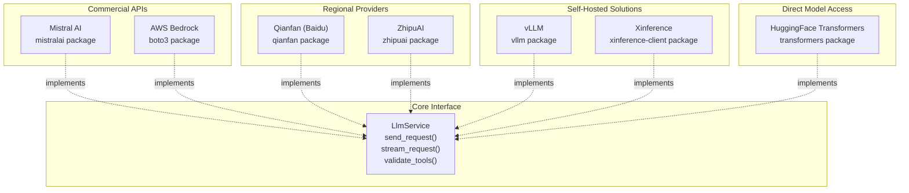
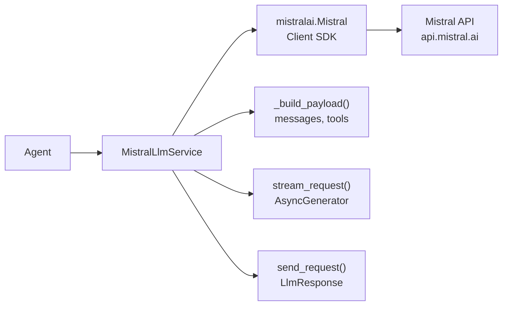
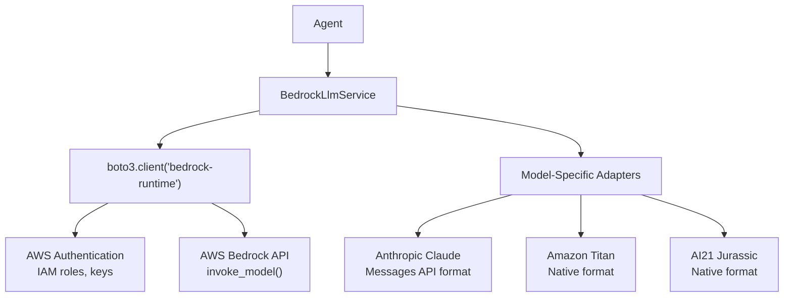
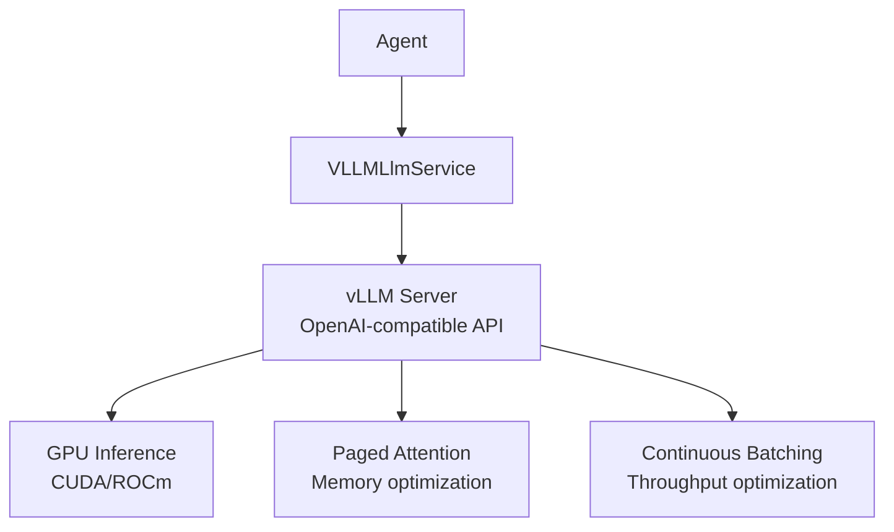
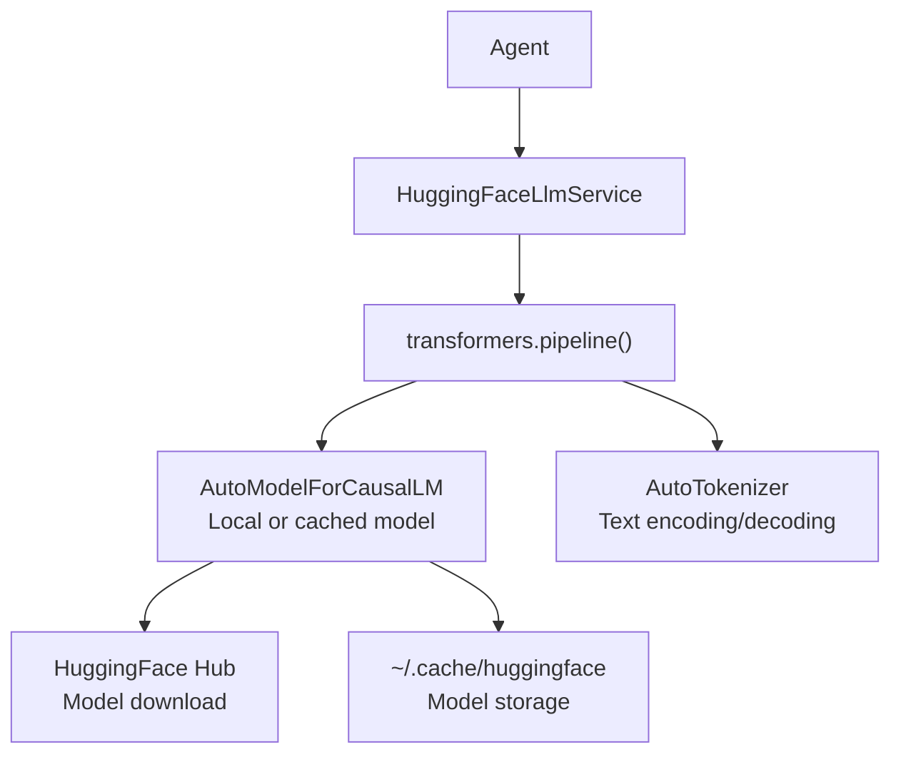
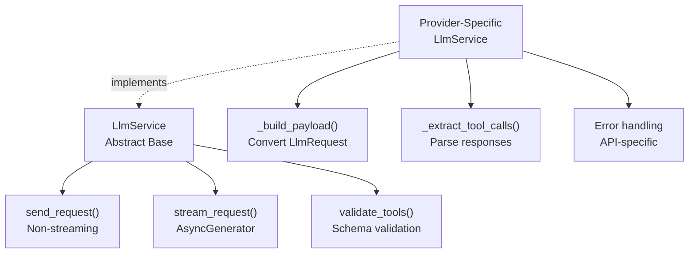
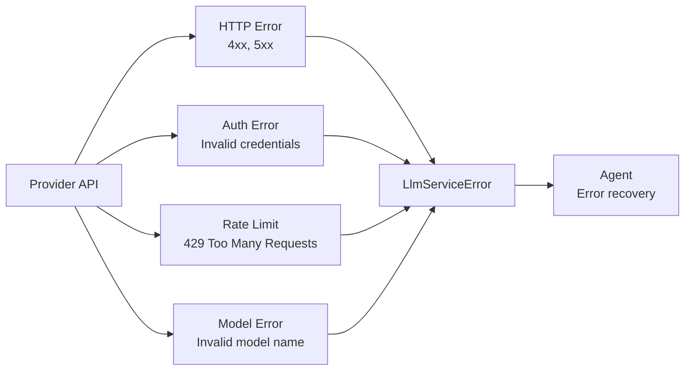
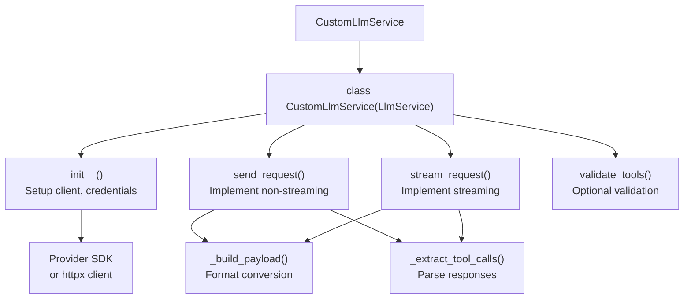
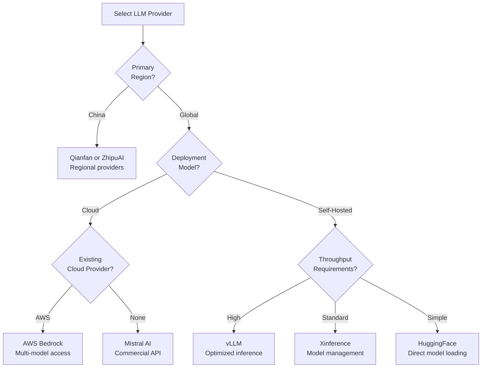

<!-- source: DeepWiki mcp.deepwiki.com · repo vanna-ai/vanna · page 5.7 Other LLM Providers · fetched 2026-10-29 -->

# Other LLM Providers

<details>
<summary>Relevant source files</summary>

The following files were used as context for generating this wiki page:

- [pyproject.toml](pyproject.toml)
- [src/vanna/__init__.py](src/vanna/__init__.py)
- [src/vanna/integrations/azureopenai/__init__.py](src/vanna/integrations/azureopenai/__init__.py)
- [src/vanna/integrations/azureopenai/llm.py](src/vanna/integrations/azureopenai/llm.py)
- [tests/conftest.py](tests/conftest.py)
- [tests/test_agent_memory_sanity.py](tests/test_agent_memory_sanity.py)
- [tests/test_agents.py](tests/test_agents.py)
- [tests/test_azureopenai_llm.py](tests/test_azureopenai_llm.py)
- [tests/test_legacy_adapter.py](tests/test_legacy_adapter.py)
- [tox.ini](tox.ini)

</details>


This page documents additional LLM provider integrations supported by Vanna beyond the major providers covered in [OpenAI](#5.2), [Anthropic](#5.3), [Gemini](#5.4), [Azure OpenAI](#5.5), and [Ollama](#5.6). These integrations follow the same `LlmService` interface patterns described in [LLM Integration Patterns](#5.1), enabling seamless swapping of providers without modifying agent code.

The providers documented here include commercial APIs (Mistral AI, AWS Bedrock), regional providers (Qianfan, ZhipuAI), self-hosted solutions (vLLM, Xinference), and direct model access (HuggingFace Transformers).

---

## Supported Additional Providers

Vanna's plugin architecture supports multiple additional LLM providers through optional dependencies. Each provider implements the `LlmService` interface, ensuring consistent behavior across the framework.

### Provider Categories



**Sources**: [pyproject.toml:40-82]()

---

## Provider Dependencies

Each provider requires specific optional dependencies installed via pip extras. The table below shows the dependency groups and their required packages:

| Provider | Pip Extra | Required Packages | Use Case |
|----------|-----------|-------------------|----------|
| Mistral AI | `mistralai` | `mistralai>=1.0.0` | Commercial API for Mistral models |
| AWS Bedrock | `bedrock` | `boto3`, `botocore` | AWS-hosted foundation models |
| Qianfan (Baidu) | `qianfan` | `qianfan` | Chinese market LLM access |
| ZhipuAI | `zhipuai` | `zhipuai` | Chinese market LLM access |
| vLLM | `vllm` | `vllm` | High-throughput self-hosted inference |
| Xinference | `xinference-client` | `xinference-client` | Self-hosted model serving |
| HuggingFace | `hf` | `transformers` | Direct model loading and inference |

**Installation Examples**:
```bash
# Single provider
pip install 'vanna[mistralai]'

# Multiple providers
pip install 'vanna[mistralai,bedrock]'

# All providers
pip install 'vanna[all]'
```

**Sources**: [pyproject.toml:52-77]()

---

## Mistral AI Integration

Mistral AI provides access to models like `mistral-large`, `mistral-medium`, and `mistral-small` through their commercial API. The integration follows standard API patterns with support for streaming and tool calling.

### Architecture



### Configuration

The `MistralLlmService` implementation typically supports:

**Authentication**:
- API key via constructor parameter
- Environment variable fallback (`MISTRAL_API_KEY`)

**Model Selection**:
- `mistral-large-latest` - Most capable model
- `mistral-medium-latest` - Balanced performance
- `mistral-small-latest` - Fast and economical

**Parameters**:
- `temperature` - Sampling temperature (0.0-1.0)
- `max_tokens` - Maximum completion length
- `tool_choice` - Tool selection strategy

### Usage Pattern

```python
from vanna.integrations.mistralai import MistralLlmService

llm = MistralLlmService(
    api_key="your-api-key",
    model="mistral-large-latest"
)

agent = Agent(
    llm_service=llm,
    tool_registry=tools,
    # ... other config
)
```

**Sources**: [pyproject.toml:59]()

---

## AWS Bedrock Integration

AWS Bedrock provides access to foundation models from multiple providers (Anthropic, AI21, Cohere, Meta, Stability AI) through a unified AWS API. The integration uses boto3 for AWS authentication and API access.

### Architecture



### Configuration

**Authentication Methods**:
1. AWS credentials file (`~/.aws/credentials`)
2. IAM role (for EC2/ECS/Lambda)
3. Environment variables (`AWS_ACCESS_KEY_ID`, `AWS_SECRET_ACCESS_KEY`)
4. boto3 session configuration

**Model Identifiers**:
- `anthropic.claude-3-5-sonnet-20241022-v2:0` - Claude 3.5 Sonnet
- `anthropic.claude-3-haiku-20240307-v1:0` - Claude 3 Haiku
- `amazon.titan-text-express-v1` - Amazon Titan Express
- `ai21.j2-ultra-v1` - AI21 Jurassic-2 Ultra
- `meta.llama3-70b-instruct-v1:0` - Meta Llama 3

### Key Features

**Multi-Provider Access**: Single integration point for multiple model families through AWS infrastructure.

**Region Configuration**: Models available in specific AWS regions (us-east-1, us-west-2, eu-west-1, etc.).

**Payload Adaptation**: The `BedrockLlmService` must translate Vanna's standard `LlmRequest` format to provider-specific payload formats required by each model family.

### Usage Pattern

```python
from vanna.integrations.bedrock import BedrockLlmService

llm = BedrockLlmService(
    model_id="anthropic.claude-3-5-sonnet-20241022-v2:0",
    region_name="us-east-1"
)

agent = Agent(
    llm_service=llm,
    tool_registry=tools,
    # ... other config
)
```

**Sources**: [pyproject.toml:71]()

---

## Regional Provider Integrations

### Qianfan (Baidu)

Qianfan is Baidu's LLM platform providing access to ERNIE models and other Chinese-language models.

**Key Characteristics**:
- Optimized for Chinese language understanding
- Requires Qianfan API credentials
- Supports ERNIE-Bot models (ERNIE-3.5, ERNIE-4.0)

**Configuration**:
```python
from vanna.integrations.qianfan import QianfanLlmService

llm = QianfanLlmService(
    api_key="your-qianfan-key",
    secret_key="your-secret-key",
    model="ERNIE-Bot-4"
)
```

**Sources**: [pyproject.toml:58]()

---

### ZhipuAI

ZhipuAI provides access to GLM (General Language Model) series models, popular in the Chinese market.

**Key Characteristics**:
- GLM-4 model family
- Chinese and English language support
- API key authentication

**Configuration**:
```python
from vanna.integrations.zhipuai import ZhipuAILlmService

llm = ZhipuAILlmService(
    api_key="your-zhipuai-key",
    model="glm-4"
)
```

**Sources**: [pyproject.toml:63]()

---

## Self-Hosted Solutions

### vLLM Integration

vLLM is a high-throughput inference engine for serving large language models with optimized performance.



**Key Features**:
- **High Throughput**: Continuous batching and paged attention for efficient GPU utilization
- **OpenAI Compatibility**: Exposes OpenAI-compatible API endpoints
- **Model Support**: Llama, Mistral, GPT-NeoX, Falcon, and others

**Configuration**:
```python
from vanna.integrations.vllm import VLLMLlmService

llm = VLLMLlmService(
    base_url="http://localhost:8000/v1",
    model="meta-llama/Llama-3-70b-chat-hf"
)
```

**Sources**: [pyproject.toml:66]()

---

### Xinference Integration

Xinference is a model serving framework that simplifies deployment and management of various LLM models.

**Key Characteristics**:
- Model management and versioning
- Multi-model deployment on single instance
- Support for LLM, embedding, and multimodal models

**Configuration**:
```python
from vanna.integrations.xinference import XinferenceLlmService

llm = XinferenceLlmService(
    endpoint="http://localhost:9997",
    model_uid="your-model-uid"
)
```

**Sources**: [pyproject.toml:77]()

---

## HuggingFace Transformers Integration

The HuggingFace Transformers integration provides direct access to models from the HuggingFace Hub without external API services.



**Key Features**:
- **Direct Model Access**: Load models directly from HuggingFace Hub
- **Local Inference**: Run models on local hardware (CPU or GPU)
- **Model Flexibility**: Access thousands of community and commercial models

**Configuration**:
```python
from vanna.integrations.huggingface import HuggingFaceLlmService

llm = HuggingFaceLlmService(
    model_name="meta-llama/Llama-2-7b-chat-hf",
    device="cuda"  # or "cpu"
)
```

**Hardware Considerations**:
- Model size must fit in available memory
- GPU acceleration requires CUDA/ROCm setup
- Quantization options available for reduced memory

**Sources**: [pyproject.toml:69]()

---

## Common Integration Patterns

All LLM provider integrations follow consistent patterns inherited from the `LlmService` interface:

### Interface Implementation



### Standard Methods

| Method | Purpose | Return Type |
|--------|---------|-------------|
| `send_request()` | Non-streaming completion | `LlmResponse` |
| `stream_request()` | Streaming completion | `AsyncGenerator[LlmStreamChunk]` |
| `validate_tools()` | Pre-validate tool schemas | `List[str]` (errors) |
| `_build_payload()` | Convert `LlmRequest` to provider format | `Dict[str, Any]` |
| `_extract_tool_calls()` | Parse provider-specific tool call format | `List[ToolCall]` |

### Authentication Patterns

**Environment Variables**: Most providers support environment variable configuration:
```python
# Provider checks env vars automatically
llm = MistralLlmService(model="mistral-large")
```

**Constructor Parameters**: Explicit credential passing:
```python
llm = BedrockLlmService(
    aws_access_key_id="...",
    aws_secret_access_key="...",
    region_name="us-east-1"
)
```

**Configuration Objects**: Some providers accept config dicts:
```python
llm = QianfanLlmService(config={
    "api_key": "...",
    "secret_key": "..."
})
```

**Sources**: [src/vanna/integrations/azureopenai/llm.py:44-119]()

---

## Tool Calling Support

Not all LLM providers support tool calling (function calling). The integration implementations handle this gracefully:

### Provider Tool Support Matrix

| Provider | Tool Support | Format |
|----------|--------------|--------|
| Mistral AI | ✅ Yes | Mistral tools format |
| AWS Bedrock (Claude) | ✅ Yes | Anthropic tools format |
| AWS Bedrock (Titan) | ❌ No | - |
| Qianfan | ⚠️ Limited | ERNIE-specific format |
| ZhipuAI | ⚠️ Limited | GLM-specific format |
| vLLM | ✅ Yes | OpenAI-compatible format |
| Xinference | ✅ Yes | OpenAI-compatible format |
| HuggingFace | ❌ No | Direct completion only |

### Graceful Degradation

For providers without native tool support, implementations should:
1. Return empty tool list from `validate_tools()`
2. Emit warning during agent initialization
3. Fall back to text-only interactions

```python
async def validate_tools(self, tools: List[ToolSchema]) -> List[str]:
    if tools:
        return ["Tool calling not supported by this provider"]
    return []
```

**Sources**: [src/vanna/integrations/azureopenai/llm.py:233-240]()

---

## Error Handling Patterns

Provider-specific error handling follows consistent patterns:

### API Error Translation



### Standard Exception Handling

All provider implementations should catch provider-specific exceptions and translate them to `LlmServiceError`:

```python
from vanna.core.exceptions import LlmServiceError

try:
    response = await self._client.chat.completions.create(**payload)
except ProviderAPIError as e:
    raise LlmServiceError(
        f"Provider API error: {str(e)}",
        original_error=e
    )
except Exception as e:
    raise LlmServiceError(
        f"Unexpected error calling provider: {str(e)}",
        original_error=e
    )
```

**Sources**: [src/vanna/integrations/azureopenai/llm.py:120-150]()

---

## Creating Custom Provider Integrations

Teams can add custom LLM provider integrations by implementing the `LlmService` interface:

### Implementation Template



### Minimal Implementation

```python
from vanna.core.llm import LlmService, LlmRequest, LlmResponse
from typing import AsyncGenerator

class CustomLlmService(LlmService):
    def __init__(self, api_key: str, model: str):
        self.api_key = api_key
        self.model = model
        # Initialize provider client
        
    async def send_request(self, request: LlmRequest) -> LlmResponse:
        """Implement non-streaming request."""
        payload = self._build_payload(request)
        # Call provider API
        # Parse response
        return LlmResponse(content=content, tool_calls=tool_calls)
        
    async def stream_request(
        self, request: LlmRequest
    ) -> AsyncGenerator[LlmStreamChunk, None]:
        """Implement streaming request."""
        payload = self._build_payload(request)
        # Stream from provider API
        # Yield chunks
        
    async def validate_tools(self, tools: List[ToolSchema]) -> List[str]:
        """Optional: Validate tool schemas."""
        return []  # No validation errors
```

### Registration

Custom providers work seamlessly with the agent framework:

```python
from vanna import Agent, AgentConfig

llm = CustomLlmService(api_key="...", model="...")
agent = Agent(llm_service=llm, tool_registry=tools, config=AgentConfig())
```

**Sources**: [src/vanna/integrations/azureopenai/llm.py:44-330]()

---

## Testing Provider Integrations

### Sanity Tests

Provider integrations should include basic sanity tests that verify:
1. Module imports correctly
2. Class instantiation works
3. Required methods are implemented

Example from test suite:

```python
def test_provider_import():
    """Test that provider can be imported."""
    from vanna.integrations.mistralai import MistralLlmService
    assert MistralLlmService is not None

def test_provider_instantiation():
    """Test that provider can be instantiated."""
    llm = MistralLlmService(api_key="test", model="mistral-large")
    assert llm.model == "mistral-large"
```

### Integration Tests

Full integration tests require API credentials and are typically marked for optional execution:

```python
@pytest.mark.mistralai
@pytest.mark.asyncio
async def test_mistral_agent(chinook_db):
    """Test Mistral agent with real API."""
    llm = MistralLlmService(
        api_key=os.getenv("MISTRAL_API_KEY"),
        model="mistral-large"
    )
    agent = create_agent(llm, chinook_db)
    # Test agent functionality
```

**Sources**: [tests/test_agents.py:108-196](), [tests/conftest.py:1-89]()

---

## Provider Selection Guidelines

### Selection Criteria Matrix

| Criterion | Best Providers | Considerations |
|-----------|----------------|----------------|
| **Commercial API** | Mistral, Bedrock | Cost per token, rate limits, SLA |
| **Self-Hosted** | vLLM, Xinference, HF | Hardware requirements, operational complexity |
| **Regional (China)** | Qianfan, ZhipuAI | Language optimization, compliance |
| **Tool Calling** | Mistral, Bedrock (Claude) | Native function calling support |
| **Throughput** | vLLM, Bedrock | Concurrent request handling |
| **Cost Optimization** | Self-hosted options | Upfront hardware vs per-token cost |

### Decision Tree



**Sources**: [pyproject.toml:40-82]()

---

