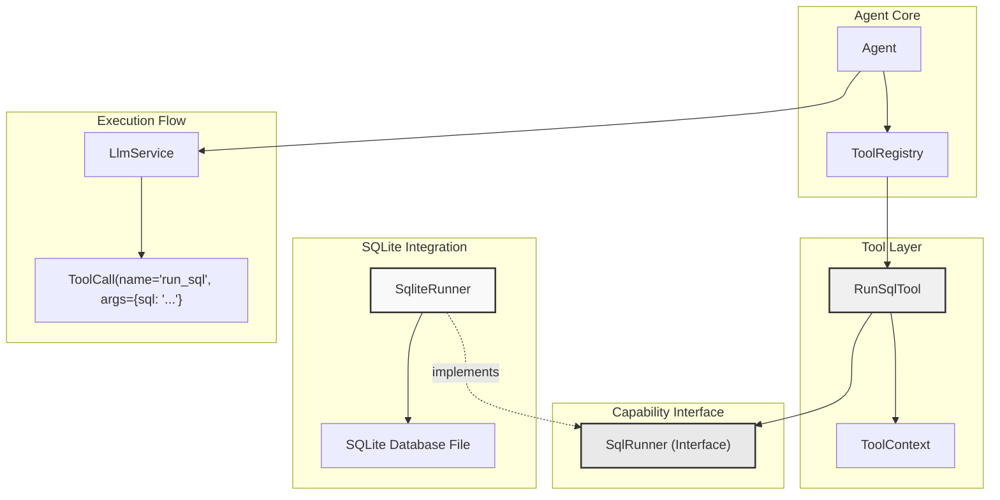
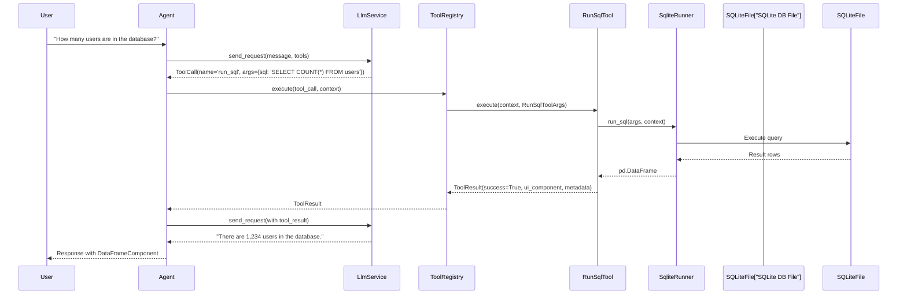
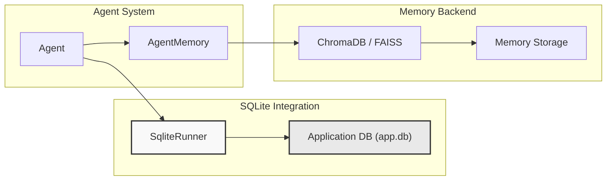

<!-- source: DeepWiki mcp.deepwiki.com · repo vanna-ai/vanna · page 6.3 SQLite · fetched 2026-10-29 -->

# SQLite

<details>
<summary>Relevant source files</summary>

The following files were used as context for generating this wiki page:

- [.github/workflows/tests.yml](.github/workflows/tests.yml)
- [.gitignore](.gitignore)
- [src/vanna/integrations/azureopenai/__init__.py](src/vanna/integrations/azureopenai/__init__.py)
- [src/vanna/integrations/azureopenai/llm.py](src/vanna/integrations/azureopenai/llm.py)
- [tests/conftest.py](tests/conftest.py)
- [tests/test_agent_memory_sanity.py](tests/test_agent_memory_sanity.py)
- [tests/test_agents.py](tests/test_agents.py)
- [tests/test_azureopenai_llm.py](tests/test_azureopenai_llm.py)
- [tests/test_legacy_adapter.py](tests/test_legacy_adapter.py)
- [tox.ini](tox.ini)

</details>


## Purpose and Scope

This page documents the SQLite integration in Vanna, which provides local database connectivity through the `SqliteRunner` implementation. For information about other SQL databases, see [Other SQL Databases](#7.4). For cloud data warehouses like Snowflake and BigQuery, see [Cloud Data Warehouses](#7.3). For general SQL execution patterns, see [PostgreSQL](#7.1).

**Sources:** [src/vanna/integrations/__init__.py:10](), [pyproject.toml:1-208]()

---

## Overview

The SQLite integration enables Vanna agents to execute SQL queries against local SQLite database files. SQLite is a serverless, file-based database engine ideal for development, testing, and lightweight production deployments. The `SqliteRunner` class implements the `SqlRunner` interface, allowing it to be used interchangeably with other database connectors.

### Key Characteristics

| Characteristic | Description |
|----------------|-------------|
| **Database Type** | Embedded, serverless SQL database |
| **Connection Model** | File-based (no server required) |
| **Interface** | Implements `SqlRunner` capability |
| **Primary Use Case** | Development, testing, local deployments |
| **Dependencies** | Built into Python (sqlite3 module) |

**Sources:** [src/vanna/integrations/__init__.py:1-18](), [pyproject.toml:45-52]()

---

## Architecture Integration

The following diagram shows how `SqliteRunner` integrates with the Vanna agent system:



**Key Integration Points:**

1. **Interface Implementation**: `SqliteRunner` implements the `SqlRunner` interface defined in `vanna.capabilities.sql_runner`
2. **Dependency Injection**: `RunSqlTool` receives a `SqliteRunner` instance at initialization
3. **File-Based Storage**: SQLite databases are accessed via filesystem paths (no network connection)
4. **Synchronous/Async Bridge**: SQLite operations are synchronous but wrapped in async methods

**Sources:** [src/vanna/tools/run_sql.py:1-166](), [src/vanna/integrations/__init__.py:10]()

---

## SqliteRunner Implementation

The `SqliteRunner` class provides SQLite-specific implementation of the `SqlRunner` interface. While the source file is not included in the provided context, the implementation follows this pattern:

### Expected Class Structure

```python
class SqliteRunner(SqlRunner):
    """SQLite implementation of SqlRunner interface."""
    
    def __init__(self, database_path: str):
        """Initialize with path to SQLite database file."""
        
    async def run_sql(self, args: RunSqlToolArgs, context: ToolContext) -> pd.DataFrame:
        """Execute SQL query and return results as DataFrame."""
        
    async def get_schema_info(self) -> Dict[str, Any]:
        """Retrieve database schema information."""
```

### Key Methods

| Method | Purpose | Return Type |
|--------|---------|-------------|
| `__init__(database_path)` | Initialize connection to SQLite file | None |
| `run_sql(args, context)` | Execute SQL query | `pd.DataFrame` |
| `get_schema_info()` | Retrieve table/column metadata | `Dict[str, Any]` |

**Sources:** [src/vanna/integrations/__init__.py:10](), [src/vanna/tools/run_sql.py:56-165]()

---

## Usage with RunSqlTool

The standard pattern for using `SqliteRunner` with the `RunSqlTool` follows the dependency injection approach:

### Initialization Pattern

```python
from vanna.integrations import SqliteRunner
from vanna.tools import RunSqlTool
from vanna.core import ToolRegistry

# 1. Create SqliteRunner instance
sqlite_runner = SqliteRunner(database_path="./my_database.db")

# 2. Inject into RunSqlTool
run_sql_tool = RunSqlTool(
    sql_runner=sqlite_runner,
    custom_tool_name="query_database",  # Optional
    custom_tool_description="Execute queries against local SQLite database"  # Optional
)

# 3. Register with ToolRegistry
registry = ToolRegistry()
registry.register_tool(run_sql_tool)
```

### Tool Execution Flow

The following diagram shows how a SQL query flows through the system when using `SqliteRunner`:



**Sources:** [src/vanna/tools/run_sql.py:18-166](), [src/vanna/core/agent/agent.py:817-920]()

---

## RunSqlTool Integration Details

The `RunSqlTool` class orchestrates SQL execution and result formatting:

### Constructor Parameters

[src/vanna/tools/run_sql.py:21-39]() defines the `RunSqlTool.__init__` method:

| Parameter | Type | Required | Description |
|-----------|------|----------|-------------|
| `sql_runner` | `SqlRunner` | Yes | SqliteRunner instance for query execution |
| `file_system` | `FileSystem` | No | File storage for CSV results (defaults to `LocalFileSystem`) |
| `custom_tool_name` | `str` | No | Override default "run_sql" name |
| `custom_tool_description` | `str` | No | Override default description |

### Query Execution Logic

The tool execution flow [src/vanna/tools/run_sql.py:56-165]() follows these steps:

1. **Execute Query**: Delegates to `sql_runner.run_sql(args, context)`
2. **Determine Query Type**: Parses SQL to identify SELECT vs. DML queries
3. **Format Results**:
   - **SELECT queries**: Converts DataFrame to records, saves CSV file, creates `DataFrameComponent`
   - **DML queries** (INSERT/UPDATE/DELETE): Reports rows affected, creates `NotificationComponent`
4. **Return ToolResult**: Packages results for LLM and UI

### Result Storage

For SELECT queries with results [src/vanna/tools/run_sql.py:90-106]():

```python
# Write DataFrame to CSV file for downstream tools
file_id = str(uuid.uuid4())[:8]
filename = f"query_results_{file_id}.csv"
csv_content = df.to_csv(index=False)
await self.file_system.write_file(filename, csv_content, context, overwrite=True)

result = f"{results_preview}\n\nResults saved to file: {filename}\n\n**IMPORTANT: FOR VISUALIZE_DATA USE FILENAME: {filename}**"
```

This enables downstream visualization tools to access query results via the filesystem.

**Sources:** [src/vanna/tools/run_sql.py:56-165]()

---

## Common Use Cases

### Development and Testing

SQLite is ideal for development environments where a full database server is unnecessary:

```python
# Development agent with SQLite
from vanna.integrations import SqliteRunner
from vanna.tools import RunSqlTool
from vanna.core import Agent, ToolRegistry
from vanna.integrations.anthropic import AnthropicLlmService

# Local test database
sqlite_runner = SqliteRunner("./test_data.db")
run_sql = RunSqlTool(sqlite_runner)

registry = ToolRegistry()
registry.register_tool(run_sql)

agent = Agent(
    llm_service=AnthropicLlmService(api_key="..."),
    tool_registry=registry,
    # ... other config
)
```

### Embedded Applications

SQLite works well for applications with embedded analytics:

- **Desktop Applications**: Local data analysis without server dependencies
- **Mobile Backends**: Lightweight SQL execution on device
- **CI/CD Pipelines**: Database testing without infrastructure setup

### Limitations

| Limitation | Impact | Mitigation |
|------------|--------|------------|
| No concurrent writes | Single-writer lock | Use for read-heavy workloads |
| No network access | Single-machine only | Distribute database file or use network FS |
| Limited scalability | Not for large datasets | Migrate to client-server DB for production |
| File corruption risk | Power loss can corrupt | Regular backups, WAL mode |

**Sources:** [pyproject.toml:45-52]()

---

## Configuration and Schema Discovery

### Database Initialization

SQLite databases can be created on-the-fly or pre-populated:

```python
# Option 1: Existing database
sqlite_runner = SqliteRunner("./existing_database.db")

# Option 2: New database (created automatically)
sqlite_runner = SqliteRunner("./new_database.db")
# Tables are created via DDL statements through run_sql
```

### Schema Information

The `SqlRunner` interface requires `get_schema_info()` for LLM context enhancement. For SQLite, this typically queries:

- `sqlite_master` table for table definitions
- `PRAGMA table_info(table_name)` for column metadata
- `PRAGMA foreign_key_list(table_name)` for relationships

This schema information is provided to the LLM in the system prompt [src/vanna/core/agent/agent.py:600-602](), enabling the agent to generate valid SQL queries.

**Sources:** [src/vanna/tools/run_sql.py:1-166]()

---

## Comparison with Other SQL Runners

The following table compares `SqliteRunner` with other SQL database integrations:

| Feature | SQLite | PostgreSQL | Snowflake | BigQuery |
|---------|--------|------------|-----------|----------|
| **Deployment** | Local file | Server | Cloud | Cloud |
| **Connection** | File path | Host/port/credentials | Account/credentials | Project/credentials |
| **Concurrency** | Limited | High | Very high | Very high |
| **Scale** | Small to medium | Medium to large | Large | Very large |
| **Cost** | Free | Self-hosted or managed | Usage-based | Usage-based |
| **Use Case** | Dev/testing/embedded | Production apps | Data warehouse | Analytics |

**Sources:** [pyproject.toml:45-52]()

---

## Integration with Agent Memory

When using SQLite with agent memory systems, the database file provides persistent storage for both application data and agent learning:



**Key Points:**

1. **Separation of Concerns**: Application data (SQLite) is separate from agent memories (vector DB)
2. **Memory Learning**: Successful SQL queries are saved to AgentMemory via [src/vanna/tools/agent_memory.py:74-115]()
3. **Query Improvement**: Agent learns which SQL patterns work for specific questions

**Sources:** [src/vanna/tools/agent_memory.py:1-254](), [src/vanna/core/agent/agent.py:88-105]()

---

## Error Handling

The `RunSqlTool` wraps SQLite operations with comprehensive error handling [src/vanna/tools/run_sql.py:150-165]():

```python
except Exception as e:
    error_message = f"Error executing query: {str(e)}"
    return ToolResult(
        success=False,
        result_for_llm=error_message,
        ui_component=UiComponent(
            rich_component=NotificationComponent(
                type=ComponentType.NOTIFICATION,
                level="error",
                message=error_message,
            ),
            simple_component=SimpleTextComponent(text=error_message),
        ),
        error=str(e),
        metadata={"error_type": "sql_error"},
    )
```

Common SQLite-specific errors include:

- **Syntax errors**: Invalid SQL statements
- **Table not found**: Querying non-existent tables
- **Column not found**: Referencing undefined columns
- **Lock errors**: Write conflicts in concurrent scenarios
- **Disk I/O errors**: File system problems

**Sources:** [src/vanna/tools/run_sql.py:150-165]()

---

## Best Practices

### 1. Database File Management

- Use absolute paths for production deployments
- Implement backup strategies for critical data
- Enable Write-Ahead Logging (WAL) mode for better concurrency

### 2. Query Optimization

- Create indexes on frequently queried columns
- Use EXPLAIN QUERY PLAN to analyze performance
- Limit result set sizes to prevent memory issues

### 3. Security Considerations

- Never expose database file paths to untrusted users
- Validate SQL through LLM before execution
- Use read-only connections when appropriate
- Sanitize file paths to prevent directory traversal

### 4. Integration with File System

The [src/vanna/tools/run_sql.py:91-96]() pattern saves query results as CSV files, enabling:

- **Visualization tools** to read results via filename
- **Result caching** for repeated queries
- **Export capabilities** for users

**Sources:** [src/vanna/tools/run_sql.py:1-166]()

---

## Summary

The SQLite integration provides a lightweight, file-based SQL database option for Vanna agents through the `SqliteRunner` implementation. Key characteristics:

- **Zero Configuration**: No server setup required
- **Dependency Injection**: Follows the `SqlRunner` interface pattern
- **Tool Integration**: Works seamlessly with `RunSqlTool`
- **Development Focus**: Ideal for testing and local deployments
- **Production Ready**: Suitable for read-heavy, single-user applications

For multi-user production environments with high concurrency needs, consider [PostgreSQL](#7.1) or [Cloud Data Warehouses](#7.3).

**Sources:** [src/vanna/integrations/__init__.py:1-18](), [src/vanna/tools/run_sql.py:1-166](), [pyproject.toml:45-52]()

---

