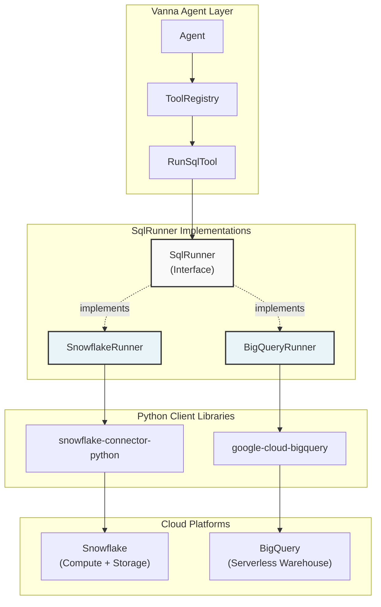
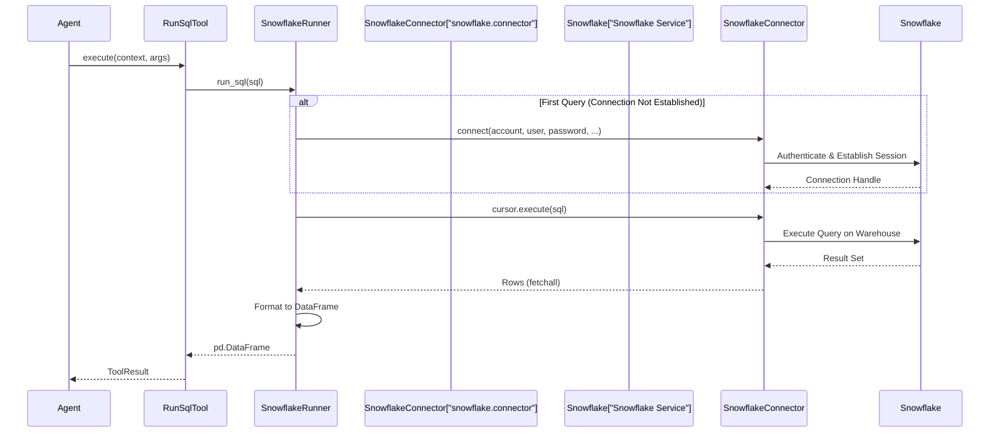
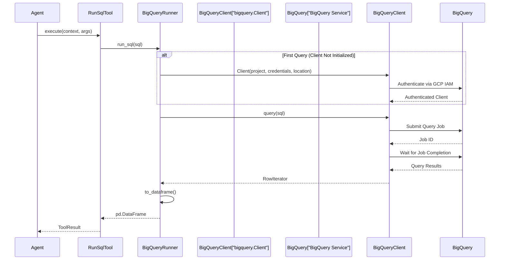

<!-- source: DeepWiki mcp.deepwiki.com · repo vanna-ai/vanna · page 6.4 Cloud Data Warehouses · fetched 2026-10-29 -->

# Cloud Data Warehouses

<details>
<summary>Relevant source files</summary>

The following files were used as context for generating this wiki page:

- [pyproject.toml](pyproject.toml)
- [src/vanna/__init__.py](src/vanna/__init__.py)
- [src/vanna/integrations/azureopenai/__init__.py](src/vanna/integrations/azureopenai/__init__.py)
- [src/vanna/integrations/azureopenai/llm.py](src/vanna/integrations/azureopenai/llm.py)
- [tests/conftest.py](tests/conftest.py)
- [tests/test_agent_memory_sanity.py](tests/test_agent_memory_sanity.py)
- [tests/test_agents.py](tests/test_agents.py)
- [tests/test_azureopenai_llm.py](tests/test_azureopenai_llm.py)
- [tests/test_legacy_adapter.py](tests/test_legacy_adapter.py)
- [tox.ini](tox.ini)

</details>


## Purpose and Scope

This page documents Vanna's `SqlRunner` implementations for cloud-native data warehouse platforms. These implementations enable Vanna agents to execute SQL queries against managed cloud services that are optimized for analytical workloads at scale.

**Covered Platforms:**
- **Snowflake**: Cloud data warehouse with compute-storage separation
- **BigQuery**: Google Cloud's serverless data warehouse

For the `SqlRunner` interface specification, see [SqlRunner Interface](#6.1). For traditional RDBMS systems (MySQL, PostgreSQL, Oracle, MSSQL), see [Traditional SQL Databases](#6.5). For analytics engines (ClickHouse, DuckDB, Presto), see [Analytics Engines](#6.6).

**Sources:** [pyproject.toml:48-49](), [tox.ini:15-19]()

---

## Architecture Overview

Cloud data warehouse runners implement the `SqlRunner` interface and are used by `RunSqlTool` to execute LLM-generated SQL queries. These runners handle platform-specific connection management, authentication, query execution, and result formatting.

### Integration Architecture



**Sources:** [tox.ini:141-189](), [pyproject.toml:48-49]()

---

## Installation

Cloud data warehouse runners require platform-specific Python packages. Install them using optional dependencies:

| Platform | Installation Command | Python Package |
|----------|---------------------|----------------|
| Snowflake | `pip install vanna[snowflake]` | `snowflake-connector-python` |
| BigQuery | `pip install vanna[bigquery]` | `google-cloud-bigquery` |
| Both | `pip install vanna[snowflake,bigquery]` | Both packages |

**Alternative:** Install all database connectors:
```bash
pip install vanna[all]
```

**Sources:** [pyproject.toml:48-49](), [pyproject.toml:52]()

---

## Snowflake Integration

### SnowflakeRunner

The `SnowflakeRunner` class provides connectivity to Snowflake data warehouses using the official `snowflake-connector-python` library. It supports multiple authentication methods and Snowflake-specific features like warehouse control, role management, and schema specification.

**Implementation Location:** `vanna.integrations.snowflake.SnowflakeRunner`

### Connection Flow



### Configuration Parameters

`SnowflakeRunner` typically accepts these initialization parameters:

| Parameter | Description | Example |
|-----------|-------------|---------|
| `account` | Snowflake account identifier | `"myorg-myaccount"` |
| `user` | Username for authentication | `"analyst_user"` |
| `password` | Password or use external auth | `"secure_password"` |
| `warehouse` | Compute warehouse name | `"COMPUTE_WH"` |
| `database` | Default database | `"ANALYTICS_DB"` |
| `schema` | Default schema | `"PUBLIC"` |
| `role` | Snowflake role to assume | `"ANALYST_ROLE"` |

**Authentication Options:**
- **Username/Password**: Standard authentication
- **SSO**: Single sign-on via browser redirect
- **Key Pair**: Private key authentication for service accounts
- **OAuth**: External OAuth token

### Usage Example

```python
from vanna.integrations.snowflake import SnowflakeRunner
from vanna.tools import RunSqlTool
from vanna.integrations.local.file_system import LocalFileSystem

# Initialize Snowflake connection
snowflake_runner = SnowflakeRunner(
    account="myorg-myaccount",
    user="analyst_user",
    password="secure_password",
    warehouse="COMPUTE_WH",
    database="ANALYTICS_DB",
    schema="PUBLIC",
    role="ANALYST_ROLE"
)

# Create SQL execution tool
sql_tool = RunSqlTool(
    sql_runner=snowflake_runner,
    file_system=LocalFileSystem()
)

# Register with agent's tool registry
tools.register_local_tool(sql_tool, access_groups=["analyst"])
```

### Snowflake-Specific Features

**Warehouse Management:**
Snowflake separates compute (warehouses) from storage. The `warehouse` parameter specifies which compute cluster executes queries. Different warehouses can have different sizes (X-Small to 6X-Large) and configurations.

**Role-Based Access:**
Snowflake's role hierarchy is enforced by specifying the `role` parameter. The runner executes queries with the specified role's permissions.

**Query Optimization:**
- Leverages Snowflake's query optimizer and caching
- Results are automatically formatted to pandas DataFrames
- Supports Snowflake's VARIANT type for semi-structured data

**Sources:** [tox.ini:141-149](), [pyproject.toml:49]()

---

## BigQuery Integration

### BigQueryRunner

The `BigQueryRunner` class provides connectivity to Google Cloud BigQuery using the official `google-cloud-bigquery` library. It supports GCP authentication methods, dataset specification, and BigQuery-specific query features.

**Implementation Location:** `vanna.integrations.bigquery.BigQueryRunner`

### Connection Flow



### Configuration Parameters

`BigQueryRunner` typically accepts these initialization parameters:

| Parameter | Description | Example |
|-----------|-------------|---------|
| `project_id` | GCP project identifier | `"my-analytics-project"` |
| `credentials` | GCP credentials object or path | Service account JSON |
| `location` | BigQuery dataset location | `"US"`, `"EU"` |
| `default_dataset` | Default dataset for queries | `"analytics.production"` |

**Authentication Options:**
- **Application Default Credentials (ADC)**: Automatic credential discovery
- **Service Account Key**: JSON key file for service accounts
- **User Credentials**: OAuth 2.0 user credentials
- **Workload Identity**: For Google Kubernetes Engine (GKE) workloads

### Usage Example

```python
from vanna.integrations.bigquery import BigQueryRunner
from vanna.tools import RunSqlTool
from vanna.integrations.local.file_system import LocalFileSystem
from google.oauth2 import service_account

# Option 1: Use Application Default Credentials
bigquery_runner = BigQueryRunner(
    project_id="my-analytics-project",
    location="US"
)

# Option 2: Use Service Account Key
credentials = service_account.Credentials.from_service_account_file(
    'path/to/service-account-key.json'
)
bigquery_runner = BigQueryRunner(
    project_id="my-analytics-project",
    credentials=credentials,
    location="US",
    default_dataset="analytics.production"
)

# Create SQL execution tool
sql_tool = RunSqlTool(
    sql_runner=bigquery_runner,
    file_system=LocalFileSystem()
)

# Register with agent's tool registry
tools.register_local_tool(sql_tool, access_groups=["analyst"])
```

### BigQuery-Specific Features

**Serverless Architecture:**
BigQuery automatically scales compute resources. No warehouse management required—queries execute on Google's managed infrastructure.

**Standard SQL vs Legacy SQL:**
BigQuery supports two SQL dialects. The runner uses Standard SQL by default, which is compatible with most SQL tools and ANSI SQL standards.

**Query Jobs:**
All BigQuery queries run as asynchronous jobs. The runner handles job submission, polling, and result retrieval transparently.

**Cost Management:**
- Queries are billed based on data scanned
- Partitioned and clustered tables reduce costs
- Query results are cached for 24 hours (free re-execution)

**Performance Optimization:**
- Supports BigQuery's nested and repeated fields (STRUCT, ARRAY)
- Automatically handles large result sets via pagination
- Results converted to pandas DataFrames with proper type mapping

**Sources:** [tox.ini:181-189](), [pyproject.toml:48]()

---

## Common Patterns

### Environment-Based Configuration

Use environment variables to avoid hardcoding credentials:

```python
import os
from vanna.integrations.snowflake import SnowflakeRunner

snowflake_runner = SnowflakeRunner(
    account=os.getenv("SNOWFLAKE_ACCOUNT"),
    user=os.getenv("SNOWFLAKE_USER"),
    password=os.getenv("SNOWFLAKE_PASSWORD"),
    warehouse=os.getenv("SNOWFLAKE_WAREHOUSE", "COMPUTE_WH"),
    database=os.getenv("SNOWFLAKE_DATABASE", "ANALYTICS"),
    schema=os.getenv("SNOWFLAKE_SCHEMA", "PUBLIC")
)
```

### Multi-Platform Agent

An agent can support multiple cloud warehouses simultaneously:

```python
from vanna import Agent, AgentConfig
from vanna.core.registry import ToolRegistry
from vanna.tools import RunSqlTool
from vanna.integrations.snowflake import SnowflakeRunner
from vanna.integrations.bigquery import BigQueryRunner

tools = ToolRegistry()

# Snowflake tool
snowflake_tool = RunSqlTool(
    sql_runner=SnowflakeRunner(...),
    file_system=LocalFileSystem()
)
tools.register_local_tool(snowflake_tool, access_groups=["snowflake_users"])

# BigQuery tool
bigquery_tool = RunSqlTool(
    sql_runner=BigQueryRunner(...),
    file_system=LocalFileSystem()
)
tools.register_local_tool(bigquery_tool, access_groups=["bigquery_users"])

agent = Agent(llm_service=llm, tool_registry=tools, ...)
```

**Note:** Register each tool with distinct `access_groups` to control which users can query which platforms. See [Tool Access Control](#3.2) for details.

### Row-Level Security with Cloud Warehouses

Cloud warehouses support row-level security through `transform_args`:

```python
from vanna.core.tool import ToolContext

def inject_tenant_filter(context: ToolContext, args: dict) -> dict:
    """Add WHERE clause filtering by user's organization."""
    user = context.user
    sql = args.get("sql", "")
    
    # Get user's organization from metadata
    org_id = user.metadata.get("organization_id")
    
    if org_id and "WHERE" in sql.upper():
        # Inject tenant filter into existing WHERE clause
        sql = sql.replace("WHERE", f"WHERE organization_id = '{org_id}' AND")
    elif org_id:
        # Add WHERE clause if not present
        sql += f" WHERE organization_id = '{org_id}'"
    
    args["sql"] = sql
    return args

# Apply transform to RunSqlTool
sql_tool = RunSqlTool(
    sql_runner=snowflake_runner,
    file_system=LocalFileSystem(),
    transform_args=inject_tenant_filter
)
```

For more details, see [Argument Transformation and Row-Level Security](#3.4).

### Connection Pooling and Lifecycle

Both Snowflake and BigQuery clients maintain persistent connections:

**Snowflake:**
- Connections are established on first query
- Session persists until explicitly closed or timeout
- Supports connection pooling via `snowflake-connector-python`

**BigQuery:**
- Client objects are lightweight and reusable
- HTTP connections are managed by the underlying `requests` library
- Best practice: Create one client per agent instance

### Error Handling

Cloud warehouse runners raise platform-specific exceptions:

```python
from vanna.core.exceptions import ToolExecutionError

try:
    result = await sql_tool.execute(context, {"sql": query})
except ToolExecutionError as e:
    # Wrapper for underlying platform errors
    print(f"Query failed: {e}")
    # Original error available in e.__cause__
```

**Common Error Scenarios:**
- **Authentication failures**: Invalid credentials or expired tokens
- **Permission errors**: User lacks access to database/table
- **Query errors**: Invalid SQL syntax or non-existent objects
- **Resource limits**: Query timeout, memory exceeded, or cost controls

**Sources:** [tests/test_agents.py:23-53]()

---

## Testing

### Sanity Tests

Both cloud warehouse runners have sanity tests that verify import functionality without requiring live connections:

**Snowflake Sanity Test:**
```bash
tox -e py311-snowflake-sanity
```

Verifies:
- `SnowflakeRunner` imports successfully
- Required dependencies are installed
- Basic class structure is correct

**BigQuery Sanity Test:**
```bash
tox -e py311-bigquery-sanity
```

Verifies:
- `BigQueryRunner` imports successfully
- Google Cloud BigQuery SDK is available
- Basic class structure is correct

### Integration Testing

For full integration testing with live cloud services:

```python
import pytest
from vanna.integrations.snowflake import SnowflakeRunner

@pytest.mark.skipif(
    not os.getenv("SNOWFLAKE_ACCOUNT"),
    reason="Snowflake credentials not available"
)
def test_snowflake_query():
    runner = SnowflakeRunner(
        account=os.getenv("SNOWFLAKE_ACCOUNT"),
        user=os.getenv("SNOWFLAKE_USER"),
        password=os.getenv("SNOWFLAKE_PASSWORD"),
        warehouse=os.getenv("SNOWFLAKE_WAREHOUSE"),
        database=os.getenv("SNOWFLAKE_DATABASE")
    )
    
    result = runner.run_sql("SELECT 1 as test_column")
    assert result is not None
    assert len(result) == 1
    assert result.iloc[0]['test_column'] == 1
```

**Sources:** [tox.ini:141-189](), [tests/conftest.py:29-67]()

---

## Comparison Matrix

| Feature | Snowflake | BigQuery |
|---------|-----------|----------|
| **Architecture** | Compute-storage separation | Serverless, fully managed |
| **Scaling** | Manual warehouse sizing | Automatic, slot-based |
| **Pricing Model** | Compute hours + storage | Data scanned + storage |
| **Authentication** | Username/password, SSO, key pair | GCP IAM, service accounts |
| **SQL Dialect** | ANSI SQL with extensions | Standard SQL (default) or Legacy SQL |
| **Semi-Structured Data** | VARIANT, ARRAY, OBJECT types | STRUCT, ARRAY types |
| **Query Optimization** | Result caching, materialized views | Automatic query caching (24h), partitioning |
| **Connection Management** | Persistent sessions | Stateless HTTP clients |
| **Python Package** | `snowflake-connector-python` | `google-cloud-bigquery` |
| **Vanna Extra** | `vanna[snowflake]` | `vanna[bigquery]` |

---

## Best Practices

### Security

1. **Credential Management:**
   - Use environment variables or secrets managers (AWS Secrets Manager, GCP Secret Manager, HashiCorp Vault)
   - Never hardcode credentials in source code
   - Rotate credentials regularly

2. **Least Privilege:**
   - Grant minimum required permissions to service accounts
   - Use Snowflake roles with specific privileges
   - Configure BigQuery IAM roles at dataset level

3. **Network Security:**
   - Use Snowflake's IP whitelisting or private connectivity (AWS PrivateLink, Azure Private Link)
   - Configure VPC Service Controls for BigQuery
   - Enable SSL/TLS for all connections

### Performance

1. **Query Optimization:**
   - Use partition/cluster keys in table design
   - Leverage Snowflake's clustering keys
   - Implement BigQuery partitioning by date/timestamp
   - Add appropriate WHERE clause filters

2. **Result Size Management:**
   - Limit result sets with `LIMIT` clauses
   - Use pagination for large datasets
   - Configure `max_rows` in `RunSqlTool` if needed

3. **Cost Control:**
   - Monitor query costs in cloud provider dashboards
   - Set Snowflake warehouse auto-suspend/auto-resume
   - Use BigQuery's flat-rate pricing for predictable costs
   - Implement query complexity limits in LLM prompts

### Reliability

1. **Error Handling:**
   - Implement retry logic for transient failures
   - Log all query executions and errors
   - Use try-except blocks around runner operations

2. **Connection Management:**
   - Reuse runner instances within agent lifecycle
   - Close connections properly during shutdown
   - Handle connection timeouts gracefully

3. **Monitoring:**
   - Track query execution times
   - Monitor authentication failures
   - Set up alerts for cost thresholds

**Sources:** [pyproject.toml:48-49](), [tox.ini:141-189]()

---

## Next Steps

- For PostgreSQL, MySQL, Oracle, and MSSQL integrations, see [Traditional SQL Databases](#6.5)
- For ClickHouse, DuckDB, Presto, and Hive integrations, see [Analytics Engines](#6.6)
- For details on creating custom `SqlRunner` implementations, see [SqlRunner Interface](#6.1)
- For row-level security implementation patterns, see [Argument Transformation and Row-Level Security](#3.4)

---

