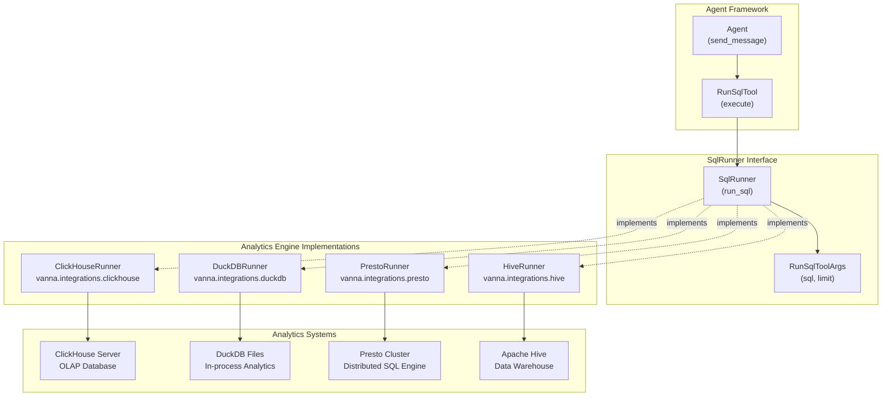
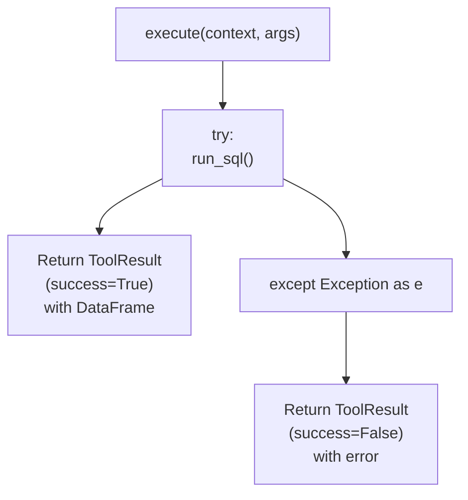
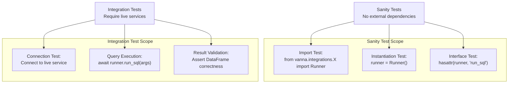

<!-- source: DeepWiki mcp.deepwiki.com · repo vanna-ai/vanna · page 6.6 Analytics Engines · fetched 2026-10-29 -->

# Analytics Engines

<details>
<summary>Relevant source files</summary>

The following files were used as context for generating this wiki page:

- [pyproject.toml](pyproject.toml)
- [src/vanna/__init__.py](src/vanna/__init__.py)
- [src/vanna/integrations/azureopenai/__init__.py](src/vanna/integrations/azureopenai/__init__.py)
- [src/vanna/integrations/azureopenai/llm.py](src/vanna/integrations/azureopenai/llm.py)
- [tests/conftest.py](tests/conftest.py)
- [tests/test_agent_memory_sanity.py](tests/test_agent_memory_sanity.py)
- [tests/test_agents.py](tests/test_agents.py)
- [tests/test_azureopenai_llm.py](tests/test_azureopenai_llm.py)
- [tests/test_legacy_adapter.py](tests/test_legacy_adapter.py)
- [tox.ini](tox.ini)

</details>


This page documents the four analytics-focused database integrations in the Vanna framework: **ClickHouse**, **DuckDB**, **Presto**, and **Hive**. These implementations of the `SqlRunner` interface are optimized for analytical workloads such as OLAP queries, data warehousing, and large-scale data processing. For traditional RDBMS systems (PostgreSQL, MySQL, Oracle, SQL Server), see [Traditional SQL Databases](#6.5). For cloud data warehouses (Snowflake, BigQuery), see [Cloud Data Warehouses](#6.4). For the base `SqlRunner` interface, see [SqlRunner Interface](#6.1).

## Overview

Analytics engines are designed for read-heavy, aggregation-intensive workloads. Unlike transactional databases (OLTP), these systems prioritize query performance over write throughput and typically support:

- **Columnar storage**: Optimized for analytical queries that scan specific columns across many rows
- **Distributed processing**: Horizontal scaling across multiple nodes
- **Complex aggregations**: Efficient GROUP BY, window functions, and statistical operations
- **Large datasets**: Handling petabyte-scale data with acceptable query latency

All four analytics engines implement the `SqlRunner` interface, enabling seamless integration with Vanna's agent framework through the `RunSqlTool`.



**Sources**: [tox.ini:17-23](), [src/vanna/tools/run_sql.py:1-166]()

## Analytics Engine Comparison

| Engine | Architecture | Primary Use Case | Installation | Key Features |
|--------|-------------|------------------|--------------|--------------|
| **ClickHouse** | Columnar OLAP database | Real-time analytics, time-series data | `pip install 'vanna[clickhouse]'` | Sub-second queries, MergeTree tables, distributed queries |
| **DuckDB** | In-process analytical database | Embedded analytics, data science | `pip install 'vanna[duckdb]'` | Zero external dependencies, Parquet/CSV ingestion, OLAP in Python |
| **Presto** | Distributed SQL query engine | Federated queries across data sources | `pip install 'vanna[presto]'` | Query heterogeneous data sources, MPP architecture, ANSI SQL |
| **Hive** | Data warehouse on Hadoop | Batch processing, data lake queries | `pip install 'vanna[hive]'` | Hadoop integration, HiveQL, large-scale ETL |

**Sources**: [tox.ini:161-229]()

## ClickHouseRunner

**ClickHouse** is a column-oriented database management system designed for online analytical processing (OLAP). It excels at aggregating large volumes of data with sub-second query latency.

### Installation and Import

```bash
pip install 'vanna[clickhouse]'
```

The `ClickHouseRunner` can be imported from `vanna.integrations.clickhouse`:

```python
from vanna.integrations.clickhouse import ClickHouseRunner
```

**Sources**: [tox.ini:161-169]()

### Use Cases

- **Real-time analytics dashboards**: Low-latency aggregations for monitoring systems
- **Time-series data analysis**: Efficient storage and querying of log data, metrics, events
- **Data warehouse queries**: High-performance OLAP operations on large datasets
- **Click stream analysis**: Processing billions of user events with complex GROUP BY queries

### Configuration

ClickHouse typically requires connection parameters including host, port, database name, and authentication credentials. The runner handles the translation of Vanna's `RunSqlToolArgs` to ClickHouse-specific query execution.

### Testing

The sanity test environment validates that the `ClickHouseRunner` can be imported and instantiated without requiring an actual ClickHouse server connection:

```bash
tox -e py311-clickhouse-sanity
```

This test:
1. Imports `ClickHouseRunner` from `vanna.integrations.clickhouse`
2. Runs tests from `tests/test_database_sanity.py::TestClickHouseRunner`
3. Validates interface compliance without network dependencies

**Sources**: [tox.ini:161-169]()

## DuckDBRunner

**DuckDB** is an in-process SQL OLAP database management system. Unlike traditional client-server databases, DuckDB runs within the application process, making it ideal for embedded analytics and data science workflows.

### Installation and Import

```bash
pip install 'vanna[duckdb]'
```

The `DuckDBRunner` can be imported from `vanna.integrations.duckdb`:

```python
from vanna.integrations.duckdb import DuckDBRunner
```

**Sources**: [tox.ini:191-199]()

### Use Cases

- **Embedded analytics**: SQL analysis within Python applications without external database servers
- **Data science workflows**: Interactive querying of DataFrames, Parquet files, CSV files
- **Local development and testing**: Lightweight alternative to production data warehouses
- **Prototyping**: Rapid SQL exploration without infrastructure setup

### Key Features

DuckDB provides several advantages for analytical workloads:

- **Zero external dependencies**: No database server installation required
- **Native Parquet/CSV support**: Direct queries on files without ETL
- **Pandas integration**: Seamless conversion between DataFrames and SQL tables
- **OLAP optimizations**: Columnar storage, vectorized execution, parallel query processing

### Configuration

DuckDB can operate in three modes:
1. **In-memory**: `:memory:` for ephemeral analytics
2. **File-based persistence**: Path to `.duckdb` file for persistent storage
3. **Read-only mode**: Query existing files without write permissions

### Testing

The sanity test environment validates DuckDB integration:

```bash
tox -e py311-duckdb-sanity
```

**Sources**: [tox.ini:191-199]()

## PrestoRunner

**Presto** (also known as **Trino**) is a distributed SQL query engine designed for running interactive analytic queries against data sources of all sizes, from gigabytes to petabytes.

### Installation and Import

```bash
pip install 'vanna[presto]'
```

The `PrestoRunner` can be imported from `vanna.integrations.presto`:

```python
from vanna.integrations.presto import PrestoRunner
```

**Sources**: [tox.ini:211-219]()

### Use Cases

- **Federated queries**: Single SQL query across multiple heterogeneous data sources (MySQL, PostgreSQL, Kafka, S3)
- **Interactive analytics**: Ad-hoc queries on large datasets with acceptable latency
- **Data lake queries**: SQL interface to data stored in object storage (S3, Azure Blob, GCS)
- **Multi-tenant analytics**: Isolated query execution with resource management

### Architecture

Presto uses a massively parallel processing (MPP) architecture:
- **Coordinator**: Parses SQL, builds query plans, manages query execution
- **Workers**: Execute query fragments in parallel across cluster nodes
- **Connectors**: Pluggable data source integrations (Hive, PostgreSQL, MongoDB, etc.)

### Configuration

Presto connections typically require:
- Coordinator host and port (default: 8080)
- Catalog name (data source type: hive, mysql, postgresql, etc.)
- Schema name within the catalog
- Authentication method (none, basic, kerberos, JWT)

### Testing

The sanity test environment validates Presto integration:

```bash
tox -e py311-presto-sanity
```

**Sources**: [tox.ini:211-219]()

## HiveRunner

**Apache Hive** is a data warehouse software built on top of Hadoop for providing data query and analysis. It uses HiveQL, a SQL-like language, to query data stored in Hadoop Distributed File System (HDFS).

### Installation and Import

```bash
pip install 'vanna[hive]'
```

The `HiveRunner` can be imported from `vanna.integrations.hive`:

```python
from vanna.integrations.hive import HiveRunner
```

**Sources**: [tox.ini:221-229]()

### Use Cases

- **Batch processing**: Large-scale ETL jobs on Hadoop clusters
- **Data lake queries**: SQL interface to structured data in HDFS
- **Historical data analysis**: Querying archived data with MapReduce or Tez execution
- **Data warehouse**: Traditional OLAP operations on Hadoop-based storage

### Architecture

Hive operates as a translation layer:
1. **HiveQL Parsing**: Translates SQL-like queries into execution plans
2. **Execution Engine**: Converts plans to MapReduce, Tez, or Spark jobs
3. **Metastore**: Stores table schemas, partitions, and storage locations
4. **Storage**: Data resides in HDFS, S3, or other distributed file systems

### Configuration

Hive connections require:
- **HiveServer2 endpoint**: Host and port (default: 10000)
- **Authentication**: None, LDAP, Kerberos, or custom
- **Database**: Default or specific database within Hive
- **Execution engine**: MapReduce (default), Tez, or Spark

### Performance Considerations

Hive is optimized for throughput over latency:
- Queries may take seconds to minutes due to MapReduce/Tez overhead
- Best suited for batch analytics, not interactive queries
- Partitioning and bucketing significantly improve query performance
- Consider Presto/Trino for lower-latency queries on Hive tables

### Testing

The sanity test environment validates Hive integration:

```bash
tox -e py311-hive-sanity
```

**Sources**: [tox.ini:221-229]()

## Common Integration Patterns

All analytics engine runners share common patterns for integration with Vanna's agent framework:

### SqlRunner Interface Compliance

Each runner implements the `SqlRunner` interface, which requires:

```python
async def run_sql(
    self,
    args: RunSqlToolArgs,
    context: ToolContext
) -> pd.DataFrame
```

The method:
1. Receives `RunSqlToolArgs` containing the SQL query and optional limit
2. Accesses user context for authentication and authorization
3. Executes the query against the analytics engine
4. Returns results as a pandas `DataFrame`

**Sources**: [src/vanna/tools/run_sql.py:56-61]()

### Error Handling

Analytics engines may encounter specific error conditions:



Common error scenarios:
- **Syntax errors**: Invalid SQL for the specific engine's dialect
- **Timeout errors**: Query exceeds execution time limit
- **Resource errors**: Insufficient memory or cluster capacity
- **Permission errors**: User lacks access to tables/schemas
- **Connection errors**: Network issues or service unavailable

**Sources**: [src/vanna/tools/run_sql.py:150-165]()

### Result Handling

The `RunSqlTool` processes results from analytics engines uniformly:

1. **Empty results**: Returns a notification component indicating no rows
2. **SELECT results**: Creates `DataFrameComponent` for UI display, saves CSV file for downstream tools
3. **DML results**: Returns row count affected by INSERT/UPDATE/DELETE operations

For large result sets, the tool truncates the LLM-facing text representation to 1000 characters while preserving full results in the CSV file:

**Sources**: [src/vanna/tools/run_sql.py:63-127]()

## Testing Infrastructure

### Sanity Tests

The testing infrastructure uses `pytest` with dedicated test environments for each analytics engine. Sanity tests validate:

1. **Import verification**: Module can be imported without dependencies
2. **Class instantiation**: Runner can be constructed
3. **Interface compliance**: All required methods are implemented

Test execution for all analytics engines:

```bash
# Individual engine tests
tox -e py311-clickhouse-sanity
tox -e py311-duckdb-sanity
tox -e py311-presto-sanity
tox -e py311-hive-sanity

# All database sanity tests
tox -e py311-db-sanity
```

### Test Structure

Each sanity test environment follows a consistent pattern in `tox.ini`:

- **Description**: Human-readable test purpose
- **Dependencies**: `pytest>=7.0.0`, `pytest-asyncio>=0.21.0`
- **Extras**: Specific integration package (e.g., `clickhouse`, `duckdb`)
- **Commands**: 
  1. Import test: Validates module import succeeds
  2. Test execution: Runs `tests/test_database_sanity.py::Test<Engine>Runner`

**Sources**: [tox.ini:161-229]()

### Integration Tests

Full integration tests (not shown in provided files) would require:
- Running analytics engine instances (Docker containers, cloud services)
- Environment variables for connection strings
- Test data fixtures (Chinook database or equivalent)
- Query execution and result validation

The testing approach mirrors the pattern used for LLM providers and memory systems:



**Sources**: [tox.ini:111-229](), [tests/conftest.py:69-88]()

## Configuration Examples

### Agent Setup with Analytics Engines

```python
from vanna import Agent, AgentConfig
from vanna.core.registry import ToolRegistry
from vanna.tools import RunSqlTool
from vanna.integrations.local import LocalFileSystem
from vanna.integrations.<engine> import <Engine>Runner

# Initialize analytics engine runner
runner = ClickHouseRunner(
    host="clickhouse.example.com",
    port=9000,
    database="analytics",
    user="analyst",
    password="secret"
)

# Create tool registry and register SQL tool
tools = ToolRegistry()
db_tool = RunSqlTool(
    sql_runner=runner,
    file_system=LocalFileSystem()
)
tools.register_local_tool(db_tool, access_groups=["user", "analyst"])

# Create agent
agent = Agent(
    llm_service=llm,
    tool_registry=tools,
    user_resolver=user_resolver,
    config=AgentConfig()
)
```

This pattern applies to all analytics engines, with engine-specific connection parameters.

**Sources**: [tests/test_agents.py:23-52]()

## Dialect Considerations

Each analytics engine supports a SQL dialect with specific features and limitations:

### ClickHouse SQL

- **Non-standard functions**: `quantile()`, `uniq()`, `arrayJoin()`
- **Table engines**: MergeTree family requires specific syntax
- **Distributed queries**: `GLOBAL` modifier for distributed joins

### DuckDB SQL

- **Postgres compatibility**: Most PostgreSQL syntax works
- **File operations**: `read_csv()`, `read_parquet()` functions
- **Extensions**: Optional modules for JSON, spatial data

### Presto/Trino SQL

- **ANSI SQL compliant**: Standard SQL syntax
- **Connector-specific**: Some functions vary by data source
- **Information schema**: `SHOW CATALOGS`, `SHOW SCHEMAS` for discovery

### HiveQL

- **Limited SQL support**: Subset of SQL-92
- **DDL differences**: `CREATE TABLE` with storage format clauses
- **UDFs**: User-defined functions in Java

Agents using these runners must account for dialect variations when generating SQL. The LLM system prompt should specify the target analytics engine to ensure correct SQL generation.

**Sources**: Referenced knowledge from architecture overview

---

This page documented the four analytics engine integrations available in Vanna: ClickHouse for real-time OLAP, DuckDB for embedded analytics, Presto for federated queries, and Hive for Hadoop-based data warehousing. All four implement the `SqlRunner` interface and integrate seamlessly with the agent framework through `RunSqlTool`.

---

