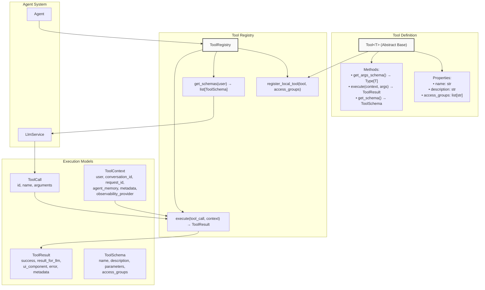
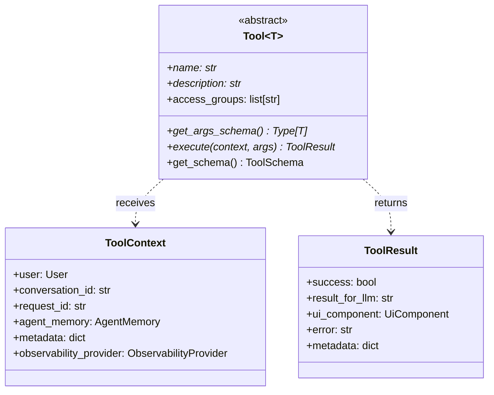
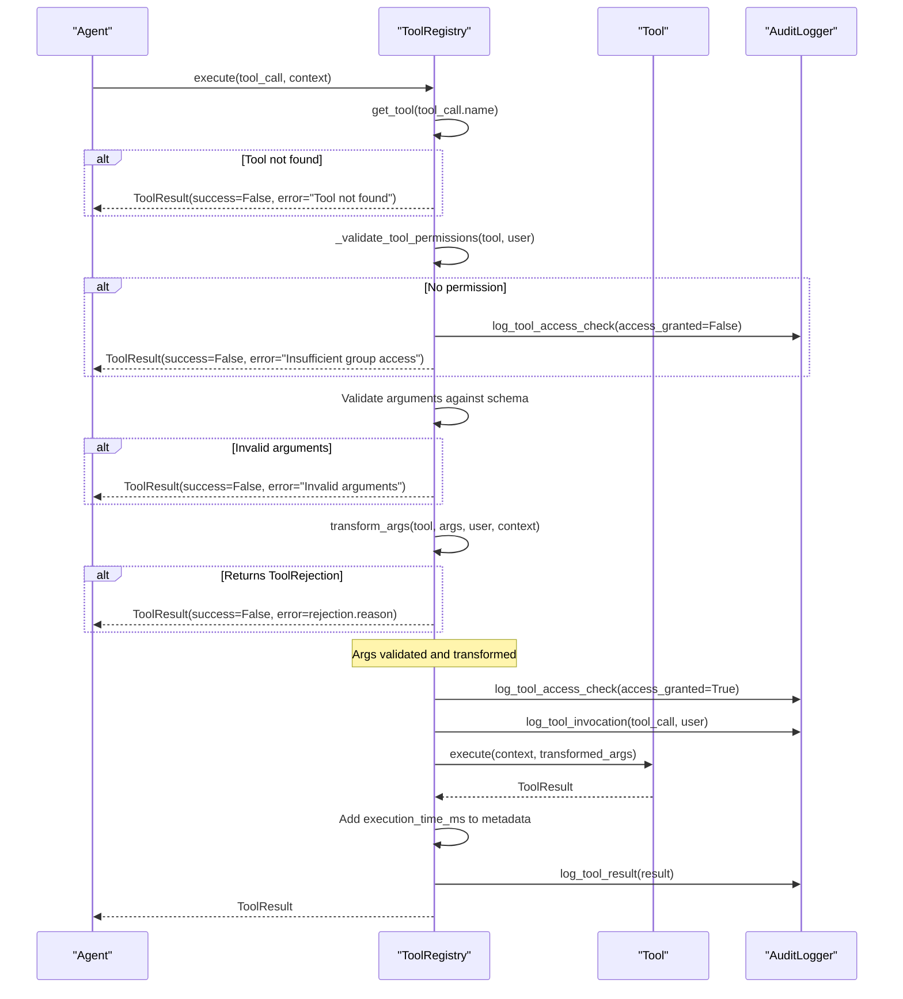
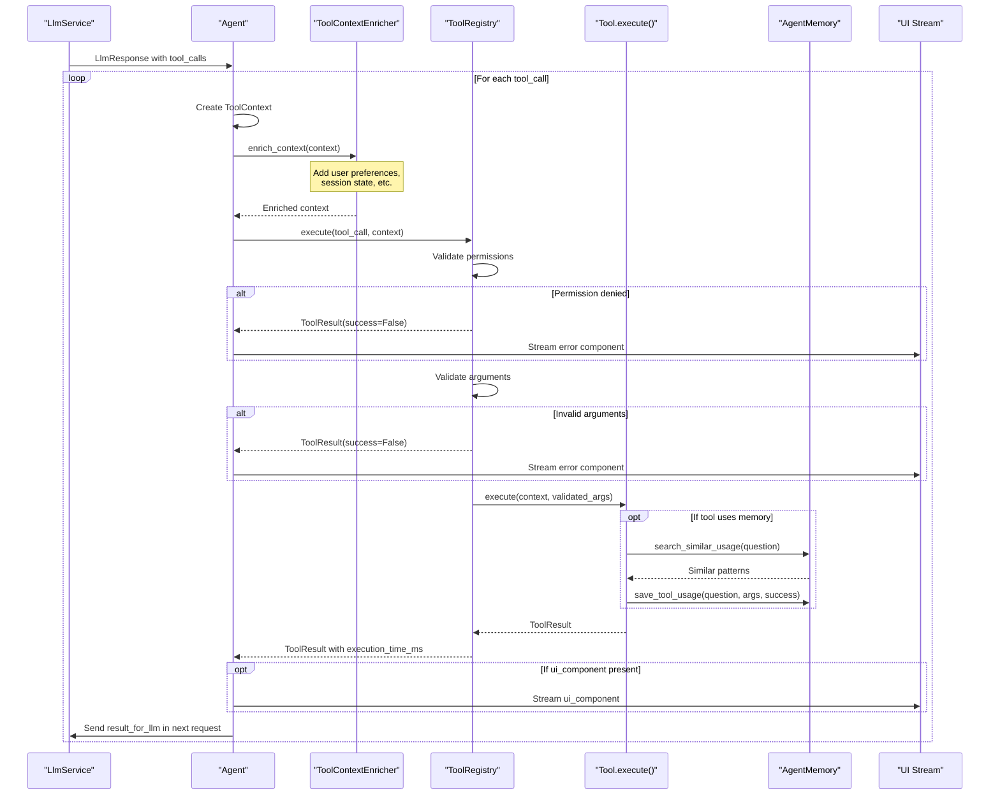
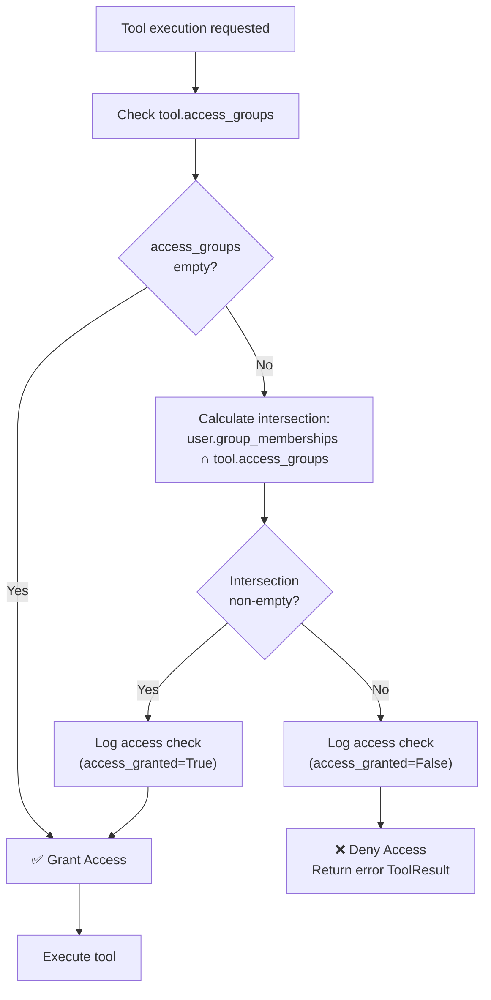

<!-- source: DeepWiki mcp.deepwiki.com · repo vanna-ai/vanna · page 7 Tool System · fetched 2026-10-29 -->

# Tool System

<details>
<summary>Relevant source files</summary>

The following files were used as context for generating this wiki page:

- [MIGRATION_GUIDE.md](MIGRATION_GUIDE.md)
- [README.md](README.md)
- [examples/transform_args_example.py](examples/transform_args_example.py)
- [img/architecture.png](img/architecture.png)
- [img/vanna2.svg](img/vanna2.svg)
- [notebooks/quickstart.ipynb](notebooks/quickstart.ipynb)
- [src/vanna/core/registry.py](src/vanna/core/registry.py)
- [src/vanna/core/tool/__init__.py](src/vanna/core/tool/__init__.py)
- [src/vanna/core/tool/base.py](src/vanna/core/tool/base.py)
- [src/vanna/core/tool/models.py](src/vanna/core/tool/models.py)
- [src/vanna/core/user/models.py](src/vanna/core/user/models.py)
- [src/vanna/integrations/anthropic/llm.py](src/vanna/integrations/anthropic/llm.py)
- [src/vanna/integrations/openai/llm.py](src/vanna/integrations/openai/llm.py)
- [src/vanna/servers/fastapi/app.py](src/vanna/servers/fastapi/app.py)
- [src/vanna/servers/flask/app.py](src/vanna/servers/flask/app.py)
- [tests/test_agent_memory.py](tests/test_agent_memory.py)
- [tests/test_tool_permissions.py](tests/test_tool_permissions.py)

</details>


The Tool System provides the framework for defining, registering, and executing tools that extend the Agent's capabilities. Tools are functions that the LLM can invoke to perform actions such as querying databases, generating visualizations, or managing memory. This document covers the complete tool lifecycle: definition, registration, permission validation, execution, and result handling.

For step-by-step guides on creating tools, see [Creating Custom Tools](#6.1). For documentation of built-in tools, see [Built-in Tools](#6.2). For details on permission enforcement, see [Tool Access Control](#6.3).

---

## Tool System Architecture

The Tool System consists of three main components: the `Tool` base class for defining tools, the `ToolRegistry` for managing tool registration and access control, and the execution models (`ToolContext`, `ToolResult`) that handle the data flow during tool invocation.



**Sources:** [src/vanna/core/tool/base.py:1-71](), [src/vanna/core/tool/models.py:1-73](), [src/vanna/core/registry.py:1-229]()

---

## Tool Base Class

Tools are implemented by extending the abstract `Tool[T]` class, where `T` is a Pydantic model defining the tool's argument schema. The generic type parameter ensures type safety during argument validation.

### Core Interface



| Property/Method | Type | Description |
|----------------|------|-------------|
| `name` | `str` (property) | Unique identifier for the tool, used in LLM tool calls |
| `description` | `str` (property) | Human-readable description sent to LLM |
| `access_groups` | `list[str]` (property) | Groups permitted to use this tool; empty list = no restrictions |
| `get_args_schema()` | `Type[T]` (method) | Returns Pydantic model class for argument validation |
| `execute(context, args)` | `async ToolResult` (method) | Executes tool with validated arguments |
| `get_schema()` | `ToolSchema` (method) | Generates JSON schema for LLM consumption |

**Sources:** [src/vanna/core/tool/base.py:16-71]()

### Example Tool Implementation

The following example from the README demonstrates the tool interface:

```python
from vanna.core.tool import Tool, ToolContext, ToolResult
from pydantic import BaseModel, Field
from typing import Type

class QueryArgs(BaseModel):
    query: str = Field(description="SQL query to execute")

class CustomSQLTool(Tool[QueryArgs]):
    @property
    def name(self) -> str:
        return "query_database"

    @property
    def description(self) -> str:
        return "Execute a SQL query against the database"

    @property
    def access_groups(self) -> list[str]:
        return ["read_sales"]

    def get_args_schema(self) -> Type[QueryArgs]:
        return QueryArgs

    async def execute(self, context: ToolContext, args: QueryArgs) -> ToolResult:
        user = context.user
        # Tool logic here
        return ToolResult(
            success=True,
            result_for_llm=str(results)
        )
```

**Sources:** [README.md:247-282]()

---

## Tool Execution Models

### ToolCall

Represents an LLM's request to invoke a tool. Created by the Agent when parsing LLM responses containing tool calls.

| Field | Type | Description |
|-------|------|-------------|
| `id` | `str` | Unique identifier for this tool call (from LLM) |
| `name` | `str` | Tool name to execute |
| `arguments` | `dict[str, Any]` | Raw arguments from LLM (validated before execution) |

**Sources:** [src/vanna/core/tool/models.py:20-26]()

### ToolContext

Context object passed to every tool execution, providing access to user identity, memory, and system resources.

| Field | Type | Description |
|-------|------|-------------|
| `user` | `User` | User identity with `id`, `group_memberships`, and metadata |
| `conversation_id` | `str` | Current conversation identifier |
| `request_id` | `str` | Unique request identifier for tracing/debugging |
| `agent_memory` | `AgentMemory` | Agent memory for tool usage learning and retrieval |
| `metadata` | `dict[str, Any]` | Additional context (e.g., UI features, preferences) |
| `observability_provider` | `ObservabilityProvider` | Optional metrics and tracing provider |

**Sources:** [src/vanna/core/tool/models.py:28-44]()

### ToolResult

Result returned by tool execution, containing both machine-readable and human-readable representations.

| Field | Type | Description |
|-------|------|-------------|
| `success` | `bool` | Whether execution succeeded |
| `result_for_llm` | `str` | Text content sent back to LLM for reasoning |
| `ui_component` | `UiComponent` (optional) | Rich UI component for client rendering |
| `error` | `str` (optional) | Error message if `success=False` |
| `metadata` | `dict[str, Any]` | Additional metadata (e.g., `execution_time_ms`) |

The dual representation (`result_for_llm` + `ui_component`) allows tools to provide:
- **Machine-readable data** for LLM reasoning and decision-making
- **Human-readable UI** for rich client rendering (tables, charts, notifications)

**Sources:** [src/vanna/core/tool/models.py:47-62]()

### ToolRejection

Indicates that tool execution should be rejected with an explanation. This model is returned by `ToolRegistry.transform_args()` when arguments cannot be appropriately transformed for the user's context, such as when:
- User attempts to access restricted resources
- Required security constraints cannot be applied
- Arguments fail user-specific validation

| Field | Type | Description |
|-------|------|-------------|
| `reason` | `str` | Explanation of why the tool execution was rejected |

When `transform_args()` returns a `ToolRejection`, the registry immediately returns a failed `ToolResult` without executing the tool.

**Sources:** [src/vanna/core/tool/models.py:75-85]()

### ToolSchema

JSON schema describing a tool for LLM consumption. Generated automatically from tool properties and Pydantic argument schemas.

| Field | Type | Description |
|-------|------|-------------|
| `name` | `str` | Tool name |
| `description` | `str` | Tool description |
| `parameters` | `dict[str, Any]` | JSON Schema of parameters (from Pydantic model) |
| `access_groups` | `list[str]` | Groups permitted to access (for filtering) |

**Sources:** [src/vanna/core/tool/models.py:64-73]()

---

## ToolRegistry

The `ToolRegistry` manages tool registration, schema generation, and execution with access control enforcement.

### Registration

Tools are registered using `register_local_tool()` which optionally wraps tools with access group restrictions:

```python
registry = ToolRegistry()
registry.register_local_tool(tool, access_groups=["admin", "analyst"])
```

If `access_groups` is empty or `None`, the tool is accessible to all users. Otherwise, the registry wraps the tool in a `_LocalToolWrapper` that enforces the specified groups.

**Sources:** [src/vanna/core/registry.py:63-81]()

### Argument Transformation

The `ToolRegistry.transform_args()` method enables per-user transformation and validation of tool arguments before execution. This is commonly used for:

- **Row-Level Security (RLS)**: Injecting WHERE clauses into SQL queries based on user context
- **Argument validation**: Checking required fields or constraints specific to the user
- **Access control**: Rejecting execution for restricted resources
- **Data filtering**: Scoping queries to user-visible data

#### Default Behavior

The default implementation performs no transformation (pass-through):

```python
async def transform_args(
    self,
    tool: Tool[T],
    args: T,
    user: User,
    context: ToolContext,
) -> Union[T, ToolRejection]:
    return args  # No transformation
```

#### Custom Implementation

Subclass `ToolRegistry` to override `transform_args()`:

```python
class RLSToolRegistry(ToolRegistry):
    async def transform_args(self, tool, args, user, context):
        # Apply row-level security to SQL queries
        if tool.name == "run_sql" and isinstance(args, RunSqlToolArgs):
            if "restricted_table" in args.sql.lower():
                return ToolRejection(
                    reason="Access to 'restricted_table' is not permitted"
                )
            
            # Inject WHERE clause for user's organization
            org_id = user.metadata.get("organization_id")
            if org_id and "SELECT" in args.sql.upper():
                # Transform query to add organization filter
                transformed_sql = self._inject_where_clause(args.sql, org_id)
                return args.model_copy(update={"sql": transformed_sql})
        
        return args
```

**Return Types:**
- **Transformed args** (`T`): Modified arguments that will be passed to tool execution
- **ToolRejection**: Prevents execution and returns error to LLM

For a complete example, see [examples/transform_args_example.py:1-157]().

**Sources:** [src/vanna/core/registry.py:113-143](), [examples/transform_args_example.py:45-97](), [tests/test_tool_permissions.py:420-683]()

### Schema Generation

The `get_schemas(user)` method returns only tools accessible to the specified user:

```python
schemas = await registry.get_schemas(user)
# Returns list of ToolSchema for tools user can access
```

This filtered list is sent to the LLM, ensuring it only attempts to call tools the user has permission to use.

**Sources:** [src/vanna/core/registry.py:90-96]()

### Tool Execution Flow



**Sources:** [src/vanna/core/registry.py:144-279]()

### Permission Validation

The `_validate_tool_permissions()` method checks for intersection between user groups and tool access groups:

```python
async def _validate_tool_permissions(self, tool: Tool[Any], user: User) -> bool:
    tool_access_groups = tool.access_groups
    if not tool_access_groups:
        return True  # No restrictions
    
    user_groups = set(user.group_memberships)
    tool_groups = set(tool_access_groups)
    # Grant access if ANY user group matches ANY tool group
    return bool(user_groups & tool_groups)
```

Access is granted if:
- Tool has no `access_groups` specified (empty list), OR
- User's `group_memberships` has **any** intersection with tool's `access_groups`

**Sources:** [src/vanna/core/registry.py:98-111]()

---

## Complete Tool Execution Lifecycle

The following diagram shows the complete flow from LLM tool call to result streaming, including all validation and enrichment steps:



**Sources:** [src/vanna/core/registry.py:113-228](), [README.md:26-33]()

---

## Access Control System

### Group-Based Permissions

The tool system implements group-based access control through two properties:

1. **Tool-side**: `Tool.access_groups` - List of groups permitted to use the tool
2. **User-side**: `User.group_memberships` - List of groups the user belongs to

### Permission Rules

| Tool `access_groups` | User `group_memberships` | Access Granted? |
|----------------------|--------------------------|-----------------|
| `[]` (empty) | Any | ✅ Yes |
| `["admin"]` | `["admin"]` | ✅ Yes |
| `["admin"]` | `["admin", "user"]` | ✅ Yes |
| `["admin", "analyst"]` | `["analyst"]` | ✅ Yes (ANY match) |
| `["admin"]` | `["user"]` | ❌ No |
| `["admin"]` | `[]` | ❌ No |

### Access Control Flow



**Sources:** [src/vanna/core/registry.py:98-111](), [src/vanna/core/registry.py:129-153](), [tests/test_tool_permissions.py:357-386]()

### Audit Logging

When audit logging is enabled, the ToolRegistry logs:

1. **Access checks** (`log_tool_access_check`): Before execution, logs whether access was granted or denied
2. **Tool invocations** (`log_tool_invocation`): After access granted, logs the tool call with sanitized parameters
3. **Tool results** (`log_tool_result`): After execution, logs the result status

**Sources:** [src/vanna/core/registry.py:133-146](), [src/vanna/core/registry.py:169-180](), [src/vanna/core/registry.py:183-196](), [src/vanna/core/registry.py:207-218]()

---

## Tool Context and Metadata

The `ToolContext` object passed to every tool execution contains a `metadata` dictionary that can be populated with additional context:

- **User preferences**: Timezone, locale, display preferences
- **Session state**: Current filters, selections
- **UI features**: Available UI components for the current user
- **Request metadata**: Tracking IDs, client information

Tools can access and utilize this metadata during execution:

```python
async def execute(self, context: ToolContext, args: MyArgs) -> ToolResult:
    # Access user timezone from metadata
    timezone = context.metadata.get("timezone", "UTC")
    
    # Check available UI features
    ui_features = context.metadata.get("ui_features_available", [])
    
    # Use metadata to customize behavior
    if "detailed_results" in ui_features:
        # Return detailed UI component
        pass
    
    return ToolResult(success=True, result_for_llm="...")
```

The `metadata` dictionary is also used by the ToolRegistry to pass information such as:
- `ui_features_available`: List of UI features available for audit logging
- `execution_time_ms`: Added automatically after tool execution

**Sources:** [src/vanna/core/tool/models.py:37-38](), [src/vanna/core/registry.py:239-245](), [src/vanna/core/registry.py:255]()

---

## Integration with Agent Memory

Tools have access to `AgentMemory` via `ToolContext.agent_memory`, enabling:

1. **Learning from successful executions**: Tools can save successful usage patterns
2. **Retrieving relevant patterns**: Tools can search for similar past executions
3. **Contextual decision-making**: Tools can adapt behavior based on history

### Example Memory Usage in Tools

```python
async def execute(self, context: ToolContext, args: QueryArgs) -> ToolResult:
    # Search for similar queries
    similar = await context.agent_memory.search_similar_usage(
        question=args.question,
        context=context,
        tool_name_filter="run_sql"
    )
    
    # Execute query
    result = await self.run_query(args.query)
    
    # Save successful execution
    if result.success:
        await context.agent_memory.save_tool_usage(
            question=args.question,
            tool_name=self.name,
            args={"query": args.query},
            context=context,
            success=True
        )
    
    return result
```

For details on the memory system, see [AgentMemory System](#2.4) and [Agent Learning and Memory](#8).

**Sources:** [src/vanna/core/tool/models.py:34-36](), [tests/test_agent_memory.py:98-124]()

---

## Tool Result UI Components

Tools return `ToolResult` objects containing both `result_for_llm` (text) and optional `ui_component` (rich UI). This dual representation allows:

- **LLM reasoning**: The `result_for_llm` provides context for the LLM's next response
- **User display**: The `ui_component` renders rich content (tables, charts, notifications) in the client

### UI Component Types

| Component Type | Purpose | Example Use Case |
|----------------|---------|------------------|
| `DataFrameComponent` | Display tabular data | SQL query results |
| `PlotlyChartComponent` | Interactive charts | Data visualizations |
| `NotificationComponent` | Status messages | Success/error alerts |
| `StatusCardComponent` | Tool execution status | "Running query..." |
| `CodeBlockComponent` | Formatted code | Generated SQL |
| `RichTextComponent` | Formatted text | LLM responses |

**Sources:** [README.md:285-303]()

---

## Creating Custom Tools

To create a custom tool:

1. Define a Pydantic model for arguments
2. Extend `Tool[YourArgsModel]`
3. Implement required properties and methods
4. Register with `ToolRegistry`

For detailed examples and best practices, see [Creating Custom Tools](#6.1).

**Sources:** [README.md:376-451]()

---

## Built-in Tools

Vanna provides several built-in tools for common operations:

- `RunSqlTool` - Execute SQL queries with result formatting
- `VisualizeDataTool` - Generate Plotly visualizations
- `SaveQuestionToolArgsTool` - Save SQL patterns for learning
- `SearchSavedCorrectToolUsesTool` - Search past successful queries
- Memory management tools (`SaveTextMemoryTool`, etc.)

For documentation of each built-in tool, see [Built-in Tools](#6.2).

**Sources:** [README.md:152-170]()

---

## Testing Tools

The test suite demonstrates tool permission validation, execution, argument transformation, and error handling.

### Permission Validation Tests

```python
# Test permission validation
@pytest.mark.asyncio
async def test_tool_access_denied_no_matching_group(regular_user, agent_memory):
    registry = ToolRegistry()
    tool = MockTool("admin_tool")
    registry.register_local_tool(tool, access_groups=["admin"])
    
    context = ToolContext(
        user=regular_user,  # user has ["user"], not ["admin"]
        conversation_id="test_conv",
        request_id="test_req",
        agent_memory=agent_memory
    )
    
    tool_call = ToolCall(id="call_1", name="admin_tool", arguments={"message": "test"})
    result = await registry.execute(tool_call, context)
    
    assert result.success is False
    assert "Insufficient group access" in result.result_for_llm
```

**Sources:** [tests/test_tool_permissions.py:167-199]()

### Argument Transformation Tests

The test suite includes comprehensive tests for `transform_args()` functionality:

**Default behavior (no transformation):**
```python
@pytest.mark.asyncio
async def test_transform_args_default_no_transformation(regular_user, agent_memory):
    registry = ToolRegistry()
    # Default transform_args returns args unchanged
    original_args = SimpleToolArgs(message="original message")
    transformed_args = await registry.transform_args(
        tool=tool, args=original_args, user=regular_user, context=context
    )
    assert transformed_args == original_args
```

**Custom transformation:**
```python
class CustomTransformRegistry(ToolRegistry):
    async def transform_args(self, tool, args, user, context):
        if isinstance(args, SimpleToolArgs):
            # Modify args by appending user info
            return SimpleToolArgs(message=f"{args.message} [user: {user.username}]")
        return args
```

**Rejection:**
```python
class RejectionRegistry(ToolRegistry):
    async def transform_args(self, tool, args, user, context):
        if isinstance(args, SimpleToolArgs):
            if "forbidden" in args.message.lower():
                return ToolRejection(
                    reason=f"Message contains forbidden keyword"
                )
        return args

# Execution is rejected and returns error
result = await registry.execute(tool_call, context)
assert result.success is False
assert "forbidden keyword" in result.error
```

**Row-level security simulation:**
```python
class RowLevelSecurityRegistry(ToolRegistry):
    async def transform_args(self, tool, args, user, context):
        if "SELECT" in args.message.upper():
            if "admin" in user.group_memberships:
                return args  # No modification for admins
            elif "analyst" in user.group_memberships:
                # Filter by department
                return SimpleToolArgs(
                    message=args.message + " WHERE department='analytics'"
                )
            else:
                # Filter by user ID
                return SimpleToolArgs(
                    message=args.message + f" WHERE user_id='{user.id}'"
                )
        return args
```

**Sources:** [tests/test_tool_permissions.py:425-683]()

---

## Summary

The Tool System provides:

1. **Type-safe tool definition** via `Tool[T]` with generic Pydantic argument schemas
2. **Centralized management** through `ToolRegistry` with automatic schema generation
3. **Group-based access control** with audit logging support
4. **Rich execution context** with user identity, memory, and observability
5. **Dual-representation results** for both LLM reasoning and UI rendering
6. **Extensibility** through context enrichers and integration with agent memory

For implementation details, see:
- [Creating Custom Tools](#6.1) - Step-by-step tool creation guide
- [Built-in Tools](#6.2) - Documentation of provided tools
- [Tool Access Control](#6.3) - Advanced permission patterns

---

