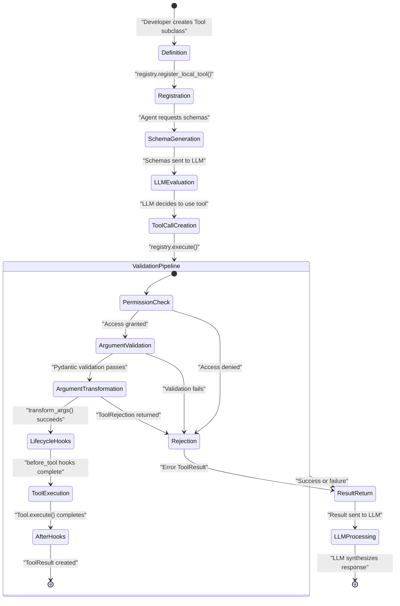
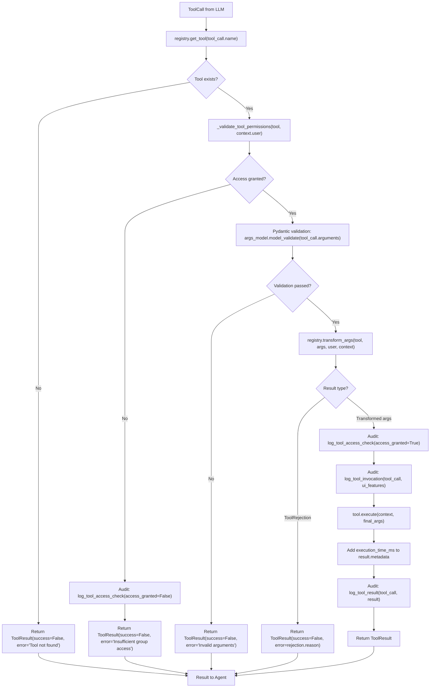
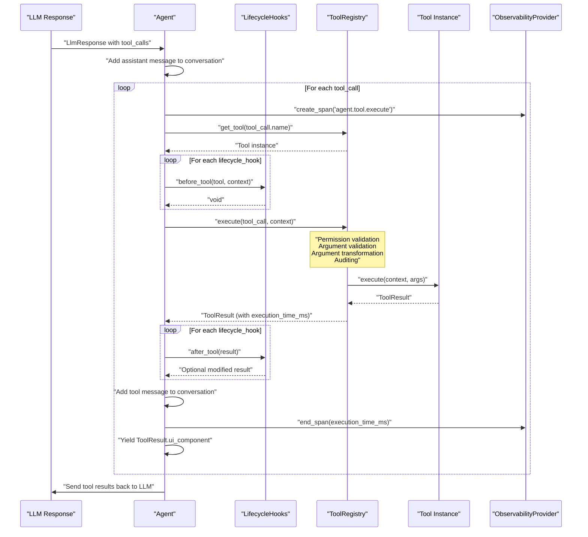
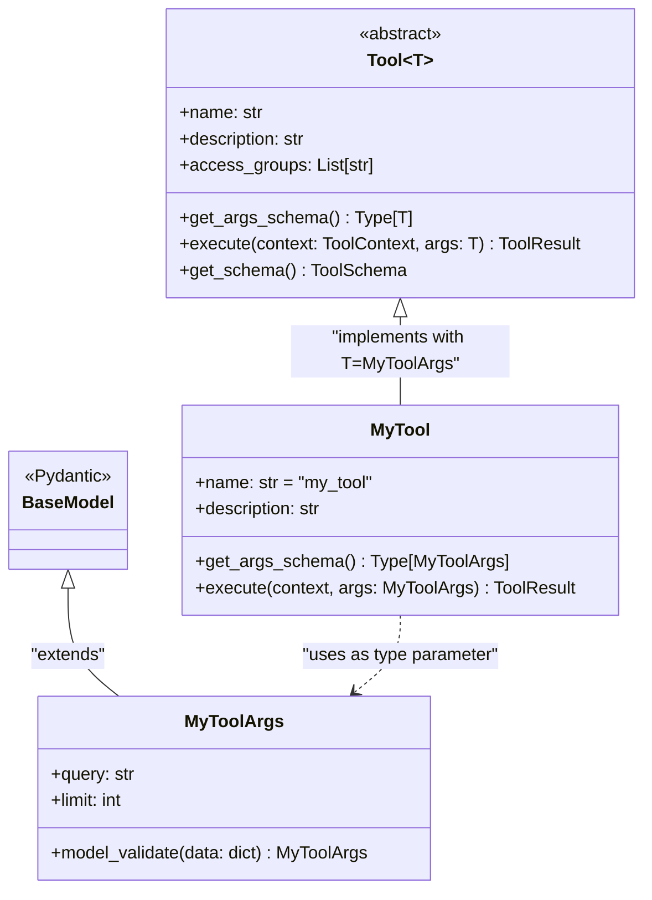
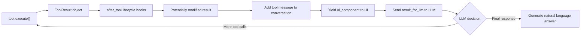
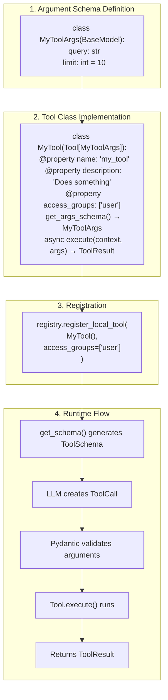

<!-- source: DeepWiki mcp.deepwiki.com · repo vanna-ai/vanna · page 7.1 Tool Interface and Lifecycle · fetched 2026-10-29 -->

# Tool Interface and Lifecycle

<details>
<summary>Relevant source files</summary>

The following files were used as context for generating this wiki page:

- [examples/transform_args_example.py](examples/transform_args_example.py)
- [src/vanna/core/__init__.py](src/vanna/core/__init__.py)
- [src/vanna/core/agent/agent.py](src/vanna/core/agent/agent.py)
- [src/vanna/core/registry.py](src/vanna/core/registry.py)
- [src/vanna/core/tool/__init__.py](src/vanna/core/tool/__init__.py)
- [src/vanna/core/tool/base.py](src/vanna/core/tool/base.py)
- [src/vanna/core/tool/models.py](src/vanna/core/tool/models.py)
- [src/vanna/core/user/models.py](src/vanna/core/user/models.py)
- [src/vanna/core/workflow/__init__.py](src/vanna/core/workflow/__init__.py)
- [src/vanna/examples/default_workflow_handler_example.py](src/vanna/examples/default_workflow_handler_example.py)
- [src/vanna/integrations/local/__init__.py](src/vanna/integrations/local/__init__.py)
- [src/vanna/integrations/local/file_system_conversation_store.py](src/vanna/integrations/local/file_system_conversation_store.py)
- [src/vanna/tools/agent_memory.py](src/vanna/tools/agent_memory.py)
- [tests/test_agent_memory.py](tests/test_agent_memory.py)
- [tests/test_tool_permissions.py](tests/test_tool_permissions.py)

</details>


This document describes the `Tool` interface, the core data models for tool execution, and the complete lifecycle of a tool from registration through execution. Tools are the primary mechanism by which Vanna agents interact with external systems, databases, APIs, and custom business logic.

**Scope**: This page covers the `Tool` abstract base class, associated data models (`ToolCall`, `ToolContext`, `ToolResult`, `ToolSchema`), and the execution pipeline managed by `ToolRegistry`. For creating custom tools, see [Creating Custom Tools](#7.2). For built-in tool implementations, see [Built-in Tools](#7.3). For the argument validation system, see [Tool Arguments and Validation](#7.4).

---

## Tool Interface Overview

The `Tool` class is an abstract base class that defines the contract all tools must implement. It uses Python generics to provide type safety for tool arguments.

**Class Definition:**

```python
class Tool(ABC, Generic[T]):
```

Where `T` is a type parameter representing the Pydantic model for the tool's arguments.

**Abstract Properties and Methods:**

| Member | Type | Description |
|--------|------|-------------|
| `name` | Property (str) | Unique identifier for the tool |
| `description` | Property (str) | Human-readable description for the LLM |
| `get_args_schema()` | Method | Returns the Pydantic model class for arguments |
| `execute(context, args)` | Async Method | Executes the tool with validated arguments |

**Optional Property:**

| Member | Type | Default | Description |
|--------|------|---------|-------------|
| `access_groups` | Property (List[str]) | `[]` | Groups permitted to access this tool |

**Provided Method:**

| Member | Description |
|--------|-------------|
| `get_schema()` | Generates `ToolSchema` from the tool's metadata for LLM consumption |

**Sources:** [src/vanna/core/tool/base.py:16-71]()

---

## Tool Data Models

The tool system uses four primary data models that flow through the execution pipeline:

### ToolCall

Represents the LLM's request to invoke a tool. Created when the LLM decides to use a tool.

| Field | Type | Description |
|-------|------|-------------|
| `id` | str | Unique identifier for this specific tool call |
| `name` | str | Name of the tool to execute |
| `arguments` | Dict[str, Any] | Raw arguments from the LLM (not yet validated) |

**Sources:** [src/vanna/core/tool/models.py:20-26]()

### ToolContext

Execution context passed to all tool executions. Contains user identity, conversation metadata, and system capabilities.

| Field | Type | Description |
|-------|------|-------------|
| `user` | User | User executing the tool (for permissions) |
| `conversation_id` | str | Current conversation identifier |
| `request_id` | str | Unique request identifier for tracing |
| `agent_memory` | AgentMemory | Agent memory for learning and retrieval |
| `metadata` | Dict[str, Any] | Additional context data |
| `observability_provider` | Optional[ObservabilityProvider] | Metrics and tracing provider |

**Sources:** [src/vanna/core/tool/models.py:28-45]()

### ToolResult

Result returned by tool execution. Contains both LLM-facing text and optional UI components.

| Field | Type | Description |
|-------|------|-------------|
| `success` | bool | Whether execution succeeded |
| `result_for_llm` | str | Text content sent back to the LLM |
| `ui_component` | Optional[UiComponent] | Optional UI component for rendering |
| `error` | Optional[str] | Error message if failed |
| `metadata` | Dict[str, Any] | Additional result metadata |

**Sources:** [src/vanna/core/tool/models.py:47-62]()

### ToolSchema

Schema description of a tool for LLM consumption. Generated by `Tool.get_schema()`.

| Field | Type | Description |
|-------|------|-------------|
| `name` | str | Tool name |
| `description` | str | What the tool does |
| `parameters` | Dict[str, Any] | JSON Schema of parameters (from Pydantic model) |
| `access_groups` | List[str] | Groups permitted to access this tool |

**Sources:** [src/vanna/core/tool/models.py:64-73]()

---

## Tool Lifecycle Phases

The following diagram shows the complete lifecycle of a tool from definition to execution result:



**Sources:** [src/vanna/core/registry.py:144-278](), [src/vanna/core/agent/agent.py:658-893]()

---

## Tool Registration and Schema Generation

### Registration

Tools are registered with a `ToolRegistry` using `register_local_tool()`:

```python
registry.register_local_tool(tool, access_groups=["admin", "analyst"])
```

If `access_groups` is provided, the tool is wrapped with an internal `_LocalToolWrapper` that enforces the access restrictions. If `access_groups` is empty or `None`, the tool is accessible to all users.

**Sources:** [src/vanna/core/registry.py:63-80]()

### Schema Generation

When the `Agent` prepares to call the LLM, it requests schemas for all tools accessible to the current user:

```python
tool_schemas = await registry.get_schemas(user)
```

The `get_schemas()` method:
1. Iterates through all registered tools
2. Validates permissions for each tool using `_validate_tool_permissions()`
3. Calls `tool.get_schema()` for accessible tools
4. Returns list of `ToolSchema` objects

Permission validation checks if there's any intersection between the user's `group_memberships` and the tool's `access_groups`:

```python
user_groups = set(user.group_memberships)
tool_groups = set(tool.access_groups)
access_granted = bool(user_groups & tool_groups)
```

**Sources:** [src/vanna/core/registry.py:90-111](), [src/vanna/core/agent/agent.py:564-583]()

---

## Execution Pipeline

The following diagram shows the detailed execution pipeline within `ToolRegistry.execute()`:



**Sources:** [src/vanna/core/registry.py:144-278]()

---

## Execution Flow in Agent Context

When the `Agent` receives a `ToolCall` from the LLM, it orchestrates the execution with additional observability and lifecycle hooks:



**Key execution points:**

1. **Lines 704-741**: Task creation and UI feature access checks
2. **Lines 785-815**: Before-tool lifecycle hooks with observability
3. **Lines 816-846**: Tool execution with span tracking
4. **Lines 847-893**: After-tool lifecycle hooks that can modify results
5. **Lines 897-917**: Conversation message creation with tool results

**Sources:** [src/vanna/core/agent/agent.py:658-917]()

---

## Type Safety with Generics

The `Tool` class uses Python generics to provide compile-time type safety for tool arguments:



**Type Flow:**

1. Developer defines `MyToolArgs(BaseModel)` with Pydantic fields
2. Developer defines `MyTool(Tool[MyToolArgs])`
3. `get_args_schema()` returns `Type[MyToolArgs]`
4. `ToolRegistry` calls `args_model.model_validate()` for validation
5. `execute()` receives strongly-typed `args: MyToolArgs`

This ensures:
- IDE autocomplete for `args` parameter
- Type checking catches mismatched argument types
- Pydantic validation ensures runtime correctness

**Sources:** [src/vanna/core/tool/base.py:16-71](), [tests/test_tool_permissions.py:25-52]()

---

## Argument Transformation Hook

`ToolRegistry.transform_args()` is an overridable method that enables user-specific argument transformation before execution. Common use cases:

- **Row-Level Security (RLS)**: Inject `WHERE` clauses into SQL queries
- **Data Filtering**: Restrict available options based on user context
- **Argument Validation**: Additional business logic validation
- **Redaction**: Remove sensitive fields

**Method Signature:**

```python
async def transform_args(
    self,
    tool: Tool[T],
    args: T,
    user: User,
    context: ToolContext,
) -> Union[T, ToolRejection]:
```

**Return Types:**

- **Transformed arguments**: Modified `args` object (may be unchanged)
- **ToolRejection**: Reject execution with explanation

The default implementation is a no-op (returns `args` unchanged). Subclasses override to implement custom logic.

**Example: Row-Level Security**

```python
class RLSToolRegistry(ToolRegistry):
    async def transform_args(self, tool, args, user, context):
        if tool.name == "run_sql" and "SELECT" in args.sql:
            if "admin" not in user.group_memberships:
                # Inject WHERE clause for non-admins
                args.sql += f" WHERE organization_id = {user.metadata['org_id']}"
        return args
```

**Sources:** [src/vanna/core/registry.py:113-142](), [examples/transform_args_example.py:1-157](), [tests/test_tool_permissions.py:419-683]()

---

## Integration with Agent Workflow

Tools integrate with multiple agent subsystems during execution:

| Integration Point | Purpose | Access Via |
|------------------|---------|------------|
| **User Identity** | Permission validation, argument transformation | `context.user` |
| **AgentMemory** | Learning from successful executions, retrieving patterns | `context.agent_memory` |
| **Conversation** | Maintaining execution history, building context | `context.conversation_id` |
| **Observability** | Metrics, spans, tracing | `context.observability_provider` |
| **UI Components** | Rich visual feedback | `ToolResult.ui_component` |
| **Audit Logging** | Compliance, security monitoring | Via `ToolRegistry.audit_logger` |

**Memory Integration Example:**

Tools can use `AgentMemory` to learn from successful executions. The `SaveQuestionToolArgsTool` demonstrates this pattern:

```python
await context.agent_memory.save_tool_usage(
    question=args.question,
    tool_name=args.tool_name,
    args=args.args,
    context=context,
    success=True,
)
```

**Sources:** [src/vanna/tools/agent_memory.py:76-103](), [src/vanna/core/tool/models.py:28-45]()

---

## Tool Result Handling

After execution, `ToolResult` flows back through the system:



**Sources:** [src/vanna/core/agent/agent.py:827-917]()

---

## Error Handling

The tool execution pipeline has multiple error handling layers:

| Error Type | Handling Location | Result |
|------------|------------------|--------|
| Tool not found | `ToolRegistry.execute()` line 150-158 | `ToolResult(success=False, error="Tool not found")` |
| Permission denied | `ToolRegistry.execute()` line 161-184 | `ToolResult(success=False, error="Insufficient group access")` |
| Invalid arguments | `ToolRegistry.execute()` line 186-197 | `ToolResult(success=False, error="Invalid arguments")` |
| Transformation rejection | `ToolRegistry.execute()` line 207-213 | `ToolResult(success=False, error=rejection.reason)` |
| Execution exception | `ToolRegistry.execute()` line 271-278 | `ToolResult(success=False, error="Execution failed")` |

All error results flow back to the LLM, which can:
- Retry with corrected arguments
- Request clarification from the user
- Switch to a different approach

**Sources:** [src/vanna/core/registry.py:144-278]()

---

## Complete Tool Example

The following shows a complete tool implementation mapping to the interface:



**Sources:** [tests/test_tool_permissions.py:25-52](), [src/vanna/core/tool/base.py:16-71]()

---

## Summary

The tool system provides a strongly-typed, extensible interface for agent capabilities:

- **`Tool[T]`** abstract base class defines the contract
- **`ToolRegistry`** manages registration, permissions, and execution
- **`ToolContext`** provides execution environment and integrations
- **`ToolResult`** returns both LLM-facing text and UI components
- **Type safety** through Python generics and Pydantic validation
- **Extensibility** via `transform_args()`, lifecycle hooks, and custom implementations

The lifecycle progresses from registration → schema generation → LLM invocation → validation → transformation → execution → result handling, with multiple integration points for security, observability, and learning.

---

