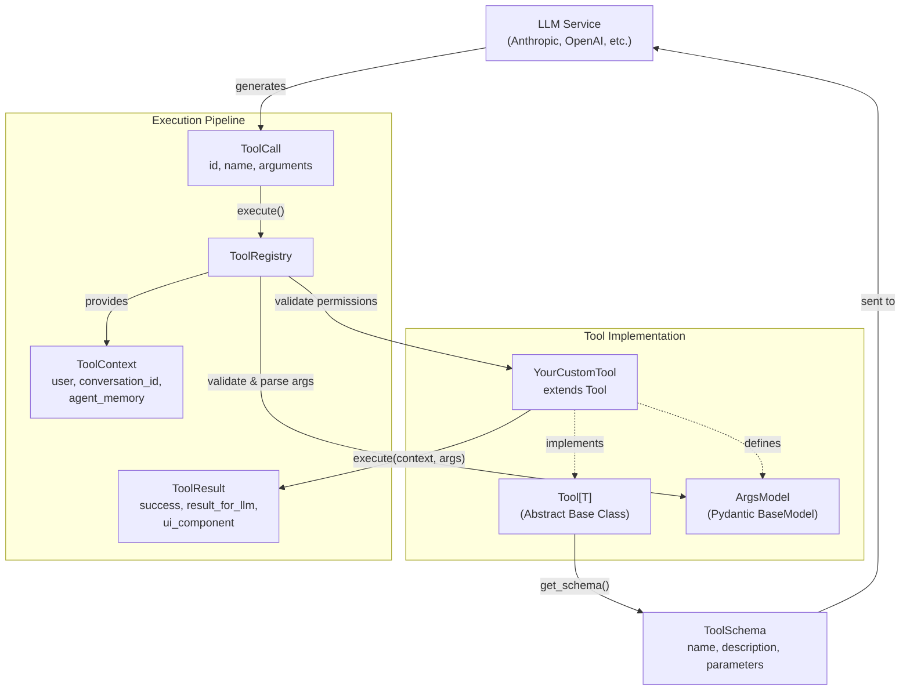
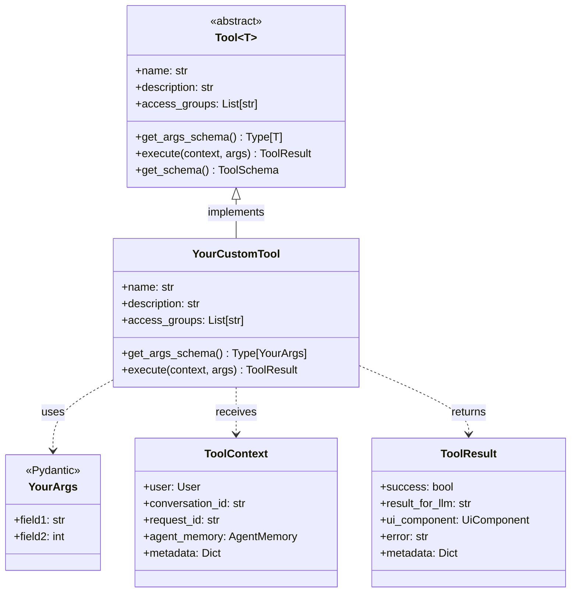
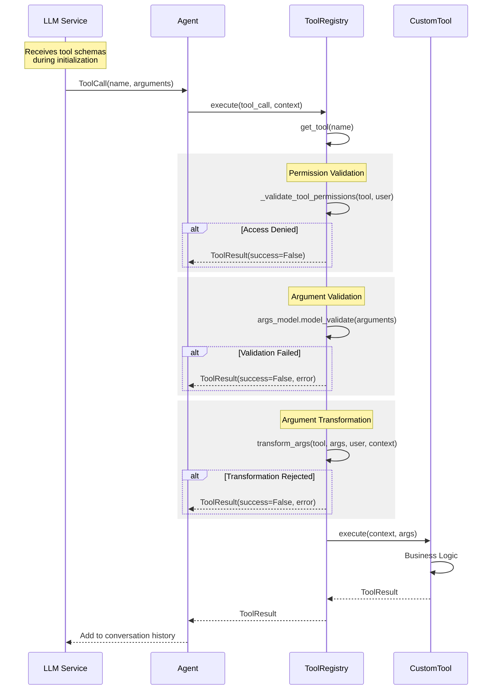
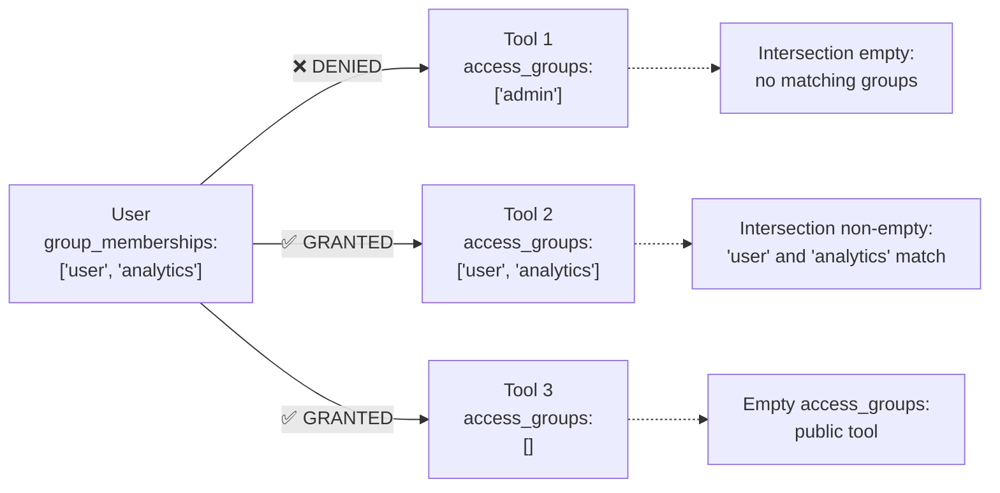
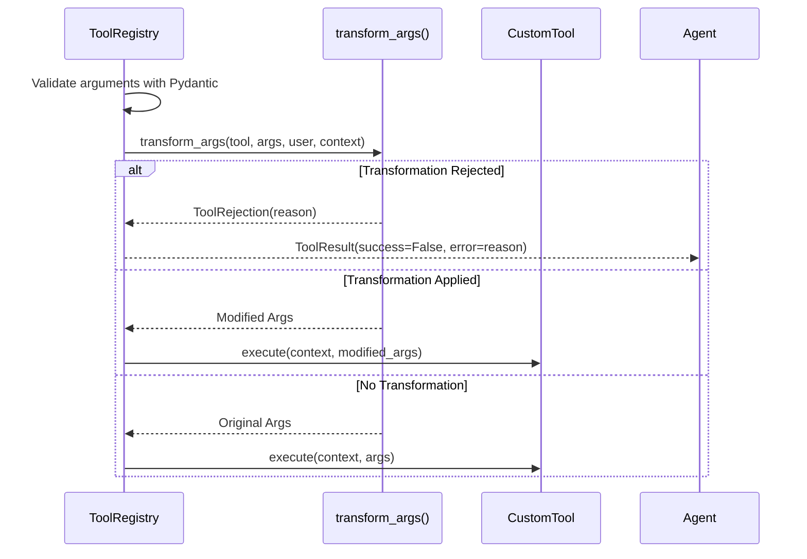

<!-- source: DeepWiki mcp.deepwiki.com · repo vanna-ai/vanna · page 7.2 Creating Custom Tools · fetched 2026-10-29 -->

# Creating Custom Tools

<details>
<summary>Relevant source files</summary>

The following files were used as context for generating this wiki page:

- [MIGRATION_GUIDE.md](MIGRATION_GUIDE.md)
- [README.md](README.md)
- [examples/transform_args_example.py](examples/transform_args_example.py)
- [img/architecture.png](img/architecture.png)
- [img/vanna2.svg](img/vanna2.svg)
- [notebooks/quickstart.ipynb](notebooks/quickstart.ipynb)
- [src/vanna/core/registry.py](src/vanna/core/registry.py)
- [src/vanna/core/tool/__init__.py](src/vanna/core/tool/__init__.py)
- [src/vanna/core/tool/base.py](src/vanna/core/tool/base.py)
- [src/vanna/core/tool/models.py](src/vanna/core/tool/models.py)
- [src/vanna/core/user/models.py](src/vanna/core/user/models.py)
- [src/vanna/integrations/anthropic/llm.py](src/vanna/integrations/anthropic/llm.py)
- [src/vanna/integrations/openai/llm.py](src/vanna/integrations/openai/llm.py)
- [src/vanna/servers/fastapi/app.py](src/vanna/servers/fastapi/app.py)
- [src/vanna/servers/flask/app.py](src/vanna/servers/flask/app.py)
- [tests/test_agent_memory.py](tests/test_agent_memory.py)
- [tests/test_tool_permissions.py](tests/test_tool_permissions.py)

</details>


This guide explains how to implement custom tools that extend the capabilities of Vanna agents. Custom tools allow you to expose any functionality—from database operations to external API calls to business logic—to the LLM through a structured, type-safe interface.

For an overview of the tool system architecture and lifecycle, see [Tool Interface and Lifecycle](#7.1). For documentation on the built-in tools that ship with Vanna, see [Built-in Tools](#7.3). For details on argument validation patterns, see [Tool Arguments and Validation](#7.4).

---

## Tool Architecture Overview

The tool system in Vanna is built around the abstract `Tool` base class, which defines a contract that all tools must implement. The LLM interacts with tools through a schema-based interface, while the agent handles execution, permission checking, and argument transformation.



**Sources:** [src/vanna/core/tool/base.py:1-71](), [src/vanna/core/tool/models.py:1-85](), [src/vanna/core/registry.py:1-279]()

---

## The Tool Base Class

All custom tools must inherit from `Tool[T]` where `T` is a Pydantic model representing the tool's arguments. The base class requires implementation of five members:

| Member | Type | Description |
|--------|------|-------------|
| `name` | `@property` → `str` | Unique identifier for the tool (must be valid function name) |
| `description` | `@property` → `str` | Human-readable explanation shown to LLM |
| `access_groups` | `@property` → `List[str]` | Groups allowed to use this tool (empty = public) |
| `get_args_schema()` | `Type[T]` | Returns Pydantic model class for arguments |
| `execute()` | `async (context, args) → ToolResult` | Executes the tool logic |



**Sources:** [src/vanna/core/tool/base.py:16-71]()

---

## Step-by-Step: Creating a Simple Tool

Here's how to create a basic custom tool from scratch. This example creates a tool that sends email notifications.

### 1. Define the Arguments Model

The arguments model uses Pydantic for validation and schema generation. Field descriptions are shown to the LLM to guide proper usage.

```python
from pydantic import BaseModel, Field

class EmailArgs(BaseModel):
    recipient: str = Field(description="Email recipient address")
    subject: str = Field(description="Email subject line")
    body: str = Field(default="", description="Email body content")
```

**Key Points:**
- Each field should have a `description` for the LLM
- Use `Field(...)` for validation constraints (`min_length`, `max_length`, etc.)
- Default values make fields optional
- Types are validated automatically by Pydantic

**Sources:** [README.md:212-215](), [src/vanna/core/tool/base.py:36-40]()

### 2. Implement the Tool Class

The tool class extends `Tool[T]` where `T` is your arguments model:

```python
from typing import Type
from vanna.core.tool import Tool, ToolContext, ToolResult

class EmailTool(Tool[EmailArgs]):
    @property
    def name(self) -> str:
        return "send_email"
    
    @property
    def description(self) -> str:
        return "Send an email notification to a specified recipient"
    
    @property
    def access_groups(self) -> List[str]:
        return ["user", "admin"]  # Only users in these groups can call this
    
    def get_args_schema(self) -> Type[EmailArgs]:
        return EmailArgs
    
    async def execute(self, context: ToolContext, args: EmailArgs) -> ToolResult:
        # Access user information from context
        user = context.user
        
        # Your business logic here
        try:
            await send_email_via_smtp(
                from_email=user.email,
                to_email=args.recipient,
                subject=args.subject,
                body=args.body
            )
            
            return ToolResult(
                success=True,
                result_for_llm=f"Email sent to {args.recipient} with subject '{args.subject}'"
            )
        except Exception as e:
            return ToolResult(
                success=False,
                result_for_llm=f"Failed to send email: {str(e)}",
                error=str(e)
            )
```

**Sources:** [README.md:207-242](), [tests/test_tool_permissions.py:31-52]()

### 3. Register the Tool

Tools must be registered with a `ToolRegistry` to be available to the agent:

```python
from vanna.core.registry import ToolRegistry

# Create registry
tools = ToolRegistry()

# Register your tool with access control
tools.register_local_tool(
    EmailTool(),
    access_groups=["user", "admin"]  # Only these groups can use it
)
```

The `register_local_tool` method takes two parameters:
- `tool`: Your tool instance
- `access_groups`: List of groups that can access this tool (empty list = everyone)

**Sources:** [src/vanna/core/registry.py:63-81](), [README.md:241-242]()

---

## Tool Execution Flow

Understanding the execution pipeline helps when debugging or implementing advanced features:



**Sources:** [src/vanna/core/registry.py:144-279]()

---

## The ToolContext Object

Every tool execution receives a `ToolContext` that provides access to user information, conversation state, and the agent's memory system:

| Field | Type | Description |
|-------|------|-------------|
| `user` | `User` | User making the request (includes `id`, `email`, `group_memberships`) |
| `conversation_id` | `str` | Unique identifier for the conversation thread |
| `request_id` | `str` | Unique identifier for this specific request |
| `agent_memory` | `AgentMemory` | Access to the agent's memory system for storing/retrieving patterns |
| `metadata` | `Dict[str, Any]` | Additional context data (custom enrichers can add data here) |
| `observability_provider` | `ObservabilityProvider` | Optional metrics and tracing provider |

**Usage Example:**

```python
async def execute(self, context: ToolContext, args: MyArgs) -> ToolResult:
    # Access user information
    user_id = context.user.id
    user_email = context.user.email
    is_admin = "admin" in context.user.group_memberships
    
    # Store successful patterns in memory
    if result_successful:
        await context.agent_memory.save_tool_usage(
            question="User's original question",
            tool_name=self.name,
            args=args.model_dump(),
            context=context,
            success=True
        )
    
    # Access custom metadata
    custom_data = context.metadata.get("my_custom_field")
    
    return ToolResult(success=True, result_for_llm="Done")
```

**Sources:** [src/vanna/core/tool/models.py:28-45](), [README.md:228-239]()

---

## Returning Results: ToolResult

The `ToolResult` object communicates execution outcomes back to the LLM and optionally provides UI components for rendering:

```python
class ToolResult(BaseModel):
    success: bool                      # Whether execution succeeded
    result_for_llm: str               # Message sent back to LLM
    ui_component: Optional[UiComponent] = None  # Visual component for frontend
    error: Optional[str] = None       # Error message if failed
    metadata: Dict[str, Any] = {}     # Additional result metadata
```

### Basic Success Result

```python
return ToolResult(
    success=True,
    result_for_llm="Email sent successfully to user@example.com"
)
```

### Error Result

```python
return ToolResult(
    success=False,
    result_for_llm="Failed to send email: SMTP connection timeout",
    error="SMTP connection timeout after 30s"
)
```

### Result with UI Component

```python
from vanna.components import DataFrameComponent

return ToolResult(
    success=True,
    result_for_llm=f"Query returned {len(df)} rows",
    ui_component=DataFrameComponent(data=df, title="Query Results")
)
```

The `result_for_llm` field is critical—it's what the LLM sees and uses to formulate its response to the user. Be descriptive but concise.

**Sources:** [src/vanna/core/tool/models.py:47-62]()

---

## Access Control with Groups

Tools can restrict access to specific user groups. The permission check happens automatically in `ToolRegistry.execute()` before the tool runs.

### Permission Model



### Permission Patterns

**Admin-Only Tool:**
```python
@property
def access_groups(self) -> List[str]:
    return ["admin"]
```

**Multi-Group Tool:**
```python
@property
def access_groups(self) -> List[str]:
    return ["admin", "analyst", "data_scientist"]
```

**Public Tool (No Restrictions):**
```python
@property
def access_groups(self) -> List[str]:
    return []  # Everyone can access
```

The permission check uses set intersection: `user.group_memberships ∩ tool.access_groups`. If the result is non-empty, access is granted. Empty `access_groups` grants access to everyone.

**Sources:** [src/vanna/core/registry.py:98-112](), [tests/test_tool_permissions.py:135-199]()

---

## Advanced: Argument Transformation

The `ToolRegistry.transform_args()` method allows custom registries to modify or validate arguments based on user context. This is commonly used for implementing Row-Level Security (RLS) or user-specific filtering.

### Custom Registry with RLS

```python
from typing import Union
from vanna.core.registry import ToolRegistry
from vanna.core.tool import Tool, ToolRejection

class RLSToolRegistry(ToolRegistry):
    async def transform_args(
        self,
        tool: Tool[T],
        args: T,
        user: User,
        context: ToolContext,
    ) -> Union[T, ToolRejection]:
        # Only transform SQL execution tools
        if tool.name == "run_sql" and isinstance(args, RunSqlToolArgs):
            original_query = args.sql.strip()
            
            # Reject queries to restricted tables
            if "restricted_table" in original_query.lower():
                return ToolRejection(
                    reason="Access to 'restricted_table' is not permitted"
                )
            
            # Apply RLS by injecting WHERE clause
            user_org_id = user.metadata.get("organization_id")
            if user_org_id and "SELECT" in original_query.upper():
                if "WHERE" in original_query.upper():
                    transformed = original_query.replace(
                        "WHERE",
                        f"WHERE organization_id = {user_org_id} AND",
                        1
                    )
                else:
                    transformed = original_query + f" WHERE organization_id = {user_org_id}"
                
                # Return modified args
                return args.model_copy(update={"sql": transformed})
        
        # No transformation needed
        return args
```

### Transformation Flow



**Key Use Cases:**
- **Row-Level Security**: Inject `WHERE` clauses based on user organization/department
- **Field Redaction**: Remove sensitive fields from arguments
- **Validation**: Additional business logic validation beyond Pydantic
- **Enrichment**: Add user-specific defaults or computed values

**Sources:** [src/vanna/core/registry.py:113-143](), [examples/transform_args_example.py:1-157](), [tests/test_tool_permissions.py:458-683]()

---

## Example: Database Query Tool

Here's a complete example of a tool that executes SQL queries with proper error handling:

```python
from pydantic import BaseModel, Field
from vanna.core.tool import Tool, ToolContext, ToolResult
from vanna.capabilities.sql_runner import SqlRunner
from vanna.components import DataFrameComponent
import pandas as pd

class QueryArgs(BaseModel):
    sql: str = Field(description="SQL query to execute")
    limit: int = Field(default=100, description="Maximum rows to return", ge=1, le=10000)

class DatabaseQueryTool(Tool[QueryArgs]):
    def __init__(self, sql_runner: SqlRunner):
        self.sql_runner = sql_runner
    
    @property
    def name(self) -> str:
        return "execute_database_query"
    
    @property
    def description(self) -> str:
        return "Execute a SQL query against the database and return results as a table"
    
    @property
    def access_groups(self) -> List[str]:
        return ["analyst", "data_scientist", "admin"]
    
    def get_args_schema(self) -> Type[QueryArgs]:
        return QueryArgs
    
    async def execute(self, context: ToolContext, args: QueryArgs) -> ToolResult:
        try:
            # Apply limit to query
            limited_sql = f"{args.sql.rstrip(';')} LIMIT {args.limit}"
            
            # Execute query
            df = await self.sql_runner.run_sql(limited_sql)
            
            if df is None or df.empty:
                return ToolResult(
                    success=True,
                    result_for_llm="Query executed successfully but returned no results"
                )
            
            # Save successful pattern to memory
            await context.agent_memory.save_tool_usage(
                question=f"Execute query with {len(df)} results",
                tool_name=self.name,
                args=args.model_dump(),
                context=context,
                success=True
            )
            
            # Return with UI component
            return ToolResult(
                success=True,
                result_for_llm=f"Query returned {len(df)} rows and {len(df.columns)} columns",
                ui_component=DataFrameComponent(
                    data=df,
                    title="Query Results",
                    show_index=False
                )
            )
            
        except Exception as e:
            return ToolResult(
                success=False,
                result_for_llm=f"Query execution failed: {str(e)}",
                error=str(e)
            )
```

**Sources:** [README.md:207-242](), [notebooks/quickstart.ipynb:109-114]()

---

## Example: External API Tool

Tools can wrap external APIs to make them accessible to the agent:

```python
from pydantic import BaseModel, Field, HttpUrl
from vanna.core.tool import Tool, ToolContext, ToolResult
import httpx

class APIRequestArgs(BaseModel):
    endpoint: str = Field(description="API endpoint path (e.g., '/users/123')")
    method: str = Field(default="GET", description="HTTP method", pattern="^(GET|POST|PUT|DELETE)$")
    params: dict = Field(default_factory=dict, description="Query parameters")

class ExternalAPITool(Tool[APIRequestArgs]):
    def __init__(self, base_url: str, api_key: str):
        self.base_url = base_url
        self.api_key = api_key
    
    @property
    def name(self) -> str:
        return "call_external_api"
    
    @property
    def description(self) -> str:
        return "Call an external REST API endpoint"
    
    @property
    def access_groups(self) -> List[str]:
        return ["admin", "integration_user"]
    
    def get_args_schema(self) -> Type[APIRequestArgs]:
        return APIRequestArgs
    
    async def execute(self, context: ToolContext, args: APIRequestArgs) -> ToolResult:
        async with httpx.AsyncClient() as client:
            try:
                url = f"{self.base_url}{args.endpoint}"
                headers = {"Authorization": f"Bearer {self.api_key}"}
                
                response = await client.request(
                    method=args.method,
                    url=url,
                    params=args.params,
                    headers=headers,
                    timeout=30.0
                )
                response.raise_for_status()
                
                data = response.json()
                
                return ToolResult(
                    success=True,
                    result_for_llm=f"API call to {args.endpoint} succeeded: {data}",
                    metadata={"status_code": response.status_code, "data": data}
                )
                
            except httpx.HTTPError as e:
                return ToolResult(
                    success=False,
                    result_for_llm=f"API call failed: {str(e)}",
                    error=str(e)
                )
```

**Sources:** [README.md:207-242]()

---

## Tool Registration Patterns

### Basic Registration

```python
from vanna.core.registry import ToolRegistry

tools = ToolRegistry()

# Register with access control
tools.register_local_tool(EmailTool(), access_groups=["user", "admin"])
tools.register_local_tool(AdminTool(), access_groups=["admin"])
tools.register_local_tool(PublicTool(), access_groups=[])
```

### Registration in Agent Initialization

```python
from vanna import Agent, AgentConfig
from vanna.core.registry import ToolRegistry
from vanna.integrations.anthropic import AnthropicLlmService

# Create registry and register tools
tools = ToolRegistry()
tools.register_local_tool(EmailTool(), access_groups=["user"])
tools.register_local_tool(QueryTool(sql_runner), access_groups=["analyst"])

# Create agent with registered tools
agent = Agent(
    llm_service=AnthropicLlmService(model="claude-sonnet-4-5"),
    tool_registry=tools,
    user_resolver=MyUserResolver(),
    config=AgentConfig()
)
```

### Conditional Registration

```python
# Register different tools based on environment
tools = ToolRegistry()

if is_production:
    tools.register_local_tool(ProductionQueryTool(), access_groups=["admin"])
else:
    tools.register_local_tool(SandboxQueryTool(), access_groups=["user"])

# Register optional features
if feature_flags.get("email_enabled"):
    tools.register_local_tool(EmailTool(), access_groups=["user"])
```

**Sources:** [notebooks/quickstart.ipynb:109-115](), [src/vanna/core/registry.py:63-81]()

---

## Best Practices

### 1. Descriptive Names and Descriptions

The LLM relies on tool names and descriptions to decide when to use each tool. Be specific:

**❌ Bad:**
```python
@property
def name(self) -> str:
    return "query"

@property
def description(self) -> str:
    return "Run query"
```

**✅ Good:**
```python
@property
def name(self) -> str:
    return "execute_sql_query"

@property
def description(self) -> str:
    return "Execute a SQL query against the production database and return results as a table. Use this when the user asks for data analysis or reporting."
```

### 2. Comprehensive Field Descriptions

Pydantic field descriptions guide the LLM in providing correct arguments:

**❌ Bad:**
```python
class Args(BaseModel):
    query: str
    limit: int
```

**✅ Good:**
```python
class Args(BaseModel):
    query: str = Field(description="SQL SELECT query to execute (must start with SELECT)")
    limit: int = Field(
        default=100,
        ge=1,
        le=10000,
        description="Maximum number of rows to return (1-10000)"
    )
```

### 3. Proper Error Handling

Always catch exceptions and return descriptive error messages:

```python
async def execute(self, context: ToolContext, args: Args) -> ToolResult:
    try:
        # Your logic
        result = await perform_operation(args)
        return ToolResult(success=True, result_for_llm="Success")
        
    except ValidationError as e:
        return ToolResult(
            success=False,
            result_for_llm=f"Validation failed: {e.message}",
            error=str(e)
        )
    except DatabaseError as e:
        return ToolResult(
            success=False,
            result_for_llm=f"Database error: {e.message}",
            error=str(e)
        )
    except Exception as e:
        return ToolResult(
            success=False,
            result_for_llm=f"Unexpected error: {str(e)}",
            error=str(e)
        )
```

### 4. Leverage ToolContext

Use the context object to provide personalized, user-aware behavior:

```python
async def execute(self, context: ToolContext, args: Args) -> ToolResult:
    # Check user permissions beyond access_groups
    if args.sensitive_operation and "admin" not in context.user.group_memberships:
        return ToolResult(
            success=False,
            result_for_llm="This operation requires admin privileges"
        )
    
    # Use user metadata for personalization
    user_timezone = context.user.metadata.get("timezone", "UTC")
    formatted_time = format_in_timezone(result.timestamp, user_timezone)
    
    # Store successful patterns
    if success:
        await context.agent_memory.save_tool_usage(
            question=f"Operation performed by {context.user.email}",
            tool_name=self.name,
            args=args.model_dump(),
            context=context,
            success=True
        )
    
    return ToolResult(success=True, result_for_llm=f"Completed at {formatted_time}")
```

### 5. Use Type Hints and Validation

Leverage Pydantic's validation features:

```python
from pydantic import BaseModel, Field, validator, HttpUrl
from typing import Literal

class Args(BaseModel):
    email: str = Field(pattern=r"^[a-zA-Z0-9_.+-]+@[a-zA-Z0-9-]+\.[a-zA-Z0-9-.]+$")
    priority: Literal["low", "medium", "high"] = Field(default="medium")
    attachments: List[HttpUrl] = Field(default_factory=list, max_items=5)
    
    @validator("email")
    def validate_email_domain(cls, v):
        if not v.endswith("@company.com"):
            raise ValueError("Email must be from company.com domain")
        return v
```

### 6. Provide Rich UI Components

When possible, return structured UI components instead of plain text:

```python
from vanna.components import DataFrameComponent, ChartComponent

return ToolResult(
    success=True,
    result_for_llm=f"Analysis complete with {len(df)} data points",
    ui_component=ChartComponent(
        data=df,
        chart_type="line",
        x_column="date",
        y_column="revenue",
        title="Revenue Over Time"
    )
)
```

**Sources:** [README.md:207-242](), [src/vanna/core/tool/base.py:1-71](), [src/vanna/core/tool/models.py:1-85]()

---

## Testing Custom Tools

When testing custom tools, create mock contexts and validate behavior:

```python
import pytest
from vanna.core.user import User
from vanna.core.tool import ToolContext
from vanna.integrations.local.agent_memory import DemoAgentMemory

@pytest.fixture
def test_user():
    return User(
        id="test_user",
        email="test@example.com",
        group_memberships=["user"]
    )

@pytest.fixture
def test_context(test_user):
    return ToolContext(
        user=test_user,
        conversation_id="test_conv",
        request_id="test_req",
        agent_memory=DemoAgentMemory(max_items=100)
    )

@pytest.mark.asyncio
async def test_email_tool_success(test_context):
    tool = EmailTool()
    args = EmailArgs(
        recipient="user@example.com",
        subject="Test",
        body="Test message"
    )
    
    result = await tool.execute(test_context, args)
    
    assert result.success is True
    assert "sent" in result.result_for_llm.lower()
    assert result.error is None

@pytest.mark.asyncio
async def test_email_tool_validation():
    tool = EmailTool()
    
    # Test invalid email
    with pytest.raises(ValidationError):
        EmailArgs(recipient="invalid-email", subject="Test")
```

**Sources:** [tests/test_tool_permissions.py:31-52](), [tests/test_tool_permissions.py:101-132]()

---

## Complete Example: Multi-Feature Tool

This example demonstrates a tool with multiple features: validation, error handling, UI components, and memory storage.

```python
from typing import Type, List
from pydantic import BaseModel, Field, validator
from vanna.core.tool import Tool, ToolContext, ToolResult
from vanna.components import DataFrameComponent
import pandas as pd

class DataAnalysisArgs(BaseModel):
    """Arguments for data analysis tool."""
    
    dataset: str = Field(description="Name of the dataset to analyze")
    aggregation: str = Field(
        default="sum",
        description="Aggregation method: sum, mean, count, min, max"
    )
    group_by: List[str] = Field(
        default_factory=list,
        description="Columns to group by"
    )
    
    @validator("aggregation")
    def validate_aggregation(cls, v):
        valid = {"sum", "mean", "count", "min", "max"}
        if v not in valid:
            raise ValueError(f"aggregation must be one of {valid}")
        return v

class DataAnalysisTool(Tool[DataAnalysisArgs]):
    """Tool for performing data analysis operations."""
    
    def __init__(self, data_loader):
        self.data_loader = data_loader
    
    @property
    def name(self) -> str:
        return "analyze_data"
    
    @property
    def description(self) -> str:
        return (
            "Perform data analysis on a dataset. "
            "Supports aggregations (sum, mean, count, min, max) "
            "with optional grouping by columns."
        )
    
    @property
    def access_groups(self) -> List[str]:
        return ["analyst", "data_scientist"]
    
    def get_args_schema(self) -> Type[DataAnalysisArgs]:
        return DataAnalysisArgs
    
    async def execute(
        self,
        context: ToolContext,
        args: DataAnalysisArgs
    ) -> ToolResult:
        try:
            # Load dataset
            df = await self.data_loader.load(args.dataset)
            
            if df is None or df.empty:
                return ToolResult(
                    success=False,
                    result_for_llm=f"Dataset '{args.dataset}' not found or empty"
                )
            
            # Perform aggregation
            if args.group_by:
                result_df = df.groupby(args.group_by).agg(args.aggregation)
            else:
                result_df = df.agg(args.aggregation).to_frame().T
            
            # Save successful pattern to memory
            await context.agent_memory.save_tool_usage(
                question=f"Analyze {args.dataset} with {args.aggregation}",
                tool_name=self.name,
                args=args.model_dump(),
                context=context,
                success=True
            )
            
            # Return with UI component
            return ToolResult(
                success=True,
                result_for_llm=(
                    f"Analyzed {args.dataset} using {args.aggregation} aggregation. "
                    f"Result has {len(result_df)} rows."
                ),
                ui_component=DataFrameComponent(
                    data=result_df,
                    title=f"{args.aggregation.capitalize()} by {', '.join(args.group_by) if args.group_by else 'all'}"
                ),
                metadata={
                    "dataset": args.dataset,
                    "row_count": len(result_df),
                    "aggregation": args.aggregation
                }
            )
            
        except FileNotFoundError:
            return ToolResult(
                success=False,
                result_for_llm=f"Dataset '{args.dataset}' not found",
                error="Dataset not found"
            )
        except KeyError as e:
            return ToolResult(
                success=False,
                result_for_llm=f"Column not found: {str(e)}",
                error=str(e)
            )
        except Exception as e:
            return ToolResult(
                success=False,
                result_for_llm=f"Analysis failed: {str(e)}",
                error=str(e)
            )
```

**Registration and Usage:**

```python
from vanna.core.registry import ToolRegistry

# Create and register tool
tools = ToolRegistry()
tools.register_local_tool(
    DataAnalysisTool(data_loader=MyDataLoader()),
    access_groups=["analyst", "data_scientist"]
)

# Tool is now available to agent
# LLM will receive schema and can call it when users ask for data analysis
```

**Sources:** [README.md:207-242](), [tests/test_tool_permissions.py:31-52]()

---

