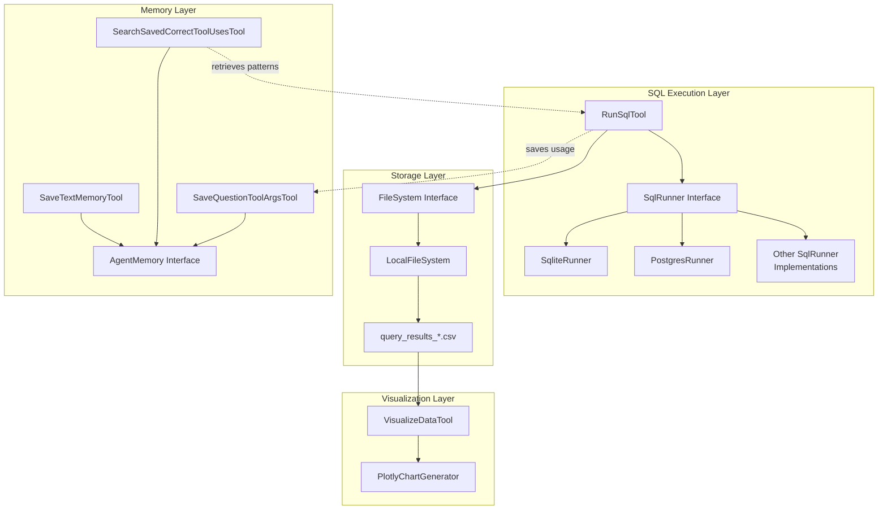
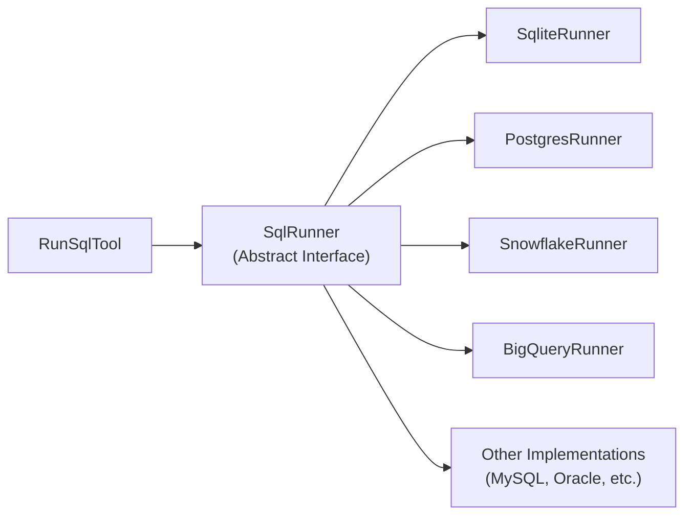
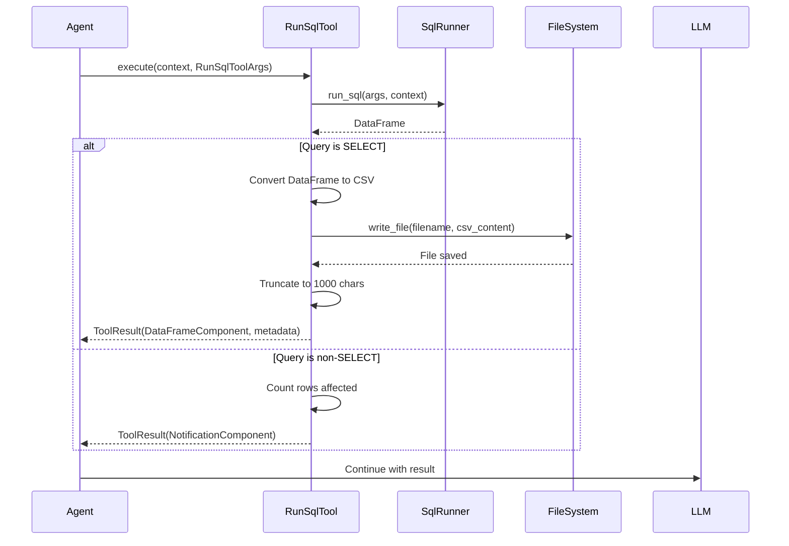
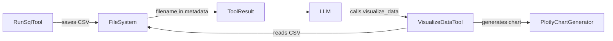
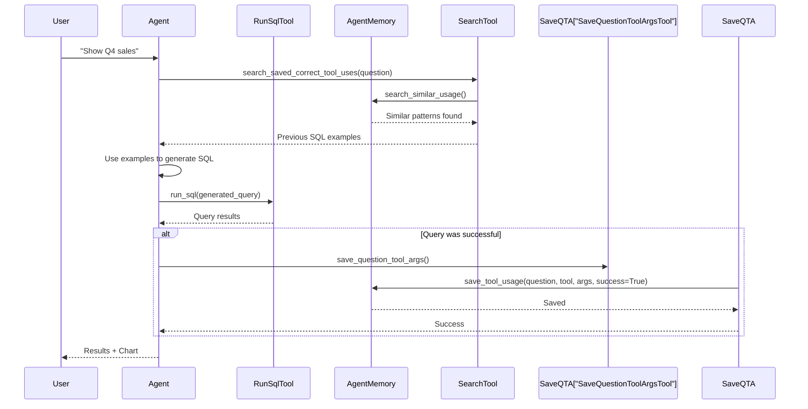
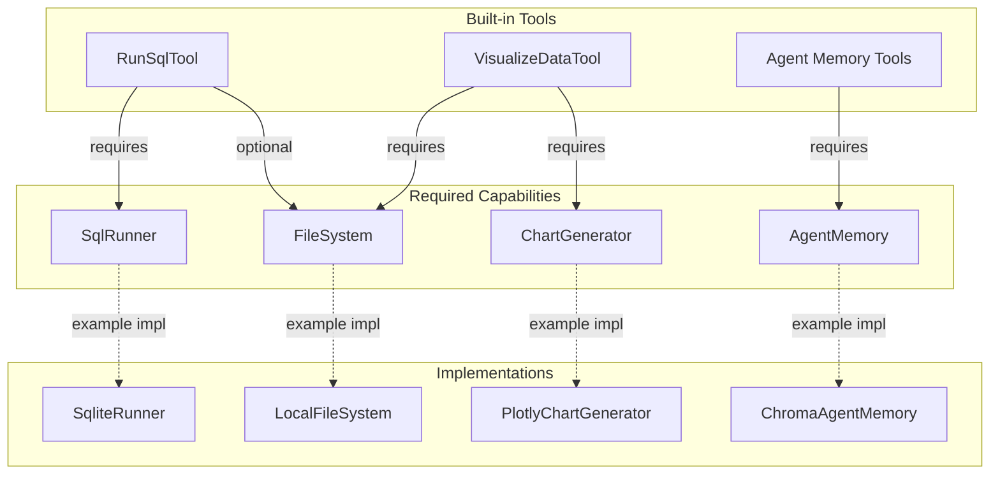

<!-- source: DeepWiki mcp.deepwiki.com · repo vanna-ai/vanna · page 7.3 Built-in Tools · fetched 2026-10-29 -->

# Built-in Tools

<details>
<summary>Relevant source files</summary>

The following files were used as context for generating this wiki page:

- [MIGRATION_GUIDE.md](MIGRATION_GUIDE.md)
- [README.md](README.md)
- [img/architecture.png](img/architecture.png)
- [img/vanna2.svg](img/vanna2.svg)
- [notebooks/quickstart.ipynb](notebooks/quickstart.ipynb)
- [src/vanna/core/agent/config.py](src/vanna/core/agent/config.py)
- [src/vanna/integrations/__init__.py](src/vanna/integrations/__init__.py)
- [src/vanna/integrations/anthropic/llm.py](src/vanna/integrations/anthropic/llm.py)
- [src/vanna/integrations/openai/llm.py](src/vanna/integrations/openai/llm.py)
- [src/vanna/servers/fastapi/app.py](src/vanna/servers/fastapi/app.py)
- [src/vanna/servers/flask/app.py](src/vanna/servers/flask/app.py)
- [src/vanna/tools/run_sql.py](src/vanna/tools/run_sql.py)

</details>


This page documents the built-in tools provided by Vanna for SQL execution, data visualization, and agent memory operations. These tools are production-ready implementations that can be registered with the `ToolRegistry` and used immediately in agents.

For information about creating custom tools, see [Creating Custom Tools](#6.1). For tool access control mechanisms, see [Tool Access Control](#6.3). For the broader agent learning system that these tools support, see [Agent Learning and Memory](#8).

---

## Overview of Built-in Tools

Vanna provides five built-in tools organized into three categories:

| Tool Name | Category | Purpose | Source File |
|-----------|----------|---------|-------------|
| `RunSqlTool` | SQL Execution | Execute SQL queries against databases | [src/vanna/tools/run_sql.py]() |
| `VisualizeDataTool` | Visualization | Generate charts from CSV data | Not in provided files |
| `SaveQuestionToolArgsTool` | Agent Memory | Save successful tool usage patterns | [src/vanna/tools/agent_memory.py:58-116]() |
| `SearchSavedCorrectToolUsesTool` | Agent Memory | Search similar tool usage patterns | [src/vanna/tools/agent_memory.py:118-197]() |
| `SaveTextMemoryTool` | Agent Memory | Save free-form text memories | [src/vanna/tools/agent_memory.py:200-254]() |

**Sources**: [src/vanna/tools/run_sql.py](), [src/vanna/tools/agent_memory.py](), [README.md:152-169]()

---

## Built-in Tool Architecture



**Diagram: Built-in Tool Architecture** - Shows how the five built-in tools interact with abstractions (SqlRunner, FileSystem, AgentMemory) and how tools in the pipeline pass data to each other.

**Sources**: [src/vanna/tools/run_sql.py:18-40](), [src/vanna/tools/agent_memory.py:1-21]()

---

## SQL Execution Tools

### RunSqlTool

The `RunSqlTool` class executes SQL queries against databases using the `SqlRunner` abstraction pattern. It supports dependency injection for database connectivity and file storage.

**Class Definition**: [src/vanna/tools/run_sql.py:18-166]()

**Key Features**:
- **Dependency injection**: Accepts `SqlRunner` implementation (SqliteRunner, PostgresRunner, etc.)
- **File system integration**: Optional `FileSystem` for saving query results (defaults to `LocalFileSystem`)
- **Custom naming**: Supports `custom_tool_name` and `custom_tool_description` parameters
- **Query type handling**: Different behavior for SELECT vs. non-SELECT queries
- **Result truncation**: Limits LLM response to 1000 characters for large result sets
- **CSV export**: Saves SELECT results to CSV files for downstream tools

**Constructor Parameters**: [src/vanna/tools/run_sql.py:21-39]()
```python
def __init__(
    self,
    sql_runner: SqlRunner,
    file_system: Optional[FileSystem] = None,
    custom_tool_name: Optional[str] = None,
    custom_tool_description: Optional[str] = None,
):
```

**Sources**: [src/vanna/tools/run_sql.py:18-40]()

---

### SqlRunner Abstraction

The `SqlRunner` interface defines the contract for database query execution. Different implementations support different databases.



**Diagram: SqlRunner Abstraction** - Shows how `RunSqlTool` depends on the `SqlRunner` interface, which has implementations for various database systems.

**Tool Arguments Schema**: `RunSqlToolArgs` defined in the `sql_runner` capability module (referenced at [src/vanna/tools/run_sql.py:13]()).

**Sources**: [src/vanna/tools/run_sql.py:1-16](), [README.md:73-75]()

---

### Query Execution Flow



**Diagram: SQL Query Execution Flow** - Shows the execution path from Agent through RunSqlTool to SqlRunner, with file system interactions for SELECT queries.

**SELECT Query Handling**: [src/vanna/tools/run_sql.py:65-127]()
- Returns `DataFrameComponent` for UI display
- Saves CSV file with UUID-based filename pattern: `query_results_{uuid}.csv`
- Truncates result_for_llm to 1000 characters
- Includes filename in metadata for downstream tools

**Non-SELECT Query Handling**: [src/vanna/tools/run_sql.py:127-141]()
- Returns `NotificationComponent` with success message
- Reports rows affected count
- No file system interaction

**Sources**: [src/vanna/tools/run_sql.py:56-166]()

---

### Registration Example

```python
from vanna.tools import RunSqlTool
from vanna.integrations.sqlite import SqliteRunner
from vanna.integrations.local import LocalFileSystem

file_system = LocalFileSystem("./data")

tools.register(RunSqlTool(
    sql_runner=SqliteRunner(database_path="./data.db"),
    file_system=file_system
))
```

**Sources**: [README.md:159-169]()

---

## Data Visualization Tools

### VisualizeDataTool

The `VisualizeDataTool` generates charts from CSV files saved by `RunSqlTool`. It uses the `PlotlyChartGenerator` to create interactive visualizations.

**Referenced in**: [README.md:156]()

**Key Features**:
- Reads CSV files from `FileSystem`
- Generates Plotly charts (bar, line, scatter, pie, etc.)
- Returns chart as UI component
- Supports custom chart types and configurations

**Tool Integration Pattern**:


**Diagram: SQL-to-Visualization Pipeline** - Shows how RunSqlTool saves CSV files that are consumed by VisualizeDataTool, with the filename passed through LLM tool calls.

**Sources**: [README.md:156-169](), [src/vanna/tools/run_sql.py:90-106]()

---

## Agent Memory Tools

The agent memory tools enable agents to learn from successful tool usage patterns and store free-form text memories. All three tools interact with the `AgentMemory` interface via `ToolContext.agent_memory`.

### Tool Context Access Pattern

All memory tools access `AgentMemory` through the `ToolContext`:

```python
# Inside tool execute method
await context.agent_memory.save_tool_usage(...)
await context.agent_memory.search_similar_usage(...)
await context.agent_memory.save_text_memory(...)
```

The `ToolContext` is populated by the Agent with an `AgentMemory` instance during tool execution: [src/vanna/core/agent/agent.py:534-542]().

**Sources**: [src/vanna/tools/agent_memory.py:1-21](), [src/vanna/core/agent/agent.py:534-542]()

---

### SaveQuestionToolArgsTool

Saves successful question-tool-argument combinations for future reference. This enables agents to learn which tool invocations work well for specific questions.

**Class Definition**: [src/vanna/tools/agent_memory.py:58-116]()

**Tool Name**: `save_question_tool_args`

**Arguments Schema**: `SaveQuestionToolArgsParams` [src/vanna/tools/agent_memory.py:23-33]()
- `question: str` - The original question that was asked
- `tool_name: str` - The name of the tool that was used successfully
- `args: Dict[str, Any]` - The arguments that were passed to the tool

**Execution Logic**: [src/vanna/tools/agent_memory.py:74-115]()
1. Calls `context.agent_memory.save_tool_usage(question, tool_name, args, context, success=True)`
2. Returns `StatusBarUpdateComponent` on success
3. Handles errors with error component

**Sources**: [src/vanna/tools/agent_memory.py:58-116]()

---

### SearchSavedCorrectToolUsesTool

Searches for similar tool usage patterns based on semantic similarity of questions. This allows agents to find relevant past tool invocations.

**Class Definition**: [src/vanna/tools/agent_memory.py:118-197]()

**Tool Name**: `search_saved_correct_tool_uses`

**Arguments Schema**: `SearchSavedCorrectToolUsesParams` [src/vanna/tools/agent_memory.py:35-49]()
- `question: str` - The question to find similar tool usage patterns for
- `limit: Optional[int]` - Maximum number of results (default: 10)
- `similarity_threshold: Optional[float]` - Minimum similarity score 0.0-1.0 (default: 0.7)
- `tool_name_filter: Optional[str]` - Filter results to specific tool name

**Execution Logic**: [src/vanna/tools/agent_memory.py:132-196]()
1. Calls `context.agent_memory.search_similar_usage(question, context, limit, threshold, tool_name_filter)`
2. Formats results as text with similarity scores
3. Returns formatted list of matching patterns
4. Returns empty result if no matches found

**Result Format**: [src/vanna/tools/agent_memory.py:163-168]()
```
Found N similar tool usage pattern(s):

1. tool_name (similarity: 0.95)
   Question: ...
   Args: {...}
```

**Sources**: [src/vanna/tools/agent_memory.py:118-197]()

---

### SaveTextMemoryTool

Saves free-form text memories for important insights, observations, or context that don't fit the structured tool usage pattern.

**Class Definition**: [src/vanna/tools/agent_memory.py:200-254]()

**Tool Name**: `save_text_memory`

**Arguments Schema**: `SaveTextMemoryParams` [src/vanna/tools/agent_memory.py:52-56]()
- `content: str` - The text content to save as a memory

**Execution Logic**: [src/vanna/tools/agent_memory.py:214-252]()
1. Calls `context.agent_memory.save_text_memory(content, context)`
2. Returns memory ID in success message
3. Returns `StatusBarUpdateComponent` with memory ID

**Sources**: [src/vanna/tools/agent_memory.py:200-254]()

---

## Memory Learning Workflow



**Diagram: Agent Memory Learning Loop** - Shows how agents search for similar past tool uses before executing, then save successful patterns for future reference.

**Key Points**:
- **Search before execution**: Agents can search memory before making decisions
- **Learn from success**: Successful tool invocations are saved automatically or explicitly
- **Similarity-based retrieval**: Uses vector similarity to find relevant patterns
- **Iterative improvement**: Agent gets better over time as memory grows

**Sources**: [src/vanna/tools/agent_memory.py](), [src/vanna/core/agent/agent.py:605-627]()

---

## Tool Result Components

All built-in tools return `ToolResult` objects with UI components for display:

| Tool | Success Component | Error Component | Metadata Fields |
|------|------------------|-----------------|-----------------|
| `RunSqlTool` (SELECT) | `DataFrameComponent` | `NotificationComponent` | `row_count`, `columns`, `output_file` |
| `RunSqlTool` (non-SELECT) | `NotificationComponent` | `NotificationComponent` | `rows_affected`, `query_type` |
| `VisualizeDataTool` | Chart component | `NotificationComponent` | Chart metadata |
| `SaveQuestionToolArgsTool` | `StatusBarUpdateComponent` | `StatusBarUpdateComponent` | None |
| `SearchSavedCorrectToolUsesTool` | `StatusBarUpdateComponent` | `StatusBarUpdateComponent` | None |
| `SaveTextMemoryTool` | `StatusBarUpdateComponent` | `StatusBarUpdateComponent` | None |

**RunSqlTool SELECT Query Result**: [src/vanna/tools/run_sql.py:85-126]()
```python
ToolResult(
    success=True,
    result_for_llm="<CSV data truncated to 1000 chars>\n\nResults saved to file: query_results_{uuid}.csv",
    ui_component=UiComponent(
        rich_component=DataFrameComponent(...),
        simple_component=SimpleTextComponent(...)
    ),
    metadata={
        "row_count": 42,
        "columns": ["id", "name", "amount"],
        "query_type": "SELECT",
        "output_file": "query_results_a1b2c3d4.csv"
    }
)
```

**Sources**: [src/vanna/tools/run_sql.py:143-148](), [src/vanna/tools/agent_memory.py:90-101]()

---

## Registering Built-in Tools

Built-in tools are registered with the `ToolRegistry` like any other tool:

```python
from vanna.core.registry import ToolRegistry
from vanna.tools import RunSqlTool
from vanna.tools.agent_memory import (
    SaveQuestionToolArgsTool,
    SearchSavedCorrectToolUsesTool,
    SaveTextMemoryTool,
)
from vanna.integrations.sqlite import SqliteRunner
from vanna.integrations.local import LocalFileSystem

# Create registry
tools = ToolRegistry()

# Register SQL execution tool
file_system = LocalFileSystem("./data")
tools.register(RunSqlTool(
    sql_runner=SqliteRunner(database_path="./data.db"),
    file_system=file_system
))

# Register memory tools
tools.register(SaveQuestionToolArgsTool())
tools.register(SearchSavedCorrectToolUsesTool())
tools.register(SaveTextMemoryTool())
```

**Access Control**: All built-in tools have default `access_groups = []`, meaning they are accessible to all users. To restrict access, subclass the tool and override the `access_groups` property. See [Tool Access Control](#6.3) for details.

**Sources**: [README.md:73-76](), [src/vanna/tools/run_sql.py:18-40]()

---

## Tool Dependencies and Abstractions

Built-in tools depend on capability interfaces that must be provided:



**Diagram: Tool Dependencies** - Shows the capability interfaces required by each built-in tool and example implementations.

**Key Dependencies**:
- **RunSqlTool**: Requires `SqlRunner` implementation; optionally uses `FileSystem`
- **VisualizeDataTool**: Requires `FileSystem` and `ChartGenerator` implementations
- **Memory Tools**: Require `AgentMemory` via `ToolContext` (injected by Agent)

For database connectors (SqlRunner implementations), see [Database Connectors (SqlRunner)](#7). For AgentMemory implementations, see [AgentMemory Implementations](#3).

**Sources**: [src/vanna/tools/run_sql.py:21-39](), [src/vanna/tools/agent_memory.py:74-85](), [README.md:159-169]()

---

