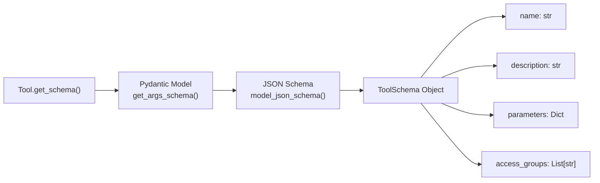
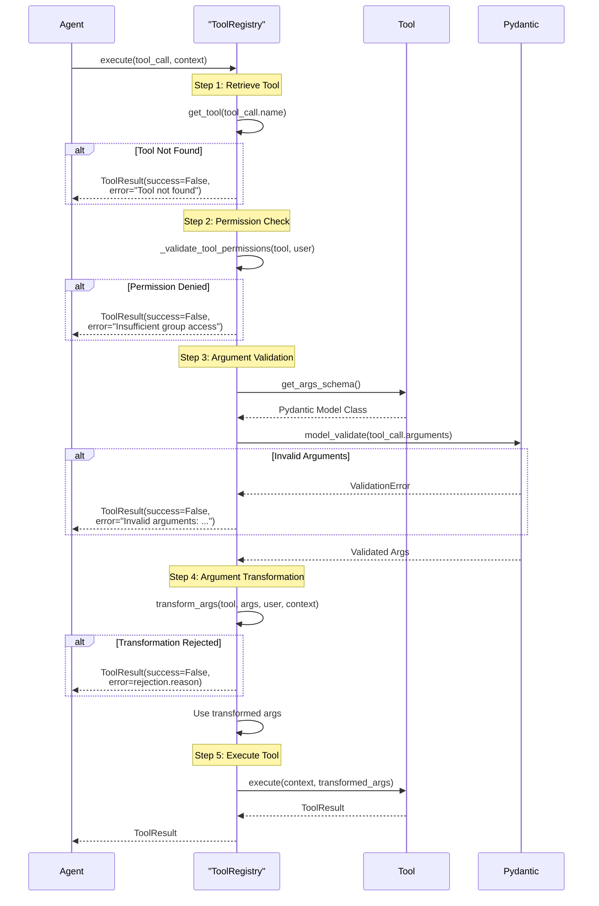
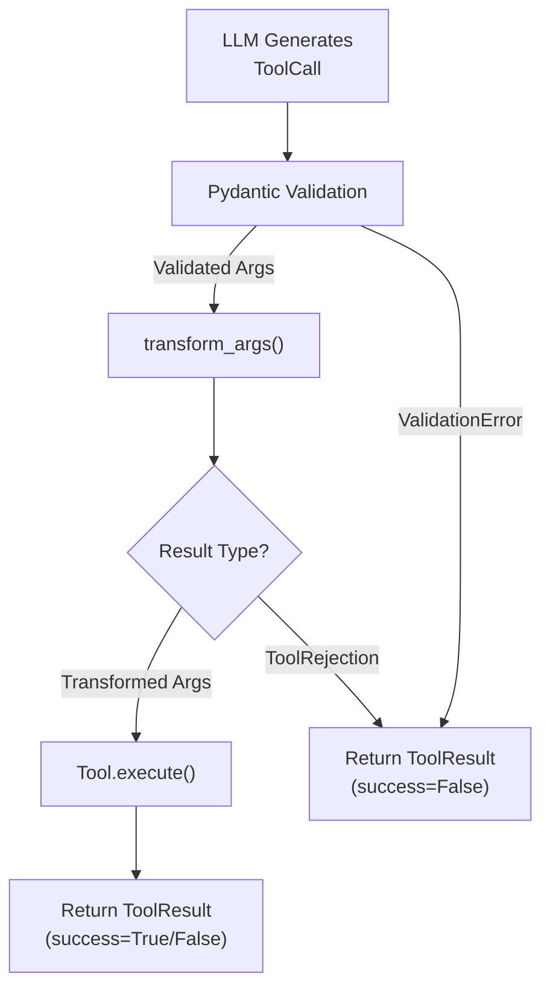

<!-- source: DeepWiki mcp.deepwiki.com · repo vanna-ai/vanna · page 7.4 Tool Arguments and Validation · fetched 2026-10-29 -->

# Tool Arguments and Validation

<details>
<summary>Relevant source files</summary>

The following files were used as context for generating this wiki page:

- [examples/transform_args_example.py](examples/transform_args_example.py)
- [src/vanna/core/registry.py](src/vanna/core/registry.py)
- [src/vanna/core/tool/__init__.py](src/vanna/core/tool/__init__.py)
- [src/vanna/core/tool/base.py](src/vanna/core/tool/base.py)
- [src/vanna/core/tool/models.py](src/vanna/core/tool/models.py)
- [src/vanna/core/user/models.py](src/vanna/core/user/models.py)
- [tests/test_agent_memory.py](tests/test_agent_memory.py)
- [tests/test_tool_permissions.py](tests/test_tool_permissions.py)

</details>


## Purpose and Scope

This page documents how tool arguments are defined, validated, and transformed in the Vanna Agents framework. It covers the Pydantic-based argument schema system, automatic validation during tool execution, and custom validation/transformation logic through `transform_args`.

For information about the Tool interface and execution lifecycle, see [Tool Interface and Lifecycle](#7.1). For creating custom tools, see [Creating Custom Tools](#7.2). For the context passed to tools during execution, see [ToolContext and Enrichment](#7.5).

**Sources**: [src/vanna/core/tool/base.py:1-71](), [src/vanna/core/tool/models.py:1-85](), [src/vanna/core/registry.py:1-279]()

---

## Pydantic-Based Argument Schemas

All tool arguments are defined using Pydantic models, providing automatic validation, type checking, and JSON schema generation. Each tool must implement `get_args_schema()` to return a Pydantic model class defining its expected arguments.

### Defining Argument Models

```python
from pydantic import BaseModel, Field
from typing import Optional

class RunSqlToolArgs(BaseModel):
    """Arguments for SQL execution."""
    
    sql: str = Field(
        description="SQL query to execute"
    )
    
    database: Optional[str] = Field(
        default=None,
        description="Target database name"
    )
    
    limit: int = Field(
        default=100,
        ge=1,
        le=10000,
        description="Maximum number of rows to return"
    )
```

**Key Features**:
- **Field descriptions** are used in LLM prompts to explain parameters
- **Type annotations** enforce runtime validation
- **Pydantic validators** (e.g., `ge=1`, `le=10000`) constrain values
- **Optional fields** with defaults reduce required parameters
- **Nested models** support complex argument structures

**Sources**: [tests/test_tool_permissions.py:25-29](), [examples/transform_args_example.py:19-23]()

### Tool Implementation

```python
from typing import Type
from vanna.core.tool import Tool, ToolContext, ToolResult

class RunSqlTool(Tool[RunSqlToolArgs]):
    @property
    def name(self) -> str:
        return "run_sql"
    
    @property
    def description(self) -> str:
        return "Execute SQL queries against the database"
    
    def get_args_schema(self) -> Type[RunSqlToolArgs]:
        return RunSqlToolArgs
    
    async def execute(self, context: ToolContext, args: RunSqlToolArgs) -> ToolResult:
        # args is already validated - guaranteed to be RunSqlToolArgs
        result = await self.sql_runner.run_sql(args.sql)
        return ToolResult(
            success=True,
            result_for_llm=f"Query returned {len(result)} rows"
        )
```

The `get_args_schema()` method returns the Pydantic model **class** (not an instance). The framework uses this class for validation and schema generation.

**Sources**: [src/vanna/core/tool/base.py:36-39](), [tests/test_tool_permissions.py:31-51]()

---

## ToolSchema Generation for LLMs

The `Tool.get_schema()` method converts the Pydantic model into a `ToolSchema` object that LLMs can understand. This schema is included in the system prompt, allowing the LLM to know which tools are available and how to call them.

### ToolSchema Structure



**Sources**: [src/vanna/core/tool/base.py:54-70](), [src/vanna/core/tool/models.py:64-73]()

### JSON Schema Format

The `ToolSchema.parameters` field contains a JSON Schema generated from the Pydantic model:

```json
{
  "type": "object",
  "properties": {
    "sql": {
      "type": "string",
      "description": "SQL query to execute"
    },
    "database": {
      "type": "string",
      "description": "Target database name",
      "default": null
    },
    "limit": {
      "type": "integer",
      "minimum": 1,
      "maximum": 10000,
      "default": 100,
      "description": "Maximum number of rows to return"
    }
  },
  "required": ["sql"]
}
```

This schema is passed to the LLM provider's function/tool calling API (e.g., OpenAI's `tools` parameter, Anthropic's `tools` format).

**Sources**: [src/vanna/core/tool/base.py:58-64]()

### Schema Filtering by User

The `ToolRegistry.get_schemas(user)` method returns only tools accessible to the user based on group membership:

```python
async def get_schemas(self, user: Optional[User] = None) -> List[ToolSchema]:
    """Get schemas for all tools accessible to user."""
    schemas = []
    for tool in self._tools.values():
        if user is None or await self._validate_tool_permissions(tool, user):
            schemas.append(tool.get_schema())
    return schemas
```

This ensures the LLM only sees tools the user can actually execute. See [Tool Access Control](#3.2) for details on permission validation.

**Sources**: [src/vanna/core/registry.py:90-96](), [tests/test_tool_permissions.py:286-315]()

---

## Validation Pipeline in ToolRegistry

Tool argument validation occurs during `ToolRegistry.execute()` as part of a multi-step pipeline. This ensures arguments are validated **before** tools execute, providing early error detection and clear error messages.

### Execution Pipeline Diagram



**Sources**: [src/vanna/core/registry.py:144-278]()

### Step-by-Step Validation Process

#### 1. Tool Retrieval

```python
tool = await self.get_tool(tool_call.name)
if not tool:
    return ToolResult(
        success=False,
        result_for_llm=f"Tool '{tool_call.name}' not found",
        error=f"Tool '{tool_call.name}' not found"
    )
```

**Sources**: [src/vanna/core/registry.py:150-158]()

#### 2. Permission Validation

```python
if not await self._validate_tool_permissions(tool, context.user):
    msg = f"Insufficient group access for tool '{tool_call.name}'"
    return ToolResult(
        success=False,
        result_for_llm=msg,
        error=msg
    )
```

See [Tool Access Control](#3.2) for group-based permission logic.

**Sources**: [src/vanna/core/registry.py:161-184]()

#### 3. Pydantic Argument Validation

```python
try:
    args_model = tool.get_args_schema()
    validated_args = args_model.model_validate(tool_call.arguments)
except Exception as e:
    msg = f"Invalid arguments: {str(e)}"
    return ToolResult(
        success=False,
        result_for_llm=msg,
        error=msg
    )
```

This catches:
- Missing required fields
- Type mismatches (e.g., string instead of int)
- Pydantic validator failures (e.g., value out of range)
- Extra fields (if model doesn't allow extras)

**Sources**: [src/vanna/core/registry.py:186-197]()

#### 4. Custom Transformation (transform_args)

```python
transform_result = await self.transform_args(
    tool=tool,
    args=validated_args,
    user=context.user,
    context=context,
)

if isinstance(transform_result, ToolRejection):
    return ToolResult(
        success=False,
        result_for_llm=transform_result.reason,
        error=transform_result.reason
    )

final_args = transform_result
```

See [Custom Validation with transform_args](#custom-validation-with-transform_args) below.

**Sources**: [src/vanna/core/registry.py:199-216]()

#### 5. Tool Execution

```python
try:
    result = await tool.execute(context, final_args)
    return result
except Exception as e:
    msg = f"Execution failed: {str(e)}"
    return ToolResult(
        success=False,
        result_for_llm=msg,
        error=msg
    )
```

**Sources**: [src/vanna/core/registry.py:249-278]()

---

## Custom Validation with transform_args

The `ToolRegistry.transform_args()` method provides a powerful extension point for custom argument validation and transformation. It's called **after** Pydantic validation but **before** tool execution, allowing per-user or per-context modifications.

### transform_args Signature

```python
async def transform_args(
    self,
    tool: Tool[T],
    args: T,
    user: User,
    context: ToolContext,
) -> Union[T, ToolRejection]:
    """Transform and validate tool arguments based on user context.
    
    Args:
        tool: The tool being executed
        args: Already Pydantic-validated arguments
        user: The user executing the tool
        context: Full execution context
    
    Returns:
        Either:
        - Transformed arguments (may be unchanged)
        - ToolRejection with explanation
    """
    return args  # Default: no transformation (NoOp)
```

**Sources**: [src/vanna/core/registry.py:113-142]()

### Use Cases for transform_args

#### 1. Row-Level Security (RLS)

Modify SQL queries to enforce data isolation:

```python
class RLSToolRegistry(ToolRegistry):
    async def transform_args(self, tool, args, user, context):
        if tool.name == "run_sql" and isinstance(args, RunSqlToolArgs):
            # Add WHERE clause for user's organization
            org_id = user.metadata.get("organization_id")
            if "SELECT" in args.sql.upper():
                if "WHERE" in args.sql.upper():
                    modified_sql = args.sql.replace(
                        "WHERE",
                        f"WHERE organization_id = {org_id} AND",
                        1
                    )
                else:
                    modified_sql = args.sql + f" WHERE organization_id = {org_id}"
                
                return args.model_copy(update={"sql": modified_sql})
        
        return args
```

**Sources**: [examples/transform_args_example.py:45-96](), [tests/test_tool_permissions.py:597-683]()

#### 2. Rejecting Invalid Arguments

Return `ToolRejection` to prevent execution:

```python
class ValidationRegistry(ToolRegistry):
    async def transform_args(self, tool, args, user, context):
        if tool.name == "run_sql" and isinstance(args, RunSqlToolArgs):
            # Reject queries to restricted tables
            if "restricted_table" in args.sql.lower():
                return ToolRejection(
                    reason="Access to 'restricted_table' is not permitted for your user group"
                )
            
            # Reject DELETE/DROP operations for non-admins
            if "admin" not in user.group_memberships:
                dangerous_ops = ["DELETE", "DROP", "TRUNCATE"]
                if any(op in args.sql.upper() for op in dangerous_ops):
                    return ToolRejection(
                        reason="Only admin users can execute DELETE/DROP/TRUNCATE operations"
                    )
        
        return args
```

**Sources**: [tests/test_tool_permissions.py:511-562]()

#### 3. Argument Enrichment

Add context-specific information:

```python
class EnrichmentRegistry(ToolRegistry):
    async def transform_args(self, tool, args, user, context):
        if isinstance(args, SQLExecutionArgs):
            # Add user tracking metadata
            modified_sql = f"/* user: {user.id}, request: {context.request_id} */ {args.sql}"
            return args.model_copy(update={"sql": modified_sql})
        
        return args
```

**Sources**: [tests/test_tool_permissions.py:458-509]()

### ToolRejection Model

```python
class ToolRejection(BaseModel):
    """Indicates tool execution should be rejected with a message."""
    
    reason: str = Field(
        description="Explanation of why the tool execution was rejected"
    )
```

When `transform_args` returns a `ToolRejection`, the `ToolRegistry` converts it to a failed `ToolResult` with the rejection reason as the error message. This is sent back to the LLM, allowing it to explain the rejection to the user.

**Sources**: [src/vanna/core/tool/models.py:75-84]()

### Transform Pipeline Diagram



**Sources**: [src/vanna/core/registry.py:186-216]()

---

## Validation Error Messages

When validation fails at any stage, the `ToolRegistry` returns a `ToolResult` with `success=False` and descriptive error messages. These messages are sent to the LLM, which can then explain the problem to the user.

### Error Message Types

| Validation Stage | Error Message Format | Example |
|-----------------|---------------------|---------|
| Tool Not Found | `"Tool '{name}' not found"` | `"Tool 'execute_sql' not found"` |
| Permission Denied | `"Insufficient group access for tool '{name}'"` | `"Insufficient group access for tool 'admin_tool'"` |
| Invalid Arguments | `"Invalid arguments: {pydantic_error}"` | `"Invalid arguments: field required (type=value_error.missing)"` |
| Transform Rejection | `{rejection.reason}` | `"Access to 'restricted_table' is not permitted for your user group"` |
| Execution Error | `"Execution failed: {exception}"` | `"Execution failed: Connection refused"` |

**Sources**: [src/vanna/core/registry.py:150-278]()

### Example: Invalid Arguments

When the LLM provides arguments that don't match the Pydantic schema:

```json
// LLM provides:
{
  "tool": "run_sql",
  "arguments": {
    "query": "SELECT * FROM users",
    "limit": "invalid_number"
  }
}
```

The Pydantic validation catches this:

```python
# Pydantic raises ValidationError:
# "1 validation error for RunSqlToolArgs
#  limit
#    value is not a valid integer (type=type_error.integer)"
```

The `ToolRegistry` converts this to a `ToolResult`:

```python
ToolResult(
    success=False,
    result_for_llm="Invalid arguments: 1 validation error for RunSqlToolArgs\nlimit\n  value is not a valid integer (type=type_error.integer)",
    error="Invalid arguments: 1 validation error for RunSqlToolArgs\nlimit\n  value is not a valid integer (type=type_error.integer)"
)
```

This error message is added to the conversation history and sent back to the LLM in the next turn, allowing the LLM to self-correct or ask the user for clarification.

**Sources**: [src/vanna/core/registry.py:186-197]()

### Example: Transform Rejection

When `transform_args` rejects arguments:

```python
# Custom ToolRegistry
class SecurityRegistry(ToolRegistry):
    async def transform_args(self, tool, args, user, context):
        if "DROP TABLE" in args.sql.upper():
            return ToolRejection(
                reason="DROP TABLE operations are not permitted through this interface"
            )
        return args
```

The rejection is converted to a failed `ToolResult`:

```python
ToolResult(
    success=False,
    result_for_llm="DROP TABLE operations are not permitted through this interface",
    error="DROP TABLE operations are not permitted through this interface"
)
```

**Sources**: [src/vanna/core/registry.py:207-213](), [tests/test_tool_permissions.py:530-562]()

---

## Testing Argument Validation

The test suite includes comprehensive validation tests demonstrating various scenarios:

### Test Categories

1. **Basic Validation**: [tests/test_tool_permissions.py:319-343]()
   - Tool not found errors
   - Duplicate tool registration prevention

2. **Permission Validation**: [tests/test_tool_permissions.py:101-283]()
   - Access granted for matching groups
   - Access denied for non-matching groups
   - Schema filtering by user groups

3. **transform_args Tests**: [tests/test_tool_permissions.py:424-727]()
   - Default NoOp behavior
   - Custom transformations
   - ToolRejection handling
   - Row-level security examples

4. **Full Agent Integration**: [tests/test_tool_permissions.py:786-916]()
   - Validation during `Agent.send_message` workflow
   - End-to-end argument transformation

These tests serve as examples of how to implement custom validation logic.

**Sources**: [tests/test_tool_permissions.py:1-916]()

---

## Best Practices

### 1. Use Descriptive Field Descriptions

LLMs use field descriptions to understand how to provide arguments:

```python
class RunSqlToolArgs(BaseModel):
    sql: str = Field(
        description="SQL query to execute. Use SELECT for data retrieval, "
                    "INSERT for adding data, UPDATE for modifications. "
                    "Avoid DROP or TRUNCATE operations."
    )
```

### 2. Set Reasonable Defaults

Reduce required fields by providing sensible defaults:

```python
class VisualizationArgs(BaseModel):
    chart_type: str = Field(
        default="bar",
        description="Type of chart: 'bar', 'line', 'scatter', 'pie'"
    )
    
    limit: int = Field(
        default=100,
        ge=1,
        le=10000,
        description="Maximum data points to visualize"
    )
```

### 3. Use Pydantic Validators for Common Constraints

```python
from pydantic import validator

class EmailToolArgs(BaseModel):
    recipient: str = Field(description="Email address")
    
    @validator("recipient")
    def validate_email(cls, v):
        if "@" not in v:
            raise ValueError("Invalid email address")
        return v
```

### 4. Override transform_args for Security

Always override `transform_args` when implementing row-level security or other access controls:

```python
class SecureRegistry(ToolRegistry):
    async def transform_args(self, tool, args, user, context):
        # Apply security transformations for all SQL tools
        if hasattr(args, "sql"):
            args = self._apply_rls(args, user)
        
        return args
```

### 5. Provide Clear Rejection Reasons

When returning `ToolRejection`, explain why and suggest alternatives:

```python
return ToolRejection(
    reason="Cannot execute DROP TABLE. Instead, use the 'archive_table' tool "
           "to safely archive the table while preserving data."
)
```

**Sources**: [examples/transform_args_example.py:1-157](), [src/vanna/core/registry.py:113-142]()

---

