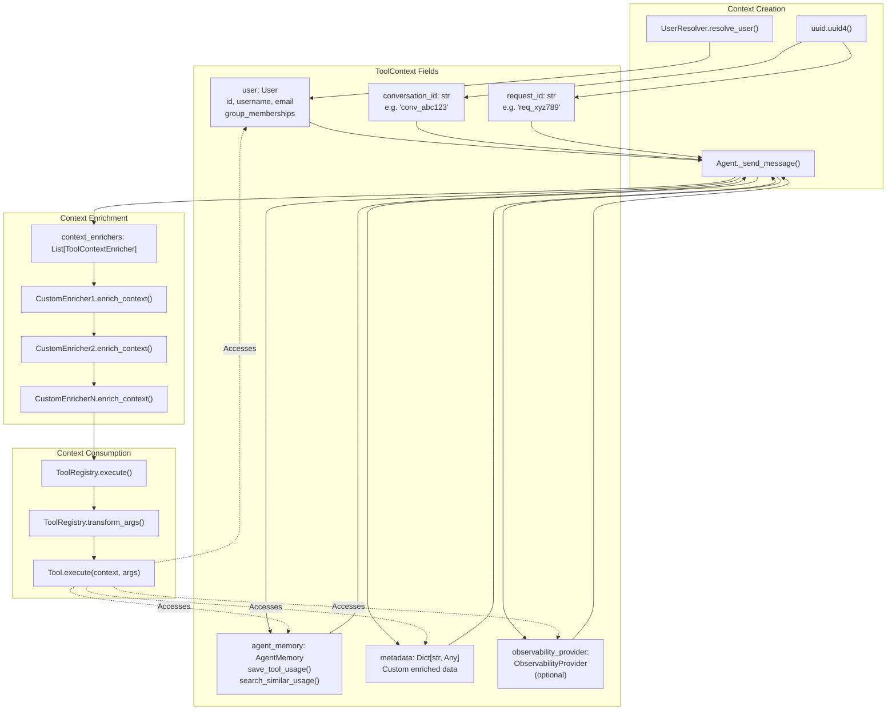
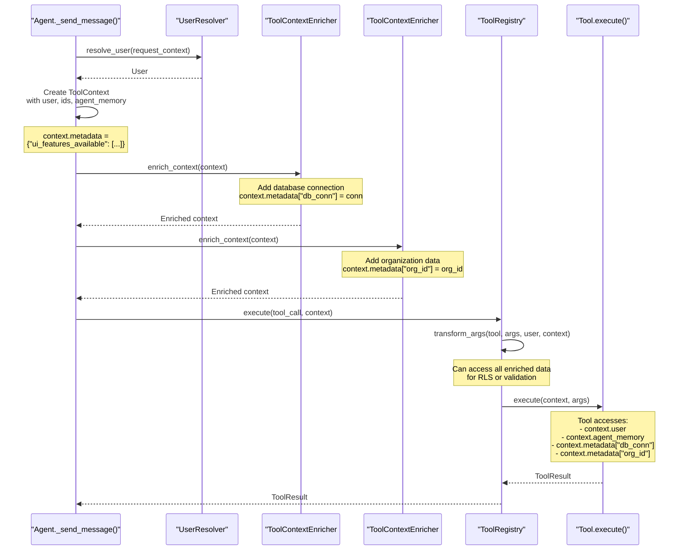

<!-- source: DeepWiki mcp.deepwiki.com · repo vanna-ai/vanna · page 7.5 ToolContext and Enrichment · fetched 2026-10-29 -->

# ToolContext and Enrichment

<details>
<summary>Relevant source files</summary>

The following files were used as context for generating this wiki page:

- [examples/transform_args_example.py](examples/transform_args_example.py)
- [src/vanna/core/__init__.py](src/vanna/core/__init__.py)
- [src/vanna/core/agent/agent.py](src/vanna/core/agent/agent.py)
- [src/vanna/core/registry.py](src/vanna/core/registry.py)
- [src/vanna/core/tool/__init__.py](src/vanna/core/tool/__init__.py)
- [src/vanna/core/tool/base.py](src/vanna/core/tool/base.py)
- [src/vanna/core/tool/models.py](src/vanna/core/tool/models.py)
- [src/vanna/core/user/models.py](src/vanna/core/user/models.py)
- [src/vanna/core/workflow/__init__.py](src/vanna/core/workflow/__init__.py)
- [src/vanna/examples/default_workflow_handler_example.py](src/vanna/examples/default_workflow_handler_example.py)
- [src/vanna/integrations/local/__init__.py](src/vanna/integrations/local/__init__.py)
- [src/vanna/integrations/local/file_system_conversation_store.py](src/vanna/integrations/local/file_system_conversation_store.py)
- [src/vanna/tools/agent_memory.py](src/vanna/tools/agent_memory.py)
- [tests/test_agent_memory.py](tests/test_agent_memory.py)
- [tests/test_tool_permissions.py](tests/test_tool_permissions.py)

</details>


This page documents the `ToolContext` model and the context enrichment system in Vanna. `ToolContext` is the execution context object passed to all tool executions, containing user information, conversation metadata, agent memory, and custom data. The enrichment system allows developers to inject additional data into the context before tool execution.

For information about tool permissions and argument transformation, see [Tool Access Control](#3.2) and [Argument Transformation and Row-Level Security](#3.4). For general tool development patterns, see [Creating Custom Tools](#7.2).

---

## ToolContext Model

`ToolContext` is a Pydantic model that encapsulates all execution context for a tool invocation. It is defined in [src/vanna/core/tool/models.py:28-45]() and contains five core fields:

| Field | Type | Purpose |
|-------|------|---------|
| `user` | `User` | The authenticated user executing the tool |
| `conversation_id` | `str` | Unique identifier for the conversation |
| `request_id` | `str` | Unique identifier for this specific request (for tracing) |
| `agent_memory` | `AgentMemory` | Agent memory instance for learning and pattern retrieval |
| `metadata` | `Dict[str, Any]` | Custom key-value data injected by enrichers or the agent |
| `observability_provider` | `ObservabilityProvider` (optional) | Provider for metrics and tracing spans |

The model allows arbitrary types via `Config.arbitrary_types_allowed = True` to support non-serializable objects like `AgentMemory` and `ObservabilityProvider`.

**Design Rationale**: By consolidating all context into a single object, tools have a stable, versioned interface. New context data can be added to `metadata` without breaking existing tool signatures.

**Sources**: [src/vanna/core/tool/models.py:28-45](), [src/vanna/core/__init__.py:91-95]()

---

## ToolContext Structure and Data Flow



**Diagram: ToolContext Structure and Flow from Agent to Tools**

The diagram shows how `ToolContext` is assembled from multiple sources and flows through the enrichment pipeline before reaching tool execution. Each enricher can modify the `metadata` field or replace the entire context.

**Sources**: [src/vanna/core/agent/agent.py:534-562](), [src/vanna/core/tool/models.py:28-45](), [src/vanna/core/registry.py:144-278]()

---

## Context Creation in Agent

The `Agent` creates `ToolContext` during message processing in [src/vanna/core/agent/agent.py:534-541]():

```python
context = ToolContext(
    user=user,
    conversation_id=conversation_id,
    request_id=request_id,
    agent_memory=self.agent_memory,
    observability_provider=self.observability_provider,
    metadata={"ui_features_available": ui_features_available},
)
```

**Key Steps**:
1. **User Resolution**: User is resolved from `RequestContext` via `UserResolver` (lines 257-267)
2. **ID Generation**: `conversation_id` and `request_id` are generated using `uuid.uuid4()` (lines 396-398)
3. **Agent Memory**: The agent's `AgentMemory` instance is attached (line 538)
4. **UI Features**: Available UI features are collected and stored in `metadata` (lines 528-541)
5. **Observability**: Optional `ObservabilityProvider` is attached for tracing (line 539)

The initial `metadata` contains `ui_features_available`, a list of UI feature names the user can access based on their group memberships. This enables tools to conditionally show detailed information.

**Sources**: [src/vanna/core/agent/agent.py:534-541](), [src/vanna/core/agent/agent.py:528-532]()

---

## ToolContextEnricher System

The `ToolContextEnricher` interface allows injecting custom data into `ToolContext` before tool execution. This enables patterns like:
- Adding database connection information
- Injecting tenant/organization context
- Loading user preferences or settings
- Adding cached data to avoid repeated fetches

### ToolContextEnricher Interface

The enricher interface is defined in [src/vanna/core/enricher.py]():

```python
class ToolContextEnricher(ABC):
    @abstractmethod
    async def enrich_context(self, context: ToolContext) -> ToolContext:
        """
        Enrich the tool context with additional data.
        
        Args:
            context: The current tool context
            
        Returns:
            Enriched tool context (may be the same instance with modified metadata,
            or a new instance with additional fields)
        """
        pass
```

Enrichers are registered in the `Agent` constructor and executed sequentially before tool execution:

[src/vanna/core/agent/agent.py:544-562]():
```python
for enricher in self.context_enrichers:
    enrichment_span = None
    if self.observability_provider:
        enrichment_span = await self.observability_provider.create_span(
            "agent.context.enrichment",
            attributes={"enricher": enricher.__class__.__name__},
        )

    context = await enricher.enrich_context(context)

    if self.observability_provider and enrichment_span:
        await self.observability_provider.end_span(enrichment_span)
        if enrichment_span.duration_ms():
            await self.observability_provider.record_metric(
                "agent.enrichment.duration",
                enrichment_span.duration_ms() or 0,
                "ms",
                tags={"enricher": enricher.__class__.__name__},
            )
```

Each enricher receives the context, enriches it, and returns the enriched context. Enrichers are chained, so later enrichers see modifications from earlier ones.

**Sources**: [src/vanna/core/enricher.py](), [src/vanna/core/agent/agent.py:544-562]()

---

## Context Enrichment Lifecycle



**Diagram: ToolContext Enrichment and Consumption Lifecycle**

This sequence shows how context flows from creation through enrichment to consumption by tools. Each stage can add data to `context.metadata`, which becomes available to subsequent stages.

**Sources**: [src/vanna/core/agent/agent.py:534-562](), [src/vanna/core/registry.py:144-278]()

---

## Accessing Context in Tools

Tools receive `ToolContext` as the first parameter to their `execute()` method. The context provides access to all execution context data.

### Accessing User Information

[src/vanna/tools/agent_memory.py:76-87]():
```python
async def execute(
    self, context: ToolContext, args: SaveQuestionToolArgsParams
) -> ToolResult:
    """Save the tool usage pattern to agent memory."""
    try:
        await context.agent_memory.save_tool_usage(
            question=args.question,
            tool_name=args.tool_name,
            args=args.args,
            context=context,  # Pass full context for user scoping
            success=True,
        )
```

The `context.user` field provides access to user identity and group memberships for permission checks or data scoping.

### Accessing Agent Memory

Tools access `context.agent_memory` to interact with the learning system:

[src/vanna/tools/agent_memory.py:139-145]():
```python
results = await context.agent_memory.search_similar_usage(
    question=args.question,
    context=context,
    limit=args.limit or 10,
    similarity_threshold=args.similarity_threshold or 0.7,
    tool_name_filter=args.tool_name_filter,
)
```

### Accessing Metadata

Tools can access enriched data via `context.metadata`:

[src/vanna/tools/agent_memory.py:153-159]():
```python
ui_features_available = context.metadata.get(
    "ui_features_available", []
)
show_detailed_results = (
    UiFeature.UI_FEATURE_SHOW_MEMORY_DETAILED_RESULTS
    in ui_features_available
)
```

This pattern allows tools to adapt their behavior based on user permissions or enriched context data.

### Accessing Observability Provider

Tools can create custom spans and metrics for observability:

```python
if context.observability_provider:
    span = await context.observability_provider.create_span(
        "my_tool.expensive_operation",
        attributes={"user_id": context.user.id}
    )
    try:
        # ... perform operation ...
    finally:
        await context.observability_provider.end_span(span)
```

**Sources**: [src/vanna/tools/agent_memory.py:76-117](), [src/vanna/tools/agent_memory.py:134-266]()

---

## Context in transform_args

The `ToolRegistry.transform_args()` method receives the full context, enabling user-scoped transformations:

[src/vanna/core/registry.py:113-142]():
```python
async def transform_args(
    self,
    tool: Tool[T],
    args: T,
    user: User,
    context: ToolContext,
) -> Union[T, ToolRejection]:
    """Transform and validate tool arguments based on user context.
    
    Args:
        tool: The tool being executed
        args: Already Pydantic-validated arguments
        user: The user executing the tool
        context: Full execution context
    
    Returns:
        Either:
        - Transformed arguments (may be unchanged if no transformation needed)
        - ToolRejection with explanation of why args were rejected
    """
    return args  # Default: no transformation (NoOp)
```

The context provides access to enriched data for implementing Row-Level Security or validation logic. See [examples/transform_args_example.py:45-96]() for a complete example.

**Sources**: [src/vanna/core/registry.py:113-142](), [examples/transform_args_example.py:45-96]()

---

## Common Enrichment Patterns

### Pattern 1: Database Connection Injection

```python
class DatabaseConnectionEnricher(ToolContextEnricher):
    """Inject database connection information based on user's organization."""
    
    async def enrich_context(self, context: ToolContext) -> ToolContext:
        org_id = context.user.metadata.get("organization_id")
        if org_id:
            # Get connection string for this organization
            conn_string = self.get_connection_for_org(org_id)
            context.metadata["db_connection_string"] = conn_string
            context.metadata["db_schema"] = f"org_{org_id}"
        return context
```

Tools can then access `context.metadata["db_connection_string"]` to connect to the appropriate database.

### Pattern 2: Tenant Context Injection

```python
class TenantContextEnricher(ToolContextEnricher):
    """Inject tenant/organization context for multi-tenant applications."""
    
    async def enrich_context(self, context: ToolContext) -> ToolContext:
        user_groups = context.user.group_memberships
        
        # Determine tenant from user groups
        tenant_id = self.extract_tenant_from_groups(user_groups)
        
        context.metadata.update({
            "tenant_id": tenant_id,
            "tenant_name": self.get_tenant_name(tenant_id),
            "tenant_config": self.load_tenant_config(tenant_id),
        })
        return context
```

### Pattern 3: User Preferences Loading

```python
class UserPreferencesEnricher(ToolContextEnricher):
    """Load user preferences from database."""
    
    async def enrich_context(self, context: ToolContext) -> ToolContext:
        prefs = await self.db.get_user_preferences(context.user.id)
        context.metadata["user_preferences"] = prefs
        return context
```

### Pattern 4: Cached Data Injection

```python
class CachedDataEnricher(ToolContextEnricher):
    """Inject cached data to avoid repeated fetches during tool execution."""
    
    async def enrich_context(self, context: ToolContext) -> ToolContext:
        # Cache data that multiple tools might need
        context.metadata["cached_schemas"] = await self.get_db_schemas()
        context.metadata["cached_user_permissions"] = await self.get_permissions(
            context.user
        )
        return context
```

**Sources**: Pattern examples synthesized from enrichment system design

---

## Implementation Guide

### Step 1: Create Enricher Class

Implement the `ToolContextEnricher` interface:

```python
from vanna.core import ToolContextEnricher, ToolContext

class MyCustomEnricher(ToolContextEnricher):
    def __init__(self, config: dict):
        self.config = config
    
    async def enrich_context(self, context: ToolContext) -> ToolContext:
        # Add custom data to metadata
        context.metadata["my_custom_data"] = self.fetch_custom_data(
            context.user
        )
        return context
```

### Step 2: Register Enricher with Agent

Pass the enricher to the `Agent` constructor:

[src/vanna/core/agent/agent.py:82-99]():
```python
agent = Agent(
    llm_service=llm_service,
    tool_registry=registry,
    user_resolver=user_resolver,
    agent_memory=agent_memory,
    context_enrichers=[
        MyCustomEnricher(config={"key": "value"}),
        AnotherEnricher(),
    ],
)
```

Enrichers are executed in the order provided. Each enricher receives the context enriched by previous enrichers.

### Step 3: Access Enriched Data in Tools

Tools can access the enriched data via `context.metadata`:

```python
class MyTool(Tool[MyToolArgs]):
    async def execute(self, context: ToolContext, args: MyToolArgs) -> ToolResult:
        custom_data = context.metadata.get("my_custom_data")
        
        if not custom_data:
            return ToolResult(
                success=False,
                result_for_llm="Missing required custom data",
                error="my_custom_data not found in context"
            )
        
        # Use the enriched data
        result = self.process_with_custom_data(custom_data)
        return ToolResult(success=True, result_for_llm=result)
```

### Step 4: Add Observability (Optional)

Enrichers can use the observability provider for tracing:

```python
async def enrich_context(self, context: ToolContext) -> ToolContext:
    if context.observability_provider:
        span = await context.observability_provider.create_span(
            "my_enricher.load_data",
            attributes={"user_id": context.user.id}
        )
    
    try:
        # Perform enrichment
        data = await self.load_data(context.user)
        context.metadata["my_data"] = data
        return context
    finally:
        if context.observability_provider and span:
            await context.observability_provider.end_span(span)
```

**Sources**: [src/vanna/core/agent/agent.py:544-562](), [src/vanna/core/enricher.py]()

---

## Testing ToolContext

### Creating Test Context

[tests/test_tool_permissions.py:113-118]():
```python
context = ToolContext(
    user=regular_user,
    conversation_id="test_conv",
    request_id="test_req",
    agent_memory=agent_memory,
)
```

### Testing with Enriched Metadata

[tests/test_agent_memory.py:29-38]():
```python
def create_test_context(test_user, agent_memory):
    """Helper to create test context with specific agent memory."""
    return ToolContext(
        user=test_user,
        conversation_id="test_conv",
        request_id="test_req",
        agent_memory=agent_memory,
        metadata={},
    )
```

Add custom metadata for testing:

```python
context = ToolContext(
    user=test_user,
    conversation_id="test_conv",
    request_id="test_req",
    agent_memory=agent_memory,
    metadata={
        "test_data": "value",
        "ui_features_available": ["feature1", "feature2"],
    }
)
```

**Sources**: [tests/test_tool_permissions.py:113-118](), [tests/test_agent_memory.py:29-38]()

---

## Context and UI Features

The `Agent` populates `context.metadata["ui_features_available"]` with a list of UI feature names the user can access. Tools use this to conditionally show detailed information:

[src/vanna/tools/agent_memory.py:203-209]():
```python
ui_features_available = context.metadata.get("ui_features_available", [])
show_detailed_results = (
    UiFeature.UI_FEATURE_SHOW_MEMORY_DETAILED_RESULTS
    in ui_features_available
)

if show_detailed_results:
    # Show detailed admin view
    ui_component = UiComponent(
        rich_component=CardComponent(
            title=f"🧠 Memory Search: {len(results)} Result(s)",
            content=detailed_content.strip(),
            # ...
        )
    )
else:
    # Show simple non-admin view
    ui_component = UiComponent(
        rich_component=StatusBarUpdateComponent(
            status="success",
            message=f"Found {len(results)} similar pattern(s)",
            # ...
        )
    )
```

This pattern enables role-based UI rendering without hardcoding permission checks in tools.

**Sources**: [src/vanna/tools/agent_memory.py:203-246](), [src/vanna/core/agent/agent.py:528-541]()

---

## Best Practices

### 1. Avoid Modifying User Object

The `context.user` object should be treated as read-only. Use `context.metadata` for mutable data:

```python
# ❌ Don't modify user
context.user.metadata["enriched_data"] = data

# ✅ Use context metadata
context.metadata["enriched_data"] = data
```

### 2. Use Type Hints for Metadata

Define typed access helpers to avoid runtime errors:

```python
def get_tenant_id(context: ToolContext) -> Optional[str]:
    """Safely get tenant ID from context."""
    return context.metadata.get("tenant_id")

def require_tenant_id(context: ToolContext) -> str:
    """Get tenant ID or raise error."""
    tenant_id = context.metadata.get("tenant_id")
    if not tenant_id:
        raise ValueError("tenant_id not found in context")
    return tenant_id
```

### 3. Document Expected Metadata Keys

Document which metadata keys your enrichers add and which your tools expect:

```python
class TenantEnricher(ToolContextEnricher):
    """
    Adds the following metadata keys:
    - tenant_id: str - Tenant identifier
    - tenant_name: str - Human-readable tenant name
    - tenant_config: dict - Tenant configuration
    """
    async def enrich_context(self, context: ToolContext) -> ToolContext:
        # ...
```

### 4. Handle Missing Metadata Gracefully

Always provide defaults or error handling:

```python
# ✅ Provide default
db_conn = context.metadata.get("db_connection_string", DEFAULT_CONN)

# ✅ Check and fail early
if "required_key" not in context.metadata:
    return ToolResult(
        success=False,
        result_for_llm="Missing required context",
        error="required_key not in metadata"
    )
```

### 5. Chain Enrichers Logically

Order enrichers from most general to most specific:

```python
agent = Agent(
    # ...
    context_enrichers=[
        UserPreferencesEnricher(),      # Load user prefs first
        TenantContextEnricher(),        # Then determine tenant
        DatabaseConnectionEnricher(),   # Then get DB conn for tenant
        CachedDataEnricher(),          # Finally cache data
    ]
)
```

Later enrichers can depend on data added by earlier ones.

**Sources**: Best practices synthesized from architecture patterns

---

## Summary

The `ToolContext` model and enrichment system provide a flexible, extensible mechanism for passing execution context to tools:

- **ToolContext** consolidates user, conversation, memory, and metadata into a single object
- **ToolContextEnricher** allows injecting custom data before tool execution
- **metadata** field enables arbitrary custom data without breaking tool interfaces
- Enrichers are chained, allowing progressive enhancement of context
- Tools access context data for user scoping, permission checks, and feature gating
- The system integrates with observability for tracing enrichment performance

This design enables powerful patterns like multi-tenancy, row-level security, user preferences, and conditional UI rendering while maintaining clean tool interfaces.

**Sources**: [src/vanna/core/tool/models.py:28-45](), [src/vanna/core/agent/agent.py:534-562](), [src/vanna/core/enricher.py](), [src/vanna/tools/agent_memory.py:76-266]()

---

