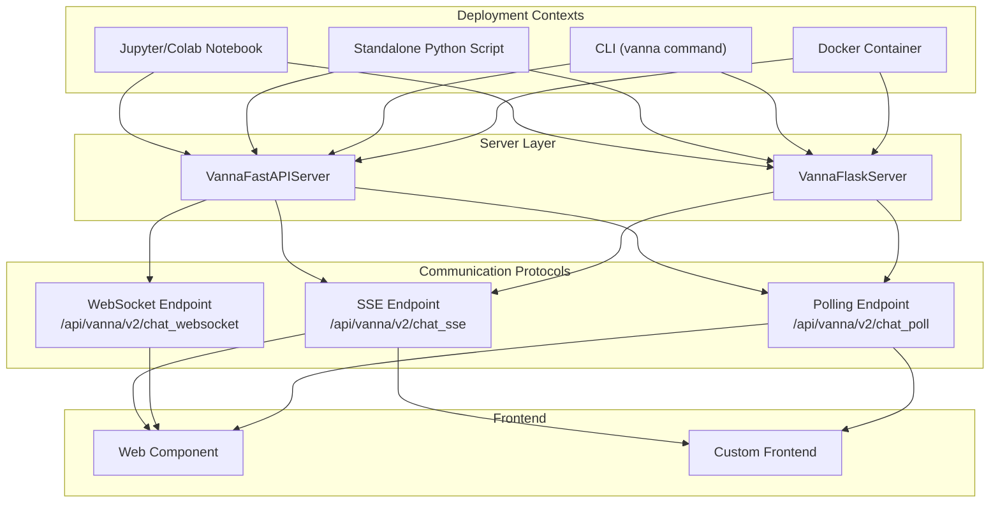
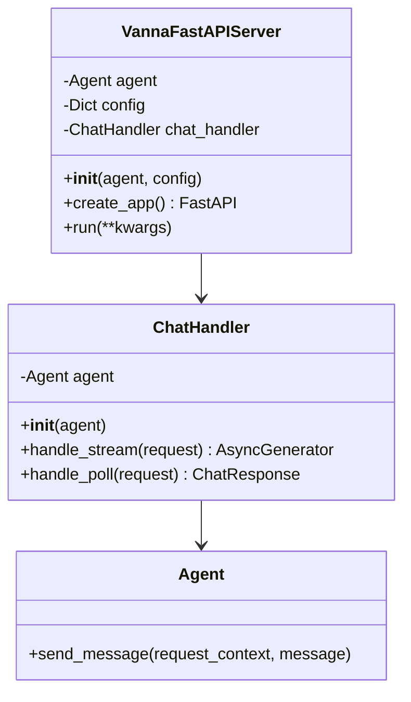
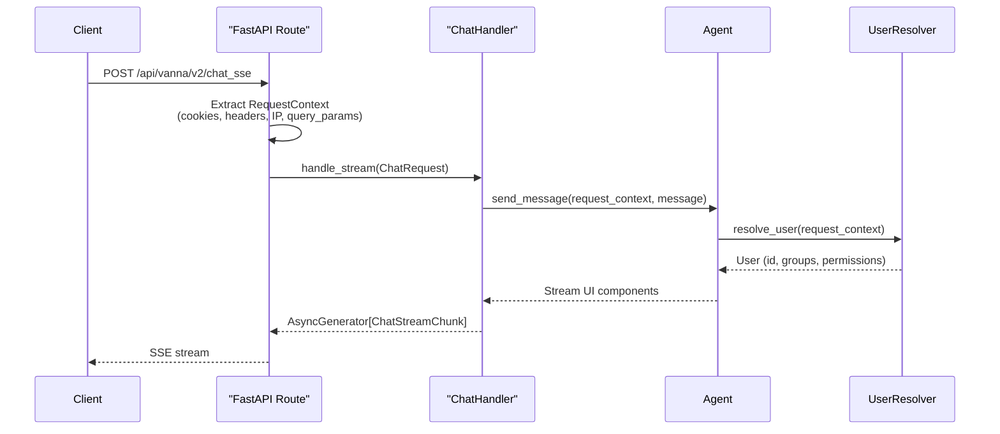
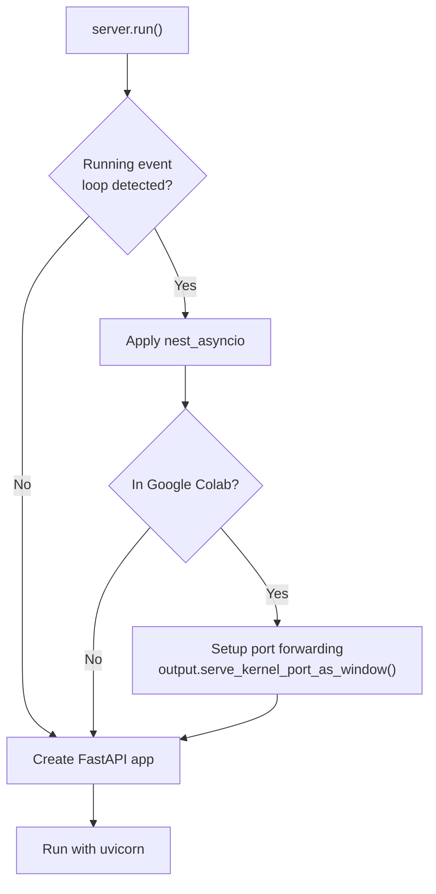
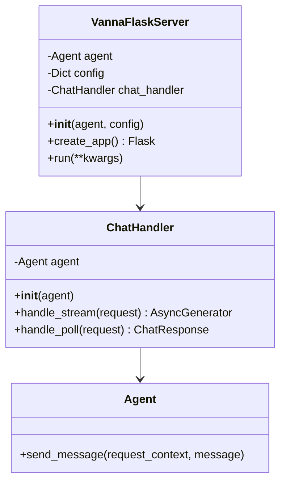
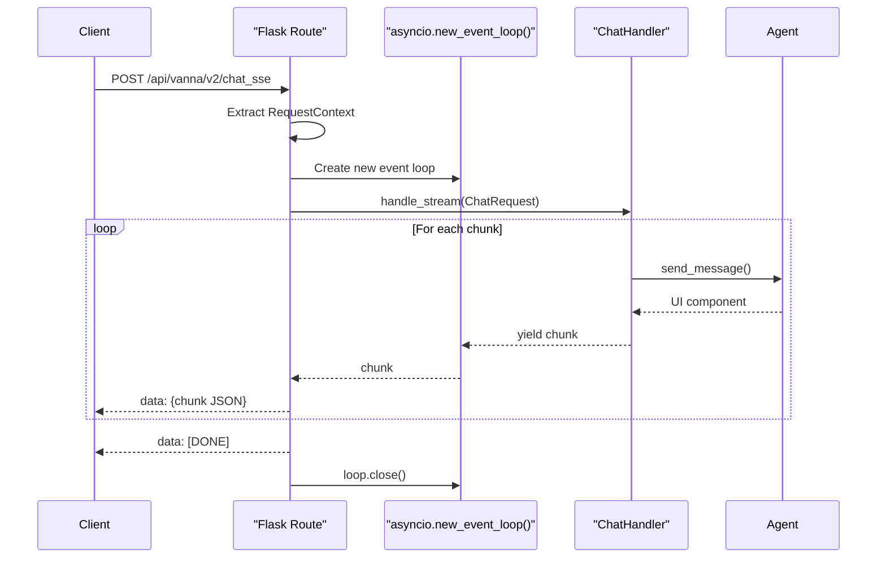
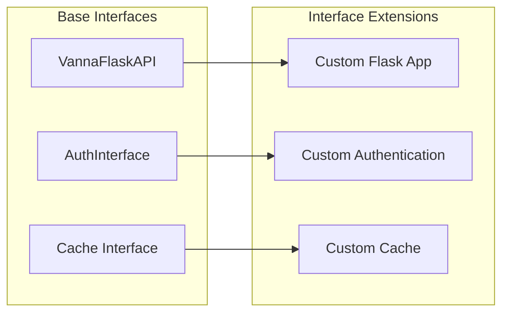
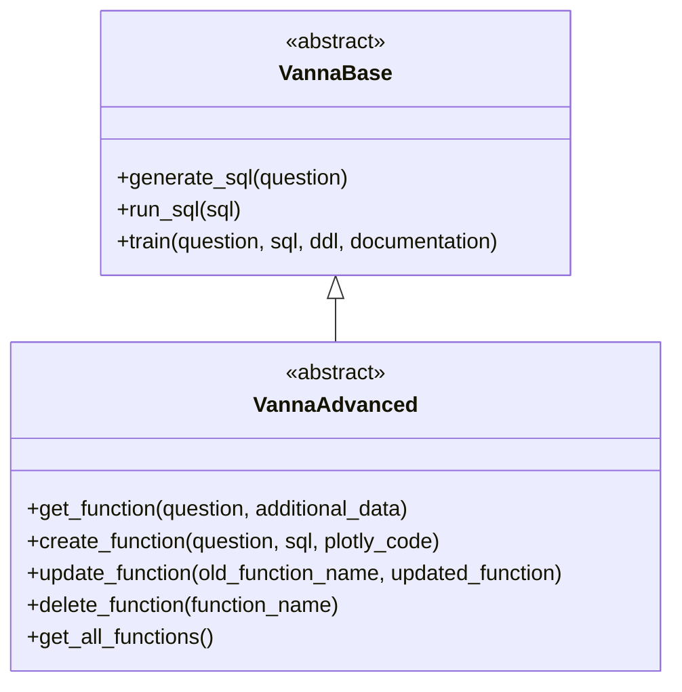

<!-- source: DeepWiki mcp.deepwiki.com · repo vanna-ai/vanna · page 8 Server and Deployment · fetched 2026-10-29 -->

# Server Implementations

<details>
<summary>Relevant source files</summary>

The following files were used as context for generating this wiki page:

- [MIGRATION_GUIDE.md](MIGRATION_GUIDE.md)
- [README.md](README.md)
- [img/architecture.png](img/architecture.png)
- [img/vanna2.svg](img/vanna2.svg)
- [notebooks/quickstart.ipynb](notebooks/quickstart.ipynb)
- [src/vanna/integrations/anthropic/llm.py](src/vanna/integrations/anthropic/llm.py)
- [src/vanna/integrations/openai/llm.py](src/vanna/integrations/openai/llm.py)
- [src/vanna/servers/__init__.py](src/vanna/servers/__init__.py)
- [src/vanna/servers/base/templates.py](src/vanna/servers/base/templates.py)
- [src/vanna/servers/cli/server_runner.py](src/vanna/servers/cli/server_runner.py)
- [src/vanna/servers/fastapi/app.py](src/vanna/servers/fastapi/app.py)
- [src/vanna/servers/fastapi/routes.py](src/vanna/servers/fastapi/routes.py)
- [src/vanna/servers/flask/app.py](src/vanna/servers/flask/app.py)
- [src/vanna/servers/flask/routes.py](src/vanna/servers/flask/routes.py)

</details>


This page documents the server implementations for deploying Vanna Agents as web services. Vanna 2.0+ provides FastAPI and Flask server factories that expose Agent instances through HTTP endpoints, enabling streaming responses via Server-Sent Events (SSE), WebSocket, and polling protocols.

For information about the core Agent architecture, see [Agent Core](#2.1). For details about the web component that connects to these servers, see [Web Component Integration](#5.3).

## Overview

Vanna 2.0+ provides two server implementations that expose the same Agent through different web frameworks:

| Server | Framework | Async Support | WebSocket | Best For |
|--------|-----------|---------------|-----------|----------|
| `VannaFastAPIServer` | FastAPI | Native async | Yes | Production deployments, high performance |
| `VannaFlaskServer` | Flask | Sync with async wrapper | No (returns 501) | Simple deployments, familiarity with Flask |

Both servers expose the same API endpoints and work with the `<vanna-chat>` web component.

**High-Level Architecture**



Sources: [src/vanna/servers/fastapi/app.py:1-164](), [src/vanna/servers/flask/app.py:1-133](), [src/vanna/servers/fastapi/routes.py:1-184](), [src/vanna/servers/flask/routes.py:1-138]()
</thinking>

## Communication Protocols

All servers expose three communication protocols for streaming Agent responses:

### Server-Sent Events (SSE)

SSE streams text events from server to client over HTTP. This is the recommended protocol for most applications.

**Endpoint**: `POST /api/vanna/v2/chat_sse`

**Format**: Each chunk is sent as:
```
data: {"type": "text", "content": "...", "conversation_id": "...", "request_id": "..."}

data: [DONE]
```

**Use Cases**: Web applications, framework-agnostic, works through firewalls

Sources: [src/vanna/servers/fastapi/routes.py:40-80](), [src/vanna/servers/flask/routes.py:40-92]()

### WebSocket

WebSocket provides full-duplex communication for real-time bidirectional messaging.

**Endpoint**: `WS /api/vanna/v2/chat_websocket`

**Format**: JSON messages sent and received:
```json
{
  "message": "What are the top customers?",
  "conversation_id": "conv-123",
  "metadata": {}
}
```

**Use Cases**: Real-time applications, bidirectional communication needs

**Note**: Only available in `VannaFastAPIServer`. Flask returns 501 Not Implemented.

Sources: [src/vanna/servers/fastapi/routes.py:82-162](), [src/vanna/servers/flask/routes.py:94-102]()

### HTTP Polling

Simple request-response polling for environments that don't support streaming.

**Endpoint**: `POST /api/vanna/v2/chat_poll`

**Response**: Complete JSON response with all UI components:
```json
{
  "components": [...],
  "conversation_id": "conv-123",
  "request_id": "req-456"
}
```

**Use Cases**: Simple integrations, testing, restricted network environments

Sources: [src/vanna/servers/fastapi/routes.py:163-184](), [src/vanna/servers/flask/routes.py:104-138]()

## FastAPI Server

The `VannaFastAPIServer` class provides a production-ready FastAPI application with native async support.

### Class Structure



Sources: [src/vanna/servers/fastapi/app.py:16-164](), [src/vanna/servers/base/__init__.py:1-50]()

### Core Endpoints

**Chat Endpoints**

| Endpoint | Method | Protocol | Description |
|----------|--------|----------|-------------|
| `/api/vanna/v2/chat_sse` | POST | SSE | Streaming chat via Server-Sent Events |
| `/api/vanna/v2/chat_websocket` | WS | WebSocket | Real-time bidirectional chat |
| `/api/vanna/v2/chat_poll` | POST | HTTP | Request-response polling |
| `/health` | GET | HTTP | Health check endpoint |
| `/` | GET | HTTP | Web UI (serves HTML with `<vanna-chat>` component) |

**Request Context Extraction**

All chat endpoints extract `RequestContext` from the HTTP request, which is used by `UserResolver` to identify users:



Sources: [src/vanna/servers/fastapi/routes.py:40-80]()

### Configuration Options

The `config` dictionary passed to `VannaFastAPIServer.__init__()` supports:

| Option | Type | Default | Description |
|--------|------|---------|-------------|
| `dev_mode` | bool | `False` | Load web components from local static files |
| `static_folder` | str | `"static"` | Path to static files directory (dev mode only) |
| `cdn_url` | str | `"https://img.vanna.ai/vanna-components.js"` | CDN URL for web component |
| `api_base_url` | str | `""` | Base URL for API endpoints (useful for proxies) |
| `cors.enabled` | bool | `True` | Enable CORS middleware |
| `cors.allow_origins` | list | `["*"]` | CORS allowed origins |
| `cors.allow_credentials` | bool | `True` | CORS allow credentials |
| `cors.allow_methods` | list | `["*"]` | CORS allowed methods |
| `cors.allow_headers` | list | `["*"]` | CORS allowed headers |
| `fastapi.*` | dict | `{}` | Additional kwargs for FastAPI constructor |

Sources: [src/vanna/servers/fastapi/app.py:19-80]()

### Basic Usage Example

```python
from vanna import Agent, AgentConfig
from vanna.servers.fastapi import VannaFastAPIServer
from vanna.core.registry import ToolRegistry
from vanna.core.user import UserResolver, User, RequestContext
from vanna.integrations.anthropic import AnthropicLlmService

# Define user resolver
class SimpleUserResolver(UserResolver):
    async def resolve_user(self, request_context: RequestContext) -> User:
        email = request_context.get_cookie('vanna_email')
        return User(id=email, email=email, group_memberships=['user'])

# Create agent
llm = AnthropicLlmService(model="claude-sonnet-4-5")
tools = ToolRegistry()
# ... register tools ...

agent = Agent(
    llm_service=llm,
    tool_registry=tools,
    user_resolver=SimpleUserResolver(),
    config=AgentConfig()
)

# Create and run server
server = VannaFastAPIServer(agent, config={
    "dev_mode": False,
    "cors": {"enabled": True}
})
server.run(host="0.0.0.0", port=8000)
```

Sources: [notebooks/quickstart.ipynb:49-137]()

### Async Environment Handling

The `run()` method automatically detects async environments (Jupyter, Colab, IPython) and applies `nest_asyncio` to handle nested event loops:



Sources: [src/vanna/servers/fastapi/app.py:82-164]()

### Production Deployment

For production, use `uvicorn` directly:

```python
# app.py
from vanna import Agent
from vanna.servers.fastapi import VannaFastAPIServer

agent = create_agent()  # Your agent factory
server = VannaFastAPIServer(agent, config={
    "dev_mode": False,
    "cors": {
        "enabled": True,
        "allow_origins": ["https://yourdomain.com"]
    }
})
app = server.create_app()
```

```bash
uvicorn app:app --host 0.0.0.0 --port 8000 --workers 4
```

Sources: [src/vanna/servers/fastapi/app.py:1-164]()

## Flask Server

The `VannaFlaskServer` class provides a Flask-based server for simpler deployments or Flask-familiar teams.

### Class Structure



Sources: [src/vanna/servers/flask/app.py:16-133]()

### Core Endpoints

**Chat Endpoints**

| Endpoint | Method | Protocol | Description |
|----------|--------|----------|-------------|
| `/api/vanna/v2/chat_sse` | POST | SSE | Streaming chat via Server-Sent Events |
| `/api/vanna/v2/chat_websocket` | GET | - | Returns 501 Not Implemented |
| `/api/vanna/v2/chat_poll` | POST | HTTP | Request-response polling |
| `/health` | GET | HTTP | Health check endpoint |
| `/` | GET | HTTP | Web UI (serves HTML with `<vanna-chat>` component) |

**Note**: Flask server does not support WebSocket. The endpoint returns `501 Not Implemented` with a suggestion to use Flask-SocketIO.

Sources: [src/vanna/servers/flask/routes.py:1-138]()

### SSE Implementation

Flask's SSE endpoint creates a new event loop for each request to handle async agent operations:



Sources: [src/vanna/servers/flask/routes.py:62-92]()

### Configuration Options

Same configuration options as FastAPI server, except:
- `fastapi` key is replaced with `flask` key for Flask-specific settings
- No WebSocket support

Sources: [src/vanna/servers/flask/app.py:30-58]()

### Basic Usage Example

```python
from vanna import Agent, AgentConfig
from vanna.servers.flask import VannaFlaskServer
from vanna.core.registry import ToolRegistry
from vanna.core.user import UserResolver, User, RequestContext
from vanna.integrations.anthropic import AnthropicLlmService

# Define user resolver
class SimpleUserResolver(UserResolver):
    async def resolve_user(self, request_context: RequestContext) -> User:
        email = request_context.get_cookie('vanna_email')
        return User(id=email, email=email, group_memberships=['user'])

# Create agent
llm = AnthropicLlmService(model="claude-sonnet-4-5")
tools = ToolRegistry()
# ... register tools ...

agent = Agent(
    llm_service=llm,
    tool_registry=tools,
    user_resolver=SimpleUserResolver(),
    config=AgentConfig()
)

# Create and run server
server = VannaFlaskServer(agent, config={
    "dev_mode": False,
    "cors": {"enabled": True}
})
server.run(host="0.0.0.0", port=5000)
```

Sources: [src/vanna/servers/flask/app.py:1-133]()

### Production Deployment

For production, export the Flask app and use a production WSGI server:

```python
# app.py
from vanna import Agent
from vanna.servers.flask import VannaFlaskServer

agent = create_agent()  # Your agent factory
server = VannaFlaskServer(agent, config={
    "dev_mode": False,
    "cors": {
        "enabled": True,
        "allow_origins": ["https://yourdomain.com"]
    }
})
app = server.create_app()
```

```bash
gunicorn app:app --bind 0.0.0.0:5000 --workers 4
```

Sources: [src/vanna/servers/flask/app.py:1-133]()

## Interface Selection Guide

Here's a guide for choosing the appropriate interface based on your use case:

| Interface | Best For | Use Case |
|-----------|----------|----------|
| Jupyter   | Data scientists, analysts | Exploratory analysis, iterative development, one-off queries |
| Flask     | Applications, production use | Web applications, integration with other systems, production deployments |
| Streamlit | Data applications, dashboards | Interactive data applications, shareable dashboards, simpler deployment |
| Slack     | Team collaboration | Team-wide data access, collaborative analysis, quick answers without leaving Slack |

## Advanced Interface Customization

For advanced use cases, you can extend the existing interfaces or create custom ones by:

1. **Extending the Base Classes**: Inherit from `VannaFlaskAPI` to create custom Flask interfaces
2. **Implementing Custom Authentication**: Create classes that implement the `AuthInterface` for custom authentication logic
3. **Creating Custom Caching**: Implement the `Cache` interface for persistent or distributed caching



Sources: [src/vanna/flask/__init__.py:21-194](), [src/vanna/flask/auth.py:6-55]()

## Advanced Function Support

Vanna.AI has support for saved functions that can be accessed through the interfaces. This feature is available via the `VannaAdvanced` classes.



Functions can be accessed and managed through the Flask API with the following endpoints:
- `/api/v0/get_function`
- `/api/v0/get_all_functions`
- `/api/v0/create_function`
- `/api/v0/update_function`
- `/api/v0/delete_function`

Sources: [src/vanna/advanced/__init__.py:4-26](), [src/vanna/flask/__init__.py:381-931]()

---

