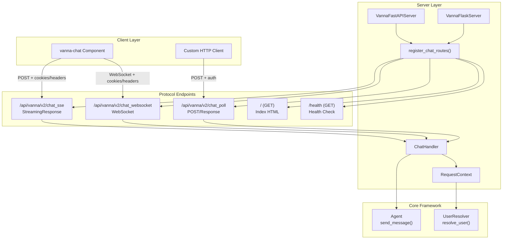
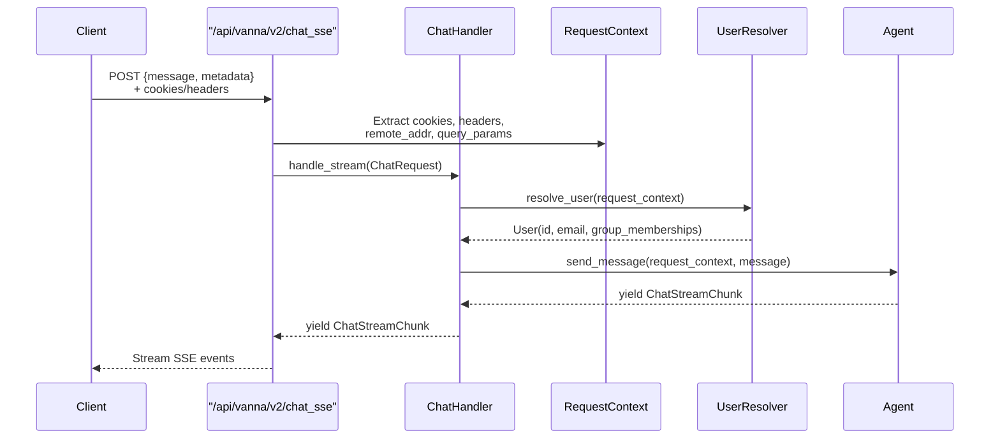
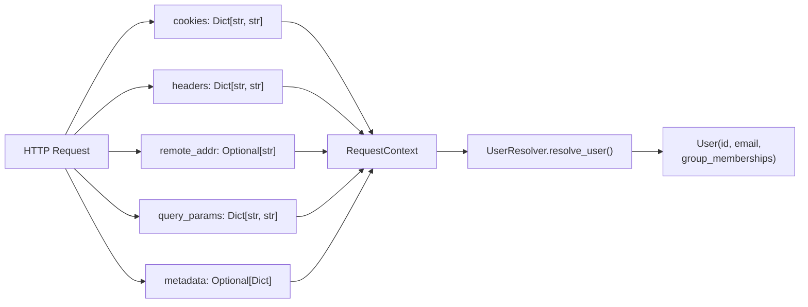
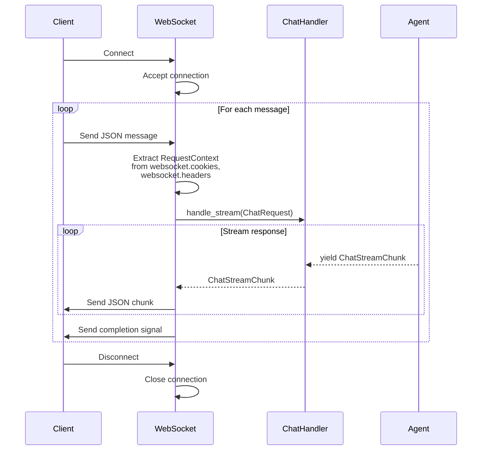
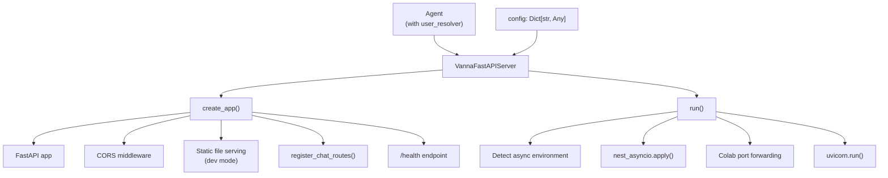
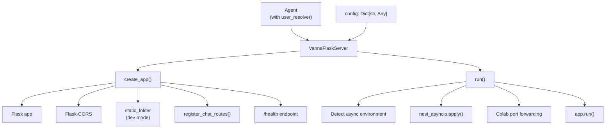
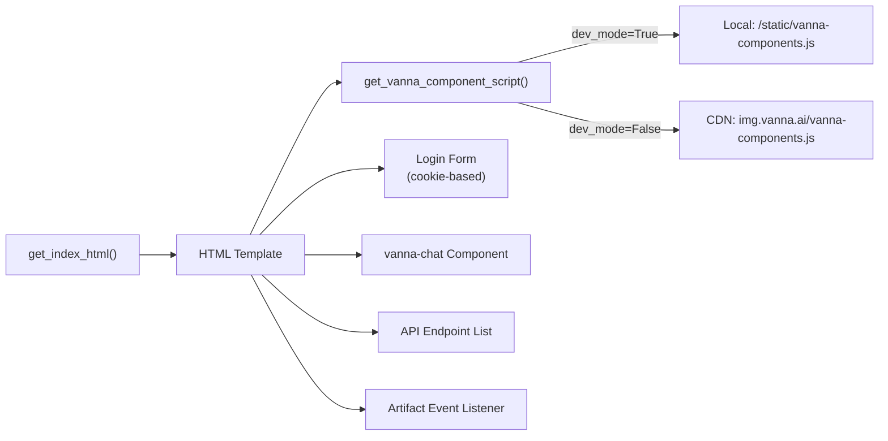
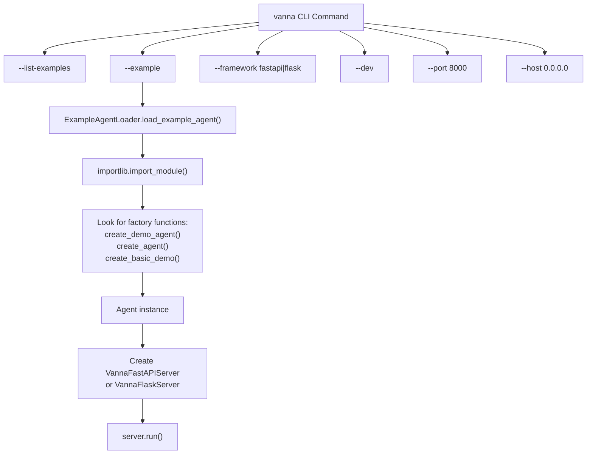
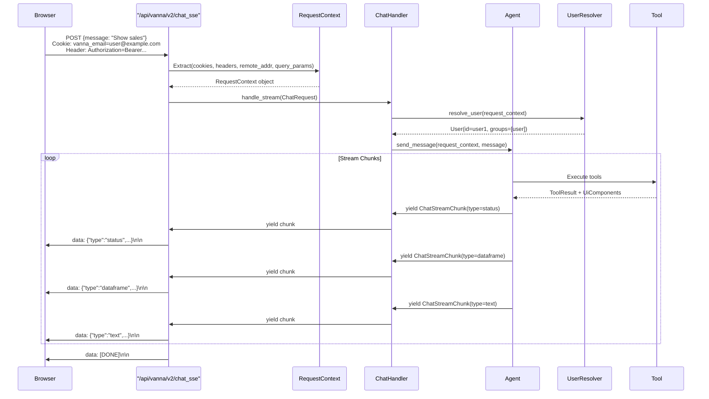

<!-- source: DeepWiki mcp.deepwiki.com · repo vanna-ai/vanna · page 8.1 Server Architecture · fetched 2026-10-29 -->

# Server Architecture

<details>
<summary>Relevant source files</summary>

The following files were used as context for generating this wiki page:

- [MIGRATION_GUIDE.md](MIGRATION_GUIDE.md)
- [README.md](README.md)
- [img/architecture.png](img/architecture.png)
- [img/vanna2.svg](img/vanna2.svg)
- [notebooks/quickstart.ipynb](notebooks/quickstart.ipynb)
- [src/vanna/integrations/anthropic/llm.py](src/vanna/integrations/anthropic/llm.py)
- [src/vanna/integrations/openai/llm.py](src/vanna/integrations/openai/llm.py)
- [src/vanna/servers/__init__.py](src/vanna/servers/__init__.py)
- [src/vanna/servers/base/templates.py](src/vanna/servers/base/templates.py)
- [src/vanna/servers/cli/server_runner.py](src/vanna/servers/cli/server_runner.py)
- [src/vanna/servers/fastapi/app.py](src/vanna/servers/fastapi/app.py)
- [src/vanna/servers/fastapi/routes.py](src/vanna/servers/fastapi/routes.py)
- [src/vanna/servers/flask/app.py](src/vanna/servers/flask/app.py)
- [src/vanna/servers/flask/routes.py](src/vanna/servers/flask/routes.py)

</details>


This document describes the server layer that exposes Vanna agents as web services. The server layer translates HTTP requests into agent interactions and streams responses back to clients. For information about the agent system itself, see [Agent System](#2.1). For details on web component integration, see [Web Component Integration](#8.6).

## Purpose and Components

The server architecture provides production-ready HTTP endpoints for interacting with Vanna agents through multiple communication protocols. It consists of:

1. **ChatHandler** - Bridge between HTTP requests and agent execution
2. **RequestContext** - Extraction of authentication and metadata from HTTP requests
3. **Communication Protocols** - SSE, WebSocket, and Polling endpoints
4. **Server Implementations** - FastAPI and Flask server factories
5. **CLI Runner** - Command-line interface for launching servers with example agents

**Sources**: [src/vanna/servers/__init__.py:1-16](), [README.md:115-199]()

## Server Layer Architecture



The server layer acts as an adapter between HTTP/WebSocket protocols and the core agent framework. `VannaFastAPIServer` and `VannaFlaskServer` create configured applications, while `register_chat_routes()` installs the actual endpoint handlers.

**Sources**: [src/vanna/servers/fastapi/app.py:1-164](), [src/vanna/servers/flask/app.py:1-133](), [src/vanna/servers/fastapi/routes.py:17-184]()

## ChatHandler and Request Flow



The `ChatHandler` class bridges the HTTP server and the agent. It:
- Accepts `ChatRequest` objects containing message and metadata
- Delegates to `agent.send_message()` for processing
- Streams `ChatStreamChunk` objects back to clients

**Sources**: [src/vanna/servers/base/__init__.py](), [src/vanna/servers/fastapi/routes.py:40-80]()

## RequestContext Extraction

The `RequestContext` object extracts authentication and metadata from HTTP requests:



Each endpoint extracts `RequestContext` before invoking `ChatHandler`:

**FastAPI SSE Endpoint** [src/vanna/servers/fastapi/routes.py:40-52]():
```python
chat_request.request_context = RequestContext(
    cookies=dict(http_request.cookies),
    headers=dict(http_request.headers),
    remote_addr=http_request.client.host if http_request.client else None,
    query_params=dict(http_request.query_params),
    metadata=chat_request.metadata,
)
```

**Flask SSE Endpoint** [src/vanna/servers/flask/routes.py:49-54]():
```python
data["request_context"] = RequestContext(
    cookies=dict(request.cookies),
    headers=dict(request.headers),
    remote_addr=request.remote_addr,
    query_params=dict(request.args),
)
```

This uniform extraction pattern ensures that authentication information (cookies, JWT headers, etc.) flows consistently to the `UserResolver` regardless of framework.

**Sources**: [src/vanna/servers/fastapi/routes.py:46-52](), [src/vanna/servers/flask/routes.py:49-54](), [src/vanna/core/user/request_context.py]()

## Communication Protocols

The server layer supports three communication protocols for different client requirements:

| Protocol | Endpoint | Use Case | Implementation |
|----------|----------|----------|----------------|
| **Server-Sent Events (SSE)** | `POST /api/vanna/v2/chat_sse` | Browser-based streaming, unidirectional | [src/vanna/servers/fastapi/routes.py:40-80]() |
| **WebSocket** | `/api/vanna/v2/chat_websocket` | Bidirectional real-time communication | [src/vanna/servers/fastapi/routes.py:82-161]() |
| **Polling** | `POST /api/vanna/v2/chat_poll` | Simple request/response, no streaming | [src/vanna/servers/fastapi/routes.py:163-183]() |

### Server-Sent Events (SSE)

SSE streams responses as text/event-stream with `data:` prefixed JSON chunks:

**FastAPI Implementation** [src/vanna/servers/fastapi/routes.py:54-80]():
```python
async def generate() -> AsyncGenerator[str, None]:
    try:
        async for chunk in chat_handler.handle_stream(chat_request):
            chunk_json = chunk.model_dump_json()
            yield f"data: {chunk_json}\n\n"
        yield "data: [DONE]\n\n"
    except Exception as e:
        error_data = {"type": "error", "data": {"message": str(e)}, ...}
        yield f"data: {json.dumps(error_data)}\n\n"

return StreamingResponse(
    generate(),
    media_type="text/event-stream",
    headers={
        "Cache-Control": "no-cache",
        "Connection": "keep-alive",
        "X-Accel-Buffering": "no",  # Disable nginx buffering
    },
)
```

The `X-Accel-Buffering: no` header ensures that nginx does not buffer the stream, enabling true real-time streaming.

**Flask Implementation** [src/vanna/servers/flask/routes.py:62-92]():
Flask requires an event loop wrapper since it's synchronous:
```python
def generate() -> Generator[str, None, None]:
    loop = asyncio.new_event_loop()
    asyncio.set_event_loop(loop)
    try:
        async def async_generate() -> AsyncGenerator[str, None]:
            async for chunk in chat_handler.handle_stream(chat_request):
                chunk_json = chunk.model_dump_json()
                yield f"data: {chunk_json}\n\n"
        
        gen = async_generate()
        try:
            while True:
                chunk = loop.run_until_complete(gen.__anext__())
                yield chunk
        except StopAsyncIteration:
            yield "data: [DONE]\n\n"
    finally:
        loop.close()
```

**Sources**: [src/vanna/servers/fastapi/routes.py:40-80](), [src/vanna/servers/flask/routes.py:40-92]()

### WebSocket Protocol

WebSocket enables bidirectional communication. The FastAPI implementation [src/vanna/servers/fastapi/routes.py:82-161]():



Key implementation details [src/vanna/servers/fastapi/routes.py:82-161]():
- Uses `await websocket.accept()` to establish connection
- Extracts `RequestContext` from `websocket.cookies`, `websocket.headers`, `websocket.client.host`, `websocket.query_params`
- Streams chunks via `await websocket.send_json(chunk.model_dump())`
- Sends completion signal: `{"type": "completion", "data": {"status": "done"}}`
- Handles `WebSocketDisconnect` gracefully

**Note**: Flask does not implement WebSocket natively. [src/vanna/servers/flask/routes.py:94-102]() returns HTTP 501 with a suggestion to use Flask-SocketIO.

**Sources**: [src/vanna/servers/fastapi/routes.py:82-161](), [src/vanna/servers/flask/routes.py:94-102]()

### Polling Protocol

Polling provides a simple request/response pattern without streaming:

**FastAPI Implementation** [src/vanna/servers/fastapi/routes.py:163-183]():
```python
@app.post("/api/vanna/v2/chat_poll")
async def chat_poll(
    chat_request: ChatRequest, http_request: Request
) -> ChatResponse:
    chat_request.request_context = RequestContext(
        cookies=dict(http_request.cookies),
        headers=dict(http_request.headers),
        remote_addr=http_request.client.host if http_request.client else None,
        query_params=dict(http_request.query_params),
        metadata=chat_request.metadata,
    )
    
    try:
        result = await chat_handler.handle_poll(chat_request)
        return result
    except Exception as e:
        raise HTTPException(status_code=500, detail=f"Chat failed: {str(e)}")
```

The `handle_poll()` method collects all stream chunks and returns a single `ChatResponse` object. This is useful for:
- Simple REST API clients
- Testing and debugging
- Environments where streaming is not supported

**Sources**: [src/vanna/servers/fastapi/routes.py:163-183](), [src/vanna/servers/flask/routes.py:104-137]()

## Server Factory Classes

### VannaFastAPIServer

The `VannaFastAPIServer` class provides a factory pattern for creating configured FastAPI applications:



**Key Methods** [src/vanna/servers/fastapi/app.py:16-164]():

| Method | Purpose | Configuration |
|--------|---------|---------------|
| `__init__(agent, config)` | Initialize with agent and optional config | `config` dict for server settings |
| `create_app()` | Create configured FastAPI app | Returns `FastAPI` instance |
| `run(**kwargs)` | Run server with auto-detection of async environments | Kwargs passed to `uvicorn.run()` |

**Configuration Options** [src/vanna/servers/fastapi/app.py:30-80]():

```python
config = {
    "fastapi": {  # Passed to FastAPI()
        "title": "Vanna Agents API",
        "description": "API server for Vanna Agents framework",
        "version": "0.1.0"
    },
    "cors": {  # CORS middleware settings
        "enabled": True,
        "allow_origins": ["*"],
        "allow_credentials": True,
        "allow_methods": ["*"],
        "allow_headers": ["*"]
    },
    "dev_mode": False,  # Enable local static file serving
    "static_folder": "static",  # Path to static assets
    "cdn_url": "https://img.vanna.ai/vanna-components.js",
    "api_base_url": ""  # Base URL for API endpoints
}
```

**Async Environment Detection** [src/vanna/servers/fastapi/app.py:82-164]():

The `run()` method automatically handles async environments (Jupyter, Colab, IPython):
1. Detects existing event loop via `asyncio.get_running_loop()`
2. Applies `nest_asyncio` to allow nested loops
3. Detects Google Colab and sets up port forwarding via `google.colab.output.serve_kernel_port_as_window()`
4. Uses `uvicorn.Config` with `loop="asyncio"` for Jupyter environments

**Sources**: [src/vanna/servers/fastapi/app.py:1-164]()

### VannaFlaskServer

The `VannaFlaskServer` provides similar functionality using Flask:



**Key Differences from FastAPI**:
- Uses Flask's `app.run()` instead of uvicorn
- WebSocket endpoint returns HTTP 501 (not implemented) [src/vanna/servers/flask/routes.py:94-102]()
- SSE implementation wraps async generators with `asyncio.new_event_loop()` [src/vanna/servers/flask/routes.py:62-82]()
- Static files served via Flask's built-in `static_folder` parameter

**Configuration** [src/vanna/servers/flask/app.py:30-58]():
```python
config = {
    "flask": {},  # Passed to app.config.update()
    "cors": {  # Flask-CORS settings
        "enabled": True
    },
    "dev_mode": False,
    "static_folder": "static",
    "cdn_url": "https://img.vanna.ai/vanna-components.js",
    "api_base_url": ""
}
```

**Sources**: [src/vanna/servers/flask/app.py:1-133](), [src/vanna/servers/flask/routes.py:1-138]()

## Template System and Index Page

The server serves an index HTML page with embedded `<vanna-chat>` web component:



**Template Configuration** [src/vanna/servers/base/templates.py:31-131]():

| Parameter | Default | Purpose |
|-----------|---------|---------|
| `dev_mode` | `False` | Load components from local static files vs CDN |
| `static_path` | `"/static"` | Path to local static assets |
| `cdn_url` | `"https://img.vanna.ai/vanna-components.js"` | CDN URL for web components |
| `api_base_url` | `""` | Base URL for API endpoints (empty = relative) |

**Cookie-Based Authentication Demo** [src/vanna/servers/base/templates.py:150-176]():

The template includes a demo login form that stores the user's email in a `vanna_email` cookie. This is used by example `UserResolver` implementations:

```javascript
// Set cookie
const setCookie = (name, value) => {
    const expires = new Date(Date.now() + 365 * 864e5).toUTCString();
    document.cookie = `${name}=${value}; expires=${expires}; path=/; SameSite=Lax`;
};
```

This demonstrates how authentication works but should be replaced with a real authentication system in production.

**Artifact Handling** [src/vanna/servers/base/templates.py:277-307]():

The template includes an event listener for the `artifact-opened` event from the `vanna-chat` component, demonstrating external artifact rendering:

```javascript
vannaChat.addEventListener('artifact-opened', (event) => {
    const { artifactId, type, title, trigger } = event.detail;
    
    // Open artifact in new window
    const newWindow = window.open('', '_blank', 'width=900,height=700');
    newWindow.document.write(event.detail.getStandaloneHTML());
    newWindow.document.close();
    
    // Prevent default in-chat rendering
    event.detail.preventDefault();
});
```

**Sources**: [src/vanna/servers/base/templates.py:1-332]()

## CLI Server Runner

The `ExampleAgentLoader` and CLI provide a convenient way to run example agents:



**Available Examples** [src/vanna/servers/cli/server_runner.py:18-31]():

| Example Name | Description |
|--------------|-------------|
| `mock_quickstart` | Basic agent with mock LLM service |
| `anthropic_quickstart` | Agent configured for Anthropic's Claude API |
| `openai_quickstart` | Agent configured for OpenAI's GPT models |
| `mock_custom_tool` | Agent with custom tool demonstration |
| `mock_quota_example` | Agent with usage quota management |
| `mock_rich_components_demo` | Rich components demonstration |
| `coding_agent_example` | Coding agent with file system tools |
| `email_auth_example` | Email-based authentication demonstration |
| `claude_sqlite_example` | Claude agent with SQLite database |
| `mock_sqlite_example` | Mock agent with SQLite database |

**CLI Usage**:
```bash
# List available examples
vanna --list-examples

# Run an example with FastAPI
vanna --framework fastapi --example claude_sqlite_example --port 8000

# Run in development mode with local static assets
vanna --framework fastapi --dev --static-folder ./frontend/static --port 8000

# Run with custom config
vanna --framework flask --config config.json --port 5000
```

**Example Agent Loading** [src/vanna/servers/cli/server_runner.py:34-71]():

The loader uses `importlib.import_module()` to dynamically load example modules from `vanna.examples.<name>`, then searches for factory functions in this order:
1. `create_demo_agent()`
2. `create_agent()`
3. `create_basic_demo()`

If no factory function is found, it looks for a `main_agent` module-level instance.

**Sources**: [src/vanna/servers/cli/server_runner.py:1-205]()

## Integration Patterns

### Basic Integration with Existing FastAPI App

```python
from fastapi import FastAPI
from vanna import Agent
from vanna.servers.fastapi.routes import register_chat_routes
from vanna.servers.base import ChatHandler

# Your existing FastAPI app
app = FastAPI()

# Create agent (see Agent System documentation)
agent = create_my_agent()

# Register Vanna chat routes
chat_handler = ChatHandler(agent)
register_chat_routes(app, chat_handler)

# Your existing routes continue to work
@app.get("/my-endpoint")
async def my_endpoint():
    return {"message": "Hello"}
```

This pattern is shown in [README.md:143-199]().

**Sources**: [README.md:143-199](), [src/vanna/servers/fastapi/routes.py:17-27]()

### Standalone Server with Quickstart

The quickstart notebook demonstrates the standalone server pattern [notebooks/quickstart.ipynb:1-170]():

```python
from vanna import Agent, AgentConfig
from vanna.servers.fastapi import VannaFastAPIServer
from vanna.core.user import UserResolver, User, RequestContext

# Define user resolver
class SimpleUserResolver(UserResolver):
    async def resolve_user(self, request_context: RequestContext) -> User:
        user_email = request_context.get_cookie('vanna_email')
        if user_email == "admin@example.com":
            return User(id="admin1", email=user_email, group_memberships=['admin'])
        return User(id="user1", email=user_email, group_memberships=['user'])

# Create agent
agent = Agent(
    llm_service=llm,
    tool_registry=tools,
    user_resolver=SimpleUserResolver(),
)

# Create and run server
server = VannaFastAPIServer(agent)
server.run()  # Auto-detects Jupyter/Colab environment
```

**Sources**: [notebooks/quickstart.ipynb:49-138]()

### Configuration for Production

Production deployments should use proper configuration:

```python
config = {
    "fastapi": {
        "title": "Production Vanna API",
        "version": "1.0.0",
        "docs_url": None,  # Disable docs in production
    },
    "cors": {
        "enabled": True,
        "allow_origins": ["https://yourdomain.com"],
        "allow_credentials": True,
        "allow_methods": ["GET", "POST"],
        "allow_headers": ["Authorization", "Content-Type"],
    },
    "dev_mode": False,
    "cdn_url": "https://cdn.yourdomain.com/vanna-components.js",
    "api_base_url": "https://api.yourdomain.com",
}

server = VannaFastAPIServer(agent, config=config)
app = server.create_app()

# Deploy with:
# uvicorn main:app --host 0.0.0.0 --port 8000 --workers 4
```

**Security Considerations**:
1. Disable API docs (`docs_url=None`) in production
2. Restrict CORS origins to your domain
3. Use proper authentication (JWT, OAuth) instead of cookie-based demo
4. Run behind a reverse proxy (nginx, Traefik) for SSL/TLS
5. Set `X-Accel-Buffering: no` in nginx config for SSE streaming

**Sources**: [src/vanna/servers/fastapi/app.py:30-80](), [src/vanna/servers/fastapi/routes.py:76-79]()

## Request/Response Flow Summary



The complete flow demonstrates:
1. **Request Extraction**: HTTP metadata → `RequestContext`
2. **User Resolution**: `RequestContext` → `User` (via `UserResolver`)
3. **Agent Execution**: User-aware message processing with tool execution
4. **Response Streaming**: Progressive UI component delivery via SSE

**Sources**: [src/vanna/servers/fastapi/routes.py:40-80](), [src/vanna/servers/base/__init__.py]()

---

