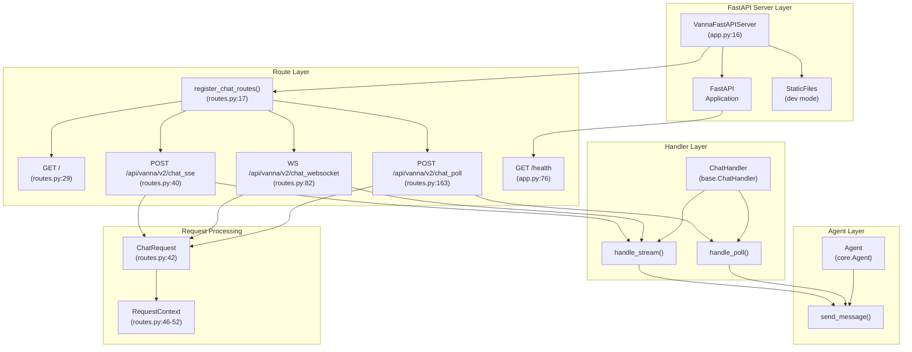
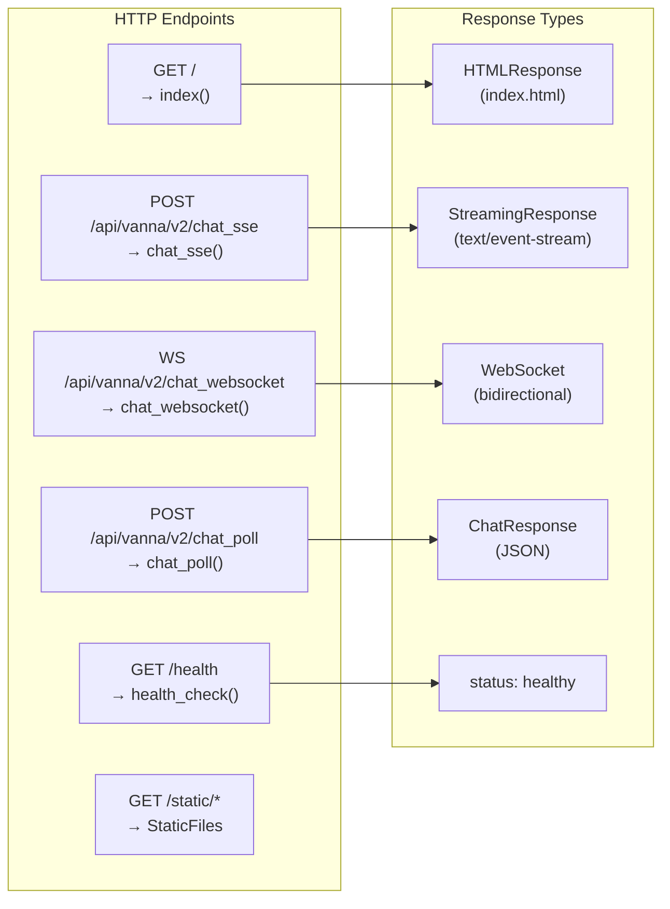
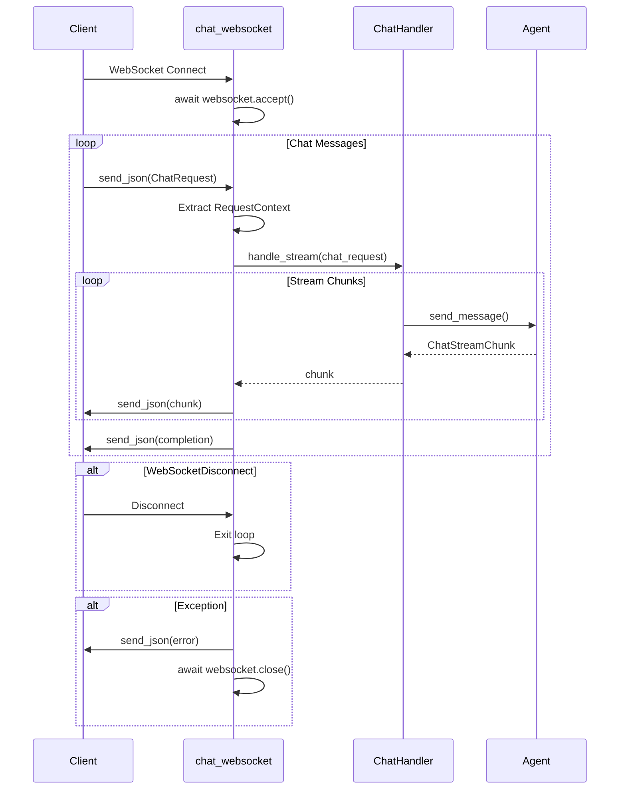
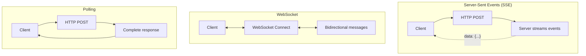
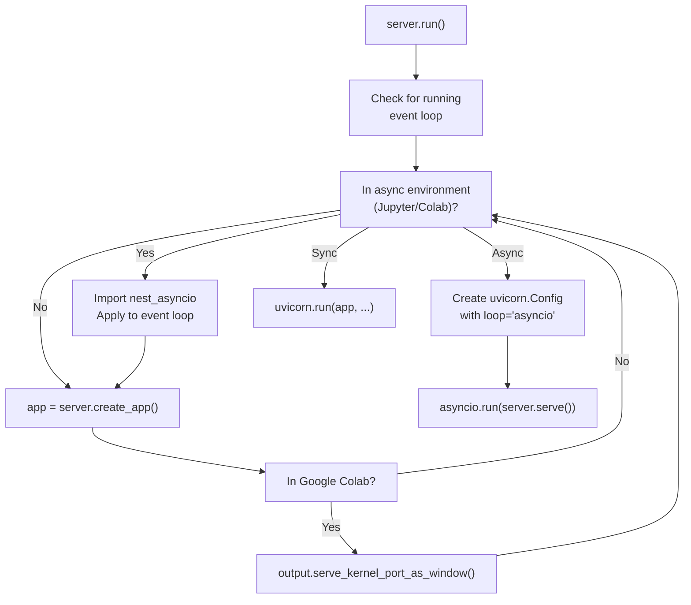

<!-- source: DeepWiki mcp.deepwiki.com · repo vanna-ai/vanna · page 8.2 FastAPI Server · fetched 2026-10-29 -->

# FastAPI Server

<details>
<summary>Relevant source files</summary>

The following files were used as context for generating this wiki page:

- [src/vanna/servers/__init__.py](src/vanna/servers/__init__.py)
- [src/vanna/servers/base/templates.py](src/vanna/servers/base/templates.py)
- [src/vanna/servers/cli/server_runner.py](src/vanna/servers/cli/server_runner.py)
- [src/vanna/servers/fastapi/routes.py](src/vanna/servers/fastapi/routes.py)
- [src/vanna/servers/flask/routes.py](src/vanna/servers/flask/routes.py)

</details>


The FastAPI Server provides a production-ready HTTP interface for serving Vanna Agents with support for Server-Sent Events (SSE), WebSocket, and polling endpoints. It integrates with the `<vanna-chat>` web component to provide a complete chat interface.

For information about the Flask server implementation, see [Flask Server](#5.2). For details about the web component integration, see [Web Component Integration](#5.3). For CLI usage with example agents, see [CLI and Example Agents](#5.4).

---

## Overview

The FastAPI server implementation consists of three main components:

1. **VannaFastAPIServer** - Factory class that creates and configures the FastAPI application
2. **Route Registration** - Endpoints for chat, health checks, and static file serving
3. **ChatHandler** - Adapter that bridges HTTP requests to Agent execution

The server automatically handles async environments (Jupyter, Colab) and provides multiple communication protocols for different use cases.

### Core Architecture



**Sources:** [src/vanna/servers/fastapi/app.py:1-164](), [src/vanna/servers/fastapi/routes.py:1-184]()

---

## VannaFastAPIServer Class

The `VannaFastAPIServer` class is defined in [src/vanna/servers/fastapi/app.py:16-164]() and provides a factory for creating configured FastAPI applications.

### Initialization

```python
VannaFastAPIServer(agent: Agent, config: Optional[Dict[str, Any]] = None)
```

**Parameters:**
- `agent`: The Agent instance to serve (must have `user_resolver` configured)
- `config`: Optional configuration dictionary

The constructor creates a `ChatHandler` instance that wraps the agent and handles HTTP request/response translation.

**Sources:** [src/vanna/servers/fastapi/app.py:19-28]()

### Configuration Options

The `config` dictionary supports the following keys:

| Key | Type | Description | Default |
|-----|------|-------------|---------|
| `dev_mode` | bool | Load web components from local static files | `False` |
| `static_folder` | str | Path to static assets in dev mode | `"static"` |
| `cdn_url` | str | CDN URL for web components | `"https://img.vanna.ai/vanna-components.js"` |
| `api_base_url` | str | Base URL for API endpoints | `""` |
| `fastapi` | dict | Additional FastAPI constructor arguments | `{}` |
| `cors.enabled` | bool | Enable CORS middleware | `True` |
| `cors.allow_origins` | list | Allowed origins | `["*"]` |
| `cors.allow_credentials` | bool | Allow credentials | `True` |
| `cors.allow_methods` | list | Allowed HTTP methods | `["*"]` |
| `cors.allow_headers` | list | Allowed headers | `["*"]` |

**Sources:** [src/vanna/servers/fastapi/app.py:30-80]()

---

## Route Endpoints

The server exposes the following HTTP endpoints, registered by `register_chat_routes()`:



**Sources:** [src/vanna/servers/fastapi/routes.py:17-184](), [src/vanna/servers/fastapi/app.py:76-78]()

### GET / - Index Page

Returns the HTML chat interface with embedded `<vanna-chat>` web component.

**Implementation:** [src/vanna/servers/fastapi/routes.py:29-38]()

**Response:** HTML page generated by `get_index_html()` from [src/vanna/servers/base/templates.py:31-328]()

The index page includes:
- Login form with email selection (demo authentication via cookies)
- `<vanna-chat>` web component configured with API endpoints
- Tailwind CSS styling with Vanna brand colors
- API endpoint documentation
- Artifact event listeners for external rendering

### POST /api/vanna/v2/chat_sse - Server-Sent Events

Streams chat responses as Server-Sent Events for real-time updates.

**Request Body:** JSON matching `ChatRequest` schema
**Response:** `text/event-stream` with chunked SSE data

**Key Implementation Details:**

1. **Request Context Extraction** [src/vanna/servers/fastapi/routes.py:46-52]():
   ```python
   chat_request.request_context = RequestContext(
       cookies=dict(http_request.cookies),
       headers=dict(http_request.headers),
       remote_addr=http_request.client.host,
       query_params=dict(http_request.query_params),
       metadata=chat_request.metadata,
   )
   ```

2. **SSE Stream Generation** [src/vanna/servers/fastapi/routes.py:54-70]():
   - Yields `data: {chunk_json}\n\n` for each chunk
   - Sends `data: [DONE]\n\n` on completion
   - Sends error events with type `"error"` on exceptions

3. **Response Headers** [src/vanna/servers/fastapi/routes.py:75-79]():
   - `Cache-Control: no-cache`
   - `Connection: keep-alive`
   - `X-Accel-Buffering: no` (disables nginx buffering)

**Sources:** [src/vanna/servers/fastapi/routes.py:40-80]()

### WS /api/vanna/v2/chat_websocket - WebSocket

Provides bidirectional WebSocket communication for real-time chat.

**Connection Flow:**



**Key Implementation Details:**

1. **Connection Lifecycle** [src/vanna/servers/fastapi/routes.py:82-161]():
   - Accepts connection with `await websocket.accept()`
   - Maintains persistent connection in `while True` loop
   - Handles `WebSocketDisconnect` exceptions gracefully

2. **Request Context from WebSocket** [src/vanna/servers/fastapi/routes.py:95-101]():
   - Extracts cookies, headers from `websocket.cookies` and `websocket.headers`
   - Uses `websocket.client.host` for remote address
   - Includes query parameters from `websocket.query_params`

3. **Completion Signal** [src/vanna/servers/fastapi/routes.py:121-132]():
   - Sends `{"type": "completion", "data": {"status": "done"}}` after streaming completes

**Sources:** [src/vanna/servers/fastapi/routes.py:82-161]()

### POST /api/vanna/v2/chat_poll - Polling

Synchronous request-response endpoint for simple polling-based chat.

**Request Body:** JSON matching `ChatRequest` schema  
**Response:** JSON matching `ChatResponse` schema

**Implementation:** [src/vanna/servers/fastapi/routes.py:163-183]()

This endpoint:
- Extracts `RequestContext` from HTTP request
- Calls `chat_handler.handle_poll()` which waits for complete response
- Returns all UI components in a single JSON response
- Raises `HTTPException(status_code=500)` on errors

**Sources:** [src/vanna/servers/fastapi/routes.py:163-183]()

### GET /health - Health Check

Simple health check endpoint for load balancers and monitoring.

**Response:** `{"status": "healthy", "service": "vanna"}`

**Implementation:** [src/vanna/servers/fastapi/app.py:76-78]()

**Sources:** [src/vanna/servers/fastapi/app.py:76-78]()

---

## Communication Protocols

The server supports three communication protocols to accommodate different client requirements:

| Protocol | Use Case | Latency | Complexity | Browser Support |
|----------|----------|---------|------------|----------------|
| **Server-Sent Events** | Web apps, real-time streaming | Low | Medium | Excellent (native) |
| **WebSocket** | Interactive chat, bidirectional | Lowest | High | Excellent (native) |
| **Polling** | Simple clients, testing | High | Low | Universal |

### Protocol Comparison



**Sources:** [src/vanna/servers/fastapi/routes.py:40-183]()

---

## Creating and Running the Server

### Basic Usage

```python
from vanna import Agent
from vanna.servers.fastapi import VannaFastAPIServer

# Create agent (see Agent Core documentation)
agent = Agent(...)

# Create server
server = VannaFastAPIServer(agent)

# Run server
server.run(host='0.0.0.0', port=8000)
```

**Sources:** [notebooks/quickstart.ipynb:122-136]()

### Advanced Configuration

```python
from vanna.servers.fastapi import VannaFastAPIServer

config = {
    "dev_mode": True,
    "static_folder": "frontend/webcomponent/static",
    "cdn_url": "https://img.vanna.ai/vanna-components.js",
    "api_base_url": "",
    "cors": {
        "enabled": True,
        "allow_origins": ["https://example.com"],
        "allow_credentials": True,
    },
    "fastapi": {
        "title": "My Vanna API",
        "version": "1.0.0",
    }
}

server = VannaFastAPIServer(agent, config=config)
app = server.create_app()

# Run with uvicorn
# uvicorn main:app --host 0.0.0.0 --port 8000
```

**Sources:** [src/vanna/servers/fastapi/app.py:30-80]()

### The run() Method

The `run()` method in [src/vanna/servers/fastapi/app.py:82-163]() automatically handles different execution environments:



**Key Features:**

1. **Async Environment Detection** [src/vanna/servers/fastapi/app.py:99-104]():
   - Checks for running event loop with `asyncio.get_running_loop()`
   - Detects Jupyter, Colab, IPython environments

2. **nest_asyncio Handling** [src/vanna/servers/fastapi/app.py:107-121]():
   - Automatically installs if missing
   - Applies before creating the app to allow nested event loops

3. **Google Colab Port Forwarding** [src/vanna/servers/fastapi/app.py:135-148]():
   - Calls `output.serve_kernel_port_as_window(port)`
   - Displays the proxied URL with `eval_js()`

4. **Uvicorn Configuration** [src/vanna/servers/fastapi/app.py:153-163]():
   - Uses `loop="asyncio"` for async environments
   - Creates `uvicorn.Server` with config and runs with `asyncio.run()`
   - Direct `uvicorn.run()` for normal execution

**Sources:** [src/vanna/servers/fastapi/app.py:82-163]()

---

## Static File Serving

In development mode, the server mounts a `StaticFiles` instance to serve local web component assets.

**Implementation:** [src/vanna/servers/fastapi/app.py:58-70]()

```python
dev_mode = self.config.get("dev_mode", False)
if dev_mode:
    static_folder = self.config.get("static_folder", "static")
    if os.path.exists(static_folder):
        app.mount("/static", StaticFiles(directory=static_folder), name="static")
```

**Static File Loading Logic:**

| Mode | `dev_mode` | Script Source | Use Case |
|------|------------|---------------|----------|
| Production | `False` | CDN URL | Deployed servers |
| Development | `True` | `/static/vanna-components.js` | Local development |

The HTML template in [src/vanna/servers/base/templates.py:8-28]() uses `get_vanna_component_script()` to generate the appropriate `<script>` tag.

**Sources:** [src/vanna/servers/fastapi/app.py:58-70](), [src/vanna/servers/base/templates.py:8-28]()

---

## CORS Configuration

The server includes CORS middleware configuration for cross-origin requests.

**Default CORS Settings** [src/vanna/servers/fastapi/app.py:45-56]():

```python
cors_config = {
    "enabled": True,
    "allow_origins": ["*"],
    "allow_credentials": True,
    "allow_methods": ["*"],
    "allow_headers": ["*"],
}
```

The middleware is applied via `app.add_middleware(CORSMiddleware, **cors_params)`.

**Production Recommendation:** Override `allow_origins` with specific domains:

```python
config = {
    "cors": {
        "enabled": True,
        "allow_origins": ["https://yourapp.com"],
        "allow_credentials": True,
    }
}
```

**Sources:** [src/vanna/servers/fastapi/app.py:45-56]()

---

## Integration with Web Component

The FastAPI server is designed to work seamlessly with the `<vanna-chat>` web component defined in the index HTML.

### Web Component Configuration

The HTML page in [src/vanna/servers/base/templates.py:189-196]() embeds the web component with endpoint configuration:

```html
<vanna-chat
    api-base="{api_base_url}"
    sse-endpoint="{api_base_url}/api/vanna/v2/chat_sse"
    ws-endpoint="{api_base_url}/api/vanna/v2/chat_websocket"
    poll-endpoint="{api_base_url}/api/vanna/v2/chat_poll">
</vanna-chat>
```

### Authentication Flow

The demo implementation uses cookie-based authentication:

1. **Login Form** [src/vanna/servers/base/templates.py:149-176]():
   - User selects email from dropdown
   - JavaScript sets `vanna_email` cookie
   - Cookie persists for 365 days

2. **Request Context Extraction** [src/vanna/servers/fastapi/routes.py:46-52]():
   - Server reads `vanna_email` from cookies
   - Creates `RequestContext` with cookies, headers, remote address
   - Passes to `UserResolver.resolve_user()`

3. **User Resolution** [notebooks/quickstart.ipynb:81-93]():
   - Custom `UserResolver` validates cookie
   - Returns `User` object with group memberships
   - Used for tool access control

**Sources:** [src/vanna/servers/base/templates.py:149-196](), [src/vanna/servers/fastapi/routes.py:46-52](), [notebooks/quickstart.ipynb:81-93]()

---

## RequestContext Construction

The `RequestContext` class captures HTTP request metadata for user resolution. Each endpoint constructs it slightly differently:

### SSE Endpoint

[src/vanna/servers/fastapi/routes.py:46-52]()

```python
chat_request.request_context = RequestContext(
    cookies=dict(http_request.cookies),
    headers=dict(http_request.headers),
    remote_addr=http_request.client.host if http_request.client else None,
    query_params=dict(http_request.query_params),
    metadata=chat_request.metadata,
)
```

### WebSocket Endpoint

[src/vanna/servers/fastapi/routes.py:95-101]()

```python
data["request_context"] = RequestContext(
    cookies=dict(websocket.cookies),
    headers=dict(websocket.headers),
    remote_addr=websocket.client.host if websocket.client else None,
    query_params=dict(websocket.query_params),
    metadata=metadata,
)
```

### Polling Endpoint

[src/vanna/servers/fastapi/routes.py:169-175]()

```python
chat_request.request_context = RequestContext(
    cookies=dict(http_request.cookies),
    headers=dict(http_request.headers),
    remote_addr=http_request.client.host if http_request.client else None,
    query_params=dict(http_request.query_params),
    metadata=chat_request.metadata,
)
```

The `RequestContext` is then passed to `UserResolver.resolve_user()` by the `ChatHandler` to determine the user's identity and permissions.

**Sources:** [src/vanna/servers/fastapi/routes.py:46-52](), [src/vanna/servers/fastapi/routes.py:95-101](), [src/vanna/servers/fastapi/routes.py:169-175]()

---

## Error Handling

All endpoints implement comprehensive error handling:

### SSE Error Streaming

[src/vanna/servers/fastapi/routes.py:61-70]()

Errors are sent as SSE events:
```python
error_data = {
    "type": "error",
    "data": {"message": str(e)},
    "conversation_id": chat_request.conversation_id or "",
    "request_id": chat_request.request_id or "",
}
yield f"data: {json.dumps(error_data)}\n\n"
```

### WebSocket Error Handling

[src/vanna/servers/fastapi/routes.py:104-160]()

Three error scenarios:
1. **Invalid Request JSON**: Sends error message, continues listening
2. **Streaming Exception**: Sends error JSON with conversation/request IDs
3. **Connection Exception**: Attempts to send error, closes WebSocket

### Polling Error Handling

[src/vanna/servers/fastapi/routes.py:177-183]()

Raises `HTTPException` with status 500:
```python
except Exception as e:
    traceback.print_stack()
    traceback.print_exc()
    raise HTTPException(status_code=500, detail=f"Chat failed: {str(e)}")
```

All endpoints print stack traces to stderr for debugging.

**Sources:** [src/vanna/servers/fastapi/routes.py:61-70](), [src/vanna/servers/fastapi/routes.py:104-160](), [src/vanna/servers/fastapi/routes.py:177-183]()

---

## Usage with CLI

The `vanna` CLI command can launch a FastAPI server with example agents.

**Command:**
```bash
vanna --framework fastapi --port 8000 --example claude_sqlite_example
```

**Implementation:** [src/vanna/servers/cli/server_runner.py:74-201]()

The CLI:
1. Loads the example agent with `ExampleAgentLoader.load_example_agent()`
2. Merges configuration from `--config` file and command-line options
3. Creates `VannaFastAPIServer` instance
4. Calls `server.run()` with specified host and port

**Available Options:**

| Option | Description | Default |
|--------|-------------|---------|
| `--framework` | Server framework (fastapi or flask) | `fastapi` |
| `--port` | Port to bind to | `8000` |
| `--host` | Host to bind to | `0.0.0.0` |
| `--example` | Example agent name | None |
| `--list-examples` | List available examples | - |
| `--config` | JSON config file path | None |
| `--dev` | Enable development mode | `False` |
| `--static-folder` | Static folder path | `frontend/webcomponent/static` |
| `--cdn-url` | CDN URL for components | `https://img.vanna.ai/...` |

**Sources:** [src/vanna/servers/cli/server_runner.py:74-201]()

---

## Comparison with Flask Server

The FastAPI server differs from the Flask implementation in several ways:

| Feature | FastAPI | Flask |
|---------|---------|-------|
| **WebSocket Support** | Native via `@app.websocket()` | Not implemented (suggests Flask-SocketIO) |
| **Async by Default** | Yes, `async def` handlers | No, sync handlers with event loop creation |
| **Request Handling** | `Request` and `WebSocket` objects | `request` global |
| **Response Types** | `StreamingResponse`, native WebSocket | `Response` generator |
| **API Documentation** | Auto-generated Swagger UI at `/docs` | None |
| **CORS Middleware** | `CORSMiddleware` | `flask_cors.CORS` |
| **Static Files** | `StaticFiles` mount | `Flask(static_folder=...)` |

**Key Differences:**

1. **Async Event Loop Handling**:
   - FastAPI: Applies `nest_asyncio` before creating app [src/vanna/servers/fastapi/app.py:107-121]()
   - Flask: Creates new event loop per request [src/vanna/servers/flask/routes.py:64-82]()

2. **WebSocket Implementation**:
   - FastAPI: Native support with bidirectional streaming [src/vanna/servers/fastapi/routes.py:82-161]()
   - Flask: Returns 501 Not Implemented [src/vanna/servers/flask/routes.py:94-102]()

3. **Request Context**:
   - FastAPI: Uses `http_request.client.host`, `http_request.cookies` [src/vanna/servers/fastapi/routes.py:46-52]()
   - Flask: Uses `request.remote_addr`, `request.cookies` [src/vanna/servers/flask/routes.py:49-54]()

**Sources:** [src/vanna/servers/fastapi/app.py:1-164](), [src/vanna/servers/fastapi/routes.py:1-184](), [src/vanna/servers/flask/app.py:1-133](), [src/vanna/servers/flask/routes.py:1-138]()

---

