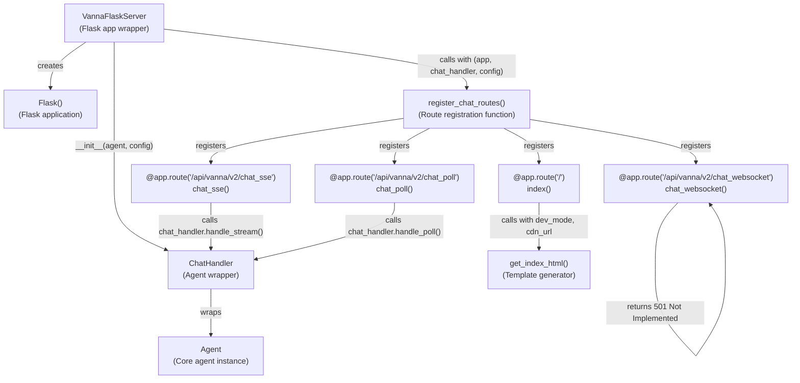
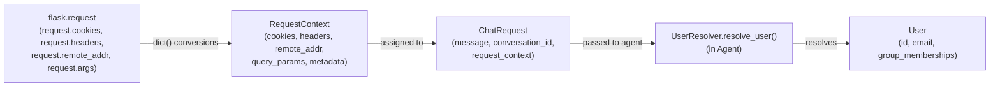
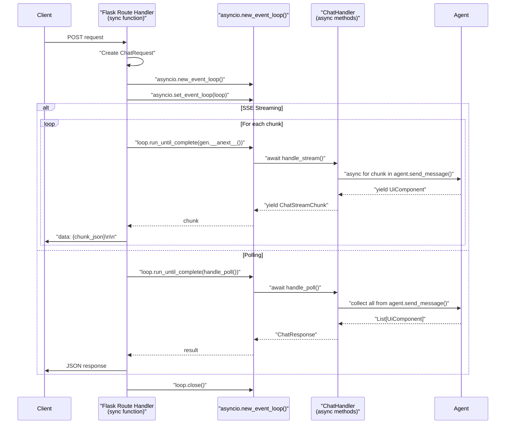
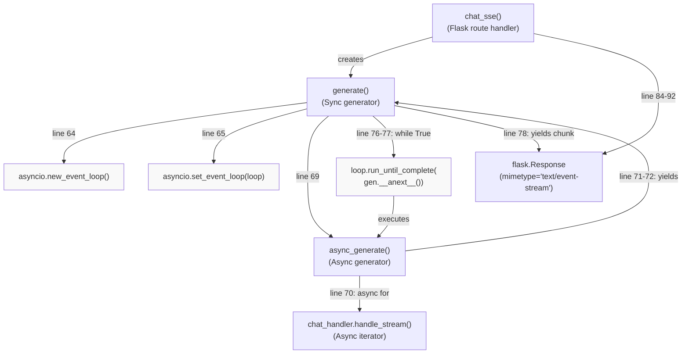
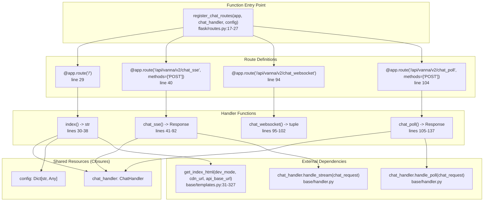

<!-- source: DeepWiki mcp.deepwiki.com · repo vanna-ai/vanna · page 8.3 Flask Server · fetched 2026-10-29 -->

# Flask Server

<details>
<summary>Relevant source files</summary>

The following files were used as context for generating this wiki page:

- [src/vanna/servers/__init__.py](src/vanna/servers/__init__.py)
- [src/vanna/servers/base/templates.py](src/vanna/servers/base/templates.py)
- [src/vanna/servers/cli/server_runner.py](src/vanna/servers/cli/server_runner.py)
- [src/vanna/servers/fastapi/routes.py](src/vanna/servers/fastapi/routes.py)
- [src/vanna/servers/flask/routes.py](src/vanna/servers/flask/routes.py)

</details>


## Purpose and Scope

The Flask Server provides a synchronous HTTP server implementation for deploying Vanna agents using the Flask web framework. It serves as an alternative to the FastAPI server ([8.2](#8.2)) for environments where async/await syntax is not required or where Flask is the preferred framework. The Flask implementation handles the same communication protocols (Server-Sent Events and polling) but uses explicit asyncio event loop management to bridge Flask's synchronous request handlers with the agent's asynchronous execution model.

For information about the underlying server architecture and `ChatHandler` abstraction, see [8.1](#8.1). For communication protocol details, see [8.4](#8.4).

**Sources:** [src/vanna/servers/flask/routes.py:1-138]()

---

## Flask Server Architecture

The Flask server implementation consists of three primary components:

| Component | File | Purpose |
|-----------|------|---------|
| `VannaFlaskServer` | `src/vanna/servers/flask/app.py` | Flask application factory and server wrapper |
| `register_chat_routes` | `src/vanna/servers/flask/routes.py` | Route registration function for chat endpoints |
| `get_index_html` | `src/vanna/servers/base/templates.py` | HTML template generation for web interface |

The Flask implementation differs from FastAPI in its handling of asynchronous operations. Since Flask route handlers are synchronous by default, the implementation creates and manages asyncio event loops explicitly within each request handler to execute the agent's asynchronous methods.

**Sources:** [src/vanna/servers/flask/routes.py:1-138](), [src/vanna/servers/__init__.py:1-17]()

---

## Route Registration Flow



The `register_chat_routes` function is called during server initialization with three parameters: the Flask app instance, a `ChatHandler` wrapping the agent, and optional configuration. It registers route handlers as closures that have access to these shared resources.

**Sources:** [src/vanna/servers/flask/routes.py:17-27]()

---

## Request Context Extraction

All Flask endpoints extract `RequestContext` from the incoming HTTP request to enable user resolution and authentication:



The context extraction pattern is identical across endpoints:

```python
data["request_context"] = RequestContext(
    cookies=dict(request.cookies),
    headers=dict(request.headers),
    remote_addr=request.remote_addr,
    query_params=dict(request.args),
)
```

**Sources:** [src/vanna/servers/flask/routes.py:49-54](), [src/vanna/servers/flask/routes.py:113-118]()

---

## Asyncio Event Loop Management

The critical Flask-specific implementation detail is explicit asyncio event loop creation and management. Since Flask route handlers are synchronous functions but `ChatHandler` methods are asynchronous, the implementation creates a new event loop for each request:



**Sources:** [src/vanna/servers/flask/routes.py:64-82](), [src/vanna/servers/flask/routes.py:126-137]()

---

## Server-Sent Events (SSE) Endpoint

The `/api/vanna/v2/chat_sse` endpoint implements streaming responses using Flask's `Response` with a generator function. The implementation creates a nested structure where an async generator is consumed by a synchronous generator using event loop iterations:

### Endpoint Definition

[src/vanna/servers/flask/routes.py:40-92]()

### Event Loop Streaming Pattern



### Key Implementation Details

1. **Event Loop Creation:** Line 64 creates a new event loop for the request
2. **Loop Assignment:** Line 65 sets it as the current event loop for the thread
3. **Async Generator:** Lines 69-72 define the async generator that yields formatted SSE messages
4. **Manual Iteration:** Lines 76-77 manually iterate the async generator using `run_until_complete(gen.__anext__())`
5. **Cleanup:** Line 82 closes the event loop in a finally block

### SSE Message Format

Each message follows the Server-Sent Events specification:

```
data: {"type":"component","data":{...},"conversation_id":"...","request_id":"..."}\n\n
```

Completion signal:

```
data: [DONE]\n\n
```

**Sources:** [src/vanna/servers/flask/routes.py:62-92]()

---

## Polling Endpoint

The `/api/vanna/v2/chat_poll` endpoint provides a request-response pattern for clients that cannot handle streaming. It collects all agent responses before returning:

### Endpoint Definition

[src/vanna/servers/flask/routes.py:104-137]()

### Event Loop Execution Pattern

```mermaid
graph LR
    chat_poll["chat_poll()<br/>(Route handler)"]
    parse_request["Parse JSON<br/>Create ChatRequest"]
    new_loop["asyncio.new_event_loop()"]
    set_loop["asyncio.set_event_loop(loop)"]
    run_complete["loop.run_until_complete(<br/>chat_handler.handle_poll())"]
    close_loop["loop.close()"]
    jsonify["jsonify(result.model_dump())"]
    
    chat_poll --> parse_request
    parse_request --> new_loop
    new_loop --> set_loop
    set_loop --> run_complete
    run_complete --> jsonify
    jsonify --> close_loop
```



The pattern is simpler than SSE because `handle_poll()` returns a single `ChatResponse` object rather than streaming chunks. The event loop is created (line 127), used to execute the async method once (line 130), and closed (line 137).

**Sources:** [src/vanna/servers/flask/routes.py:126-137]()

---

## WebSocket Endpoint (Placeholder)

The basic Flask implementation does not provide WebSocket support. The endpoint returns HTTP 501 (Not Implemented) with a suggestion to use Flask-SocketIO:

[src/vanna/servers/flask/routes.py:94-102]()

For WebSocket support, see the FastAPI server implementation ([8.2](#8.2)) or integrate Flask-SocketIO as a third-party extension.

**Sources:** [src/vanna/servers/flask/routes.py:94-102]()

---

## Index Route and Web Interface

The root endpoint serves the interactive chat interface using the shared HTML template generator:

### Route Handler

[src/vanna/servers/flask/routes.py:29-38]()

### Configuration Parameters

| Parameter | Default | Purpose |
|-----------|---------|---------|
| `dev_mode` | `False` | Load web components from local static folder instead of CDN |
| `cdn_url` | `https://img.vanna.ai/vanna-components.js` | CDN URL for production web components |
| `api_base_url` | `""` (empty string) | Base URL prefix for API endpoints (useful for proxies) |

The template generator `get_index_html()` produces a complete HTML page with:
- Embedded Tailwind CSS for styling
- Login form with cookie-based authentication
- `<vanna-chat>` web component integration
- Endpoint documentation display
- Fallback error handling for component loading failures

**Sources:** [src/vanna/servers/flask/routes.py:29-38](), [src/vanna/servers/base/templates.py:31-327]()

---

## Server Configuration and Initialization

The Flask server is typically initialized through `VannaFlaskServer` or the CLI:

### Configuration Object Structure

```python
config = {
    "dev_mode": False,              # Enable local component loading
    "cdn_url": "https://...",       # CDN URL for web components
    "api_base_url": "",             # API endpoint prefix
    "static_folder": "static",      # Static assets folder (dev mode)
}
```

### CLI Integration

The `vanna` CLI command supports Flask server creation:

```bash
vanna --framework flask --port 5000 --example mock_sqlite_example
```

CLI options are processed by `ExampleAgentLoader` and passed to `VannaFlaskServer.__init__()`:

[src/vanna/servers/cli/server_runner.py:173-186]()

**Sources:** [src/vanna/servers/flask/routes.py:17-27](), [src/vanna/servers/cli/server_runner.py:104-201]()

---

## Error Handling

All Flask endpoints implement consistent error handling patterns:

### Request Parsing Errors

```python
try:
    data = request.get_json()
    if not data:
        return jsonify({"error": "JSON body required"}), 400
    chat_request = ChatRequest(**data)
except Exception as e:
    traceback.print_stack()
    traceback.print_exc()
    return jsonify({"error": f"Invalid request: {str(e)}"}), 400
```

### Execution Errors

In SSE streaming, errors are sent as SSE messages (no exception propagation to Flask):

```python
except Exception as e:
    traceback.print_stack()
    traceback.print_exc()
    error_data = {
        "type": "error",
        "data": {"message": str(e)},
        "conversation_id": chat_request.conversation_id or "",
        "request_id": chat_request.request_id or "",
    }
    yield f"data: {json.dumps(error_data)}\n\n"
```

In polling, errors return HTTP 500:

```python
except Exception as e:
    traceback.print_stack()
    traceback.print_exc()
    return jsonify({"error": f"Chat failed: {str(e)}"}), 500
```

**Sources:** [src/vanna/servers/flask/routes.py:57-60](), [src/vanna/servers/flask/routes.py:132-135]()

---

## Response Headers Configuration

Both SSE and polling endpoints set response headers to prevent caching and buffering:

### SSE Response Headers

```python
headers={
    "Cache-Control": "no-cache",
    "Connection": "keep-alive",
    "X-Accel-Buffering": "no",  # Disable nginx buffering
}
```

The `X-Accel-Buffering: no` header is critical for nginx proxy deployments to ensure real-time streaming without buffering delays.

**Sources:** [src/vanna/servers/flask/routes.py:87-91]()

---

## Flask vs FastAPI Comparison

| Aspect | Flask Implementation | FastAPI Implementation |
|--------|----------------------|------------------------|
| Route handlers | Synchronous functions | Native async functions |
| Event loop | Manually created per request | Managed by FastAPI/Starlette |
| SSE streaming | Generator with manual async iteration | Async generator with `StreamingResponse` |
| WebSocket | Not implemented (returns 501) | Native WebSocket support via Starlette |
| Request parsing | `request.get_json()` with manual parsing | Pydantic model injection via dependency |
| Error handling | Try/except with `jsonify()` | HTTPException with automatic JSON |
| Type hints | Optional | Required for dependency injection |
| Performance | Single-threaded by default | ASGI-based with better concurrency |

For applications requiring WebSocket support or high concurrency, FastAPI ([8.2](#8.2)) is recommended. Flask is suitable for simple deployments or environments where Flask is already the standard framework.

**Sources:** [src/vanna/servers/flask/routes.py:1-138](), [src/vanna/servers/fastapi/routes.py:1-184]()

---

## Route Registration Code Mapping



**Sources:** [src/vanna/servers/flask/routes.py:17-138]()

---

## Deployment Considerations

### Running the Flask Server

```python
from vanna.servers.flask.app import VannaFlaskServer
from vanna.core import Agent

server = VannaFlaskServer(agent, config={
    "dev_mode": False,
    "cdn_url": "https://img.vanna.ai/vanna-components.js",
})
server.run(host="0.0.0.0", port=5000, debug=False)
```

### Production Deployment

For production, Flask should be deployed behind a WSGI server such as:

- **Gunicorn:** `gunicorn -w 4 -b 0.0.0.0:5000 myapp:app`
- **uWSGI:** `uwsgi --http 0.0.0.0:5000 --wsgi-file myapp.py --callable app`

The `X-Accel-Buffering: no` header ensures nginx reverse proxies don't buffer SSE streams.

### Event Loop Limitations

Since Flask creates a new event loop per request, the implementation:
- Cannot share state across requests via async context managers
- Creates overhead from event loop creation/teardown
- Limits concurrency to WSGI worker processes

For high-concurrency scenarios, consider FastAPI ([8.2](#8.2)) with ASGI servers like Uvicorn or Hypercorn.

**Sources:** [src/vanna/servers/flask/routes.py:64-82](), [src/vanna/servers/cli/server_runner.py:183-186]()

---

