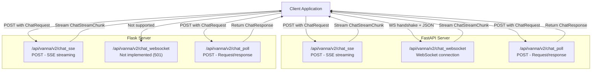
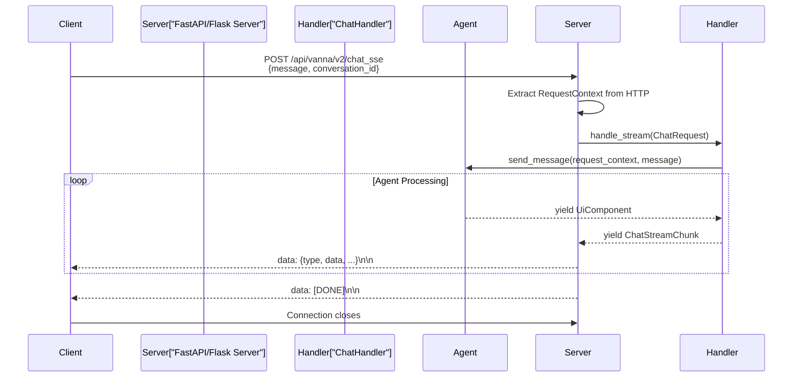
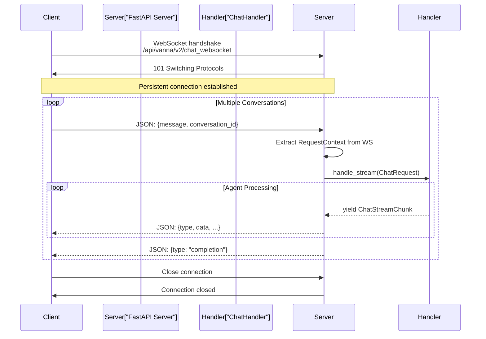
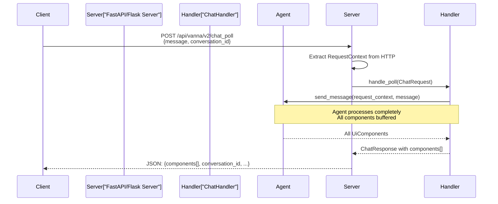
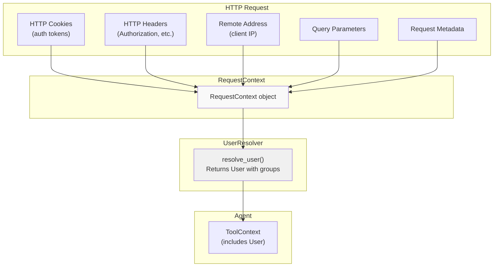
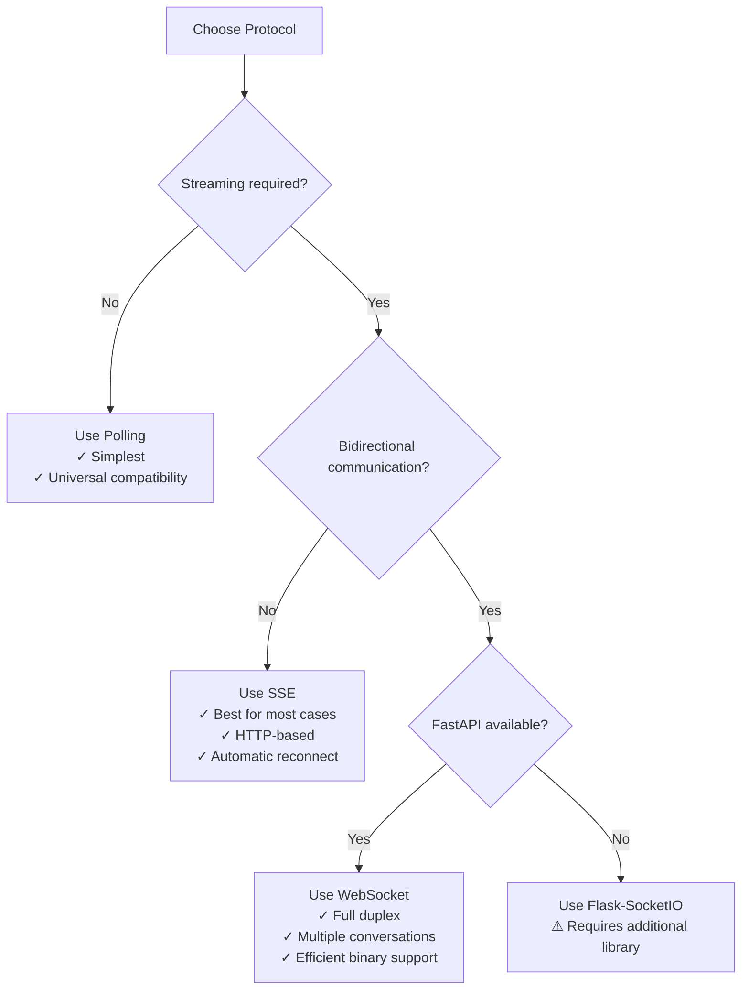

<!-- source: DeepWiki mcp.deepwiki.com · repo vanna-ai/vanna · page 8.4 Communication Protocols · fetched 2026-10-29 -->

# Communication Protocols

<details>
<summary>Relevant source files</summary>

The following files were used as context for generating this wiki page:

- [src/vanna/servers/__init__.py](src/vanna/servers/__init__.py)
- [src/vanna/servers/base/templates.py](src/vanna/servers/base/templates.py)
- [src/vanna/servers/cli/server_runner.py](src/vanna/servers/cli/server_runner.py)
- [src/vanna/servers/fastapi/routes.py](src/vanna/servers/fastapi/routes.py)
- [src/vanna/servers/flask/routes.py](src/vanna/servers/flask/routes.py)

</details>


## Purpose and Scope

This document explains the three communication protocols available for client-server communication in Vanna Agents: **Server-Sent Events (SSE)**, **WebSocket**, and **Polling**. These protocols enable streaming agent responses from the server to client applications.

For information about server setup and configuration, see [Server Architecture](#8.1), [FastAPI Server](#8.2), and [Flask Server](#8.3). For frontend integration details, see [Web Component Integration](#8.6).

## Protocol Overview

Vanna Agents supports three communication protocols, each with distinct characteristics:

| Protocol | Transport | Bidirectional | Browser Support | Use Case |
|----------|-----------|---------------|-----------------|----------|
| **SSE** | HTTP | No (server→client only) | Universal | Default choice for streaming responses |
| **WebSocket** | WebSocket | Yes (full duplex) | Universal (modern browsers) | Real-time bidirectional communication |
| **Polling** | HTTP | No (request/response) | Universal | Compatibility fallback, simple clients |

**Sources:** [src/vanna/servers/fastapi/routes.py:1-184](), [src/vanna/servers/flask/routes.py:1-138]()

### Protocol Endpoints



**Sources:** [src/vanna/servers/fastapi/routes.py:40-184](), [src/vanna/servers/flask/routes.py:40-137](), [src/vanna/servers/base/templates.py:190-213]()

## Message Format

### ChatRequest Structure

The `ChatRequest` model represents an incoming message from the client. All three protocols accept the same request structure:

```python
# Fields in ChatRequest (defined in src/vanna/servers/base/__init__.py)
{
    "message": str,              # User's message text
    "conversation_id": str,      # Optional: existing conversation ID
    "request_id": str,           # Optional: client-provided request ID
    "metadata": dict,            # Optional: custom metadata
    "request_context": RequestContext  # Injected by server from HTTP context
}
```

The `request_context` field is automatically populated by the server from HTTP headers, cookies, query parameters, and remote address. This enables user resolution and authentication.

**Sources:** [src/vanna/servers/fastapi/routes.py:41-53](), [src/vanna/servers/flask/routes.py:44-56]()

### ChatStreamChunk Structure

For SSE and WebSocket protocols, the server streams `ChatStreamChunk` objects as the agent processes the request:

```python
# Fields in ChatStreamChunk
{
    "type": str,                 # "component" | "error" | "completion"
    "data": dict,                # Component data or error details
    "conversation_id": str,      # Conversation identifier
    "request_id": str,           # Request identifier
}
```

Each chunk represents a discrete UI component or status update that can be rendered incrementally by the client.

**Sources:** [src/vanna/servers/fastapi/routes.py:54-71](), [src/vanna/servers/flask/routes.py:69-73]()

### ChatResponse Structure

For the polling protocol, the server returns a complete `ChatResponse` after processing:

```python
# Fields in ChatResponse
{
    "components": List[dict],    # All UI components generated
    "conversation_id": str,      # Conversation identifier
    "request_id": str,           # Request identifier
    "metadata": dict,            # Response metadata
}
```

**Sources:** [src/vanna/servers/fastapi/routes.py:163-183](), [src/vanna/servers/flask/routes.py:104-137]()

## Server-Sent Events (SSE)

### Protocol Mechanics

Server-Sent Events is a unidirectional HTTP-based protocol where the server pushes updates to the client over a persistent connection. It is the **recommended default protocol** for Vanna Agents due to its simplicity and universal browser support.



**Sources:** [src/vanna/servers/fastapi/routes.py:40-80](), [src/vanna/servers/flask/routes.py:40-92]()

### FastAPI Implementation

The FastAPI SSE endpoint is implemented at [src/vanna/servers/fastapi/routes.py:40-80]():

```python
@app.post("/api/vanna/v2/chat_sse")
async def chat_sse(chat_request: ChatRequest, http_request: Request) -> StreamingResponse:
    # Extract RequestContext from HTTP request
    chat_request.request_context = RequestContext(
        cookies=dict(http_request.cookies),
        headers=dict(http_request.headers),
        remote_addr=http_request.client.host if http_request.client else None,
        query_params=dict(http_request.query_params),
        metadata=chat_request.metadata,
    )
    
    async def generate() -> AsyncGenerator[str, None]:
        try:
            async for chunk in chat_handler.handle_stream(chat_request):
                chunk_json = chunk.model_dump_json()
                yield f"data: {chunk_json}\n\n"
            yield "data: [DONE]\n\n"
        except Exception as e:
            # Error chunk with conversation_id and request_id preserved
            error_data = {
                "type": "error",
                "data": {"message": str(e)},
                "conversation_id": chat_request.conversation_id or "",
                "request_id": chat_request.request_id or "",
            }
            yield f"data: {json.dumps(error_data)}\n\n"
    
    return StreamingResponse(
        generate(),
        media_type="text/event-stream",
        headers={
            "Cache-Control": "no-cache",
            "Connection": "keep-alive",
            "X-Accel-Buffering": "no",  # Disable nginx buffering
        },
    )
```

**Key Implementation Details:**
- **Async Generator**: Native `async for` loop over `chat_handler.handle_stream()`
- **SSE Format**: Each chunk prefixed with `data: ` and terminated with `\n\n`
- **Completion Signal**: `[DONE]` marker sent after final chunk
- **Error Handling**: Exceptions converted to error chunks with preserved IDs
- **Nginx Compatibility**: `X-Accel-Buffering: no` prevents reverse proxy buffering

**Sources:** [src/vanna/servers/fastapi/routes.py:40-80]()

### Flask Implementation

The Flask SSE endpoint at [src/vanna/servers/flask/routes.py:40-92]() requires manual event loop management:

```python
@app.route("/api/vanna/v2/chat_sse", methods=["POST"])
def chat_sse() -> Union[Response, tuple[Response, int]]:
    # Request parsing and RequestContext extraction similar to FastAPI
    
    def generate() -> Generator[str, None, None]:
        # Create new event loop for this request
        loop = asyncio.new_event_loop()
        asyncio.set_event_loop(loop)
        
        try:
            async def async_generate() -> AsyncGenerator[str, None]:
                async for chunk in chat_handler.handle_stream(chat_request):
                    chunk_json = chunk.model_dump_json()
                    yield f"data: {chunk_json}\n\n"
            
            gen = async_generate()
            try:
                while True:
                    chunk = loop.run_until_complete(gen.__anext__())
                    yield chunk
            except StopAsyncIteration:
                yield "data: [DONE]\n\n"
        finally:
            loop.close()
    
    return Response(
        generate(),
        mimetype="text/event-stream",
        headers={
            "Cache-Control": "no-cache",
            "Connection": "keep-alive",
            "X-Accel-Buffering": "no",
        },
    )
```

**Key Differences from FastAPI:**
- **Event Loop Management**: Flask is synchronous, requires explicit `asyncio.new_event_loop()`
- **Sync Generator**: Wraps async generator with `run_until_complete()`
- **StopAsyncIteration**: Manually caught to send completion signal
- **Cleanup**: `loop.close()` in finally block ensures resource release

**Sources:** [src/vanna/servers/flask/routes.py:40-92]()

## WebSocket Implementation

### Protocol Mechanics

WebSocket provides full-duplex communication over a single TCP connection. It enables bidirectional messaging but is currently only implemented in FastAPI.



**Sources:** [src/vanna/servers/fastapi/routes.py:82-161]()

### FastAPI WebSocket Endpoint

The WebSocket implementation at [src/vanna/servers/fastapi/routes.py:82-161]() supports multiple requests over a single connection:

```python
@app.websocket("/api/vanna/v2/chat_websocket")
async def chat_websocket(websocket: WebSocket) -> None:
    await websocket.accept()
    
    try:
        while True:
            # Receive message from client
            try:
                data = await websocket.receive_json()
                
                # Extract request context from WebSocket
                metadata = data.get("metadata", {})
                data["request_context"] = RequestContext(
                    cookies=dict(websocket.cookies),
                    headers=dict(websocket.headers),
                    remote_addr=websocket.client.host if websocket.client else None,
                    query_params=dict(websocket.query_params),
                    metadata=metadata,
                )
                
                chat_request = ChatRequest(**data)
            except Exception as e:
                await websocket.send_json({
                    "type": "error",
                    "data": {"message": f"Invalid request: {str(e)}"},
                })
                continue
            
            # Stream response
            try:
                async for chunk in chat_handler.handle_stream(chat_request):
                    await websocket.send_json(chunk.model_dump())
                
                # Send completion signal
                await websocket.send_json({
                    "type": "completion",
                    "data": {"status": "done"},
                    "conversation_id": chunk.conversation_id,
                    "request_id": chunk.request_id,
                })
            
            except Exception as e:
                await websocket.send_json({
                    "type": "error",
                    "data": {"message": str(e)},
                    "conversation_id": chat_request.conversation_id or "",
                    "request_id": chat_request.request_id or "",
                })
    
    except WebSocketDisconnect:
        pass
    except Exception as e:
        try:
            await websocket.send_json({
                "type": "error",
                "data": {"message": f"WebSocket error: {str(e)}"},
            })
        except Exception:
            pass
        finally:
            await websocket.close()
```

**Key Features:**
- **Connection Persistence**: Single connection handles multiple conversations
- **Bidirectional**: Client can send new requests while server is processing
- **Structured Messages**: JSON objects instead of SSE text format
- **Completion Marker**: Explicit `{"type": "completion"}` message
- **Graceful Disconnect**: `WebSocketDisconnect` exception handling

**Sources:** [src/vanna/servers/fastapi/routes.py:82-161]()

### Flask WebSocket Support

Flask does not support WebSocket natively. The endpoint at [src/vanna/servers/flask/routes.py:94-102]() returns HTTP 501:

```python
@app.route("/api/vanna/v2/chat_websocket")
def chat_websocket() -> tuple[Response, int]:
    return jsonify({
        "error": "WebSocket endpoint not implemented in basic Flask example",
        "suggestion": "Use Flask-SocketIO for WebSocket support",
    }), 501
```

Production Flask deployments can integrate `Flask-SocketIO` for WebSocket support.

**Sources:** [src/vanna/servers/flask/routes.py:94-102]()

## Polling Implementation

### Protocol Mechanics

Polling uses traditional HTTP request/response cycles. The client sends a request and waits for the complete response. This is the **simplest protocol** but lacks real-time streaming.



**Sources:** [src/vanna/servers/fastapi/routes.py:163-183](), [src/vanna/servers/flask/routes.py:104-137]()

### FastAPI Polling Endpoint

The FastAPI polling endpoint at [src/vanna/servers/fastapi/routes.py:163-183]():

```python
@app.post("/api/vanna/v2/chat_poll")
async def chat_poll(
    chat_request: ChatRequest, http_request: Request
) -> ChatResponse:
    # Extract request context (same as SSE)
    chat_request.request_context = RequestContext(
        cookies=dict(http_request.cookies),
        headers=dict(http_request.headers),
        remote_addr=http_request.client.host if http_request.client else None,
        query_params=dict(http_request.query_params),
        metadata=chat_request.metadata,
    )
    
    try:
        result = await chat_handler.handle_poll(chat_request)
        return result
    except Exception as e:
        raise HTTPException(status_code=500, detail=f"Chat failed: {str(e)}")
```

**Key Characteristics:**
- **Await Complete**: Single `await` for entire agent execution
- **Buffered Response**: All components returned in single `ChatResponse`
- **HTTP Exception**: Errors thrown as `HTTPException` with 500 status
- **No Streaming**: Client receives nothing until agent completes

**Sources:** [src/vanna/servers/fastapi/routes.py:163-183]()

### Flask Polling Endpoint

The Flask polling endpoint at [src/vanna/servers/flask/routes.py:104-137]() mirrors the pattern with event loop handling:

```python
@app.route("/api/vanna/v2/chat_poll", methods=["POST"])
def chat_poll() -> Union[Response, tuple[Response, int]]:
    # Request parsing and context extraction
    
    # Create event loop for async handler
    loop = asyncio.new_event_loop()
    asyncio.set_event_loop(loop)
    try:
        result = loop.run_until_complete(chat_handler.handle_poll(chat_request))
        return jsonify(result.model_dump())
    except Exception as e:
        return jsonify({"error": f"Chat failed: {str(e)}"}), 500
    finally:
        loop.close()
```

**Sources:** [src/vanna/servers/flask/routes.py:104-137]()

## RequestContext Extraction

All three protocols extract `RequestContext` from the HTTP/WebSocket transport. This context flows through the agent system for user resolution and permission checks.

### Extraction Pattern

The extraction pattern is consistent across protocols:



**Sources:** [src/vanna/servers/fastapi/routes.py:46-52](), [src/vanna/servers/flask/routes.py:49-54]()

### SSE/Polling Context Extraction

For SSE and polling endpoints (HTTP POST):

```python
# FastAPI
chat_request.request_context = RequestContext(
    cookies=dict(http_request.cookies),
    headers=dict(http_request.headers),
    remote_addr=http_request.client.host if http_request.client else None,
    query_params=dict(http_request.query_params),
    metadata=chat_request.metadata,
)

# Flask
data["request_context"] = RequestContext(
    cookies=dict(request.cookies),
    headers=dict(request.headers),
    remote_addr=request.remote_addr,
    query_params=dict(request.args),
)
```

**Sources:** [src/vanna/servers/fastapi/routes.py:46-52,169-175](), [src/vanna/servers/flask/routes.py:49-54,113-118]()

### WebSocket Context Extraction

For WebSocket connections:

```python
data["request_context"] = RequestContext(
    cookies=dict(websocket.cookies),
    headers=dict(websocket.headers),
    remote_addr=websocket.client.host if websocket.client else None,
    query_params=dict(websocket.query_params),
    metadata=metadata,
)
```

WebSocket context is extracted **per message**, not per connection, allowing different users to potentially share a connection (though not recommended for security).

**Sources:** [src/vanna/servers/fastapi/routes.py:95-101]()

## Error Handling

### Protocol-Specific Error Handling

Each protocol has distinct error handling semantics:

| Protocol | Error Format | Status Handling | Recovery |
|----------|--------------|-----------------|----------|
| **SSE** | Error chunk in stream | Continue stream | Client sees error, stream completes |
| **WebSocket** | Error message in JSON | Continue connection | Client can send new request |
| **Polling** | HTTP exception | 500 status code | Client must retry request |

**Sources:** [src/vanna/servers/fastapi/routes.py:61-70,134-144,180-183](), [src/vanna/servers/flask/routes.py:132-135]()

### SSE Error Handling

Errors in SSE are sent as error chunks within the stream:

```python
except Exception as e:
    error_data = {
        "type": "error",
        "data": {"message": str(e)},
        "conversation_id": chat_request.conversation_id or "",
        "request_id": chat_request.request_id or "",
    }
    yield f"data: {json.dumps(error_data)}\n\n"
```

The stream continues and completes normally. The client receives the error as a component and can display it in the UI.

**Sources:** [src/vanna/servers/fastapi/routes.py:61-70](), [src/vanna/servers/flask/routes.py:69-83]()

### WebSocket Error Handling

WebSocket errors are sent as JSON messages:

```python
except Exception as e:
    await websocket.send_json({
        "type": "error",
        "data": {"message": str(e)},
        "conversation_id": chat_request.conversation_id or "",
        "request_id": chat_request.request_id or "",
    })
```

The connection remains open, and the client can send a new request immediately.

**Sources:** [src/vanna/servers/fastapi/routes.py:134-144]()

### Polling Error Handling

Polling errors are raised as HTTP exceptions:

```python
# FastAPI
except Exception as e:
    raise HTTPException(status_code=500, detail=f"Chat failed: {str(e)}")

# Flask
except Exception as e:
    return jsonify({"error": f"Chat failed: {str(e)}"}), 500
```

The client receives an HTTP 500 response and must initiate a new request.

**Sources:** [src/vanna/servers/fastapi/routes.py:180-183](), [src/vanna/servers/flask/routes.py:132-135]()

## Protocol Selection Guide

### Decision Matrix



**Sources:** [src/vanna/servers/fastapi/routes.py:1-184](), [src/vanna/servers/flask/routes.py:1-138]()

### Use Case Recommendations

**Server-Sent Events (SSE):**
- ✅ **Default choice** for most applications
- ✅ Simple chat interfaces with streaming responses
- ✅ Works with all reverse proxies (nginx, CloudFlare, etc.)
- ✅ Browser automatically handles reconnection
- ❌ Unidirectional only (client cannot interrupt)

**WebSocket:**
- ✅ Real-time collaborative features
- ✅ Multiple simultaneous conversations
- ✅ Client needs to cancel/interrupt agent processing
- ✅ Binary data transfer (future use cases)
- ❌ Requires FastAPI or additional Flask libraries
- ❌ More complex reverse proxy configuration

**Polling:**
- ✅ Simple REST client libraries
- ✅ No streaming infrastructure required
- ✅ Batch processing scenarios
- ✅ Testing and debugging (easier to inspect)
- ❌ No real-time feedback
- ❌ Higher latency for user experience

**Sources:** [src/vanna/servers/base/templates.py:190-213]()

### Frontend Configuration

The `vanna-chat` web component supports all three protocols via configuration attributes:

```html
<vanna-chat
    api-base="http://localhost:8000"
    sse-endpoint="/api/vanna/v2/chat_sse"
    ws-endpoint="/api/vanna/v2/chat_websocket"
    poll-endpoint="/api/vanna/v2/chat_poll">
</vanna-chat>
```

The component will attempt protocols in this order: WebSocket → SSE → Polling, falling back automatically if a protocol is unavailable.

**Sources:** [src/vanna/servers/base/templates.py:190-195]()

---

